8

# 使用 QuickSight 工作

在上一章中，您学习了 Amazon Athena 服务，以及它如何有效地用于数据发现、数据丰富化和数据质量管道。在本章中，我们将探讨 Amazon QuickSight 服务如何帮助数据清洗管道中的数据发现和数据可视化阶段。

本章涵盖以下主题：

- *介绍 Amazon QuickSight 及其概念*
- *使用 QuickSight 进行数据发现*
- *使用 QuickSight 进行数据可视化*

## 介绍 Amazon QuickSight 及其概念

Amazon QuickSight 是一种**商业智能 (BI)** 服务，可帮助您从各种数据源（如云、本地和第三方服务）生成交互式仪表板，包含可视化图表。此外，Amazon QuickSight 还提供高级功能，如嵌入式分析和 AI 驱动的智能搜索栏。

为什么我们需要数据可视化工具？

如前所述，一图胜千言。用户通过可视化和图表比通过表格数据更容易理解数据中的模式。此外，当识别出数据洞察时，可以通过仪表板与业务团队和高管团队共享，从而更有效地传达信息。

QuickSight 是如何工作的？

QuickSight 从支持的数据源加载数据，用户可以在 QuickSight 中准备数据以满足其可视化要求。在 QuickSight 中渲染可视化之前，数据是从**快速、并行、内存计算引擎 (SPICE)** 本地检索，还是通过数据源直接查询。以下截图显示了 QuickSight 的重要组件：

**主题**
这是使业务用户能够用英语提问并通过机器学习技术理解数据中关系来获得答案的部分。这避免了希望从数据中快速获得答案的团队不得不构建报表和仪表板。

现在我们已经在高层次上了解了 QuickSight，让我们探索如何从各种数据源使用 QuickSight 执行数据发现。

## 使用 QuickSight 进行数据发现

Amazon QuickSight 支持从各种数据源加载数据，然后我们可以在 **分析** 选项卡中创建可视化以理解数据。数据发现也可以使用 Jupyter 笔记本和自定义可视化库来完成，但这可能需要在执行数据发现活动之前具备编程专业知识和复杂的设置。相比之下，业务用户可以在 QuickSight 的 **分析** 选项卡中使用可视化进行数据发现。

## QuickSight 支持的数据源和设置

QuickSight 支持各种各样的数据源。完整列表可在 https://docs.aws.amazon.com/quicksight/latest/user/supported-data-sources.html 找到。

来源可分为以下几个大类：

- **关系型数据源**：涵盖云端和本地数据源，包括流行的数据库引擎，如 MySQL、Postgres、SQL Server、Oracle、Snowflake 和 Redshift。在连接本地数据源时，您还需要创建一个 QuickSight VPC 接口，以便通过安全连接导入数据。
- **文件数据源**：从 S3 或本地网络导入文件。用户可以从本地网络上传文件以便快速分析，或提供一个符号链接文件，其中包含用于分析所需的 S3 文件位置。
- **软件即服务 (SaaS) 数据源**：支持从流行的 SaaS 数据源导入数据，如 Salesforce、Twitter、Jira 和 ServiceNow。如果您的 SaaS 提供商未在 QuickSight 数据源列表中列为受支持，您可以使用 AWS AppFlow 服务导入数据，或者您也可以选择通过在 ECS 容器、AWS Glue 或 Lambda 函数中运行的代码以编程方式将 SaaS 数据导入 Amazon S3。
- **分析数据源**：支持从分析服务导入数据，以便可以将分析引擎的数据可视化。支持从 Amazon Athena、Presto、Spark、Amazon OpenSearch、IoT Analytics 等导入数据。

请参阅 AWS 文档，了解如何为流行数据源设置连接的一些示例：https://docs.aws.amazon.com/quicksight/latest/user/connecting-to-data-examples.html。

## 使用 QuickSight 分析进行数据发现

现在，我们可以通过导入来自示例数据集的销售管道数据来查看 Amazon QuickSight 的数据发现（请参阅图 8.3 中的销售管道数据集）。您可以导入数据并为我们的分析创建一个新数据集。

导入数据后，它将显示一个空白画布，左侧显示我们数据集的字段。您可以通过在想要探索的字段上创建可视化，使用 QuickSight 随意尝试。

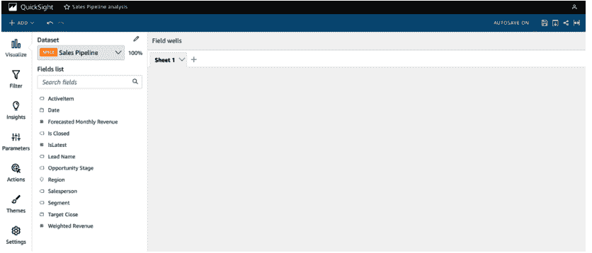

图 8.4：QuickSight – QuickSight 控制台中的分析屏幕

我们将考虑以下情况来执行数据发现活动：一位没有编码专业知识的业务用户希望在对销售预测做出决策之前探索和理解销售数据集。

使用可视化工具的优势在于，您可以在没有任何编程专业知识的情况下快速创建可视化。为了在一段时间内可视化销售数据，我们只需单击 **日期** 列，QuickSight 就会自动创建最适合该类型数据的可视化。

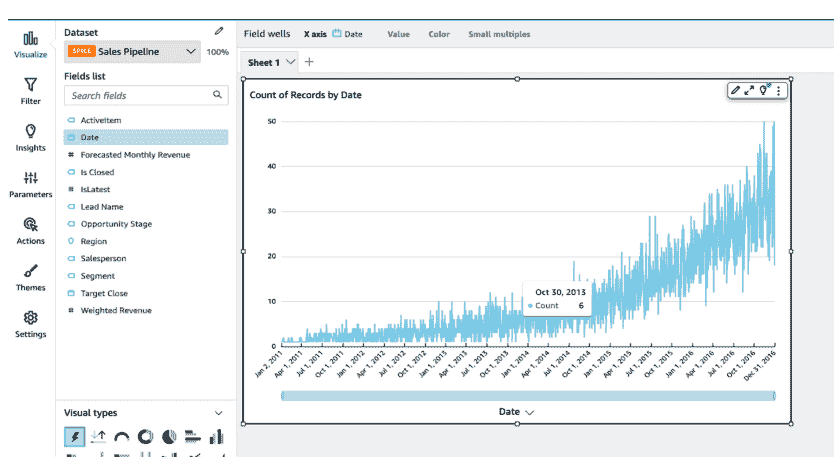

图 8.5：QuickSight – 自动图表，可自动为日期字段选择最佳可视化

正如前面的屏幕截图所示，QuickSight 为日期字段创建了一个自动图表，显示了跨日期的销售记录计数。该图表显示了销售的上升趋势，您可以悬停在图表上以查看特定时间段的记录计数，如前面的屏幕截图所示。

但我们的数据仍然跨越了巨大的时间段，我们希望将分析重点放在仅 2016 年的销售记录上，这是此示例数据集中最新的年份。我们将添加一个过滤器来仅可视化 2016 年的数据。单击左侧的过滤器图标，它将显示添加过滤器选项，如下所示：

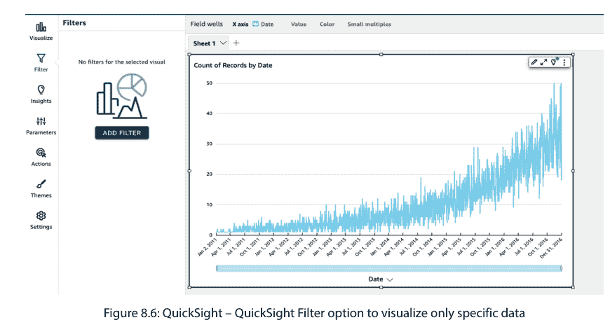

单击 **添加过滤器** 并从数据集中选择列/属性，以根据该列/属性应用过滤条件。请记住选择 **仅此可视化** 选项，以避免日期过滤器应用于我们在本表中可能创建的其他可视化。我们将为 **条件** 选择 *之后* 并将 *日期* 字段设置为 *2016/01/01*。我们也有选择滚动窗口的选项，以继续查看最新数据（仅可视化最近 90 天的数据）。选择所有选项后，单击 **应用**。现在您可以看到数据仅显示 2016 年的数据，这使得图表更易读：

图 8.7：QuickSight – 应用过滤器以在 QuickSight 控制台中可视化数据

尽管如此，数据仍跨越 365 天，我们希望查看每个月的汇总数字，以便我们能够理解来自销售数据集的销售模式。我们可以通过单击可视化并查看画布上方的字段井部分来实现这一点。请参阅以下突出显示字段井中日期字段的屏幕截图。

图 8.8：QuickSight – QuickSight 字段井演示

现在，我们可以单击字段井下的日期字段，按月汇总数据，如以下屏幕截图所示：

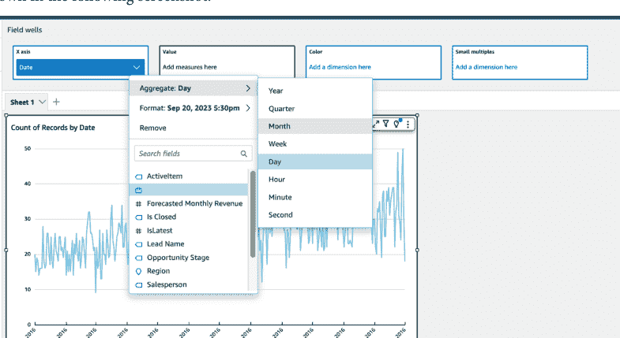

图 8.9：QuickSight – 通过字段井在可视化中汇总数据

这将按月级别显示汇总的数据，如下所示，这使得我们更容易可视化和理解 2016 年的销售趋势：

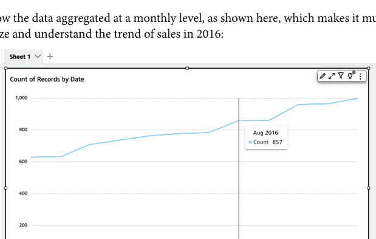

图 8.10：QuickSight – 折线图 – 按月汇总的记录计数

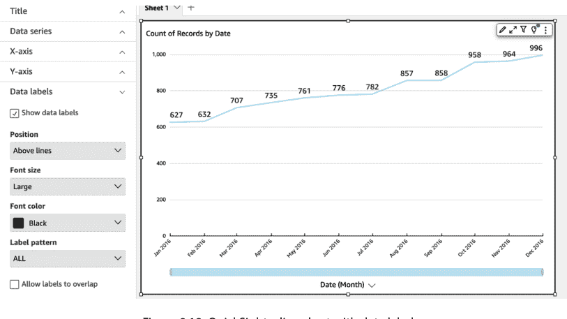

我们还可以向此可视化添加其他字段，以使用不同因素的组合分析销售数字。我们可以添加 **细分** 和 **区域** 字段，以了解是否有任何特定属性对我们的销售增长做出了重大贡献。这可以通过简单地单击 **字段** 列表下的 **细分** 字段来实现。

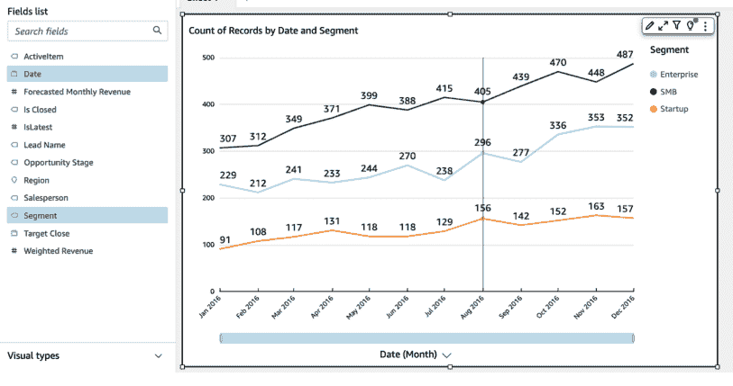

## 使用 QuickSight

我们仍然想了解是否有任何特定区域对我们的销售数字贡献更大。我们只需在字段列表下单击区域字段，QuickSight 就会在主图表内自动呈现子图/子图表，以提供区域级可视化，如下所示：

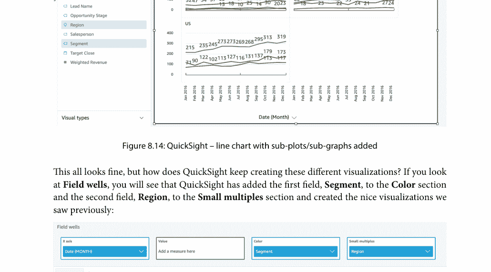

这一切看起来都不错，但 QuickSight 是如何不断创建这些不同可视化的呢？如果您查看字段井，您会看到 QuickSight 已将第一个字段细分添加到颜色部分，并将第二个字段区域添加到小型多图部分，并创建了我们之前看到的漂亮可视化：

对于好奇的人，如果我们继续通过单击添加新字段会发生什么？让我们继续单击销售人员字段。您现在会看到区域已被销售人员替换在小型多图中。QuickSight 使用机制来理解图表类型并不断添加适合当前可视化选项的属性（这里我们有折线图）。

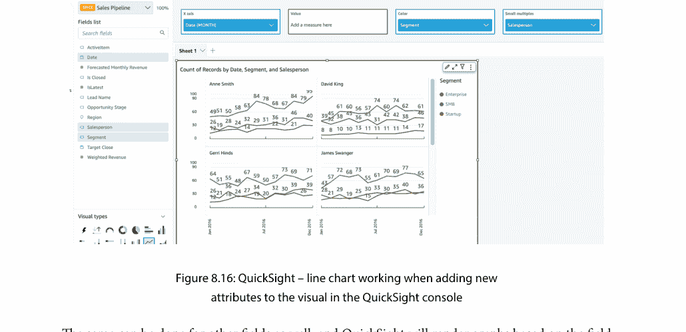

对于其他字段也可以这样做，QuickSight 将根据所选字段类型呈现图表。我们将进一步探索销售人员字段以了解该字段中的唯一值。单击当前折线图外部并从字段列表中选择销售人员。您将看到一个以销售人员姓名为内容的条形图。QuickSight 自动确定最适合用户选择的字段的可视化类型。我们可以轻松地在所示的视觉类型部分更改可视化：

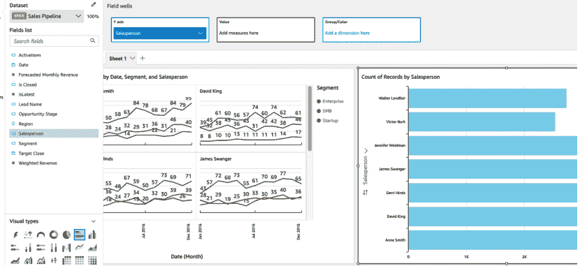

您可以继续添加更多可视化内容，并高效地探索数据。但这里的关键在于，用户无需掌握任何编程语言专业知识，就能轻松地高效探索数据。

## QuickSight Q 与基于 AI 的数据分析/发现

Amazon QuickSight Q 还通过业务语言问题提供高级数据分析或数据探索，而无需依赖 IT 团队创建的 SQL 脚本或 BI 仪表板。QuickSight Q 在后端使用自然语言处理模型来回答问题。这有助于业务团队和管理团队在没有编程语言专业知识的情况下从数据中获取答案，也无需等待 IT 团队为他们创建仪表板。

您可以向 QuickSight Q 提问，例如“谁是按销售额计算的最佳销售代理？”和“去年排名靠前的销售代理有哪些？”使用的词语可能不同，但 QuickSight Q 仍然能够理解并从数据集中提供有意义的结果。

让我们使用 QuickSight 提供的示例数据集来探索 QuickSight Q。您可以选择主题并单击 **Try Q**，使用示例数据集探索 Q。如果您想用自己的数据探索 Q 并配置 QuickSight Q，可以单击 **Start free trial**。您可以查看附加定价部分，了解使用 QuickSight Q 的成本详情。为了本书的学习目的，我们继续使用 **TRY Q** 选项。

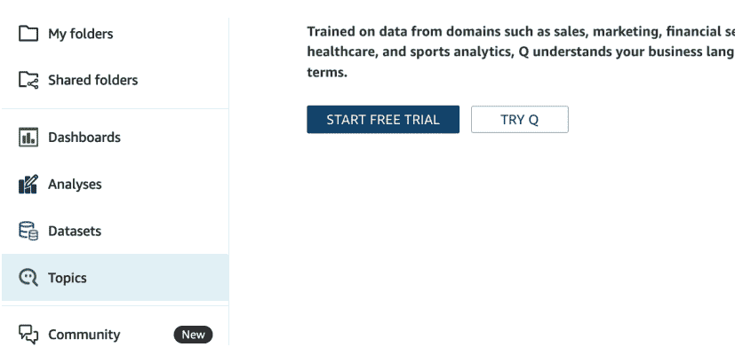

图 8.18：QuickSight – 控制台中启用了 QuickSight Q

从示例数据集中选择“Product sales”。现在您将看到一个可以通过 Q 提问的界面。它还提供了关于示例数据集的可建议问题，以及一个已经提供了良好数据可视化的仪表板。

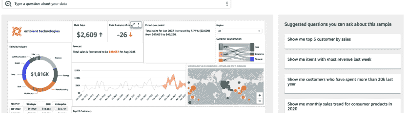

图 8.19：QuickSight – 带有搜索栏的 QuickSight Q 主屏幕

我们可以先使用 Q 建议的示例问题之一。我们可以看到输出结果以水平条形图显示，按销售额（美元）排序的前五名客户。

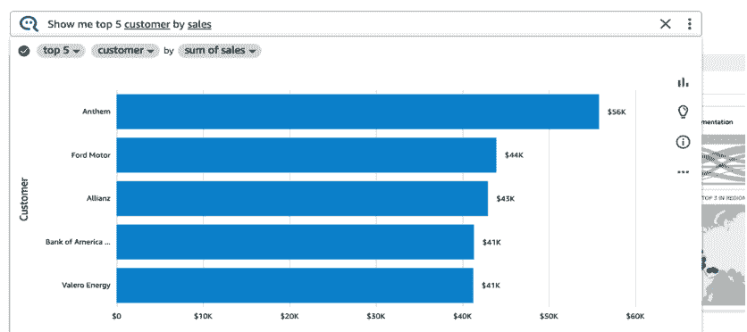

图 8.20：QuickSight – QuickSight Q 显示热门建议问题的结果

让我们通过优化问题来进一步探索，以便按区域获取销售代理。我们将看到结果现在按区域分组显示。

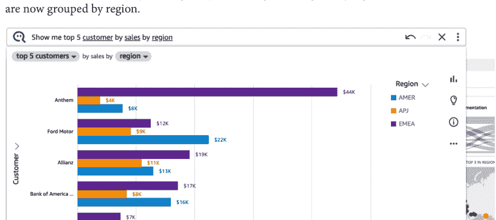

图 8.21：QuickSight Q – 按区域汇总的前五名客户销售额结果

我们可以看到，排名第一的客户来自 EMEA 地区，收入最高。我们想要识别 AMER 地区的顶级客户。让我们通过询问特定区域的顶级客户来优化问题。

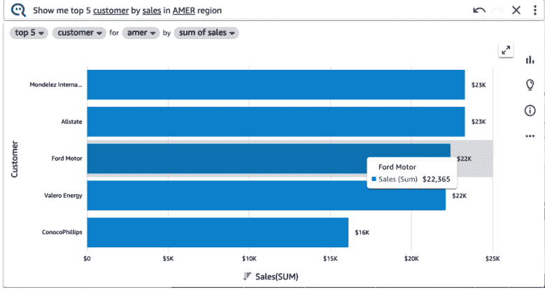

图 8.22：QuickSight Q – 仅 AMER 地区前五名客户的销售结果

现在，我们想查看最近数据中的顶级客户。业务团队希望识别过去两年数据中的顶级客户，以便为这些顶级客户提供奖励/折扣。

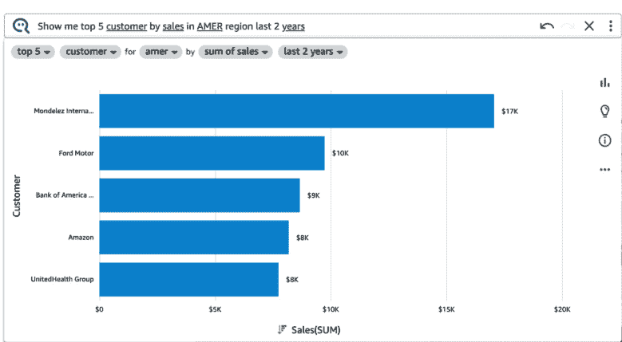

图 8.23：QuickSight Q – 仅 AMER 地区前五名客户并按最近两年筛选的销售结果

现在，您可以从这些结果中导出数据或执行进一步分析。这里的重要启示是，我们只需使用简单的英语语句即可轻松获得图表和可视化。用户无需知道如何使用任何编程语言、SQL 脚本或 BI 工具，仍然可以使用 QuickSight Q 创建可视化来探索数据。它还可以处理一些拼写错误、缩写词和同义词，并根据每个项目的业务需求提供自动完成建议。用户还可以对结果提供进一步反馈，以便 QuickSight Q 能够从用户交互中学习和改进。

我们仅从数据发现的角度使用示例数据探索了 QuickSight Q 的功能。但 QuickSight Q 还有许多高级功能，可用于在您的数据集上启用**自然语言查询（NLQ）**。我们已经了解了使用 QuickSight 探索数据的方法，接下来将了解 QuickSight 中的数据可视化选项。

## 使用 QuickSight 进行数据可视化

在本节中，我们将探索 QuickSight 中可用的不同视觉对象和选项。我们将介绍 QuickSight 中的高级概念、不同的视觉对象和功能。

### 使用 QuickSight 进行可视化和图表

在 QuickSight 中发布仪表板时，会执行以下步骤。

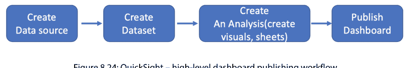

1. **创建数据源**：这是建立与数据源连接的步骤。这可以是一次性活动，并且在从该数据源创建新数据集时可以多次复用。
2. **创建数据集**：可以根据不同的分析需求，从新的数据源或现有数据集创建数据集。可以根据特定的分析需求修改、解析或丰富数据集。
3. **创建分析（创建视觉对象）**：从特定数据集创建视觉对象。在这里，仪表板作者将创建交互式视觉对象，这些视觉对象可以发布到仪表板供用户使用。
4. **发布仪表板**：从 **Analyses** 选项卡创建仪表板后，仪表板作者可以发布该仪表板，然后用户（读者或作者）即可使用。用户现在可以订阅报告、将其导出为 PDF，或者根据情况将其嵌入到他们的应用程序中。

以下是可以在 QuickSight 中使用的不同类型的可视化图表。我们不会提供 QuickSight 中所有可用视觉对象的完整列表，但会重点介绍一些常用图表以及可以使用它们的场景：

* **折线图** 有助于连续可视化随时间的变化。如果一个度量值较小而另一个度量值很大，可以使用双轴折线图，例如比较一段时间内的收入（较高的美元金额）和利润（较低的美元金额）。折线图和柱状图都有助于可视化某个维度在一段时间内的变化。

* **面积图** 类似于折线图，但线条下方的区域会被着色，以便更好地可视化。当存在多个度量且它们下方的区域不重叠时，可以使用面积图。下图显示了折线图和面积图：

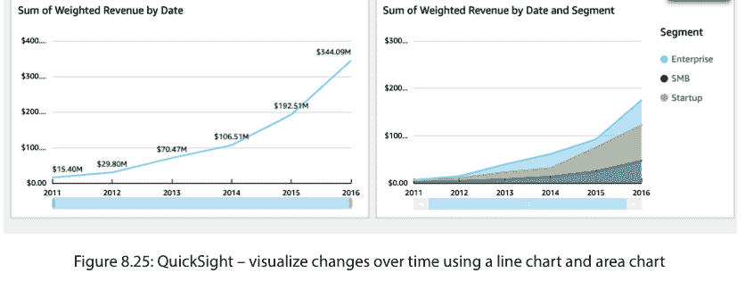

* **条形图** 有助于在维度列中存在离散值时可视化和比较维度：
    * **单度量：** 将维度添加到 *x*（垂直）或 *y* 轴（水平），图表将显示每次出现的计数
    * **多度量：** 每个维度针对一个或多个度量并排比较，例如比较每个部门的成本和利润

* **堆叠条形图** 可用于在单个度量上可视化分组在单个堆栈中的多个维度

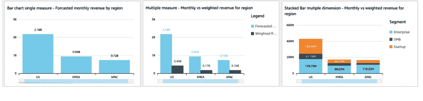

* **组合图** 可用于显示条形图和折线图之间存在关系的情况。下图显示了在折线图上显示预测收入、在柱状图上显示实际收入的可视化。

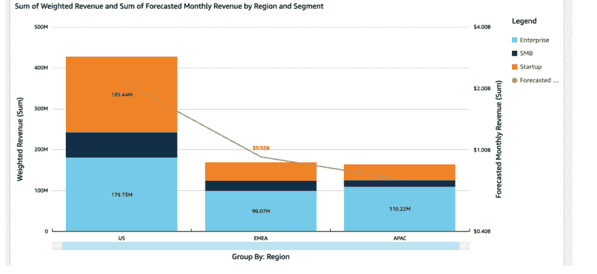

图 8.27：QuickSight – 使用组合图进行可视化

* **饼图** 让我们可视化每个值在总份额中的贡献。每个扇区/饼块的大小代表该值在整体份额中所占的百分比。任何可以分解为不同类别的数据都可以使用此图表，但尽量将图表中的数据类别数量限制在五个以下，否则可能难以阅读和比较饼图中的各个扇区。

* 在**环形图**中，除了显示每个值的贡献外，整个值还会显示在中心位置，以便参考。在下图中，您可以在饼图和环形图中看到每个区域对收入的贡献。

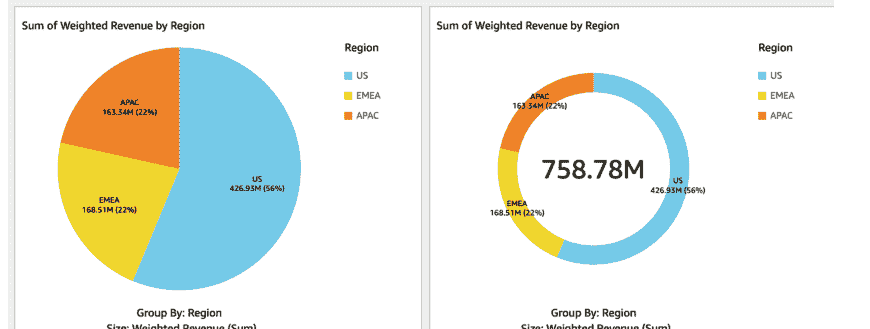

图 8.28：QuickSight – 使用饼图和环形图进行可视化

- **仪表盘图（gauge chart）** 帮助我们理解某个指标相对于总体目标的进展。在下面的仪表盘图中，我们可以看到实际收入与预测收入的对比。它清晰地表明当前实际收入仅为预测收入的19.84%。此图表可用于定期跟踪某个指标相对于目标的进展。

- **KPI图（KPI chart）** 通过将关键绩效指标与目标值进行对比来展示这些指标。我们也可以用它来定期比较指标的进展，如下所示。*图8.29*右侧显示的KPI图表明，加权收入在**2016年第三季度**和**2016年第四季度**之间增长了8.82%。

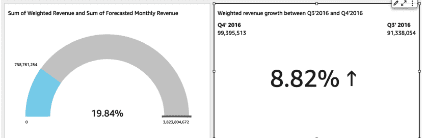

## 图8.29：QuickSight – 仪表盘图和KPI图

- **热力图（heat map）** 有助于识别两个不同维度属性之间的数据离群值和数据分布。数据以表格格式显示，每个方框根据为热力图选择的指标列进行颜色编码。指标值越高，方框颜色越深；指标值越低，颜色越浅。在下图中，我们可以立即看到EMEA企业客户应获得更多关注，因为该细分市场/地区的收入与其他地区相比更低（尽管这仍然是EMEA地区内收入最高的细分市场）。

## 图8.30：QuickSight – 热力图

- **箱线图（box/whisker plot）** 有助于可视化数据沿轴的分布。在下图中，您可以看到不同业务细分市场的收入分布。这帮助我们看出初创企业细分市场具有收入潜力。

## 图8.31：QuickSight – 箱线图/须状图

- **桑基图（sankey diagram）** 展示了数据从一个维度到另一个维度的流动。下图展示了各地区与业务细分市场之间的收入分布，连接路径的大小提供了该地区该业务细分市场产生的收入规模的概念。

各地区和业务细分市场的加权收入总和

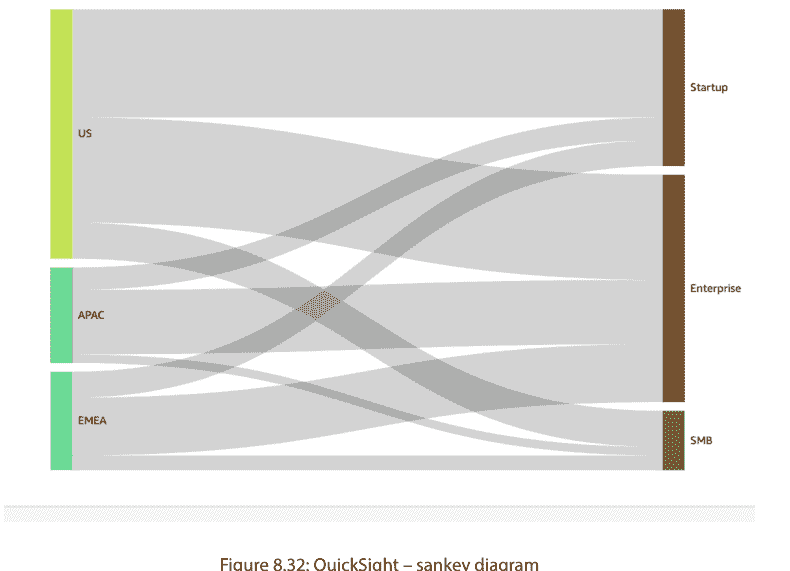

- **地图图（map charts）** 让我们使用地理字段（邮政编码、州、县等）在地图上可视化某个指标。
- 在QuickSight中可以创建两种类型的地图图：

  - **点地图（point maps）** 以不同大小的点显示指标——较大的点表示较高的值，较小的点表示较低的值。
  - **填充地图（filled maps）** 以不同深浅的颜色显示指标——较深的阴影表示较高的值，较浅的阴影表示较低的值。

下图显示了一个点地图，展示了来自不同医院的加权收入。每个地区以不同颜色标识，便于业务团队分析。

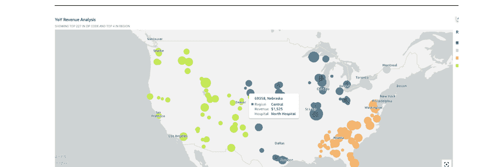

下图显示了一个填充地图，每个州根据该州内医院的收入进行着色。

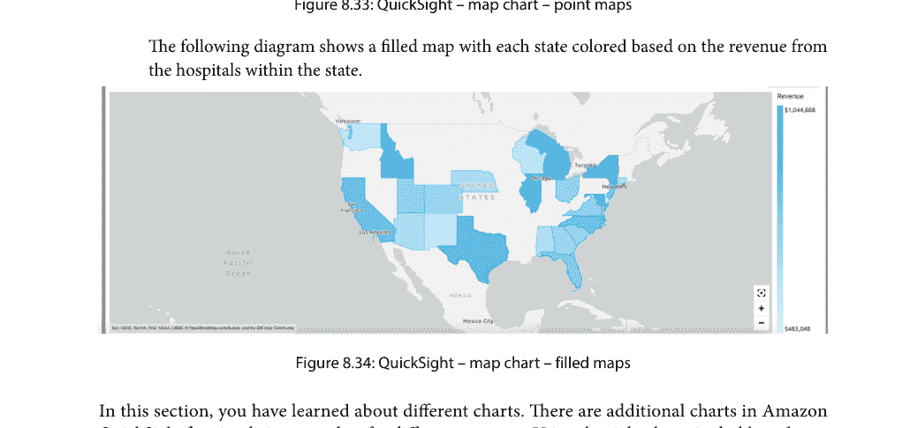

在本节中，您了解了不同的图表。Amazon QuickSight中还有其他图表，可用于针对不同用例可视化数据。在仪表板中正确使用图表可以帮助用户更有效地向更广泛的受众传达他们的故事。在下一节中，我们将学习嵌入式分析。

## 嵌入式分析

本节内容很短，旨在向您介绍将仪表板嵌入应用程序的概念。组织可以将仪表板嵌入到其应用程序或Web门户中，这样用户无需登录AWS控制台即可访问QuickSight，从而探索QuickSight仪表板。这使团队的生活更简单，他们现在可以在Web门户上发布高级仪表板和可视化内容，并增强用户交互。QuickSight支持三种不同方式的嵌入：

- **QuickSight控制台**：将整个QA控制台嵌入到Web门户中，以便用户可以创作和发布仪表板。团队可以使用此功能将QuickSight创作体验嵌入到其Web门户中，并为员工提供额外功能。
- **仪表板和可视化**：嵌入在QuickSight控制台中开发的仪表板，用户只需查看仪表板并与之交互。希望在其Web应用程序中向客户发布高级仪表板的团队可以使用此功能。
- **QuickSight Q**：将QuickSight Q搜索栏嵌入到Web应用程序中。

QuickSight支持一键式仪表板嵌入。相关步骤记录在此博客文章中：https://docs.aws.amazon.com/quicksight/latest/user/1-click-embedding.html。

要启用一键式公共嵌入，您需要将QuickSight订阅更改为基于会话的模型。

## 总结

在本章中，我们探索了Amazon QuickSight服务及其如何帮助完成数据整理管道的各个阶段。我们学习了各种AWS服务及其如何融入数据整理管道，并能够高效地执行某些数据整理活动。

在下一章中，我们将学习数据整理管道的实际用例。
