## 第4部分：
高级数据操作
与机器学习数据优化

在本部分中，我们将探索使用AWS Data Wrangler和AWS SageMaker Data Wrangler进行高级数据操作和机器学习数据优化。第9章展示了AWS Data Wrangler与pandas的强大组合，指导您完成高级数据转换和分析。第10章深入探讨了使用AWS SageMaker Data Wrangler进行机器学习数据优化，帮助您为机器学习项目预处理和准备数据，以最大化模型性能和准确性。

本部分包含以下章节：

- 第9章，使用AWS SDK for Pandas构建端到端数据整理管道
- 第10章，使用SageMaker Data Wrangler进行机器学习数据处理

- 使用Pandas重构数据
- 数据清洗
- 数据丰富
- 数据质量验证
- 数据可视化

让我们开始吧！

## sportstickets.com解决方案演练

我们将通过一个虚构的示例sportstickets.com进行演练，这是一家体育票务特许经营公司。该公司管理不同的体育赛事，并以折扣价出售体育赛事门票。sportsticket.com的业务分析师想要建立一个端到端的数据整理管道，以对数据执行门票销售分析。

我们将探索数据整理管道的不同阶段，并解释Pandas库如何帮助有效且高效地执行这些操作。


## 图9.1：数据整理管道的不同阶段

## 数据摄取的前提条件

为了对上述用例执行数据整理活动，我们首先需要将数据摄取到数据湖中。为了将本地数据库中的数据摄取到云环境中，我们有以下选项：

1. 使用SQL查询从服务（如AWS Glue或部署在Elastic Kubernetes Service（EKS）/Elastic Container Service（ECS）上的容器）中以编程方式提取数据。

这种方法的优点如下：

- 只要存在用于连接数据库的包/库，它就可以与大多数数据库配合使用
- 除了需要具有所需权限的登录凭据来提取数据外，不需要任何额外设置
- 这种方法直接从表中读取数据，因此服务器无需额外负载来创建数据库日志文件，这些文件是**变更数据捕获（CDC）** 流式传输工具所需的

这种方法的局限性如下：

- 数据是使用SQL查询提取的，需要一个额外的书签列来增量提取后续运行的数据。如果有一个时间戳列表示记录上次更新的时间，我们可以使用它来仅提取新数据。
- 管理书签列状态的额外负担也落在用户身上。因此，用户必须将元数据存储在如DynamoDB之类的数据库中，以从上次成功的数据提取中获取值。
- 已删除的记录无法使用书签列提取，需要额外设置，这会在数据库中消耗大量资源。
- 使用这种方法也无法捕获DDL更改。
- 由于提取过程是使用SQL脚本完成的，因此它会与用户查询竞争数据库资源，并可能影响数据库性能。

2. 使用AWS **数据库迁移服务（AWS DMS）**、Debezium等工具从数据库变更日志中提取数据。

这种方法的优点如下：

- 它可以使用数据库日志捕获几乎所有数据更改，包括记录删除和DDL更改
- 更改在数据库日志中捕获，不会与用户查询竞争数据库资源来提取数据
- 更改会增量捕获，并通过工具立即流式传输

这种方法的局限性如下：

- 用户将依赖工具及其支持的数据库才能使此方法正常工作。从数据库CDC流式传输解决方案迁移到另一种方法将需要大量工作。
- 对于定期的数据导出，持续流式传输不是一种经济高效的方法。但是，使用AWS DMS，您可以在计划的基础上仅加载增量数据，而无需持续运行DMS实例，从而节省成本，如这篇博客文章所述：https://aws.amazon.com/blogs/database/build-an-incremental-data-load-solution-using-aws-dms-checkpoints-and-database-logs/。
- 它需要额外的权限来读取数据库日志，并且数据库必须启用日志捕获并保留足够长的时间。如果日志在数据库CDC工具捕获之前被删除，将导致数据丢失，用户必须重新捕获所有数据才能继续。


- 数据库需要为每个事务捕获完整日志，因为某些CDC工具要求这样做，这会产生少量开销。

## 何时使用它们？

在大多数情况下，使用AWS DMS等CDC工具会更快速、更简单地完成设置。如果您是全新开始，请根据您的生态系统选择基于AWS DMS/Debezium的方案。还有其他来自不同厂商的CDC捕获工具可供进一步探索。如果CDC捕获工具不支持您的源数据库类型，或者您需要工具不支持的配置（例如，从副本数据库捕获更改），您可以使用编程方式提取数据。

在本示例中，我们将使用编程式提取来展示AWS SDK for Pandas (awswrangler)在数据提取过程中的能力。

## 向源数据库加载示例数据

我们将使用Amazon RDS MySQL作为源数据库，但这种方法也可以扩展到本地数据库。

我们将按照https://aws.amazon.com/getting-started/hands-on/create-mysql-db/ 中提到的步骤创建一个RDS MySQL数据库。请注意，在上述方法中，数据库是创建为公共访问的。请限制附加到数据库的安全组的访问权限，使其仅允许来自客户机IP地址的流量。在生产部署中，数据库应部署在私有子网中，并通过具有额外设置的更安全的机制进行访问。

在这里，我们将使用Amazon EC2实例连接RDS MySQL数据库，并从aws-database-migration-samples Git存储库（https://github.com/aws-samples/aws-database-migration-samples）加载示例数据库。我们将使用票务数据库，并按以下步骤将其加载到RDS MySQL中：

1. 登录EC2实例并安装MySQL客户端和git。执行以下命令在EC2上安装git和MySQL：

```bash
sudo yum update # as needed
sudo yum install git
git version
sudo yum install mysql
mysql --version
```

以下截图显示了在EC2实例上成功安装git和MySQL：

```
Dependency Installed:
git-core.x86_64 0:2.37.1-1.amzn2.0.1 git-core-doc.noarch 0:2.37.1-1.amzn2.0
perl-Error.noarch 1:0.17020-2.amzn2 perl-Git.noarch 0:2.37.1-1.amzn2.0.1
perl-TermReadKey.x86_64 0:2.30-20.amzn2.0.2
Complete!
[ec2-user@ip-10-0-30-62 ~]$ git version
git version 2.37.1
[ec2-user@ip-10-0-30-62 ~]$ sudo yum install mysql
Loaded plugins: extras_suggestions, langpacks, priorities, update-motd
Resolving Dependencies
--> Running transaction check
```

图 9.2：在EC2实例上安装MySQL

2. 连接到`migration-samples` Git存储库并克隆代码。在EC2实例上执行以下命令：

```
git clone https://github.com/aws-samples/aws-database-migration-samples.git
cd aws-database-migration-samples/mysql/sampledb/v1/
```

您可以列出克隆文件夹下MySQL相关的文件，以确保代码已成功复制。

```
[ec2-user@ip-10-0-30-62 ~]$ git clone https://github.com/aws-samples/aws-database-migration-samples
Cloning into 'aws-database-migration-samples'...
remote: Enumerating objects: 1015, done.
remote: Total 1015 (delta 0), reused 0 (delta 0), pack-reused 1015
Receiving objects: 100% (1015/1015), 2.58 MiB | 13.63 MiB/s, done.
Resolving deltas: 100% (449/449), done.
[ec2-user@ip-10-0-30-62 ~]$ ls
aws-database-migration-samples
[ec2-user@ip-10-0-30-62 ~]$ cd aws-database-migration-samples/mysql/sampledb/v1/
[ec2-user@ip-10-0-30-62 v1]$ ls
data install-rds.sql README.md remove-sampledb.sql schema user
[ec2-user@ip-10-0-30-62 v1]$
```

图 9.3：将示例数据从GitHub复制到EC2实例

3. 连接MySQL数据库并确保连接正常。使用以下命令连接MySQL数据库，并在提示时提供密码：

```
mysql -h <<database endpoint>> -u admin -P 3306 -p
```

您可以从RDS控制台的**Connectivity & Security**选项卡中获取数据库端点。

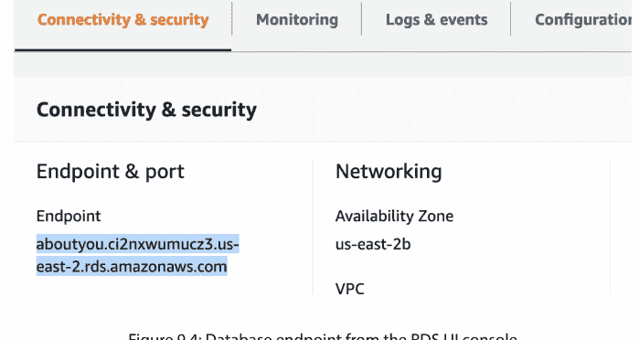

4. 将示例数据库加载到我们的源数据库中。执行GitHub存储库中的加载脚本，它将把票务数据库加载到MySQL实例中。加载示例数据库需要一些时间。此步骤必须在`aws-database-migration-samples/mysql/sampledb/v1/`文件夹下执行，我们在连接MySQL之前已经导航到了该文件夹。在MySQL中执行以下命令：

```
source install-rds.sql
```

加载完成后，您可以通过执行以下命令进行验证：

```
show databases; -- Display available databases, verify dms_sample is present in the list
use dms_sample;
show tables;
```

## 从源本地数据库迁移数据

如前所述，我们将使用awswrangler连接源数据库，并使用Glue Python shell作业提取数据：

1. 在Glue控制台中创建一个Python shell作业。选择**Python Shell script editor**，如下所示：

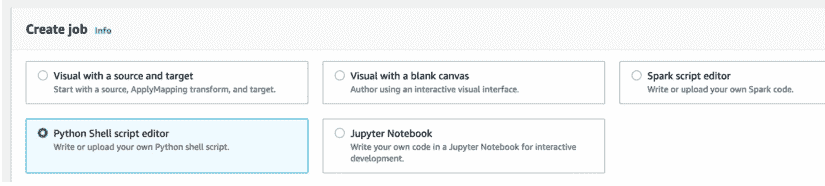

图 9.5：创建Glue Python shell作业

2. 将以下代码输入脚本编辑器并保存作业：

```
import sys
import awswrangler as wr
import time
import csv
#Connect to MySQL using Glue connections
con=wr.mysql.connect("wranglerbook")
schema="dms_sample"
table_list=["mlb_data","name_data","nfl_data",
"nfl_stadium_data","person","player","seat","seat_type",
"sport_division","sport_league","sport_location","sport_team",
"sport_type","sporting_event","ticket_purchase_hist"]
for table in table_list:
    #Read data from MySQL tables into Pandas dataframe
    start_time = time.time()
    output_data=wr.mysql.read_sql_query("SELECT * FROM "+schema+"."+ table +";", con=con)

    #Print one row for debugging
    #print(output_data.loc[1,:])
    #output_data['Name'] = output_data['Name'].apply
    #(lambda x: '"' + str(x) + '"')

    if len(output_data.axes[0])>0:
        #Write Pandas dataframe into S3
        wr.s3.to_csv(
            df=output_data,
            path="s3://wranglerbook/awswrangler/"+table+"/",
            dataset=True,
            index=False,
            mode="overwrite",
            header=True,
```

可以看到，person表加载700万条记录几乎花了4分钟，而seat表加载用了1分钟。其余表的加载时间几乎只有一秒。整个作业耗时5分31秒，我们可以理解这些表是按顺序加载的。如果通过多个线程执行作业，可以加快速度，但这将消耗更多内存，如果数据量很大，会导致内存不足错误。

## 挑战

我们已经从MySQL数据库中完成了全量数据提取，那么您如何提取仅需要增量数据以用于后续加载？

## 提示

您必须修改提取脚本，以查询源表，仅在特定时间戳列之后提取数据。如果源数据库中当前没有这样的列，我们有两个选项：

- 选项 1：修改源数据库表，添加一个时间戳列，以便您可以增量提取数据。请记住，这种方法仍然无法帮助您获取删除的记录和DDL更改。
- 选项 2：使用AWS DMS或其他流式处理解决方案从源数据库进行CDC。

尽管我们已经展示了如何使用Glue Python shell作业和AWS SDK for Pandas以编程方式提取数据，但我们建议使用AWS DMS设置从数据库进行数据摄取，它具有多个优势并且性能更好。如果我们试图加载数据量较大的表，Glue作业将因内存不足异常而失败。您可以通过添加数据量更大的sporting_event_ticket表来尝试这一点。此外，在本章的剩余部分，我们将探索MySQL数据库中的所有表，我们已经使用AWS DMS将数据迁移到S3原始层以供探索。您可以按照此博文使用DMS迁移数据 - https://aws.amazon.com/blogs/database/replicate-data-from-amazon-aurora-to-amazon-s3-with-aws-database-migration-service/。

现在，我们将通过数据整理活动的各个阶段（如数据发现、数据结构化、数据清洗、数据丰富、数据质量验证和数据可视化）来探索源数据。让我们从下一节的数据发现开始。

## 数据发现

数据发现是数据整理管道中的一个重要阶段，因为它帮助用户理解数据并指导后续步骤应如何进行。例如，如果用户查看数据并确定某些列包含缺失值，则数据清洗应修复这些值，缺失的列可以通过与其他数据源连接或从原始数据中推导出来来添加。本质上，此步骤将让用户了解数据集的完整性、有用性和相关性。


## 使用 AWS SDK for Pandas 构建端到端数据整理流水线

有多种方式进行数据发现，包括在本地机器上下载小文件，以及使用 Excel 文件来探索数据。我们将探讨如何探索存储在数据湖中的原始数据。在数据发现阶段执行的一些常见步骤如下：

- 识别源数据结构/格式及其相关属性
- 可视化数据集上的数据分布
- 验证数据集中是否存在有用的数据值
- 可视化探索数据集以理解数据模式
- 对数据集进行切片和分割，并探索满足特定业务需求的数据

您的特定项目可能包含额外的数据发现活动，您仍然可以使用以下各节中提到的选项来执行这些活动。

## 使用 S3 Select 命令探索数据

S3 Select 功能（https://docs.aws.amazon.com/AmazonS3/latest/userguide/selecting-content-from-objects.html）有助于通过 AWS 控制台界面和代码探索较小的数据集，以查看示例记录并运行一些探索性 SQL 查询。预计该功能仅支持小于 128 MB 卷的文件，并且可以提取最多 40 MB 的数据，但围绕行组和记录大小的限制仍然存在。对于受这些限制阻碍的数据集分析或发现，建议使用其他形式的分析。

> 128 MB 和 40 MB 的文件大小/检索数据限制适用于控制台和 S3 Select，当以编程方式使用时，S3 Select 没有此限制。然而，无论通过哪种访问机制（通过控制台或编程方式），行组和记录大小的限制仍然适用。

我们将使用 S3 Select 命令探索 S3 原始存储桶中可用的数据，步骤如下所示：

1. 导航到源文件所在的 S3 路径进行探索。在我们的示例中，让我们选取一个表进行探索，即 nfl_data：

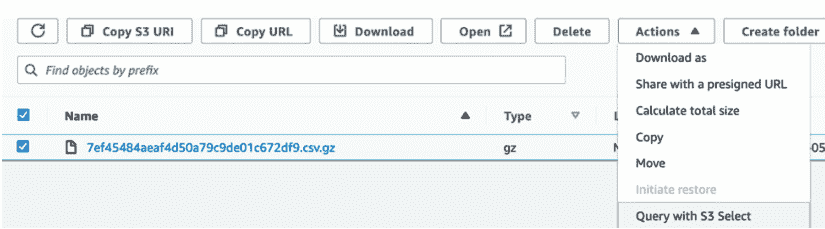

图 9.7：在 AWS 控制台中使用 S3 Select 查询 S3 文件

2. 在 AWS 控制台中，验证输入和输出设置是否正确。在大多数用例中，这些设置会自动填充并正确推断，但您也可以针对我们的用例进行验证。我们将输入数据存储在 GZIP 压缩的逗号分隔值 (CSV) 文件格式中。

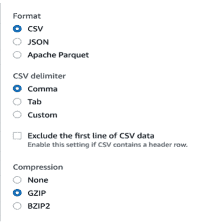

图 9.8：AWS 控制台中的 S3 Select 配置

如果您运行输出格式为 CSV 的查询，您可以在格式化视图中看到表头已正确填充。但是，列和字段对齐存在问题，我们将在接下来的步骤中进一步探讨此问题。查看列，从 name 开始：

| position | player_number | name | status | stat1 | stat1_val | stat2 | stat2_val | stat3 | stat3_val | stat4 | stat4_val | team |
| OT | 66 | Graf\ | Kevin | ACT | G | -- | GS | -- |  |  |  | IND |
| FS | 32 | Green\ | T.J. | ACT | TCKL | -- | SCK | -- | FF | -- | INT | -- | IND |
| FS | 27 | Guy\ | Winston | ACT | TCKL | 6 | SCK | 0 | FF | 0 | INT | -- | IND |
| OT | 73 | Haeg\ | Joe | ACT | G | -- | GS | -- |  |  |  | IND |

图 9.9：使用 S3 Select 探索 CSV 文件数据

3. 如果您希望以 **JavaScript 对象表示法 (JSON)** 格式查看输出，请在输入设置中勾选 **排除 CSV 数据的第一行**，并在输出设置中选择 **JSON**。如果没有此 JSON 设置，输出将不会将第一行解释为列标题。

```
{
  "position": "OT",
  "player_number": "66",
  "name": "Graf\\",
  "status": " Kevin",
  "stat1": "ACT",
  "stat1_val": "G",
  "stat2": "-",
  "stat2_val": "GS",
  "stat3": "-",
  "stat3_val": "",
  "stat4": "",
  "stat4_val": "",
  "team": "",
  "": "IND"
}
```

图 9.10：作为 JSON 格式输出探索的示例记录

现在，如您从数据中看到的，我们的 CSV 导出文件包含带有逗号的列。**Name** 字段是名和姓的组合。您可以从源（MySQL CLI）或 Glue 作业日志中参考原始数据：

| Position | FS |
|---|---|
| player_number | 32 |
| Name | Green, T.J. |
| status | ACT |

图 9.11：从 Glue 控制台输出看到的示例记录

现在我们已经发现，我们的作业在写入 CSV 输出时未用封装字符包裹字段，这导致字段错位。然而，我们不能使用 awswrangler 代码为这些列添加封装符，因为 AWS SDK 的 GitHub 网站上的文档指出，如果我们在同一代码中使用 Glue 目录同步（我们正在这样做以在 Athena 中查询最终数据），pandas 关键字参数将被忽略。

4. 如果传递了 table 和 database 参数，**pandas_kwargs** 将因 Athena/Glue Catalog 所需的限制性引号、**date_format**、**escapechar** 和编码而被忽略。

AWS SDK for Pandas 会将 escapechar 设置为 \ 以启用与 Athena 的配合使用。您可以从以下代码片段中看到，当我们需要同 Glue Catalog 集成时，pandas 的额外关键字参数被忽略，并且默认设置了 escapechar。

```
if database and table:
    quoting: Optional[int] = csv.QUOTE_NONE
    escapechar: Optional[str] = "\\"
    header: Union[bool, List[str]] = pandas_kwargs.get("header", False)
    date_format: Optional[str] = "%Y-%m-%d %H:%M:%S.%f"
    pd_kwargs: Dict[str, Any] = {}
```

图 9.12：显示 escapechar 配置的 AWS SDK for Pandas 代码片段

5. 让我们重新执行 Glue 作业以填充数据，手动用双引号包裹列。添加以下代码片段以在将其写入为 CSV 文件之前用双引号包裹 Name 列。取消代码片段中这一行的注释并重新运行作业：

```
output_data['Name'] = output_data['Name'].apply(lambda x: '""' + str(x) + '""')
```

图 9.13：包含转义字符双引号包裹的列的输出文件

即使我们修复了一个文件，还有其他具有类似问题的文件，转义字符的存在会导致该列上的数据过滤器无法正常工作。因此，根据我们的初步分析，将原始文件存储为 JSON 格式以便进一步分析是合适的。

6. 更改 Glue 控制台中的源代码，将数据存储为 JSON 文件格式。克隆当前的 Glue 作业并更改脚本如下所示：

```
import sys
import awswrangler as wr
import time
import csv
#Connect to MySQL using Glue connections
con=wr.mysql.connect("wranglerbook")
schema="dms_sample"
#table_list=["mlb data","name data", "nfl data", "nfl stadium data","person", "player", "seat", "seat_type", "sport division", "sport_league", "sport_location", "sport_team", "sporting event", "ticket_purchase_hist"]
table_list=["nfl_data"]
```

| position | name | status | stat1 | stat1_val | stat2 | stat2_val | stat3 | stat3_val | stat4 | stat4_val | team |
|----------|------|--------|-------|-----------|------|-----------|------|-----------|------|-----------|------|
| FS | 66 | Graf, Kevin | ACT | G | -- | GS | -- | FF | -- | INT | -- |
| FS | 27 | Guy, Windem | ACT | TCKL | 6 | SCK | 0 | FF | 0 | INT | -- |
| OT | 75 | Haeg, Joe | ACT | G | -- | GS | -- | -- | -- | -- | -- |

```
for table in table_list:
    #Read data from MySQL tables into Pandas dataframe
    start_time = time.time()
    output_data=wr.mysql_read_sql_query("SELECT * FROM "
            +schema+"."+ table +";", con=con)
    
    #Print one row for debugging
    #print(output_data.loc[1,:])
    if len(output_data.axes[0])>0:
        #Write Pandas dataframe into S3
        wr.s3.to_json(
                df=output_data,       path="s3://wranglerbook/
                awswrangler/"+table+"/",
                dataset=True,
                orient='records',
                lines=True,
                mode="overwrite",
                database="mysql_extract",
                table="mysql_"+table)
        end_time=time.time()
        print(f"Completed the data extraction for table -
                {table} ,Loaded record count - {len(output_data.axes[0])} and
                took {round(end_time-start_time,2)} seconds")
    else:
        print(f"Data load not performed for table {table} as it
                is empty.")
print("Completed the data extraction process")
con.close()
```

如果您注意到差异，我们只是将 `to_csv` 函数更改为 `to_json`。这说明了将文件保存到 S3 的便捷程度。

现在您可以看到数据正确填充为 JSON 文件，并可以从 S3 Select 验证这一点，如下所示。


### Pandas 中的数据探索

一旦数据被加载到 pandas DataFrame 中，你就可以使用 pandas 的数据探索功能来分析数据。根据数据类型和业务用途，可以执行不同类型的探索。我们将在本节中介绍一些高层级的数据探索活动，并使用 `info` 函数来识别数据结构，包括记录数、列数、列类型、内存使用情况等。这会让您对数据及其结构有个概念。

```python
output_data.info()

<class 'pandas.core.frame.DataFrame'>
RangeIndex: 2928 entries, 0 to 2927
Data columns (total 13 columns):
#     Column          Non-Null Count  Dtype
---     ------          --------------  -----
0      Position        2928 non-null   string
1      player_number   2916 non-null   Int64
2      Name            2928 non-null   string
3      status          2928 non-null   string
4      stat1           2928 non-null   string
5      stat1_val       2928 non-null   string
6      stat2           2928 non-null   string
7      stat2_val       2928 non-null   string
8      stat3           2390 non-null   string
9      stat3_val       2390 non-null   string
10     stat4           2390 non-null   string
11     stat4_val       2390 non-null   string
12     team            2928 non-null   string
dtypes: Int64(1), string(12)
memory usage: 300.4 KB
```


如果你只关注 DataFrame 中的记录数和列数，可以使用 `shape` 函数。该函数的用法是 `dataframe.shape`。

假设你只想分析某些列，而 DataFrame 又有很多列；你可以按名称选择列，如下所示。你也可以使用 `loc` 函数选择从特定索引获取记录。

```python
# Explore only first specific columns from specific records, if you iloc, need to pass row indexes
output_data.loc[1:5,["player_number","Name"]]
```

| | player_number | Name |
|---|---|---|
| 1 | 32 | Green, T.J. |
| 2 | 27 | Guy, Winston |
| 3 | 73 | Haeg, Joe |
| 4 | 72 | Harrison, Jonathan |
| 5 | 38 | Hightower, Lee |

图9.17：使用 Pandas DataFrame 的 info 函数探索所有列

如果你想关注满足选择条件的特定记录，可以按照下面所示进行过滤。在下面的截图中，我们将仅过滤来自印第安纳波利斯（IND）球队的跑卫（RB）记录：

```python
# filter records for certain values
output_data[(output_data["team"]=="IND") & (output_data["Position"]=="RB")]
```

| | Position | player_number | Name | status | stat1 | stat1_val | stat2 | stat2_val | stat3 | stat3_val | stat4 | stat4_val | team |
|---|---|---|---|---|---|---|---|---|---|---|---|---|---|
| 38 | RB | 35 | Price, Chase | ACT | CAR | -- | YDS | -- | AVG | -- | TDS | -- | IND |
| 57 | RB | 28 | Todman, Jordan | ACT | CAR | 4 | YDS | 22 | AVG | 5.5 | TDS | 0 | IND |
| 59 | RB | 33 | Turbin, Robert | ACT | CAR | 50 | YDS | 199 | AVG | 4 | TDS | 1 | IND |
| 67 | RB | 40 | Williams, Trey | ACT | CAR | 2 | YDS | 12 | AVG | 6 | TDS | 0 | IND |
| 607 | RB | 34 | Ferguson, Josh | ACT | CAR | -- | YDS | -- | AVG | -- | TDS | -- | IND |
| 611 | RB | 23 | Gore, Frank | ACT | CAR | 260 | YDS | 967 | AVG | 3.7 | TDS | 6 | IND |

图9.18：从 Pandas DataFrame 中筛选特定记录

此外，在进行进一步分析之前，你应该先确定 DataFrame 中 NULL/缺失值的数量。以下代码片段演示了如何识别 DataFrame 中的空列。为了演示此示例，我们手动在 Pandas DataFrame 中添加了一个空列：

```python
# Find empty columns from the dataset
empty_cols = [col for col in output_data.columns if output_data[col].isnull().all()]
empty_cols
```

```
[]
```

```python
import numpy as np
output_data['new_column_null']=np.nan
empty_cols = [col for col in output_data.columns if output_data[col].isnull().all()]
empty_cols
```

```
['new_column_null']
```

图9.19：识别 DataFrame 中的空列

如果你想确定每列中的空值数量，以了解数据的完整性，可以使用以下函数：

```python
output_data.isna().sum()
```

```
Position       0
player_number    12
Name             0
status           0
stat1            0
stat1_val        0
stat2            0
stat2_val        0
stat3            538
stat3_val        538
stat4            538
stat4_val        538
team             0
dtype: int64
```

图9.20：识别 DataFrame 中各列的数据完整性

另外，你可以像下面这样使用 `matplotlib` 将数据可视化。这有助于了解哪些列包含空值：

```python
output_data.isna().sum().plot.bar()
```

```
<AxesSubplot:>
```

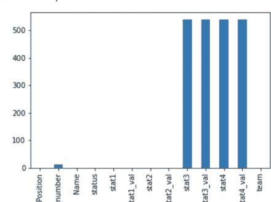

图9.21：可视化 DataFrame 的数据完整性

然后，我们可以根据特定列中数据值的分布情况来探索数据集，这将让您对数据集有所了解。以下函数提供了值计数、出现频率最高和最低的值，以及所有不同值的总计数（4058 个唯一值）：

```python
output_data["last_name"].value_counts()
```

```
Williams      57
Johnson       47
Jones         40
Smith         40
Brown         27
..            
Forte          1
Barney         1
Bishop         1
Bohanon        1
Shead          1
Name: last_name, Length: 4058, dtype: Int64
```

图9.22：DataFrame 中特定列的数据值分布

如果你想查看来自擒杀数最高球队的球员，必须进一步探索数据。下面的代码片段可以帮助你浏览数据：

```python
output_data[["stat1_val", "stat2_val"]] = output_data[["stat1_val", "stat2_val"]].apply(pd.to_numeric, errors='coerce')
```

```python
output_data[(output_data["stat2"]=="SCK")].groupby(["team"])["stat1_val"].sum().sort_values(ascending=False)[:3]

team
DEN  45.0
TB   44.5
MIN  44.5
Name: stat2_val, dtype: float64
```

```python
output_data[(output_data["team"]=="DEN") & (output_data["stat2"]=="SCK") & (output_data["stat2_val"]>8)],\
         dropna(subset=["stat2_val"]),\
         sort_values(by="stat2_val", ascending=False)
```

| | position | player_number | name | status | stat1 | stat1_val | stat2 | stat2_val | stat3 | stat3_val | stat4 | stat4_val | team |
|---|---|---|---|---|---|---|---|---|---|---|---|---|---|
| 1399 | | 58.0 | Miller, Von | ACT | TCKL | 35.0 | SCK | 11.0 | FF | 4 | INT | -- | DEN |
| 1439 | OLB | 94.0 | Ware, DeMarcus | ACT | TCKL | 25.0 | SCK | 7.5 | FF | 1 | INT | -- | DEN |
| 1359 | OLB | 48.0 | Barrett, Shaqill | ACT | TCKL | 50.0 | SCK | 5.5 | FF | 4 | INT | -- | DEN |
| 1445 | DE | 95.0 | Wolfe, Derek | ACT | TCKL | 49.0 | SCK | 5.5 | FF | 0 | INT | -- | DEN |
| 1416 | LB | 56.0 | Ray, Shane | ACT | TCKL | 20.0 | SCK | 4.0 | FF | 0 | INT | -- | DEN |
| 1443 | NT | 92.0 | Williams, Sylvester | ACT | TCKL | 25.0 | SCK | 3.0 | FF | 0 | INT | -- | DEN |
| 1365 | DE | 93.0 | Crick, Jared | ACT | TCKL | 48.0 | SCK | 2.0 | FF | 1 | INT | -- | DEN |
| 1437 | DE | 96.0 | Walker, Vance | ACT | TCKL | 33.0 | SCK | 2.0 | FF | 0 | INT | -- | DEN |
| 1438 | SS | 43.0 | Ward, T.J. | ACT | TCKL | 61.0 | SCK | 2.0 | FF | 2 | INT | -- | DEN |
| 1396 | ILB | 54.0 | Marshall, Brandon | ACT | TCKL | 102.0 | SCK | 1.5 | FF | 2 | INT | 1 | DEN |
| 1406 | OLB | 52.0 | Nelson, Corey | ACT | TCKL | 16.0 | SCK | 1.0 | FF | 0 | INT | -- | DEN |

图9.23：识别全队擒杀总数更高的球队中擒杀数最高的球员

你还可以使用 matplotlib 库将数据可视化并导出为图片。下面的代码片段提供了将擒杀数最高的球队可视化的示例：

```python
# plotting values
import matplotlib.pyplot as plt
vis_data=output_data[(output_data["stat2"]=="SCK")].groupby(["team"])["stat1_val"].sum().sort_values(ascending=False)[:10]
vis_data=vis_data.to_frame()
ax=vis_data.plot.barh(color="red")
ax.bar_label(ax.containers[0])
ax.get_legend().remove()
plt.title('Team with highest sacks')
plt.xlabel('Sacks')
plt.ylabel('Team')
```

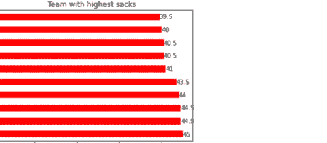

图9.24：可视化擒杀数最高的球队


前面的示例旨在展示 Pandas DataFrame 在对数据进行深度分析时的强大功能，无论数据是什么结构或格式。你可以继续探索数据并使用 matplotlib 来可视化结果，从而更深入地了解数据。

## 通过 Amazon Athena 和 Glue Catalog 访问

为了让习惯使用基于 SQL 访问的用户能够发现数据，我们可以将数据集编目到 AWS Glue Data Catalog 中，并对数据集进行更复杂的分析。Athena 提供了基于 SQL 的访问机制，可在没有任何文件大小限制的情况下探索数据，支持 SQL，并且无需 Python 编程即可探索数据集。

让我们对 nfl_data 表进行进一步分析，其中我们希望从 stat1_val 列中运行复杂的值：

```sql
select case when regexp_like(stat1_val, '^A-?\d+$') then 'valid'
    else stat1_val end as column_spread,count(*)
from mysql_nfl_data
group by case when regexp_like(stat1_val, '^A-?\d+$') then 'valid'
    else stat1_val end
```

| # | column_spread | _col1 |
|---|---|---|
| 1 | -- | 1218 |
| 2 | valid | 1710 |

图 9.25：使用 Amazon Athena 查询来识别数据集中有效的统计值

你可以验证并看到 stat1_val 列中约有 40% 的值未填充有效的统计值。

> 注意：单个行或其列的大小不能超过 32 兆字节。例如，当 CSV 或 JSON 文件中的一行包含 100 兆字节的单个列时，就会超出此限制。超出此限制还可能产生错误消息 Line too long in text file。 (https://docs.aws.amazon.com/athena/latest/ug/other-notable-limitations.html)

现在我们已经了解了不同的数据探索技术，让我们讨论何时使用前面提到的数据探索方法：

- 如果文件大小较小且不需要从多个文件探索数据，请使用 S3 Select 来探索数据集。这将支持你快速搜索数据集中不正确的值、缺失列等。
- 如果文件大小很大并且你希望对数据进行更深入的分析（例如某列中空值的百分比），并且团队熟悉 Python 编程，请使用 Pandas 探索数据集。
- 如果文件大小很大并且团队习惯于基于 SQL 的探索活动，则使用 Athena 以及 Glue Catalog。awswrangler 有助于在写入文件时填充 Glue Catalog。对于来自其他数据源的文件，Glue Crawler 将帮助你推断模式，该模式可使用 Athena 进行查询。

我们已经了解了数据探索的不同技术，现在可以探索数据整理管道的下一阶段——数据结构化。

## 数据结构化

现在我们需要进入将数据从原始格式重构为可用格式的部分。在我们的用例中，我们以 JSON 格式提取了数据，这对于我们使用的探索性分析来说是合适的。当我们进一步进入数据整理管道时，不同的文件格式和结构会更有效。

### 不同文件格式及何时使用

数据管道中常用的文件格式有多种：

- **可读文件格式**：CSV、JSON 和 **可扩展标记语言（XML）** 是一些可被人类用户读取的文件格式：
  - CSV 文件主要用于数据提取阶段，当数据需要与分析师共享以便阅读和执行进一步操作时。优点是你不需要任何编程语言即可读取文件，并且可以在最常见的文本编辑器中打开。这些文件格式在数据分析社区中与 Excel 文件一起很受欢迎。它们可用于在 Excel 应用程序本身内执行快速透视和其他分析/可视化。然而，它们不支持数据类型或复杂数据格式（分层数据）的概念，并且可扩展性有限。
  - XML 于 1990 年代创建，很快成为 W3C 用于共享分层和复杂数据类型的标准。这是第一个支持分层数据格式的流行格式，并被广泛用于各种系统之间的数据交换。XML 文件在存储大小上很大，因为它们使用开放和关闭标签来表示数据，而不像 CSV 文件格式。
  - JSON 文件格式主要被 Web 应用程序用于存储数据，并传递到下游数据管道用于数据分析。JSON 文件比 XML 文件更受欢迎，因为它们比 XML 更容易阅读和理解。它们支持更复杂的数据格式，包括分层数据、对象和数组。它们还支持通过键值组合进行模式演进，这有助于我们理解存储的数据。我们可以选择性地跳过某些字段，如果它们不适用，而不像 CSV 文件那样具有刚性模式，这对前端应用程序有利。然而，与 CSV 文件相比，它们消耗更多大小和内存来处理。

选择可读文件格式的主要原因是为了在用户希望下载文件并用于不同用例的场景，例如将用户列表共享给另一个团队以便进行电话跟进：

- 如果数据结构相对简单且没有分层字段，可以选择 CSV 文件格式，因为它易于阅读且轻量。CSV 文件与 Excel 结合将为轻量级数据分析提供良好的可视化。
- 如果数据具有更复杂的数据类型并且你需要存储不同的数据格式，请选择 JSON 文件格式。在前面的示例中，我们从 CSV 迁移到 JSON 文件格式，因为我们的数据中包含逗号，并且使用 pandas 库处理该数据带来了更多挑战。
- **二进制文件格式**：Parquet、Avro 和 ORC 是一些常见的文件格式，它们不可读且在数据管道的分析阶段使用。这些文件格式以机器可读的二进制格式存储，可以拆分并存储在多个磁盘上，从而支持并行处理。这些文件格式在大数据处理领域被广泛使用。它们是自描述的，这意味着它们将模式和数据一起存储，因此处理系统可以轻松读取数据。

什么是行存储与列存储？Parquet 和 ORC 文件格式以记录级格式以列式格式存储数据。列式格式将来自同一列的数据一起存储在一个记录块中。这在分析系统中很有帮助，其中数据针对特定列进行聚合和可视化。将来自相邻列的数据一起存储有助于更快地读取数据，并跳过分析查询中未使用的其他列的读取。

例如，见下文：

表 9.1：原始数据（记录块 – 3 条记录）

| Name | stat1 | stat2 |
|------|-------|-------|
| Test_user1 | 12 | 13 |
| Test_user2 | 14 | 15 |
| Test_user3 | 16 | 17 |

以下是记录级存储：

表 9.2：表的记录级存储

| Test_user1 | 12 | 13 | Test_user2 | 14 | 15 | Test_user3 | 16 | 17 |

以下是列式存储：

表 9.3：表的列级存储

| Test_user1 | Test_user2 | Test_user3 | 12 | 14 | 16 | 13 | 15 | 17 |

前面的表格仅用于说明和理解目的，实际存储将与数据块一起存储额外信息，以及压缩。

### 何时选择文件格式

Parquet 文件是最常用的，如果你不确定数据存储格式的选择，但你知道数据将用于分析用例，你可以从它们开始。如果需要实时流式处理并且模式演进是主要关注点，并且数据将用于探索性目的，你可以选择使用 Avro 文件格式。

### 使用 Pandas 重构数据

我们将继续以票务数据库中的 seat 表为例。表的结构如下所示粘贴：

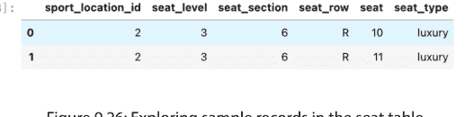

图 9.26：探索 seat 表中的示例记录

我们将考虑一种情况，其中我们需要重命名某些列以更好地适应数据治理标准，并根据我们的需要重新排列某些列：

```python
# Rename and change order of columns
output_data.rename(columns={"sport_location_id":"sport_loc_id","seat":"seat_nbr"}, inplace=True)
output_data = output_data.loc[:,["sport_loc_id","seat_type","seat_section","seat_level","seat_row","seat_nbr"]]
output_data.head(2)
```


图 9.27：在 DataFrame 中重命名和重新排列列

Pandas 还提供了强大的功能，可使用 pivot 函数将数据形状从宽格式转换为长格式，反之亦然。考虑一个示例，其中我们想要转换


将原始格式的数据转换为每个运动场馆各类别座位的聚合计数。这些数据将用于仪表板中，以可视化不同地点可用的座位类型。

透视函数提供了实现类似聚合的能力。我们将使用合并操作连接 sport_location 表数据和 seat 表数据（这些数据已加载到 output_data DataFrame 中）。我们将在本章的数据结构部分进一步探索如何连接 DataFrame。透视表将根据座位类型和体育场名称汇总座位数量。

```python
import awswrangler as wr
import pandas as pd
import numpy as np
con=wr.mysql.connect("wranglerbook")
sport_loc=wr.mysql.read_sql_query("SELECT * FROM dms_sample.sport_location", con=con)
pivot_data=pd.merge(output_data,sport_loc,left_on="sport_loc_id",right_on="id",how='inner')
final_data=pivot_data.pivot_table(values="seat_nbr", index="name", margins="True", columns="seat_type", aggfunc="count")
final_data
```

| 座位类型 | 豪华 | 视线受阻 | 优质 | 标准 | 低于标准 | 总计 |
| :--- | :--- | :--- | :--- | :--- | :--- | :--- |
| **名称** | | | | | | |
| AT&T Park | 1000.0 | NaN | 13000.0 | 23915.0 | 4000.0 | 41915 |
| AT&T Stadium | 1000.0 | 1000.0 | 22999.0 | 42000.0 | 13001.0 | 80000 |
| Angel Stadium | NaN | NaN | 17001.0 | 26482.0 | 2000.0 | 45483 |
| Arrowhead Stadium | 3415.0 | 1000.0 | 16000.0 | 50001.0 | 6000.0 | 76416 |
| Bank of America Stadium | 8000.0 | NaN | 23001.0 | 33418.0 | 11000.0 | 75419 |
| ... | ... | ... | ... | ... | ... | ... |
| US Cellular Field | 5000.0 | 1000.0 | 12614.0 | 18001.0 | 4000.0 | 40615 |

图 9.28：使用透视表将数据集聚合并转换为所需的结构

在上面的示例中，我们可以看到 AT&T Park 没有视线受阻的座位（请记住这是虚构数据 😊）。然而，座位计数是小数类型，这具有误导性，因为我们不可能有部分的座位。让我们通过以下方式使用 format 函数转换该列的数据类型来修复这个问题：

```python
final_data.head(5).style.format("{:.0f}")
```

| 座位类型 | 豪华 | 视线受阻 | 优质 | 标准 | 低于标准 | 总计 |
| :--- | :--- | :--- | :--- | :--- | :--- | :--- |
| **名称** | | | | | | |
| AT&T Park | 1000 | nan | 13000 | 23915 | 4000 | 41915 |
| AT&T Stadium | 1000 | 1000 | 22999 | 42000 | 13001 | 80000 |
| Angel Stadium | nan | nan | 17001 | 26482 | 2000 | 45483 |
| Arrowhead Stadium | 3415 | 1000 | 16000 | 50001 | 6000 | 76416 |
| Bank of America Stadium | 8000 | nan | 23001 | 33418 | 11000 | 75419 |

图 9.29：在 pandas 中使用数据格式化和样式选项

## 使用 AWS SDK for Pandas 构建端到端数据整理流水线

现在我们拥有了一种不同的数据表示方式，这是原始数据源中不可用的。类似地，你可以根据项目消费需求使用 pandas 操作（如透视、非透视等）来转换数据。

Pandas 提供了结构化成数据的能力，例如删除不需要的列、重命名列以及根据需要更改索引。这有助于将数据格式更改为更适合每种用例的更标准格式。此外，Pandas 中有一些函数可用于展平单列内的嵌套数据，以便更好地分析数据。

为了展示我们的工作，让我们考虑一个示例体育场数据，其中包含体育场的地址和餐饮选项。我们的示例数据集中没有这些数据，因此将使用一个示例值来展示 JSON 数据展平是如何工作的。我们将使用 `json_normalize` ([https://pandas.pydata.org/docs/reference/api/pandas.json_normalize.html](https://pandas.pydata.org/docs/reference/api/pandas.json_normalize.html)) 函数将嵌套的 JSON 数据展平为列以供分析。现在我们可以更高效地查询这些列的数据。你可以通过筛选 Location.State 列来查询加利福尼亚州有多少个体育场。

```python
stadium_address = {'Name': 'Angel Stadium', 'Location': {'City': 'Anaheim', 'Zipcode': '92806', 'State': 'CA', 'Address': {'Street Name': 'E Gene Autry Way', 'Number': '2000'}}, 'Dining': ['The Sweet shop', 'Big A Burger']}
```

```python
from pandas import json_normalize
flat1 = json_normalize(stadium_address)
```

| | Name | Dining | Location.City | Location.Zipcode | Location.State | Location.Address.Street Name | Location.Address.Number |
|:---|:---|:---|:---|:---|:---|:---|:---|
| 0 | Angel Stadium | [The Sweet shop, Big A Burger] | Anaheim | 92806 | CA | E Gene Autry Way | 2000 |

图 9.30：使用 json_normalize 函数展平层次结构 JSON 数据

然而，我们在 Dining 列中仍有列表形式的数据。如果我们希望展开该列，它将有助于我们进一步分析。为此，我们需要创建一个函数，该函数将展平来自 JSON 字符串的字典和列表数据。

```python
# 函数参考自 https://towardsdatascience.com/flattening-json-objects-in-python-f5343c794b10
def flatten_json(y):
    out = {}
    def flatten(x, name=''):
        if type(x) is dict:
            for a in x:
                flatten(x[a], name + a + '_')
        elif type(x) is list:
            i = 0
            for a in x:
                flatten(a, name + str(i) + '_')
                i += 1
        else:
            out[name[:-1]] = x
    flatten(y)
    return out
```

图 9.31：展平包含 JSON 数据的列表和字典列的函数

现在，你可以看到输出显示了从 JSON 字符串中展平的字典和列表数据。我们使用了在前一步骤中创建的 `flatten_json` 函数来实现所需输出：

```python
flat = flatten_json(stadium_address)
json_normalize(flat)
```

图 9.32：展平包含列表和字典列的 JSON 数据

| | Name | Location_City | Location_Zipcode | Location_State | Location_Address_Street_Name | Location_Address_Number | Dining_0 | Dining_1 |
|:---|:---|:---|:---|:---|:---|:---|:---|:---|
| 0 | Angel Stadium | Anaheim | 92806 | CA | E Gene Autry Way | 2000 | The Sweet shop | Big A Burger |

让我们花点时间来理解该函数是如何工作的，以便你可以进一步开发它。我们将向函数添加注释，并展示 `flatten` 函数的工作方式。该函数将被递归调用以展平 JSON 字符串：

```python
# 用于学习函数的工作方式。
def flatten(x, name='', out={}):
    print(x)
    a=""
    if type(x) is dict:
        for a in x:
            print("")
            print("Dictionary route " + a)
            flatten(x[a], name + a + '_')
    elif type(x) is list:
        i = 0
        for a in x:
            print("********************")
            print("List route " + name + str(i) + '_')
            flatten(a, name + str(i) + '_')
            i += 1
    else:
        print("===> Found a value for target column --> " + x)
        out[name[:-1]] = x
```

图 9.33：通过添加注释来理解 flatten 函数的工作方式

我们在函数中立即添加了 print 语句，以理解传入的输入字符串。我们在每个部分中添加了 print 语句，执行以下功能：

- 展平字典对象
- 展平列表对象
- 识别要存储在目标列中的原子值

### 该函数是如何工作的？

该函数将遍历提供的数据，并识别当前对象是字典还是列表：

- 字典对象具有花括号，并采用键值对结构，例如：`{ "name":"Angel stadium", "state":"CA" }`。字典内部可以包含字典或列表对象。
- 列表对象包含重复多次的类似数据项。它们存储在中括号结构中。它们可用于存储多值属性。在上面的示例中，我们将 Angel stadium 内多家餐厅的数据存储在列表中 – 例如：`[ "The sweet shop", "Big A burger" ]`。

一旦识别出对象，如果它是嵌套在另一个对象中的字典或列表，该函数将递归调用自身。

以下截图提供了该函数在提供最终输出之前如何解析数据的说明。遵循每个步骤，你可以更好地理解该函数的工作原理：


## Flatten 函数执行输出

```python
flatten(stadium_address)

{'Name': 'Angel Stadium', 'Location': {'City': 'Anaheim', 'Zipcode': '92806', 'State': 'CA', 'Address': {'Street Name': 'E Gene Autry Way', 'Number': '2000'}}, 'Dining': ['The Sweet shop', 'Big A Burger']}

Dictionary route Name
Angel Stadium
====> Found a value for target column --> Angel Stadium

Dictionary route Location
{'City': 'Anaheim', 'Zipcode': '92806', 'State': 'CA', 'Address': {'Street Name': 'E Gene Autry Way', 'Number': '2000'}}

Dictionary route City
Anaheim
====> Found a value for target column --> Anaheim

Dictionary route Zipcode
92806
====> Found a value for target column --> 92806

Dictionary route State
CA
====> Found a value for target column --> CA

Dictionary route Address
{'Street Name': 'E Gene Autry Way', 'Number': '2000'}

Dictionary route Street Name
E Gene Autry Way
====> Found a value for target column --> E Gene Autry Way

Dictionary route Number
2000
====> Found a value for target column --> 2000

Dictionary route Dining
['The Sweet shop', 'Big A Burger']
*********************
List route Dining_0_
The Sweet shop
====> Found a value for target column --> The Sweet shop
*********************
List route Dining_1_
Big A Burger
====> Found a value for target column --> Big A Burger
```


现在，我们已成功将数据扁平化为独立的列，以便于更好地进行分析。然而，列表项在同一张表中被拆分为多个列，这可能导致列数过多且数据稀疏，不利于数据查询。更好的方法是将列表中的数据拆分到带有外键关系的独立表中。

为了实现这一点，我们将进一步修改我们的 `flatten` 函数。以下是针对 `flatten` 函数所做的更改摘要：

-   添加逻辑以处理数据集的主键，以便主键可以存储在子表中，从而将它们连接起来。
-   我们将更改列表对象的扁平化逻辑，以创建一个新的 DataFrame。该逻辑还将填充主键迭代器列，以识别原始列表对象中的不同值。
-   现在我们的函数将返回多个字典项，因此我们将函数的输出更改为返回一个字典/列表对象的列表。

```python
# For learning the working of the function.
def flatten_v2(x, name='', df_name='df', pk='Name', pk_val='', out={}, out_dfs={}):
    print("Input -->", x, "--", df_name, "--", name)
    a = ""
    df1 = {}
    df_list = []
    if pk_val == "":
        pk_val = x[pk]
    if type(x) is dict:
        for a in x:
            print("________________________")
            print("Dictionary route " + a)
            flatten(x[a], name + a + '_', "df", pk_val=pk_val)
    elif type(x) is list:
        i = 0
        for a in x:
            df1 = {}
            print("**************************")
            print("List route " + name + str(i) + '_')
            df_name = name[:-1]
            df1[name[:-1]] = a
            df1[name[:-1] + "_PK"] = i
            df1[pk] = pk_val
            df_list.append(df1)
            print("Output in list-->", df_list)
            i += 1
        out_dfs[df_name] = df_list
        return out_dfs
    else:
        print("====> Found a value for target column --> " + x)
        out[name[:-1]] = x
        out_dfs[df_name] = out
        print("Output-->", out)
        return out_dfs
```

图 9.35：更新后的 flatten 函数，用于将列表对象拆分为另一个 DataFrame，并建立主外键关系

探索该函数，你可以在自己的环境中执行它以更好地理解其内部工作原理。现在，让我们将此整合为一个可用的 flatten 函数并验证输出：

```python
def flatten_json_v2(y):
    out = {}
    out_dfs = {}

    def flatten(x, name='', pk_name='df', pk=pk_val):
        df1 = {}
        df_list = []
        if pk_val != '':
            pk_val = pk[pk]
        if type(x) is dict:
            for a in x:
                flatten(x[a], name + ' ', 'df', pk_val=pk, df1=df1, df_list=df_list)
        elif type(x) is list:
            i = 0
            for a in x:
                df1 = {}
                print("**************************")
                print("List route " + name + str(i) + '_')
                df_name = name[:-1]
                df1[df_name] = a
                df1[df_name + "_PK"] = i
                df1[pk] = pk_val
                df_list.append(df1)
                i += 1
            out_dfs[df_name] = df_list
        else:
            out[name] = x
            out_dfs[name] = out
        return out_dfs

    pk_val = y['Name']
    flatten(y, 'Name_', 'df', pk=pk_val)
    return out_dfs
```

图 9.36：作为 flatten 函数第 2 版创建的新扁平化代码

在此处对我们的示例数据集执行该函数，我们现在可以看到该函数创建了两个 DataFrame，其中一个 DataFrame 包含来自列表对象的内容以及用于连接目的的主键值（在此示例用例中为体育场名称）。

```python
flat = flatten_json_v2(stadium_address)
json_normalize(flat['df'])
```

| | Name | Location_City | Location_Zipcode | Location_State | Location_Address_StreetName | Location_Address_Number |
|---|------|---------------|------------------|----------------|-----------------------------|-------------------------|
| 0 | Angel Stadium | Anaheim | 92806 | CA | E Gene Autry Way | 2000 |

```python
json_normalize(flat['Dining'])
```

| | Dining | Dining_pk | Name |
|---|--------|-----------|------|
| 0 | The Sweet shop | 0 | Angel Stadium |
| 1 | Big A Burger | 1 | Angel Stadium |

图 9.37：验证更新后的 flatten 函数的运行情况

我们通过这个练习展示了如何结合 pandas 和 Python 执行强大的数据转换以满足我们的需求。然而，此逻辑可以进一步开发和调整。

### 挑战

你能更新脚本来处理嵌套列表吗？一个例子可以是体育场有一个食品出口列表，每个食品出口有一个菜单项列表。

### 提示

你可以尝试为层级结构中的每个表单独存储主键，然后将它们添加到子表中，并加上特定于该表的迭代器列。

在下一节中，我们将学习更多关于使用 pandas 的操作进行数据清洗活动的知识。

## 数据清洗

数据清洗是数据梳理过程中的重要步骤。大量时间花在识别正确的数据源和清洗数据上。Pandas 提供了许多功能来清洗你的数据。

此阶段所需的确切活动因数据集类型而异。某些数据源的数据只需要最少的清洗，而某些其他数据源可能需要大量的清洗活动，才能将数据集用于你的项目。你还可以使用数据探索活动的输出，以了解需要执行的数据清洗活动的程度。

## 使用 Pandas 进行数据清洗

为了演示数据清洗步骤，我们将使用数据库中的 `seat_type` 表。由于该表的数据量很小，因此在继续进行数据清洗之前，我们将插入一些数据。

`seat_type` 中的数据如下面的截图所示。它有三列：座位类型名称、该座位类型的描述，以及提供该座位类型质量相对排名的列：

```python
con = wr.mysql.connect("wranglerbook")
cursor = con.cursor()
cursor.execute("show columns from seat_type")
cursor.fetchall()
```

```
[('name', 'varchar(15)', 'NO', 'PRI', None, ''),
 ('description', 'varchar(120)', 'YES', '', None, ''),
 ('relative_quality', 'tinyint', 'YES', '', None, '')]
```

```python
cursor.execute("select * from seat_type;")
cursor.fetchall()
```

```
[('luxury', 'Excellent seats – box seats, behind the plate, etc. etc.', 1),
 ('obstructed', 'Pretty crappy, partially obstructed seats', 5),
 ('premium', 'Really good seats – first level, mid field, etc. etc.', 2),
 ('standard', 'Standard seats – not super awesome but pretty good', 3),
 ('standing', "Really? That's – not a seat at all now, is it?", 10),
 ('sub-standard', 'End zone, nose bleed, etc.', 4)]
```

图 9.38：探索座位表中当前可用的数据

我们将修改数据，以模拟一个有助于我们逐步了解数据清洗活动的数据集。相反于删除或更新座位表中的当前数据，我们将插入新记录，这些记录是当前数据的模拟版本。

以下截图显示了 `seat_type` 表中具有相同列的新模拟记录。然而，描述列现在包含额外详细信息，例如座位类型可用的体育场层级、该特定类型可用座位的数量以及描述。

```python
cursor.execute("insert into seat_type values('Luxury1', 'level1,1500 seats,Comfortable seats,Leather seats!!!',1)")
cursor.execute("insert into seat_type values('Obstructed1', 'level3,100 seats,Comfortable seats though,But wont have any v...',1)")
cursor.execute("insert into seat_type values('Premium1', 'level4-5,500 seats,Comfortable but normal seats, good views for 1...',1)")
cursor.execute("insert into seat_type values('Standard1', 'level1,5500 seats,Comfortable seats,Leather seats!!!',3)")
cursor.execute("insert into seat_type values('standing1', 'level1-5,Comfortable seats,Leather seats!!!',10)")
cursor.execute("insert into seat_type values('sub-standard1', 'level1,200 seats,Front row , risk of injury!!!',4)")
```

图 9.39：座位表的模拟记录

对于我们当前的用例，我们将只提取插入到表中的数据。我们将过滤座位类型名称列中值以字母（a-z）开头并以数字（0-9）结尾的记录，这将只获取名称列末尾追加数字 1 的新插入记录。


# 筛选以字母开头并以单个数字结尾的数据
```python
cleanse_data=output_data[output_data["description"].str.contains("^[a-zA-Z]*[0-9]$")]
cleanse_data
```

|   | name | description | relative_quality |
|---|---|---|---|
| 1 | Luxury1 | level5,1500 seats,Comfortable seats,Leather se... | 1 |
| 3 | Obstructed1 | level3,100 seats,Comfortable seats though,But ... | 5 |
| 5 | Premium1 | level4-5,500 seats,Comfortable but normal seat... | 2 |
| 7 | Standard1 | level1,5500 seats,Comfortable seats,Leather se... | 3 |
| 9 | standing1 | Level1-5,Comfortable seats,Leather seats!!! | 10 |
| 11 | sub-standard1 | level1,200 seats,Front row , risk of injury!!! | 4 |

**图9.40：** 单独提取模拟数据记录，用于数据清洗活动。

接下来，我们将拆分 description 列中的数据，以便对数据进行更好的分析。我们将使用 split 函数，以逗号作为分隔符进行拆分，并将数据放入不同的列中，如下面的截图所示：

```python
# Extract data from column into different columns
pd.options.mode.chained_assignment = None
cleanse_data["Level_data"]=cleanse_data["description"].str.split(",",n=2).str[0]
cleanse_data["No_of_seats"]=cleanse_data["description"].str.split(",",n=2).str[1]
cleanse_data["Seat description"]=cleanse_data["description"].str.split(",",n=2).str[2]
```

**识别离群值，并用有效值替换空值**

```python
cleanse_data
```

|   | name | description | relative_quality | Level_data | No_of_seats | Seat description |
|---|---|---|---|---|---|---|
| 1 | Luxury1 | level5,1500 seats,Comfortable seats,Leather se... | 1 | level5 | 1500 seats | Comfortable seats,Leather seats!!! |
| 3 | Obstructed1 | level3,100 seats,Comfortable seats though,But ... | 5 | level3 | 100 seats | Comfortable seats though,But wont have any vis... |
| 5 | Premium1 | level4-5,500 seats,Comfortable but normal seat... | 2 | level4-5 | 500 seats | Comfortable but normal seats, good views for t... |
| 7 | Standard1 | level1,5500 seats,Comfortable seats,Leather se... | 3 | level1 | 5500 seats | Comfortable seats,Leather seats!!! |
| 9 | standing1 | Level1-5,Comfortable seats,Leather seats!!! | 10 | Level1-5 | Comfortable seats | Leather seats!!! |
| 11 | sub-standard1 | level1,200 seats,Front row , risk of injury!!! | 4 | level1 | 200 seats | Front row , risk of injury!!! |

**图9.41：** 验证更新后的 flatten 函数的实际效果。

现在，数据已经被拆分到多个列中，但仍有一些数据不够干净，无法用于最终分析。为了便于理解，我们一次处理一个列。Level_data 列提供了体育场中哪些层级有该类型座位的信息。然而，有些记录包含诸如 Level1-5 的数据，表示座位分布在 level1、level2、level3、level4 和 level5。这对人脑来说一目了然，但如果你想查询 level3 中可用的座位类型，这些数据就不能给出正确结果。我们希望在适用的情况下扩展层级数据。

# 将列的首字母大写
```python
cleanse_data["Level_data"]=cleanse_data["Level_data"].str.capitalize()
cleanse_data
```

|   | name | description | relative_quality | Level_data | No_of_seats | Seat description |
|---|---|---|---|---|---|---|
| 1 | Luxury1 | level5,1500 seats,Comfortable seats,Leather se... | 1 | Level5 | 1500 | Comfortable seats,Leather seats!!! |
| 3 | Obstructed1 | level3,100 seats,Comfortable seats though,But ... | 5 | Level3 | 100 | Comfortable seats though,But wont have any vis... |
| 5 | Premium1 | level4-5,500 seats,Comfortable but normal seat... | 2 | Level4,Level5 | 500 | Comfortable but normal seats, good views for t... |
| 7 | Standard1 | level1,5500 seats,Comfortable seats,Leather se... | 3 | Level1 | 5500 | Comfortable seats,Leather seats!!! |
| 9 | standing1 | Level1-5,Comfortable seats,Leather seats!!! | 10 | Level1,Level2,Level3,Level4,Level5 | None | Leather seats!!! |
| 11 | sub-standard1 | level1,200 seats,Front row , risk of injury!!! | 4 | Level1 | 200 | Front row , risk of injury!!! |

**图9.44：** capitalize 函数将列的第一个字符改为大写。

然而，这不会将逗号后面的值大写。如果你希望每个单词都大写，可以使用 **title** 函数将所有单词的首字母大写，如下所示：

```python
# Capitalize the first letter of the column
cleanse_data["Level_data"]=cleanse_data["Level_data"].str.title()
cleanse_data
```

|   | name | description | relative_quality | Level_data | No_of_seats | Seat description |
|---|---|---|---|---|---|---|
| 1 | Luxury1 | level5,1500 seats,Comfortable seats,Leather se... | 1 | Level5 | 1500 | Comfortable seats,Leather seats!!! |
| 3 | Obstructed1 | level3,100 seats,Comfortable seats though,But ... | 5 | Level3 | 100 | Comfortable seats though,But wont have any vis... |
| 5 | Premium1 | level4-5,500 seats,Comfortable but normal seat... | 2 | Level4,Level5 | 500 | Comfortable but normal seats, good views for t... |
| 7 | Standard1 | level1,5500 seats,Comfortable seats,Leather se... | 3 | Level1 | 5500 | Comfortable seats,Leather seats!!! |
| 9 | standing1 | Level1-5,Comfortable seats,Leather seats!!! | 10 | Level1,Level2,Level3,Level4,Level5 | None | Leather seats!!! |
| 11 | sub-standard1 | level1,200 seats,Front row , risk of injury!!! | 4 | Level1 | 200 | Front row , risk of injury!!! |

**图9.45：** title 函数将列中每个单词的首字母大写。

接下来，假设我们要确定特定层级上的可用座位数。**No_of_seats** 列中既有数字，也有尾部带有 *座位* 字样的值。我们可以只提取数据中的数字部分并存入该列。我们将使用带正则表达式的 **extract** 函数识别并仅提取数据中的数字部分，如下面的截图所示：

```python
# Extract only numbers from the seat column
import numpy as np
cleanse_data['No_of_seats']=cleanse_data['No_of_seats'].str.extract('(\d+)')
cleanse_data
```

|   | name | description | relative_quality | Level_data | No_of_seats | Seat description |
|---|---|---|---|---|---|---|
| 1 | Luxury1 | level5,1500 seats,Comfortable seats,Leather se... | 1 | level5 | 1500 | Comfortable seats,Leather seats!!! |
| 3 | Obstructed1 | level3,100 seats,Comfortable seats though,But ... | 5 | level3 | 100 | Comfortable seats though,But wont have any vis... |
| 5 | Premium1 | level4-5,500 seats,Comfortable but normal seat... | 2 | level4,level5 | 500 | Comfortable but normal seats, good views for t... |
| 7 | Standard1 | level1,5500 seats,Comfortable seats,Leather se... | 3 | level1 | 5500 | Comfortable seats,Leather seats!!! |
| 9 | standing1 | Level1-5,Comfortable seats,Leather seats!!! | 10 | level1,level2,level3,level4,level5 | NaN | Leather seats!!! |
| 11 | sub-standard1 | level1,200 seats,Front row, risk of injury!!! | 4 | level1 | 200 | Front row, risk of injury!!! |


现在，**No_of_seats** 列只包含数值，而 standing（站立）类型的值则为 **Not a Number**（NaN）。这是正确的，因为 standing 并不是真正的座位类型。不过，我们可以将 NaN 值替换为 **None**，以便更好地将其表示为 NULL 值，表示 **No_of_seats** 列不适用于这种座位类型。

```python
# Replace Nan to None in the data
cleanse_data=cleanse_data.replace(np.nan, None)
cleanse_data
```

|   | name | description | relative_quality | Level_data | No_of_seats | Seat description |
|---|---|---|---|---|---|---|
| 1 | Luxury1 | level5,1500 seats,Comfortable seats,Leather se... | 1 | level5 | 1500 | Comfortable seats,Leather seats!!! |
| 3 | Obstructed1 | level3,100 seats,Comfortable seats though,But ... | 5 | level3 | 100 | Comfortable seats though,But wont have any vis... |
| 5 | Premium1 | level4-5,500 seats,Comfortable but normal seat... | 2 | level4,level5 | 500 | Comfortable but normal seats, good views for t... |
| 7 | Standard1 | level1,5500 seats,Comfortable seats,Leather se... | 3 | level1 | 5500 | Comfortable seats,Leather seats!!! |
| 9 | standing1 | Level1-5,Comfortable seats,Leather seats!!! | 10 | level1,level2,level3,level4,level5 | None | Leather seats!!! |
| 11 | sub-standard1 | level1,200 seats,Front row, risk of injury!!! | 4 | level1 | 200 | Front row, risk of injury!!! |


如这里所示，我们可以得到 Level 5 的座位总数。但在那之前，我们必须将 **No_of_seats** 字段转换为整数类型，并将空值替换为 0，以便对它们求和：

```python
cleanse_data['No_of_seats']=cleanse_data['No_of_seats'].fillna(0).astype('int')
cleanse_data[cleanse_data['Level_data'].str.contains('Level5')]['No_of_seats'].sum()
2000
```


在本节中，我们探索了不同的功能来清洗数据以进行有意义的分析。用户可以进一步探索不同的 Pandas 函数来进行去重和其他针对其数据源特定的清洗活动。我们现在将探索数据整理管道的数据丰富阶段。

## 数据丰富

我们已经学习了如何从各种来源提取数据，将它们放入通用或期望的结构中，并清洗数据问题。然而，数据仍然来自各个来源的孤岛，将来自多个来源的数据结合起来以丰富数据中的额外信息将很有价值。

让我们考虑一个用例，我们将发布特定球队的足球比赛日程。在此之前，我们必须了解我们的数据集，以便连接相关的表。我们将首先打印源数据库中可用的表列表。

```python
con=wr.mysql.connect("wranglerbook")
cursor=con.cursor()
cursor.execute("show tables;")
cursor.fetchall()
```

```python
(('mlb_data',),
('name_data',),
('nfl_data',),
('nfl_stadium_data',),
('person',),
('player',),
('seat',),
('seat_type',),
('sport_division',),
('sport_league',),
('sport_location',),
('sport_team',),
('sport_type',),
('sporting_event',),
('sporting_event_ticket',),
('ticket_purchase_hist',))
```

图 9.49：打印体育票务数据集源数据库中的所有表

我们有一个表列表，下面的图表将说明我们数据集中不同表之间的关系：

| Table name | Description |
| :-- | :-- |
| mlb_data | Contains stats and details about players in the MLB. |
| name_data | Details about people/players’ names such as last or first name. |
| nfl_data | Contains stats about players in the NFL. |
| nfl_stadium_data | Contains details about sports stadiums for NFL such as its surface, whether it is covered/open, etc. |
| person | Contains detail about people, linking to the ticket purchase history table. |
| player | Contains players’ details and the sports team they belong to. |
| seat | Contains seat data with links to sports location. |
| seat_type | Contains details about seats in stadiums, different classifications, and their comfort ranking. |
| sport_division | Contains description about the sports league division the teams are playing for, e.g., NFL -> AFC South. |
| sport_league | Contains description about the sports league the teams are playing for, e.g., MLB, NFL, etc. |
| sport_location | Contains information about sporting locations/stadiums’ addresses and seat capacities. |
| sport_team | Contains details about the teams, their short names, the leagues they belong to, and home stadiums. |
| sport_type | Contains description about different sport types – here we will have data about football and baseball alone. |
| sporting_event | Contains details on the teams playing along with location IDs for where they are playing, the dates when they are playing, etc. |
| sporting_event_ticket | Contains details about tickets purchased for each sporting event along with information on who purchased them, the price of the tickets, and also additional information on seating. |
| ticket_purchase_hist | Will have details about tickets’ purchase history and any transfers made of the tickets. |

表 9.1：表名和描述

我们期望在最终发布的赛程中看到参赛球队、比赛举办的体育场、各自体育场的城市和州、比赛日期以及体育场的座位容量。凭借前面的信息，我们将为特定足球球队（在此实例中为纽约巨人队）准备赛程。

## Pandas 操作用于数据转换

第一步是从 sporting event 表中获取信息。让我们探索 sporting event 表中可用的数据：

图 9.50：探索 sporting_event 表中可用的数据

现在我们有了比赛日期和运动类型，我们将筛选足球球队。然而，我们仍然需要知道参加比赛的球队名称。现在我们将 sporting_event 表与 sport_team 表连接以获取球队名称信息。我们将使用 pandas 的 merge（[https://pandas.pydata.org/docs/reference/api/pandas.DataFrame.merge.html](https://pandas.pydata.org/docs/reference/api/pandas.DataFrame.merge.html)）命令来连接 DataFrames。我们将使用 `left_on` 和 `right_on` 属性来提及将在连接子句中使用的键名：

```python
sporting_event_temp1=pd.merge(sporting_event,sport_team,left_on="home_team_id",right_on="id",how='left')
sporting_event_temp1
```

图 9.51：使用 pandas 的 merge 函数连接表

现在我们了解到 4 月 2 日和 4 月 9 日安排的比赛的主队是来自 MLB 联盟的圣地亚哥教士队。细心的眼睛会注意到 `id` 列被附加了 `_x` 用于 sporting_event（左表）DataFrame 和 `_y` 用于 sport_team（右表）DataFrame。这是为了避免结果数据集中重复的列名。具有相似名称的其他列也将附加类似的后缀。我们必须注意这一点，并在结果 DataFrame 中使用此名称来访问这些列。

这很棒，但你能想到前面方法中的任何问题吗？如果您再连接一个表，该表也有一列标记为 `id` 怎么办？这将导致连接条件出错。而且当结果数据集导出供不同用途消费时，很难记住哪个表用于左或右。幸运的是，Pandas 还允许我们为相似的列名添加自定义后缀。我们将使用 `_set` 用于 sporting_event 表和 `_se` 用于 sporting_event_temp1 表，如以下屏幕截图所示：

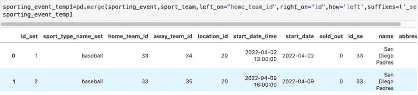

图 9.52：使用自定义后缀连接表

现在让我们做同样的连接以获取客队信息，如下所示。你可以看到我们在连接语句中对不同的键列 `home_team_id` 和 `away_team_id` 进行了连接：

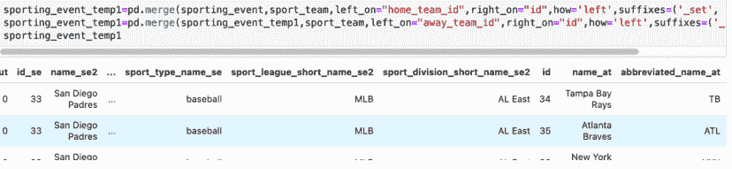

图 9.53：连接表以获取主客队信息

现在我们有了参赛体育球队的信息可用，我们仍然需要比赛发生的地点信息/体育场信息。我们将通过连接 `sport_location` 表来获取该信息，以便它将具有体育场信息（名称、城市和州）以及座位容量，如以下屏幕截图所示：

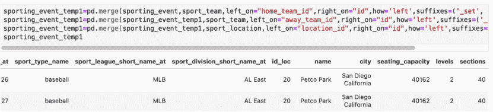

图 9.54：连接 sport_location 表以获取体育赛事的体育场/地点信息

现在我们拥有了所有所需字段，但我们有很多额外的字段需要过滤掉。我们可以利用 `df.loc[:, list of columns]` 函数来实现这一点，通过仅选择所需的列：

```python
sporting_event_temp1=pd.merge(sporting_event,sport_team,left_on="home_team_id",right_on="id",how="left",\
suffixes=('_se1', '_nt'))
sporting_event_temp1=pd.merge(sporting_event_temp1,sport_team,left_on="away_team_id",right_on="id",how="left",\
suffixes=('_se2', '_at'))
sporting_event_temp1=pd.merge(sporting_event_temp1,sport_location,left_on="location_id",right_on="id",how="left",\
suffixes=('_se3', '_loc'))
sporting_event_schedule=sporting_event_temp1.loc[:,['id_se1','sport_type_name_se1','sport_league_short_name_se2',\
'start_date_time','name_se2','name_at','sport_division_short_name_se2',\
'sport_division_short_name_at','name','city','seating_capacity']]
sporting_event_schedule
```

| id_se1 | sport_type_name_se1 | sport_league_short_name_se2 | start_date_time | name_se2 | name_at | sport_division_short_name_se2 | sport_division_short_name_at |
| --- | --- | --- | --- | --- | --- | --- | --- |
| 0 | 1 | baseball | MLB | 2022-04-02 16:00:00 | San Diego Padres | Tampa Bay Rays | AL East |
| 1 | 2 | baseball | MLB | 2022-04-09 16:00:00 | San Diego Padres | Atlanta Braves | AL East |
| 2 | 3 | baseball | MLB | 2022-04-16 16:00:00 | San Diego Padres | New York Yankees | AL East |
| 3 | 4 | baseball | MLB | 2022-04-23 16:00:00 | San Diego Padres | Texas | AL East |

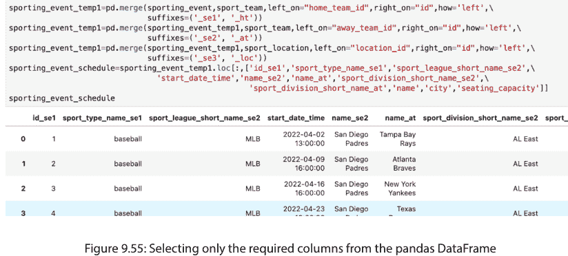

前面的输出仍然具有冗长且没有有意义的业务名称的列名。我们可以使用 rename 函数更改名称以更好地表示数据，如此处所示。

```python
sporting_event_temp1=pd.merge(sporting_event,sport_team,left_on="home_team_id",right_on="id",how="left",\
suffixes=('_se1', '_nt'))
sporting_event_temp1=pd.merge(sporting_event_temp1,sport_team,left_on="away_team_id",right_on="id",how="left",\
suffixes=('_se2', '_at'))
sporting_event_temp1=pd.merge(sporting_event_temp1,sport_location,left_on="location_id",right_on="id",how="left",\
suffixes=('_se3', '_loc'))
sporting_event_schedule=sporting_event_temp1.loc[:,['id_se1','sport_type_name_se1','sport_league_short_name_se2',\
'start_date_time','name_se2','name_at','sport_division_short_name_se2',\
'sport_division_short_name_at','name','city','seating_capacity']]
sporting_event_schedule.rename(columns={'id_se1': 'id', 'sport_type_name_se1': 'sport_name',\
'sport_league_short_name_se2': 'league_name','name_se2': 'home_team','name_at': \
'away_team','sport_division_short_name_se2': 'home_team_league',\
'sport_division_short_name_at': 'away_team_league','name': 'stadium_name'}, \
inplace=True)
sporting_event_schedule
```

| sport_name | league_name | start_date_time | home_team | away_team | home_team_league | away_team_league | stadium_name | city | seating_capacity |
| --- | --- | --- | --- | --- | --- | --- | --- | --- | --- |
| baseball | MLB | 2022-04-02 16:00:00 | San Diego Padres | Tampa Bay Rays | AL East | AL East | Petco Park | San Diego, California | 40162 |
| baseball | MLB | 2022-04-09 16:00:00 | San Diego Padres | Atlanta Braves | AL East | AL East | Petco Park | San Diego, California | 40162 |
| baseball | MLB | 2022-04-16 16:00:00 | San Diego Padres | New York Yankees | AL East | AL East | Petco Park | San Diego, California | 40162 |

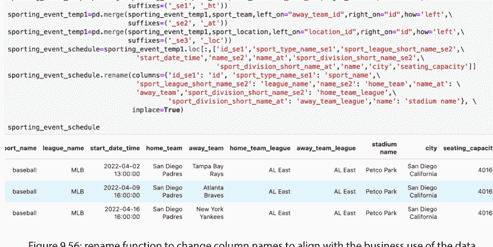

现在我们有一个工作数据集，其中包含所需的数据属性，但我们仍然需要将其筛选为足球比赛以及纽约巨人队作为主队或客队参与的比赛：


# 使用 Pandas 进行数据质量验证

对于熟悉 NFL 比赛的读者，赛季期间每周一场比赛，中间会有几周的比赛轮空。让我们首先验证为纽约巨人队准备的赛程，并检查实际数据是否符合这些规则。这是一个数据质量验证步骤，因为数据本身没有问题，但我们期望数据符合我们的规则，以匹配现实世界情况。请注意，这是由脚本生成的虚构数据，用于说明我们的用例。

我们首先会确定纽约巨人队是否有在同一时间段内安排的比赛，这将使这些比赛无法进行。我们将使用 pandas 的 `groupby` 功能对比赛开始时间进行分组，并获取比赛场次数量，如以下代码所示：

```python
#We need to identify schedule issues where the same team is playing multiple games on the same day across different stadiums
#We can highlight the issues as the same team can't play games at the same time
sport_schedule_NYG.groupby(['start_date_time'])['start_date_time'].count()
```

```text
start_date_time
2022-08-28 18:00:00    1
2022-09-04 12:00:00    1
2022-09-11 14:00:00    1
2022-09-18 14:00:00    1
2022-09-25 13:00:00    1
2022-10-02 15:00:00    1
2022-10-16 19:00:00    4
2022-11-13 14:00:00    4
2022-12-11 12:00:00    4
Name: start_date_time, dtype: int64
```

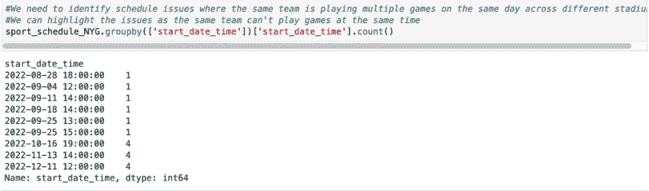

我们在 3 周的时间里安排了 4 场同时进行的比赛，这些比赛是不可能进行的。但我们是否在其他周也有问题，例如 9 月 25 日，当天不同时间安排了多场比赛？即使我们做出一个大胆的假设，即同一支队伍可以在一天内不同时间进行两场比赛，让我们理解比赛进行的地点背景。我们将对比赛开始时间和比赛所在城市执行 `groupby` 函数。

```python
#Go one level further, to identify issues that have same team playing games on same day at different locations
sport_schedule_NYG.groupby(['start_date_time','city'])['start_date_time'].count()
```

```text
start_date_time         city                         
2022-08-28 18:00:00    Arlington, Texas                 1
2022-09-04 12:00:00    East Rutherford, New Jersey      1
2022-09-11 14:00:00    East Rutherford, New Jersey      1
2022-09-18 14:00:00    East Rutherford, New Jersey      1
2022-09-25 13:00:00    Philadelphia, Pennsylvania       1
2022-09-25 15:00:00    Landover, Maryland                1
2022-10-16 19:00:00    East Rutherford, New Jersey      4
2022-11-13 14:00:00    East Rutherford, New Jersey      4
2022-12-11 12:00:00    East Rutherford, New Jersey      4
```

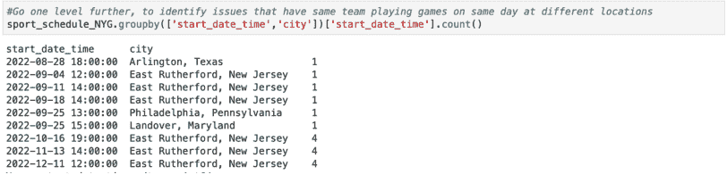

现在我们明白了，队伍无法在同一天内移动的这些城市之间进行多场比赛，因此我们还需要修改该周的赛程。上述验证旨在展示 pandas 在数据验证方面的能力。我们的业务规则是确保每支队伍每周只有一场比赛。让我们在我们的样本数据中验证该业务规则。我们将开始时间转换为日期字段，仅提取周的部分，并统计该队伍每周的比赛数量。

输出与我们之前的验证结果类似。现在我们将着手修正该队伍的赛程。

```python
#Practically, a team can play a match per week and let us identify teams having more than one game per week
sport_schedule_NYG.loc[:,"week_nbr"]=sport_schedule_NYG['start_date_time'].dt.isocalendar().week
sport_schedule_NYG.groupby(['week_nbr'])['week_nbr'].count()
```

```text
week_nbr
34      1
35      1
36      1
37      1
38      2
41      4
45      4
49      4
Name: week_nbr dtype: int64
```

图 9.60：验证 NFL 队伍是否每周只有一场比赛

我们将使用 numpy 库及其 `where` 子句函数，通过开始日期来识别记录，同时识别当开始日期数据重复时的对手队伍。以下更新语句仅用于本书的学习目的。我们手动更新了赛程，以确保纽约巨人队每周只有一场比赛，但我们没有比较其他队伍的赛程，实际上，创建一个反映这一点的赛程将是一个复杂的练习。因此，我们将只关注纽约巨人队，并假设其他队伍的赛程不会有任何冲突：

我们可以设置这些数据质量规则以执行并仅显示不符合规则的记录，然后向业务团队成员发送电子邮件，以便他们检查我们数据管道中的数据。

```python
sport_schedule_NYG.loc[:, "week_nbr"]=sport_schedule_NYG['start_date_time'].dt.isocalendar().week
sport_schedule_NYG.groupby(['week_nbr'])['week_nbr'].count()
```

```text
week_nbr
34      1
35      1
36      1
37      1
38      1
39      1
40      1
41      1
42      1
43      1
44      1
45      1
46      1
47      1
48      1
49      1
50      1
51      1
```

图 9.63：验证更新后的纽约巨人队赛程

我们也可以执行其他验证规则。我们可以针对 `ticket_purchase_hist` 表运行查询，并查看其为空。在实际生产环境中，可能是因为本应填充购票数据的过程损坏了。然而，在我们当前的用例中，本应插入购票数据的存储过程在初始设置期间未执行。我们将登录到*将示例数据加载到源数据库*章节中之前使用的 EC2 实例。一旦连接到 RDS MySQL 数据库，使用 `use` 命令选择 `dms_sample` 数据库并执行存储过程以插入 1,000 张门票，调用 `generateTicketActivity(1000, 0);`。

```mysql
MySQL [(none)]> use dms_sample;
Reading table information for completion of table and column names
You can turn off this feature by adding --skip-auto-rehash
Database changed

MySQL [dms_sample]> call generateTicketActivity(1000,0);
+--------------------------------------------------------------------------------------------+
| CONCAT('Congratulations! You've just purchased ',p_quantity,' tickets.') |
+--------------------------------------------------------------------------------------------+
| Congratulations! You've just purchased 6 tickets.                                         |
+--------------------------------------------------------------------------------------------+
1 row in set (0.22 sec)

+--------------------------------------------------------------------------------------------+
| CONCAT('Congratulations! You've just purchased ',p_quantity,' tickets.') |
+--------------------------------------------------------------------------------------------+
| Congratulations! You've just purchased 4 tickets.                                         |
+--------------------------------------------------------------------------------------------+
```

图 9.64：生成购票活动的存储过程

现在我们查询 `ticket_purchase_hist` 表，查看记录正在被填充。这将确保我们在数据管道中所有数据都按预期填充。

```python
# After executing the insert tickets stored procedure. This SP is created but not called during initial run
# We can insert 1000 tickets and validate the ticketing activity now. This ensures the data is complete
ticket_purchase_hist=wr.mysql.read_sql_query("SELECT * FROM dms_sample.ticket_purchase_hist", con=con)
```

|  | sporting_event_ticket_id | purchased_by_id | transaction_date_time | transferred_from_id | purchase_price |
|:---|:---:|:---:|:---:|:---:|:---:|
| 0 | 65536 | 410959 | 2022-12-07 03:23:29 | None | 43.13 |
| 1 | 65537 | 410959 | 2022-12-07 03:23:29 | None | 43.13 |
| 2 | 131071 | 4232646 | 2022-12-07 03:22:48 | None | 44.59 |
| 3 | 131072 | 4232646 | 2022-12-07 03:22:48 | None | 44.59 |
| 4 | 131090 | 4232646 | 2022-12-07 03:22:48 | None | 44.59 |
| ... |  |  |  |  |  |

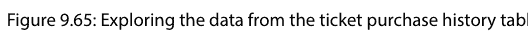

我们将查询查看纽约巨人队与费城老鹰队（event_id – 934）之间比赛的购票情况。现在我们将看到一些记录的 `ticketholder_id` 字段已填充，标识了购买门票的人（这是从我们之前执行的存储过程中填充的）：

```python
sporting_event_ticket=wr.mysql.read_sql_query("SELECT * FROM dms_sample.sporting_event_ticket where sporting_event_id=934")
sporting_event_ticket.loc[sporting_event_ticket["ticketholder_id"].notnull()]
```

|  | id | sporting_event_id | sport_location_id | seat_level | seat_section | seat_row | seat | ticketholder_id | ticket_price |
|:---|:---:|:---:|:---:|:---:|:---:|:---:|:---:|:---:|:---:|
| 82496 | 63339564 | 934 | 32 | 2 | 10 | A | 1 | 2051116 | 29.44 |
| 82497 | 63339565 | 934 | 32 | 2 | 10 | A | 10 | 2051116 | 29.44 |
| 82498 | 63339582 | 934 | 32 | 2 | 10 | A | 8 | 2051116 | 29.44 |
| 82499 | 63339583 | 934 | 32 | 2 | 10 | A | 9 | 2051116 | 29.44 |


现在我们可以在哪些比赛门票售罄以及哪些比赛门票销售不佳方面进行分析。

我们使用几条规则验证了样本数据集的数据质量：

- 每支 NFL 队伍在整个赛季中每周需要安排一场比赛
- 应填充购票历史数据，以了解每场活动还有多少空座

# 数据质量验证与数据管道的集成

我们可以根据每个项目的特定要求对数据集执行不同的验证。可以通过以下更新进一步提高数据质量验证：


- 创建可在 SQL 格式下执行的业务规则并将其存储在元数据存储中（如 DynamoDB）。每次运行都执行存储的数据质量规则并识别不符合的记录。加载应仅使用分区或自定义书签功能处理新数据。

- GreatExpectations 是一个基于 Python 的开源库，用于数据的验证、分析和文档化。通过该库，我们可以在数据集上创建期望的断言。该库还支持多个内置期望。一旦执行期望，您将以名为 Data Docs 的格式化的 HTML 文档形式获得结果。

现在，我们将在下一节中探索数据可视化，这是数据整理管道的最后一个阶段。

## Data visualisation

数据可视化是您将创建可视化和图表以更好地向业务用户传达分析结果的阶段。一图胜千言，图表/仪表板比表格/文本数据更能更好地传达想法/信息。

## Visualization with Python libraries

在本节中，我们将使用 Python 库（如 matplotlib (https://matplotlib.org/) 和 Seaborn (https://seaborn.pydata.org/index.html)）探索创建仪表板。还有更多 Python 库可以帮助可视化数据，但我们在此不会比较所有这些库。

我们将继续使用本节的同一体育数据集。还有其他数据集，例如 NY 出租车行程数据集，我们可以用它们来涵盖不同的可视化方面，但为了本章的连贯性，我们将使用体育数据。让我们考虑一个用例，我们希望可视化以下需求：

- 每天售出的商品数量及其价格范围
- 按座位类别售出的票的价格范围，以便更好地了解票价带的构成

为了获取售出的票数，我们将使用 ticket_purchase_hist 表的数据。表中的数据将具有以下屏幕截图中所示的信息：

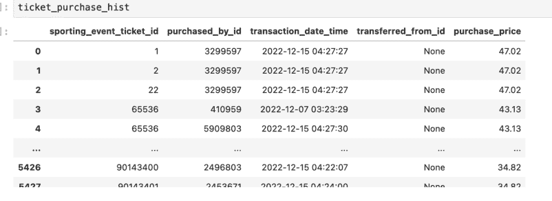

Figure 9.67: Exploring the ticket_purchase_hist table

该表包含票证 ID、交易日期、购买价格和购买人员 ID 的详细信息。我们可以单独使用此表来可视化每天售出的票数。

我们将使用 Matplotlib 散点图来可视化每天售出的票数。请注意这只是测试数据，我们已在本章前面运行存储过程来填充票证购买历史。在屏幕截图中显示的示例数据中，存储过程在两天内执行以生成票证购买数据量：

```
import matplotlib.pyplot as plt
plt.xticks(rotation=-90)
plt.scatter(ticket_purchase_hist['transaction_date_time'].dt.date, ticket_purchase_hist['purchase_price'])
```

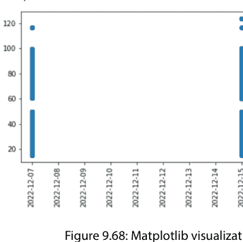

Figure 9.68: Matplotlib visualization of ticket purchase history data on a daily basis

我们使用了 xticks 旋转参数使日期值易于阅读。然后我们使用交易日期和购买价格创建散点图，如图所示。我们可以看到在较低的价格范围内售出的票数更多（点密集分布），但也有一些票以高价售出。让我们探索并找出售出价格高于

```
import seaborn as sb
plt.xticks(rotation=90)
scatter_plot=sb.scatterplot(x='transaction_date_time' , y='purchase_price', data=ticket_purchase_hist)
```

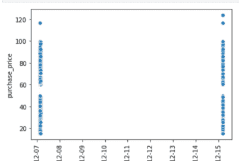

Figure 9.70: Ticket purchase history scatterplot drawn with the Seaborn package

为了了解座位类型对票价的影响，我们将票证购买历史与 sporting_event_ticket 表和 seat 表进行连接。

```
sporting_event_temp1=pd.merge(ticket_purchase_hist,sporting_event_ticket,left_on="sporting_event_ticket_id",right_on="id", suffixes=('_tph', '_ht'))
sporting_event_temp1.head(5)
```

```
...
```

```
sporting_event_temp2=pd.merge(sporting_event_temp1,seat,left_on=["sport_location_id","seat_level","seat_section","seat_row" suffixes=('_tph', 'seat'))
sporting_event_temp2.head(5)
```

| sporting_event_ticket_id | purchased_by_id | transaction_date_time | transferred_from_id | purchase_price | id | sporting_event_id | sport_location_ |
|---|---|---|---|---|---|---|---|
| 0 | 1 | 3299597 | 2022-12-15 04:27:27 | None | 47.02 | 1 | 1 |
| 1 | 2 | 3299597 | 2022-12-15 04:27:27 | None | 47.02 | 2 | 1 |
| 2 | 22 | 3299597 | 2022-12-15 04:27:27 | None | 47.02 | 22 | 1 |
| 3 | 65536 | 410959 | 2022-12-07 03:23:29 | None | 43.13 | 65536 | 2 |
| 4 | 65536 | 5909803 | 2022-12-15 04:27:30 | None | 43.13 | 65536 | 2 |

Figure 9.71: Joining the sporting event table with ticket purchase history to get seat details

有了这些新数据，我们将在之前的散点图中可视化座位类别。我们将添加 seat_type 作为 hue 参数，这将根据座位类型为图表中的数据点着色，如图所示：

```
import seaborn as sb
plt.xticks(rotation=90)
scatter_plot1=sb.scatterplot(x='transaction_date_time', y='purchase_price',hue='seat_type', data=sporting_event_temp2, ma
```

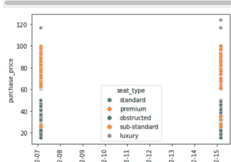

Figure 9.72: Ticket purchase history visualization along with seat type

这给我们一个想法，即豪华座位价格昂贵且仅不频繁售出，而高级座位和标准座位则大量售出。

让我们进一步探索，通过了解每种座位类型类别的平均票价。我们将为此用例绘制条形图。但在此之前，我们需要了解 pandas DataFrame 中 purchase_price 列的数据类型：

```
<class 'pandas.core.frame.DataFrame'>
Int64Index: 5431 entries, 0 to 5430
Data columns (total 15 columns):
#   Column                     Non-Null Count  Dtype
---  ------                     --------------  -----
0   sporting_event_ticket_id   5431 non-null   Int64
1   purchased_by_id            5431 non-null   Int64
2   transaction_date_time      5431 non-null   datetime64[ns]
3   transferred_from_id        0 non-null      object
4   purchase_price             5431 non-null   float64
5   id                         5431 non-null   Int64
6   sporting_event_id          5431 non-null   Int64
7   sport_location_id          5431 non-null   Int64
8   seat_level                 5431 non-null   Int64
9   seat_section               5431 non-null   string
10  seat_row                   5431 non-null   string
11  seat                       5431 non-null   string
12  ticketholder_id            5431 non-null   Int64
13  ticket_price               5431 non-null   object
14  seat_type                  5431 non-null   string
dtypes: int64(7), datetime64[ns](1), float64(1), object(2), string(4)
memory usage: 716.0+ KB
```

Figure 9.73: pandas DataFrame info function to understand the data type of columns

我们可以看到 purchase_price 列是 object 类型，这将在条形图上聚合时会抛出错误。让我们将其转换为 float 对象类型，然后创建条形图。我们还将在条形上方添加 purchase_price 值，以便更好地了解票价范围，如图所示：

```
sporting_event_temp2["purchase_price"]=sporting_event_temp2.purchase_price.astype(float)
ax=sb.barplot(x='seat_type',y='purchase_price', data=sporting_event_temp2)
for i in ax.containers:
    ax.bar_label(i,)
```

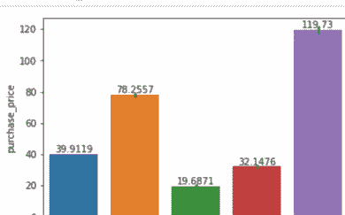

Figure 9.74: Bar plot showing the average purchase price for each ticket type

这个图表还不错，但如果我们能按 purchase_price 的顺序对图表进行排序，以便更好地可视化，那就更好了。因此，我们将首先按购买价格对 DataFrame 进行排序并重置 pandas DataFrame 索引。我们还将使用 alpha 参数以更美观的方式绘制图表来调整条形图的透明度。

```
sporting_event_temp2["purchase_price"]=sporting_event_temp2.purchase_price.astype(float)
sporting_event_temp2 = sporting_event_temp2.sort_values("purchase_price").reset_index(drop=True)
ax=sb.barplot(x='seat_type',y='purchase_price', data=sporting_event_temp2, alpha=0.5)
for i in ax.containers:
    ax.bar_label(i,)
```

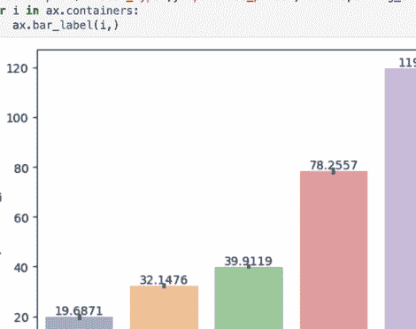

Figure 9.75: Sorted bar plot to understand the seat type and average price for that category of seats


现在，我们能够更清晰地可视化不同座位类型对票价区间的影响。我们可以进一步探索如何根据每种座位类型的售票数量，通过为某些座位类型提供折扣来最大化票务销售额。

这些库还支持更多类型的可视化，你可以使用之前提供的这些库的链接来进一步了解它们。对于大多数用例，前面介绍的库应该足以实现用户数据的可视化。此外，我们建议使用 Amazon QuickSight 来可视化更复杂的用例。

## 摘要

在本章中，我们学习了如何对数据集执行 pandas 操作以实现数据整理目的。我们通过发现、结构化、清理、丰富、数据质量验证以及可视化等阶段，探索了数据整理生命周期的各个阶段，以及如何使用 pandas 操作无缝执行这些活动。用户可以使用 AWS SDK for pandas（也称为 awswrangler 集成）结合 pandas 数据帧，在 AWS 云服务上执行数据整理活动。

在下一章中，我们将学习 SageMaker Data Wrangler，它有助于将数据整理活动作为机器学习流程的一部分来执行。

## 使用 SageMaker Data Wrangler 进行机器学习的预处理

在*第 4 章*中，我们向你介绍了 SageMaker Data Wrangler，这是一种专门用于处理机器学习数据的工具。我们讨论了为什么机器学习的数据处理是整体机器学习流程中的关键组成部分，以及处理不干净或原始数据的一些风险。我们还涵盖了 SageMaker Data Wrangler 的核心功能，以及它如何有助于解决机器学习数据处理中的一些关键挑战。

在本章中，我们将通过一个实际的分步骤数据流程，将示例数据集预处理为适合机器学习使用，从而更进一步。我们将首先使用 SageMaker Data Wrangler 预加载的示例数据集，然后使用 Data Wrangler 内置的分析功能进行一些基本的探索性数据分析。我们还将为数据集中的不平衡和偏差添加几个自定义检查。特征工程是机器学习周期中的关键步骤。它包括选择和转换原始数据特征，生成更能代表机器学习模型底层问题的新特征。我们将创建一个 Data Wrangler 流程，并在我们的示例数据集上定义数据转换来进行特征工程。SageMaker Data Wrangler 是一个统一的数据处理工具，使你可以完成完整的机器学习周期，包括训练机器学习模型并直接从工具内部部署模型用于推理。我们将导出处理后的数据，并从 Data Wrangler 训练和部署模型。

本章涵盖以下部分：

- 登录 SageMaker Studio
- 导入数据
- 探索性数据分析

### 步骤 1 – 登录 SageMaker Studio

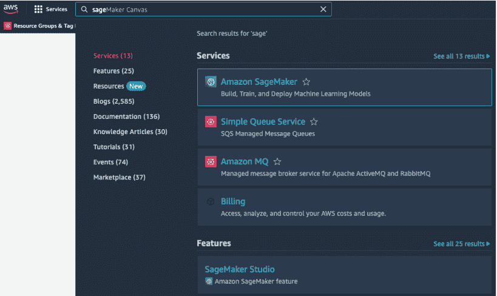

图 10.1：AWS 控制台 – SageMaker

进入 SageMaker 界面后，你应该能看到你在*第 4 章*先决条件部分中创建的域。在继续之前，请确保域的状态为 **InService（服务中）**。如果你完全看不到域，请验证你当前所在区域是否是你创建域的区域。在 AWS 控制台的右上角部分检查并切换你的区域。点击域名。

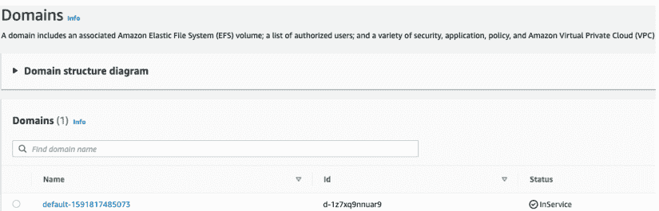

图 10.2：SageMaker 域

这将带你进入该域的注册用户列表。如果你遵循了*第 4 章*中的先决条件步骤，你会在这里看到你创建的用户。如果你看不到用户，你可以使用**添加用户**按钮创建一个新的 SageMaker Studio 用户。有关详细信息，请参阅*第 4 章*中的先决条件步骤。使用**启动**按钮上的下拉选项选择**Studio**。这将带你进入 SageMaker Studio 主页。


图 10.3：SageMaker Studio

如果你第一次登录 SageMaker Studio，创建和设置用户环境需要几分钟时间。在 SageMaker Studio 主页上，点击**可视化导入和准备数据**。这将带你进入 Data Wrangler 页面并创建一个新流程。

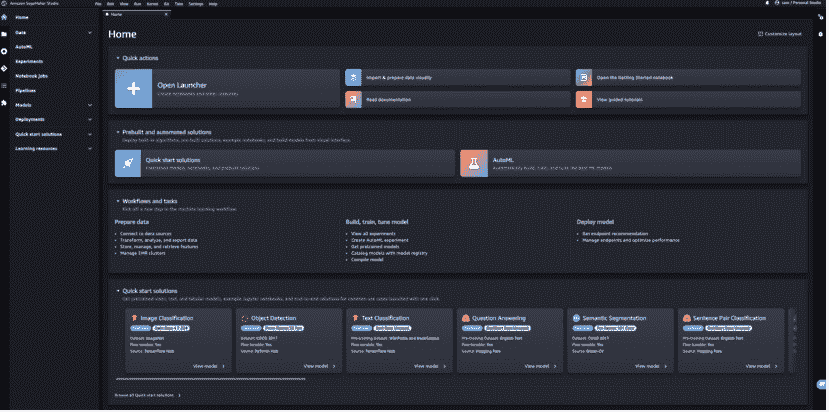

图 10.4：SageMaker Studio 主页

一旦你登录并启动了 Data Wrangler，你就需要将数据导入 SageMaker。我们将在*步骤 2*中介绍这部分内容。

### 步骤 2 – 导入数据

在我们可以开始将数据导入 SageMaker Data Wrangler 之前，我们需要与数据源建立连接。SageMaker Data Wrangler 提供了适用于 Amazon S3、Amazon Athena、Amazon Redshift、Snowflake、Amazon EMR 和 Databricks 的现成原生连接器。除此之外，你还可以使用 Amazon AppFlow（一项完全托管的集成服务，帮助你安全地在**软件即服务 (SaaS)** 应用程序之间传输数据）设置新的数据源，连接超过 40 种 SaaS 和 Web 应用程序。**创建连接**界面显示了 Data Wrangler 中的连接器，以及你可以使用 Amazon AppFlow 设置的额外数据源。

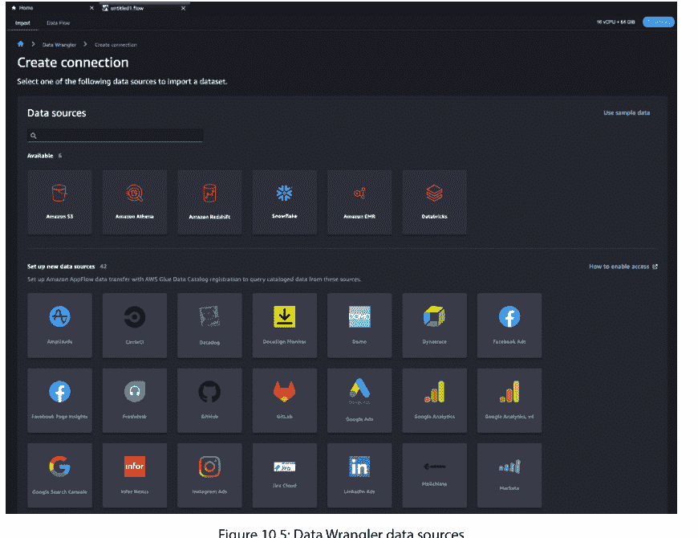

在本章中，我们将使用一个公开可用的示例：泰坦尼克号数据集。由于该示例数据集能够应用许多常用的数据处理和机器学习技术，泰坦尼克号数据集被视为机器学习数据集中的“你好，世界”（Hello World）。我们将使用泰坦尼克号数据集的一个略微修改版本。你可以在此了解更多关于该数据集的信息：https://www.openml.org/search?type=data&sort=runs&id=40945&status=active。该数据集通过公共 S3 存储桶提供。要在 Data Wrangler 中使用此数据集，我们可以将其上传到我们 AWS 账户中的 S3 存储桶，或者直接通过“数据源”部分右上角的**使用示例数据**选项将数据集直接导入 Data Wrangler。在本章中，我们将使用后者。

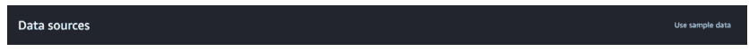

图 10.6：Data Wrangler 示例数据

点击“使用示例数据”后，将在托管该数据集的 S3 存储桶中创建一个 Data Wrangler 连接，并将该数据集的一个示例子集加载到 Data Wrangler 中。这也为你的数据流创建了起点。

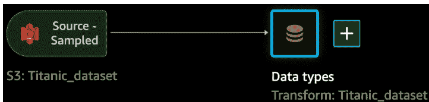

图 10.7：Data Wrangler 数据流

你可以通过双击源（在本例中为 S3）来查看数据集样本。这将显示数据集的前几行，以及标题或列名（如果存在）。在这里，你还可以检查 Data Wrangler 自动确定的每个特征或列的数据类型。

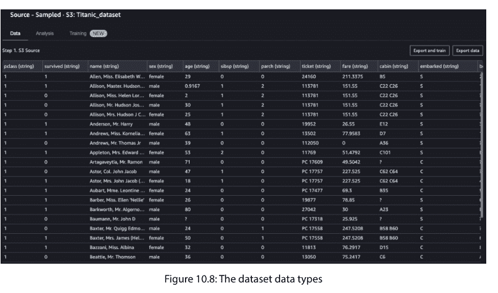

你可能已经注意到，Data Wrangler 自动对你的数据集做出了一些假设，例如文件格式、数据类型、采样方法和数量。你可以通过点击**加号**并选择*编辑数据集*选项来更改这些设置。Data Wrangler 还自动检测了我们的数据集文件格式、分隔符，以及第一行包含标题。你可以更改这些设置。例如，你可以将文件从 `csv` 更改为**Parquet**，或将分隔符从**COMMA（逗号）**更改为**space（空格）**。有时，你的数据集可能没有标题，因此你也可以在此更新标题设置。默认情况下，Data Wrangler 将选择*前 K 个（First K）*方法对数据集进行采样。你可以将此采样方法更改为**随机（random）**或**分层（stratified）**。你还可以在此设置样本大小。

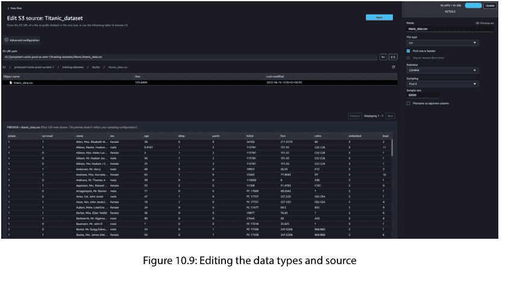


这里有一个关键点需要牢记：如果你计划使用 Data Wrangler 进行模型训练，并且在此处使用了采样，那么你需要重新导入数据。我们将在本章的后半部分介绍模型训练。在接下来的步骤中，我们将进行一些探索性数据分析（EDA），以便更好地理解我们的数据。

## 探索性数据分析

在进行任何数据转换或操作之前，我们需要充分了解我们的数据。**探索性数据分析**（EDA）是数据科学中至关重要的一步，因为它使我们能够理解所处理数据的结构和特征。EDA 涉及使用各种技术和工具来总结和可视化数据，以识别模式、趋势和关系。此外，在进行任何数据转换或建模之前执行此步骤也很重要，因为 EDA 可以帮助我们理解哪些特征与当前的机器学习问题相关，哪些特征最为重要。EDA 可以帮助你理解数据的分布，并识别数据集中特征之间存在的关系。在处理现实世界的真实数据时，你不可避免地会遇到数据质量问题，例如缺失数据、各类别不平衡、数据收集错误以及离群值。EDA 有助于识别这些数据质量问题，这些问题可能会对机器学习模型的质量产生不利影响。Data Wrangler 通过内置的数据分析报告提供了常用的 EDA 工具，你还可以生成自定义的数据分析。

## 内置数据洞察

AWS Data Wrangler 开箱即用地提供了几种常用的数据分析工具。在本节中，我们将介绍其中一些。你可以点击数据源图标旁边的 + 按钮并选择**获取数据洞察**（Get Data Insights）进入**数据分析**部分。

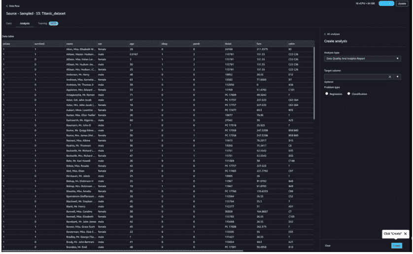

图 10.10：Data Wrangler 数据洞察

让我们创建一个新的分析报告：

- 1. 选择数据质量与洞察报告。
- 2. 选择你的目标列，或者你的机器学习模型试图预测的列。
- 3. 在这里，我们还需要选择我们将尝试解决的机器学习问题类型，是分类问题还是回归问题。在我们的案例中，我们试图预测乘客是否幸存于泰坦尼克号悲剧。我们将目标列改为 Survived（生存），将问题类型设置为分类（Classification），然后点击创建按钮。Data Wrangler 将花费几分钟时间生成报告。这当然取决于你的数据集和样本大小。

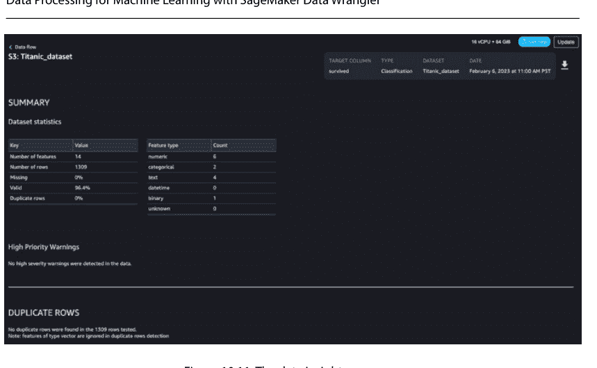

图 10.11：数据洞察摘要

让我们逐一查看报告的不同部分，首先从顶部的摘要开始。摘要包括你数据集的关键统计信息和特征类型。在这里，我们可以看到数据集中的总行数、缺失行数以及重复行数（如果有的话）。在摘要部分，你还可以查看数据集中特征的数量及其计数。如果数据集中存在将对机器学习模型质量产生显著影响的关键错误，它们将显示在报告的**高优先级警告**部分。高优先级警告的一个例子是目标泄露（target leakage）。当某个特征直接受目标变量影响时，就会发生目标泄露，导致在训练集上准确率很高但在测试数据上表现糟糕。为了防止目标泄露，重要的是将目标变量排除在训练过程之外，确保我们仅使用独立特征来训练模型。

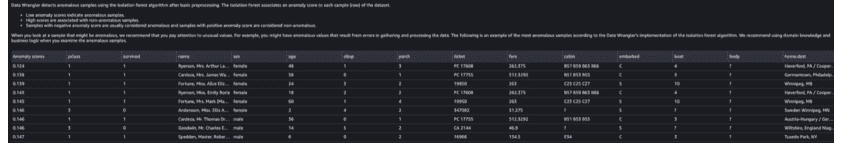

图 10.12：数据洞察异常值

报告的下一部分显示了数据中可能存在的异常值。Data Wrangler 在基本预处理后使用孤立森林（Isolation Forest）算法检测异常样本。孤立森林算法根据数据点与其他数据的距离来检测异常值。该算法为数据集中的每条记录计算一个异常分数。负分数被视为异常值，而较高的分数表明样本非异常。虽然移除所有被归类为异常的样本很有诱惑力，但有时，根据机器学习问题和数据集的情况，保留训练数据集中的异常值可能是有用的。在我们的示例数据集中，我们可以看到某些记录的异常分数较低，但没有负值。我们将保留这些样本作为训练数据的一部分。

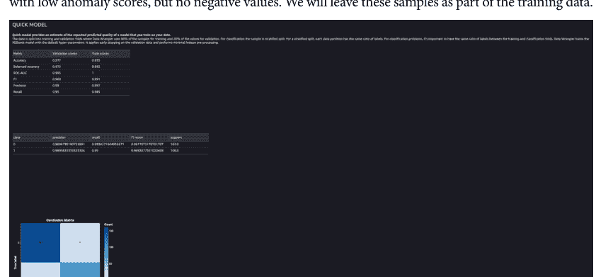

图 10.13：数据洞察快速模型

目标列部分告知我们目标变量的分布以及其他相关信息，例如缺失记录。在我们的示例数据集中，我们可以看到泰坦尼克号悲剧中的幸存人数少于未幸存的人数。虽然数据集中存在轻微的分类不平衡，但这并不足以对我们的机器学习模型造成损害。在发现显著分类不平衡的情况下（例如，某个类别过度代表或代表不足的场景），请考虑其他数据平衡技术，例如对多数类进行欠采样（under-sampling）或对少数类进行过采样（over-sampling）。

报告中的快速模型部分是通过自动在数据集中的样本上训练 XGBoost 模型生成的。快速模型自动保留 20% 的样本数据并将其用于测试。快速模型的目的是提供模型预期预测质量的估算。根据机器学习问题的类型（即分类或回归），快速模型会生成各种指标来评估模型质量。在我们的例子中，由于我们面对的是分类问题，我们可以看到诸如准确率、F1 分数、精确率、召回率和 AUC 等指标。例如，我们可以看到训练数据集中的 F1 分数为 .99，而验证数据集中的分数为 .96。

更高的 F1 分数意味着模型具有更高的准确性，在精确率和召回率之间取得了更好的平衡，表明误报和漏报较少，从而在分类任务中表现更好。由于我们正在处理分类问题，除了这些关键指标外，快速模型部分还生成了一个混淆矩阵，用于比较我们样本数据集中的实际类别和预测类别。

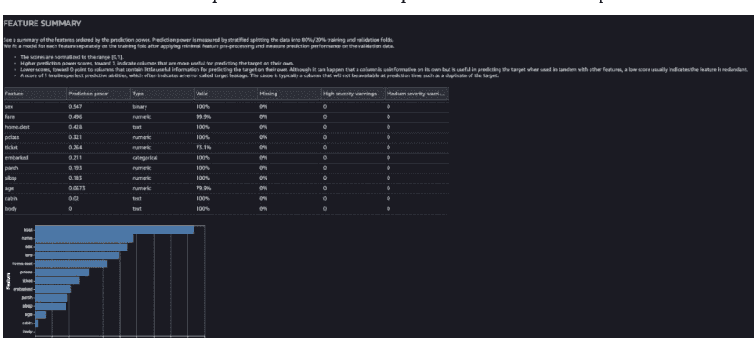

图 10.14：数据洞察特征摘要

报告中的特征摘要部分生成特征重要性或特征的预测能力。这有助于使我们的机器学习模型更具可解释性。我们将特征重要性的值归一化到 0 到 1 的尺度上。值越接近 1，表明该特征在最终预测中越重要。值等于 1 可能表明存在目标泄露。相比之下，较低的分值（接近 0）指向包含对预测目标信息较少的列。你可能会决定对这些列进行特征工程或直接删除它们。

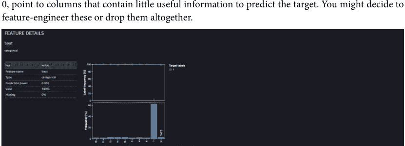

图 10.15：数据洞察特征详情

**特征详情**部分列出了我们数据集中每个特征的关键信息。例如，它可以突出显示可能包含错误或不干净数据的列。我们可以看到一个名为“boat”（船）的特征，它是一个具有九个类别的分类特征。这种情况很少见，可能指向数据收集中的错误。在数据转换阶段，我们可能会决定删除该列或对该列应用特征工程。

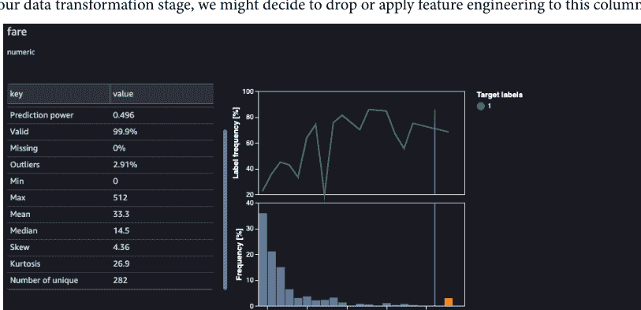

图 10.16：数据洞察数值特征

同样，对于数值特征，**特征详情**部分可以列出关键描述性统计信息，例如平均值和中位值，除了最大值、最小值、缺失值和离群值外。你还会得到这些数值特征的值的频率分布。

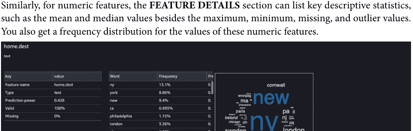

图 10.17：数据洞察基于文本的特征


虽然我们正在处理结构化的表格数据，但某些列包含纯文本数据，例如目的地或姓名特征。虽然删除这些特征可能看似显而易见，但应用数据转换并提取有助于改善预测的有用信息也是可能的。在处理这些特征时，报告中的**特征详情（FEATURE DETAILS）**部分可以对包含文本的特征进行分词，并显示诸如词频等有用信息，从而帮助我们做出特征转换决策。

**特征详情（FEATURE DETAILS）**部分是确定我们要在数据整理过程中添加哪些具体的特征转换步骤的重要场所。

## 第 3 步 – 创建数据分析

正如前一节所述，Data Wrangler 开箱即用的内置数据分析报告涵盖了机器学习中许多常用的探索性数据分析（EDA）；然而，你还可以在 Data Wrangler 中创建额外的分析和自定义分析。在本节中，我们将介绍其中的一些内容：

- **目标泄漏（Target leakage）**是机器学习中的一个常见问题，即使用目标变量或结果的信息来创建特征或预测变量，从而导致模型过于乐观或存在偏差。当使用在预测或决策时间不可用的信息创建的特征来训练预测模型时，就会发生目标泄漏。目标泄漏分析至关重要，因为它有助于确保预测模型建立在有效且无偏差的数据之上。在 Data Wrangler 中，你可以通过点击数据集旁边的 + 图标并选择 **Add Analysis（添加分析）**来生成目标泄漏分析。在 **Analysis Type（分析类型）**下拉菜单中，选择 **Target Leakage（目标泄漏）**。然后，选择问题类型和目标下拉菜单中的一个选项。

  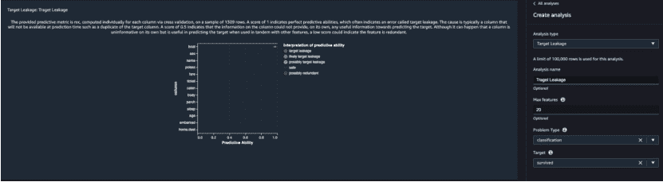

  *图 10.18：目标泄漏*

  如你所见，在我们的数据集中，`boat` 特征可能存在目标泄漏问题。`boat` 特征包含乘客所乘救生艇的编号（如果乘客乘坐了救生艇）。该特征可能不适用于我们数据集中的所有记录，并且是在预测后填充的。我们将在数据转换和特征工程步骤中研究如何处理这个问题。

- 散点图分析：散点图表示两个或三个变量之间的关系。在我们的示例数据集中，我们将使用散点图来可视化票价（fare）、年龄（age）和目标变量存活状态（survived）之间的关系。你可以按照与之前添加分析相同的方式添加新分析。在 **Analysis type（分析类型）**下拉菜单中，选择 **Scatter Plot（散点图）**，然后选择 `age` 作为 X 轴，`fare` 作为 Y 轴。要将目标作为另一个变量添加，请在 **Color by（按颜色区分）**下拉菜单中选择 `survived`。

  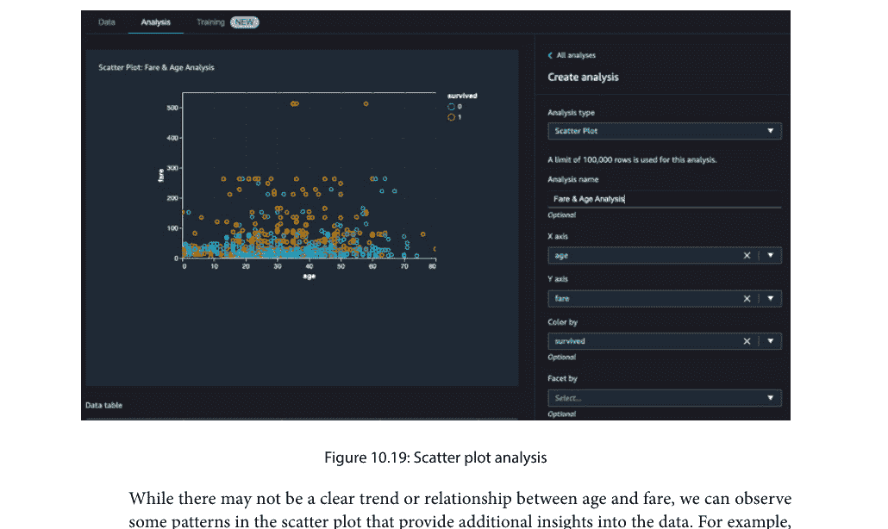

  虽然年龄和票价之间可能没有明显的趋势或关系，但我们可以观察到散点图中的一些模式，为数据提供额外的洞察。例如，我们可以发现支付较高票价的乘客存活率更高。或者，我们可以发现与成人相比，儿童的存活率更高，显示出存活率中潜在的年龄相关因素。

- 自定义可视化：除了使用预定义的分析可视化外，你还可以使用 Altair 在 Data Wrangler 中创建自己的自定义数据可视化。Altair 是一个 Python 数据可视化库，允许用户使用简洁且直观的代码轻松创建交互式可视化。它还与 Python 其他数据分析库（如 pandas、NumPy 和 SciPy）很好地集成，使其成为数据科学家和分析师的流行选择。Data Wrangler 使用 `df` 变量来存储数据框，用户可以访问该变量。你可以通过点击任何步骤的 + 按钮并选择 **Add analysis（添加分析）**来添加类似于上述的自定义可视化。将分析类型设置为 **Custom Visualization（自定义可视化）**。在这里，我们将创建一个数据集。

**方差膨胀因子（variance inflation factor, VIF）**是变量之间共线性的度量。我们通过解决一个回归问题来计算它，即在给出其他变量的情况下预测其中一个变量。VIF 分数是一个大于或等于 1 的正数，得分为 1 表示该变量与其他变量完全独立。分数越大，依赖性越强。经验法则是，我们可以删除或特征工程化 VIF 分数大于 1 的特征。

要使用 VIF 创建多重共线性分析，请选择 **Add Analysis（添加分析）**，然后选择 **Multicollinearity（多重共线性）**。

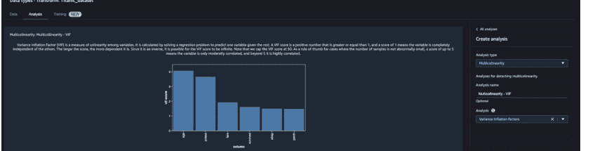

*图 10.21：使用 VIF 进行多重共线性分析*

点击预览后，你会看到一个直方图，*X* 轴显示特征名称，*Y* 轴显示 VIF 分数。在我们的示例中，我们可以看到，基于 VIF，我们没有具有多重共线性的特征。

- 除了 VIF，Data Wrangler 还提供了几种你可以开箱即用的其他多重共线性分析。让我们看看 **Lasso 特征选择分析（Lasso feature selection analysis）**。Lasso 方法涉及在回归模型中添加一个惩罚项，将自变量的系数向零收缩。该惩罚项有助于识别哪些自变量对预测因变量最为重要，也有助于解决多重共线性问题。要在 Data Wrangler 中使用 Lasso 特征选择方法，请选择之前讨论过的 **Multicollinearity（多重共线性）** 分析，然后将 **Analysis（分析）**设置为 **Lasso feature selection（Lasso 特征选择）**。你可以可选地选择 L1 幅度，即惩罚项；默认值为 **1**。接下来，我们将问题类型设置为 **Classification（分类）**，并将标签列设置为 **Survived（存活）**。这将创建一个基线回归模型，使数据集中所有自变量的正则化参数设置为足够大，导致某些系数向零收缩。这将创建一个直方图，显示最重要的特征——即具有非零系数的特征。

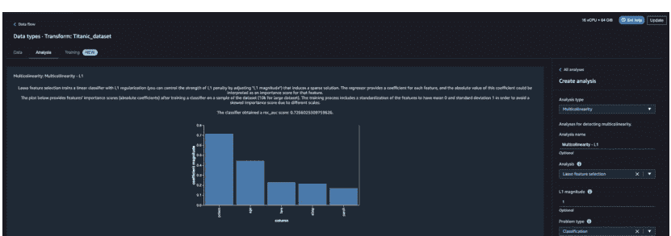

*图 10.22：使用 Lasso 特征选择进行多重共线性分析*

检查所选自变量之间的相关性，以确定是否存在任何多重共线性问题。通过以这种方式使用 Lasso 特征选择方法，你可以识别并解决回归模型中的多重共线性，这有助于提高其准确性和可靠性。

除了我们在本章节中涵盖的分析外，Data Wrangler 还具有分析其他特定类型数据集（如时间序列数据）的功能。这些功能允许你进行异常检测和季节性趋势检测等额外分析。现在，你对数据和底层模式有了很好的理解，你可以进入下一步，通过添加转换来修改你的数据。

## 第 4 步 – 添加转换

作为数据分析的一部分，你可能已经注意到想要更改或转换的数据集元素。数据转换的目标是使数据更适合建模，提高机器学习算法的性能，或处理缺失或损坏的值。机器学习的特征转换可以包括归一化、标准化、数据编码和分箱等。并非所有数据集都相同，也并非所有转换都适用于所有数据集。数据分析的目标是为你的数据集确定特定的转换。虽然通常我们在机器学习管道中将数据转换作为早期步骤，在数据用于训练模型之前应用，但在实际机器学习中，我们会持续监控模型性能，并在必要时应用转换。在 Data Wrangler 中导入并检查你的数据集后，你可以开始在数据流中添加转换。你可能已经注意到，我们数据集中的某些列没有与其关联的正确数据类型。例如，我们数据集中的 `age` 特征具有 String 类型，而不是 Numeric 类型。在应用转换之前，我们建议审查并修复数据集中所有特征的数据类型。

你可以审查 Data Wrangler 自动分配给特征的数据类型。


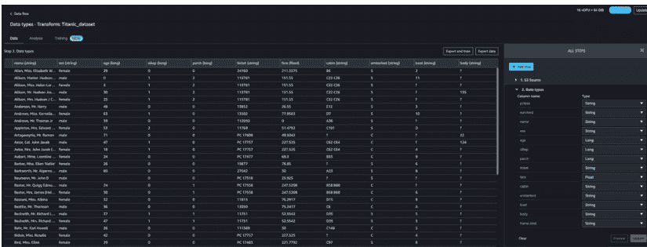

图 10.23：数据源数据类型

您可以使用以下步骤来执行此操作：

- 前往数据流界面并双击**数据类型**框。这将打开一个部分，列出您的所有特征以及自动推断出的每个特征的数据类型。屏幕右侧还会实时显示您数据集的预览。
- 您可以使用**类型**下拉菜单来更改特定特征的数据类型。在进行下一步之前，让我们先执行其中一些操作。在这里，我们将`age`、兄弟姐妹（**sibsp**）和父母（**parch**）的数据类型更改为 Long，并将`age`特征更改为`Float`。在我的案例中，Data Wrangler 自动将这些所有特征分类为**字符串**。如果您在自己的账户中尝试此操作，结果可能略有不同。一旦您选择了特征所需的数据类型，即可使用**预览**按钮查看预览。
- 一旦您对更改感到满意，就可以点击**更新**按钮以应用这些更改。

## 类别编码

在删除前一部分中的特征后，我们的示例数据集中仍有两个包含表示类别的文本数据的特征，即**sex**（性别）和**boat**（救生艇）。我们将使用类别编码来转换**sex**特征。类别编码是一种常见的特征工程技术，它将代表一组离散值的分类数据转换为可用于机器学习模型的数值数据。由于大多数机器学习算法都基于数值数据工作，而分类数据不能直接用于许多机器学习模型，因此类别编码是必要的。有几种常见的类别编码技术，例如“独热编码”，其中每个类别值被转换为一个新列，并分配给该列 1 或 0。例如，**sex**特征可以通过独热编码转换为两个新列，`sex_male`（男性）和`sex_female`（女性），每列根据**sex**特征的原始值包含 1 或 0。标签编码是另一种常用的类别编码方法，它为每个类别分配一个唯一的整数值。例如，在我们的情况下，如果我们对**sex**特征应用标签编码，

我们将得到分别对应`female`（女性）和`male`（男性）值的 1 和 2。由于我们处理的是数字，较高的数值可能与具有较高正相关或负相关性的机器学习模型相关联，而这并不是我们想要的特征结果。除了独热编码和标签编码外，其他类别编码方法包括计数编码（将每个类别替换为其在数据集中出现的次数）和目标编码（将每个类别替换为该类别的目标变量的平均值）。目前，让我们对 sex 特征应用独热编码。我们将通过点击数据流中**删除列**按钮旁边的加号来添加一个新的转换步骤开始。

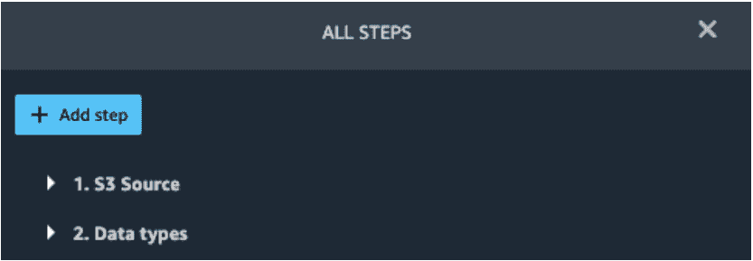

图 10.24：数据转换 – 添加步骤

接下来，点击**添加步骤**按钮并选择**类别编码**部分。在这里，您可以从**转换**下拉菜单中选择编码类型。我们将选择**独热编码**。我们将指定输入列，在我们的例子中是`sex`。接下来，指定您希望如何处理该列中的缺失值。您可以选择保留它们、跳过它们，或者如果在遇到缺失值时以错误结束转换过程。您可以预览转换，一旦您感到满意，就可以点击**添加**按钮将新的转换步骤添加到您的流程中。

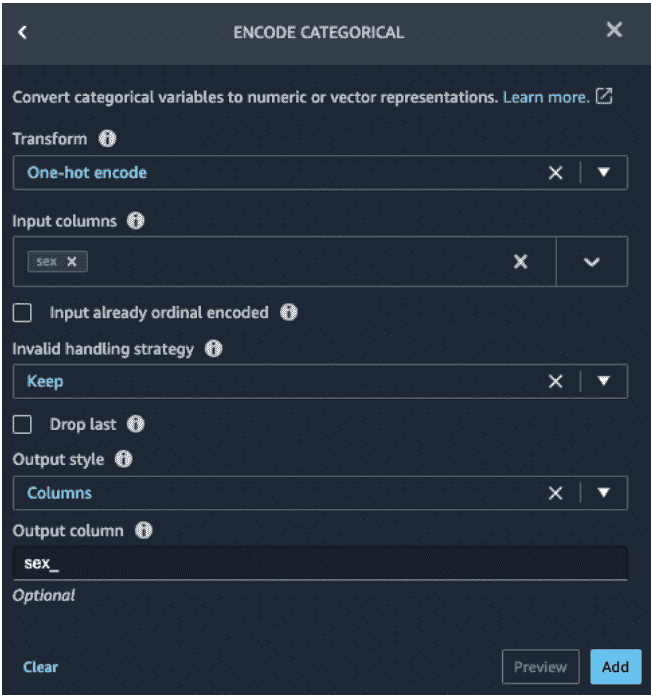

图 10.25：数据转换 – 独热编码

检查可视化器中的数据流，确保一切看起来符合预期。您现在应该看到一个用于独热编码的额外步骤。

## 自定义转换

Data Wrangler 提供了几种开箱即用的常用内置转换，无需从头编写代码即可使用。我们在前面的章节中介绍了其中两种：首先，当我们使用删除列转换从数据集中删除冗余或无关的特征时；另一种我们使用的内置转换是对 DataFrame 的 sex 特征应用类别编码转换来进行独热编码。除此之外，还有其他内置转换可用于处理文本数据和时序数据、处理缺失和异常数据，以及执行常见的数据工程任务，如降维和在平衡数据集中工作。然而，可能会有场景需要您进行超出内置转换范围的数据转换。Data Wrangler 通过**自定义转换**为您提供此功能，您可以在其中提供自己的 PySpark、PySparSQL 和 Python pandas 自定义代码，以及 Python 用户定义函数。选择要使用的特定类型自定义转换代码之前，注意数据集的大小至关重要。例如，如果您选择 Python (pandas)，您的数据集必须适合单个实例的内存。如果您有更大的数据集，请选择提供 PySpark 代码，这将允许您将数据分布在多个实例上并聚合结果。在我们的例子中，Titanic 数据集有一个**boat**（救生艇）特征，其中包含乘客如果登上的救生艇编号。虽然救生艇编号本身不包含重要信息，但乘客能够接触救生艇会显著增加其生存几率。我们将使用自定义转换来为数据集生成一个新特征，指定乘客是否能接触救生艇。以下自定义 Python 代码片段正是这样做的。它创建了一个新特征，**Lifeboat Exists**（是否有救生艇），并检查**boat**特征是否有值，如果有，则添加值 1，如果没有，则插入 0。最后，它删除现有的**boat**特征，因为不再需要它：

```python
# Table is available as variable `df`
# Assign a target value to check, in our case '?' and use an escape as
# this is a special character
target_value = '\\?'
# Create a new column that will check if value exists for boat number
df['lifeboat_exists'] = (~df['boat'].str.contains(target_value,
na=False)).astype(int)
# Drop the existing "boat" column
df.drop('boat', axis=1, inplace=True)
```

使用以下步骤在 Data Wrangler 中添加自定义转换：

1. 前往 Data Wrangler 流程，通过点击数据流中**删除列**步骤旁边的加号来添加一个新的转换步骤。
2. 接下来，点击**添加步骤**按钮并选择**自定义转换**部分。在这里，您可以为您的自定义转换步骤提供一个可选的名称；我们将调用它`Lifeboat_check`。
3. 然后，我们将选择类型；由于我们的数据集相对较小，我们将选择 Python (pandas)。您将收到一条警告消息，提醒您检查数据集大小并确保可以将其放入单台机器的内存中。
4. 然后您可以粘贴上一节中的代码。为了确保没有错误，点击**预览**按钮并确保一切正常。您应该看到创建了一个新列`lifeboat_exists`，并且之前的`boat`列应该不再存在。
5. 一旦您对结果感到满意，点击**添加**按钮将此转换作为数据流中的额外步骤添加。您还可以像在之前一样在可视化器中审查您的数据流。

```
df['cabin_bin'] = pd.cut(pd.factorize(df['cabin'])[0], num_bins,
labels=False)
# Drop the existing "cabin" column
df.drop('cabin', axis=1, inplace=True)
```

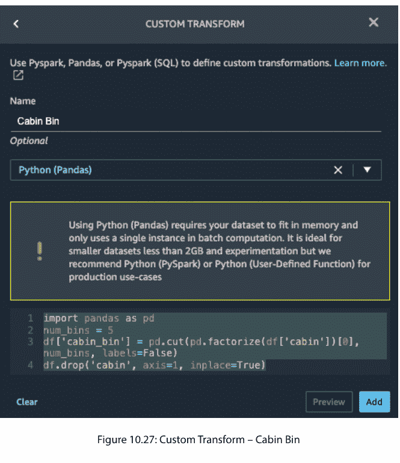

通过选择一个新的自定义转换，类似于我们为救生艇检查所做的那样，您可以添加此转换步骤。

## 数值缩放

使用梯度下降作为优化技术的机器学习算法，如线性回归、逻辑回归、神经网络等，要求数据进行缩放。您可以缩放数据集中特征的方法有两种。您可以应用归一化，也可以选择标准化。决定使用归一化还是标准化取决于归一化


of the distribution of the features. We use standardization for features with a normal distribution. If the features have a skewed distribution, normalization may be more appropriate. Normalization scales the features to a range of 0 to 1, while standardization scales the features to have a mean of 0 and a standard deviation of 1. In our case, fare is highly skewed, and age is closer to the normal distribution. For the sake of simplicity, we will apply normalization to both these features. To apply scaling in Data Wrangler, go to the Data Wrangler flow to add a new transform step by clicking on the + sign next to the last step in your data flow. Here, it is the transformation step for creating bins. Next, click the Add step button and choose the Process numeric section. Here, choose Min-max scaler as the scaler. For Input columns, select age and fare. Specify the Min and Max values. We keep them as 0 and 1. Optionally, give the prefix for the new input columns as scaled_. Hit the Preview button to make sure that the data looks correct.

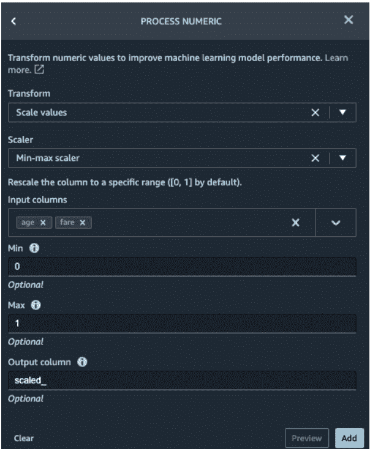

Figure 10.28: Scale values

Once you are satisfied with the results, click on the **Add** button to add this new transformation to your data flow. As usual, you can verify the flow in the Data Wrangler visualizer.

# Dropping columns

Now that we have applied several transformations, there are likely columns and features in our dataset that are redundant or no longer needed. Let’s review them now. Picking the right features and dropping irrelevant or redundant features are crucial steps in building a machine learning model because they can significantly affect the model’s performance and the quality of the predictions it makes. While feature selection directly improves the accuracy of the model by preventing overfitting issues, it also helps to keep the model simple and easier to explain, as well as reduce the training time, leading to cost and performance efficiencies. In other words, adding too many features may cause a complex model that may overfit on the training data and be difficult to explain and train. But how do you choose which features to drop and which to keep? Choosing the columns or features from a dataset often depends on the specific machine learning problem and the analysis that you do. Let’s look at some features in our example dataset that we could consider dropping, starting with the **name** feature. While we may deduce meaningful information about a passenger’s name, such as the sex of the passenger perhaps, it is unlikely to have any direct impact on whether the passenger survived, and it would be difficult to derive any meaningful insights from this column. In addition, we already have the sex of the passenger as a distinct feature in the dataset, so it makes the information irrelevant. Similarly, the **ticket** number is unlikely to affect survival and may not provide any useful insights. We could try deriving other useful information from the **ticket** feature, such as the class of passenger, but that information is also already available in the dataset as a distinct feature. This also is not likely to influence the chances of survival. We will drop the **home destination** feature, which shows the final destination of the passenger, for similar reasons. The **body** feature represents the body number of the recovered body of the passenger. A value for that feature would show the person would not have survived the tragedy. The **boat** feature has the lifeboat number of the passenger, which would also show that the passenger survived. Both these features can be tricky. In our example, we will drop the **body** feature as it is a strong and independent predictor of our target. We will, however, keep the **boat** feature. Finally, since we have already encoded the **sex** feature and scaled the **age** and **fare** features, we also no longer need those. To drop a feature, click on the + sign next to the last step and choose **Add Transform**. Data Wrangler refers to each data transformation we define as a step. On the **All Steps** screen, click on **Add step** to create a new transformation. This will bring up the **Add Transform** screen. Here, we will get a comprehensive list of out-of-the-box transformations that Data Wrangler provides. Let’s choose the **MANAGE COLUMNS** section and then choose **Drop column** from the **Transform** dropdown.

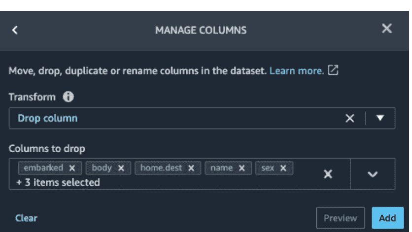

The **Drop column** transformation allows you to select the columns you want to drop from your dataset. Once we have selected the features, we can preview the changes and click on the **Add** button to add the data transformation to our flow. You can also go back and check to see whether a new step added to your data flow in the data flow visualizer. Once we have defined all our transformations, we are ready to actually apply them and export our data. We will cover this in *step 5*.

# Step 5 – exporting data

So far, we have performed several analyses on our dataset. We have also defined several feature engineering data transformations. However, it is important to remember that we have made no changes to the actual data itself yet. We have defined the data flow, which contains a series of analysis and transformation steps that can be executed before we build machine learning models. If you check the data flow, it will look something similar to the following:

You can choose to update your sources and your destination locations directly in the Jupyter notebook before executing it. Data Wrangler uses a SageMaker Processing job to apply the transformations from your data flow, which are defined in the Jupyter notebook.

- **Export to SageMaker Pipelines**: SageMaker Pipelines is a fully managed service to build machine learning pipelines. When you choose this option, Data Wrangler creates a Jupyter notebook with code to create a SageMaker pipeline that executes your entire data flow. As with the Export to S3 option, you are able to update your input and destination sources directly from the generated Jupyter notebook.
- **Export to an inference pipeline**: Using Data Wrangler, you can directly export to a SageMaker inference pipeline that can be used with a SageMaker endpoint. When you choose this option, Data Wrangler creates a Jupyter notebook with code to apply all the transformations in your data flow and then train an autopilot model. It then creates an inference pipeline and deploys it to an endpoint. The inference pipeline uses the Data Wrangler flow to transform the data from your inference request into a format that the trained model can use.
- **Export as Python code**: This option creates a Python script file with code that contains all the transformations defined in your data flow. Depending on where and how you run this script file, you might need to provide additional permissions to access your AWS resources.
- **Export to Feature Store**: Finally, you can use Data Wrangler to export directly to SageMaker Feature Store. SageMaker Feature Store is a fully managed feature repository for storing and retrieving all your features and the metadata associated with those features. SageMaker Feature Store uses a feature group, which is a collection of features. Using Data Wrangler, you can either update an existing feature group or create a new one. When you choose this option, Data Wrangler will create a Jupyter notebook with the code to define and configure a feature group in SageMaker Feature Store. It will then run a SageMaker Processing job to apply the transformations defined in your data flow and update the feature group.

Once we have the data in the right format and the location that we want, we can move on to the next step of building and training a machine learning model.

# Training a machine learning model

We have now used Data Wrangler to do data analysis and processing, which involved several steps, such as data cleaning, preprocessing, feature engineering, and exploratory data analysis. These steps are crucial before doing machine learning, as they ensure that data is in the correct format, we selected the relevant features, and we dealt with outliers and missing values using data transformation. Data Wrangler provides a unified experience, enabling you to prepare data and seamlessly train a machine learning model, all from within the tool.


**SageMaker Autopilot** 是一个自动化 **自动机器学习（AutoML）** 流程关键任务的工具。这包括探索您的数据、选择与问题类型相关的算法，以及准备数据以便于模型训练和调优。只需几次点击，您就可以使用 Autopilot、XGBoost 或您自己的算法，直接从 Data Wrangler **用户界面**（UI）自动构建、训练和调优 ML 模型。当您训练和调优模型时，Data Wrangler 会将您的数据导出到 Amazon S3 位置，以便 Amazon SageMaker Autopilot 可以访问它。让我们看看如何从 Data Wrangler 中开始模型训练：

- **导出数据**：首先点击 Data Wrangler 步骤旁边的 +，从该步骤开始训练。

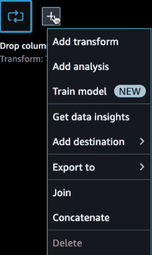

图 10.32：Data Wrangler – 训练模型

然后，选择 **Train model**。这将打开一个数据导出屏幕，您可以在其中指定要导出转换后数据的 S3 存储桶。SageMaker Processing 作业将应用从您选择训练模型的那一步开始的所有数据转换。接下来，您指定导出数据的格式。默认情况下，您选择了 CSV，但您也可以选择以 parquet 格式导出数据。您可以选择性地为数据指定加密密钥。

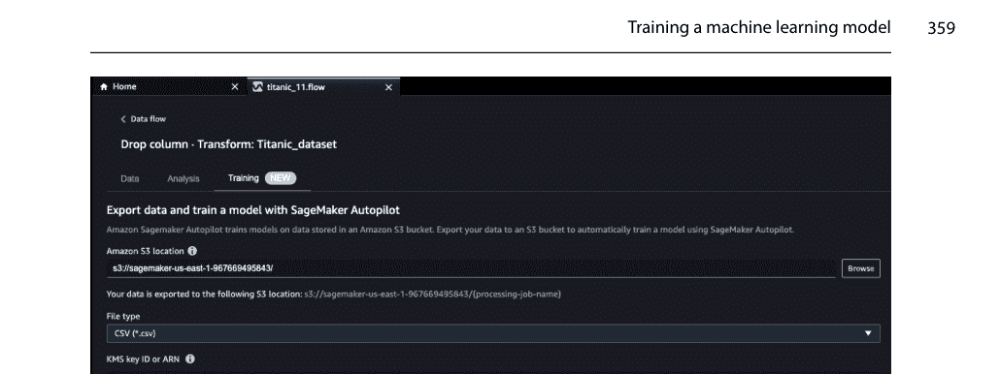

## 图 10.33：Train Model – 数据导入

需要注意的是，如果您选择在 Data Wrangler 中导入记录样本，则必须在开始模型训练之前重新导入数据且不进行采样，以确保训练过程使用您整个数据集。当您准备就绪时，点击 **Export and train**。这将启动导出过程。

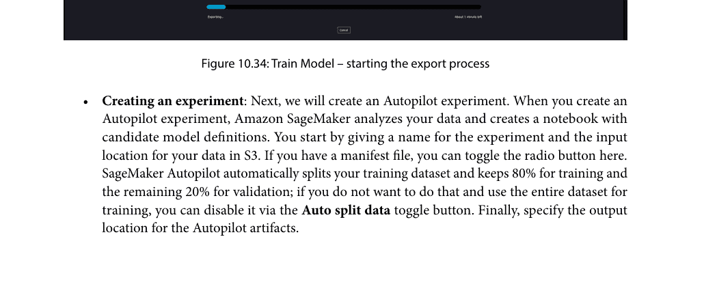

## 图 10.34：Train Model – 开始导出过程

- **创建实验**：接下来，我们将创建一个 Autopilot 实验。当您创建 Autopilot 实验时，Amazon SageMaker 会分析您的数据并创建一个包含候选模型定义的笔记本。您首先为实验命名并指定 S3 中数据的输入位置。如果您有清单文件，可以在此处切换单选按钮。SageMaker Autopilot 会自动将训练数据集拆分为 80% 用于训练，剩余 20% 用于验证；如果您不想这样做并使用整个数据集进行训练，可以通过 **Auto split data** 切换按钮将其禁用。最后，指定 Autopilot 工件的输出位置。


如果一切看起来符合预期，请点击 **Experiment and data details** 按钮。

- **指定目标和特征：** 在这里，您指定模型将预测的目标列。在我们的例子中，这是 **Survived** 列。以下部分允许您选择要用于训练的特征。默认情况下，Data Wrangler 将使用除目标外的所有特征进行训练。您也可以在此处指定特征的数据类型。由于我们已经在 Data Wrangler 中处理了数据，因此我们将使用默认值。

在我们的例子中，我们将选择默认的 **Auto** 方法。点击 **Next: Deployment and the advanced settings** 按钮继续。

- **指定部署设置**：在这里，我们将指定模型部署选项。SageMaker Autopilot 可以自动将模型部署到实时端点，我们可以使用它进行推理。默认情况下，SageMaker Autopilot 将部署最佳版本的模型以及数据转换到端点。您也可以覆盖此设置，选择不使用数据转换部署或根本不部署到端点。接下来，为端点指定一个名称。高级设置是可选的。您可以指定机器学习问题的类型，在我们的例子中是二元分类——也就是说，我们要预测的只有两种结果，乘客是否幸存。您还可以指定用于评估模型的指标；对于 **Binary classification**，默认选择 **F1** 分数，我们将保留它。这里还有几个可以调整的其他高级选项。我们将保留默认值，但让我们看一下其中的一些。


图 10.38：Train model – 部署设置

默认情况下，Autopilot 实验将运行多个训练作业以及超参数优化作业。如果您想限制这些作业的持续时间，可以在运行时限制部分进行操作。您还可以指定 SageMaker Autopilot 用于访问您的数据、运行处理和训练作业以及部署端点的特定 IAM。默认情况下，选择了 SageMaker 角色。您也可以通过指定 **AWS key** 来加密 S3 位置和训练实例的存储卷。在 **security** 部分，您可以通过指定 **virtual private cloud** 选择在私有网络中运行 Autopilot 作业。在 **Project** 部分，您可以将实验与特定的 SageMaker 项目关联，并在 **Tags** 部分指定额外的标签。接下来，点击 **Next: Review and create** 按钮。

- **Review and create**：在最后一部分，查看所有内容以确保所有细节都正确。当您准备就绪时，点击 **Create experiment** 按钮开始从 Data Wrangler 启动 SageMaker Autopilot 实验。


图 10.39：Train model – 查看实验

您可以在下一屏幕上查看训练进度，该进度从数据预处理阶段开始。您还可以在 **Job profile** 选项卡下找到有关作业的更多信息。


图 10.40：Train model – 实验进度

使用我们的数据集和默认作业设置，该过程需要几个小时才能完成。一旦完成，SageMaker Autopilot 将列出所有实验或作业运行以及关键评估指标、状态和时间。它还将显示用于创建部署端点的最佳模型。


图 10.41：Train model – 列出模型

在本节中，我们使用 Data Wrangler 和 SageMaker Autopilot 对转换后的数据训练了机器学习模型。我们还运行了微调作业并选择了最佳模型。您可以选择部署该模型。

## Summary

SageMaker Data Wrangler 是一个专门用于分析和处理机器学习数据的工具。它也是 AWS 上机器学习的基础平台之一。这是一个很长的章节，虽然我们涵盖了 Data Wrangler 的几个关键功能，但仍有一些功能未包含在这本书中。我们首先介绍了如何登录 SageMaker Studio 并访问 Data Wrangler。对于示例数据集，我们使用了通过公共 S3 存储桶提供的内置 Titanic 数据集。然后我们执行了 EDA，首先使用 Data Wrangler 中的内置洞察报告，然后添加了额外的分析，包括使用自定义代码。接下来，为我们的 Data Wrangler 流程定义了几个数据转换步骤以进行特征工程。为此，我们使用了 Data Wrangler 中的多个内置数据转换。我们还研究了如何使用 Python（pandas）应用自定义数据转换。一旦我们定义了数据转换，我们就研究了将 Data Wrangler 流程导出到各种目标的各种选项，包括 S3、SageMaker Feature Store、SageMaker Pipelines 和独立的 Python 脚本。最后但同样重要的是，我们研究了直接从 Data Wrangler 运行完整的端到端机器学习周期的便捷性，其中包括所有数据处理步骤，选择合适的算法，并运行训练实验以及超参数调优作业。作为本次练习的一部分，我们还将实验中的最佳模型部署为 SageMaker 实时端点。随着本章的结束，请确保删除您账户中创建的任何已使用资源。

随着我们进入本书的最后一章，我们将重点关注数据安全和监控。在这一最终部分，我们将把本书中探索的各种 AWS 服务汇集在一起，重点关注安全和监控。


## 11
数据湖安全
与监控

在前几章中，我们学习了数据整理流程，以及如何利用 AWS 生态系统中的不同服务进行数据整理活动。到目前为止，你应该已经掌握了使用 Glue DataBrew、SageMaker Data Wrangler 和 AWS SDK for pandas 创建数据管道的足够知识。我们还讨论了 AWS 服务（如 AWS Glue、Athena、Amazon S3 和 QuickSight）提供的功能，所有这些都更有效地支持数据整理管道中的特定活动。在本章中，我们将探讨如何为您的工作负载的数据整理管道设置安全和监控。

本章涵盖以下主题：

- 数据湖安全
- 监控与审计

## 数据湖安全

在本节中，我们将讨论增强数据湖安全性的各种选项和方法。我们将讨论跨越多个层级的安全性；然而，这应仅被视为一个起点。你需要进一步完善，并根据项目的需要添加额外的安全层级。

## 数据湖访问控制

为了保障数据湖的安全，我们可以结合使用基于用户的访问策略和基于资源的访问策略。用户策略附加到用户/角色，并控制用户/角色在账户内可执行的操作。除了基于用户的控制策略外，我们还可以通过将访问策略附加到 Amazon S3、Amazon SQS 等资源来控制对该特定资源的访问。这为保护 AWS 资源提供了另一层安全。作为一个通用最佳实践，访问策略应保持最小权限原则，仅允许在特定条件下执行所需的行动。

### 基于用户的访问策略

AWS 身份和访问管理（IAM）以集中式的方式帮助控制对 AWS 资源的访问。它同时为您的 AWS 账户提供身份验证和授权：

- 身份验证使用其凭据在访问 AWS 资源之前验证资源/人员的身份
- 授权验证已验证身份的用户/资源是否被允许执行特定操作

我们将在本节中更多地讨论 IAM 授权，以了解它如何保护数据湖的访问。

一些 IAM 策略的最佳实践在此处有详细说明。你还应遵循以下 AWS 文档中概述的最佳实践：[https://docs.aws.amazon.com/IAM/latest/UserGuide/best-practices.html](https://docs.aws.amazon.com/IAM/latest/UserGuide/best-practices.html)。让我们来看一下：

- 你应该使用服务控制策略（SCPs）为整个账户或组织内的多个账户应用权限护栏。护栏策略是用户在各账户上的最大可用权限。组织可以使用这些策略来阻止某些操作，以确保严格的安全姿态。一个例子是添加一个 SCP 策略，阻止个人团队成员创建新的角色/用户。以下链接提供了你开始使用的一些示例 SCP 策略：[https://docs.aws.amazon.com/organizations/latest/userguide/orgs_manage_policies_scps_examples_general.html#example-scp-restricts-iam-principals](https://docs.aws.amazon.com/organizations/latest/userguide/orgs_manage_policies_scps_examples_general.html#example-scp-restricts-iam-principals)。
- 你还可以为用户或角色提供 IAM 权限边界，以定义可以附加到该角色的权限最大边界。这将防止添加原本意图之外的额外权限。即使通过托管或内联策略为 IAM 用户/角色添加了更广泛的权限，权限边界也将作为预防性护栏，使该用户/角色只能拥有定义在权限边界内的访问权限。一个常见的用例是允许开发人员创建额外角色以执行日常任务，但同时也限制这些服务角色拥有更广泛的权限，以避免任何安全问题。请参阅以下博文，了解有关使用权限边界的更多详细信息：[https://aws.amazon.com/blogs/security/when-and-where-to-use-iam-permissions-boundaries/](https://aws.amazon.com/blogs/security/when-and-where-to-use-iam-permissions-boundaries/)。

你可以通过基础架构供应代码或控制台为特定用户将权限边界附加到个人用户角色：

```
1 - {
2       "Version": "2012-10-17",
3       "Statement": [
4           {
5               "Sid": "Statement1",
6               "Principal": "*",
7               "Effect": "Deny",
8               "Action": "*",
9               "Resource": ["arn:aws:s3:::wranglerbook", "arn:aws:s3:::wranglerbook/*"],
10              "Condition": {
11                  "NotIpAddress": {
12                      "aws:SourceIp": "172.0.0.0/24"
13                  }
14              }
15          }
16      ]
17  }
```


- 你还可以通过文件夹级别控制用户的访问。请注意，Amazon S3 是一个对象数据存储，具有扁平的文件存储层次结构；AWS 控制台将具有相同前缀的数据可视化为文件夹，以便于浏览。因此，在共享数据集的情况下，仅授予特定前缀的访问权限。例如，假设我们在不同的文件夹下存储了来自多个客户的数据。我们可以将特定用户角色的访问权限限制在特定的文件夹/前缀。请参阅以下文档路径，了解设置文件夹级别访问权限的存储桶策略示例：`https://docs.aws.amazon.com/AmazonS3/latest/userguide/example-bucket-policies.html#example-bucket-policies-folders`。

- 在需要为多组用户提供不同文件夹中对象访问权限的情况下，使用对象标签将访问权限限制为 S3 存储桶中的特定对象。例如，假设我们有三个不同的数据源（电子商务、代理、其他）将用户数据存入 S3 存储桶。每个源每天将上传两个文件，一个包含敏感数据（不应被用户访问），另一个不包含敏感数据（可被所有用户访问）。每个源将文件上传到以其名称命名的文件夹下。在这种情况下，我们可以使用对象标签来提供对不包含敏感数据的文件的访问权限，如下所示：

```
{
  "Version": "2012-10-17",
  "Statement": [
    {
      "Principal":{"AWS":[
        "arn:aws:iam::<<accountid>>/role/role_name"]},
      "Effect": "Allow",
      "Action": ["s3:GetObject"],
      "Resource": "arn:aws:s3::wranglerbook/*",
      "Condition": { "StringEquals": {"s3:ExistingObjectTag/dataclassification": "sensitive" } }
    }
  ]
}
```

图 11.3：基于附加到 S3 存储桶的标签限制访问的 S3 访问策略语句

你还可以在数据上传到 S3 存储桶时确保对象被正确标记，通过使标签成为 PutObject 操作的条件。请参阅以下 AWS 文档，了解基于对象的标签的更多详细信息：[https://docs.aws.amazon.com/AmazonS3/latest/userguide/example-bucket-policies.html#example-bucket-policies-object-tags](https://docs.aws.amazon.com/AmazonS3/latest/userguide/example-bucket-policies.html#example-bucket-policies-object-tags)。

### 控制数据湖访问的额外选项

你可以执行以下活动来保护数据湖中的数据：

- **S3 访问点**帮助简化被多个团队访问的共享存储桶的访问控制。它们是附加到 S3 存储桶的命名网络端点，具有不同的权限策略。S3 端点通过将每个用例的策略分离到独立的端点中，帮助管理具有复杂存储桶策略且难以维护的存储桶。一些常见用例包括托管大型共享数据集的存储桶，其中每个数据集具有不同的访问策略，以及在影响现有策略的情况下在 S3 存储桶上测试新的访问策略更改。

- **对象 Lambda 访问点**在你希望在访问点前使用 Lambda 函数时非常有用。它们有助于使用 Lambda 对象进行 PII 数据脱敏等情况。请参阅以下博文以了解如何实现此解决方案：[https://docs.aws.amazon.com/AmazonS3/latest/userguide/tutorial-s3-object-lambda-redact-pii.html](https://docs.aws.amazon.com/AmazonS3/latest/userguide/tutorial-s3-object-lambda-redact-pii.html)。

- **IAM Access Analyzer** 有助于验证策略的语法和最佳实践，识别与外部实体共享的资源，并基于 CloudTrail 日志生成策略。它帮助你应用遵循最小权限模型的政策，仅授予用户所需的最小权限。应定期验证，以确保根据最近的用户活动更新策略。


- **Amazon S3 日志选项**：Amazon S3 提供了几种日志选项，用于捕获所有用户操作，以满足审计、合规性和安全需求：
  - Amazon S3 服务器日志用于捕获细粒度详细的日志（生命周期转换事件、身份验证失败等）。这些日志包含对象大小、HTTP 引用者等额外字段。除了日志的存储成本外，没有额外费用。
  - AWS CloudTrail 事件（S3 API 调用）通过 CloudTrail 捕获对象和存储桶的 API 操作。日志可以传送到多个位置，并转发到 Amazon CloudWatch 进行进一步分析。除了日志存储成本外，CloudTrail 事件捕获还有额外费用，但它与其他系统的集成能力更强。

请参阅以下文档页面，了解 AWS CloudTrail 和 Amazon S3 服务器日志之间的区别：https://docs.aws.amazon.com/AmazonS3/latest/userguide/logging-with-S3.html。

- **Amazon S3 Inventory** 可帮助您定期导出 CSV/ORC/Parquet 格式文件，其中包含 S3 存储桶或前缀中的对象列表。此报告可用于分析对象的复制和加密状态，以确保数据安全。可以使用 Amazon Athena 查询清单文件，通过 SQL 查询识别 S3 存储桶中的监管或合规性问题。

## 监控、发现和识别安全问题

以下服务可帮助您监控、发现和识别数据湖中的安全问题：

- **AWS Config** 帮助用户持续监控 AWS 资源并审计配置变更。用户可以在 AWS Config 上配置规则，以监控和标记不符合所配置规则的资源。您可以设置 AWS Config 来验证组织内所有存储桶的公共读写配置。请参阅以下博客文章，了解如何使用 AWS Config 识别和更新您账户中 S3 存储桶的公共设置：https://aws.amazon.com/blogs/security/how-to-use-aws-config-to-monitor-for-and-respond-to-amazon-s3-buckets-allowing-public-access/。

- **AWS Trusted Advisor** 会扫描您账户中的 AWS 基础设施，并提供遵循最佳实践的建议。它可用于识别数据湖配置中的任何问题并适当修复。此服务适用于 AWS Enterprise Support 客户。Trusted Advisor 提供优化建议，帮助解决以下问题：
  - **成本优化**：识别未分配、未充分利用和空闲的 AWS 资源，帮助用户优化成本。
  - **性能**：通过分析 AWS 资源的吞吐量、延迟和计算使用情况，提供改进性能的建议。
  - **安全性**：识别暴露的凭证、安全组漏洞、S3 存储桶权限过于开放等问题，并提供相关建议。
  - **容错能力**：识别并突出 EC2 自动扩缩、健康检查、数据备份等。
  - **服务限制**：AWS 对不同服务设有服务限制。当用户达到服务限制的 80% 时，它会突出显示，以便用户做好充分准备。

- **Amazon Macie** 通过机器学习模式匹配识别您 S3 存储桶中的敏感数据。Macie 还支持对 S3 存储桶进行自动敏感数据发现。请参阅以下文章，了解使用 Amazon Macie 跨多个账户实现自动化敏感数据发现框架：https://aws.amazon.com/blogs/security/use-amazon-macie-for-automatic-continual-and-cost-effective-discovery-of-sensitive-data-in-s3/。

- **AWS GuardDuty** 是一项威胁检测服务，可持续监控您的 AWS 账户是否存在可疑活动。您可以使用 GuardDuty 监控 S3 管理事件和数据事件，从而识别安全问题。系统将生成报告，以便用户针对这些问题采取行动。一些常见用例包括：
  - 识别存储在 EBS 存储卷中的文件相关问题
  - 通过分析 EKS 审计日志识别容器部署问题
  - 识别受损凭证、可疑登录和访问模式等

## AWS Lake Formation 集成

AWS Lake Formation 为数据湖提供细粒度访问控制，允许您向 Data Catalog 资源、Amazon S3 位置以及底层数据上的各个主体授予权限。这可以实现对数据访问和用户操作的精确控制。

在 Lake Formation 中，有两种执行细粒度访问控制的方式：

- **IAM 访问控制**：推荐的方法是向各个主体授予对 Data Catalog 资源、S3 位置和底层数据的 IAM 权限。此方法可实现对数据访问的最大控制。
- **IAM 和 Lake Formation 权限**：此方法结合了 IAM 权限和 Lake Formation 权限。它有助于实施额外的安全控制，例如行级访问控制。

要有效配置安全规则，请考虑以下因素：

- **数据安全要求**：确定数据所需的安全级别，包括防止未经授权的访问、修改或删除
- **数据访问要求**：确定谁需要访问数据以及他们应能够执行哪些操作
- **数据治理要求**：考虑需要强制执行的任何数据治理策略

要有效配置安全规则，请遵循以下提示：

- 从最小权限原则开始，只向需要权限的用户授予权限，以缩小攻击面
- 使用细粒度权限，通过授予对特定资源（如表或列）的访问权限，更好地控制数据访问
- 实施**基于角色的访问控制（RBAC）**，将权限分配给角色，然后将这些角色分配给用户或组，以简化安全管理
- 启用审计日志以跟踪数据访问和用户操作，帮助排查安全事件

通过考虑这些因素并遵循安全规则配置的最佳实践，您可以有效控制对数据湖的访问、降低安全风险并强制实施数据治理策略。

## 数据保护

数据必须在必要时通过安全和加密措施加以保护。在适用的情况下，对 S3 存储桶和数据库中的数据进行加密。敏感数据可以进行令牌化处理，以在必要时增加一层安全保护。除非您有权访问令牌化服务器，否则令牌化数据无法逆向工程得到原始数据项。有关在 AWS 中实施令牌化解决方案的更多详细信息，请参阅以下 Protegrity/Athena 博客：https://aws.amazon.com/blogs/apn/data-tokenization-with-amazon-athena-and-protegrity/。

为了获得稳健的安全性，我们需要启用其他 S3 数据保护选项，以保护数据免受恶意或意外删除：

- **启用对象版本控制**：对象版本控制在每次更改时在存储桶中保留对象的多个版本。当对象被删除时，会插入一个删除标记，并且该对象不会从存储桶中永久删除。这有助于您在出现问题时回滚到对象的先前版本。
- **启用 MFA 删除以防止意外删除**：此功能通过要求两种形式的身份验证来删除或更改对象状态，有助于防止意外删除文件。
- **阻止公共访问**：为数据湖存储桶启用此功能，避免所有人获得对存储桶的访问权限。这除了存储桶策略和其他访问控制机制之外，还增加了另一层安全保护，以保护数据湖对象。
- **对象锁定**：对象锁定可防止对象在一定时期内被删除或覆盖。此功能有助于存储对象以满足监管合规性要求（**一次写入，多次读取 – WORM**）
- **强制实施 TLS 连接**：您可以通过使用存储桶策略和加密数据存储来实现这一点。


请参考以下 Amazon S3 博客以了解保护数据的最佳实践：https://aws.amazon.com/blogs/security/top-10-security-best-practices-for-securing-data-in-amazon-s3/。

对于 Redshift/RDS 数据库，最佳实践是使用 IAM 身份验证来增强安全性。或者，您可以使用 AWS Secrets Manager 安全地存储数据库用户名/密码并自动轮换密钥以提高您的安全态势。Redshift 原生支持行级和列级过滤器以提供细粒度的访问控制。对于其他自定义数据库，您可以利用视图来强制执行安全性：https://aws.amazon.com/blogs/big-data/achieve-fine-grained-data-security-with-row-level-access-control-in-amazon-redshift/。

关于 Redshift，请参考以下文档了解有关安全的更多信息：https://docs.aws.amazon.com/redshift/latest/dg/c_security-overview.html。

## 在 AWS Glue 中保护您的数据

在上一章中，我们学习了如何使用 AWS Glue，它为您提供了一种简便高效的方式来准备和转换数据以进行分析。在本节中，我们将探讨如何使用 AWS Glue 来保护数据：

- 1. **对静态数据使用加密**：保护数据最关键的步骤之一是对其进行加密。AWS Glue 为静态数据提供了多种加密选项。您可以使用 Amazon S3 服务器端加密在将数据存储到 S3 之前对其进行加密。您还可以使用 AWS Key Management Service (KMS) 安全地管理加密密钥。此外，您还可以使用 Glue 的 Data Catalog Encryption 功能来加密存储在 Data Catalog 中的元数据。

- 2. **限制对数据的访问**：为了防止未经授权访问您的数据，您需要控制对 AWS Glue 资源的访问。AWS Glue 提供了多种限制对数据访问的工具。您可以使用 AWS IAM 创建策略来定义谁可以访问 AWS Glue 资源。您还可以使用 VPC 端点将对 AWS Glue 资源的访问限制在您的 VPC 内。此外，您还可以使用 AWS PrivateLink 通过私有网络安全地访问您的 AWS Glue 资源。

让我们看一个示例。在此策略中，使用了 Deny 效果来限制对 glue:GetTable、glue:GetPartition 和 glue:GetDatabase 操作的访问。Resource 字段用于指定受此策略影响的资源，例如目录、数据库、表和分区。Condition 字段用于指定该策略仅适用于未在 aws:PrincipalArn 字段中指定的用户或角色：

```
{
  "Version": "2012-10-17",
  "Statement": [
    {
      "Effect": "Deny",
"Action": [
    "glue:GetTable",
    "glue:GetPartition",
    "glue:GetDatabase"
  ],
  "Resource": [
    "arn:aws:glue:region:account-id:catalog",
    "arn:aws:glue:region:account-id:database/database-name",
    "arn:aws:glue:region:account-id:table/database-name/table-name",
    "arn:aws:glue:region:account-id:table/database-name/table-name/*",
    "arn:aws:glue:region:account-id:partition/database-name/table-name/*/*"
  ],
  "Condition": {
    "StringNotEquals": {
      "aws:PrincipalArn": [
        "arn:aws:iam::account-id:user/username",
        "arn:aws:iam::account-id:role/role-name"
      ]
    }
  }
}
]
```

通过使用 IAM 策略限制对 AWS Glue 中数据的访问，您可以确保只有授权的用户和角色可以查看、修改或删除您的数据。您可以在 AWS Glue 的官方文档中找到更多示例：https://docs.aws.amazon.com/glue/latest/dg/glue-policy-examples.html。

- 3. **监控数据访问**：监控谁在访问您的数据以及何时访问至关重要。AWS Glue 提供了多种监控和日志功能来帮助您监控对数据的访问。您可以使用 AWS CloudTrail 记录 API 调用并跟踪谁在访问您的 AWS Glue 资源。您还可以使用 Amazon CloudWatch 监控并在特定事件或阈值发生时提醒您。例如，您可以创建一个规则来查找 Glue.DataCatalog 事件，其中 eventName 字段设置为 GetTable、GetPartition 或 GetDatabase。

- 4. **保护传输中的数据**：为了保护数据在架构不同组件之间传输时的安全，您需要使用安全协议。AWS Glue 提供了多种保护传输中数据的选项。您可以使用 HTTPS 在 Glue 作业和 S3 之间传输时加密数据。您还可以使用 SSL/TLS 在 Glue 作业和其他 AWS 服务之间传输时加密数据。

- 5. **使用 IAM 角色和策略：** AWS Glue 使用 IAM 角色来控制对 AWS Glue 资源的访问。您可以创建授予特定 Glue 资源权限的 IAM 角色。IAM 策略定义每个角色的权限。您可以使用 IAM 策略来控制对 AWS Glue 资源的访问，包括作业、爬虫和触发器。

至此，我们已经探讨了确保数据湖安全的各种选项。即使平台具有最高可能的安全标准，也应建立监控和审计框架以确保安全标准/规则按预期工作。我们将在下一节中详细继续探讨监控和审计的选项。

## 监控和审计

在本节中，我们将查看监控数据湖工作负载的不同选项。这将帮助您了解数据湖和其他 AWS 服务的性能和健康状况。我们还将使用 Amazon CloudTrail 探讨数据湖的审计方面。

## Amazon CloudWatch

Amazon CloudWatch 是一种监控和可观测性服务，为用户提供其 AWS 资源和应用程序的性能和健康状况的可见性。它从各种 AWS 资源中收集和存储指标、日志和事件，包括 EC2 实例、Lambda 函数、RDS 数据库等。用户随后可以使用这些数据来排除故障、优化性能并提高运营效率。

### Amazon CloudWatch 概述

- - **指标：** 表示资源随时间推移的性能或利用率的数值数据点，例如 CPU 利用率、网络流量或数据库延迟
- - **日志：** 应用程序或系统中发生的事件和活动的基于文本的记录，例如服务器日志、应用程序日志和安全日志
- - **事件：** AWS 资源内发生的重大更改或操作的通知，例如启动新的 EC2 实例或更改安全组

### Amazon CloudWatch 的关键功能

- - **指标和警报：** CloudWatch 从 AWS 资源和服务收集和存储指标，并允许用户根据特定指标设置警报和触发器。当指标突破阈值时，用户可以收到通知并采取自动操作，例如扩展资源。
- - **日志和洞察：** CloudWatch 允许用户收集、监控和分析来自 AWS 资源和应用程序的日志。用户可以搜索和过滤日志并使用 CloudWatch Logs Insights 深入了解日志数据并识别问题。
- - **事件和规则：** CloudWatch 提供了一个集中式事件管理系统，允许用户监控和响应其 AWS 资源和服务中的更改和操作。用户可以创建规则以根据特定事件触发自动操作，例如启动 EC2 实例或停止 RDS 数据库。
- - **仪表板和可视化：** CloudWatch 提供了用于可视化和分析指标和日志的各种工具，包括可自定义的仪表板、图表和图形。用户可以创建自定义可视化以监控其 AWS 基础设施和应用程序的特定方面。
- - **集成和 API：** CloudWatch 与各种 AWS 服务和第三方工具集成，并提供用于以编程方式访问和管理 CloudWatch 数据的 API。用户还可以使用 AWS CloudFormation 模板自动创建和管理 CloudWatch 资源。

### Amazon CloudWatch 的优势

- - **实时监控和可见性：** 使用 Amazon CloudWatch，用户可以实时了解其 AWS 基础设施和应用程序的性能和健康状况，并快速响应问题和事件
- - **自动扩展和优化：** Amazon CloudWatch 允许用户根据特定指标设置警报和触发器，并采取自动操作，例如扩展资源以优化性能和成本
- - **提高运营效率：** Amazon CloudWatch 提供了用于监控和分析 AWS 基础设施和应用程序的各种工具，使用户能够更快、更高效地识别和排除故障
- - **降低成本：** Amazon CloudWatch 可以帮助用户通过优化资源使用并在问题导致停机或性能下降之前识别和解决它们来降低成本

### 使用 AWS Glue ETL 作业监控监控 AWS Glue 作业

要使用 AWS Glue ETL 作业监控监控您的 AWS Glue 作业的状态和进度，请按照以下步骤操作：

- 1. 转到 AWS Glue 并导航到 ETL **Jobs** 部分。单击 **Job run monitoring**。
- 2. 指定您想要监控作业的日期范围。系统将提供在指定日期范围内执行的所有作业的摘要，包括 **Total runs、Success、Failed、DPU hours** 等：


## 图 11.4：AWS Glue ETL 监控

3. 要监控特定作业，请选择所需作业并单击查看运行详情：


## 图 11.5：监控 AWS Glue ETL 作业

4. 作业运行标签页将向您展示作业的当前状态，包括作业的运行 ID、开始时间和状态。

5. 如果您希望查看作业的详细日志，请单击 CloudWatch 日志下的超链接。此操作将打开一个 CloudWatch 页面，指定日志的详细信息：


6. CloudWatch 日志将被列出，为您提供必要的信息：


7. 要获取有关作业的更多详细信息，请单击任何可用的日志流。

按照这些步骤，您可以使用 AWS Glue ETL 作业监控有效地监控您的 AWS Glue 作业。

# Amazon CloudTrail

CloudTrail 是 Amazon Web Services（AWS）提供的一项服务，使您能够记录和监控 AWS 账户内所做的所有 API 调用。它提供了一个全面的审计跟踪，可用于安全分析、合规审计和故障排除。

## CloudTrail 的功能

- **API 日志记录**：CloudTrail 记录对 AWS 服务所做的所有 API 调用，包括通过 AWS 管理控制台、SDK、命令行工具和其他 AWS 服务所做的调用
- **事件历史**：CloudTrail 提供所有 API 事件的详细历史，包括调用者的身份、事件时间以及 API 调用中使用的参数
- **日志文件完整性验证**：CloudTrail 使用加密哈希来确保日志文件的完整性，防止篡改或未经授权的访问
- **S3 集成**：CloudTrail 可以将其日志文件存储在 S3 存储桶中，为您的日志文件提供经济高效、持久且可扩展的存储
- **实时通知**：CloudTrail 可以在特定事件发生时向您发送实时通知，例如创建或删除 EC2 实例

## CloudTrail 的优势

- **提高安全性**：CloudTrail 为您提供 AWS 账户内所做所有 API 调用的完整审计跟踪，使您能够快速识别和响应安全威胁
- **合规审计**：CloudTrail 通过提供所有 API 事件的详细历史来帮助您满足合规要求，可用于审计和报告
- **故障排除**：CloudTrail 通过提供所有 API 事件的详细历史来帮助您排除问题，可用于识别问题的根本原因
- **经济高效的存储**：CloudTrail 可以将其日志文件存储在 S3 存储桶中，为您的日志文件提供经济高效、持久且可扩展的存储

## CloudTrail 的工作原理

CloudTrail 通过捕获和记录 AWS 账户内所做的 API 调用而工作。当进行 API 调用时，CloudTrail 会创建一个 JSON 格式的日志文件，其中包含有关调用的信息，例如调用者的身份、调用时间以及调用中使用的参数。然后日志文件存储在 S3 存储桶中。

您可以配置 CloudTrail 以记录特定 AWS 服务或整个 AWS 账户的 API 调用。您还可以配置 CloudTrail 在特定事件发生时发送实时通知，例如创建或删除 EC2 实例。

要使用 CloudTrail，您必须首先在 AWS 账户中启用它。然后您可以配置它以记录特定服务的 API 调用并发送实时通知。一旦启用，CloudTrail 将开始捕获和记录 AWS 账户内所做的 API 调用。

# 总结

在本章中，我们讨论了在 AWS 中保护、监控和审计您的数据管道的选项。本书前面，我们探索了在 AWS 中执行数据整理活动的各种选项。让我们总结一下本书前面讨论的数据：

- 首先，我们探索了 AWS Glue DataBrew，它通过基于 GUI 的方法帮助您为每种类型的用户创建数据整理管道。这对于希望快速设置数据整理管道而无需担心管道的编码和管理方面的团队非常有用。
- 我们还介绍了 SageMaker Data Wrangler，它帮助用户创建基于 GUI 的数据整理管道。然而，它更紧密地与机器学习工作负载相关联，并与 SageMaker 服务集成更紧密。这对于计划在 SageMaker 中管理模型训练和推理的数据整理的团队非常有用。
- 我们还探索了用于 pandas 的 AWS SDK，也称为 awswrangler，一种动手编码的数据整理方法，将 pandas 库与 AWS 生态系统集成。这被更喜欢 Python 编程并且热爱 pandas 库及其能力的用户使用。
- 我们还介绍了不同的 AWS 服务，例如 Amazon S3、Amazon Athena、AWS Glue 和 Amazon QuickSight，以及这些服务如何帮助数据整理管道的不同方面。这些功能应有效地使用，以使您的数据整理管道更有效和高效。

我们希望您所学到的关于在 AWS 中创建稳健数据管道的概念对您有所帮助。您可以使用所学知识开始在您的 AWS 账户中实施数据整理管道。

如果您有任何其他问题，请联系本书的作者——我们将很乐意帮助您。祝学习愉快！！
