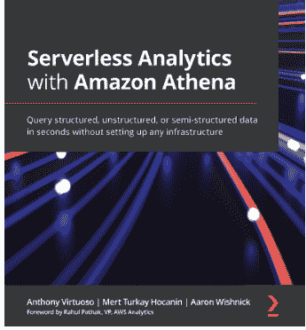

# 索引

## 符号

- 5 Vs，大数据
- value 154
- variety 153
- velocity 153
- veracity 153, 154
- volume 153

## A

- 访问控制列表（ACLs） 158
- 在 Amazon S3 上构建数据湖的优势
  - 经济高效 157
  - 数据管理和治理 158
  - 数据安全 158
  - 耐用性和可用性 158
  - 易于访问 159
  - 灵活性 158
  - 集成 158
  - 可扩展性 157
- Amazon Athena 111, 112, 134, 203, 204
  - 缓存查询，执行 114-116
  - 缓存验证，执行 114
  - 数据发现，通过访问 293, 294
  - 查询执行工作流 112
  - 查询元数据，利用以提高性能 113, 114
  - 无服务器数据质量管道，设置 228
  - 基于 SQL 的数据探索 204-206
  - SQL/Spark 分析选项，使用 204
- Amazon CloudTrail 383
  - 优势 383
  - 功能 383
  - 工作原理 383
- Amazon CloudWatch 379
  - 优势 380
  - 事件 379
  - 功能 379
  - 日志 379
  - 指标 379
  - 概述 379
- Amazon DynamoDB
  - 使用，作为数据质量管道的元数据存储 230-232
- Amazon EC2
  - 自定义安装 79, 80
  - 标准安装 79, 80

Amazon Elastic File System（Amazon EFS） 143
Amazon Elastic MapReduce（Amazon EMR） 152
Amazon Macie 375
Amazon QuickSight 245
- 组件 246
- 概念 245
Amazon QuickSight，数据发现 247
- 基于 AI 的数据分析 258-262
- 基于 AI 的数据发现 258-262
- 分析 249-258
- 数据源设置 248
- 数据源支持 247
Amazon QuickSight，数据可视化 262
- 面积图 263
- 柱状图 263
- 箱线图 266
- 组合图 264
- 仪表板发布 262, 268
- 甜甜圈图 264
- 嵌入式分析 268
- 仪表图 265
- 热力图 265
- KPI 图表 265
- 折线图 263
- 地图图表 267
- 饼图 264
- 桑基图 267
- 堆叠柱状图 263
Amazon Redshift 134
Amazon S3 数据湖
- 数据，组织 160, 161
- 数据，结构化 160
Amazon S3 生命周期
- 配置，用于数据湖 168-171
Amazon S3 Select
- 参考链接 282
Amazon SageMaker 笔记本
- 自定义安装 98
- 标准安装 98
Amazon Simple Storage Service（Amazon S3） 103, 104, 132, 151
- 在构建数据湖方面的优势 157
- awswrangler S3 函数 107-110
- 构建数据湖 155, 156
- Parquet 文件，处理 104
- 与 awswrangler 的实际示例 104-107
Amazon Virtual Private Cloud（Amazon VPC） 143
Amazon Web Services（AWS） 3, 132, 151
年故障率（AFR） 158
Apache Arrow 77
- 优势 77
- URL 77
Apache Mesos 176
Apache Spark 175, 176
- 架构 176
- 框架 178, 179
- 弹性分布式数据集 179, 180
Apache Spark 架构 178
- 驱动程序职责 177
- 执行器职责 177
- 应用程序编程接口（API） 178
Athena
- 数据质量规则，实现 228-230
- 表创建，手动 208-210
- 表，查询 207-210
Athena 查询联合
- 参考链接 221
Athena SQL 功能
- 参考链接 220
Athena SQL 连接
- 使用，以丰富数据 218-220

automated ML (AutoML) 133, 358
AWS 账户
数据联邦，设置 223, 224
AWS Config 374
AWS 文档
参考链接 76
AWS Glue
数据发现 182
Glue 连接 185, 186
表统计 191, 192
AWS Glue Blueprint 182
AWS Glue 目录 204, 205
数据发现，通过其访问 293, 294
AWS Glue Connections 182
AWS GlueContext 195
AWS Glue Crawler 186
分类阶段 186, 187
数据源 181, 182
分组/聚类 187
输出 187
表，在 Athena 中创建 207, 208
工作原理 187-190
AWS Glue DataBrew 13-19, 24
数据集，使用其识别 27
功能 19
内连接 47
作业，创建以修复数据质量问题 62
左排除连接 48
左连接 47
外排除连接 48
外连接 47
价格 24-26
右排除连接 48
右连接 47
示例数据集，使用其下载 27-32
使用，用于数据整理 26
使用，用于事件驱动的数据质量检查 67
使用，用于执行数据质量检查 49-61
使用，用于执行数据转换 37-49
AWS Glue DataBrew，构建块
DataBrew 数据集 20
数据血缘 22
数据剖析 23
项目 20
配方 21, 22
AWS Glue DataBrew 配置文件
列摘要 35
相关系数 (r) 33, 34
创建，用于数据集 32, 33
值分布 35
AWS Glue Data Catalog 181-183
数据库 183
分区 184
表 183
AWS Glue ETL 181
用于数据摄取 194
AWS Glue 交互式会话 182
AWS Glue 作业
监控，使用 AWS Glue ETL
作业监控 380-382
AWS Glue Schema Registry 182
AWS Glue Studio
功能 198
定制有限 198
AWS Glue Triggers 181, 197
条件触发器 197
按需触发器 197
计划触发器 197
AWS Glue Workflows 181
AWS GuardDuty 375
AWS Lake Formation
安全规则，配置 375
AWS SDK for Pandas 13, 75, 76
构建块 76
构建，用于不同用例 78
配置选项 101
配置，用例 103
自定义安装，用于 Python
shell 作业 94, 95
自定义安装 81-84
自定义安装，优势 81
自定义安装，在 AWS Glue 作业上 91
自定义安装，在 Glue spark 作业上 97
自定义安装，在 lambda
函数 84, 85
自定义，用于不同用例 78
功能，与 AWS 服务 103
安装，用于不同用例 78
安装，用于 EMR 使用 99, 100
安装，在虚拟环境中 80
标准安装，在 Amazon EC2 上 79
标准安装，在 AWS Glue 作业上 91
标准安装，在 Glue spark 作业上 96
标准安装，在 lambda
函数 84, 85
标准安装，在本地机器上 79
标准安装，在 Python
shell 作业 92-94
AWS SDK for Pandas，配置选项
全局变量，设置 101
AWS SDK for Pandas，功能
与 AWS 服务
RDS 数据库 117-123
Redshift 123-129
AWS Single Sign-On (AWS SSO) 143
AWS 软件开发工具包 (SDK) 75
AWS Trusted Advisor 374
awswrangler。参见 AWS SDK for Pandas

### B
条形图
多度量 263
单度量 263
大数据 151, 152
5V 153
多样性 153
容量 153
二进制文件格式 295
分箱 351
Boto 78
Boto3 76, 78
参考链接 78
botocore 配置变量 102
botocore 文档
参考链接 102
存储桶策略 371
内置数据洞察 336-342
商业智能 (BI) 11, 245

### C
加州消费者隐私法案 (CCPA) 18
捕获数据变更 (CDC) 275
分类编码 347-349
CDC 捕获工具
使用，场景 276
挑战和注意事项，用于
在 Amazon 上构建数据湖
成本 174
数据访问 174
数据治理 173
数据摄取 173
数据管理 173
数据处理 173
数据安全 174
性能 174
集群管理器类型，Apache Spark
Apache Mesos 176
Hadoop YARN 176
Kubernetes 176
独立 176

### D
列
删除 354, 355
列摘要 35
命令行界面 (CLI) 161
逗号分隔值 (CSV) 134, 158, 283, 294
相关系数 (r) 33, 34
CTAS 语句
使用，用于数据结构化 217
客户关系管理 (CRM) 10, 153
自定义转换 349-351
自定义可视化 343, 344
仪表板和可视化 269
数据
使用 Athena SQL 连接丰富 218-220
使用数据联邦丰富 227, 228
使用 S3 Select 命令探索 282-287
导出 355
加载到源数据库 276-278
使用 Pandas 重构 296-298
数据分析 140
创建 342
自定义可视化 343, 344
特征相关性报告 141
Lasso 特征选择分析 345, 346
多重共线性 344, 345
散点图分析 343
目标泄漏 342
数据即服务 (DaaS) 18
数据平衡操作
随机过采样 136
随机欠采样 136
SMOTE 136
数据清洗 9, 10, 304
使用 Pandas 304-309
数据定义语言 (DDL)
语句 208
数据发现 8, 281
通过 Amazon Athena 访问 293, 294
通过 Glue 目录访问 293, 294
执行，步骤 282
使用 Amazon QuickSight 247
Data Docs 321
数据丰富 10, 310, 311
数据导出 141, 142
数据，导出选项
导出为 Python 代码 357
导出到 S3 356
导出到 Feature Store 357
导出到推理管道 357
导出到 SageMaker Pipelines 357
数据联邦
为源数据库设置 220
在 AWS 账户中设置 223, 224
DataFrames 180
数据导入 133, 134
数据摄取
先决条件 274-276
数据摄取，使用 AWS Glue ETL 194
AWS GlueContext 195
AWS Glue 交互式会话 197
AWS Glue Job 书签 196
AWS Glue Studio 197
AWS Glue Triggers 197
DynamicFrame 195, 196
来自数据库 (JDBC 数据存储) 199, 200
来自对象存储 198, 199
来自 SaaS 数据存储 201, 202
数据湖 154
Amazon S3 生命周期，配置 168-171
优势 155
在 Amazon S3 上构建 155, 156
压缩方法，选择 166, 167
数据布局模式 160
文件格式，选择 161-166
分区策略，选择 167, 168
安全 369
数据湖，访问控制 369
使用 Amazon S3 日志选项 374
使用 IAM Access Analyzer 373
使用对象 lambda 访问点 373
基于资源的访问策略 371-373
使用 S3 访问点 373
基于用户的访问策略 370, 371
数据湖布局 159, 160
文件大小，优化 172
文件数量，优化 172
数据湖布局元素
数据血缘 160
逻辑组织 160
元数据 160
物理位置 160
安全和访问控制 160
数据湖，在 Amazon S3 上
构建，挑战和注意事项 173
使用设计原则设计 159
数据湖安全 369
访问控制 369
访问控制，选项 373, 374
AWS Lake Formation 集成 375, 376
数据保护 376, 377
数据，在 AWS Glue 中保护 377, 378
问题，识别 374
问题，监控 374
数据血缘 22, 73
数据迁移
从源本地数据库 278-281
数据编排 135, 136
数据剖析 23, 138
数据保护，使用 AWS
Glue DataBrew 67
静态加密 68
传输中加密 68
PII，处理 69-73
PII，识别 69-73
数据发布 73
数据发布 11
数据质量检查
使用 AWS Glue
DataBrew 执行 49-61
使用校正后的数据集验证 63-66
数据质量管道
使用 Amazon DynamoDB 作为
元数据存储 230-232
数据质量规则
在 Athena 中实现 228-230
数据质量验证 315
与数据管道集成 320, 321
使用 Pandas 316-320
数据集 180
数据结构化 9, 294
文件格式，选择 296
文件格式，使用 294-296
数据转换 136, 137
添加 346, 347
分类编码 347-349
列，删除 354, 355
自定义转换 349-351
数值缩放 352-354
使用 Pandas 操作 311-315
数据验证 10
数据可视化 321
使用 Python 库 321-327
数据整理 3
优势 4-7
使用 AWS Glue DataBrew 26

## G

- 通用数据保护条例（GDPR）18
- 全局变量
  - 设置 101
- 全局变量，AWS SDK for Pandas
  - Athena 缓存行为，配置 102
  - 配置，应用 101，102
  - 参数，使用以与 Amazon S3 交互 103
- GraphX 179

## H

- Hadoop 分布式文件系统（HDFS）152
- Hadoop YARN 176
- 哈希 69
- 健康保险流通与责任法案（HIPAA）18

## I

- IAM 访问分析器 371
- 身份和访问管理（IAM）78，205，370
- 洞察报告
  - 生成，关于数据和质量 138，139
- 集成开发环境（IDE）133

## J

- Java 数据库连接（JDBC）135
- JavaScript 对象表示法（JSON）134，158，284
- Java 虚拟机（JVM）77
- 作业 22
  - 配置文件作业 22
  - 配方作业 22
- JSON 文件格式 294
- json_normalize
  - 参考链接 298
- Jupyter
  - 安装链接 287

## K

- 密钥管理服务（KMS）68，377
- Kubernetes 176

## L

- lambda 函数
  - 自定义安装 84，85
  - 自定义托管层，创建 86-91
  - 标准安装 84，85
  - 标准安装，托管层 85，86
- lambda 服务限制
  - 参考链接 86
- Lasso 特征选择 140
  - 分析 345，346
- 惰性求值 180
- 本地机器
  - 自定义安装 79，80
  - 标准安装 79，80

## M

- 机器学习（ML）154
- 机器学习模型，训练 357，358
  - 创建 Autopilot 实验 359，360
  - 创建 363，364
  - 数据，导出 358，359
  - 模型部署选项，指定 362
  - 评审 363，364
  - 目标和特征，指定 360
  - 训练方法，选择 361，362
- 地图图表
  - 填充地图 267
  - 点地图 267
- 屏蔽 69
- matplotlib
  - URL 321
- 模块，Apache Spark
  - GraphX 179
  - Spark SQL 179
  - Spark Streaming 179
- 多重共线性 345
- MySQL 数据库
  - 参考链接 276

## N

- 自然语言处理（NLP）154
- 自然语言查询（NLQ）262
- 嵌套数据
  - 使用 Pandas 进行展平 298，299
- NOAA 数据集 README 文件
  - 参考链接 229
- 置零或删除 69
- 数值缩放 352-354

## O

- 单区域-低频访问（One Zone-IA）172
- 优化行列式（ORC）134，161

## P

- Pandas
  - 用于数据清洗 304-309
  - 用于数据质量验证 316-320
  - 用于展平嵌套数据 298，299
  - 用于重构数据 296-298
- pandas.DataFrame.merge
  - 参考链接 312
- Pandas 库 77
  - URL 77
  - 用于原始数据探索 287-293
- Pandas 操作
  - 用于数据转换 311-315
- Parquet 163
- 分区规范 185
- 个人身份信息（PII）18
  - 处理 69-73
  - 识别 69-73
- PIP 安装 Python（PIP）80
  - 优势 79
- 销售点（POS）153
- 主成分分析（PCA）140
- 概率加密 69
- 配置文件作业 22
- Python 库
  - 使用进行数据可视化 321-327

## Q

- QuickSight 控制台 269
- QuickSight Q 269

## R

- 随机过采样 136
- 随机欠采样 136
- 原始数据 3
- 原始数据探索
  - 使用 Pandas 库 287-293
- RDS 数据库 117-123
- RDS MySQL 实例
  - 参考链接 221
- 配方 21
- 配方作业 22
- Redshift 123-129
- 正则表达式（regex）211
- 正则表达式（regex）解析器
  - 用于加载定宽表 210-212
- 关系数据库管理系统（RDBMSs）183
- 关系数据库服务（RDS）MySQL 220
  - 源表，创建 221-223
- 弹性分布式数据集（RDD）177-180
  - 操作 180
  - 转换 180
- 响应语法
  - 参考链接 234
- 基于角色的访问控制（RBAC）173，376
- 均方根误差（RMSE）139

## S

- S3 Select 命令
  - 用于探索数据 282-287
- SageMaker Autopilot 358
- SageMaker Data Wrangler 13
  - 数据，导入 333-336
- SageMaker Studio
  - 登录 330-332
- SageMaker Studio 设置
  - 域 143
  - 入职步骤 143-146
  - 先决条件 142
- 散点图分析 343
- Seaborn 323
- seaborn，统计数据可视化
  - 参考链接 321
- 季节性 140
- 使用 LOESS 的季节-趋势分解（STL）方法 140
- 安全文件传输协议（SFTP）11
- 安全套接层（SSL）68
- 无服务器数据质量管道
  - 自动化 241-243
  - 使用 Athena 设置 228
  - 步骤函数工作流 232-241
- 服务器端加密（SSE）158
- 服务控制策略（SCPs）370
- 洗牌 69
- 简单通知服务（SNS）233
- Snowflake 135
- 软件即服务（SaaS）13，333
- 排序字符串表（SSTable）162
- 源数据库
  - 数据联邦，设置 220
  - 数据，加载到 276-278
- 源本地数据库
  - 数据迁移 278-281
- Spark SQL 179，180
- Spark Streaming 179
- 可拆分文件格式 162
- sportstickets.com 274
- 使用 Athena 的基于 SQL 的数据发现 205，206
  - 优势 204
- SQL 查询，在 Amazon Athena 中的注意事项和限制
  - 参考链接 293
- SQL/Spark 分析选项
  - 使用 204
- 独立 176
- 标准-低频访问（Standard-IA）172
- 存储内存 177
- 结构化查询语言（SQL）132，156
- 替换 69
- 超快速并行内存计算引擎（SPICE）245
- 合成人力资源数据集
  - 参考链接 27
- 合成少数类过采样技术（SMOTE）136

## T

- 表
  - 在 Athena 中手动创建 208-210
  - 在 Athena 中通过 AWS Glue 爬虫创建 207，208
  - 查询 208，210
  - 在 Athena 中查询 207，208
- 表统计 191-194
  - 数据倾斜检测 192
  - 连接优化 192
  - 谓词下推 192
  - 查询规划 192
- 制表符分隔值（TSV）163
- 目标泄漏 342
- 趋势 140

## U

- 不可拆分文件格式 162
- 用户界面（UI）358

## V

- 值分布 35
- 方差膨胀因子（VIF）140，344
- 虚拟私有云（VPC）200

## W

- 工作内存 177
- wrangler 配置变量 101
- 一次写入多次读取（WORM）376

Packtpub.com

订阅我们的在线数字图书馆，全面访问超过 7,000 本书籍和视频，以及帮助您规划个人发展和提升职业生涯的行业领先工具。更多信息，请访问我们的网站。

## 为什么订阅？

- 使用来自 4,000 多名行业专业人士的实用电子书和视频，节省学习时间，专注于编码
- 使用专为您打造的技能计划提升学习效果
- 每月免费获得一本电子书或视频
- 完全可搜索，便于快速访问重要信息
- 复制、粘贴、打印和书签内容

您知道 Packt 提供每本书的电子书版本吗？提供 PDF 和 ePub 文件。您可以在 packtpub.com 升级到电子书版本，如果您是印刷书籍客户，您有权享受电子书折扣。请联系 customercare@packtpub.com 获取更多详情。

在 www.packtpub.com，您还可以阅读大量免费技术文章，订阅多种免费新闻通讯，并获得 Packt 书籍和电子书的独家折扣和优惠。

## 您可能感兴趣的其他书籍

如果您喜欢这本书，您可能对 Packt 的这些其他书籍感兴趣：

### 使用 R 进行数据整理

Gustavo R Santos

ISBN: 9781803235400

- 了解如何在 R 中加载数据集并探索数据
- 在数据集中处理不同类型的变量
- 创建基本和高级可视化
- 了解如何构建您的第一个数据模型
- 在 Microsoft Power BI 中逐步使用 ggplot2 创建图形
- 熟悉使用 Shiny 在 R 中构建应用程序

### 使用 Amazon Athena 进行无服务器分析

Anthony Virtuoso, Mert Turkay Hocanin, Aaron Wishnick

ISBN: 9781800562349

- 保护和管理查询数据的成本
- 使用 Athena ML 和用户定义函数（UDFs）为报告添加高级功能
- 编写自己的 Athena Connector 以集成自定义数据源
- 使用 AWS Glue 爬虫在 S3 上发现您的数据集
- 将 Amazon Athena 集成到您的应用程序中
- 设置身份和访问管理（IAM）策略以限制对 Glue 数据目录中表和数据库的访问
- 在 Athena 查询中添加 Amazon SageMaker Notebook
- 掌握使用 Athena 进行 ETL 管道

## 免费下载本书的 PDF 副本

感谢您购买本书！

喜欢在途中阅读，但无法随身携带纸质书？您的电子书购买是否与您选择的设备不兼容？

别担心，现在每本 Packt 图书都附带无 DRM 的 PDF 版本，无需额外费用。

随时随地，在任何设备上阅读。直接搜索、复制并粘贴您最喜爱的技术书籍中的代码到您的应用程序中。

福利不止于此，您还可以每天在收件箱中独享折扣、新闻通讯和大量免费内容。

按照以下简单步骤即可获得这些福利：

- 1. 扫描二维码或访问以下链接

https://packt.link/free-ebook/9781801810906

- 1. 提交您的购买凭证
- 2. 就这样！我们会将免费 PDF 和其他福利直接发送至您的邮箱

