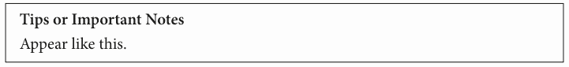

## 前言

仅仅提及 AI 这个术语，就会引发一连串反应。我们都听说过该技术的各个方面，有些是真实的，有些是前瞻性的，这引发了各种各样的观点。有些人认为，应用这种能力是帮助解决社会一些最令人困惑问题的巨大飞跃。另一些人则确信，它正为人类被边缘化、受制于软件的任意摆布打开大门。无论你持何种观点，AI 正迅速成为一种广泛使用的技术，用于帮助解决运营挑战和基于预测的问题，在这些问题中，大量信息被用来发现和明确趋势，并创造有价值的产出。

我们中有些人多年来一直涉足这一技术领域，头上的讨厌白发越来越多，也见证了几项新能力从出现到成长为新常态的一部分。从时间的维度来看，这些新能力往往遵循一个清晰而普遍的规律。一项新技术被开发出来，并在少数案例中得到应用，产生了极具影响力的结果。随着更多人了解到这一点，他们开始设想更广泛的采用，期待解决方案设计实现质的飞跃。无论是由于过于乐观的雄心，还是缺乏应用专业知识，预期都会有所回归，可以说是一种现实回归。然而，在这些早期的采用阶段，越来越多的专业从业人员正在学习必要的技能，既要构思新技术的用途，也要看到其在广泛且不断扩展的领域中的应用，从而扩大这项技术的影响力。这通常正是采用率快速而稳定增长的时候。

这一循环——*引入 – 过度炒作的使用或影响 – 预期回归 – 民主化 – 爆炸性增长*——是众所周知的趋势。民主化阶段是最具影响力的阶段之一。当更多从业者理解并熟练使用该技术时，他们就能立即开始在现实场景中看到可能的应用。这个阶段实现了两件事：第一，它极大地扩大了从业者的技能基础；第二，它拓宽了部署用例的范围，进一步推动了新技术的采用。

在这部著作中，我们的作者不仅阐述了如何开始理解并部署这项技术，还定义并划分了 AI 的不同层级，并清晰地指导读者如何使用它。对于好学的读者来说，通往专业的道路始于第一步，而本书将引导你迈出这些第一步。我鼓励你阅读本书，理解并想象 AI 的可能用途，让你的好奇心引领你前进。

*前言作者：Tom Torlone——自动化思想领袖，曾帮助众多企业扩展其转型计划。*

## 贡献者

### 关于作者

**Fanny Ip** 是自动化、业务转型和创新领域的思想领袖。目前，Fanny 担任 UiPath 自动化咨询创新办公室副总裁，带领一支经验丰富的管理顾问团队，为客户开发经过实地验证的解决方案。

在加入 UiPath 之前，Fanny 曾共同领导麦肯锡在北美的自动化业务，并为 CxO 制定自动化战略，以实现收入增长并取得利润成效。在从事自动化工作之前，Fanny 还曾在普华永道和德勤领导业务转型项目。

Fanny 拥有芝加哥大学经济学学士学位和加州大学洛杉矶分校安德森管理学院 MBA 学位。她出生于香港，现与家人居住在洛杉矶。

**Jeremiah Crowley** 是一位跨学科开发者，拥有广阔的技术和运营视角。他最初对软件开发和实施的热情引导他走向自动化和流程效率领域。他喜欢处理并解决问题，无论问题大小或涉及何种技术。

Jeremiah 毕业于纽约大学，获得计算机科学学士学位。他的工作经历包括安永和麦肯锡公司，在自动化与服务运营部门担任职务。目前，他是 UiPath 自动化咨询创新办公室的总监，通过管理数字化转型项目和开发超自动化框架与方法论，帮助组织推动采用并扩展自动化。

## 致谢

**人工智能 (AI)** 使企业能够优化需要认知能力、具有概率性、以及在文档、图像和语音方面具有高变异性和非结构化数据的业务流程。RPA 开发人员和精通技术的业务用户使用 AI 解决日常业务问题没有很高的门槛。本关于 UiPath 的 AI 实用指南将帮助 AI 工程师和从事业务流程优化的 RPA 开发人员将知识付诸实践。该书采用动手方法，在短时间内在业务用例中实施自动化。

完整包含对基本概念的分步解释、实用示例和自我评估问题，本书首先帮助你理解 AI 的强大功能，并概述利用现成模型的优势。你将了解认知 AI 在 RPA 中的背景、机器学习的基础知识，以及如何在开发生命周期中应用认知自动化。然后你将通过使用 UiPath Document Understanding、UiPath AI Center 和 Druid 构建三个用例来检验你的技能。

在本 AI 书籍结束时，你将能够构建具有 Document Understanding 和 AI Center 认知能力的 UiPath 自动化，同时理解开发生命周期。

### 本书适合谁

希望提升技能并使用 UiPath 的 AI 能力部署现成模型的 AI 工程师和 RPA 开发人员会发现本指南有用。对机器人流程自动化和机器学习有基本了解将有益，但不是开始阅读本 UiPath 书籍的强制条件。

### 本书涵盖内容

*第一章，理解 RPA 开发人员必备的人工智能基础知识，* 将涵盖与你在日常 RPA 开发工作中相关的关键 AI 概念。

*第二章，弥合 RPA 与认知自动化之间的差距，* 将详细探讨将认知自动化添加到你的 **机器人流程自动化 (RPA)** 工具包的好处。

你还需要 UiPath Automation Cloud 的企业许可证才能继续阅读本书。UiPath 企业自动化云的 60 天试用版可在 https://cloud.uipath.com/portal_/register 获取。

如果你使用的是本书的数字版本，我们建议你自己输入代码或从本书的 GitHub 仓库访问代码（链接在下一节提供）。这样做将帮助你避免与复制和粘贴代码相关的潜在错误。

### 下载示例代码文件

你可以从 GitHub https://github.com/PacktPublishing/Democratizing-Artificial-Intelligence-with-UiPath 下载本书的示例代码文件。如果代码有更新，将在 GitHub 仓库中更新。

我们还有来自我们丰富的图书和视频目录的其他代码包，可在 https://github.com/PacktPublishing/ 获取。快来看看吧！

### 代码实操

本书的代码实操视频可在 https://bit.ly/3DKdXul 查看。

### 下载彩色图片

我们还提供了一份 PDF 文件，其中包含本书中使用的屏幕截图和图表的彩色图片。你可以在这里下载：https://static.packt-cdn.com/downloads/9781801817653_ColorImages.pdf。

### 使用的约定

本书中使用了多种文本约定。

**文本中的代码**：表示文本中的代码词、数据库表名、文件夹名、文件名、文件扩展名、路径名、虚拟 URL、用户输入和 Twitter 账号。示例：“在 **variables** 选项卡中，将 windowIdentifier 范围设置为 main sequence 而不是 Do。”

**粗体**：表示新术语、重要单词或你在屏幕上看到的单词。例如，菜单或对话框中的单词以粗体显示。示例：“在 **DefaultTenant** 中，单击三个点然后单击 **Tenant Settings**。”

## Get in touch

读者反馈总是受欢迎的。

**General feedback**：如果您对本书的任何方面有疑问，请发送电子邮件至 `customercare@packtpub.com`，并在邮件主题中提及书名。

**Errata**：尽管我们已尽一切努力确保内容的准确性，但难免会出现错误。如果您在本書中发现错误，我们将不胜感激您向我们报告。请访问 `www.packtpub.com/support/errata` 并填写表格。

**Piracy**：如果您在互联网上以任何形式发现我们作品的非法复制，我们将不胜感激您提供位置地址或网站名称。请通过 `copyright@packt.com` 联系我们并附上材料链接。

**If you are interested in becoming an author**：如果您在某个领域拥有专业知识，并且有兴趣撰写或为一本书做出贡献，请访问 `authors.packtpub.com`。

## Share Your Thoughts

在您阅读完 *Democratizing Artificial Intelligence with UiPath* 后，我们很想听听您的想法！请点击此处直接前往本书在 Amazon 的评论页面并分享您的反馈。

您的评论对我们和技术社区都很重要，将帮助我们确保提供优质的内容。
