# 1 Understanding Essential Artificial Intelligence Basics for RPA Developers

在本章中，我们将介绍作为 RPA 开发者在日常工作中相关的一些关键 **artificial intelligence (AI)** 概念。我们将发现 **robotic process automation (RPA)** 开发者在实施 RPA 用例中的认知自动化时可以在哪里产生最大影响，而无需成为数据科学家。我们还将了解当今 AI 解决的实际业务问题。

在本章中，我们将涵盖以下主要主题：

- Understanding key AI concepts
- Understanding cognitive automation
- Exploring **out-of-the-box (OOTB) machine learning (ML)** models for RPA developers

到本章结束时，您将掌握常见的 AI 基础知识，并通过真实案例的启发，开始思考如何将 AI 应用于您的潜在用例。

## Understanding key AI concepts

当您开始探索 AI 主题时，您可能会遇到许多术语。我们将解构 AI，并只呈现对您作为 RPA 开发者最相关的概念。请注意，您可能会遇到其他材料中基于不同上下文而略有不同的定义。

### Differentiating between artificial intelligence, machine learning, and deep learning

AI、ML 和 **deep learning (DL)** 相关但并不相同。以下图表说明了这些学习类型的层级关系：

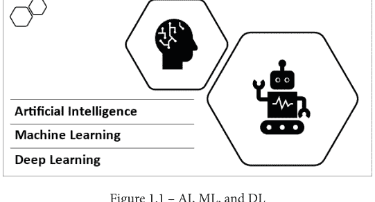

Figure 1.1 – AI, ML, and DL

- **AI:** 这相当于赋予机器或机器人思考的能力。它涵盖了 ML 和 DL。
- **ML:** 这是指机器或机器人通过算法在没有显式编程的情况下学习思考的方式。ML 是 AI 的子集。
- **DL:** 这是指 ML 算法利用人工神经网络来模仿学习的方式。DL 是 ML 的子集。

接下来，我们将查看在 ML 和 DL 之间选择时需要考虑的三个关键因素。它们如下列出：

- Data requirement and availability
- Computational power
- Training time

下表显示了 ML 和 DL 的比较：

|  | Machine Learning | Deep Learning |
|---|---|---|
| **Data Requirement and Availability** | • Can work with small datasets | • Must have large data sets |
| **Computational Power** | • Machines with a Central Processing Unit (CPU) are sufficient | • Machines with a Graphics Processing Unit (GPU) are required |
| **Training Time** | • Short training time | • Long training time |

Figure 1.2 – Comparison of ML and DL

在 ML 中，研究对象的 *features* 被输入算法供机器学习。我们可以将 *features* 视为我们给算法的提示。此步骤允许使用较小的数据集、较低的计算能力和更少的训练时间。

在 DL 中，*features* 由人工神经网络确定。它需要付出更多努力来弄清 *features* 和学习模式。因此，它需要大量数据、高计算能力和长时间的训练。

尽管 DL 很有价值，但对于大多数企业来说，开发 DL 模型来解决其业务问题超出了其能力范围。幸运的是，许多 DL 模型已由拥有时间和预算的公司预先训练，使其可供大量用户使用。

这一选择的含义是，您作为 RPA 开发者的角色不是 *create* 这些模型。您作为 RPA 开发者是这些模型的 *trainer*。了解训练在 AI 中的作用非常重要。

### Appreciating the relevance of supervised learning, unsupervised learning, and reinforcement learning in AI

正如我们在上一节中所学，AI 是关于训练机器或机器人思考。就像人类一样，机器人需要学习。有三种不同的机器人学习方式。

下图为 **supervised learning**、**unsupervised learning** 和 **reinforcement learning** 提供了一些类比：

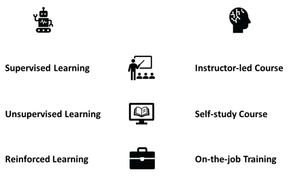

Figure 1.3 – Supervised learning, unsupervised learning, and reinforcement learning analogies

下面的列表解释了各种类比：

- **Supervised learning**: 这基于过去的数据，*trainer* 指定输入以预测未来结果。这种训练类似于讲师主导的培训课程。它要求 *trainer* 监督学生或模型以实现期望的学习成果。Classification 和 regression 是监督学习的类型：
  - **Classification** 指将给定数据集分类到类别中的过程。例如，一组不同动物的图片被输入到 ML 模型中。每张图片都标记有动物名称。ML 模型被训练以从图像中识别动物。
  - **Regression** 有助于预测连续变量。例如，利润预测 ML 模型就是回归模型的例子。由研发、营销和行政支出、地理位置和利润组成的训练数据被输入模型。ML 模型预测利润。
- **Unsupervised learning**: 这依赖于算法从数据中识别未知模式。这种训练类似于自学课程。它要求学生或模型综合信息以实现期望的学习成果。Clustering 是一种无监督学习方法：
  - **Clustering** 指用于在训练数据集中寻找相似性和关系模式，然后根据 *features* 将这些数据集聚类到具有相似性的组中的方法。例如，聚类技术通常用于市场细分。ML 模型查看性别、年龄、种族和地理位置等特征，将客户群体分组到细分市场，以更好地了解他们的购买习惯。
- **Reinforcement learning**: 这使用奖励和惩罚系统来学习。没有训练数据或 *trainer*。算法会根据反馈或奖励和惩罚随着时间的推移而改进。这种训练类似于在职培训。如果员工工作做得好，员工会获得加薪或晋升。如果员工表现不佳，员工不会获得加薪或晋升。当没有数据或特定专业知识可用时，这通常被使用。

### Practical tips

AI 平台提供商的使命是让 AI 变得易于访问。其使命的一部分是努力开发产品功能以克服 AI 的复杂概念。具体来说，以下是 AI 民主化的一些显著努力：

- Increased availability of pre-trained models to accelerate the time to result
- Simplification of the technical complexity of the ML training life cycle

我们以易于消化的格式介绍了关键 AI 概念。此概述使您能够快速上手 UiPath 等 AI 平台。您很快就能构建、部署和维护您的第一个 AI+RPA 用例。您不再需要花费数年时间掌握 AI 才能从头构建模型。相反，您是机器人的 *trainer*，教授它们需要掌握的不同技能。最重要的是，您拥有能够为您完成最复杂任务的工具。

现在您对关键 AI 概念有了良好的理解，让我们探索 **cognitive automation**，即 AI 与 RPA 的结合。

## 理解认知自动化

认知自动化或**智能流程自动化（IPA）**是指将 AI 与 RPA 结合使用。它为机器或机器人提供了大脑（AI）和四肢（RPA）。

尽管在高层面上，RPA 开发和认知自动化开发的通用**软件开发生命周期（SDLC）**看起来相同，但存在两个重要差异：

- RPA 开发者在 SDLC 中的角色
- RPA 与认知自动化生命周期的最终产物

现在，让我们详细看看这些差异。

### 理解 RPA 开发者在认知自动化生命周期中扩展的角色

RPA 开发者在认知自动化 SDLC 中扮演着扩展的角色。下图展示了代表性 RPA SDLC 与代表性认知自动化 SDLC 之间的详细对比：

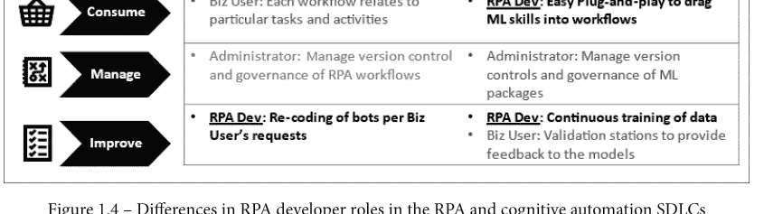

在 RPA SDLC 中，RPA 开发者就像任何其他软件包的传统开发者一样。在此过程中，典型的流程顺序如下：

1. 业务分析师收集业务流程的端到端业务需求，详细说明输入、处理步骤和输出。
2. RPA 开发者编写 RPA 工作流代码并测试代码。
3. 业务用户对 RPA 机器人进行用户验收测试。
4. 最后，RPA 开发者创建部署到生产环境的软件包。
5. 生产之后，管理员管理 RPA 机器人的运营。
6. 如果业务用户提出增强建议或报告缺陷，RPA 开发者会更新代码。

RPA 开发者通过将业务需求转换为 RPA 语言，在 RPA SDLC 的选定步骤（构建、部署和改进）中发挥重要作用。

在认知自动化 SDLC 中，RPA 开发者几乎在每一步都发挥作用，具体描述如下：

1. *RPA 开发者*收集数据特定的需求，为 ML 模型训练/再训练做准备。
2. *RPA 开发者*通常不构建 ML 模型。相反，*RPA 开发者*要么使用数据科学家开发的 ML 模型，要么使用可用的 OOTB 模型。
3. *RPA 开发者*根据具体用例准备训练和评估数据集，以训练/再训练 ML 模型。
4. 当训练结果可接受时，*RPA 开发者*会创建 ML 包以部署到生产环境。
5. 然后，ML 技能可供*RPA 开发者*在任何 RPA 工作流中即插即用。
6. 生产之后，*管理员*管理 RPA 机器人和 ML 技能的运营。
7. *RPA 开发者*继续使用新的数据点对模型进行再训练，以改进模型。

在认知自动化中，RPA 开发者在 SDLC 中扮演着更广泛的角色，既是*训练师*，也是*数据管理员*。

### 理解认知自动化生命周期与 RPA 生命周期的最终产物

RPA 与认知自动化之间的另一个重要区别与最终产出的特征有关。RPA 配置 RPA 机器人。认知自动化开发由 RPA 机器人利用的 ML 技能。下图说明了在初始部署中利益相关者对 RPA 机器人和 ML 技能期望的差异：

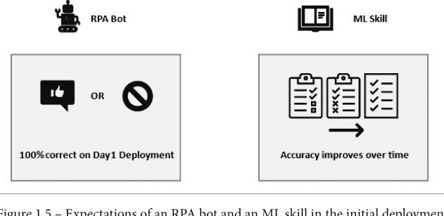

图 1.5 – 初始部署中对 RPA 机器人和 ML 技能的期望

RPA 机器人按照 RPA 开发者设定的一组规则执行。结果是黑白分明的。只有正确编码的机器人才会被部署到生产环境中。认知自动化生命周期的产物是将训练好的 ML 技能与 RPA 工作流相结合。ML 技能被训练到可接受的置信度阈值，以便部署到生产中。几乎在所有情况下，ML 技能在首次部署时都不可能做到 100% 正确。ML 技能预计会随着时间的推移而改进。

### 实用建议

企业已经通过 RPA 看到了自动化的力量并从中获益。然而，RPA 有其局限性。RPA 只能自动化基于规则的任务，从而限制了其可自动化的流程范围。此外，基于规则的任务通常是价值较低的工作。为了向价值链上游移动，结合 AI 对于企业保持竞争优势至关重要。以下是一些可以带给你领导层的关键要点：

- 科技公司已经简化了 AI 技术，使其易于消费。AI 不再只是数据科学家可以使用的工具。
- 现有的 RPA 团队可以开始整合 AI，而无需投入大量资金组建新团队。
- 整个组织中都存在有影响力的认知自动化用例。
- 现在是时候给机器或机器人一个大脑了。

既然你已经对认知自动化有了很好的理解，让我们探索一些最常用的 OOTB 模型，作为 AI 初学者你可以尝试这些模型。

## 探索与 RPA 开发者相关的 OOTB 模型

在 ML 模型方面，你有多种选择。有广泛可用的 OOTB 模型，你可以通过用自身数据进行再训练来使用它们。你也可以从头开发自己的 ML 模型。最后，你还可以与公司内的数据科学家合作，构建定制 ML 模型。

在本书中，我们将提供关于如何使用这些选项的建议。首先，我们建议你从 OOTB 模型开始。本节将概述最常用的 OOTB 模型。

### 常用的 OOTB 模型

OOTB ML 模型适用于各种用例。它们通过大量数据进行了预训练。某些 OOTB 模型可以使用你的特定数据集进行再训练，而另一些则不可再训练。大多数自动化平台现在都包含 OOTB 模型。选择正确的 OOTB 模型可以节省你的时间并加速项目进度。下图展示了 OOTB 模型的不同类别：

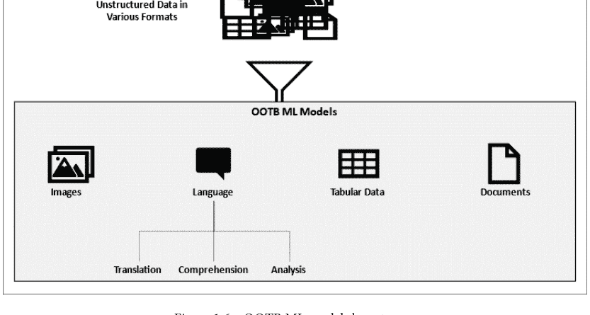

图 1.6 – 按类别划分的 OOTB ML 模型

这些 OOTB ML 模型将各种形式的非结构化数据转换为可用的格式。使用这些模型可以减少对人类花费数小时阅读、处理、理解和分析非结构化文档的依赖。非结构化文档可以表现为图像、语言、表格文本和文档等形式。

让我们仔细看看这些模型中的每一个：

- **图像分析**：有两种图像分析 OOTB 模型。下图总结了这两种模型的主要特征：

  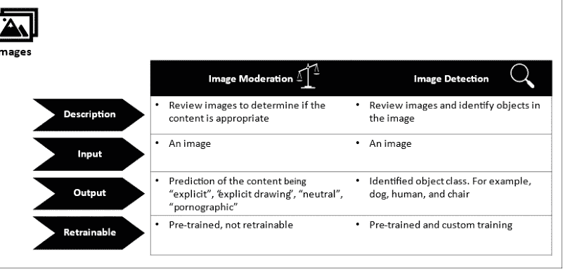

  图 1.7 – 图像分析 OOTB 模型

  这两种 OOTB 图像分析模型对许多涉及分析图像以确定后续步骤的用例非常有用。例如，图像审核模型常用于社交媒体信息流审核。OOTB 图像审核模型会审查数百万张图像，并标记可能存在问题以供人工验证的图像。

- **语言翻译**：顾名思义，语言翻译取代了从一种语言到另一种语言的繁琐翻译工作。下图总结了该模型的主要特征：

  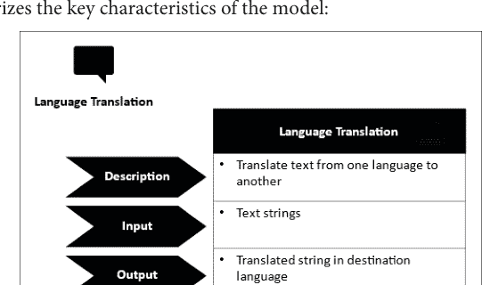

  图 1.8 – 语言翻译 OOTB 模型

  这种 ML 技能可用于多种用例，通常用于客户支持。例如，许多聊天机器人由 OOTB 语言翻译模型驱动，以处理不同语言的询问。

- **语言理解**：语言理解是复杂的。它指的是像人类一样从文本中提取含义的能力。下图总结了三种可用模型的主要特征：

  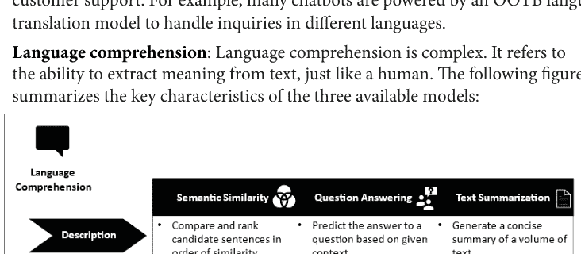

  图 1.9 – 语言理解 OOTB 模型

  语言理解 ML 模型可以模拟人类的思维并进行推理。它们有广泛的实际用途。例如，语义相似性 OOTB 模型根据用户指示的偏好提供推荐。问答 OOTB 模型通常被用作构建自动常见问题解答（FAQ）数据库的基础。最后，文本摘要 OOTB 模型从书籍和文章中提取见解。

- **语言分析**：语言分析指的是从文本中提取含义的技能。它使机器或机器人能够理解句子和段落。下图总结了三种模型的主要特征：

  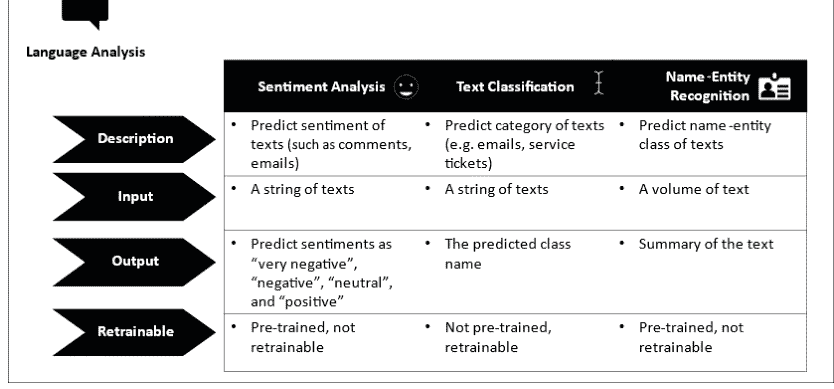

  图 1.10 – 语言分析 OOTB 模型

  语言分析 ML 模型知道如何提取单个单词之间的上下文和关系。它们有广泛的实际用途。例如，情感分析 OOTB 模型常用于管理来自客户的电子邮件。该模型会优先标记负面邮件供人工审核。文本分类模型的一个流行用途是垃圾邮件分类。最后，命名实体识别模型常用于从客户反馈中提取关键部分。

+   - **表格数据：基于树的流水线优化工具（TPOT）** 是一种为你的数据寻找最佳流水线的工具。下图总结了两个可用模型的关键特征：

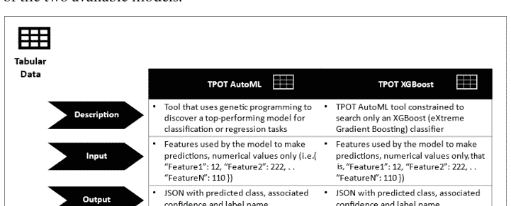

图 1.11 – 表格数据 OOTB 模型

这个 OOTB 工具将流水线构建中最繁琐的部分自动化。此外，这也是初学者创建自定义模型的入门介绍。

+   - **文档**：处理文档既耗时又繁琐。许多企业花费大量时间和人力资源，将模拟文档数字化并从中提取结构化信息。下图总结了三种模型的关键特征：

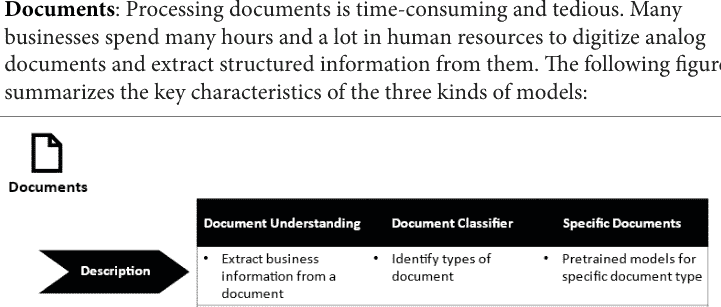

图 1.12 – 文档 OOTB 模型

可用于文档数字化的 OOTB 模型有很多。它们通常使用相关文档类型的大型数据集进行预训练，可用于加速涉及文档的认知自动化。

## 实用技巧

正如我们在本节中所学到的，有许多现成的 OOTB 模型。它们已被广泛使用，并被证明行之有效，而且易于尝试。想一个涉及 AI 技能的简单用例，然后尝试使用本节提到的任一 OOTB 模型。实践能让你在本书中读到的理论变得鲜活起来。

## 总结

在本章中，你学习了开始深入 AI 领域所需的关键 AI 概念。此外，你还了解了认知自动化在扩展自动化收益方面的力量，以及你在认知自动化实施中的角色。最后，你现在已经了解了常用的 OOTB 模型，可以开始动手探索了。

在下一章中，我们将深入探索自动化谱系、可用技术，以及一个利用认知自动化的相关应用来重新构想和解决业务问题的框架。

## 延伸阅读

+   - *MIT 开放课程 – 人工智能*：https://ocw.mit.edu/courses/electrical-engineering-and-computer-science/6-034-artificial-intelligence-fall-2010/index.htm
+   - 麦肯锡的*《高管 AI 指南》*：https://www.mckinsey.com/~/media/McKinsey/Business%20Functions/McKinsey%20Analytics/Our%20Insights/An%20executives%20guide%20to%20AI/An-executives-guide-to-AI.ashx
