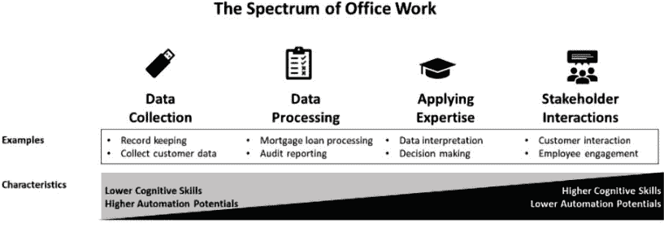
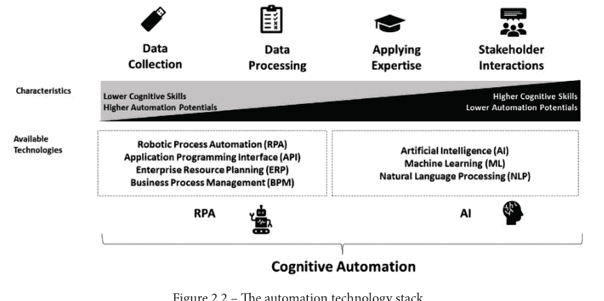
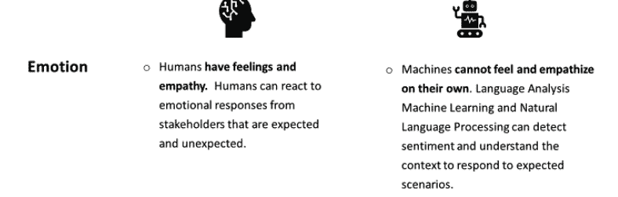
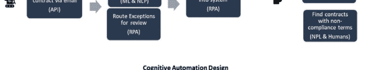

# 2

### 2 弥合 RPA 与认知自动化之间的鸿沟
### 
### 
### 

在本章中，我们将详细探讨**认知自动化**相对于纯粹**机器人流程自动化（RPA）**的优势。深入探究**办公工作谱系**至关重要，因为这样才能理解自动化技术栈、RPA 与认知自动化之间的差距，以及人机协调在使其发挥作用中的重要性。我们还将探讨许多现实中的业务问题，让你重新构想自动化潜力的各种可能。

本章将涵盖以下主要内容：

+   - 了解办公工作谱系
+   - 探索 RPA 与认知自动化之间的差距
+   - 利用认知自动化设计人机协作

到本章结束时，你将学会如何通过认知自动化这一新视角来处理业务问题。你将知道如何全面审视自动化机会，以及如何设计最优的人机协作。

## 了解办公工作谱系

我们在工作中身兼数职。如果仔细观察日常活动，每项活动都需要特定的技能组合。有些活动是可预测且基于规则的，而另一些则需要更强的认知能力。为了充分发挥自动化潜力，我们必须深入探索工作谱系的细节。本书将重点讨论办公工作，而不是体力工作。

任何职业的办公工作都可以归为四类。

如需了解更多信息，可参考以下链接：

```
https://www.mckinsey.com/~/media/mckinsey/business%20functions/mckinsey%20digital/our%20insights/where%20machines%20could%20replace%20humans%20and%20where%20they%20cant%20yet/where-machines-could-replace-humans-and-where-they-cant-yet.pdf
```

下图展示了办公工作的分类及其特征：



图 2.1 – 办公工作谱系

在办公工作谱系中，有四种类型的活动，分别是**数据收集、数据处理、应用专业技能**和**利益相关者互动**。

## 数据收集

**数据收集**是指从多个来源和系统中查找、提取数据，并将数据输出到目标系统的活动。在许多情况下，最耗费资源的任务是根据一组特定规则对数据进行清洗和格式化。这些任务通常具有较高的自动化潜力。以下示例说明了不同类型的数据收集工作和挑战。

在**人力资源（HR）**的“从招聘到退休”流程中，数据收集占用了大量时间。雇主在收集员工生命周期数据上花费大量时间和资源。雇主利用**企业资源规划（ERP）**系统，尽量节省人力和时间。然而，仍有很多手工工作和协调工作尚未自动化。我们来看一下员工入职流程。入职流程包括来自各种来源的以下数据输入：

+   - 工作授权文件通常是由 HR 专业人员对纸质文件进行扫描得到的副本。
+   - 员工基本人口统计信息通常通过员工门户收集。
+   - 背景调查结果由背景调查公司以电子方式传送给雇主。

## 数据处理

**数据处理**是将数据元素加工成有意义的信息。在数据处理中，对于干净的数据元素，可以进行基于规则的直通式处理。遗憾的是，数据永远不可能 100% 干净，总需要处理异常。数据处理被认为是最早开发的自动化流程之一。随着认知自动化技术的成熟，消除异常处理的自动化潜力正在不断增加。以下示例说明了不同类型的数据处理工作和挑战。

审计是一个高薪职业。内部和外部审计师都经过了大量的教育和在职培训来磨练技能。然而，他们也被大量数据处理工作所累，这些工作是为了完成审计程序、生成审计报告。他们只有有限的时间用于解决问题和与客户合作，以沟通和影响更好的业务实践。以下是审计师执行的一些资源密集型数据处理活动，这些活动具有自动化潜力：

+   - 收集、跟进并归档审计所需文件
+   - 根据控制要求对系统执行程序性测试
+   - 下载各种系统报告，确保跨系统数据完整性
+   - 在文档中查找关键词及相关上下文，以发现潜在违规行为
+   - 检查纸质文档中的手写内容、审批印章和签名

## 应用专业技能

**应用专业技能**是指利用通过经验获得的一系列技能来解决问题的能力。如下所述，专业技能分为两个层级：

+   - **常规专业技能：** 依靠过去反复使用的程序，持续地解决问题。
+   - **适应性专业技能：** 这种能力不仅能解决问题，还能以新的方式解决问题。

我们的办公工作中有许多活动需要专业技能。专业技能要求更高的认知能力，因此更难自动化。**机器学习（ML）**在自动化常规专业技能方面已经取得成功，但其算法仍在发展，以应对适应性专业技能。以下两个示例说明了应用专业技能的不同类型工作和挑战：

+   - *示例 1：* 从纸质文档或**便携式文档格式（PDF）**中读取和解读发票，是应用常规专业技能的一种形式。在技术尚未出现之前，企业需要员工手动阅读发票，确定发票数据的位置和内容，然后将其录入 ERP 系统。对于发票，诸如发票编号这样的数据元素可能有不同的展现方式。人类员工会明白，*发票编号、发票号、发票号码* 和 *发票#* 都是指发票编号这一数据元素，这是基于以往大量交易的经验。如今，ML 和**自然语言处理（NLP）**已经可以应用这种常规专业技能来自动化这一活动。
+   - *示例 2：* 对医生而言，如果患者的症状和诊断已知，决策可以是常规性的。然而，医生也会遇到新的或意外的情况。**人工智能（AI）**目前无法判断在新的或意外的情况中哪些信息是相关的。适应性专业技能需要更高的认知能力，并且在现有技术条件下的自动化潜力较低。


下图展示了办公领域整个价值链中可用的技术：



图 2.2 – 自动化技术栈

RPA、应用程序编程接口（API）、企业资源计划（ERP）和业务流程管理（BPM）属于一类旨在减少基于规则的数字活动所需人工投入的自动化技术。AI、ML 和 NLP 则属于另一类自动化技术，它们减少了需要认知思考的活动所需的人工投入。

正如你在上一节中学到的，几乎所有活动都包含基于规则和认知的成分。直到最近，尚没有平台允许将这些不同的技术无缝集成。企业正在寻找一种技术平台，以便用户能够充分利用不同的自动化技术。一种被称为认知自动化平台的新类别自动化产品应运而生。认知自动化平台简化了系统和之间的集成。它还使 AI 的开发和使用变得更加简单，并弥合了 RPA 和 AI 之间的差距。

## 实用技巧

将适当的认知自动化应用于工作价值链以产生效益存在着巨大的机会。早期认知自动化采纳者犯的最常见错误及其解决方案如下：

- 他们未能从整体上看待业务问题，而是被诸如**业务单元（BU）**等人为边界所限制。这一障碍需要高层介入以打破业务孤岛。
- 他们希望测试和部署特定技术，并将业务问题改装以适应该技术支持。如今，许多公司都确立了“业务问题优先，技术其次”的理念。
- 他们对 AI 技术的成熟度过于乐观，并高估了 AI 的能力。更好地了解不同技术及其工作原理将有助于设定适当的预期。
- 他们低估了人类因素的重要性，在没有考虑这种替换影响的情况下，就用技术取代了细微的人类接触点。最近大多数数字化转型旅程在其学科中包含了以人为中心的设计，以避免此问题。

至此，你应该对工作价值链、自动化潜力和技术栈有了很好的掌握。让我们通过完善人机协作来重新构想认知自动化。

## 设计认知自动化中的人机协作

在上一节中，我们探讨了办公室工作及其相对的自动化潜力。公司希望通过利用自动化来寻找更高效和有效的方法执行办公室工作。办公室工作并不由单一的*活动*组成，而是由构成*流程*的一系列活动组成。**端到端（E2E）**流程的全面自动化可能是最终目标。然而，利用当前可用的技术实现良好的*人机协作*以提高效率和效果是更现实的目标。因此，理解人类和机器如何以不同的方式工作，以及在设计认知自动化时思考人机协作的最佳方式，至关重要。

- 3. *将数据录入合同系统（数据处理）*：此步骤已自动化。RPA 完成登录系统并根据一组规则输入从合同中提取的数据元素的步骤。
- 4. *查找不合规合同条款并解决（应用专业知识及利益相关者互动）*：此步骤部分自动化。文档理解 ML 模型使用 NLP 从合同文档中提取相关合同条款。然而，人类负责解释及与利益相关者讨论以解决不合规问题。机器和人类协作完成此步骤。

**贷款处理**的第二个例子展示了工作价值链中需要不同技能组合的四个步骤，如下所示：

- 1. *通过客户门户接收贷款申请（数据收集）*：此步骤已自动化。API 将数据从客户门户路由到 ML 模型。
- 2. *运行 ML 模型确定初步审批状态（应用专业知识）*：此步骤已自动化。ML 模型基于过去的历史数据确定审批状态。ML 会通过新的训练数据随时间进行微调，以确保预测性能。RPA 将初步审批状态路由到异常案例队列或处理队列。
- 3. *审查异常案例（应用专业知识及利益相关者互动）*：此步骤部分自动化，是人在回路中辅助 RPA 的一个例子。贷款专员审查 ML 模型置信度较低的案例。RPA 为贷款专员提取额外数据作为参考资料，连同异常案例一起提供。贷款专员利用其经验和额外数据做出最终审批决定。机器和人类协作完成此步骤。
- 4. *处理已批准和已拒绝的案例（数据处理及利益相关者互动）*：此步骤部分自动化。RPA 根据已批准和已拒绝的工作流处理贷款申请。在某些情况下，贷款专员会联系客户以审查决定并提出建议。机器和人类协作完成此步骤。

## 在认知自动化设计中应用人类和机器工作方式之间的差异

人类和机器的行为和表现是不同的。下图说明了人类和机器在解决问题、记忆、生产力和情感方面的运作方式。这些差异影响我们如何设计认知自动化以实现无缝的人机协作：

| | 人类 | 机器 |
|---|---|---|
| 解决问题 | 启发式：依赖于经验法则或心理捷径 | 算法：依赖于一系列定义的步骤集 |
| 记忆 | 短期/工作记忆约 7 条信息 | 取决于 RAM（随机存取存储器）容量 |
| 生产力 | 不间断持续时间 | 任何可用的运行时 |
| 情感 | 能够感受和情感共鸣 | 没有感受和共鸣 |

图 2.4 – 人类与机器

让我们深入了解这些领域的每一个，如下所示：

- **解决问题**

*认知自动化设计启示：* 第一步是评估手头问题的类型，以确定最合适的解决方案。如果问题是可预测的且有历史经验，当前的自动化技术更可能有效；而如果问题有许多意外选项，人类则更可能有效。无论是人类还是机器，完善算法的关键都是试错。

在下图中，你可以看到更多关于人类和机器如何解决问题的信息：

## 解决问题


- 人类使用**启发式**方法解决问题。人类依赖经验法则和心理捷径来解决问题。这种方法允许人类在不耗尽数百万种可能性的情况下高效地解决问题。此外，启发式方法使人类能够在意外情况下得出可接受的解决方案。

- 机器使用**算法**解决问题，其输出是可预测和可重复的。算法是一系列有限的定义步骤。算法最适合可预测的输入和输出。

图 2.5 – 解决问题：人类与机器

## 记忆

*认知自动化设计启示：* 由于短期工作记忆的限制，人类逐个处理记录。机器可以选择逐条或批量处理记录。使用相同的示例，针对机器的设计与针对人类的不同。

- 对于人类，模式可能是这样的：

- 第 1 行：步骤 1，步骤 2
- 第 2 行：步骤 1，步骤 2
- ...
- 第 100 行，步骤 1，步骤 2

- 对于机器，模式可能是这样的：

- 步骤 1：第 1 行，第 2 行，...，第 100 行
- 步骤 2：第 1 行，第 2 行，...，第 100 行


在以下图中，您可以看到关于机器和人类在内存方面差异的更多信息：


## 内存

-   人类拥有短期工作记忆。短期工作记忆大约可以保存七条信息。如果有百条记录需要处理，且每条记录包含五个元素，人类一次只能保存一到两条记录的信息。
-   机器的内存取决于 RAM 容量。使用相同的例子，机器可以保存所有行的信息以供下一步处理使用。

图 2.6 – 内存：人类与机器

## 生产力

认知自动化设计含义：由于人类需要不间断的时间段，确保释放出的时间容量是连续的，这是一个重要的设计原则。在实践中，这意味着从自动化前的顺序步骤过渡到自动化后的批处理模式。

在以下图中，您可以看到关于人类和机器生产力差异的更多信息：


## 生产力

-   人类需要不间断的时间段才能高效工作。在中断后重新将注意力集中在任务上需要时间。释放一小时的空闲产能是否具有影响，取决于这一小时是如何分配的。如果这一小时由六十个一分钟的增量组成，那么释放的产能并不是高效的。然而，如果这一小时由一个六十分钟的增量组成，那么释放的产能是高效的。
-   机器利用任何可用的运行时间。使用相同的例子，无论释放的一小时运行时间是如何分配的，都具有影响。机器可以用六十个一分钟的增量或一个六十分钟的增量中的任务来填满运行时间。

图 2.7 – 生产力：人类与机器

## 情感

*认知自动化设计含义：* 技术已发展到可以模拟某些情感同理心的程度。然而，如果在利益相关者的情感状态维护至关重要的情况下应用自动化，风险极高。在认知自动化设计阶段，我们需要权衡用机器替代情感反应所带来的效率提升与机器产生错误情感反应所造成的损害。

在以下图中，您可以看到关于人类和机器在情感反应方面差异的更多信息：



图 2.8 – 生产力：人类与机器

现在，让我们回到前面讨论的例子，并应用这些设计原则。下图展示了使用认知自动化设计原理的未来状态设计：

## 示例 1：合同处理



## 认知自动化设计

-   1. **问题解决：** 大多数活动都是可预见且可预测的，使其成为自动化的良好候选对象。
-   2. **内存：** 将机器活动分组在一起以批处理完成
-   3. **生产力：** 将人类活动与机器活动分离，以实现连续的工作时间和空闲时间
-   4. **情感：** 将涉及情感的活动指定给人类

图 2.9 – 认知自动化设计示意图

在前一节的合同处理示例中，现状有四个顺序步骤。在未来状态设计中，流程被重新分组为两个部分。一部分由机器完成，另一部分由人类执行。我们应用了每一项认知自动化设计原则来构建未来状态设计，如下所示：

-   **问题解决**：此流程在系统中存储合同并解决不合规问题。大多数活动要么基于规则，要么在有足够的训练数据的情况下具有可预测的结果。当前的自动化技术栈可以自动化大部分步骤。
-   **内存与生产力**：由于人类和机器的思维和执行方式不同，未来状态设计将活动重新分组为人类活动和机器活动。机器活动保持顺序执行，并可以在非工作时间运行以优化运行时调度。人类活动是独立的，可以在最方便的时候执行。人类可以决定一次处理少数活动或一次性处理所有活动，而无需依赖机器。未来状态的设计考虑了人机协作。
-   **情感**：在此流程中，唯一涉及微妙利益相关者互动的步骤是不合规解决步骤。因此，在未来状态设计中，此步骤保留给人类。然而，尽可能使用 NLP 来识别不合规问题供人类审查。人类处理所有利益相关者互动。这是另一种形式的人机协作设计。

## 实用技巧

认知自动化是扩展自动化潜力的强大工具。当人机协作做得好时，它会改善**用户体验 (UX)**。我们已经向您展示了办公室工作的频谱和认知自动化设计原则。

选择一个你已完成过去的 RPA 项目。审查流程，看看它是否是认知自动化的候选对象。如果是，应用你所学到的认知自动化设计原则。设计一个未来状态并将其与你仅使用 RPA 所做的进行对比。你会发现，只需调整看待业务问题和通过自动化技术解决问题的方式，就很容易扩展自动化的收益。

## 摘要

在本章中，我们涵盖了认知自动化的所有方面。我们了解了办公室工作的频谱及其特征。我们探索了自动化技术栈以及填补这一差距的认知平台。我们还学习了使用认知自动化进行人机协作设计的最佳实践。

你在本章中所学到的内容对于以全新方式探索自动化并扩展当前自动化收益潜力至关重要。在下一章中，我们将对 UiPath 的 E2E 平台在认知自动化生命周期中的概览进行介绍。我们将探索 UiPath 文档理解、UiPath AI 中心和 Druid 聊天机器人。
