# 3
理解认知自动化生命周期中的 UiPath 平台

在本章中，我们将探索 UiPath 平台。它是市场上领先的**自动化平台**之一。了解 UiPath 平台中的元素对于欣赏如何使用该平台通过认知自动化来加速和放大至关重要。我们还将对该平台中的三款关键 AI 产品进行概览，你将在本书中详细探索这些产品。

在本章中，我们将涵盖以下主要主题：

-   了解选择认知自动化平台的关键成功标准
-   介绍 UiPath 的端到端认知自动化平台
-   认识 UiPath 文档理解
-   认识 UiPath AI 中心
-   认识具有 Druid 的 UiPath 聊天机器人

本章结束时，你将充分理解 UiPath 的端到端自动化平台。你将了解每个产品具有的具体认知自动化功能。你可以参考本书中的相关章节，获得亲身体验和示例，以使用各自的产品。

## 了解选择认知自动化平台的关键成功标准

几年前，自动化和机器人流程自动化 (RPA) 是同义词。许多公司仅使用 RPA 开始了它们的自动化之旅。此外，IT 部门在幕后运行 RPA。多年来，自动化技术已经演变。如今，公司在其认知自动化项目中使用 RPA、机器学习 (ML)、AI、聊天机器人和 NLP。此外，显而易见的是，机器人无法独自完成所有工作。人类和机器人之间的协作是解锁自动化潜力的关键。

选择正确的平台非常重要。你将学习选择能够支持认知自动化转型的自动化平台的关键成功标准。


# 多功能自动化平台的指导原则

下图展示了强大自动化平台的指导原则和优势：

## 强大自动化平台的指导原则

| 指导原则 | 细节 | 优势 |
|---|---|---|
| ♻ 可复用 | 开箱即用 (OOTB) 模板 | 民主化 |
| 简单 | 低代码，无代码 | 民主化 |
| 开放 | 与传统和最佳应用的简单集成 | 灵活性 |
| 强大的配置 | 几乎无需定制即可满足多样化需求 | 快速上市 |
| 安全 | 内置治理以实现企业级保护 | 企业级和规模化 |
| 持续变化 | 无缝升级 | 低维护成本 |

图 3.1 – 强大自动化平台的指导原则

指导原则如下：

- **可复用：** UiPath 平台拥有许多内置的 **开箱即用 (OOTB)** 模板，并具备强大的可复用组件管理功能，以适应不同技术能力水平的用户。UiPath Marketplace 收录了来自 UiPath、合作伙伴和社区贡献者的这些可复用组件。
- **简单：** UiPath 平台始终将易用性放在首位。该平台为低代码/无代码，允许从开发和运行到管理自动化，民主化端到端生命周期。它还允许对各种自动化技术进行民主化，从 RPA 和文档理解到 ML。
- **开放：** UiPath 平台允许与其他最佳自动化技术集成，因为 UiPath 了解它可能不是唯一选择。作为平台提供商，UiPath 使客户能够轻松组装最合适的技术栈，并在平台内无缝运行。
- **强大的配置：** UiPath 平台是低代码/无代码平台。它具有强大的配置能力，可让简单到复杂的函数轻松配置。
- **安全：** UiPath 平台专为企业使用而设计。每项功能集始终确保安全性和可扩展性。UiPath 平台符合以下行业标准：ISO/IEC 27001、Veracode 持续认证和 SOC 2。
- **适应变化：** UiPath 平台自动化流程。许多外部变化无法在客户的四面墙内控制。UiPath 平台具有内置预防控制功能，可最大程度地减少意外变化带来的影响。UiPath 鼓励使用 REFramework 以确保代码设计的健壮性和可维护性。它还提倡使用可复用组件以实现关注点分离。通过将对象存储库元素纳入每个应用程序的独立库中，这使得 UiPath 主项目中只剩下逻辑而没有 UI 交互。最后，UiPath Test Suite 执行回归测试以识别意外变化。

## 认知自动化中人机协作的设计原则

正如我们在 *第 2 章，弥合 RPA 与认知自动化之间的差距* 中讨论的那样，协作是扩展自动化潜力到认知自动化的关键。下图展示了 UiPath 为实现其平台上无缝人机协作而遵循的关键设计原则：

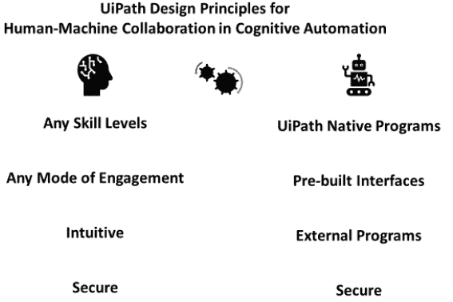

图 3.2 – UiPath 认知自动化中人机协作的设计原则

认知自动化的设计原则如下：

- **人类：** UiPath 平台专为不同技术技能水平的用户设计，从新手到专业开发人员。此外，UiPath 平台允许用户以不同的模式与平台互动——虚拟机、网页、移动设备和桌面。最重要的是，人机之间的界面必须直观且安全。
- **机器：** UiPath 平台是一个开放平台，允许 UiPath 的原生程序、与最流行系统预建的接口以及外部程序。UiPath 在 RPA 领域做得非常出色，但也选择成为 AI 部分的平台和基础设施提供商。开放平台也附带安全性和治理。

UiPath 平台遵循多功能自动化平台的指导原则以及认知自动化人机协作的设计原则。它是一个您可以信赖的平台，用于执行您的变革性自动化项目。

## 介绍 UiPath 端到端认知自动化平台

UiPath 曾是 RPA 应用提供商。过去几年，UiPath 扩展了其产品并重新定位为领先的自动化平台提供商之一。由于 UiPath 目标是更广泛的自动化市场而不仅仅是 RPA，它有意识地努力在平台中遵循人机协作的设计原则，以实现无缝认知自动化。

让我们逐步了解 UiPath 平台的端到端产品集。您将很好地了解如何在您的转型之旅中利用产品集以最大化自动化的潜力。

如需更多信息，您可以参考以下网址：

```
https://www.uipath.com/product
```

下图展示了 UiPath 端到端自动化平台：

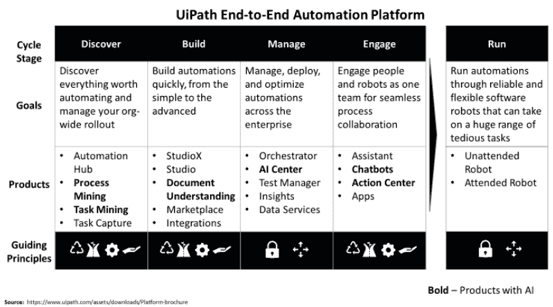

图 3.3 – UiPath 端到端自动化平台

**UiPath 平台**涵盖了自动化生命周期的完整周期：发现、构建、管理、参与和运行。自动化生命周期的每个支柱都遵循多功能平台的指导原则：

- **发现、构建和参与支柱：** UiPath 产品旨在让各种技能水平的人都能够使用 UiPath 开始参与、发现和构建自动化。产品始终牢记预建模板、可复用组件、低代码/无代码选项和灵活配置。
- **维护和运行支柱：** UiPath 产品也专为企业扩展而设计。平台是安全的、可管理的，并具有治理中心，以确保从数据到应用程序的安全，能够承受内部和外部的持续变化，能够大规模优化资源，并能够监控和主动检测问题。

我们现在将在以下章节中查看每个支柱。

## 发现支柱 – 发现、评估和管理自动化用例管道

自动化开发生命周期的 **发现** 支柱是指寻找合格自动化机会的活动。传统上，这一阶段劳动密集且主观。UiPath 平台为此支柱提供了四种产品，使其高效且客观。下图展示了 UiPath 产品如何针对发现支柱内的不同活动：

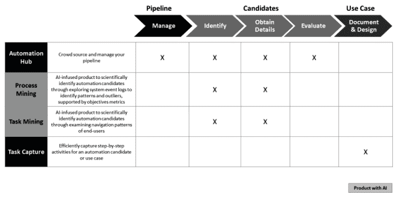

图 3.4 – UiPath：发现支柱

这四种产品是 **Automation Hub**、**Process Mining**、**Task Mining** 和 **Task Capture**：

- **Automation Hub** 是发现支柱中的基石产品。它是协作流程识别、自动化管道管理和流程存储库工具。
- **Process Mining** 和 **Task Mining** 是 AI 增强型产品。**Process Mining** 将您 IT 系统中的数据转化为可视化交互式仪表板，了解根本原因和风险，并识别自动化重点领域。**Task Mining** 收集员工桌面数据，包括每次用户操作时的屏幕截图和日志数据，以建议具有高自动化潜力的流程列表。
- **Task Capture** 帮助您深入挖掘自动化想法，使您能够快速捕获、增强和加速自动化，通过分享您工作的具体细节。


五个产品是 **StudioX、Studio、Marketplace、Document Understanding 和 Automation Ops**。这些产品专为公民开发者和 RPA 开发者设计：

- **StudioX** 是一个面向非技术公民开发者的无代码平台，用于自动化其任务。此外，StudioX 是 UiPath 平台的一部分，这意味着企业级治理和安全基础设施已到位，让企业安心无忧。
- **Studio** 是一款先进的自动化软件，为专业的 RPA 开发者提供构建机器人的正确自动化画布。Studio 提供一套全面的工具，用于设计复杂的有人值守、无人值守和测试自动化。
- **Marketplace** 是一个预建 RPA 内容库。公民开发者和专业 RPA 开发者均可利用 Marketplace 和集成。内容包括原生的 UiPath 集成以及 UiPath 合作伙伴和个人的提交。所有发布在 Marketplace 上的内容都经过严格的认证流程，使得自动化更具效益，因为开发时间减少，同时不牺牲整体内容质量和安全性。
- **Document Understanding** 帮助机器人通过 AI 理解文档。该产品允许专业 RPA 开发者使用预训练模型来加速涉及文档的用例。
- **Automation Ops** 是保持自动化安全的中央管理控制台。它允许公司自定义组织策略并为团队和个人量身定制规则。

## Manage 支柱 – 管理、部署和优化自动化

自动化开发生命周期的 Manage 支柱指的是在整个企业中管理、部署和优化自动化的活动。作为一个自动化平台，UiPath 产品旨在管理所有方面，从机器人、AI 技能和数据到变更。此外，它还拥有强大的报表引擎，用于衡量自动化项目的有效性。下图显示了 UiPath 产品如何覆盖管理整体项目的各个方面：

### UiPath: Manage Phase

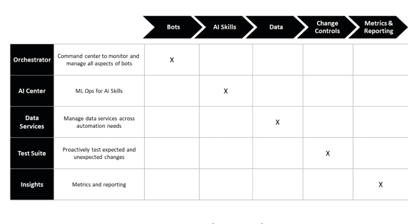

图 3.6 – UiPath: Manage 阶段

五个产品如下：

- **Orchestrator** 是一款企业级监控和管理工具。UiPath Orchestrator 允许集中编排有人值守和无人值守机器人的配置、部署、触发、监控、衡量和跟踪工作。
- **AI Center** 是一个应用程序，允许您部署、管理和持续改进 ML 模型，并在 Studio 中的 RPA 工作流中消费它们。提供预建模型、AI 解决方案模板、多种部署选项，以及专为 RPA 开发者设计的拖放界面。
- **Data Services** 使 RPA 开发者能够轻松访问整个 UiPath 平台所需的数据、变量和工具。它可轻松与任何企业或遗留系统、数据库或自定义应用集成，并提供拖放式存储界面。
- **Test Suite** 是企业测试的测试管理工具。它集成到您的生态系统中并适应您的工作方式，无论您使用 ServiceNow、SAP Solution Manager、Jira 和/或 Azure DevOps。Test Suite 与测试管理和 ALM 工具具有紧密集成。
- **Insights** 是一款 RPA 分析解决方案，用于跟踪、衡量和管理自动化项目的绩效。它拥有经过策划的仪表板模板库，包括机器人、流程、队列和业务 ROI。它还计算自动化的业务影响，并通过自助报表快速与公司各地的关键利益相关者共享结果。

## Engage 支柱 – 促进自动化中的人机协作

自动化开发生命周期的 Engage 支柱指的是将人类和机器人作为一个团队协作以参与活动的活动。Engage 支柱中有四个产品，它们对于我们正在进行的认知自动化——人机协作尤为重要。下图显示了 UiPath Engage 支柱产品如何让人类和机器人参与其中：

UiPath: Engage Phase

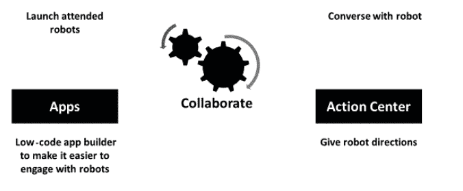

图 3.7 – UiPath: Engage 阶段

四个产品如下：

- **Assistant** 是自动化的桌面启动板。它允许个人触发自动化以协助其日常任务。Assistant 由中央管理、分配和治理。
- **Chatbot** 可以智能地触发机器人执行操作。它自动化人类与机器人之间的对话。聊天机器人通常用于问答、通知、表单提交、报告或任务跟踪。
- **Apps** 是一个低代码应用程序开发平台，可连接到任何底层系统中的数据。它使业务用户能够创建自定义应用程序以促进人机协作。
- **Action Center** 使在机器人和人类之间交接流程变得简单高效。Action Center 用于自动化包含人类应做出的决策的情况，例如审批、升级和异常。

## Run 支柱 – 运行自动化

自动化开发生命周期的 Run 支柱指的是运行有人值守和无人值守机器人的活动。下图显示了 UiPath 产品如何允许以不同模式运行机器人：

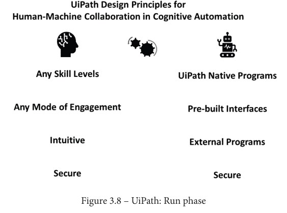

两个产品如下：

- **Unattended robots**: 无人值守机器人驻留在虚拟机中并在后台运行。无人值守机器人用于基于规则的、长期工作流自动化用例。它们通过 Action Center 与人类交互。此外，可以为无人值守机器人添加 AI 技能以执行认知任务。
- **Attended Robots**: 有人值守机器人与人类并排在桌面上工作，并充当个人助手以帮助完成日常任务。人类在 UiPath Assistant 中访问、安排和运行有人值守自动化。UiPath 平台允许为无人值守机器人添加 AI 技能以执行认知任务。

正如我们在本节中所看到的，UiPath 是一个强大的自动化平台。当您思考如何利用完整的产品套件满足您的自动化需求时，您需要了解整个产品套件及其设计用途。

## 了解 UiPath Document Understanding

**UiPath Document Understanding** 是一款强大的产品，利用 AI 使 RPA 机器人能够理解文档。该产品具有灵活性，可适应从多种文档类型中提取信息。它允许您创建一个单一工作流，从各种文档中提取数据。

## UiPath Document Understanding 的优势

下图显示了在 UiPath 平台中使用 UiPath Document Understanding 的优势：

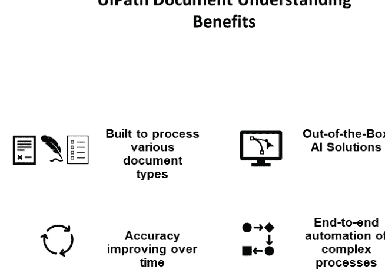

来源：UiPath Academy Course – Document Understanding

图 3.9 – UiPath Document Understanding: 优势

UiPath Document Understanding 提供四个关键优势：

- Built to process various document types and OOTB AI solutions:

UiPath Document Understanding 可以处理各种文档和丰富的预训练 ML 模型。下图显示了 UiPath Document Understanding 文档类型和预训练 ML 包：

### UiPath Document Understanding
Document Types and Pre-trained ML Packages

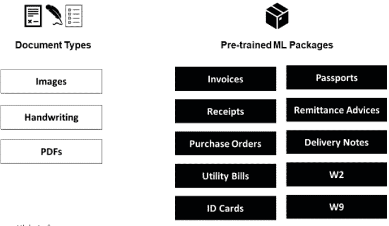

### Document Types

- Images
- Handwriting
- PDFs

### Pre-trained ML Packages

- Invoices
- Receipts
- Purchase Orders
- Utility Bills
- ID Cards
- Passports
- Remittance Advices
- Delivery Notes
- W2
- W9

图 3.10 – UiPath Document Understanding: 文档类型和预训练 ML 包

- **UiPath Document Understanding** 可以通过利用其自身的理解引擎或其合作伙伴生态系统的引擎来处理更广泛的文档。UiPath Document Understanding 也是市场上最丰富的预训练 ML 包之一。预训练包包括发票（通用、澳大利亚、日本、印度和中国）、收据、采购订单、水电费账单、护照、身份证、W2、W9、汇款通知和送货单。UiPath 还会定期添加新的预训练包。


*随时间的推移，准确性不断提高：*

**UiPath Document Understanding** 还与 UiPath Action Center 和/或 UiPath 有人值守机器人无缝集成，融入人工验证环节。此外，修正后的数据会反馈回机器学习模型，以随着时间推移不断提高准确性。下图展示了 UiPath Document Understanding 的验证与训练工作原理：

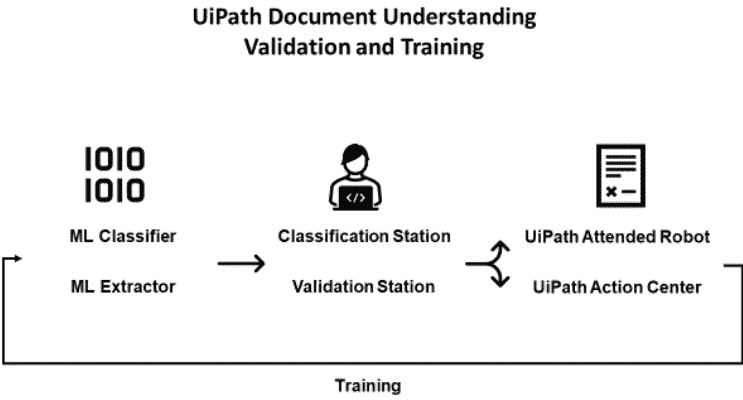

图 3.11 – UiPath Document Understanding：验证与训练

**UiPath Document Understanding** 支持人机协作以优化结果。模型可以根据人工输入自动重新训练。你与模型互动越多，它就越有效。

*复杂流程的端到端自动化：*

**UiPath Document Understanding** 不是一款独立产品。它与 UiPath 平台的其他部分相结合，可以实现端到端的业务流程自动化，如下图所示：

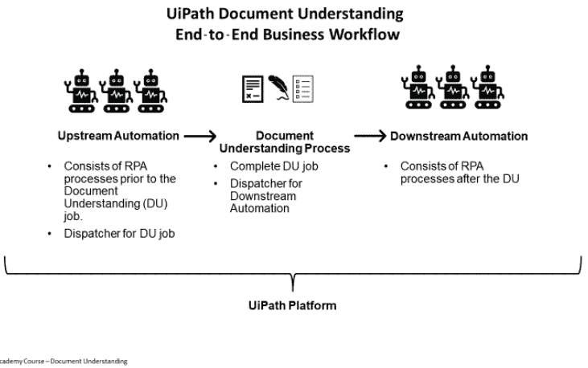

图 3.12 – UiPath Document Understanding：端到端业务流程

端到端的业务流程可实现最大效率，以管理整体流程和机器人利用率。它还能防止外部问题影响 Document Understanding 作业。

## UiPath Document Understanding 技术框架

让我们来了解 UiPath Document Understanding 的技术框架。你将全面了解框架中的每个组件及其相互关系。你将能够利用 UiPath Document Understanding 通过文档理解活动实现用例自动化。下图展示了 UiPath Document Understanding 框架：

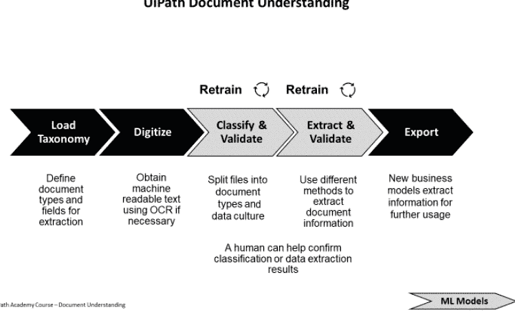

图 3.13 – UiPath Document Understanding

UiPath Document Understanding 框架包括五个组件，如下所示：

1. **加载分类法**：第一步是定义要提取的文档类型和字段，以便在分类法管理器中创建专用的分类法结构。
   - **用例**：从差旅和娱乐收据中提取信息，用于费用报销。
   - **文档类型**：收据
   - **要提取的字段**：交易日期、供应商、总金额、税额

2. **数字化**：第二步是将文件转换为机器可读的内容。此步骤需要选择**光学字符识别（OCR）**引擎来数字化内容。UiPath Document Understanding 内置了与最流行的 OCR 引擎的集成。这些 OCR 引擎包括 UiPath Document OCR、OmniPage OCR、Google Cloud Vision OCR、Microsoft Azure Computer Vision OCR、Microsoft OCR、Tesseract OCR 和 ABBYY Document OCR。

3. **分类与验证**：第三步是识别机器人正在处理的文档类型。此步骤利用 AI/ML。此步骤包含三个子步骤：
   - **文档分类**：此子步骤自动确定相关的文档类型。有四个开箱即用的分类器：基于关键字的分类器、智能关键字分类器、FlexiCapture 分类器和机器学习分类器。你也可以创建自己的分类器来实现自定义算法。
   - **文档分类验证**：此子步骤允许使用**分类站**进行人工验证。使用分类站有两种方式：作为有人值守活动或作为 Action Center 任务。此子步骤是可选的，但如果你处理的是单个文件中的多种文档类型，或者需要 100% 的准确率，则强烈建议使用。
   - **文档分类训练**：此子步骤将人工验证的信息传回分类器，以改进其未来的预测。此子步骤为能够从人工反馈中学习的分类器形成了一个闭合的反馈回路。可用的分类器训练器包括基于关键字的分类器训练器、智能关键字分类器训练器和机器学习分类器训练器。

4. **提取与验证**：此步骤从文档中识别要提取的特定信息。此步骤利用 AI/ML。此步骤包含三个子步骤：
   - **数据提取**：此子步骤根据分类法中的定义，从每种文档类型中自动提取相关信息。此步骤确保以正确的顺序、针对相关的字段列表以及正在处理的文件的指定页面范围调用配置的提取程序。有五个开箱即用的提取程序：基于正则表达式的提取程序、表单提取程序、智能表单提取程序、FlexiCapture 提取程序和机器学习提取程序。你也可以创建自己的提取程序来实现自定义算法。

## UiPath AI Center 的优势

下图展示了在 UiPath 平台中使用 UiPath AI Center 的优势：

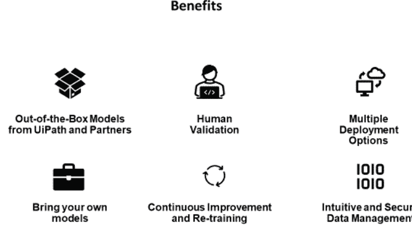

来源：UiPath 网站

图 3.14 – UiPath AI Center：优势

UiPath AI Center 提供六大关键优势：

- 来自 UiPath 及合作伙伴的 OOTB 模型：

**UiPath AI Center** 拥有来自 UiPath 的超过 25 个开箱即用模型，以及来自 UiPath 广泛合作伙伴网络的更多模型。这些开箱即用模型涵盖 UiPath Document Understanding、语言分析与理解、图像分析和表格数据。没有深厚 ML 背景的 RPA 开发人员也可以开始使用这些开箱即用模型，将 AI 融入其用例。

- *自带模型：*
**UiPath AI Center** 支持用户将自己的 ML 模型带入 UiPath AI Center，以部署、持续训练并改进这些模型。此功能使 RPA 开发人员能够与公司内部的数据科学家协作，使用数据科学家融入其 RPA 工作流的模型。

- *人工验证：*
**UiPath AI Center** 允许人与机器并肩工作，验证数据并将其发回以进行模型再训练。为了最大化自动化潜力，有助于人机协作的功能必不可少。

- *持续改进与再训练：*
**UiPath AI Center** 提供对模型使用、数据、模型性能、用户操作和流水线的端到端可见性。它还保持对版本的控制，并通过人在环和自动再训练实现无压力再训练。

- *多种部署选项：*
**UiPath AI Center** 支持本地部署和云部署。这些选项满足所有行业的需求。

- *直观且安全的数据管理：*
**UiPath AI Center** 拥有直观且安全的数据管理功能。创建和访问模型数据非常简单。它还允许用户上传自己的数据。此外，它使客户能够对其训练模型所用数据进行快照，从而获得完整的审计追踪，了解哪个模型做出了哪项预测，以及哪个模型使用了哪些数据进行训练。

## UiPath AI Center 技术概念

让我们来了解 **UiPath AI Center** 的技术概念。你将全面了解每个概念及其相互关系。下图展示了 UiPath AI Center 的技术概念：

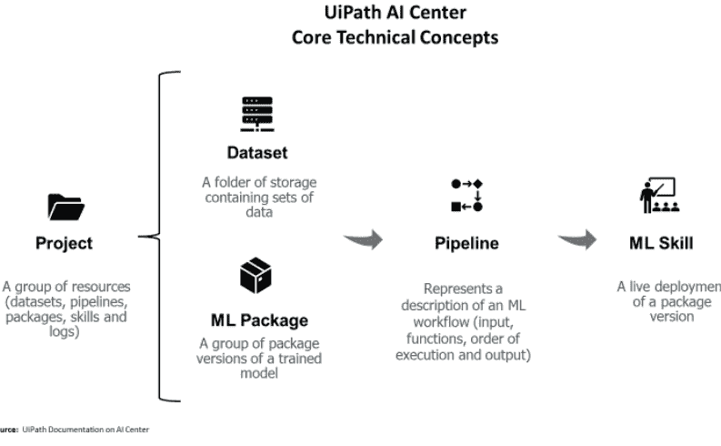

图 3.15 – UiPath AI Center：核心技术概念

UiPath AI Center 使用五个技术概念。你需要熟悉这些概念及其相互关系。它们在 UiPath AI Center 产品中贯穿使用。这五个技术概念如下：

- **项目：** 项目是资源的集合——数据集、ML 包、流水线 ML 技能和日志。你使用这些资源来构建特定的 ML 解决方案。最好为每个自动化用例创建一个单独的项目。在 **UiPath AI Center** 中，仪表板提供了所有项目的概览，包括活动流水线和已部署包的信息。
- **数据集：** 数据集是一个用于存储数据的文件夹。你可以创建新的数据文件或上传来自其他应用程序的文件。数据集是本地资源，仅在项目内可用。
- **ML 包：** ML 包是一个包含训练 ML 模型所需的代码和元数据的文件夹。一个 ML 包可以有多个版本，并带有相关的变更日志。在 UiPath AI Center 中，有超过 25 个开箱即用的 ML 包可供使用。


- **流水线**：流水线是准备数据、调整模型和转换预测所需的线性步骤序列。流水线指定了这些功能及其执行顺序，还指定了运行流水线所需的输入以及从流水线获得的输出。流水线完成后，一次流水线运行会产生相关的输出和日志。流水线有三种类型：
  - **训练流水线**：训练流水线用于训练新的机器学习模型，以生成新的包版本。
  - **评估流水线**：评估流水线用于评估已训练的机器学习模型。
  - **完整流水线**：完整流水线用于训练新的机器学习模型并评估此新模型的性能。此外，在训练之前会运行预处理步骤，从而允许数据操作和训练已训练的机器学习模型。
- **ML 技能**：ML 技能是机器学习包的一种面向消费者的实时部署。一旦部署，它就可以在 RPA 工作流中使用。在 UiPath Studio 中，您只需将任意 ML 技能活动拖放到 RPA 工作流中即可。

如您在本节中所见，借助 UiPath AI Center，您可以将 AI 和机器学习模型集成到 RPA 自动化中，从而解决一系列新的用例。接下来，让我们了解 UiPath 平台如何通过 UiPath 聊天机器人（Druid）实现智能聊天机器人功能。

## 了解 UiPath 的 Druid 聊天机器人

**UiPath 平台**与市场上的智能聊天机器人将 RPA 和对话式 AI 结合起来，以提升您的客户和员工体验。

UiPath 平台非常灵活，为集成智能聊天机器人提供了多种选项。UiPath 已与领先的聊天机器人提供商合作，提供直接集成。UiPath 还为 Dialogflow 平台提供了内置连接器。最后，UiPath 已将 Druid 提供的无代码、AI 驱动的聊天机器人原生集成到 UiPath 平台中。由于 Druid 聊天机器人是 UiPath 平台的一部分，让我们深入了解一下。

## UiPath 的 Druid 聊天机器人的优势

下图展示了在 UiPath 平台中使用 UiPath 的 Druid 聊天机器人的优势：

### UiPath 聊天机器人（Druid）
优势

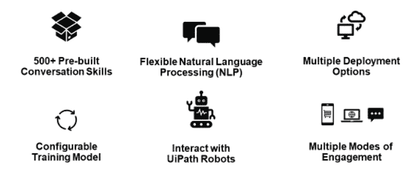

资料来源：UiPath 网站

图 3.16 – UiPath 聊天机器人（Druid）：优势

UiPath 的 Druid 聊天机器人有六大关键优势：

- **500+ 预构建对话技能**：

UiPath 的 Druid 聊天机器人拥有超过 500 个针对跨行业和多种角色的业务场景预构建的技能。这些对话技能包括回答问题、发送通知、交付报告、跟踪智能任务、填写表单以及转接人工。Druid 是一个无代码创作平台，允许 RPA 开发人员在无需深入 AI 技术知识的情况下快速创建和部署聊天机器人。

- **可配置的训练模型**：

UiPath 的 Druid 聊天机器人配备了全面的训练工具和学习机制，以提升聊天机器人的知识和性能。

- **灵活的自然语言处理（NLP）**：

**UiPath 的 Druid 聊天机器人**拥有专有的 NLP 技术，但也允许用户选择其他 NLP 技术。NLP 引擎会解译用户的意图，根据其行为和偏好提供情境化信息。该平台还具有高级 NLP 功能，用于测试话语、配置停用词、情绪和流程匹配阈值。

- **与 UiPath 机器人交互**：

**UiPath 的 Druid 聊天机器人**可以使用自然语言在机器人与人之间进行双向通信，以处理请求。下图展示了 UiPath 与 Druid 聊天机器人之间的集成方式：

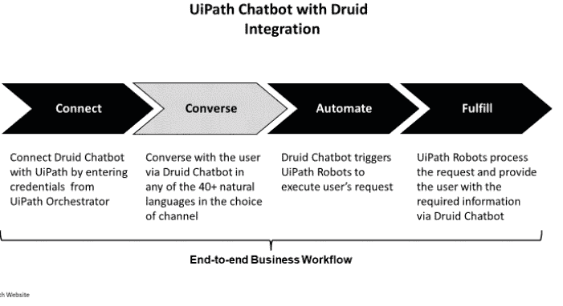

图 3.17 – UiPath 聊天机器人（Druid）：集成

UiPath 和 Druid 具有原生动态集成，可将 Druid 聊天机器人集成到 RPA 工作流中。

- **多种部署选项**：

**UiPath 的 Druid 聊天机器人**可以部署在本地、云中和混合环境中。这些选项满足不同行业和客户的需求。

- **多种交互模式**：

**UiPath 的 Druid 聊天机器人**支持通过网页、Microsoft Teams 或 Slack 等协作工具、WhatsApp 或 Facebook 等聊天应用，或语音通话，为全渠道部署提供现成集成。

## UiPath 的 Druid 聊天机器人的技术组件

让我们逐一了解 **UiPath 的 Druid 聊天机器人**的技术组件。您将对每个组件有一个全面的了解，并明白如何在下一个项目中最好地集成 Druid 聊天机器人。下图展示了 UiPath 的 Druid 聊天机器人的技术组件：

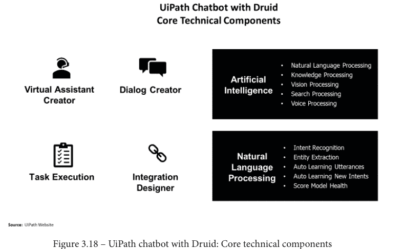

**UiPath 的 Druid 聊天机器人**包含六个技术组件。如下所示：

- **虚拟助手创建器**是一个图形化流程设计器。它使 RPA 开发人员能够创建、设计和编辑对话流。其中有超过 500 个预配置的对话技能和预构建的虚拟助手模板可供使用。
- **对话创建器**是一个拖放式工具。该工具内置了实时对话分析功能，以增强后续对话。它开箱即用地支持 40 多种语言。它还提供了针对角色、流程和行业定制的常见业务工作流的预构建对话模板。您还可以实现自己的静态响应和行为。
- **任务执行**可以在对话流中实时监控用户并发出警报。Druid 聊天机器人允许用户向其他用户分配任务并监控其完成情况。它还可以经过训练，在任务未按预设时间间隔执行时发送警报和后续提醒。
- **集成设计器**是配置企业应用程序和开放 API 的场所。Druid 聊天机器人可以通过 REST、SOAP、Web 服务、API、MQ 和 SQL 连接快速连接其他企业系统——CRM、ERP、BI、HRIS。提供了与最常见 IT 系统的预定义连接器。此外，与 UiPath 平台的集成是原生的。Druid 聊天机器人功能已与 UiPath Studio、UiPath Orchestrator 和有人值守机器人原生集成，以支持直接从聊天请求触发自动化。
- **人工智能**：Druid 聊天机器人支持 AI。其 AI 能力包括以下内容：
  - **自然语言处理**：Druid 聊天机器人可以识别意图、提取上下文并识别情绪。
  - **知识处理**：Druid 聊天机器人可以映射复杂信息和数据，以提供智能推荐并执行语义搜索。
  - **视觉处理**：Druid 聊天机器人可以处理图像，并以高准确度识别和捕获关键信息。
  - **搜索处理**：Druid 聊天机器人可以使用搜索 API，通过单次 API 调用检索网页、图像、视频和新闻。
  - **语音处理**：Druid 聊天机器人可以将语音音频转换为文本、使用语音进行验证，或增加说话人识别。
- **自然语言处理**：Druid 聊天机器人允许用户选择自己偏好的 NLP 引擎。借助所选 NLP 引擎，Druid 聊天机器人可以解译用户意图，以根据用户行为和偏好提供情境化信息。NLP 引擎包含以下组件：
  - **意图识别**：将话语与其正确意图的任务进行匹配。
  - **自动学习话语**：自动生成话语，以提高检索正确答案的精确率和召回率。
  - **自动学习新意图**：通过自动将成功执行的话语添加到其机器学习训练集中，实现无监督学习。
  - **模型健康评分**：使用混淆矩阵和重叠话语验证模型的性能。


UiPath 已将 Druid 的无代码、AI 驱动的聊天机器人原生集成到 UiPath 平台中。集成 Druid 的 UiPath 平台具有诸多优势。Druid 拥有超过 500 个预构建的对话技能、可配置的 NLP 和训练模型、多种部署选项、多种参与模式，以及与 UiPath 的原生集成。

## Summary

在本章中，我们探讨了 UiPath 平台的各个方面。UiPath 平台非常适合希望通过认知自动化加速和放大其转型之旅的公司。我们学习了认知自动化平台的关键成功标准。我们提供了整个 UiPath 平台的概述。我们还提供了三个关键 AI 融合产品的概述 – UiPath Document Understanding、UiPath AI Center 和集成 Druid 的 UiPath Chatbot。

本章所学内容将为你在后续章节中通过示例亲手实践这些产品奠定基础。

在下一章中，我们将探讨如何识别认知机会。在我们努力识别自动化机会时，自动化的价值主张始终应是核心焦点，并与组织的更高层级目标业务目标和自动化项目的核心愿景相联系。
