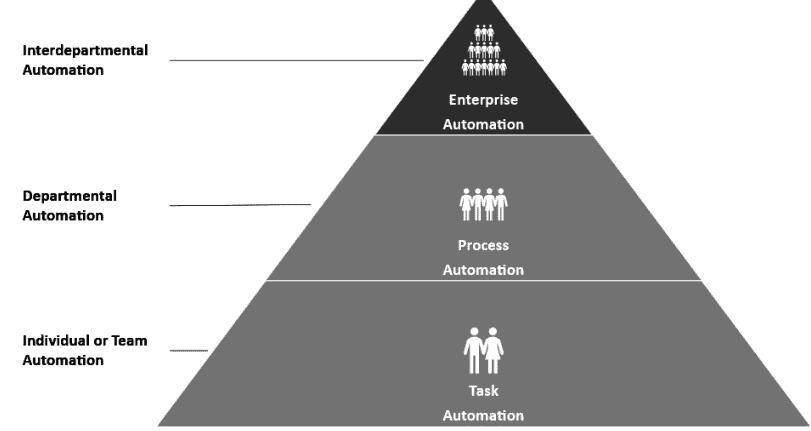
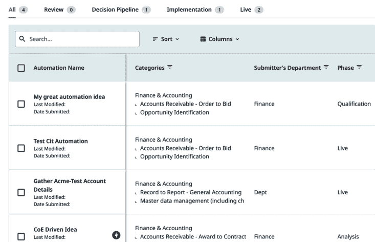
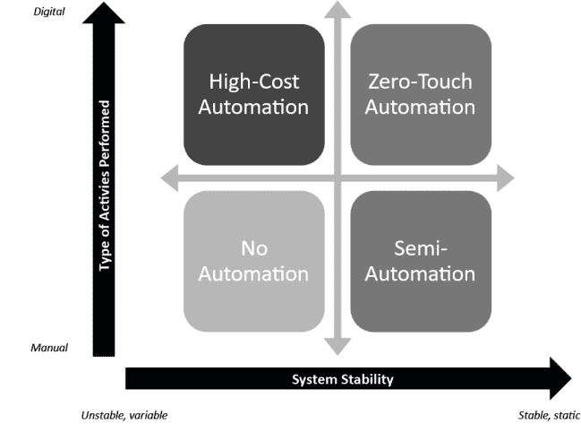
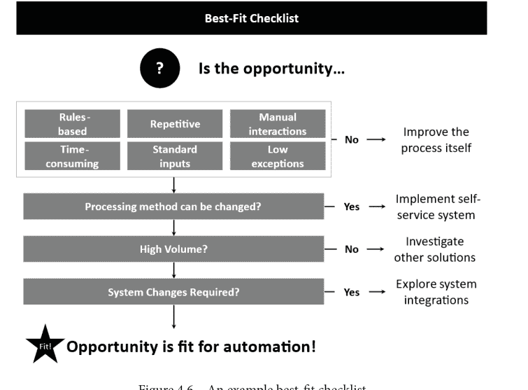
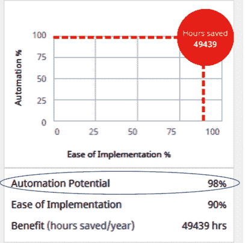
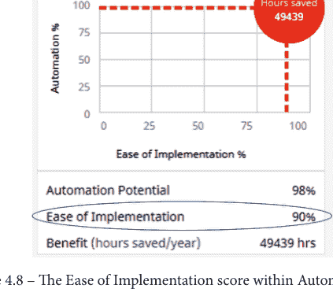
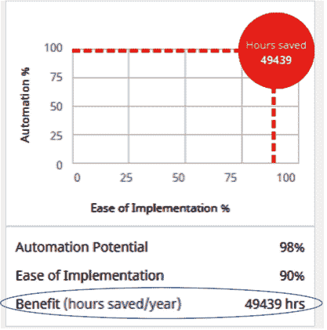
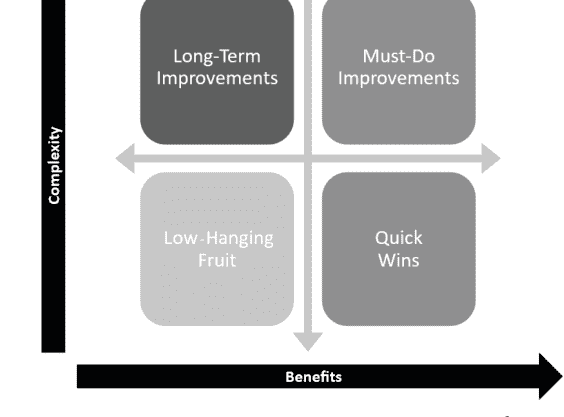

# 4
识别认知机会

随着越来越多的组织在工作场所实施 **Robotic Process Automation (RPA)** 和认知自动化，从这些实施中产生价值的重要性从未如此之高。在我们努力识别自动化机会时，自动化的价值主张始终应是核心焦点，并与组织的更高层级目标业务目标和自动化项目的核心愿景相联系。

在识别认知自动化的潜在用例时，收集尽可能多的关于自动化机会的上下文和知识至关重要，以确保 AI Center 和 Document Understanding 能够实现用例的目标。因此，在本章中，首先，我们将重点关注如何搜索自动化机会。特别是，我们将了解传统自动化机会和认知自动化机会的特征。如何为企业设定目标，以及如何领导搜索工作以找到自动化机会。在此之后，我们将深入了解自动化机会：学习如何根据最佳匹配、可行性和可行性的维度对自动化机会进行优先级排序，并学习如何通过充分理解自动化机会的端到端流程来最好地捕获价值。到本章结束时，我们将转向讨论在探究认知自动化想法时应考虑哪些项目。

在本章中，我们将涵盖以下主要主题：

- Searching for automation opportunities
- Understanding the opportunity
- Probing for cognitive automation

### Searching for automation opportunities

价值保障的重要性从未如此之高，因为组织正高度关注从自动化计划中创造即时效益。因此，在机会搜索期间识别、评估规模并批准自动化候选项目时应慎重考虑。为了确保所选机会成功并实现所宣传的效益，你应熟练掌握自动化机会的特征，了解何时应用认知能力，以及了解如何识别自动化可以创造的价值驱动因素。一旦充分掌握自动化机会的特征，你可以采用自上而下或自下而上的不同方法来识别机会，然后运用你的判断来优先考虑机会以进行进一步分析和开发。

在本节中，我们将涵盖以下主题：

- The characteristics of an automation opportunity
- Identifying target goals
- Seeking automation opportunities

### The characteristics of an automation opportunity

在企业内部搜索自动化机会之前，重要的是要充分了解传统 RPA 能做什么，以及更具体地说，将认知能力添加到 RPA 中可以解锁哪些额外好处。充分掌握这些概念在搜索机会时至关重要——过于频繁地，范围界定不佳的机会会进入组织的自动化管道，这些机会要么不适合自动化，要么无法提供即时的效益来抵消开发和支持的成本。

在之前的章节中，我们对 RPA 是什么以及它能提供什么有了一般性的了解——一种驻留在桌面级别应用程序之上的软件机器人，可以模仿人类交互来执行一系列步骤。这种自动化可以提供很多好处，例如以下内容：

- Logging into applications
- Scraping data from websites and applications
- Navigating through application windows and menus
- Making calculations

因此，在识别严格的 RPA 候选项目时，我们希望调查具有以下特征的机会：

- 需要与应用程序进行手动交互
- 具有重复性
- 具有标准输入
- 耗时
- 基于规则且结构化

然而，至关重要的是要理解，RPA 单独只能执行一系列标准化、基于规则的系统活动。在其基本形式中，RPA 非常天真，只会遵循提供的指令。当然，这与任何传统编程或脚本编写类似——你的执行代理（在我们的例子中是 UiPath 机器人）只会遵循你提供的指令集。不幸的是，这使我们可自动化的机会数量有限，排除了许多需要人类水平的判断或超出传统 if-else 条件序列的思考的用例。

幸运的是，我们现在可以通过将认知能力添加到我喜欢称之为“认知自动化”的功能中来填补这一空白。这使我们有可能重塑自动化的未来，因为我们可以界定传统基于规则的自动化无法解决的更复杂和需要判断的类型机会。许多组织正在利用这项技术来改进其现有自动化，甚至调查其自动化管道并重新审视之前因范围缩小而被排除的、现在可以用认知自动化开发的机会。

对于许多新的自动化项目来说，自动化低复杂度的自动化可能很有吸引力。然而，通过找到与战略重点一致的自动化机会，我们可以提出更有说服力的价值主张，并在试图围绕自动化凝聚参与度时提供更有说服力的成功案例。因此，结果驱动的方法始于领导层，设定业务目标，并形成假设（有数据支持）以识别关键痛点。自动化项目的典型业务目标包括以下内容：

- Growing revenue
- Improving client experience
- Scaling faster
- Improving compliance/regulations
- Reducing cost
- Improving employee experience
- Building a foundation for AI

一旦业务目标确定，对组织的调查可以引导我们创建假设，这些假设可以通过自动化得到潜在解决。例如，如果一个组织希望专注于改善员工体验，首先，我们需要深入了解影响员工体验的因素——理想情况下是工作满意度和支持（例如，感到被重视）。

了解影响我们业务目标的因素后，接下来我们可以专注于数据收集和对企业的调查。对于此示例，我们正在查看员工满意度，因此我们应该收集 HR 拥有的与满意度调查、支持票据等相关的任何数据（Figure 4.2）：

## 调查结果

- 1. 68% 认为入职流程在员工的前几个月阻碍了生产力
- 2. 60% 不认为自己的工作有回报
- 3. 35% 在其职位中看不到职业成长

## 关键绩效指标

| KPI | CURRENT | TARGET |
|---|---|---|
| Employee Satisfaction | 70% | 85% |
| Accuracy | 95% | 97% |
| Timeliness | 65% | 80% |

Figure 4.2 – An example of data collection results

从数据收集结果来看，我们可以开始建立假设：

- 1. 大多数受访者认为入职流程阻碍了生产力。
- **Hypothesis:** 跨多个应用程序和系统的手动设置导致入职时间变慢和生产力下降。
- 2. 60% 的受访者不认为自己的工作有回报。
- **Hypothesis:** 业务部门包含大量手动和繁琐的任务，小团队必须完成这些任务，从而减少员工从事有回报任务的时间。
- 3. 35% 的受访者看不到职业成长。
- **Hypothesis:** 员工没有规定的职业发展轨迹。
- 4. 服务中心周转时间较差。
- **Hypothesis:** 许多应用程序和缓慢的数据检索导致周转时间增加。

根据这些假设，我们可以开始确定需要进一步调查的领域。对于本示例，让我们调查假设 1 并深入了解新员工的入职旅程。在这种情况下，我们希望深入了解员工生命周期，回顾从申请职位、面试、接受 offer 到入职的旅程。为了做到这一点，我们将与负责执行这些活动的团队的相关利益相关者安排发现会议。在下一节中，我们将更详细地介绍如何进行这些类型的发现会议。

在我们跳入寻求自动化机会的不同方法之前，有一些成功因素需要考虑：

- 在构思过程中始终将目标业务成果放在首位。
- 确保高层一致并获得支持以最大化影响。
- 避免 exclusively 专注于成本削减。
- 专注于解决业务问题。
- 考虑其他类型的方法和解决方案 – RPA 只是工具箱中的一种工具。

遵循这些成功因素可以帮助确保我们识别的自动化机会为业务和整个自动化项目带来价值。

## Seeking automation opportunities

在整个企业中寻求自动化机会时，我们会注意到不同级别的自动化，包括从自下而上到自上而下的级别。这些类型的自动化可在 Figure 4.3 中参考：

Figure 4.3 – The types of automation opportunities

- **Enterprise automation** 关注跨部门的机会，影响组织中大量人群。这些自动化可能包括人工智能等更高复杂度的技术。
- **Process automation** 关注部门级机会，这些机会是为部门的特定流程量身定制的。这些机会可能为部门内多名同事提供高水平的影响。自动化可能包括诸如文档理解、人工智能或“人工在环”等附加技术。
- **Task automation** 关注低复杂度的机会，仅惠及少数个人。这些自动化旨在自动化个人日常执行的独特任务。通常，这些机会对自动化项目的整体影响较低，但可能对运行自动化的个人产生更大的影响。这些自动化通常不包括更高复杂度的技术。

企业自动化虽然很棒（就影响而言），但成功的自动化项目采用自上而下和自下而上的方法来确定自动化机会。并非所有自动化都将在公司范围内；因此，寻找部门级和任务级自动化机会也至关重要。让我们调查几种自上而下和自下而上的构思方法（请参阅 *Table 4.1* 和 *Table 4.2*）：

|  | **Top-Down Ideation** |
|---|---|
|  | *[Illustration of a top-down arrow/diagram]* |
| **CoE Discovery Workshops** |  |
| **Approach description** | • 更小、更集中的 intake 努力，其中 **Center of Excellence (CoE)** 针对特定的业务职能领域，以识别离散的自动化机会，从而回答一个总体业务目标。此工作在离散的研讨会中进行，每次筛选约 6–10 个机会。 |
| **Key business responsibilities** | • 识别关键资源以支持构思工作并参与教育会议。  • 调查业务中的机会以供与 CoE 审查。 |
| **Key CoE responsibilities** | • 进行 RPA 教育并指导业务识别机会。  • 促进 intake 研讨会和会议以确定已识别的业务机会。 |
| **Key activities** | • 举办 RPA 教育会议（视需要）并了解利用自动化的业务目标。  • 业务在期望的领域内调查机会（或与 CoE 合作以帮助构思工作）。  • CoE 举办 intake 研讨会/会议以确定机会。 |

Table 4.1 – The top-down approach; CoE discovery workshops

自上而下的自动化通常与更大规模的企业级数字化转型计划相关联。由于这些计划是资金充足、专注于公司战略目标的项目，因此更容易获得跨部门合作以参与构思练习。有了这种合作，从自上而下角度识别机会的最佳方式之一是提交数据收集请求，要求提供职能组织架构图（例如子职能/团队如何组织、员工人数等）。这些数据将使我们能够专注于员工人数众多的领域，以便深入调查。

这些已识别的领域然后可以进行更小的 intake 努力，在此我们可以识别离散的自动化机会以回答总体业务目标。一旦确定了总体业务目标（例如加快会计团队的任务），我们就可以调查执行的流程并确定自动化机会：

| Bottom-Up Ideation |
|---|
| Business Ideation and Submission |
| Approach description | • 更大、更详尽的数据收集工作，其中 CoE 与多个职能领域合作，在整个企业中撒网。此工作利用多个研讨会/教育会议来建立项目管道。 |
| Key business responsibilities | • 定义自动化战略和长期计划。 • 参加自动化教育会议。 • 向 Automation Hub 提交想法以供 CoE 参与。 |
| Key CoE responsibilities | • 确保正在遵循运营模式控制流程。 • 与业务合作预测需求并规划机会建设。 |
| Key activities | • CoE 邀请业务领导者参加教育会议以分享目标并介绍 RPA 和 Automation Hub。 • CoE 在 Automation Hub 中收集来自业务领导者和组织各参与者的自动化机会。 • CoE 审查机会并确定进一步分析和构建的用例。 |

Table 4.2 – The bottom-up approach; business ideation and submission

从自下而上的角度来看，方法与自上而下的方法有所不同。对于自下而上的构思，想法需要来自组织本身，而不是自上而下的针对性方法。

对于自下而上，我们进行更大规模的数据收集工作，整个组织（或其子集）有机会提交他们认为有影响力的自动化想法。参与者受邀参加教育会议，在会上他们可以分享自动化的目标以及可能的艺术。一旦接受教育，参与者将被邀请将潜在的自动化想法提交到中央存储库（例如 Automation Hub），每个想法都将被审查以进行进一步分析和构建。

一旦我们完成了探测机会的练习，我们的主机会机会日志应包含大量机会供我们深入研究。此主机会机会日志应是基于我们从构思练习中可能收集到的以下高层信息的有序列表，例如以下内容：

- Value
- Complexity (a rough estimate)
- Suitability (a rough estimate)

此主机会机会日志可以采用多种形式 – 一些组织选择使用久经考验的 Excel 表格来跟踪管道，但许多组织利用诸如 UiPath 的 Automation Hub 或 Jira 等工具来跟踪自动化管道：

## Automation Pipeline

Figure 4.4 – The master opportunity log in UiPath's Automation Hub

## 最佳适配评估

并非所有机会都最适合仅靠自动化；因此，**最佳适配评估**是初步练习，用于测试自动化机会的适用性。在深入研究可行性和影响潜力细节之前，应审查该机会，以确定 RPA 或其他技术是否最适合该机会。

在开始评估自动化机会时，我们可以利用以下矩阵轻松确定 RPA 的适用性：

图 4.5 – 自动化机会可以绘制在四个象限之一中

- **无自动化：** 通常，我们要谨慎对待涉及频繁流程和环境变化的机会（例如，不稳定的系统环境和频繁的程序变更）。因此，在评估机会时，我们要避开那些高度物理化且包含不稳定流程或系统的流程。
- **高成本自动化：** 随着机会向更数字化的方向发展，我们开始涵盖仅在计算机上执行的用例。仍需考虑系统和环境的波动性。然而，流程变更可能需要集成新的软件组件或工具——在许多情况下，需要认知计算，例如图像识别。
- **半自动化：** 随着我们向更静态的流程和环境下移，包含更多物理步骤的机会可能实现半自动化。虽然 RPA 无法覆盖物理步骤，但仍有机会重新规划或重新设计该机会以实现自动化。
- **零接触自动化：** 最后，最佳用例机会是完全数字化的，并且包含稳定的系统/环境。即使需要包含认知组件，这些也非常适合自动化。

在最佳适配评估期间，您应与流程负责人或该流程的**主题专家 (SME)** 一起坐下，深入了解现状流程的细节。通过更多地了解流程及其执行方式，参考 *图 4.6* 中的清单可以帮助您判断该机会是否适合自动化：

图 4.6 – 一个最佳适配清单示例

在审查自动化机会的最佳适配时，首先，我们必须审查该机会是否包含典型自动化（即需要人工交互、具有重复性、具有标准输入、耗时且基于规则）或认知自动化（即具有概率性、高变异性和非结构化数据）的特征。如果机会不符合这些特征，则该机会可能需要进行一些流程改进练习以使其适合自动化。

如果机会符合典型或认知自动化的特征，那么我们必须接下来检查处理方法是否可以保持不变。如果我们发现流程的交易可以通过应用程序处理（例如，使用 ServiceNow 处理服务工单而不是 RPA），那么该机会可能更适合自助服务而非自动化。

如果可以继续，那么我们需要确保该机会具有足够的业务量来支持自动化构建。这将与可行性评估相关联，但通常，我们希望查看定期执行（每日、每月甚至每季度）的自动化机会，并且包含大量交易。如果业务量低，该机会可能更适合自动化之外的其他解决方案。

最后，如果可以继续，我们需要检查自动化是否需要任何系统变更。对于自动化，我们希望确保应用程序和系统的稳定性，因此我们需要检查以下内容：

- 应用程序或系统不会很快发生变化。
- 现有应用程序和系统中已有功能（或即将推出的功能）最适合该机会。

除了前面显示的示例最佳适配清单外，UiPath 的 Automation Hub 还包含自动化潜力评分以指示最佳适配（*图 4.7*）：

图 4.7 – Automation Hub 中的自动化潜力评分

UiPath Automation Hub 中的自动化潜力评分将根据以下内容输出百分比：

- 输入数据的结构化程度
- 流程变异性
- 输入数据的数字化程度

通过完成最佳适配评估，我们可以衡量将机会与自动化匹配的潜力。完成最佳适配评估后，我们可以继续通过可行性评估来衡量实施自动化会有多困难。

## 可行性评估

一旦确定 RPA 是该机会的最佳适配，下一步评估应是确定实施的难易程度，即可行性评估。

在检查可行性时，我们希望检查可能增加开发工作复杂性的几个因素：

- **屏幕数量：** RPA 在应用程序层工作，因此流程中每增加一个新屏幕（或窗口），开发人员就需要配置自动化以与每个页面上的元素交互。屏幕数量也可以作为步骤数量的代理。
- **应用程序类型：** 应用程序类型是复杂性的重要贡献者。Java 或 Citrix 等应用程序可能会增加开发复杂性，而 Mainframe、Web 或基于 Microsoft 的应用程序可能会降低复杂性。另一个需要考虑的点不仅是应用程序类型，还有应用程序数量，因为流程中应用程序越多，开发人员需要开发的配置量就越大。
- **变体/场景/异常：** 流程中的任何变体（例如 if-else 类型的规则）都会导致复杂性增加，因为需要更多开发时间来处理每个变体。
- **结构化输入：** 输入类型是影响复杂性的另一个因素。输入类型可能在机器可读输入（文本）和数字输入（扫描的 PDF）之间变化，导致读取文本的方法不同。除了输入类型外，输入的结构（例如标准化、半结构化或非结构化）也会增加复杂性。需要解释电子邮件正文中的自由文本的自动化比搜索静态电子邮件主题行的自动化更复杂。
- **质量控制**：某些用例可能需要高准确度和/或**严格的服务水平协议 (SLA)**。虽然自动化可以通过始终保持相同的步骤序列来提高准确性，但需要更复杂组件（例如**光学字符识别**或**OCR**）的流程可能更难以在高准确度水平下维护。
- **基于图像的自动化**：必须与 VDI、远程桌面或基于 Citrix 的应用程序交互的自动化可能会增加开发复杂性。虽然 UiPath 的远程桌面和 Citrix 扩展使远程桌面的开发变得更容易，但开发的某些组件可能需要基于图像的自动化，从而增加开发和测试时间。
- **监管合规**：许多流程机会都伴随着监管义务，尤其来自银行或医疗领域。监管合规可能需要额外的范围会议、批准和审计，以确保自动化符合合规要求。

上述因素的响应可以结合起来，对流程复杂性进行粗略估计。以下表格（表 4.3）可供参考，显示流程特征如何映射到流程复杂性：

| 流程特征（非详尽） | 流程复杂性 | 低 | 中 | 高 |
|---|---|---|---|---|
| # of Applications |  | 0 - 3 | 3 - 5 | 5 - 7 |
| # of Fields |  | 1 - 99 | 100 - 200 | 201 - 300 |
| # of Process Steps |  | 1 - 20 | 20 - 60 | 60+ |
| # of Screens |  | 0 - 10 | 11 - 20 | 21 - 30 |
| # of Variations |  | 0 - 3 | 4 - 6 | 7 - 8 |
| # of Exceptions |  | 1 - 10 | 10 - 20 | 20+ |
| Process SLAs? |  | No | Yes | Yes |
| Image-Based Automation? |  | No | No | VDI/Remote Desktops |
| Number of Input Formats |  | 2 - 3 | 3 - 5 | 5 - 7 |

表 4.3 – 流程复杂性矩阵

通过将所有增加复杂度的流程特征映射到一个矩阵中，我们就能根据机会的详细信息对其在矩阵中的位置，对自动化机会的复杂度进行高层面评估。然后，通过为每种流程复杂度设定时间线（例如，低复杂度需要3–4周），我们还可以对实施可能需要的时间进行高层面估算。

与之前分享的最佳匹配评估类似，UiPath 的 Automation Hub 包含一个实施难易度评分，用以指示可行性（图4.8）：

图4.8 – Automation Hub 中的实施难易度评分

UiPath Automation Hub 中的实施难易度评分会根据以下因素输出一个百分比：

- 流程稳定性
- 应用程序稳定性
- 输入数据的结构化程度
- 流程可变性
- 流程长度
- 所用应用程序的数量

通过完成可行性评估，我们可以衡量针对特定流程实施自动化的难度。如果自动化机会通过了可行性评估，我们接下来需要审查该机会的潜在影响，以通过价值评估来证明开发成本的合理性。

## 价值评估

在确定机会的最佳匹配性和可行性之后，应创建一份商业论证，以证明实施自动化的价值或影响。捕捉自动化价值的方法有很多。以下收益列表是典型自动化投资回报率（ROI）的一些示例：

- **成本节约**：通过**全职等价（FTE）**人力节省带来的成本降低
- **生产力提升**：周转时间缩短或处理业务量增加
- **错误减少**：自动化特性带来的错误减少，相对于人工操作容易出错
- **客户满意度**：由于自动化性能和产出而提升的客户（内部或外部）满意度
- **灵活性**：在业务量变化时进行扩展和缩减的能力
- **业务敏捷性**：自动化缩短周转时间，间接影响下游业务部门，使其能够更快地行动/响应
- **合规性**：提高满足监管要求的能力（例如能够全面审计自动化交易，或限制自动化访问权限）

理想情况下，自动化机会带来的收益应与我们之前讨论的目标保持一致，因此分析师在对机会进行排序时应综合考虑所有因素。虽然人们通常更重视一些量化的影响指标（如成本节约和生产力提升），但较软性的影响类型（如满意度和错误减少）也可以作为衡量自动化影响的有价值指标。

与最佳匹配和可行性评估类似，UiPath 的 Automation Hub（*图4.9*）提供了收益评分来衡量价值：

图4.9 – Automation Hub 中的收益评分

如果你想量化时间节约，Automation Hub 中的收益评分是估算每年节省小时数这一潜在收益的好方法。

通过完成最佳匹配、可行性和价值评估，我们应该能够将自动化机会待办列表精简为那些最有可能为组织带来价值和影响的机会。现在我们的机会已通过审核，接下来可以继续对项目管道中剩余的机会进行优先级排序。

## 对项目管道进行优先级排序

当一个机会完成了最佳匹配、可行性和价值评估后，它就可以放入**用例待办列表**中。该待办列表包含所有已经过审核、可投入开发的机会。

为了对待办列表进行优先级排序，我们可以根据每个机会的复杂度和价值对其进行映射，这些数据都来自之前执行的评估工作。为了更好地比较机会，我们可以创建一个2×2矩阵，以复杂度为y轴，以收益为x轴：

图4.10 – 将自动化机会映射到四个象限

在这个矩阵中，我们会将机会映射到以下四个象限之一：

- **长期改进项**：这些是复杂度较高但收益甚微或没有收益的自动化项目。通常应尽量避免这类项目，转而探索其他类型的改进，如系统/应用程序升级、流程改进，然后再考虑自动化。
- **必做改进项**：这些机会能带来更大收益，但开发复杂度也更高。大多数认知型用例都属于这一类。在完成所有速赢项之后，最适合着手处理必做改进项。
- **低垂的果实**：这些机会收益较少，但开发起来更容易。当需要展示“可能性的艺术”时最为合适，但如果有速赢项可用，就不应优先处理。
- **速赢项**：这是最理想的机会类型，应放在任何项目管道的最顶端。速赢项以低成本快速产生影响，在转向必做改进项或低垂的果实之前，应优先完成所有速赢项。

从这四个象限出发，我们可以开始制定实施计划——规划如何构建项目管道中的自动化项目。通过采用分阶段的方法，我们可以将实施计划划分为不同的波次，并将每个象限对应到不同的波次：

- **第1波：** 实施计划的第一波应专注于展示价值和影响。因此，我们应该首先选择那些被识别为*速赢项*和*低垂的果实*的用例。这些用例应该复杂度较低、影响显著——不仅展示自动化的潜在价值，还能获得利益相关者更广泛的支持。
- **第2波：** 在第二波中，我们要继续展示第一波的影响。我们应该继续以完成项目管道中的所有*速赢项*和*低垂的果实*为核心。到第二波结束时，围绕自动化的信心和热情应当逐步建立起来。随着更多业务部门看到自动化的成功，项目管道继续自然增长的情况并不少见。
- **第3波：** 到第三波时，我们最初的*速赢项*和*低垂的果实*列表应已全部完成。此时，我们可以将重点转向其他象限，即*必做改进项*和*长期改进项*。此外，在这一波中承接更复杂类型的用例也并不少见。在延续第一波和第二波的价值创造主题基础上，第三波可以专注于通过探索更复杂的用例来展示“可能性的艺术”，例如我们将在后续章节重点介绍的认知型用例。
- **第4波及以后：** 到第四波时，自动化项目应该像流水线一样源源不断地产出自动化项目。开发团队应专注于*必做改进项*和*长期改进项*，同时也要关注并优先处理自然出现的*速赢项*或*低垂的果实*。与第二波类似，当业务部门看到自动化的价值后，这些部门开始提交新自动化机会的请求和想法也并不罕见。不过，这些机会在进入可实施机会待办列表之前，仍必须经过最佳匹配、可行性和价值评估。

即使我们的用例待办列表已经排好优先级并准备实施，我们也应始终保持积极主动，寻找更多自动化机会，让项目管道持续流动——无论是通过审视自上而下方法的结果，瞄准新的业务部门来展示自动化，还是通过尝试更多自下而上的方法来广撒网。

## 从端到端流程着手

现在我们已经创建了流程管道，并且制定了关于如何优先排序管道的实施计划，我们可以开始实施的第一步——审视当前状态。

由于实施 RPA 的整体复杂度较低，许多组织通常会利用自动化在现有流程的当前状态下进行。在一般情况下，RPA 不需要太多，甚至不需要流程再造，因为 RPA 在桌面级别进行交互。这使得很容易陷入自动化 *现状* 流程的陷阱。自动化流程的 *现状* 性质可确保快速的开发工作和较低的变更管理，这是新的自动化项目趋向于展示快速价值的方式，但我们可能会错过如果调查 *现状* 流程并将其再造为 *应有* 流程所能产生的额外价值和影响。每个涉及 RPA 的项目，无论是 *快速胜利* 还是前一节中的 *长期改进*，都应结合一定程度的流程理解、分析和再造。因此，重要的是以流程再造的视角审视自动化机会的当前状态；我们通过在应用自动化之前优化流程，并从流程的上游和下游着手来实现这一点。

在特定流程中实施自动化为重新审视整个流程及其执行方式打开了窗口。经常，现有业务流程过于复杂，通常是由于旧流程从未被彻底审视所致，并且充满了可以消除的不必要步骤。更增加了复杂性的是，大多数业务流程并未完全标准化，远非最优，而且最常见的是，未被记录。这些都是很好的理由来应用流程再造练习。再造流程可以为我们带来以下益处：

- **流程清晰度**：再造流程步骤提供了创建更新流程文档的机会——确保所有同事理解流程并一致地执行流程。
- **标准化程序**：删除不必要的流程步骤并标准化输入和流程步骤可以简化运营并提高业务流程的效率。
- **最大化影响**：通过优化流程，我们更有可能超越业务部门的目标业务目标。
- **最大化投资回报率**：通过审视大局，我们可能为自动化机会上游和下游的流程提供额外的、间接的影响和价值。

作为理解自动化机会的一部分，你应该向流程负责人和 SME 询问任何现有文档或标准操作程序。不幸的是，流程知识和理解程度很低的情况并不少见；你可能会很快意识到，其中许多流程根本没有文档记录，而且这些流程是由每位完成任务的员工以不同方式执行的。即使有流程文档，你也应安排与 SME 的会议，现场演示流程。我们将在后面的章节中更详细地讨论如何进行这些流程演练，但重要的是与多位完成流程中多个案例或变体的 SME 举行演练。通常，每位员工都会遵循他们认为的最佳实践；这可能导致每位员工的程序不同。记录多位员工步骤的好处是，你现在可以一窥哪些步骤在流程中有效，哪些步骤无效。这最终应导致被自动化流程的显著改进，因为我们只考虑业务流程中最优的步骤。

作为与 SME 的当前状态流程演练的一部分，重要的是质疑流程中的决策点或 SME 做出判断的情况。流程中的大多数决策点都应能用一套业务规则定义；始终质疑 SME 是否说决策点的规则基于经验——通常，你可以为自动化创建一个规则集。不幸的是，可能存在需要做出判断的情况，而自动化无法遵循一套规则。在这种情况下，我们可以潜在地转向后面章节的认知技术来缓解这一差距。

这些流程演练是优化流程并使其为自动化做好准备的第一步。进行流程演练将使我们对流程的按键级别有深入了解，使我们沉浸在当前状态的细节中。完全专注于流程并忘记大局可能更容易；然而，要真正优化流程并产生最大影响，重要的是考虑流程连接自何处以及流程连接至何处，即上游流程和下游流程。退一步审视大局并分析流程的上游依赖和下游影响，可以打开识别额外收益和更大价值提取机会的可能性。

回到我们 *识别目标* 部分中的 HR 入职示例，我们可以看到在更大的入职流程中存在许多子流程（*图 4.11*）。这些子流程大多数可能有整合自动化的机会，但如果过于专注于某个特定的子流程而非整个流程，我们可能无法发现可能产生更大影响的庞大机会：

总结一下，我们的自动化管道应以快速产生企业价值的方式进行优先排序。在项目的早期阶段，我们的重点应放在构建 *快速胜利* 和 *低垂果实* 上，即复杂度较低且产生价值的机会。随着我们不断深入并积累更多经验，我们可以深入研究 *长期改进* 和 *必须进行的改进*。为了确保我们交付价值，在从管道中选择自动化机会时，重要的是首先与 SME 坐下来审视流程的当前状态。在此当前状态分析期间，我们应考虑优化流程，因为将 RPA 实施到流程中是添加流程改进的绝佳机会，如果可能的话。作为流程改进的一部分，我们应始终退一步调查任何上游和下游依赖，因为改进这些依赖可以提供额外的层级影响，从而产生企业价值。

在本节中，我们回顾了如何通过最佳匹配、可行性和可行性评估来评估潜在的自动化机会。然后，我们深入研究组织通过评估的剩余机会，优先排序我们的管道。优先排序后，我们深入研究自动化机会的完整端到端状态，以便全面了解手头的问题。这些步骤在确保我们的管道充满有意义的自动化时至关重要。随着我们进入下一节，我们将深入探讨在评估认知自动化机会时需要探查的具体特征。

## 探查认知自动化

在评估自动化机会时，很可能存在对于传统自动化来说过于复杂但对于认知自动化来说很有吸引力的机会。除了前面讨论的认知机会特征（*本质上是概率性的、高变异性* 或 *非结构化数据*）之外，在评估认知自动化的自动化机会时，提出正确的问题并与正确的参与者交谈至关重要。

关于自动化机会的初步对话，流程研讨会应有以下参与者：

- 流程负责人
- 数据科学家（如果有）
- RPA 解决方案架构师
- 流程 SME
- RPA 业务分析师

手动扫描的文档在自动化和文档理解的加持下是可行的；然而，首先，请尝试检查 OCR 是否能够可靠地提取必要的信息。

询问交付的文档量，因为交付量的任何变化都可能影响自动化的复杂性。例如，如果你有一个用例，其中 80% 的文档保存在共享驱动器中，而剩余的 20% 的文档则通过电子邮件发送到共享收件箱，那么 RPA 开发人员就必须创建与共享驱动器的连接以收集大部分文档，同时还要筛选出电子邮件收件箱中特定主题行或发件人的邮件。

- **文档结构：** 关注传入文档的结构——询问结构变化的可能性或文件是否可以包含多个文档。力求获得结构化或半结构化文档/数据——非结构化文档/数据会增加流程复杂性。

询问每种输入文档的结构非常重要。例如，如果你有一个发票流程，请客户提供尽可能多来自尽可能多客户的不同类型的发票。这种输入数据的变化将使你能够审视每种模板类型的相似性和差异性。如果无法获得每种变化类型，请索取最高量的发票模板进行审阅。

如果当前状态包含不一致的文档结构，请深入探讨流程再设计。永远不要害怕考虑流程再设计。通常，这可以极大地提高项目的成功率，同时完成起来也不算太困难。

- **文档提取：** 探究需要从每份文档中提取哪些必填字段；通常，一些字段可以被认为对自动化是不必要的。我们在收集自动化机会的完整需求时将进一步探究这一点，但现在开始着手自动化流程的分类法永远不会太早。

关注每个字段的数据类型；询问是否需要考虑多种语言或格式。请记住，手写会增加流程复杂性。

- **文档验证：** 索取每种类型文档的多个副本——文档的小幅变化对人类来说可能不易察觉，但会迅速增加流程复杂性。与文档结构类似，主要关注自动化中文档类型最大的量。为数据验证和人工干预能力提前与 SME 设定期望。

最后，在初步研讨会电话中拥有数据科学家会非常有益。这是因为他们可以帮助探究构建该机会所需的数据考虑因素，例如以下内容：

- **数据样本量：** 是否有足够大的样本量来训练机器学习模型？

提前知道这一点非常重要。有时，出于多种原因，收集数据可能非常困难（例如，访问不足、安全问题和公司政治）；因此，提前知道是否有足够的数据可用非常重要。在后面的章节中，我们将讨论需要针对多少数据，但请记住，我们需要数据来进行开发和测试，同时还需要单独的数据来验证我们的开发。

- **数据噪声：** 数据集是否包含无关信息或随机性？

在收集数据时，请确保注意任何噪声或随机性。噪声数据通常会产生不理想的结果，因为我们的模型可能会开始将噪声视为一种模式。这种模式随后可能导致模型泛化并产生错误假设。如果你在数据集中开始看到不规则性或随机性，最简单的解决方法之一是询问获取更多数据。

- **数据完整性：** 数据样本是否包含建模所需的所有必要信息？

除了数据噪声外，还必须确保可用的数据样本包含实施所需的所有字段。有时，数据样本可能只包含完成流程所需字段数量的一小部分，其余数据字段来自其他来源——请确保你向 SME 询问流程所需的相关数据字段及其在样本数据中的位置。

- **数据可用性：** 利益相关者（流程负责人/SME）是否有权获取用于建模的数据？生产数据能否及时检索？

最后，与数据样本量类似，我们必须能够及时获取数据。例如，如果我们的 SME 需要从其他来源请求数据，请确保你了解平均周转时间——等待数据可用可能会对实施时间表产生很大影响。

随着我们深入研究认知用例，我们将看到这些考虑因素的重要性，尤其是在源数据方面。虽然你在早期流程研讨会期间可能无法获得这些问题的所有答案，但请将这些考虑因素放在心上，因为在进入实施阶段时，它们会在我们讨论自动化设计、开发、测试等后续章节中再次出现。

## Summary

在本章中，我们讨论了任何自动化程序的开始：创建自动化管道。我们了解了在潜在自动化和认知自动化机会中应寻找的特征，以及如何领导发现练习来寻找自动化机会。随后，我们学习了如何调查自动化机会是否是最好的实施选择，然后我们学习了如何深入研究自动化机会的当前状态，以优化流程以捕获最大价值。每个自动化程序都应具有为业务提供价值的相似目标。通过学习如何寻找自动化机会、如何了解每个机会的细节以及在处理认知自动化时应探究的内容，我们可以确保开发的自动化机会为使用它们的最终用户提供价值。

在 *第 5 章，使用最终用户考虑因素设计自动化* 中，我们将使用本章的技术捕获的自动化机会作为下一步。我们将学习如何收集用户目标和需求，并学习如何将这些目标纳入未来状态自动化的设计中，同时适当界定流程范围以降低复杂性。

## QnA

1. 什么是 RPA 的特征？
   - 它需要与应用程序进行手动交互，性质重复，输入标准，耗时，基于规则，且结构化。
2. 需要认知技术才能实现的自动化机会有哪些特征？
   - 性质概率性，可变性高，数据非结构化
