# 5 Designing Automation with End User Considerations

一旦确定了 **自动化** 机会，自动化之旅中的下一个里程碑就集中在需求收集上。在此阶段，收集尽可能多的关于最终用户对自动化的需求和目标的背景信息至关重要，以确保 **认知自动化** 能够实现最终用户的 **目标目标**。了解用例的目标将决定将认知自动化应用于某个机会的未来成功。

每个自动化都应以最终用户的考虑因素为设计前提。难以让最终用户交互的自动化存在被弃用的风险；因此，在本章中，我们首先将重点放在收集最终用户的需求上，然后转向设定未来状态自动化的目标。最后，我们将深入探讨如何设计未来状态自动化解决方案。


在本章中，我们将涵盖以下主要主题：

- 收集需求
- 设定目标
- 设计解决方案

## 收集需求

任何成功的自动化的基础是对 *当前状态* 流程的准确理解，以及对 *未来状态* 流程需求的准确理解。与端到端流程的当前状态保持同步，使我们能够充分理解自动化机会的复杂性。通过收集当前状态流程的需求，并理解使用自动化的更广泛目标，我们可以收集有价值的见解，以帮助塑造该机会的未来状态设计。

## 收集当前状态

在自动化生命周期的需求收集阶段，我们通过收集终端用户为完成计划自动化的流程所执行的当前手动步骤来开始我们的旅程。通过收集终端用户手动完成当前状态的细节，我们可以在流程中寻找低效率，并开始将流程演进为未来状态设计，其中融入了自动化和认知技术。

为了收集当前状态的步骤，我们需要与最接近流程的个人合作。在上一章中，我们讨论了流程负责人如何帮助评估自动化机会的规模，以及他们可能不是提供如何完成流程任务的逐步说明的最佳资源；因此，我们可能需要与其他熟悉定期手动完成任务的个人互动，例如 **主题专家 (SMEs)**。这些 SME 将在收集当前状态时担任我们的主要联系人，对未来状态设计提供反馈，并在 **用户验收测试 (UAT)** 期间测试自动化的有效性。

## 需求收集


收集自动化机会的当前状态只需要几个步骤：

1. 收集当前状态文档
2. 跟踪流程
3. 理解目标

一旦这些步骤完成，我们应该对当前流程是如何执行的有一个足够的上下文，然后可以更准确地理解应用自动化的目标以及未来状态设计的更有效解决方案。

## 收集当前状态文档

大多数自动化机会都与人类作为日常业务活动的一部分手动完成的流程有关。由于人类完成这些任务，因此会创建文档来记录如何执行任务，并且通常用于培训新员工或用于审计目的。记录业务流程的其他好处包括以下内容：

- 可审计性
- 业务连续性
- 团队成员之间的一致性和生产力

当你探查文档时，请注意团队可能会用不同类型的名称来指代这些文档，例如以下内容：

- 桌面操作规程
- **标准操作程序 (SOPs)**

## 流程跟踪

了解流程的最好方法之一就是简单地观察流程是如何完成的。通过与 SME 坐在一起，我们可以通过观察在他们完成流程时提问来收集流程的细节。

在 **流程跟踪** 期间，我们应始终与 SME 坐在一起（无论是虚拟还是面对面），观察完成手头任务所采取的步骤。在此观察期间，强烈建议尽可能通过视频会议录制会话。这使我们能够对所有提出的问题或每个步骤的细节有一个参考，而无需做过于详细的笔记。它在进入开发阶段时也很有帮助，因为手动流程的录制可以补充为自动化创建的任何流程文档（例如 **流程设计文档**）。

流程跟踪给了我们询问 SME 的奢侈。我们可以提出以下问题：

- 什么运作良好？
- 什么导致困难？
- 我们为什么要这样执行任务？

在观察期间，我们应询问 SME 任何 *痛点* 或 *潜在改进*，这些可以纳入自动化设计。许多业务分析师会陷入只捕获自动化当前状态的陷阱，而不质疑流程中做出的任何步骤或决策。积极倾听 SME 对痛点和对未来状态的要求。不要对你认为终端用户如何与流程交互或终端用户在未来状态中想要什么做出假设。相反，提出开放式问题，让 SME 完全提供他们的意见。如果流程效率低下，请质疑 SME 为什么要这样执行流程。这些已识别的痛点应在自动化的未来状态设计中得到解决。

## 理解目标

当我们通过流程跟踪和文档揭示机会的当前状态细节时，我们应该能够开始理解流程的更广泛目标。通过理解流程的目标并理解终端用户的需求，我们在为未来状态寻找解决方案时更好地配备了将自动化融入其中的能力。这使我们能够为业务提供更好、更有影响力的自动化。

自动化必须以终端用户体验为设计核心。当我们跟踪 SME 并了解当前状态时，我们应关注终端用户如何与当前状态流程交互。通过确认终端用户的目标，我们可以对项目应实现的目标达成共同理解。理解目标时应回答的一些问题如下：

- 任务/流程的目的是什么？
- 自动化旨在实现什么？
- 对自动化的期望是什么？
- 此任务/流程的输出如何被他人使用？

当我们了解自动化项目的目标时，在开始开发之前，重要的是我们要对端到端流程有一个完整的了解。如上一章所述，了解自动化机会的上游和下游流程的完整上下文是有利的。通过了解流程如何与上游和下游的其他任务/流程连接，我们可以更准确地判断认知自动化如何融入用例，可能允许我们更改上游或下游流程以更好地适应自动化。

通过当前状态文档和流程跟踪了解自动化机会的当前状态，并了解终端用户的目标/需求，我们可以充分理解应用自动化的机会。有了这种新获得的理解，我们就可以继续设定正确的期望并为自动化设定切合实际的目标。

## 设定目标

非常经常，项目不成功的原因为 *需求不明确*，导致 *目标不切实际*。对于自动化而言，终端用户（及其体验）在设计项目时应始终是首要优先事项。没有可实现目标的自动化开发很可能会被放弃并变成 *架上软件*。为了减轻这种放弃，我们必须了解终端用户对自动化的目标，然后设定切合实际的成功目标。

在开发过程早期设定切合实际的目标是防止自动化被放弃的重要因素。太多的自动化部署到生产环境后被终端用户放弃，因为它没有达到预期，或没有完全满足终端用户的需求或目标（图 5.3）：

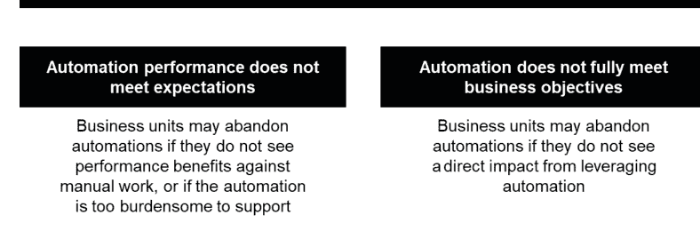

图 5.3 – 自动化放弃的原因

在开始开发之前，与终端用户就 *待实现*（或未来状态）认知自动化的成功标准达成一致。成功标准的一些示例包括以下内容：

- 节省时间
- 效率提升
- 直通处理——无需人工干预的项目（例如文档）的百分比
- 字段准确性
- 易用性
- 速度/吞吐量
- 总拥有成本
- 供应商关系


在项目目标与愿景达成一致，并全面理解端到端流程之后，我们就可以为自动化机会设定切实可行的目标。向终端用户介绍认知技术的成功率非常重要。认知自动化无法实现100%的准确率，存在出现微小偏差的可能，因此尽早向终端用户说明机器学习、**光学字符识别（OCR）** 或文档理解等技术的成功率，帮助他们建立合理预期至关重要。这也使得企业能够安排人工用户作为验证者，处理异常情况，并发挥**人在回路（HITL）** 能力的作用。

通过充分理解自动化的目标、收集端到端流程的上下文信息、倾听终端用户对自动化的需求，我们可以为自动化设定切实可行的目标和预期，并确保使用UiPath模板（如**流程定义文档（PDD）**）对自动化机会进行妥善记录。所有这些要点都有助于确保自动化在生产环境部署后能够获得良好的反响。

## 设计解决方案

构建自动化需要在时间和材料方面投入大量资源，因此我们必须确保，部署在生产环境中的任何自动化在设计时都要能够激励业务终端用户持续使用。在设计解决方案时聚焦终端用户，包括以下方面：

-   选择正确的自动化类型
-   设计最佳用户体验

通过构建易于终端用户交互和理解的自动化，我们能够实现预期的收益，因为终端用户在与自动化互动时获得了积极的体验。

## 选择正确的自动化类型

在设计认知自动化时，首先需要做出的决策之一就是采用哪种自动化类型。在机器人流程自动化中，有两种自动化类型会影响终端用户与自动化的交互方式：有人值守和无人值守自动化（图5.4），它们提供了不同类型的自动化交互方式。

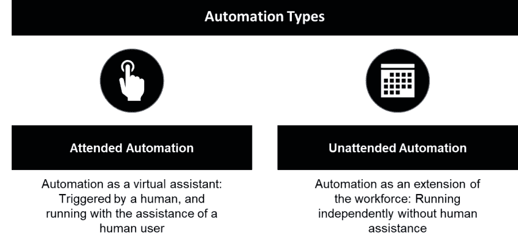

图5.4 – 自动化类型

这两种自动化类型在实施时都有不同的要求和考虑因素。然而，只要深入了解终端用户的目标，自动化类型的选择就不是一个难题。

## 有人值守自动化

**有人值守自动化**（Attended Automation）可以被视为人类用户的虚拟助手。这类自动化直接在终端用户的计算机上运行，并且必须由终端用户自行触发。有人值守自动化往往赋予终端用户更多控制权，因为他们可以选择自动化何时运行，有时还可以决定自动化使用哪些数据。有关有人值守自动化的其他要点，请参阅*图5.5*：

|  | **有人值守自动化** <br> **在人类用户协助下运行的虚拟助手** |
| :--- | :--- |
| 运行什么 | • 运行更小型的、基于任务的工作，更偏“前台”性质 |
| 何时运行 | • 可以定期运行，但也属于“临时”任务类型，在人类需要时随时提供协助 |
| 如何运行 | • 人类用户在其UiPath助手中点击“播放”来选择运行自动化 |
| 在哪里运行 | • 直接在用户的桌面上运行，用户可以随时执行 |
| 为何运行 | • 最适合较短、更个人化的任务，以满足个人需求 <br>• 通常需要人工输入（例如输入文件路径、日期范围等）<br>• 由于任务较短，通常节省的时间量较小（有人值守自动化通常只需几分钟即可运行完成） |
| 何时选择 | • 当开发的问题对每个用户而言是可变的且非标准化的，需要人工输入时 <br>• 自动化仅带来较小程度的收益，通常无法通过完整的实施工作来收回成本 |

图5.5 – 有人值守自动化

由于有人值守自动化由人类终端用户触发，这为自动化开发人员提供了在机器人和人类之间灵活传递信息的绝佳机会。这使得开发人员可以在自动化中添加消息提示，让自动化在运行期间向人类用户请求输入，例如：

-   提示用户输入应用程序凭据
-   提示用户选择本地文件作为输入
-   提示用户输入影响机器人逻辑的数据（例如账号、开始日期和结束日期）

这类提示还可以让自动化在遇到异常时请求人工验证。通过使用UiPath的验证工作站（Validation Station），当自动化遇到低置信度场景（例如无法对电子邮件进行分类）时，可以请求人工提供输入（*图5.6*）：

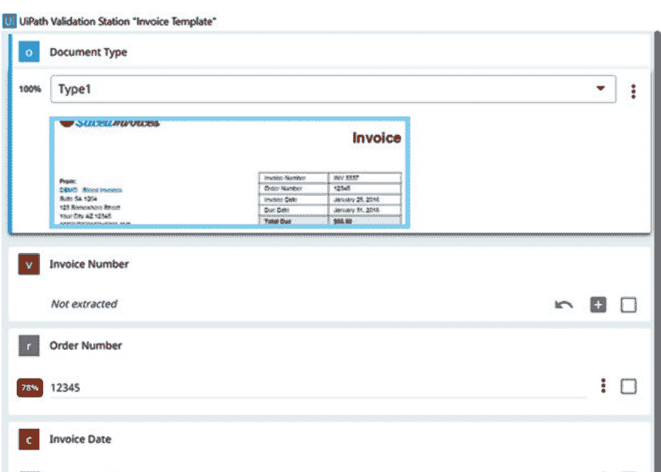

图5.6 – UiPath验证工作站

借助UiPath的验证工作站，我们可以在用户桌面上弹出一个窗口，要求用户就文档中的特定项目提供输入或验证。通过这些类型的提示，我们可以实时请求终端用户输入，使自动化真正成为终端用户的得力助手。

## 使用有人值守自动化的注意事项

由于有人值守自动化具有临时性特点，因此在文档记录和性能方面需要一些考虑。由于有人值守自动化有可能在整个员工队伍中共享，因此应创建适当的文档，教导终端用户如何与自动化交互，以及了解自动化的预期输入和输出。为自动化提供充分的上下文和信息至关重要，这能让自动化易于使用，并提升终端用户的体验。

为了让终端用户了解有人值守自动化的上下文，开发团队可以在自动化中提供详细的项目描述、用户指南和提示，以引导终端用户完成执行过程。终端用户更倾向于使用包含详细描述的自动化，这些描述可以说明自动化的具体内容；因此，项目描述应概述自动化将执行的操作、运行自动化的依赖项以及预期输出（图5.7）。团队应将项目描述发布在公共站点上，例如UiPath自动化中心（Automation Hub）或UiPath市场（Marketplace）。

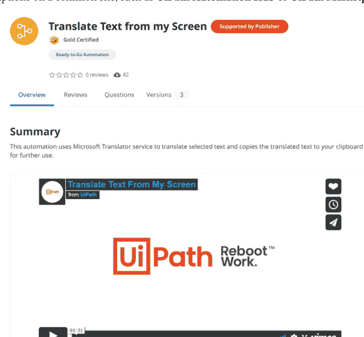

## 摘要

此自动化使用Microsoft Translator服务翻译选定的文本，并将翻译后的文本复制到剪贴板以供进一步使用。

## 概述

“翻译屏幕文本”自动化允许您使用Microsoft Translator API快速翻译屏幕上选定的文本。它会要求您选择要翻译的文本，将该文本发送至Microsoft Translator API，然后将翻译后的文本复制到剪贴板。此自动化非常适合翻译文档或电子邮件、复核译文或学习新语言。

图5.7 – 项目描述（如自动化中心中的描述）是最佳实践

除文档记录外，利用UiPath提示（例如标注）可以帮助引导用户完成自动化流程中令人困惑或困难的步骤（图5.8）。标注非常有用，因为它们可以放置在用户桌面上的元素旁边，以指导终端用户与自动化交互。

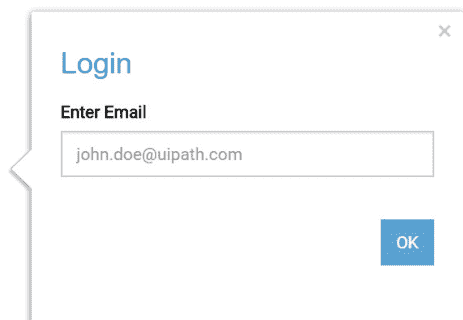

图5.8 – UiPath中标注的示例

除了文档记录方面的考虑外，在构建有人值守自动化时还必须考虑计算性能。有人值守自动化最适合短任务，为终端用户提供即时输出。这些任务不应花费太长时间，因为有人值守自动化在执行时可能会占用用户的机器，使人类用户无法使用计算机。让终端用户无法使用电脑可被视为对潜在收益的一种风险；如果终端用户在自动化运行期间无法执行其他任务，他们可能只会等待自动化完成，从而减少了时间节省。虽然有些技术支持后台处理（例如UiPath的画中画（Picture-in-Picture）和模拟/发送Windows消息交互框架），但一定要精确划定有人值守自动化的范围，将对其用户机器的影响降至最低。

在处理没有明确计划运行时间的短任务时，有人值守自动化是一个很好的选择。让终端用户触发自动化，也为自动化提供了提示用户输入的机会。然而，这些特性也带来了文档记录和性能方面的考虑，如果处理不当，可能会影响终端用户的体验。缺乏文档记录可能会导致终端用户不愿意尝试自动化，或者不知道如何使用它；而长时间运行的有人值守自动化如果导致终端用户在自动化执行期间无法使用计算机处理其他任务，也可能会让他们感到沮丧。


## 无人值守自动化

无人值守自动化最好可被视为人类用户的*延伸*。这种类型的自动化是从专用机器（如云上的虚拟机）运行的，必须由 **UiPath Orchestrator** 通过触发机制（如计划）直接触发。与有人值守自动化相比，无人值守自动化往往能释放更高级别的影响，因为将自动化放置在专用机器上可以让企业按需尽可能频繁地运行自动化。关于无人值守自动化的额外要点包含在图 5.9 中：

**无人值守自动化** — *工作力的延伸，独立运行无需人工协助*

| 何时运行 | 运行更大、端到端的基于流程的作业，更偏向“后台” |
| 何时运行 | 定期运行，无论是基于计划还是基于事件 |
| 如何运行 | 一个触发器（基于计划或基于事件）将启动一个自动化 |
| 在何处运行 | 在外部机器上运行，无论是在本地还是在云中 |
| 为什么运行 | - 最适合更长、更通用的任务，满足整个团队的需求<br>- 不需要人工输入；可以完全端到端运行而无需人工干预<br>- 通常节省更多时间，因为自动化的流程通常更长（无人值守自动化通常可以每天运行数小时甚至 24x7） |
| 何时选择 | - 当为一个在多个团队中标准化的、且不需要人工输入的问题开发时<br>- 自动化提供大量收益，提供实施工作所需的投资回报 |

图 5.9 – 无人值守自动化的概述

由于无人值守自动化在外部机器上运行，我们失去了为终端用户提供即时提示或指南的能力，就像有人值守自动化那样。好消息是，UiPath 已经考虑到了这一点，并为无人值守自动化提供了 Validation Station 的替代方案，称为 **UiPath Action Center。**

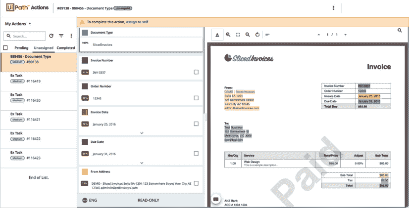

图 5.10 – UiPath Action Center

通过 UiPath Action Center，无人值守自动化可以向 Action Center 发送 **操作**，然后可以将这些操作分配给特定的人类进行审核。这允许提供与 Validation Station 或输入对话框类似的提示，只是 Action Center 将操作存储起来供人类交互。一旦人类与分配给他们的操作交互，无人值守自动化就可以接收用户的输入并继续其任务。

## 使用无人值守自动化的注意事项

无人值守自动化具有计划性，因此在计划、文档和性能方面存在一些注意事项。由于无人值守自动化需要专用机器来执行自动化作业，因此必须有机器可用以运行自动化，否则待执行的自动化必须等待直到有机器空闲。如果计划不当，这可能导致 **服务等级协议 (SLA)** 问题，项目无法及时完成。为了解决这个问题，可以在自动化和机器之间建立一对一映射；这样，自动化在计划运行时总是有机器可用。不幸的是，这可能会引发机器分配和许可问题，因为额外的机器和许可证会给自动化项目带来额外成本。自动化项目应根据已配置的机器仔细平衡自动化计划。

除了计划挑战外，文档和性能也是无人值守自动化的额外考虑因素。虽然无人值守自动化的文档不需要告诉终端用户自动化是如何工作的，但它应该告诉终端用户可以从自动化中期望什么以及在出现异常时如何处理问题。从性能角度来看，很容易过度分配无人值守自动化的事务项目，最终发现机器人无法按原计划执行那么多项目。为缓解此问题，您需要调查利用队列的方法，允许多个机器人同时执行任务。

无人值守自动化是处理可计划的较长流程时的一个很好的资源。它允许企业在后台运行自动化，并比人类用户更及时、高效、更频繁地完成交易。然而，这些功能也带来了关于文档和性能的注意事项，如果处理不当，会影响终端用户的体验并增加实施成本。如果缺乏文档，终端用户可能不了解如何处理自动化产生的潜在异常或错误，从而导致支持请求，给支持团队带来负担。这种缺乏文档的情况也可能导致对无人值守自动化引发的异常类型的误解，其中特定异常必须由终端用户处理。这种误解会留下不良印象，因为终端用户可能会对自动化的性能失去信心。

## 为最佳用户体验设计自动化

在选择最适合自动化机会的自动化类型后，我们可以进一步进入整体解决方案的设计。成功的自动化实施使用户易于参与和与自动化交互；*自动化的目标是增强人类能力，而不是让其因额外的规则和程序而负担。*因此，在为最佳用户体验设计时，我们应探索自动化的输入和输出，以及它们与人类用户的交互。

在自动化开始执行之前，要求人类提供数据是常见需求。这种类型的输入可能是来自系统的信息，例如 Salesforce 中机会的 Case ID，或非常常见的文件保存到共享或本地驱动器的路径。许多自动化要求人类用户提供精确输入，例如以下内容：

- 精确的文件名（`ME_Report_MM.DD.YYYY.xlsx`）
- 精确的措辞约定（`Subject: Month End Report MM.DD.YYYY`）

## 总结

在本章中，我们讨论了自动化之旅的下一个阶段；收集需求和设计解决方案。我们了解了如何为自动化机会收集需求，如何为自动化设定目标，以及如何以终端用户体验为出发点设计自动化。通过收集业务需求，通过设定目标来重新确认它们，并将此反馈纳入未来状态设计，我们可以确保成功的自动化部署。

在 *第 6 章，理解您的工具* 中，我们将以自动化生命周期的开发阶段为自动化机会迈出下一步。在下一章中，我们将通过深入了解其功能并学习如何使用每个工具来构建，来了解 UiPath 的认知工具 **Document Understanding**、**AI Center** 和 **Computer Vision** 的特性。

在本章中，我们将涵盖以下主要主题：

- 开始使用 UiPath Document Understanding
- 开始使用 UiPath AI Center
- 开始使用 UiPath Computer Vision

## 技术要求

本章的所有代码示例均可在 GitHub 上找到，网址为 https://github.com/PacktPublishing/Democratizing-Artificial-Intelligence-with-UiPath/tree/main/Chapter06。

使用 UiPath 非常容易，并且使用 Community 版本可以免费开始。然而，对于 UiPath AI Center，我们需要企业许可证。可以从 uipath.com 获取 60 天企业试用许可证。

使用 60 天企业试用，我们将拥有以下访问权限：

- 五个 RPA Developer Pro 许可证 – 命名用户许可证包括 Studio、StudioX、有人值守机器人、Apps、Action Center 和 Task Capture 的访问权限
- 五个无人值守机器人、五个测试机器人和两个 AI 机器人
- AI Center、AI Computer Vision、Automation Hub、Data Service、Document Understanding 和 Insights

对于本节，您需要以下内容：

- UiPath Enterprise Cloud
- UiPath Studio 2021.4+
- UiPath.IntelligentOCR.Activities 包 v.4.13.2 或更高版本
- UiPath.DocumentUnderstanding.ML.Activities v1.7.0 或更高版本


# 重要说明

关于如何安装 UiPath 包的相关说明，请参阅 https://docs.uipath.com/studio/docs/managing-activities-packages。

## 在 UiPath 企业试用版中启用 AI Center

UiPath Document Understanding 在 UiPath 社区版和企业版中均默认提供；然而，对于 UiPath AI Center，我们需要在企业试用版中启用该服务。您可以按照以下步骤启用该服务：

- 1. 前往 **Automation Cloud**：

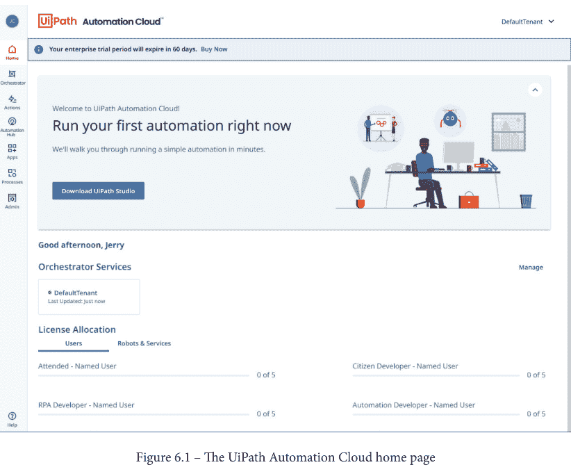

- 2. 前往 **Admin**：

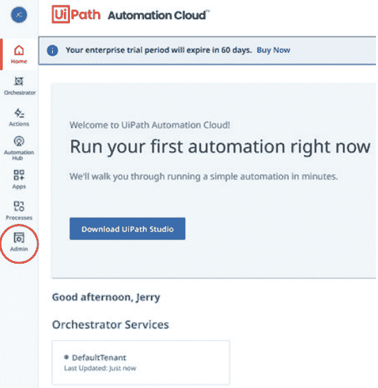

图 6.2 – 点击 Admin

- 3. 在 **DefaultTenant** 中，点击三个点，然后点击 **Tenant Settings**：

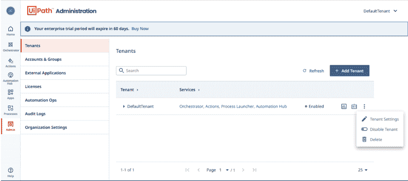

图 6.3 – 点击 Tenant Settings

4. 在 **Provision Services** 下选择 **AI Center**，然后点击 **Save**：

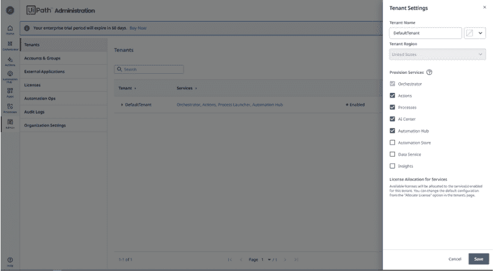

一旦在 **Automation Cloud** 中启用了 AI Center，我们就准备好开始探索 UiPath 的认知工具了。我们要探索的第一个工具是 UiPath Document Understanding。

## 开始使用 UiPath Document Understanding

UiPath Document Understanding 释放了利用机器人流程自动化（RPA）智能处理文档的能力。借助 Document Understanding，我们将能够对 PDF、扫描文档甚至手写内容进行数字化、分类并提取数据。

在本节中，我们将学习如何使用 Document Understanding 框架和 Document Understanding Studio 模板来构建 Document Understanding 用例。最后，我们将深入探讨 Document Understanding 活动包的活动或构建块。

既然引入了 Document Understanding 框架，让我们深入探讨每个组件，从分类学开始。

## 介绍分类学

Document Understanding 框架的第一步是创建分类学。
分类学是一种系统分类，在 Document Understanding 中，分类学是文档类型的分类。文档类型是业务流程处理的逻辑文档类型的分类。文档类型的示例可以包括以下内容：

- 发票
- 税表（W-2 和 1099）
- 合同
- 记录

## 分类学管理器

在创建分类学的过程中，我们将对所需的文档类型进行分类，并确定每种文档类型中的字段 – 这基本上将成为我们数据的模式（结构）。为了创建我们的分类学，我们将使用 UiPath Studio 中的分类学管理器来创建字段和文档类型的分类学。可以在 UiPath Studio 的设计选项卡中找到分类学管理器（图 6.6）：


图 6.6 – UiPath 设计选项卡中的分类学管理器

> **重要说明**
> 分类学管理器要求安装 `UiPath.IntelligentOCR.Activities` 包作为项目的依赖项。安装完成后，Studio 的设计选项卡中将出现一个分类学管理器按钮。

在 **Taxonomy Manager** 中，我们将有机会定义 **Document Types**、**Document Type Details** 以及数据字段，如 *Figure 6.7* 所示：

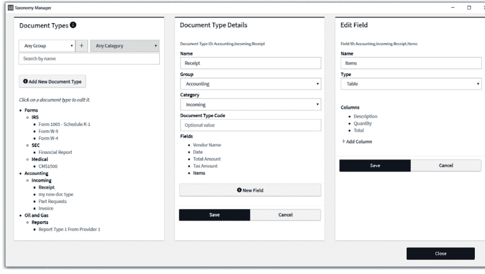

- **Document Types**：定义你的文档类型，并整理在你定义的分组下。
- **Document Type Details**：定义文档类型详情以及文档中的任意数量的字段。
- **Edit Field**：定义字段的数据类型。

## 创建分类学

让我们开始创建分类学！在 UiPath Studio 中启动一个新项目并打开 `Main.xaml`。

> 重要说明
> 在开始此练习之前，请确保你已安装以下包：`UiPath.IntelligentOCR.Activities package v.4.13.2` 或更高版本以及 `UiPath.DocumentUnderstanding.ML.Activities v1.7.0`。

- 1. 从 GitHub 仓库下载发票示例：`https://github.com/PacktPublishing/Democratizing-Artificial-Intelligence-with-UiPath/blob/main/Chapter06/Document_Understanding_Test/Invoice%20Template.pdf`：


# 发票

来自：
DEMO - Sliced Invoices
Suite 5A-1204
123 Somewhere Street
Your City AZ 12345
admin@slicedinvoices.com

| 发票编号 | INV-3337 |
| 订单编号 | 12345 |
| 发票日期 | 2016 年 1 月 25 日 |
| 到期日期 | 2016 年 1 月 31 日 |
| 应付总额 | $93.50 |

致：
Test Business
123 Somewhere St
Melbourne, VIC 3000
test@test.com

| 小时/数量 | 服务 | 费率/价格 | 调整 | 小计 |
| 1.00 | Web Design<br>这是一个示例描述... | $85.00 | 0.00% | $85.00 |

| 小计 | $85.00 |
| 税 | $8.50 |
| 总计 | $93.50 |

ANZ Bank
ACC # 1234 1234
BSB # 4321 432

付款需在发票日期起 30 天内支付。逾期付款将收取每月 5% 的费用。
感谢选择 DEMO - Sliced Invoices | admin@slicedinvoices.com
第 1 页/共 1 页

图 6.8 – 发票示例

- 2. 从设计选项卡打开分类学管理器。

- 3. 通过点击“Any Group”右侧的 + 添加一个新分组，Forms：

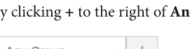

图 6.9 – 点击 + 添加分组

- 4. 通过点击“Any Category”右侧的 + 添加一个新类别，Invoices。

5. 通过点击 **Add New Document Type** 按钮添加一个新文档类型，**Sliced Invoices**（示例发票类型的名称）：

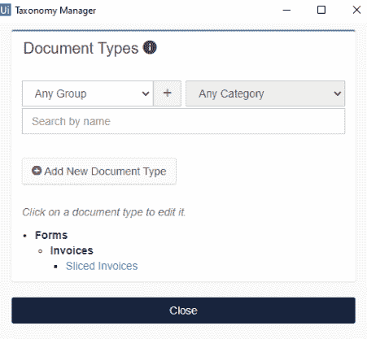

图 6.10 – 添加 Forms | Invoices | Sliced Invoices 后的分类学管理器

6. 通过点击 **Document Type Details** 下的 **New Field** 创建数据字段。在 **Edit Field** 中，添加相应的数据字段的名称和类型。完成后点击 **Save**：

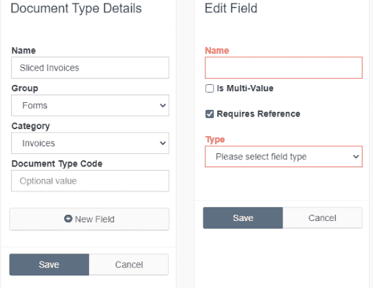

图 6.11 – 创建新字段

7. 填写以下数据点的字段（图 6.12）：

- **发票编号**（文本）
- **订单编号**（文本）
- **发票日期**（日期）
- **到期日期**（日期）
- **应付总额**（数字）
- **发件人**地址（文本）
- **收件人**地址（文本）
- 服务列表
- **小计**（数字）
- **税**（数字）
- **总计**（数字）

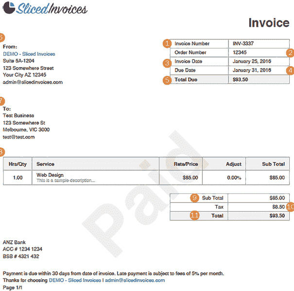

| 发票编号 | INV-3337 |
|---|---|
| 订单编号 | 12345 |
| 发票日期 | 2016 年 1 月 25 日 |
| 到期日期 | 2016 年 1 月 31 日 |
| 应付总额 | $93.50 |

| 小时/数量 | 服务 | 费率/价格 | 调整 | 小计 |
|---|---|---|---|---|
| 1.00 | Web Design<br>这是一个示例描述... | $85.00 | 0.00% | $85.00 |

|  | 小计 | $85.00 |
|---|---|---|
|  | 税 | $8.50 |
|  | **总计** | **$93.50** |

图 6.12 – 发票示例

8. 添加所有数据字段后，点击 **Save** 并关闭分类学管理器 – 结果应与 *Figure 6.13* 类似：

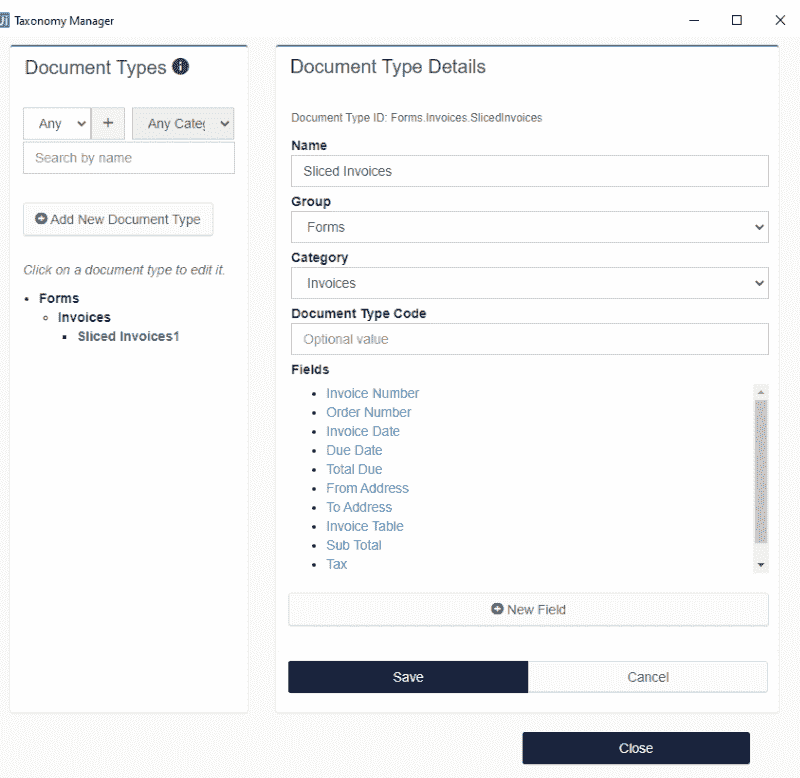

图 6.13 – 分类学创建的结果

9. 最后，在 Main.xaml 中添加一个 Load Taxonomy 活动，创建一个名为 Taxonomy 的输出变量：

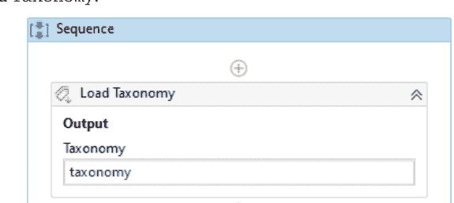

图 6.14 – 在 Main.xaml 中添加 Load Taxonomy

就这样！我们的分类学已创建并将在运行时加载到自动化流程中。请注意，在你的项目文件夹中，已创建一个 Taxonomy.json 文件。此文件可以保存并在其他项目中使用，以随时间构建中央分类学。

在下一节中，我们将学习如何对发票文档进行数字化。

## 介绍数字化

Document Understanding 过程的下一步是数字化。数字化是将输入数据扫描为机器可读文本的过程。一旦数据被数字化，我们就可以分类并提取相关数据字段，以创建自动化的可执行步骤。

Document Understanding 框架中的数字化有两个输出：

- 输入文件的文本（存储为字符串变量）
- 文件的文档对象模型（DOM） – DOM 是一个包含有关文档详细信息的 JSON 对象

虽然数字化是将输入数据作为机器可读文本的过程，但它不仅仅是光学字符识别（OCR）。数字化必须对任何类型的输入进行，无论是数字的还是实体的 – 任何已经是原生文本的文件（未扫描的 PDF 或文本文件）都可以不使用 OCR 而通过编程方式读取。


对于需要 OCR 的文档（例如扫描的 PDF），可以在数字化过程中使用 OCR 引擎。 与 UiPath Document Understanding 框架中的数字化兼容的 OCR 引擎如下：

- UiPath Document OCR
- OmniPage OCR
- Google Cloud Vision OCR
- Microsoft Azure Computer Vision OCR
- Microsoft OCR
- Tesseract OCR
- ABBYY Document OCR

让我们继续在进入练习之前回顾 Digitize Document 活动。

## Digitize Document 活动

要使 UiPath 将文档数字化为 DOM，必须在我们的自动化项目中使用 Digitize Document 活动（图 6.15）：

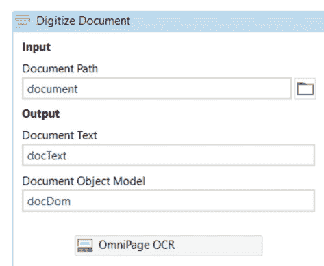

图 6.15 – 使用 OmniPage OCR 引擎的 Digitize Document 活动

在 **Digitize Document** 活动中，注意 **Input** 和 **Output** 参数：

- **Input:**
  - **Document Path:** 活动设置为数字化的文档的完整路径
- **Output:**
  - **Document Text:** 输出数字化文档的字符串文本
  - **Document Object Model:** 输入文件的对应 DOM

在下一节中，我们将利用 Digitize Document 活动尝试数字化一份文档。

## 数字化文档

让我们继续以数字化为例：

1. 在 **Load Taxonomy** 之后将 **Digitize Document** 活动拖到工作流中。

在 **Digitize Document** 活动中，我们需要插入文件路径作为输入，并分配变量作为输出以保存文档文本和 DOM。

2. 插入发票文档的路径作为 **Document Path** 输入，并创建一个名为 `document_text` 的变量作为 **Document Text** 输出。最后，添加一个名为 `dom` 的变量作为 **Document Object Model** 输出：

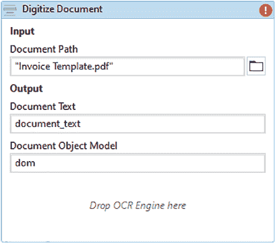

图 6.16 – 将 Digitize Document 活动插入到我们的工作流中

请注意，我们仍然有错误消息，提示我们插入 OCR 引擎。在此示例中，我们的文档已将文本嵌入到文档中（我们可以直接从 PDF 中突出显示并复制文本），因此我们不需要依赖 OCR，但仍需要在活动中拖入一个以消除错误消息。只有在传入文档需要 OCR 处理时才会使用 OCR 引擎。

3. 在 Digitize Document 活动的 **Drag OCR Engine here** 区域内拖入 **Tesseract OCR**。

> **Important Note**
> 有关 UiPath 支持的 OCR 引擎的更多信息，请访问 https://docs.uipath.com/document-understanding/docs/ocr-engines。

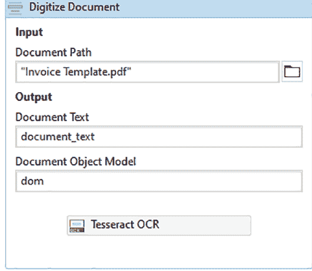

图 6.17 – 添加 Tesseract OCR 引擎

在 **Digitize Document** 活动中，我们将 **ForceApplyOCR** 标志保持为 **False**，因为我们不需要对该发票使用 OCR，因为它是一个嵌入式 PDF。如果我们将标志设置为 **True**，则会对嵌入式 PDF 使用 OCR。

我们还将 **DegreeOfParallelism** 属性保持为 1。默认情况下，该属性设置为 1。如果我们将其设置为 -1，UiPath 将使用机器上的核心数并行处理页面。任何其他正值都将使用该特定数量的逻辑处理器来处理页面。

有关 Digitize Document 活动的更多信息以及何时使用 OCR，请访问 https://docs.uipath.com/document-understanding/docs/digitization-overview。

我们现在已加载分类法并数字化了我们的发票文档。在下一节中，我们将学习如何对发票文档进行分类。

## 介绍分类

将输入数据数字化为机器可读文本后，我们的自动化现在可以解释输入文档中的文本。然而，虽然我们的自动化可以读取文本，但它仍然不知道读取的是什么类型的文档；因此，下一步是让自动化对文本进行分类。Document Understanding 框架中的分类是使用数字化输入数据来识别输入的是什么类型的文档。

当输入文档包含多种文档类型时（图 6.18），文档分类变得非常重要：

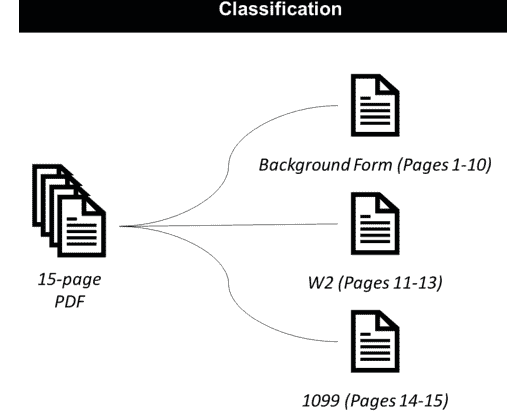

图 6.18 – 对输入进行文档分类

例如，如果我们有一个包含背景表格、W2 和 1099 等混合文档的 15 页 PDF，那么通过分类，我们可以根据文档类型将 15 页文档拆分为较小的子集。如果文件包含一种文档类型，则分类将只返回一个分类结果，但如果文件包含多种文档类型，则分类结果将返回找到的文档类型以及它们对应的页码范围。

在下一节中，让我们看一下 Classify Document Scope 活动。

## 介绍 Classifiers Scope

文档的分类是通过 **Classify Document Scope** 活动执行的：

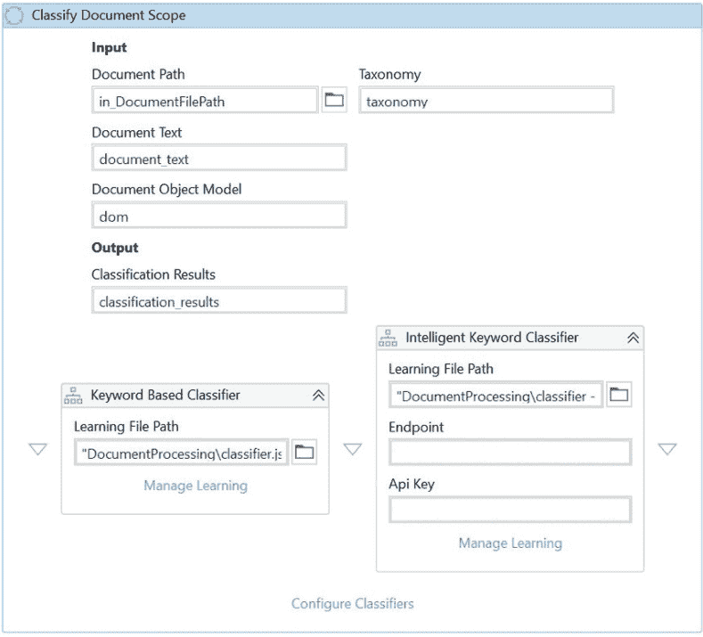

图 6.19 – Classify Document Scope 活动

在 Classify Document Scope 活动中，注意 Input 和 Output 参数：

- **Input:**
  - **Document Path**: 我们目标文档的完整路径
  - **Taxonomy**: Taxonomy Manager 返回的分类法
  - **Document Text**: 数字化返回的文档文本
  - **Document Object Model**: 数字化返回的 DOM
- **Output:**
  - **Classification Results**: 存储在 IReadOnlyList<ClassificationResult> 对象中的结果，包含分类置信度和 OCR 置信度等结果（图 6.20）：

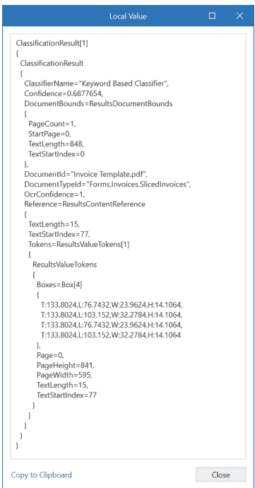

图 6.20 – 分类结果示例

在介绍了 Classification Scope 活动之后，让我们继续在 Classification Scope 活动内的 Classifiers Wizard 区域。

## 介绍 Classifiers Wizard

在 Classifiers Scope 中，您会注意到一个插入不同分类器的区域；这使我们能够根据优先级利用多个分类器，如图 6.21 所示：

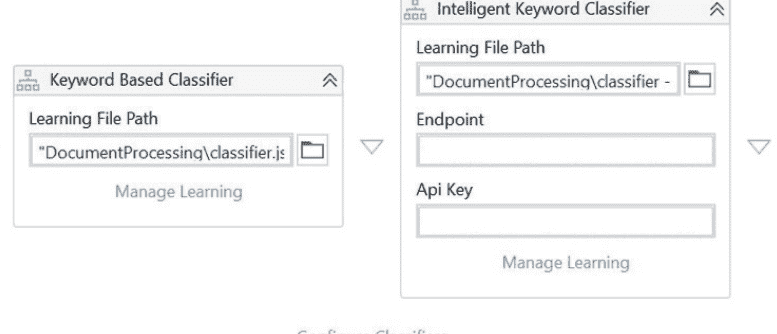

Configure Classifiers

图 6.21 – 同时利用多个分类器

在 Classification Scope 活动中，我们将 Keyword Based Classifier 和 Intelligent Keyword Classifier 一起放置以提供更强大的分类级别。我们稍后会介绍不同类型的分类器，但让我们使用 Classifiers Wizard 配置几个分类器。

通过单击 Classifiers Scope 中的 Configure Classifiers 按钮，我们会看到一个向导，其中展示了我们的两个分类器以及我们在分类法中定义的文档类型（图 6.22）：

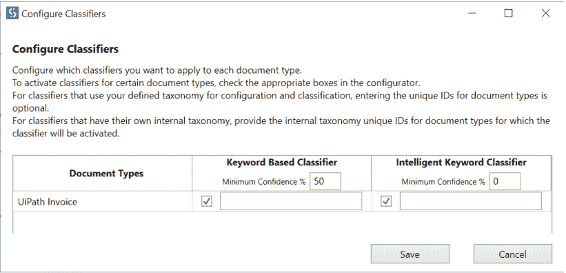

图 6.22 – Classifiers Wizard

在此示例中，我只在分类法中定义了一种文档类型（**UiPath Invoice**）；因此，向导中只显示一行。在 **Document Types** 列的右侧，注意我们的两个分类器。在每个分类器下方，我们有一个最小置信度百分比和一个复选框：

- **Minimum Confidence %:** 这是我们分类器的可接受置信度阈值。在上一节中，作为分类结果的一部分，我们提到了置信度作为输出。通过最小置信度 %，我们可以根据返回的置信度控制报告。

在 *图 6.22* 中，我们将 **Keyword Based Classifier** 的 **Minimum Confidence %** 值设置为 50。这意味着如果 Keyword Based Classifier 能够以大于或等于 50% 置信度的值对我们的文档进行分类，则它将输出该分类。如果置信度小于 50%，Classify Document Scope 将忽略该分类结果并且不会报告它。

在此示例中，如果置信度小于 50%，则不会报告 Keyword Based Classifier 的结果。然后会报告 Intelligent Keyword Classifier 的结果，因为它的置信度阈值为 0%。

> **Important Note**
> 
> 分类器按优先级执行；左侧的优先级最高。


- **Checkbox**：每个分类器下方的复选框仅用于切换是否对特定文档类型使用该分类器。在以下示例（*图 6.23*）中，请注意 **Keyword Based Classifier** 已为 **Type1** 文档类型启用，而 **Intelligent Keyword Classifier** 已为 **Type2** 文档类型启用：

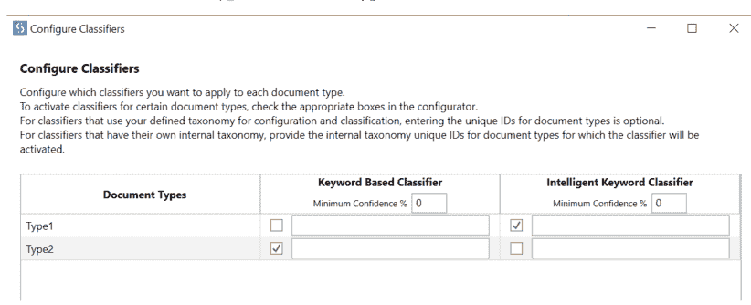

图 6.23 – 为不同文档类型启用分类器

在本节中，我们回顾了使用 Keyword Based Classifier 和 Intelligent Keyword Classifier 的 Classifiers Wizard。在下一节中，我们将回顾 Document Understanding 中提供的不同类型的分类器。

## Reviewing the types of classifiers

根据用例的需求，您可能会倾向于使用 Document Understanding 中提供的以下一个或多个分类器：

- The Keyword Based Classifier
- The Intelligent Keyword Classifier
- The FlexiCapture Classifier
- The Machine Learning Classifier

在呈现 Classification Station 时，用户将能够查看和纠正自动化执行的分类。在 Classification Station 中，用户可以通过点击并拖动页面来重新排列页面，并验证分类器执行的分类（图 6.24）：

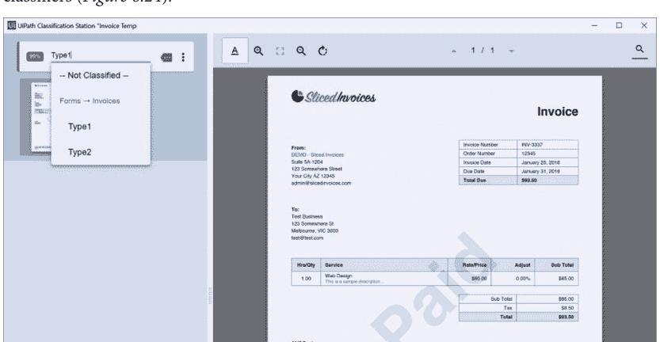

图 6.24 – 使用 Classification Station 验证分类的发票

Important Note
有关 Classification Station 的更多信息可在 UiPath 文档中找到：https://docs.uipath.com/activities/docs/present-classification-station#using-classification-station.

在 Classification Station 完成分类验证后，我们可以利用人工验证来重新训练并加强所使用的分类器。在下一节中，我们将讨论如何训练分类器。

## Training classifiers

Document Understanding 框架的强大功能之一是能够在验证后关闭反馈循环并重新训练分类器。利用人工输入是自动化自我学习和提高未来执行性能的绝佳方式。分类器的训练是通过 Train Classifiers Scope 活动完成的，如以下屏幕截图所示：

## Classifying a document

让我们继续我们的分类示例。

在此示例中，我们的页面上只有一个发票类型，因此分类并非完全必要。但是，如果我们的输入文件包含多个文档（例如多张发票），则需要进行分类：

1. 在 **Digitize Document** 之后将 **Classify Document Scope** 活动拖入工作流。

在 **Classify Document Scope** 活动内，我们需要插入文件路径、分类法、文档文本和 DOM 作为输入，并分配一个变量作为输出以保存分类结果。

2. 将发票文档的路径插入 **Document Path** 输入，并将我们的分类法、文档文本和 DOM 变量插入 **Taxonomy**、**Document Text** 和 **Document Object Model** 输入。

3. 创建一个名为 `classification_results` 的变量并将其插入 **Classification Results** 输出：

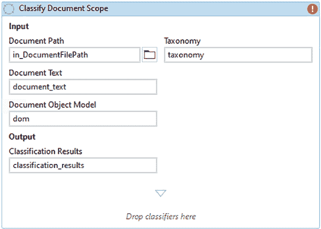

图 6.26 – 在添加分类器之前 Classify Document Scope 活动

由于此文档是嵌入式 PDF，我们可以使用 Keyword Based Classifier 进行分类。`Sliced Invoices` 模板看起来非常标准化，文档开头会出现文本 `Sliced Invoices`，因此我们可以将其用作匹配关键字。

4. 在项目文件夹中保存一个空白 JSON 文件，命名为 classification.json。此 JSON 文件将在我们管理 Keyword Based Classifier 的学习时使用。

5. 点击 Manage Learning 并选择我们最近创建的 classification.json 文件以开始学习。

在 Keyword Based Classifier 学习窗口中，请注意来自我们分类法的文档类型（Sliced Invoices）。要开始学习过程，我们需要在文档类型中包含常用关键字。如前所述，文本 Sliced Invoices 与此类型发票一致，因此让我们将其用作关键字。

6. 点击 Add new keyword set，并添加关键字 "sliced invoices" 和 "sliced invoices"（图 6.27）：

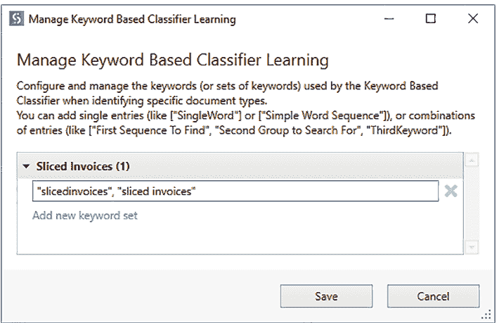

图 6.27 – 学习 Keyword Based Classifier

接下来配置我们的分类器。如果我们同时使用多个分类器，配置分类器将非常重要；然而，在本例中，我们仅使用一个分类器，因此我们必须确保它已启用，并且其置信度阈值设置为 0%，以便返回 Keyword Based Classifier 的所有结果。

7. 点击 **Configure Classifiers**。将最小置信度设置为 0%，并确保 **Keyword Based Classifier** 下方的复选框已填充：

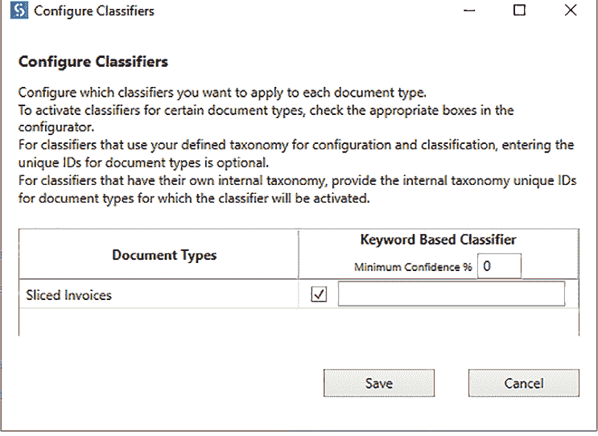

图 6.28 – 将 Keyword Based Classifier 设置为 0% 置信度

完成此操作后，我们的 Classifiers Scope 就完成了。下一步是检查分类器的置信度。在本例中，如果分类器返回的置信度低于某个百分比，让自动化启动 Classification Station 以从用户那里获得更准确的分类。

8. 在 Classification Scope 之后拖入一个 **If** 活动，将以下内容作为条件插入：

```
classification_results(0).Confidence < .5
```

13. 最后，点击 Configure Classifiers，选择 Sliced Invoices 文档类型的 Keyword Based Classifier Trainer（图 6.30）：

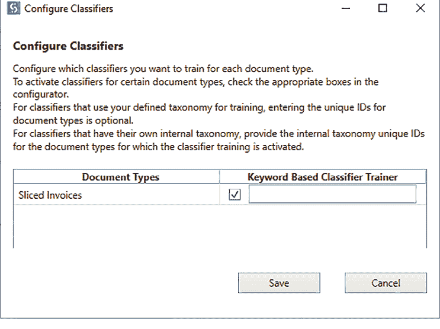

图 6.30 – 保存 Keyword Based Classifier Trainer

分类就到此为止！尝试运行自动化。如果 Classification Station 未出现，请尝试提高 If 语句中的置信度阈值。也可以插入日志消息或消息框活动以打印置信度，并注意每次验证运行后置信度如何提高。

现在，我们已加载分类法、数字化文本并对发票文档进行了分类。在下一节中，我们将学习如何从数字化文本中提取数据。

## Introducing extraction

一旦我们的文档类型分类完成，自动化现在就可以从每个文档中提取相关信息。通过提取，自动化将根据 Document Understanding 框架开始时创建的分类法提取相关数据字段。

## Introducing the Data Extraction Scope

提取是通过 **Data Extraction Scope** 活动执行的：

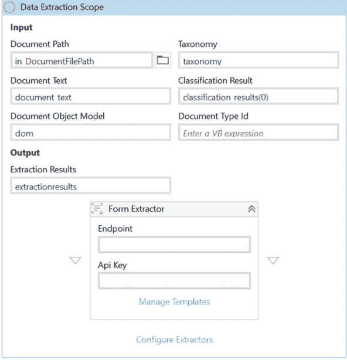

图 6.31 – Data Extraction Scope

在 **Data Extraction Scope** 活动中，让我们介绍存在的 **Input** 和 **Output** 参数：

- **Input**:
  - **Document Path**：目标文档的完整路径
  - **Taxonomy**：来自 Taxonomy Manager 的分类法
  - **Classification Result**：分类结果
  - **Document Text**：来自数字化的文档文本
  - **Document Type Id**：Taxonomy Manager 中找到的文档类型 ID – 如果使用分类结果，此字段为可选
  - **Document Object Model**：来自数字化的 DOM

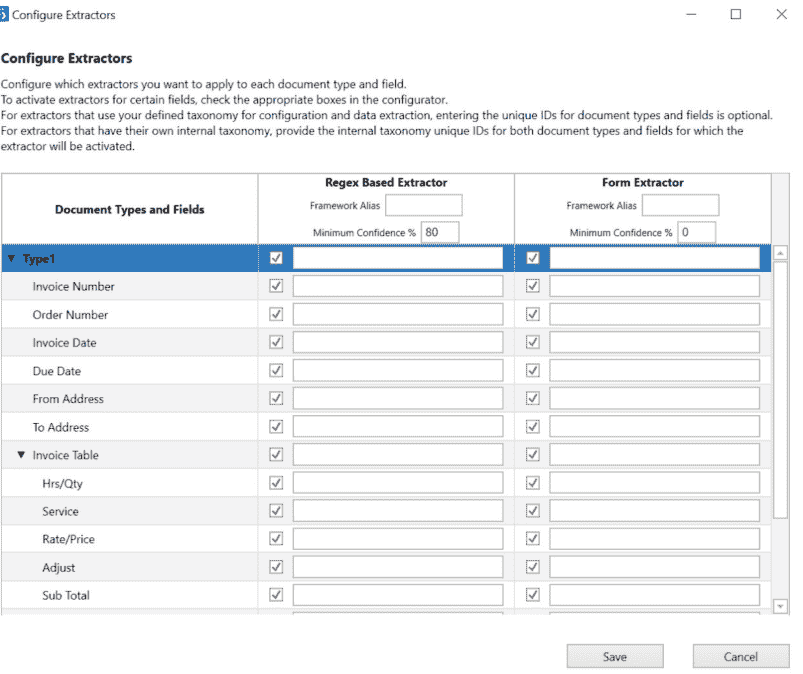

# Figure 6.33 – Leveraging multiple classifiers at once

请注意在每个提取器（**Regex Based Extractor** 和 **Form Extractor** 来自 *图 6.33*）中，能够在文档类型内每个字段右侧切换复选框的功能。这使得可以采用混合方法，利用每个数据字段的多个分类器，允许我们为每个数据字段设置特定的提取器，或允许我们将多个提取器设置为“后备”提取器，如果最高优先级提取器返回的置信度较低。


## 查看提取器类型

根据你的用例需求，你可能会倾向于使用“文档理解”中提供的以下一种或多种提取器：

- **基于正则表达式的提取器**：这是一种基于正则表达式匹配来提取数据的简单提取器。此提取器最适合较简单的用例，即目标数据字段采用标准、可预测的格式。虽然此提取器支持文本字段和表格字段，但它无法重新训练。如果你的目标数据字段存在（格式和上下文上的）变化，那么表单提取器或机器学习提取器可能是更好的选择。

- **表单提取器**：这是另一种基于标准化文档提取数据的简单提取器。表单提取器依赖定义的模板，根据页面级锚点来识别和提取值。如果需要处理多种不同布局，或文档倾斜（旋转、弯曲或尺寸不一），不建议使用此提取器。此提取器无法重新训练。

- **智能表单提取器**：它在表单提取器的基础上构建，提供额外功能，如手写识别、手写数据提取和签名检测。智能表单提取器非常适合打印或手写文档，或需要验证签名的用例。此提取器无法重新训练。

- **机器学习分类器**：它利用部署到UiPath AI Center的机器学习技能来提取文档。此提取器非常适合各种布局的结构化或半结构化文档。它可以通过*机器学习提取器训练器*重新训练。

- **FlexiCapture提取器**：它由ABBYY构建，用于根据ABBYY FlexiCapture定义提取文档。此提取器可在`UiPath.Abbyy.Activities`包中找到。

我们将在后面的章节中进一步讨论如何使用其中一些提取器。

## 验证提取器

与分类一样，我们可能需要使用**验证站**对提取器输出进行人工验证。通常建议使用验证站以确保100%的准确率——在返回自动化之前，最好由人工进行快速检查。

验证站可用于有人值守和无人值守自动化，对于有人值守使用“呈现验证站”活动，对于无人值守使用UiPath操作中心的“创建文档验证操作”、“等待文档验证操作”和“恢复”活动。

当呈现验证站时，用户将能够查看和纠正自动化执行的提取。在验证站中，用户可以旋转页面、验证文档类型，以及验证提取器执行的提取（图6.34）：

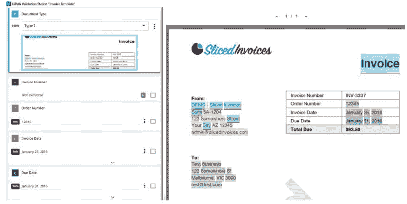

图6.34 – 验证站

通过验证站完成提取验证后，我们可以利用人工验证来重新训练和强化所使用的分类器。在下一节中，我们将讨论如何训练提取器。

## 训练提取器

与分类类似，我们可以在验证后闭合反馈回路并重新训练提取器。这种重新训练模式有助于提高提取器在未来执行中的性能。分类器的训练通过“训练提取器范围”活动执行。在“训练提取器范围”活动中，我们将介绍以下输入参数：

- **文档路径**：目标文档的完整路径
- **文档文本**：数字化返回的文档文本
- **文档对象模型**：数字化返回的DOM
- **人工验证数据**：验证站结果

以下提取器可以重新训练：

- 机器学习分类器

## 从文档中提取数据

让我们继续示例，进行提取。

我们将采用与分类类似的框架进行提取。让我们提取数据并验证置信度是否低于阈值：

1. 将**数据提取范围**拖到工作流中。
2. 将文档文件路径、分类法、文档文本和DOM作为输入插入。在**分类结果**输入中，插入第0个分类结果，因为**分类结果**是分类结果的集合。
3. 创建一个名为`extraction_results`的变量（类型为`ExtractionResult`），并将其作为数据提取范围中的输出。

对于此示例，我们将使用表单提取器，因为我们的发票只有一种布局，且其格式没有倾斜、旋转或缩放。

4. 将**表单提取器**拖入**数据提取范围**，并将你的API密钥插入该活动。

```
classification_results(0)
```

**重要说明**
你可以通过导航到 **Automation Cloud** 账户的 **管理员 > 许可证** 页面来获取API密钥。点击 **文档理解** 旁边的刷新按钮即可生成API密钥。

5. 在**表单提取器**中单击**管理模板**，并单击**创建模板**以开始创建新模板。

6. 出现提示时，使用PDF发票作为模板，配置**创建新模板**表单（*图6.35*）：

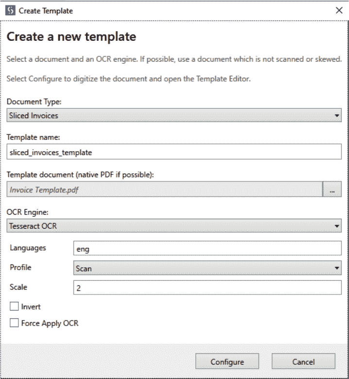

图6.35 – 创建新模板

7. 打开后，系统将提示你选择第1页匹配信息。按住Ctrl并单击右上角的“发票”、页面底部的“感谢您选择……”句子以及页面底部的“第1页，共1页”：

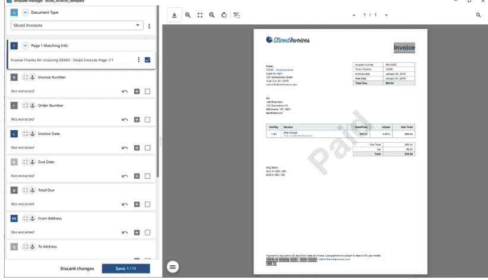

图6.36 – 设置第1页匹配信息

8. 对于分类法定义的数据字段，选择锚点选择模式（按键D+S），然后左键单击并高亮表单上的相关文本，在目标文本周围绘制蓝色框。

9. 接下来，按住Ctrl并单击相关锚点来选择锚点：

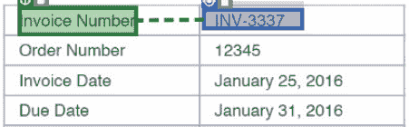

图6.37 – 选择发票编号的数据字段

10. 文本高亮后，要确认，请单击数据字段下方的“提取值”加号（按键F+C）：

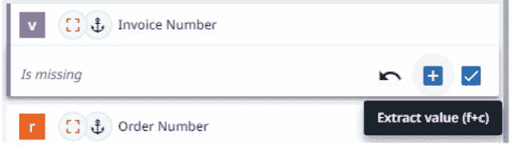

图6.38 – 确认我们的选择

11. 对发票表格中的每个数据字段和每个数据行执行相同操作。单击“保存”以保存更改，单击“关闭”以关闭模板管理器。

12. 在“数据提取范围”中单击“配置提取器”，为“切片发票”文档类型选择“表单提取器”——我们将对“切片发票”文档类型的所有数据字段使用表单提取器：

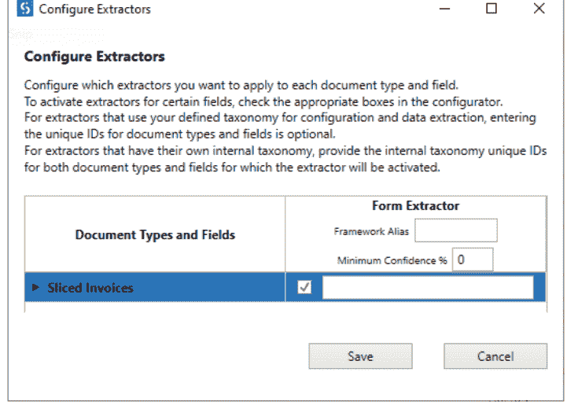

图6.39 – 配置提取器

利用这些提取的数据，我们可以轻松继续自动化流程——无论是直接处理数据，还是将其插入Excel。

## 从文档导出数据

让我们以导出操作来结束示例。

导出已验证数据非常快速；我们只需使用**导出提取结果**活动将数据导出到数据表中，然后在自动化中稍后使用该数据（例如添加到Excel、发送电子邮件或添加更多逻辑）。

1. 将**导出提取结果**活动拖到工作流末尾。
2. 将提取结果变量作为输入插入。
3. 创建一个名为dataSet的变量（类型为DataSet），并将其作为输出插入：

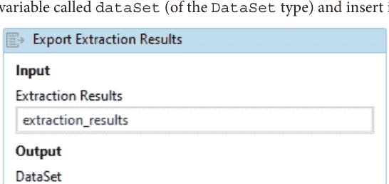

图6.41 – 导出提取结果活动

就这样！尝试将数据集写入Excel，或将数据集作为字符串输出，然后打印出来查看结果！

文档理解框架为我们提供了一组易于遵循的组件，用于构建文档理解用例。我们了解了框架的各种组件以及如何使用每个组件。现在让我们继续学习UiPath的AI Center。

## UiPath AI Center入门

UiPath AI Center释放了将机器学习模型与RPA结合使用的能力。借助AI Center，我们能够部署、管理和重新训练开箱即用或自定义的机器学习模型。在本节中，我们将探讨AI Center的核心概念，并深入了解AI Center活动包中的活动。


## 使用 AI Center

在本节中，我们将浏览 AI Center 的关键概念。通过熟悉这些概念，我们将积累利用 AI Center 的经验，这对于构建具有机器学习能力的自动化至关重要。

在创建自动化项目时，我们通常希望遵循两条通往生产环境的路径：

- **使用预训练模型：** 开发者应遵循以下流程：
  1. 创建项目
  2. 利用 ML 包
  3. 将其部署为 ML 技能
  4. 将 ML 模型拖放到 RPA 中
  
- **使用可重训模型：** 开发者应遵循以下流程：
  1. 创建项目
  2. 上传数据集
  3. 利用 ML 包
  4. 部署训练管道以训练模型
  5. 将其部署为 ML 技能
  6. 将 ML 模型拖放到 RPA 中
  7. 将 RPA 连接回 ML 模型，提供持续反馈

在本节中，我们将研究 AI Center 的关键概念，以便遵循这两条通往生产环境的路径。

## 介绍项目

每个 AI Center 用例都始于在 AI Center 中创建项目。项目是资源集合（ML 包、数据集和管道），您将在构建认知自动化用例时利用这些资源。

## 创建项目

让我们一起构建一个简单的文本分类项目，使用 AI Center，从在 AI Center 中创建项目开始我们的练习：

- 1. 导航到您的 UiPath Cloud，并点击 AI Center 开始：

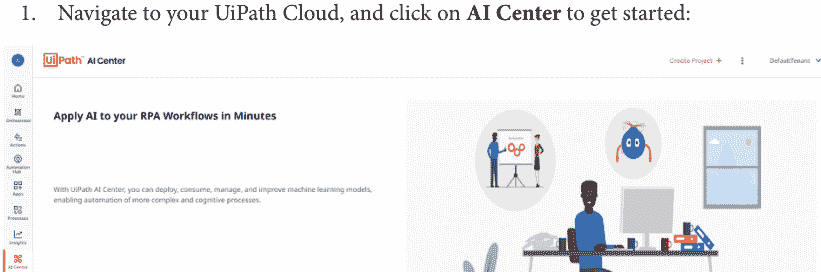

图 6.42 – UiPath Cloud 中的 AI Center 主页

- 2. 进入 AI Center 后，点击 Create Project 并提供描述性的项目名称和描述。

提供名称和描述后，您将被导航到项目仪表板。在此项目仪表板中，您会注意到我们的数据集、包、管道和技能标签，我们将在后续章节中介绍。让我们继续进入 AI Center 中的数据集。

## 介绍数据集

现在我们已经创建了项目，让我们查看第一个标签 – 数据集。按定义，数据集仅仅是一组数据。在 AI Center 中也是如此，其中数据集是 AI Center 项目所利用的文件和文件夹集合。在数据集内，我们可以上传任何必要的文件和文件夹集，以便我们的 ML 模型访问数据。

## 查看开箱即用的包

如前几节所述，AI Center 为您提供了许多 UiPath 和开源 ML 包，让您能够快速开始认知自动化。以下开箱即用的包可用：

- UiPath Document Understanding
- UiPath Image Analysis
- UiPath Language Analysis
- UiPath Task Mining
- Open source Image Analysis
- Open source Language Analysis
- Open source Language Comprehension
- Open source Language Translation
- Open source Tabular Data
- Open source Time Series

在回顾了开箱即用的包后，让我们接下来看看如何创建包。

## 创建包

由于我们正在进行文本分类练习，让我们选择 UiPath 的开箱即用 ML 包：

- 1. 通过点击项目仪表板中的 **ML Packages** 标签导航到 ML Packages。
- 2. 当出现 **Create a new package** 时，点击 **Out of the box Packages**。
- 3. 在开箱即用的包下方，选择 **Language Analysis > EnglishTextClassification**，选择 **Package Version 6.0**。

提供 ML 包名称后，您应该在项目仪表板中看到新的 ML 包，如 *Figure 6.44* 所示：

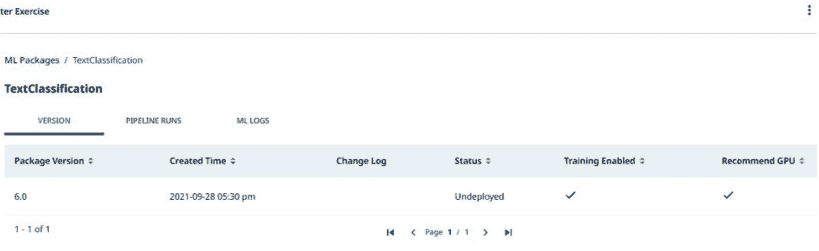

图 6.44 – 一个新创建的 TextClassification ML 包

包创建完成后，让我们研究如何创建可以训练我们已部署 ML 包的管道。

## 介绍管道

在选择了 ML 包后，我们现在可以进入 ML 管道。ML 管道是产生 ML 模型的步骤系列。在管道过程中，我们将提供输入，完成后再产生一组可用输出和日志。

在 AI Center 中，有三种类型的管道：

- **训练管道：** 从输入的 ML 包和数据集产生新训练的 ML 包版本
- **评估管道：** 从新训练的 ML 包版本和数据集产生一组指标和日志
- **完整管道：** 完整的数据处理管道，同时执行训练和评估管道

## 创建管道

对于本练习，我们将使用训练和测试数据集运行训练和评估管道：

- 1. 通过点击项目仪表板中的 **Pipelines** 标签导航到 **Pipelines**。
- 2. 点击 **Create New** 创建新管道，选择以下内容：
  - **Pipeline type:** Train run
  - **Choose package:** TextClassification
  - Choose package major version: 6
  - Choose package minor version: 0
  - Choose input dataset: Amazon Reviews/train/
  - Enable GPU: No:

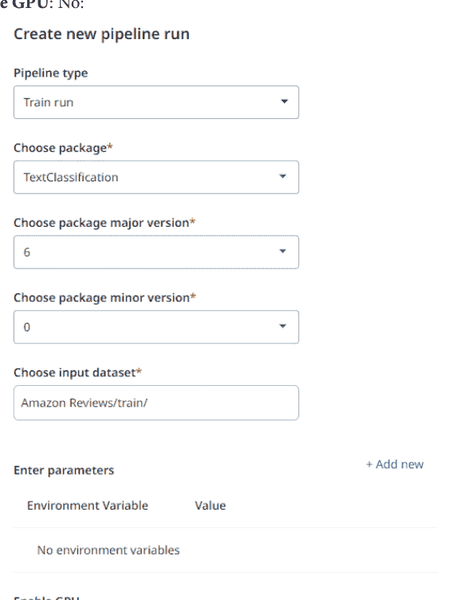

图 6.45 – 创建训练管道

3. 点击 **Create** 开始训练管道。

> **重要提示**
> 数据集的大小会影响管道持续时间。选择 **Enable GPU** 可带来更快的输出，但 GPU 在 UiPath Community 版中不可用。

4. 再次执行步骤 2 和 3，选择 **Evaluation run** 作为管道类型，Test Classification 包的版本 6.1，以及测试数据集文件夹作为输入数据集：

# Create new pipeline run

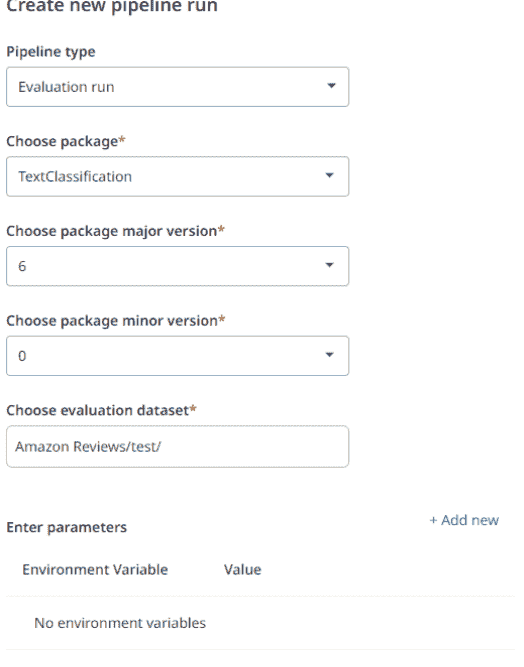

图 6.46 – 创建评估管道

完成后，评估管道将返回一些工件作为输出：

- `Evaluation.csv`: 用于评估模型的数据
- `Evaluation-report.pdf`: 管道运行的输出报告

点击 **Pipelines** 页面上的评估管道将展示管道的输出和日志：

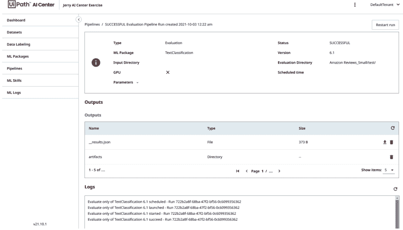

图 6.47 – 评估管道输出

就这样！在下一节中，我们将部署一个 ML 技能并将其附加到 RPA 工作流。

## 介绍 ML 技能

与包是 UiPath Studio 中已部署的 RPA 项目类似，ML 技能是 AI Center 中已部署的 ML 包。

部署到 AI Center 后，ML 技能可被自动化使用。在 UiPath Studio 中选择 ML 技能活动时，您可以从部署在 AI Fabric 上的 ML 技能列表中选择，并根据需要传递输入数据并利用输出数据：

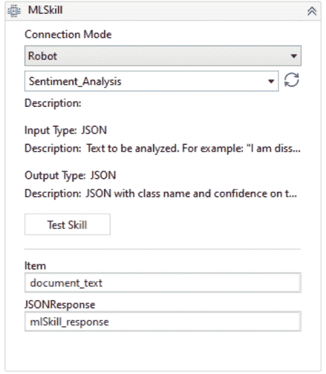

图 6.48 – UiPath Studio 中的 MLSkill 活动连接到 AI Center 的 ML 技能

> **重要提示**
> 在 UiPath Studio 中使用 ML 技能需要 UiPath Studio v2019.10+、UiPath Robot v2019.10+ 以及安装了 `UiPath.MLServices.Activities` 包。

## 创建 ML 技能

在模型训练并评估后，我们现在可以将其部署为可与 RPA 一起使用的技能：

- 1. 通过点击项目仪表板中的 **ML Skills** 标签导航到 **ML Skills**。
- 2. 点击 **Create New** 创建新的 ML 技能，选择以下内容：
  - **Name:** `Amazon_Reviews`
  - **Choose package:** **TextClassification**
  - **Choose package major version:** **6**
  - **Choose package minor version:** **1**

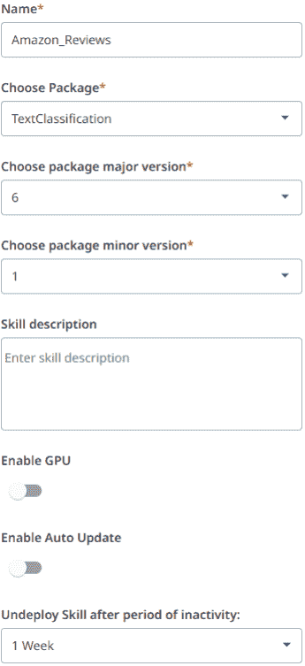

图 6.49 – 创建 ML 技能

- 3. 点击 **Create** 创建 ML 技能。技能在可用之前需要一些时间进行打包。

- 4. 在 UiPath Studio 中启动新项目并打开 Main.xaml。

> **重要提示**
> 在开始本练习之前，请确保您已安装以下内容：
> UiPath.MLServices.Activites v1.1.8 或更高版本。

- 5. 在 Main.xaml 中，创建一个字符串变量，amazon_review。

- 6. 拖放一个 Assign 活动，将 **To** 字段设置为 amazon_review，将 **Value** 字段设置为以下内容：

```
"I love this product!"
```

- 7. 拖放一个 ML Skill 活动，选择我们的 Amazon_Reviews 技能，并将 **Item** 输入分配为我们的 amazon_review 字符串，并创建 json_response 变量作为 **JSONResponse** 输出：

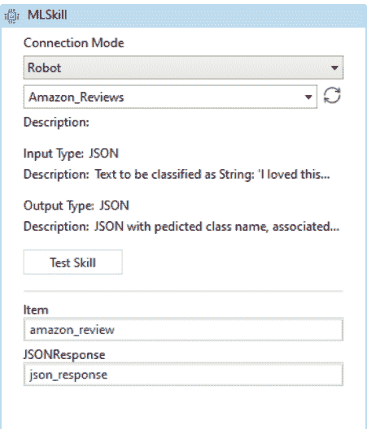

图 6.50 – Amazon_Reviews ML 技能

- 8. 在 ML 技能活动之后，拖放一个 Message Box 活动，将 json_response 变量作为输入放置。


试运行它！注意消息框中的 JSON 响应。我们可以通过在 ML Skill 活动中点击 Test Skill 来复制这种类型的测试。在后面的练习中，我们将把这个 JSON 作为进一步解决方案的一部分进行解析，但现在，我们已经拥有一个可用的、已训练并连接到 RPA 的 ML 技能！在下一节中，我们将研究 AI Center 日志。

### 介绍日志

AI Center 的日志页面是 AI Center 中发生的所有事件的汇总视图，例如 Orchestrator 的日志页面。

以下是在 AI Center 中记录的事件：

- **ML 包验证事件：** 当模型更新时
- **Pipeline 事件：** 当管道开始或失败时
- **ML 技能部署事件：** 当技能创建时
- **ML 技能预测事件：** 当技能正在工作时，抛出失败：

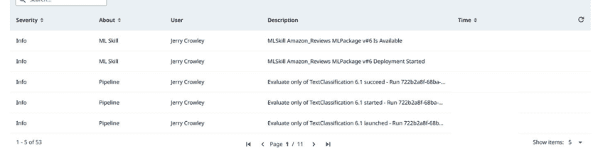

图 6.51 – ML 日志示例

我们了解了 AI Center 的各个组件以及如何使用它们。在后续章节中，我们将在构建用例示例时使用 AI Center，但现在，让我们继续使用 UiPath 的计算机视觉。

## 开始使用 UiPath Computer Vision

UiPath Computer Vision 为自动化提供了额外的能力，使其能够看到计算机屏幕并识别页面上的元素，而非通过传统的属性集对元素进行窥探。这释放了智能交互更复杂用例的能力，这些用例包括 VDI、不受支持的应用程序，甚至操作系统。

为了与页面上的元素（如文本字段和按钮）进行交互，传统的 RPA 自动化利用这些元素的属性或属性，称为**选择器**。UiPath 自动化通常与大多数应用程序兼容，并且能够为自动化与之交互找到选择器；然而，存在一些技术，对于这些技术来说，找到选择器是不可行的，需要替代解决方案。

在过去，大多数包含无法找到选择器的应用程序的用例要么被排除在范围之外，要么通过诸如图像识别等脆弱的解决方案来解决。为了帮助弥合差距并为这类用例提供解决方案，UiPath 开发了 Computer Vision，这是一种基于 ML 的方法，用于在屏幕上定位元素。这开启了新的自动化机会光谱，因为自动化现在可以在以前无法使用扩展（如 UiPath Citrix 或 VMware 扩展）自动化的用户界面上进行交互，或者交互通常过于复杂的界面。

在本节中，我们将了解 UiPath 的 Computer Vision、如何使用它以及其可用的活动。

### 使用 Computer Vision

在使用 Computer Vision 活动之前，请确保已安装 UI Automation 包 19.10 或更高版本。还必须从 Automation Cloud 生成 API 密钥：

1. 导航到 **Automation Cloud** 的 **Admin > Licenses** 页面。
2. 点击 **Computer Vision** 旁边的刷新按钮以生成 API 密钥：

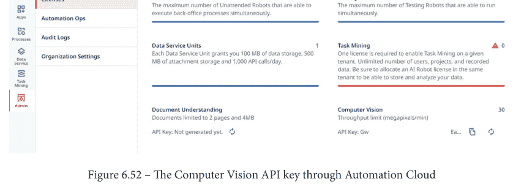

图 6.52 – 通过 Automation Cloud 的 Computer Vision API 密钥

**Computer Vision (CV)** 包包含与传统界面自动化类似的 UI Automation 活动，例如 **Click、Type Into 或 Get Text**。CV 活动与传统活动的主要区别在于使用 CV Screen Scope。一旦 CV Screen Scope 被放置到工作流中并指定了目标屏幕，您就可以使用所有 CV 活动来构建自动化，例如以下内容：

- CV Click
- CV Element Exists
- CV Get Text


图 6.54 – CV Screen Scope 中的 CV Get Text

- CV Highlight
- CV Hover
- CV Type Into

UiPath CV 提供了额外的能力，使我们能够看到计算机屏幕并在传统元素窥探无法提供一致结果时识别页面上的元素。

在本节中，我们了解了 UiPath CV、它是什么以及如何使用它。

## 总结

在本章中，我们通过深入了解 UiPath 提供的认知工具，涵盖了自动化开发生命周期的开发里程碑。我们了解了 Document Understanding、AI Center 和 Computer Vision 的基础知识，以了解如何将每个工具集成到自动化工作流中。

本章中我们回顾的工具是认知自动化的构建块。通过了解这些工具的基础知识，我们现在拥有了可以在未来用例中使用的自动化工具包中的额外工具。对这些工具的初步理解将帮助我们在后续部分中再次利用它们来构建实际用例。

在第 7 章《测试和完善开发工作》中，我们将通过学习如何为认知自动化机会准备测试和 UAT，来迈出认知自动化机会的下一步。在下一章中，我们将学习如何收集测试数据并为 UAT 创建测试用例，以及如何通过 AI Center 与人工验证和 UiPath 内置的验证功能关闭反馈循环。

## QnA

1. Document Understanding 框架的特征是什么？
   - Taxonomy、digitization、classification、extraction 和 export。
2. 你可以在没有 OCR 引擎的情况下数字化文档吗？
   - 可以；然而，Document Understanding 框架的数字化活动将需要 OCR 引擎，即使 OCR 不需要。
