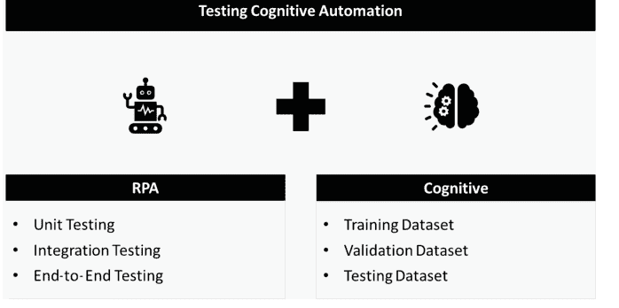
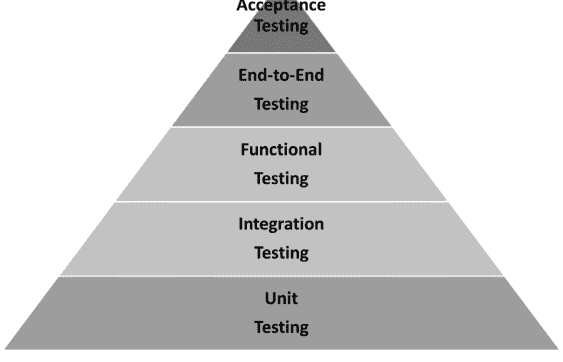
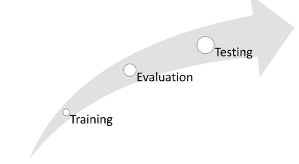
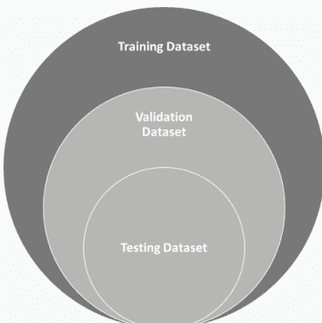
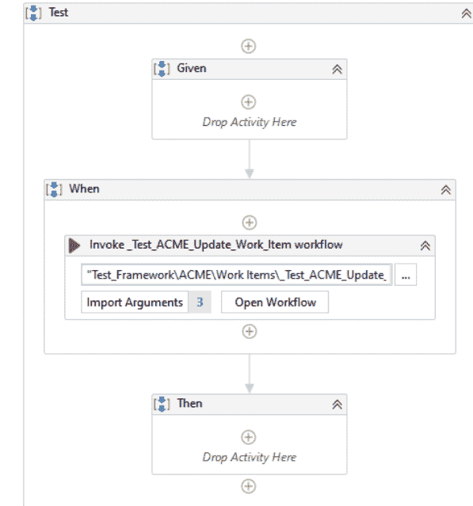
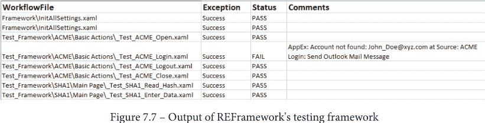
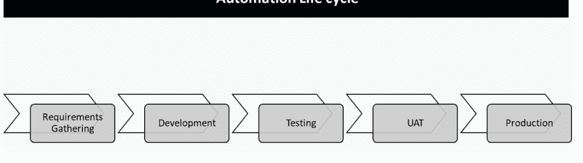
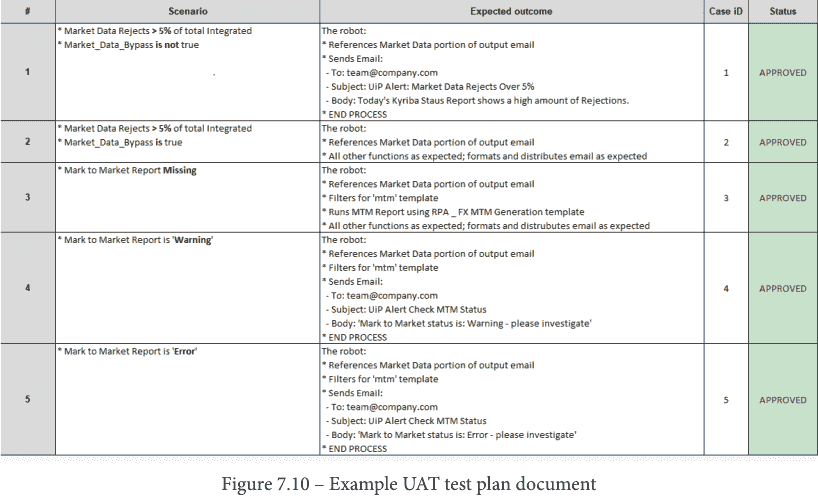
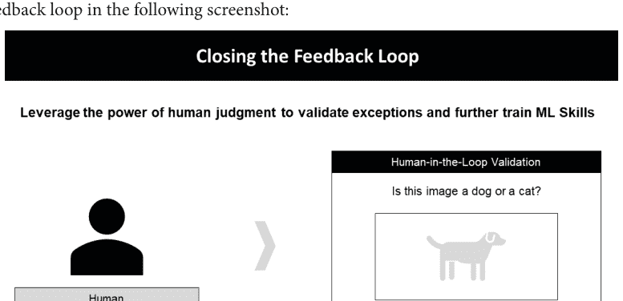

## 7 测试和完善开发工作

在部署之前准确、全面地测试自动化对于确保自动化的持久性至关重要。通过创建适当的测试方法来收集测试数据、创建测试用例并执行测试，我们可以在评估自动化开发时确保全面覆盖。

在本章中，我们将回顾测试认知自动化的方法，如何为用户验收测试（UAT）准备测试数据和测试用例，以及如何通过人工验证和 UiPath 的内置验证功能关闭反馈循环来训练和提高模型准确性。

在本章中，我们将涵盖以下主要主题：

- 接近认知自动化测试
- 执行认知自动化测试
- 关闭反馈循环

### 接近认知自动化测试

当我们继续自动化生命周期，在开发了自动化之后，我们可以继续测试所开发的内容。虽然添加认知组件（Document Understanding、机器学习（ML）技能等）为传统的基于规则的机器人流程自动化（RPA）带来了额外的复杂性，但测试认知自动化与传统自动化测试方法并没有太大不同。

在第 6 章《了解你的工具》中，我们看到在开发认知自动化时，我们本质上是在开发两个不同的组件：RPA 和认知自动化——我们会先构建 ML 技能，然后构建 RPA 来利用该 ML 技能。带着这种思维方式，我们可以将 RPA 和认知自动化视为更广泛的自动化项目的模块化组件，模仿称为关注点分离（SoC）的设计原则。

> SoC
> 这是一种软件设计模式，我们将计算机程序分离为不同的部分。

在认知自动化的情况下，RPA 组件只需要准备好处理从认知组件返回的输出，而我们的认知组件只需要准备好处理从 RPA 组件接收到的输入。考虑到这一点，我们可以在测试这些期望的同时拆分测试方法，因为这些组件（或部分）是分开的，如下图所示：



图 7.1 – 测试认知自动化

如图 7.1 所示，我们可以从两个部分入手测试认知自动化，利用传统的 RPA 测试方法和 ML 测试方法来测试每个组件。我们将按如下方式进行：

- **测试 RPA**：我们将以与测试任何 RPA 项目相同的方式来测试 RPA，通过单元测试、集成测试、**端到端**（E2E）测试等的混合。
- **测试认知自动化**：我们将以与测试 ML 模型类似的方式来测试认知自动化，通过数据驱动的训练、评估和测试。

一旦我们在各自的环境中成功测试了 RPA 和认知自动化，我们就可以将两个组件结合起来进行 UAT，然后再部署到生产环境。

让我们看看如何测试 RPA 和认知开发。

#### 如何测试 RPA 开发

以全面方式测试 RPA 开发对于获得业务的信心和建立成功的自动化项目至关重要。然而，RPA 的许多组件都可能导致异常，例如以下内容：

- **应用程序问题**：技术变更；定制
- **自动化问题**：业务逻辑变更
- **环境问题**：系统更新；桌面变更

因此，在测试 RPA 时，我们需要采取规范性方法以确保可靠性。


由于 RPA 与传统编程的偏差不大，因此在测试自动化时我们可以利用传统的软件开发测试实践。在软件测试中，有许多不同类型的测试被用来确保代码按预期执行，如下图所示：



图 7.2 – 开发测试层级

以下列表简要介绍了该层级：

- **单元测试：**最低级别的测试——测试软件使用的单个代码组件或函数
- **集成测试：**验证不同的模块或组件能否协同工作
- **功能测试：**验证业务需求，例如验证操作的输出或逻辑是否符合预期
- **端到端测试：**复制用户行为并验证端到端流程是否按预期运行
- **验收测试：**一系列正式测试，以确保开发成果符合业务需求

有关软件测试类型的更多信息，您可以参考以下链接：

https://www.atlassian.com/continous-delivery/software-testing/types-of-software-testing

虽然自动化程序在其自动化生命周期中可能需要不同程度的正式测试，但所有开发都必须经过一定程度的正式验收测试。这使得较低级别的测试（单元到端到端）留给开发团队在 UAT 之前执行。

## 如何测试认知组件

在测试认知组件时，所有测试都始于我们的数据。在第 6 章《了解您的工具》中，我们完成了 AI Center 的示例，其中包含训练和评估数据集及管道。然而，当我们接近部署 ML 技能时，我们需要再添加一个数据集——训练数据集，从而在构建认知自动化时需要以下数据集：



图 7.3 – 测试 ML 技能

这些数据集在此有更详细的说明：

- **训练数据集：**用于训练 ML 模型的初始数据集。该训练集应模拟我们理想的预期结果——换句话说，即*ground truth*。
- **评估数据集：**用于评估 ML 模型训练的一小部分数据。
- **测试数据集：**用于将训练好的 ML 模型暴露于真实数据的无偏数据集。

**重要说明**
有关*ground truth*的更多信息，请查看以下链接：
https://towardsdatascience.com/in-ai-the-objective-is-subjective-4614795d179b

总之，我们可以看到 RPA 和认知组件需要不同类型的测试。RPA 需要更多传统的**软件开发生命周期（SDLC）**测试方法，而认知自动化则需要迭代、数据驱动的方法。在尊重**SoC**思维方式的同时，我们可以有效地将 RPA 和认知自动化的开发和测试分开，以确保两个组件在为 UAT 整合之前都能正常工作。在下一节中，我们将进入认知自动化测试的执行。

## 执行认知自动化测试

为了成功测试和部署认知自动化，我们应始终准备好测试方法。在本节中，让我们回顾收集测试数据、执行 RPA 和认知测试，以及将所有内容整合以执行 UAT 测试的细节。

### 收集测试数据

ML 极度依赖数据。拥有正确类型和足够数量的数据对于成功部署 ML 模型至关重要；因此，数据准备是 ML 流程中非常重要的一部分。

在收集测试数据时，许多组织会询问需要多少数据才能开始。不幸的是，这个问题没有明确的答案，因为有很多变量会影响所需数据的数量，例如以下几点：

- ML 必须解决的业务问题的复杂性
- 分类数量（如果需要）
- 所用算法的复杂性

如果需要，您可以在收集数据时尝试达到以下估算。当然，每个问题可能略有不同，因此可能需要更多数据才能输出令人满意的结果：

- **文本分类：**尝试为*每个*分类准备几百个示例。
- **Tree-based Pipeline Optimization Tool (TPOT) 表格分类：**同样，每个分类也需要几百个示例。

总体而言，在尝试从业务团队收集数据时，您应力求获得尽可能多的數據点。拥有过多数据然后精简，总是比事后返回业务团队请求更多数据更容易。

在为项目收集必要数据后，重要的是要有足够的数据来训练、验证和测试 ML 模型，如下图所示：



图 7.4 – 拆分我们的数据集

我们数据集的大部分应用于训练 ML 模型，而较小的子集可用于验证模型并最终测试模型。以下是经验法则的估算：

- **训练数据集：**60-65%
- **验证数据集：**20-25%
- **测试数据集：**10-20%

一旦收集了用于执行测试的数据，我们就可以继续进入认知自动化测试的下一个部分：执行。

### 执行 RPA 测试

在测试 RPA 时，我们应从本章前面提到的开发测试层级（图 7.2）开始。为了便于实现该层级，开发过程中应遵循以下实践，如下所述：

- **小型工作流：**工作流应具有明确的输入和输出，执行特定操作（例如登录 X、导航到 Y、读取 Z）。
- **独立工作流：**工作流（除 Main.xaml 或 Process.xaml 外）不应调用其他工作流。

通过创建更小、模块化的工作流，我们可以更轻松地创建单元测试来测试开发的功能。

在为单元测试创建测试用例时，我们希望遵循一种方法，使我们能够准备环境以运行工作流、测试工作流并验证工作流的输出。该方法被称为测试的 *Given-When-Then* 公式，并在此详细说明：

- **Given** 一些上下文
- **When** 执行某个操作
- **Then** 应获得某个输出

有关 *Given-When-Then* 的更多信息，您可以参考以下链接：

https://www.agilealliance.org/glossary/gwt/

在 UiPath 中构建测试用例时，使用单独的序列来分隔 *Given-When-Then* 公式的 *Given*、*When* 和 *Then* 部分，如下图所示：



图 7.5 – 创建测试用例

借助 REFramework 的 `Test_Framework` 文件夹，我们可以使用 `Run_Tests.xaml` 文件运行每个创建的测试用例，并将测试结果输出到 Excel 和 TXT 日志文件，如下图所示。

| WorkflowFile | Exception | Status | Comments |
|---|---|---|---|
| Framework\\InitAllSettings.xaml | Success | PASS | |
| Framework\\InitAllSettings.xaml | Success | PASS | |
| Test_Framework\\ACME\\Basic Actions\\_Test_ACME_Open.xaml | Success | PASS | AppEx: Account not found: John_Doe@xyz.com at Source: ACME |
| Test_Framework\\ACME\\Basic Actions\\_Test_ACME_Login.xaml | Success | FAIL | Login: Send Outlook Mail Message |
| Test_Framework\\ACME\\Basic Actions\\_Test_ACME_Logout.xaml | Success | PASS | |
| Test_Framework\\ACME\\Basic Actions\\_Test_ACME_Close.xaml | Success | PASS | |
| Test_Framework\\SHA1\\Main Page\\_Test_SHA1_Read_Hash.xaml | Success | PASS | |
| Test_Framework\\SHA1\\Main Page\\_Test_SHA1_Enter_Data.xaml | Success | PASS | |



REFramework 的测试框架只是测试我们开发的一种方法。其他方法包括利用 UiPath 的 Test Suite 来运行和报告我们的测试用例。不管怎样，通过遵循这种 *Given-When-Then* 类型的框架，我们有一种方法可以为每个工作流创建测试用例，用于开发测试以及部署后的回归测试。

### 执行认知测试

在测试 ML 技能时，我们应从训练数据集开始，构建训练管道以使用初始数据集训练模型。训练完成后，可以使用评估数据集（有时也称为验证数据集）对模型进行评估。评估数据集评估完成后，我们可以查看模型的评估报告以判断模型的性能。该评估报告通常是评估管道的直接输出，如下图所示：


## 评估统计

| 指标 | 值 |
|---|---|
| accuracy | 0.53353 |
| precision | 0.52848 |
| recall | 0.53353 |
| matthews correlation | 0.41685 |
| fscore | 0.5275 |
| auroc | 0.8411 |

Figure 7.8 – 示例评估报告

Figure 7.8 是文本分类模型评估的一个示例。我们通常希望 Fscore 达到大于 70%。在这种情况下，我们低于 70%，因此我们应该检查训练和评估数据集的正确性，并研究编辑模型参数或选择完全不同的模型。

一旦我们选择了模型并成功评估它，我们就可以使用测试数据集对模型进行测试。该数据集应完全无偏，并且包含模型之前从未见过的新数据。用于测试的最佳数据类型是年轻数据，最好来自我们的生产环境。

## 执行 UAT

在之前的章节中，我们讨论了在各自独立的 silo 中测试 RPA 和 ML。这在自动化生命周期的开发阶段效果很好，但在部署到生产环境之前，这两种技术应该有一个融合。这个融合应该发生在自动化生命周期的 UAT 阶段。

UAT 是一种测试类型，用于让最终用户或业务对自动化的性能给予最终批准。这种测试在将自动化部署到生产环境之前进行，向最终用户展示自动化在给定一组场景下的预期表现。在此测试期间，我们不关注选择器等特定错误，而是关注端到端流程，确保自动化的输出满足最终用户/业务的要求。

下图说明了 UAT 如何融入自动化生命周期：



Figure 7.9 – 自动化生命周期中的 UAT

为了执行 UAT，在最终测试之前有几个入口点需要作为标准考虑。这些入口标准包括以下内容：

- **开发测试已完成**：自动化开发应经过测试（单元、集成和系统测试），并且在验收测试之前应已通过端到端测试。
- **同行评审已完成**：自动化开发应由另一名开发人员进行同行评审，以符合最佳实践。
- **环境已准备好**：UAT 通常发生在与开发环境不同的环境中。该环境可以包括带有测试数据的 UAT 应用程序和 UAT UiRobot。
- **自动化已迁移**：自动化应在 UAT 测试之前发布到开发编排器、提交到源代码控制并迁移到 UAT 编排器。
- **UAT 测试计划已创建**：应由流程负责人或**主题专家（SME）**创建包含所有必要测试场景和预期结果的测试计划。
- **UAT 数据已收集**：与测试计划一起，应收集用于测试的 UAT 数据。通常，最近的生产数据最适合进行 UAT。

有关 UAT 的更多信息，您可以参考以下链接：

```
https://www.guru99.com/user-acceptance-testing.html
```

一旦所有入口标准都完成，UAT 测试就可以开始。执行 UAT 可以有几种形式，具体取决于业务是否运行 UAT 测试或开发团队为业务运行 UAT 测试以供审查。进行 UAT 的一种简单方法是让 SME 和开发团队一起开会，逐一运行每个测试场景。SME 可以监督测试，而开发人员可以从 UAT 编排器为每个测试场景启动自动化。

为 UAT 完成定义退出标准很重要。退出标准最好在 UAT 测试计划文档中定义，以便所有相关方都知道 UAT 完成的所需标准。您可以在以下屏幕截图中看到 UAT 测试计划文档的示例：

| # | 场景 | 预期结果 | Case ID | 状态 |
|---|---|---|---|---|
| 1 | - Market Data Rejects > 5% of total Integrated<br>- Market_Data_Bypass is not true | The robot:<br>- References Market Data portion of output email<br>- Sends Email:<br>  - To: team@company.com<br>  - Subject: UIP Alert: Market Data Rejects Over 5%<br>  - Body: Today's Kyriba Status Report shows a high amount of Rejections.<br>- END PROCESS | 1 | APPROVED |
| 2 | - Market Data Rejects > 5% of total Integrated<br>- Market_Data_Bypass is true | The robot:<br>- References Market Data portion of output email<br>- All other functions as expected; formats and distributes email as expected | 2 | APPROVED |
| 3 | - Mark to Market Report Missing | The robot:<br>- References Market Data portion of output email<br>- Filters for 'mtm' template<br>- Runs MTM Reporting using RPA _ FX MTM Generation template<br>- All other functions as expected; formats and distributes email as expected | 3 | APPROVED |
| 4 | - Mark to Market Report is 'Warning' | The robot:<br>- References Market Data portion of output email<br>- Filters for 'mtm' template<br>- Sends Email:<br>  - To: team@company.com<br>  - Subject: UIP Alert Check MTM Status<br>  - Body: 'Mark to Market status is: Warning - please investigate'<br>- END PROCESS | 4 | APPROVED |
| 5 | - Mark to Market Report is 'Error' | The robot:<br>- References Market Data portion of output email<br>- Filters for 'mtm' template<br>- Sends Email:<br>  - To: team@company.com<br>  - Subject: UIP Alert Check MTM Status<br>  - Body: 'Mark to Market status is: Error - please investigate'<br>- END PROCESS | 5 | APPROVED |



退出标准可能取决于组织，但通常，UAT 退出标准包括以下内容：

- No defects open
- Successful completion of UAT test scenarios
- Documented sign-off of UAT

为了满足这些退出标准，业务分析师、UAT 测试人员或 SME 应该记录每个已完成测试场景的结果。根据组织的不同，每个测试场景可以通过屏幕截图、视频录制或仅对自动化输出进行签核来记录。一旦满足退出标准，UAT 就可以完全完成，并且自动化可以部署到生产环境。

## 关闭反馈循环

随着认知自动化从 UAT 转移到生产环境，它可能会遇到训练、评估和测试测试集中未见过的数据。我们期望部署的模型能够基于所进行的训练处理新数据，但有时模型可能会返回不令人满意的结果，或者根据它遇到的新数据存在进一步改进模型性能的机会。

这就是关闭反馈循环可以在 ML 模型性能中发挥重要作用的地方。通过对 Document Understanding 或 AI Center ML 技能关闭反馈循环，我们可以捕获未见过的数据点，使用人工向 ML 技能发送反馈并持续用新数据训练该技能。您可以在以下屏幕截图中看到关闭反馈循环的表示：



Figure 7.11 – 关闭反馈循环

使用 UiPath，开发人员可以使用置信度阈值来允许自动化继续使用 ML 技能的输出，或提示用户通过使用 Attended Automation（Validation Station）或使用 Action Center 输入。此反馈循环现在使我们能够使用新鲜、相关的数据持续测试和完善我们的模型。

## 第 3 节：使用 UiPath Document Understanding、AI Center 和 Druid 构建

在本节中，我们将使用 UiPath Document Understanding、AI Center 和 Druid 连接构建实际用例，以将 UiPath 自动化与认知能力联系起来。

本节包含以下章节：

- Chapter 8, Use Case 1 – Receipt Processing with Document Understanding
- Chapter 9, Use Case 2 – Email Classification with AI Center
- Chapter 10, Use Case 3 – Chatbots with Druid
- Chapter 11, AI Center Advanced Topics


