# 8
用例1 – 使用文档理解处理收据

每个组织，无论属于哪个行业，都有一个需要处理收据的团队。收据处理的例子可以在采购团队中看到，用于支付已交付服务的费用，也可以在人力资源团队中看到，用于审核同事在商务旅行期间提交的费用。虽然这些团队之间收据处理的用途可能不同，但一个共同点是处理收据通常是一项手动且可能容易出错的任务。幸运的是，借助UiPath的文档理解，我们可以创建认知自动化，应用光学字符识别（OCR）来读取、分类和解释收据，从而消除手动工作。

通过全面了解文档理解和*文档理解框架*，我们可以共同构建能够解释收据图像的认知自动化。在构建用例时，我们将遵循与前几章所述类似的开发生命周期。我们将从理解自动化机会的当前状态开始，然后设计涉及自动化的未来流程状态。一旦设计了未来状态，我们将使用文档理解构建自动化，测试解决方案以确保稳定性，最后将自动化部署到生产环境。

在本章中，我们将在构建处理收据的自动化时涵盖以下主题：

- 理解当前状态
- 创建未来状态
- 使用文档理解框架构建解决方案
- 测试以确保稳定性并提高准确性
- 部署时考虑最终用户体验

## 技术要求

本章的所有代码示例可以在GitHub上找到：`https://github.com/PacktPublishing/Democratizing-Artificial-Intelligence-with-UiPath/tree/main/Chapter08`。

使用UiPath非常容易，借助社区版，我们可以免费开始。但是，对于UiPath AI Center，我们需要企业许可证。您可以从 `uipath.com` 获取60天的企业试用许可证。

通过60天的企业试用，我们将可以访问以下内容：

- 五个RPA Developer Pro许可证——命名用户许可证包括访问Studio、StudioX、Attended Robot、Apps、Action Center和Task Capture
- 五个无人值守机器人、五个测试机器人和两个AI机器人
- AI Center、AI Computer Vision、Automation Hub、Data Service、Document Understanding和Insights

对于本章，您需要以下内容：

- UiPath Enterprise Cloud（包含AI Center）
- UiPath Studio 2021.4+
- `UiPath.IntelligentOCR.Activites` 包 v.4.13.2或更高版本
- `UiPath.DocumentUnderstanding.ML.Activites` v1.7.0或更高版本

> **重要说明**
> 有关如何安装UiPath包的说明，请访问 https://docs.uipath.com/studio/docs/managing-activities-packages。

查看以下视频以了解“Code In Action”：https://bit.ly/3J8gX53

## 在UiPath企业试用中启用AI Center

其他技术要求包括利用AI Center。UiPath文档理解在UiPath社区版和企业版中开箱即用；但是，对于UiPath AI Center，我们需要在企业试用中启用该服务。您可以按照以下步骤启用该服务：

- 1. 导航到 **Automation Cloud** 的 https://cloud.uipath.com：

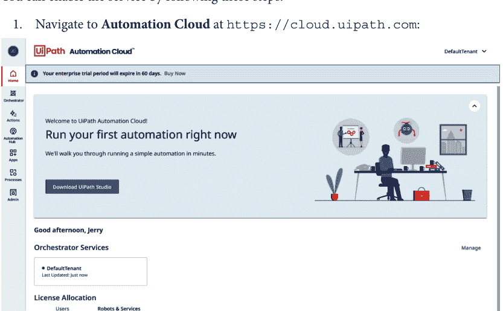

### 2. 导航到 Admin：

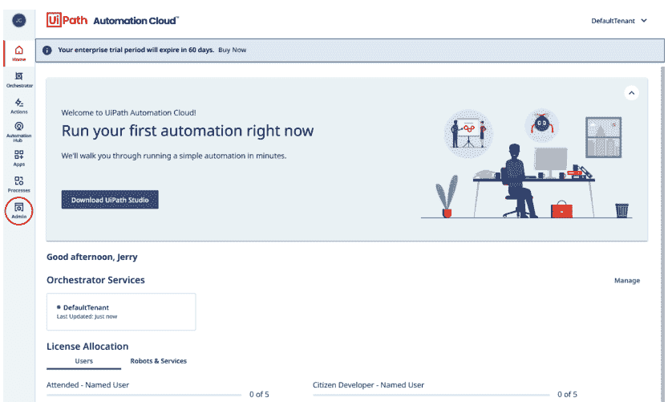

图8.2 – 点击 Admin

### 3. 在 DefaultTenant 中，点击三个点，然后点击 Tenant Settings：

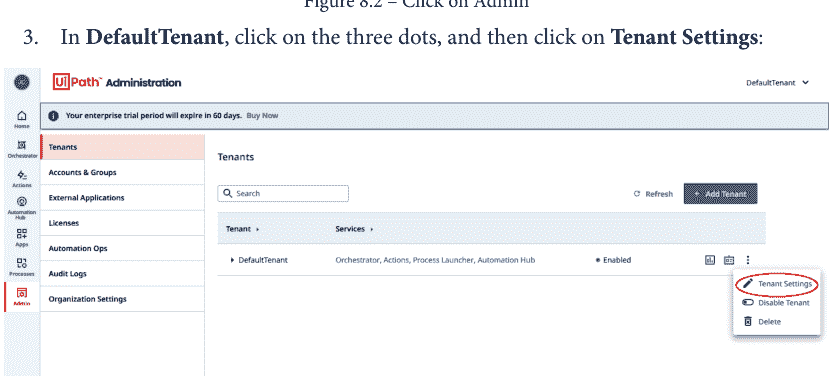

图8.3 – 点击 Tenant Settings

4. 在 **Provision Services** 下选择 **AI Center**，然后点击 **Save**：

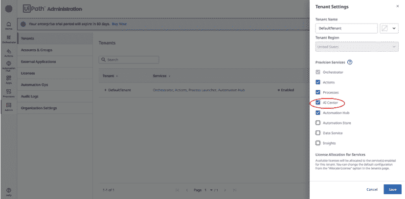

图8.4 – 勾选 AI Center，然后点击 Save

一旦启用了AI Center，我们就完成了本章的技术要求。在下一节中，我们将通过审查当前状态来开始收集关于用例的背景信息。

## 理解当前状态

在我们开始设计或构建用例之前，我们需要理解流程的当前状态。每天，Company ABC的Time and Expense（T&E）团队需要手动审核同事在商务旅行中提交的收据。当T&E团队审核这些收据时，他们会对照费用管理工具进行检查，以确保员工正确提交了费用报告。以下是T&E团队设定的规则（图8.5）：

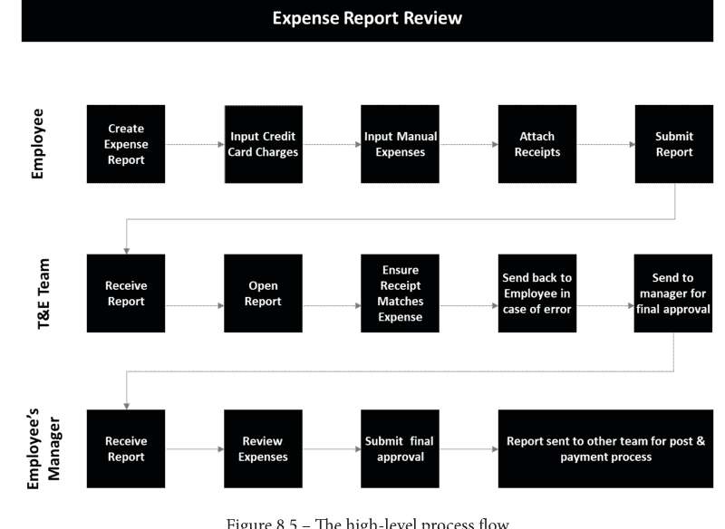

图8.5 – 高层级流程

查看高层级流程，T&E团队会在员工提交费用报告后自动收到报告。然后由T&E分析师打开报告，检查每项费用和收据的完整性和准确性。如果报告准确，分析师可以将报告转发给员工的经理进行最终审批。

Company ABC有很多员工需要定期出差，而且公司最近一直在招聘更多员工，因此T&E团队需要审核的费用报告和收据数量不断增加。T&E团队的周转时间为2天，这意味着他们可以在员工提交费用报告2天后进行审核和批准。

查看当前状态，似乎有很多自动化机会——回到第4章“识别认知机会”中讨论的自动化机会特征，我们可以看到这个自动化机会具有以下特征：

- **与应用程序的手动交互：** T&E分析师必须手动与费用管理工具交互。
- **重复性：** T&E分析师必须对每项费用和收据执行相同的一系列步骤。
- **耗时：** 审核单个收据对分析师来说可能非常耗时。
- **基于规则且结构化：** 围绕费用报告的规则大多是结构化的。

这个流程中唯一令人担忧的领域是收据本身，因为收据不太结构化，并且可能因供应商而异。这些要点与第4章“识别认知机会”中讨论的认知自动化机会的特征一致：

- 高变异性
- 非结构化数据

然而，从可行性角度来看，我们可以轻松地使用UiPath文档理解为T&E分析师创建处理收据的自动化。此外，从可行性角度来看，为这些分析师自动化此流程的部分内容可以带来以下好处：

- **提高吞吐量：** 在流程中实施自动化可以让分析师更快地完成审核，从而缩短2天的周转时间。
- **提高容量：** 在流程中实施自动化可以让分析师完成更多审核，使团队能够吸收增加的费用报告量，而无需扩大团队规模或增加周转时间。
- **减少错误：** 实施自动化可以减少手动审核期间发生的错误，最大限度地降低批准无效费用的风险。

此流程中的自动化可以为T&E团队带来巨大的影响。虽然有许多机会领域，但对于本用例，我们将重点关注流程中的收据部分。在下一节中，我们将专注于创建未来状态设计，以实施处理收据的自动化。

## 创建未来状态设计

当我们查看当前状态的高层级设计时，似乎有几个自动化机会可以让我们创建未来状态的自动化（图8.6）：

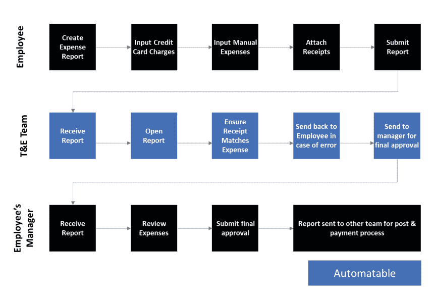

图8.6 – 费用报告审核流程中的自动化机会

看起来T&E团队在流程中采取的大多数步骤都可能通过自动化受益，通过一系列相互传递信息的自动化想法。然而，由于我们希望在本用例练习中专注于文档理解，让我们只关注流程中出现在“打开报告”和“出错时发回给员工”之间的步骤（图8.7）：


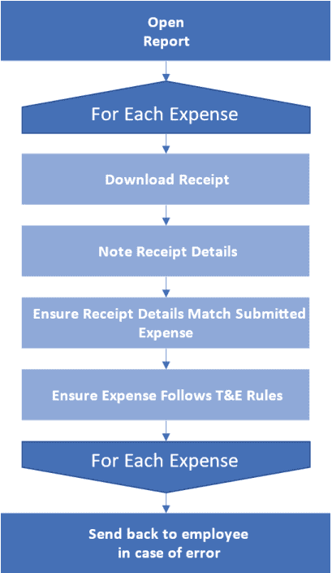

图 8.7 – 出错时从“打开报告”到“退回给员工”的步骤

如我们所见，在**打开报告**和**出错时退回给员工**的步骤中，我们可以应用文档理解技术，特别是在流程的**记录收据详情**任务中。因此，我们将重点为该任务创建一种未来状态设计。

在此自动化的未来状态中，分析师仍将被要求手动操作，像过去一样打开费用报告并下载收据；然而，在未来状态中，他们将启动自动化流程，由该流程替他们读取收据内容（图 8.8）：

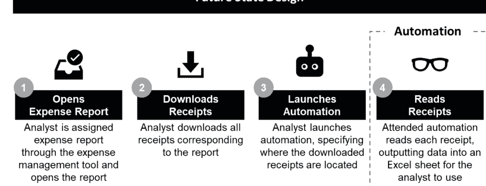

图 8.8 – 高层级的未来状态设计

对于这个用例，我们将采用增量方法，通过自动化读取每张收据的内容来解决差旅费用（T&E）团队的痛点。通过创建能够读取收据的自动化流程，我们可以解决流程中较难处理的部分之一，从而为将来扩展到其他任务奠定基础，最终通过一系列自动化流程实现端到端全流程的自动化。

双击进入我们要自动化的“读取收据”任务，在创建最终未来状态之前，有一个主要需求需要明确——我们需要从每张收据中提取的字段。在当前流程状态中，分析师需要记录并确认以下字段：

- 供应商名称
- 收据日期
- 税额
- 总金额

随着我们在第 6 章《了解你的工具》中提到的用例分类法的建立，这些字段将变得至关重要。

总结一下——作为该用例的未来状态设计，我们要构建的项目将是一个**有人值守的自动化流程**，它会提示最终用户输入已下载收据的文件夹位置。随后，自动化流程将使用 UiPath 文档理解技术读取并提取每张收据的相关信息，并将数据导出到最终用户机器上的 Excel 表格中。这样，最终用户可以更快地验证费用报告，因为所有收据都已被读取，且数据已为分析师收集完毕。

## 使用文档理解框架构建解决方案

当我们着手构建既定用例时，必须确保按照最佳实践开发自动化流程。在以下各节中构建用例时，我们将遵循 UiPath *文档理解框架* 的步骤（*图 8.9*）：

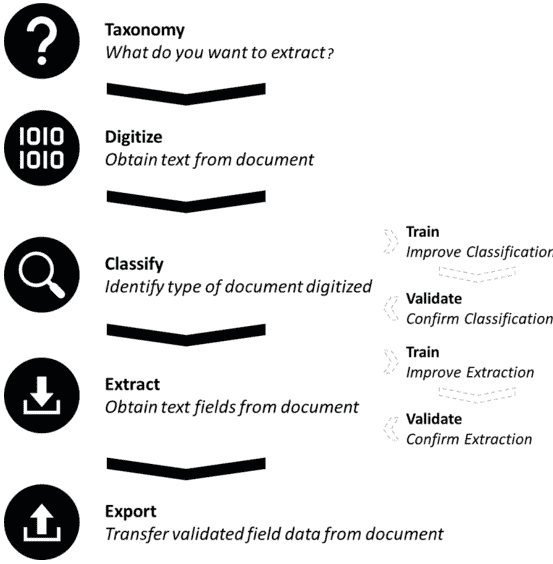

图 8.9 – UiPath 的文档理解框架

文档理解框架的步骤使我们能够最好地构建认知自动化，结合所有必要的技术和方法。

在 UiPath Studio 中选择**文档理解流程**模板如图 *8.10* 所示：

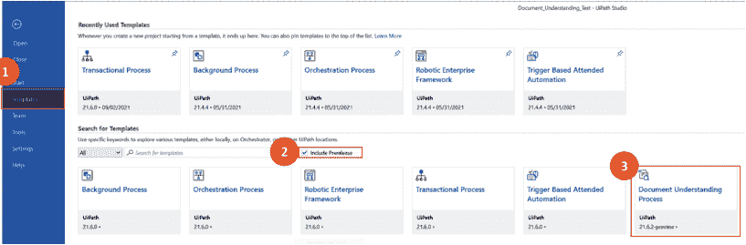

图 8.10 – 使用文档理解流程模板启动项目

> **重要提示**
> 
> 文档理解流程模板兼容 Studio 21.4.4 及更高版本。

现在我们已经为用例创建了项目，让我们深入定义文档理解流程模板的设置。

## 定义模板的设置

项目创建完成后，我们需要定义几项设置，以确保自动化流程按预期运行。

我们必须定义的第一项设置是禁用持久性支持和后台运行。由于此用例计划为有人值守用例，我们将在最终用户的本地机器上向他们展示验证站（Validation Station）。因此，由于我们不使用 UiPath Action Center 来验证文档理解的结果，就不需要持久性支持。同样，由于自动化流程是有人值守的，因此在前景中运行，也不需要后台支持。

禁用持久性支持和后台运行的步骤如下：

- 1. 导航至 UiPath 项目的“项目”窗格，并单击“项目设置”（图 8.11）：

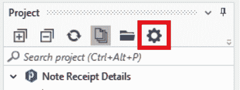

图 8.11 – 单击“项目设置”

- 2. 打开“项目设置”后，单击“后台启动”和“支持持久性”右侧的切换开关，直到它们变为禁用状态：

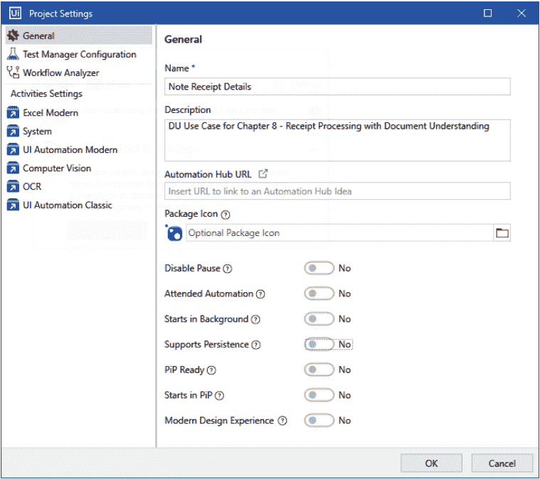

图 8.12 – 禁用了持久性和后台支持的项目设置

禁用持久性和后台支持后，我们需要在开始构建用例之前配置 *文档理解流程模板* 中包含的资产。资产是存储在 UiPath Orchestrator 中的共享变量，自动化项目在执行时可以参考它们。在文档理解流程模板中，有六个资产需要在 Orchestrator 中分配值：

- **ApiKey**：我们的文档理解 API 密钥。
- **AlwaysValidateClassification**：一个布尔值，告知 UiPath 是否由人工手动验证分类。如果设置为 True，分类将始终经过人工验证。
- **AlwaysValidateExtraction**：一个布尔值，告知 UiPath 是否由人工手动验证提取。如果设置为 True，提取将始终经过人工验证。
- **SkipClassifierTraining**：一个布尔值，告知 UiPath 跳过分类器训练。如果设置为 True，将不执行分类器训练。
- **SkipExtractorTraining**：一个布尔值，告知 UiPath 跳过提取器训练。如果设置为 True，将不执行提取器训练。

设置所需资产的步骤如下：

- 1. 登录 UiPath Orchestrator，并导航到存储资产的现代文件夹或个人工作区（图 8.13）：

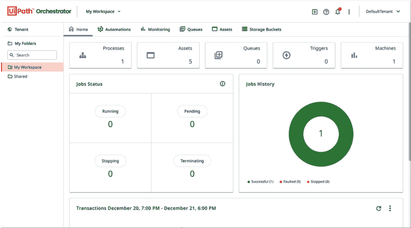

图 8.13 – UiPath Orchestrator 中的个人工作区

- 2. 单击“资产”以导航到资产页面（图 8.14）：

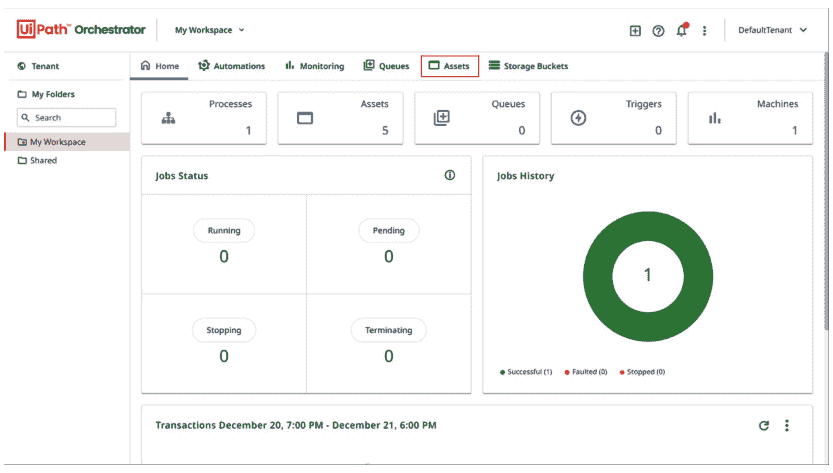

图 8.14 – 导航到资产页面

- 3. 通过单击“添加资产”按钮逐个添加每个资产；设置应如图 8.15 所示：

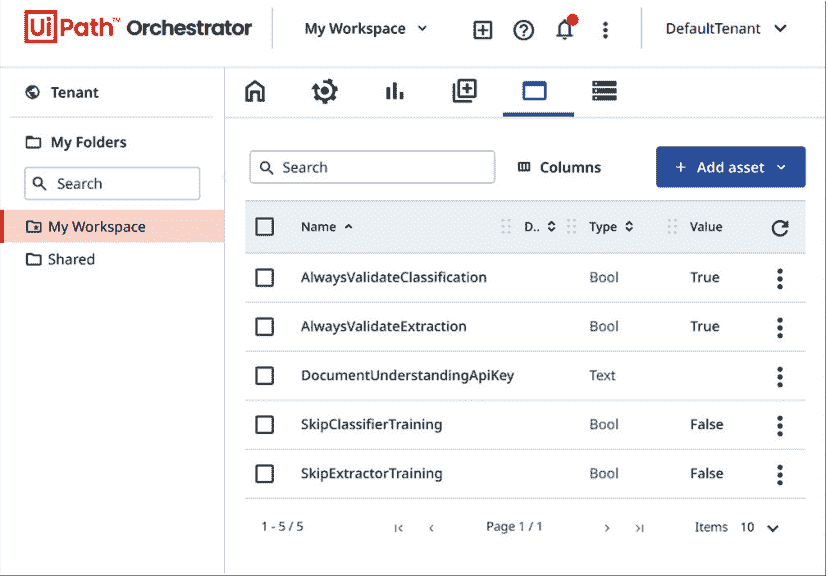

图 8.15 – 资产配置

> **重要提示**
> 
> 查找文档理解 API 密钥的详细信息可在 `https://docs.uipath.com/document-understanding/docs/api-key` 找到。

最后，在设置了项目配置和定义了资产之后，在进入构建用例阶段之前，我们需要定义的最后一项设置是设置主文件。如果你查看新创建项目的文件，你会注意到两个 `.xaml` 文件：

- `Main-ActionCenter.xaml`
- `Main-Attended.xaml`

有两个主文件的原因在于，它们在无人值守和有人值守执行中各有细微差别。`Main-ActionCenter.xaml` 文件包含 Action Center 活动，有助于无人值守场景下的验证。在有人值守执行中，这些活动并非必要，因为我们无需通过 Action Center 即可向用户显示验证站。

由于我们要构建的是有人值守用例，我们需要确保将 Main-Attended.xaml 设为主文件。每个 UiPath 项目都需要定义一个主文件，通常称为 Main.xaml，但在这种情况下，我们需要按照以下步骤将 Main-Attended.xaml 设为主文件：

- 1. 在 UiPath Studio 的项目窗格下方，右键单击 **Main-Attended.xaml**。
- 2. 单击 **设为主文件** 以将该文件设为项目的主文件（*图 8.16*）：

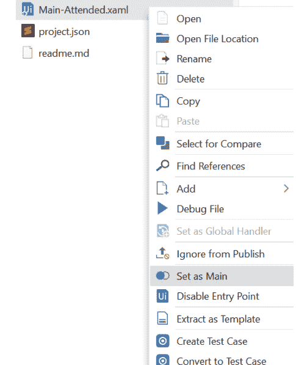

图 8.16 – 设置项目的主文件

在 *文档理解流程模板* 的必要设置完成后，我们现在可以继续构建用例，从 *文档理解框架* 的第一部分开始，即**分类法**。


## 创建分类法

作为 *Document Understanding 框架* 的第一步，我们需要创建一个分类法来对文档进行分类，并构建我们希望从收据中提取的相关信息的架构。如 *第 6 章《了解你的工具》* 中所述，分类法是一种分类系统，而在 Document Understanding 中，分类法是对 **文档类型** 的分类。

根据我们对流程的当前理解，我们将以下内容定义为此流程所必需的：

- 供应商名称
- 收据日期
- 税额
- 总金额

因此，在构建分类法的过程中，我们必须包含这些字段。*Document Understanding 流程模板* 的一个功能是为常见文档（如收据）提供预建分类法。让我们回顾一下开箱即用的分类法，并确定它是否适合我们的用例：

1. 在 UiPath Studio 的设计功能区中打开 **Taxonomy Manager**（*图 8.17*）：


图 8.17 – 设计功能区中的 UiPath Taxonomy Manager

使用 Taxonomy Manager，请注意已加载的现有文档类型 – **Documents、Semi-Structured Documents 和 Structured Documents**。让我们回顾一下半结构化文档。

2. 点击 Semi-Structured Documents > Financial > Receipt（图 8.18）：

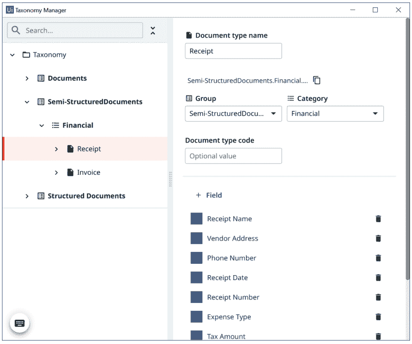

图 8.18 – 预建的 Receipt 文档类型

如果我们查看预建 **Receipt** 文档类型的字段，可以看到这些字段与我们当前状态的理解相匹配（图 8.19）：

| **Taxonomy Design** |  |
| --- | --- |
| **Fields from Current State understanding** | **Fields from prebuilt Document Type** |
| Vendor Name | Receipt Name |
| Receipt Date | Receipt Date |
| Tax Amount | Tax Amount |
| Total Amount | Total Value |

图 8.19 – Taxonomy Design

将我们当前状态理解中的字段与预建文档类型的字段进行映射可确保我们完全不需要编辑分类法。如果我们想要捕获的额外字段，我们可以轻松地将字段添加到 **Receipt** 文档类型或创建我们自己的文档类型。然而，在本例中，由于我们有映射，我们可以利用预建文档类型并继续进行 Document Understanding 框架的下一部分，**digitization**。

## 设置数字化器

*Document Understanding 框架* 的下一步是数字化。数字化是将输入数据扫描为机器可读文本的过程。一旦数据被数字化，我们就可以对数据进行分类并提取相关数据字段，以创建用于自动化的可执行步骤。

设置数字化的步骤大部分由 *Document Understanding Process* 模板处理。在项目中，打开 `20_Digitize.xaml` 文件以查看预建的数字化工作流，如图 8.20 所示：

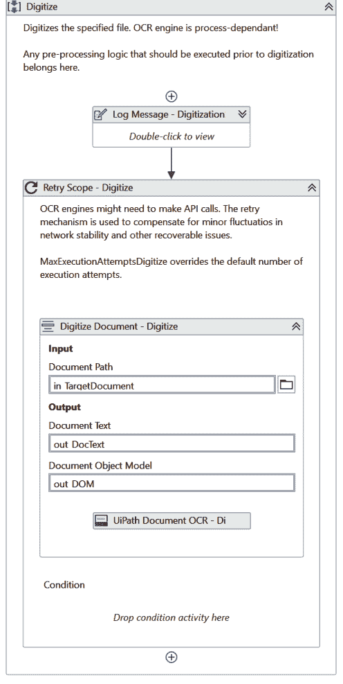

图 8.20 – `20_Digitize.xaml` 工作流

在预建工作流中，我们有机会在数字化文档之前添加任何预处理（例如添加灰度、调整大小或旋转）。预建工作流然后使用 **UiPath Document OCR** 作为 OCR 引擎来数字化文档。

如果我们想使用不同的 OCR，我们可以简单地用任何可用的 OCR 引擎替换 UiPath Document OCR。对于此用例，我们将使用 UiPath Document OCR 来为我们数字化收据。由于此原因，我们不需要为数字化添加任何额外活动，因为模板为我们完成了繁重的工作。

数字化器配置完成后，我们现在可以进入 *Document Understanding 框架* 的下一部分，即 **classification**。

## 设置分类器

一旦数字化器配置了我们选择的 OCR 引擎，我们就可以进入 *Document Understanding Framework* 的下一步，分类。对于此用例，我们只有一个文档类型（收据），因此分类似乎是不必要的，但让我们设置 UiPath Machine Learning Classifier 以展示它如何能与 *Document Understanding Process template* 快速设置。

设置分类时，我们必须同时配置分类器本身和用于重新训练分类器的训练器。幸运的是，与数字化一样，分类的步骤大部分由 Document Understanding Process 模板处理。为了回顾模板的分类工作流，打开 `30_Classify.xaml` 文件以查看预建的分类工作流（图 8.21）：

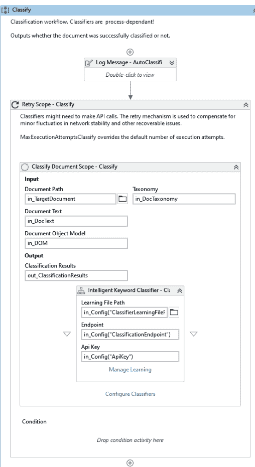

图 8.21 – `30_Classify.xaml` 工作流

在预建工作流中，我们有机会添加特定用例所需的分类器。默认情况下，Document Understanding Process 模板将包含 UiPath 的 Intelligent Keyword Classifier，但对于此用例，让我们用 UiPath 的 Machine Learning Classifier 替换 Intelligent Keyword Classifier。

UiPath Machine Learning Classifier 利用部署到 UiPath AI Center 的 ML 技能将文档分类为四个类别 – 收据、发票、采购订单和公用事业账单。因此，让我们先开始将相关 ML 技能部署到 AI Center：

1. 导航到 **Automation Cloud** 中的 **AI Center** 并创建一个新项目，`Note Receipt Details`。

2. 创建一个数据集，命名为 `DocumentUnderstanding_Classifier`，供 ML 技能用于分类器训练（图 8.22）：

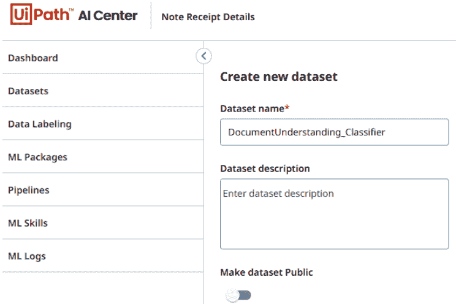

图 8.22 – 收据数据集

3. 部署 **DocumentClassifier** 开箱即用的 ML 包，位于 **ML Packages > Out of the box Packages > UiPath Document Understanding**（图 8.23）：

> **重要说明**
> 选择 **DocumentClassifier** 技能的最新版本。无需包含可选字段，例如 OCR。

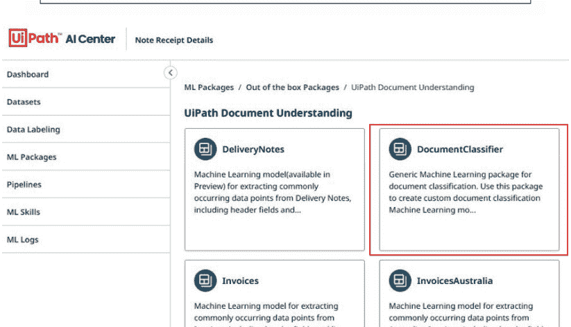

图 8.23 – DocumentClassifier 开箱即用包

数据集和 ML 包创建后，我们必须接下来创建一个管道，以便用于持续训练我们的分类器。导航到 Pipelines 并创建一个新的 train run 管道，使用前面创建的数据集和 ML 包（图 8.24）：

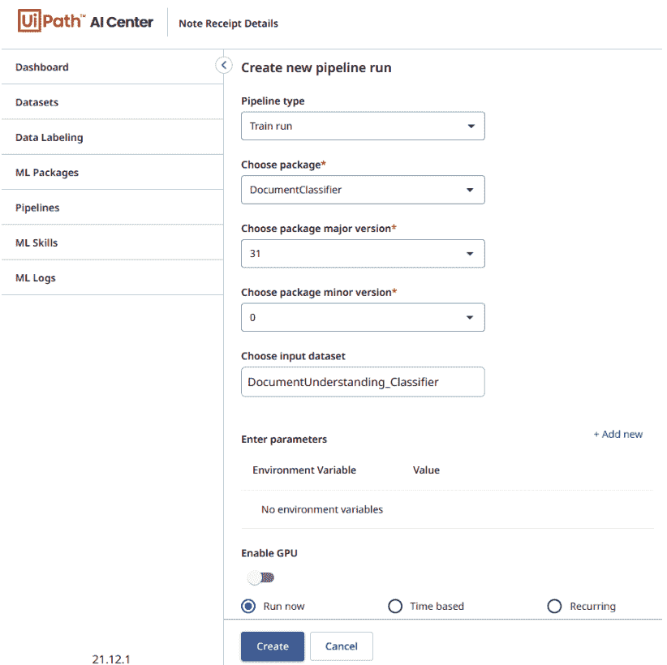

图 8.24 – 创建训练管道

训练管道创建后，我们最后一步是部署一个 ML 技能以在我们的 UiPath 项目中利用。

4. 导航到 ML Skills 并创建一个新的 ML 技能，使用前面创建的 ML 包（图 8.25）：

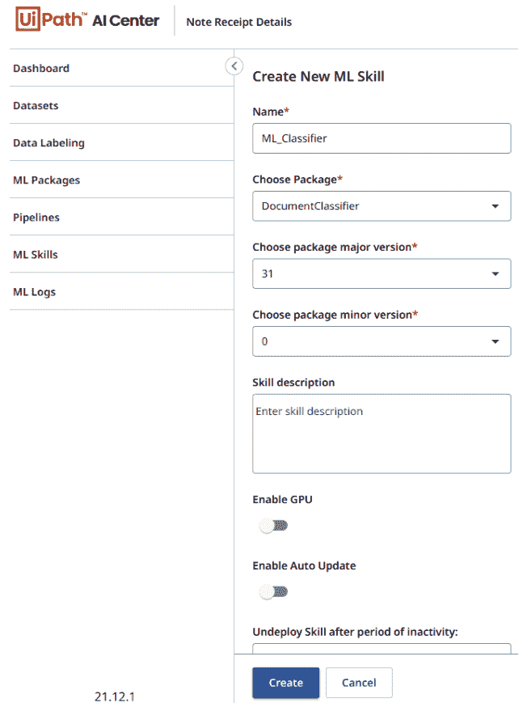

图 8.25 – 创建新的 ML 技能

一旦 Machine Learning Classifier 部署，我们必须接下来将其连接到我们的 UiPath 项目。

5. 导航回工作流 `30_Classify.xaml`。

6. 在 **Classify Document Scope** 中，用 **Machine Learning Classifier** 活动替换 **Intelligent Keyword Classifier** 活动。

7. 在 **Machine Learning Classifier** 中，选择我们刚刚创建的 ML 技能（`ML_Classifier`）（图 8.26）：

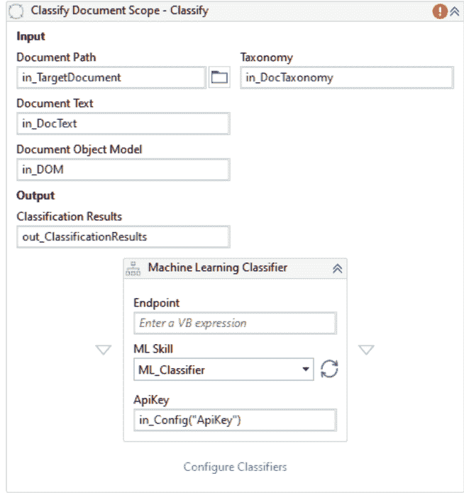

图 8.26 – 设置 Machine Learning Classifier

一旦 Machine Learning Classifier 活动添加到工作流，我们必须配置分类器以对我们分类法中的 **Receipt** 文档类型进行分类。

8. 点击 Configure Classifiers 并为 Receipt 文档类型选择 receipts（图 8.27）：

> **重要说明**
> Machine Learning Classifier 适用于发票、采购订单、收据和公用事业账单，因此下拉菜单包含四个选项。

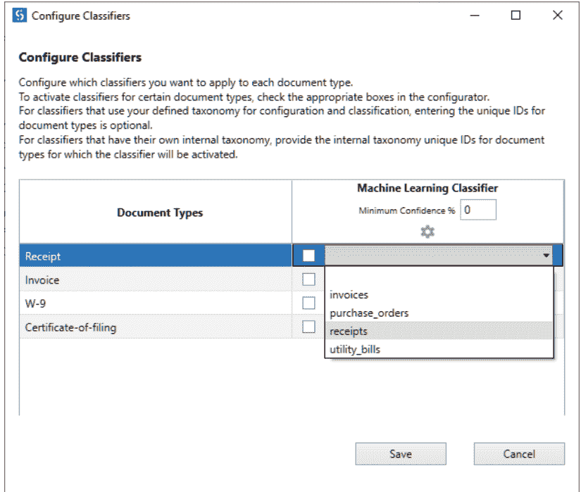

图 8.27 – Configure Classifiers

分类器部署并连接到我们的 UiPath 项目后，分类中的最后一步是设置训练器。如果我们需要手动验证 UiPath 机器人的分类结果，训练器将使用我们的手动输入重新训练我们的 ML 技能。


+   9. 打开**40_TrainClassifers.xaml**工作流。
+   10. 在**训练分类器范围**内，将**智能关键字分类器训练器**活动替换为**机器学习分类器训练器**活动。
+   11. 在机器学习分类器训练器中，选择我们之前创建的AI Center项目（**票据收据详情**）和数据集（**DocumentUnderstanding_Classifier**）（*图8.28*）：

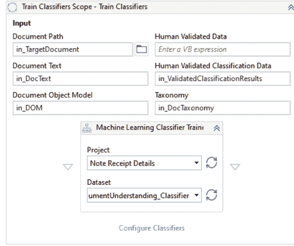

图8.28 – 设置机器学习分类器训练器

与机器学习分类器活动类似，在添加机器学习分类器训练器之后，我们必须配置分类器，以对我们的分类法中的**收据**文档类型进行分类。

12. 点击“配置分类器”，并为“收据”文档类型选择receipts（图8.29）：

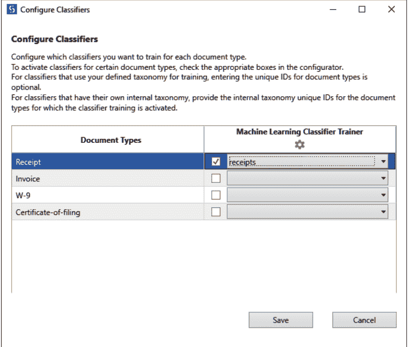

图8.29 – 配置分类器

配置完分类器训练器后，机器学习分类器的配置就完成了。

现在，我们可以利用ML技能对收据进行分类，并继续下一节的文档理解框架——抽取。

与机器学习分类器不同，用于收据和发票的机器学习抽取器可以由UiPath外部托管，也可以由我们通过AI Center在内部托管。因此，文档理解流程模板开箱即用，已经指向这些外部托管的抽取器。UiPath机器人被指示使用配置文件的**ReceiptsEndpoint**键中定义的抽取器。

对于此用例，我们将在AI Center上托管**收据**ML抽取器，以便我们可以像进行分类任务一样重新训练抽取器。托管抽取器的步骤与刚才执行的分类步骤类似，具体如下：

+   1. 在AI Center的**票据收据详情**项目中，创建一个新数据集**收据**，用于重新训练。
+   2. 部署位于**ML Packages > Out of the box Packages > UiPath Document Understanding**下的开箱即用ML包**收据**（*图8.31*）：

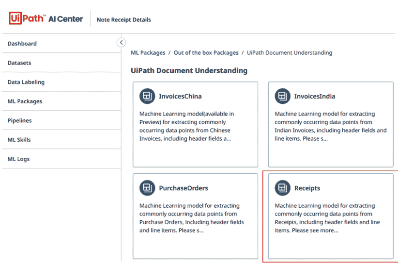

图8.31 – 收据开箱即用包

3. 导航到Pipelines，并使用Receipt数据集和新建部署的Receipt ML包创建一个新的训练运行管道。将auto_retraining标志设置为True（图8.32）：

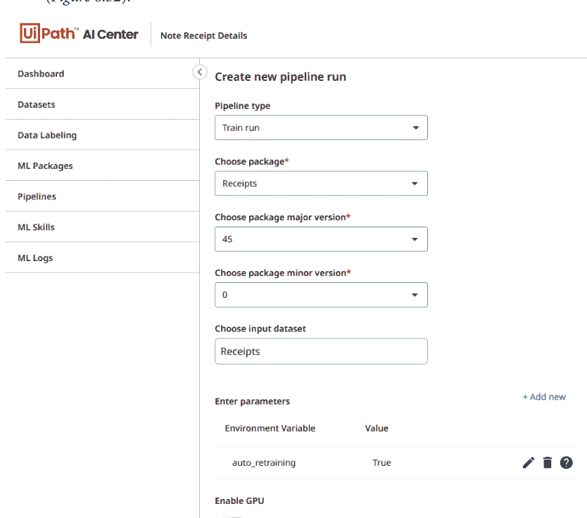

图8.32 – 创建训练管道

创建训练管道后，我们的最后一步是部署一个将在UiPath项目中使用的ML技能。

+   4. 导航到**ML技能**，并使用之前创建的**收据**ML包创建一个新的ML技能。

一旦ML抽取器部署完成，我们接下来必须将其连接到我们的UiPath项目。

+   5. 导航回**50_Extract.xaml**工作流。

+   6. 在**数据抽取范围**内，删除**收据ML抽取器**活动中的端点，并选择**ML技能**下拉菜单下的**收据**技能（*图8.33*）：

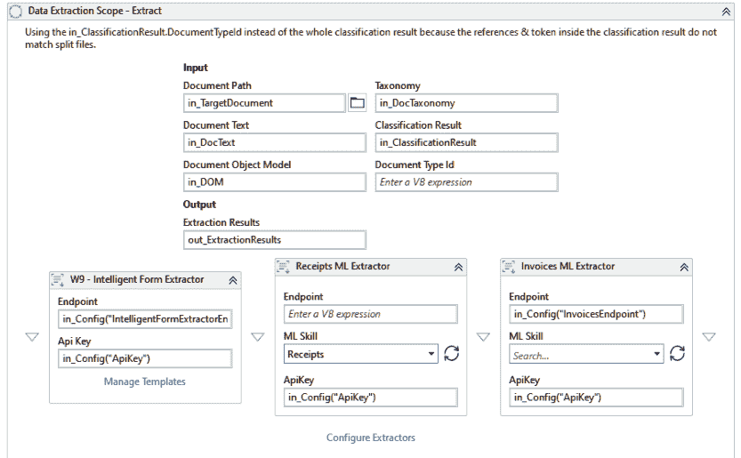

图8.33 – 用已部署的ML技能替换端点

在部署收据抽取器并将其连接到我们的UiPath项目后，抽取的最后一步是设置训练器。

+   7. 打开**60_TrainExtractors.xaml**工作流。

+   8. 在**训练分类器范围**内，在**收据抽取器训练器**活动中选择**票据收据详情**项目和**收据**数据集（*图8.34*）：

使用文档理解流程模板，导出工作流位于70_Export.xaml中。默认情况下，此工作流将为通过文档理解处理的每个文档输出一个单独的Excel工作表；但是，对于此用例，我们希望将所有结果导出到一个Excel工作表中。为此，我们需要对导出工作流进行一些修改。

第一个必要的修改是标准化导出的Excel工作表的文件名。默认情况下，文档理解流程模板将使用收据文件名和页码的组合，例如1000-receipt_1-1.xlsx。这在大多数用例中效果很好；但是，我们需要一个文件来存放所有收据的结果：

+   1. 在70_Export.xaml的**分配输出文件名**活动中，将值更改为Path.Combine(Environment.GetFolderPath(Environment.SpecialFolder.Desktop), "Note_Receipt_Details.xlsx")。

通过将输出文件名更改为Note_Receipt_Details，我们就有了一个可以导出收据数据的文件。将目录更改为桌面也会直接将文件保存到用户的桌面文件夹。

第二个必要的修改是向工作流添加**追加范围**活动。由于默认的文档理解流程模板为每个文档创建了一个Excel工作表，因此它只需要使用**写入范围**活动为每个文档写入一个新的Excel工作表。如果我们想将所有结果存储在一个Excel工作表中，使用**写入范围**活动会覆盖现有数据，因此可以使用**追加范围**将数据追加到现有Excel工作表的末尾。

+   2. 在**对于每个导出的表**中，添加一个IF语句，使用以下条件检查**outputFile**是否存在——File.Exists(outputPath)。

+   3. 将**写入范围**活动放置在**If**语句的**Else**块中。

+   4. 将一个**追加范围**活动拖到**If**语句的**Then**块中（图8.35），参数如下：

+   - **DataTable:** `table`
+   - **SheetName:** `table.TableName`
+   - **Workbook Path:** `outputPath`

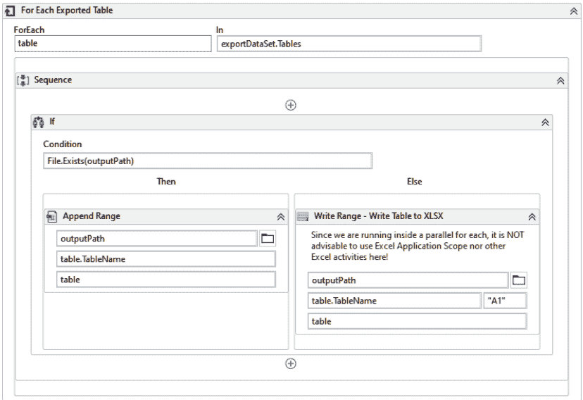

图8.35 – 修改后的“对于每个导出的表”活动

通过添加追加范围活动，自动化可以将最近读取的收据结果添加到现有的Excel工作簿中。如果工作簿不存在，自动化可以回退到使用写入范围活动来创建新的输出文件。

请注意，所有导出的数据都将保存在项目文件夹的Data\Exports中。可以通过打开项目Data文件夹中的Config.xlsx文件并修改ExportsFolder条目来更改此位置。

配置完导出器后，文档理解流程模板的配置就完成了。尝试使用位于此链接的收据运行工作流：https://github.com/PacktPublishing/Democratizing-Artificial-Intelligence-with-UiPath/tree/main/Chapter08/Receipt%20Data.

通过遵循文档理解框架的步骤并使用文档理解流程模板，我们能够快速创建一个智能工作流来识别收据。在本节中，我们利用文档理解流程模板并遵循文档理解框架步骤构建了用例。在下一节中，我们将开始使用示例数据测试刚刚创建的工作流。

## 测试以确保稳定性并提高准确性

用例的初始开发完成后，我们可以尝试测试自动化在ML分类器和ML抽取器中的表现。在部署之前测试任何自动化工作流对于确保自动化按预期工作至关重要。在本节中，我们将研究为ML分类器和ML抽取器启用验证站，并开始使用示例数据进行测试。

## 启用验证站

在先前的用例开发过程中，我们部署了DocumentUnderstanding分类器和Receipts ML技能，分别充当我们的分类器和抽取器。我们将这些技能部署到AI Center的原因之一是能够使用验证站重新训练这些技能。这使我们能够手动验证自动化性能并重新训练ML模型，我们称之为“关闭反馈循环”（图8.36）：

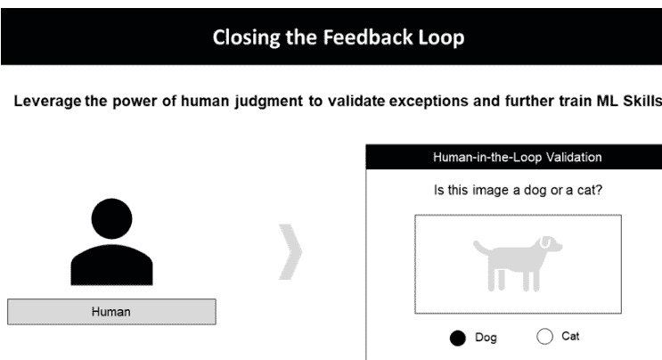

图8.36 – 关闭反馈循环

正如第7章“测试和完善开发工作”中所讨论的，使用验证站关闭反馈循环可以在提高ML模型性能方面发挥重要作用。

通过将DocumentUnderstanding分类器和Receipts抽取器部署到AI Center，并在AI Center内创建数据集以存储验证数据，我们可以轻松启用验证站，在我们的用例上关闭反馈循环。


在定义文档理解流程模板的设置时，我们在 UiPath Orchestrator 中配置了几个资产，具体如下：

- **AlwaysValidateClassification**：一个布尔值，告诉 UiPath 始终对分类进行人工验证。如果设置为 True，则将始终执行验证。
- **AlwaysValidateExtraction**：一个布尔值，告诉 UiPath 始终对提取进行人工验证。如果设置为 True，则将始终执行验证。

在配置文档理解流程模板设置期间，我们将这两个资产都设置为 True（图 8.37），这意味着我们告诉 UiPath 不希望跳过分类器或提取器训练；相反，我们希望 UiPath 启动验证站，并利用我们的人工输入来重新训练分类器和提取器：

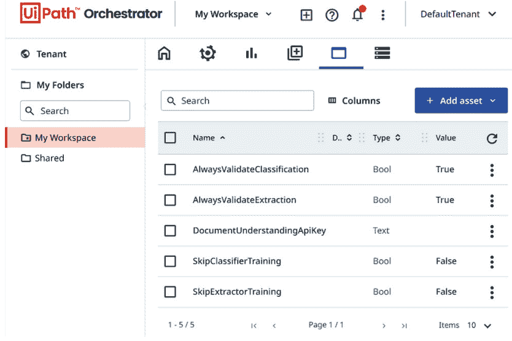

图 8.37 – 资产配置

出于测试目的，应启用验证站以帮助重新训练提取器和分类器，因此这两个资产都应设置为 True。测试完成后，您可能希望通过将资产设置为 False 来关闭验证，或者在工作流中添加额外的逻辑，仅在分类器或提取器返回较低置信度时才显示验证站。另一个建议是与业务部门合作，并就成功指标达成一致——例如，在禁用验证站之前测试 100 个场景，达到 90% 的正向率。

## 使用示例收据进行测试

启用验证站后，我们现在可以测试已部署的分类器和提取器的性能，并在必要时重新训练这两个技能。要开始测试，请导航到以下链接以获取示例收据：https://github.com/PacktPublishing/Democratizing-Artificial-Intelligence-with-UiPath/tree/main/Chapter08/Receipt%20Data。

在上述链接中，您会找到用于测试的收据，以及测试完成后使用的收据。我们将使用 Testing 文件夹中的收据进行测试。

在第 7 章“测试和完善开发工作”中，我们讨论了在训练认知自动化时，我们应该有多个数据集来测试我们的 ML 技能：

- **训练数据集**：用于训练 ML 模型的初始数据集
- **评估数据集**：用于评估 ML 模型训练效果的一组较小数据
- **测试数据集**：用于将训练好的 ML 模型暴露于真实数据中的无偏数据集

幸运的是，对于这个用例，我们使用的 ML 技能（**文档理解**分类器和**收据**提取器）已经预先训练好并可供使用。这意味着 UiPath 已经为我们完成了初始训练和评估，我们只需使用无偏数据测试数据集，并在必要时通过验证站进行重新训练。

在 Testing 文件夹中，您会找到 50 张用于测试的收据。您可以随意使用这 50 张收据的一个子集进行测试，也可以单独测试全部 50 张。测试时，请务必验证分类（图 8.38）和提取（图 8.39），以进一步加强部署到 AI Center 的 ML 技能。

与分类一样，您应手动验证提取返回的所有字段（图 8.39）：

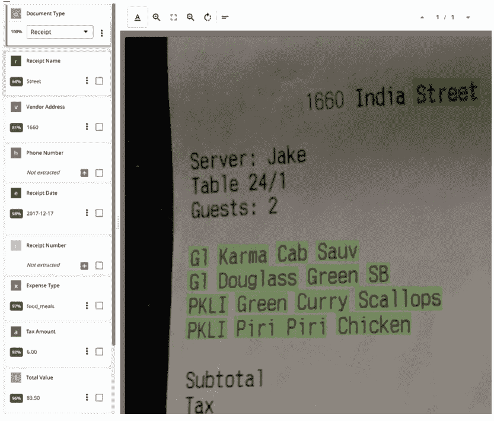

图 8.39 – 验证提取结果

验证后，您应注意到百分比变为 100%。在某些情况下，提取器可能无法正确提取正确的信息，例如图 8.39 中的收据名称。请注意，提取器只提取了 Street，而不是 1660 India Street。这是一张棘手的收据，因为收据名称看起来像供应商的地址。

要纠正此提取结果，请将鼠标悬停在文本上，然后按 *Ctrl + 左键单击*。这将在您要验证的文本周围放置一个红色虚线矩形（*图 8.40*）：

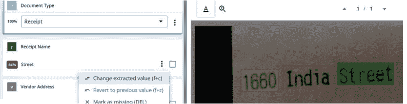

图 8.40 – 验证收据名称

然后，单击**收据名称**字段下的三个点，并单击**更改提取的值**，将**收据名称**的值更改为我们已验证的值（*图 8.41*）：

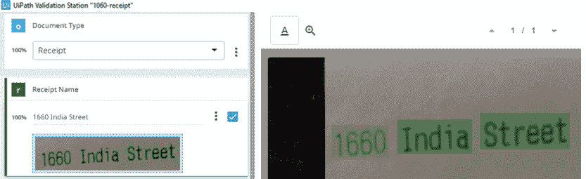

图 8.41 – 收据名称已验证

根据收据的结构及其图像，您可能需要更改某些提取的字段。对于其他收据，您可能不需要更改任何值。如果不需要更改任何值，您仍应通过选中复选框来验证提取的值，将置信度百分比更改为**100%**。对于缺失值和表格项目也是如此，因为所有验证都有助于重新训练和强化模型。

> **重要说明**
>
> 有关如何与验证站交互的更多信息，请访问 `https://docs.uipath.com/activities/docs/present-validation-station#using-the-validation-station`。

验证后，您可以单击**保存**继续，UiPath 将使用该验证来重新训练**文档理解**分类器。继续使用 Testing 文件夹中的其他收据测试自动化。当您继续测试和重新训练时，分类器和提取器的性能应会提升。

总之，在测试阶段，使用验证站验证分类和提取结果至关重要。任何人工验证都是让我们的 ML 技能变得更智能、更强大的机会。在本节中，我们学习了如何在*文档理解流程模板*中启用验证站，然后学习了如何与验证站交互。在下一节中，我们将通过添加功能来增强最终用户体验，从而为部署用例做好准备。

## 以最终用户体验为中心的部署

随着用例的初始开发和测试完成，我们可以着手将自动化部署到生产环境中。然而，在部署到生产环境之前，我们应该在自动化中添加一些项目，以改善最终用户体验。在本节中，我们将创建一个**调度器**，这是一个额外的工作流，用于调度我们的 `Main-Attended.xaml` 文件。创建调度器后，我们将添加几个对话框，让最终用户随时了解自动化的状态。完成后，我们将为最后一节——将自动化部署到生产环境做好准备。

### 创建调度器

您可能已经注意到，在上一节测试用例时，我们一次只能为一个收据运行自动化。由于*文档理解流程模板*配置为一次处理一个文档，我们需要创建一种机制来调度文档理解流程模板。调度器将要求用户输入一个文件夹路径作为输入，对于文件夹中的每个文件，调用我们创建的文档理解流程模板，以满足未来状态设计中设定的要求。

要创建调度器，我们必须首先创建一个新工作流：

1. 在**注明收据详细信息**项目中，创建一个名为 `Dispatcher` 的新工作流文件。
2. 创建后，将调度器文件设置为主文件（*图 8.42*）：

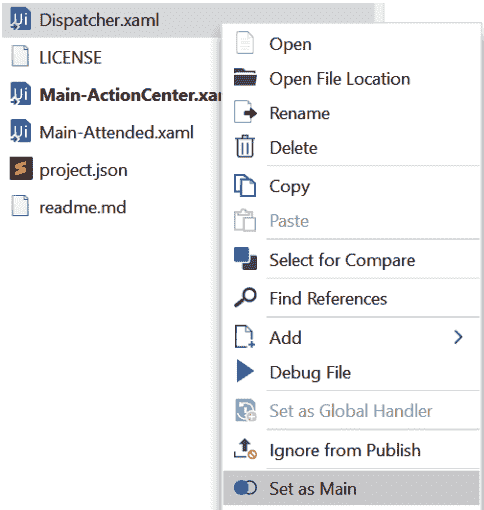

图 8.42 – 将 Dispatcher.xaml 设置为主文件

一旦调度器被创建并设置为项目的主文件，我们就可以开始向工作流添加代码。

3. 在 `Dispatcher.xaml` 中，将一个**浏览文件夹**活动拖到主序列中，将输出保存为名为 `selected_folder` 的变量。
4. 接下来，将一个**文件夹中的每个文件**活动拖到序列中，将**文件夹**输入属性设置为 `selected_folder`。
5. 在**文件夹中的每个文件**的**执行**序列中，拖入一个**调用工作流文件**活动，将**工作流文件名**输入属性设置为我们之前创建的文件 `Main-Attended.xaml`（*图 8.43*）。


6. 在 **Invoke Workflow File** 活动中，单击 **Import Arguments** 并将 `in_TargetFile` 参数设置为 `CurrentFile.FullName.` 这将确保 Main-Attended 工作流对文件夹内的每个文件运行：

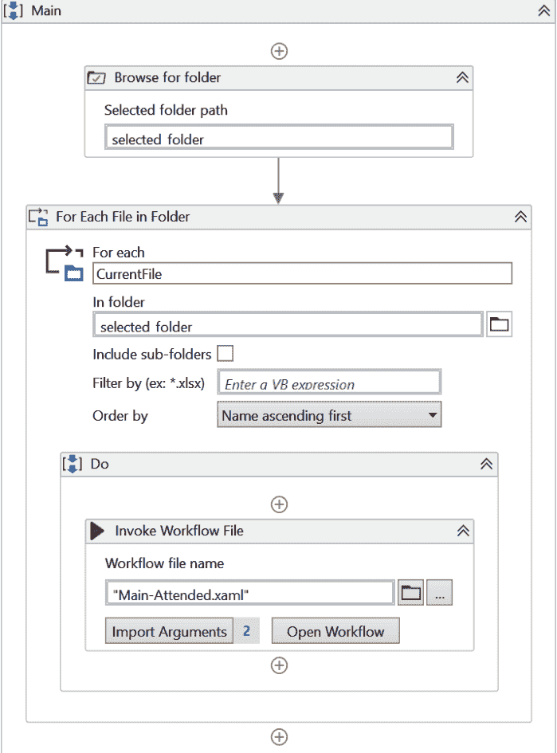

图 8.43 – 已完成的 Dispatcher.xaml 工作流

通过添加一个带有 For Each File in Folder 活动的工作流，我们可以持续调用使用 Document Understanding Process 模板创建的 Main-Attended.xaml 工作流。在本节中，我们创建了一个新的工作流 Dispatcher，并将文件设为主项目的核心文件。在 Dispatcher.xaml 中，我们添加了一个文件夹选择器活动，以提示最终用户输入文件夹路径。然后我们添加了一个 for-each 循环来遍历文件夹中的文件，为每张收据调用 Main-Attended.xaml。在下一节中，我们将在部署自动化到生产环境之前添加一些额外的提示来指导最终用户完成自动化执行。

## 添加用户输入提示

最佳实践的 attended 自动化始终应包含提示或消息框，以指导和/或告知用户自动化的进度。如第 5 章《Designing Automation with End User Considerations》中所述，让自动化易于使用是确保自动化采用的简单方法。在本节中，我们将着手添加消息框和信息对话框，以在自动化执行期间让最终用户保持了解。

在上一节创建调度器时，我们添加了一个文件夹选择器来提示人工用户选择收据文件夹以供自动化提取。新的用户可能会发现此文件夹选择器令人困惑，因为他们可能不知道该选择什么，因此我们应在文件夹选择器之前添加一个消息框，指导用户选择哪个文件夹：

- 1. 在 Dispatcher.xaml 中，在 Browse for folder 活动之前拖入一个 Message Box 活动（图 8.44）。
- 2. 在 Text 输入属性中添加一个描述性消息，例如 Please choose a receipts folder：

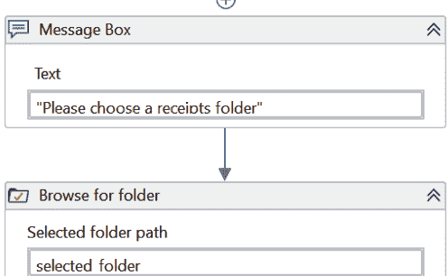

图 8.44 – 向 Dispatcher 添加消息框

通过在呈现文件夹选择器之前添加消息框，我们可以更准确地指导用户选择自动化要交互的正确文件夹。虽然添加消息框是让用户保持了解的一种方法，但另一种方法是呈现状态栏，让用户了解自动化的状态（图 8.45）：


图 8.45 – 呈现状态栏

UiPath 团队创建了一组自定义活动，专门用于通过状态栏、进度条和消息框让用户保持更新。使用 Interactive Activities 自定义活动，我们可以快速轻松地将这些消息添加到工作流中。

> Important Note
> 有关 Interactive Activities 的更多信息，请访问 https://marketplace.uipath.com/listings/notification-activities。

要在项目中安装 Interactive Activities，请按照以下步骤操作：

- 1. 在 Note Receipt Details 项目的 Design 功能区中单击 Manage Packages。
- 2. 在 Manage Packages 窗口中，单击 Marketplace 并搜索 UiPathTeam.Interactive.Activities（图 8.46）：

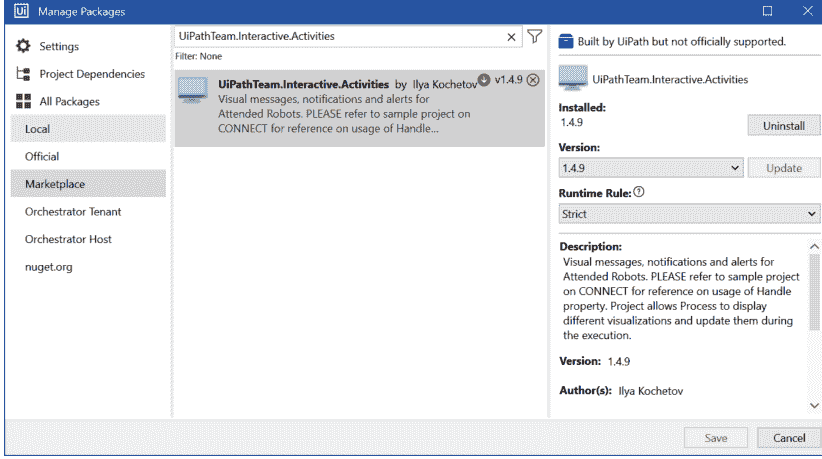

图 8.46 – 安装 Interactive Activities

- 3. 要安装，请选择最新版本并单击 **Save**。

安装 Interactive Activities 后，即可将其添加到项目中。

为了最好地显示用户的进度，我们应在开始和完成收据时呈现状态栏，以及在 Document Understanding 框架的里程碑过程中呈现状态栏（数字化、分类、提取和导出）。让我们先在调度器中添加一个开始消息。

- 4. 在 **For Each File in Folder** 活动的 **Do** 序列内拖入一个 **Display Message** 活动。
- 5. 在 **Display Message** 活动中，在 **Message** 输入属性中添加一个描述性消息，并在 **Handle** 输出属性中创建 `windowIdentifier` 变量。

如果您想多次替换状态栏消息，**Handle** 输出属性非常重要。句柄充当状态栏窗口的唯一标识符，如果在更新状态栏时未设置该属性，将导致多个状态栏彼此堆叠（*Figure 8.47*）：


图 8.47 – 状态栏彼此堆叠

- 6. 在 `Variables` 窗格中，将 `windowIdentifier` 的作用域设置为 main sequence 而不是 **Do**（*Figure 8.48*）。这可确保在 for 循环的每次迭代中唯一标识符不会被重置：

| Name | Variable type | Scope |
|---|---|---|
| selected_folder | String | Main |
| windowIdentifier | Int32 | Main |
| Create Variable | | Do |
| | | Main |
| | | Main |

图 8.48 – 设置 windowIdentifier 的作用域

添加 **Display Message** 活动后，您的调度器工作流应如下图所示 *Figure 8.49*：

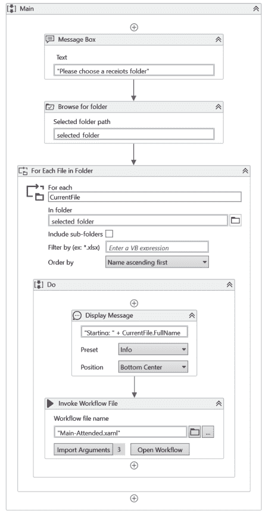

图 8.49 – 带有显示消息的调度器工作流

可以在 Document Understanding Process 模板内部添加额外的状态消息，以调用数字化、分类、提取和导出。您可以将 **Display Message** 活动添加到每个单独的工作流中；只需确保传递在调度器工作流中设置的 `windowIdentifier` 以防止状态彼此堆叠。

通过添加消息框和状态消息，我们使自动化对最终用户更友好一些，通过指导他们选择哪个文件夹并让他们了解自动化的状态。现在这些活动已添加到工作流中，我们可以认为自动化已完成，并进入下一节部署自动化到生产环境。

## 部署到生产环境

在生产环境中，我们不应直接从 UiPath Studio 运行自动化，也不应期望最终用户能够访问 UiPath Studio。因此，我们必须将自动化部署到 UiPath Orchestrator，以便其他人可以从他们的 UiPath Assistant 运行我们的自动化。

UiPath Assistant 是一款桌面工具，用于启动和与 UiPath 自动化交互，是一种启动板（图 8.50）：

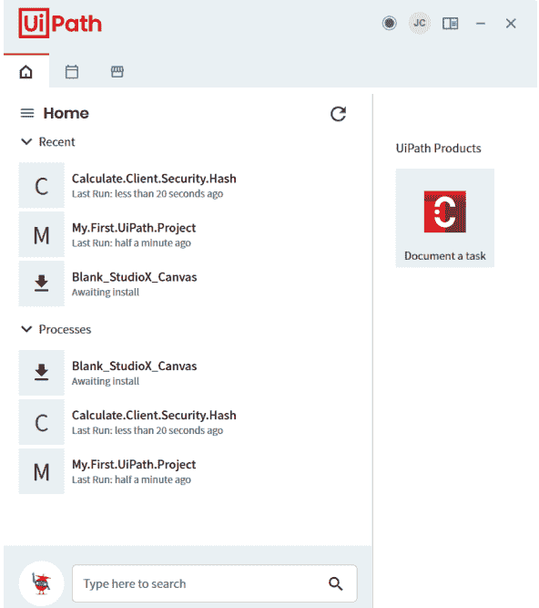

当自动化部署用于大规模使用时，它会部署到 UiPath Orchestrator，然后它会出现在最终用户的助手上供他们运行。

> **Important Note**
> 有关部署自动化的更多信息，请访问 https://docs.uipath.com/studio/docs/about-publishing-automation-projects。

对于此用例，我们将快速将自动化发布到我们自己的 UiPath Assistant 中的个人工作区：

- 1. 在 **Note Receipt Details** 项目中，单击 UiPath Studio 的 **Design** 功能区中的 **Publish** 按钮。
- 2. 检查 **Publish to** 字段是否设置为 **Orchestrator Personal Workspace Feed**（*Figure 8.51*）：

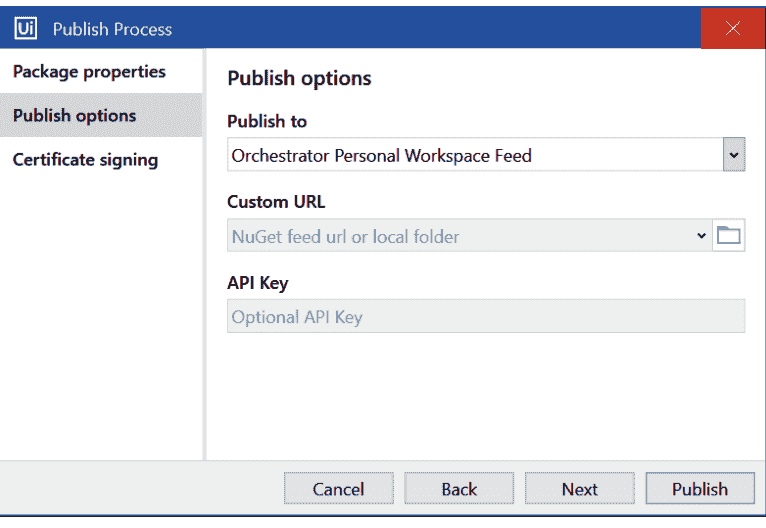

图 8.51 – 发布自动化

- 3. 单击 **Publish**。

发布后，您应该能在您的 UiPath Assistant 中看到自动化（图 8.52）：

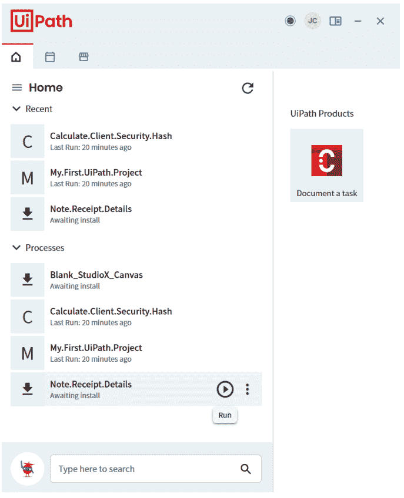

图 8.52 – 项目部署到 UiPath Assistant

单击 Note.Receipt.Details 右侧的 Run 按钮将把自动化安装到您的机器上并开始执行。

部署后，您可以自由地直接从 UiPath Assistant 运行自动化。对代码的任何更改都可以在 UiPath Studio 中进行，然后按照刚才讨论的步骤重新发布。在本节中，我们通过将 Note Receipt Details 项目部署到我们的 UiPath Assistant 来完成了用例构建——干得好！


## 摘要

在本章中，我们介绍了如何使用 *UiPath Document Understanding* 构建认知自动化用例。在构建该用例的过程中，我们利用 *UiPath Document Understanding 流程模板*，遵循 *UiPath Document Understanding 框架*的最佳实践进行构建。通过全面理解 Document Understanding 和 Document Understanding 框架，我们构建了一个认知用例，该用例可以解读收据，供 T&E 团队在费用报告审核流程中使用。

在下一章中，我们将继续采用实践操作的方式，一起构建基于 UiPath 的三个用例中的第二个。我们将学习如何使用 UiPath 的 AI Center 对电子邮件进行分类。

### 用例 2 – 使用 AI Center 进行电子邮件分类

**机器学习（ML）**的一个经典用途是文本分类。每个组织，无论属于哪个行业，都有对文本进行分类的用例。文本分类用例的示例包括将电子邮件路由到相应的文件夹，或将服务请求路由到相关团队。这类工作中有很多仍然是手动的，需要个人查看文本，并运用其判断力来解释和分类文本内容。幸运的是，借助 UiPath 的 AI Center，我们可以创建认知自动化，对文本进行智能理解，从而有可能减少人工操作的需求。

在全面理解 AI Center 的基础上，我们将一起构建能够解释和分类文本的认知自动化。在构建用例时，我们将遵循前几章中概述的类似开发生命周期。我们将从了解当前自动化机会的状态开始，然后设计包含自动化的流程未来状态。一旦设计了未来状态，我们将使用 UiPath Studio 和 AI Center 构建自动化，测试解决方案以确保稳定性，最后将自动化部署到生产环境中。

在本章 *用例 2 – 使用 AI Center 进行电子邮件分类* 中，我们将在构建处理收据的自动化时涵盖以下主题：

- 了解当前状态
- 创建未来状态设计
- 使用 AI Center 构建解决方案
- 测试以确保稳定性并提高准确性
- 考虑最终用户体验进行部署

### 技术要求

本章的所有代码示例都可以在 GitHub 上找到，链接如下：

```
https://github.com/PacktPublishing/Democratizing-Artificial-Intelligence-with-UiPath/tree/main/Chapter09
```

使用 UiPath 非常简单，使用社区版，我们可以免费开始。但是，对于 UiPath AI Center，我们需要企业版许可证。您可以从 uipath.com 获取 60 天的企业试用许可证。

有了 60 天的企业试用版，您将可以使用以下内容：

- 五个 RPA Developer Pro 许可证——指定用户许可证包括 Studio、StudioX、Attended Robot、Apps、Action Center、Task Capture 的访问权限
- 五个 Unattended Robots、五个 Testing Robots、五个 AI Robots
- AI Center、AI Computer Vision、Automation Hub、Data Service、Document Understanding 和 Insights

对于本章，您将需要以下内容：

- UiPath Enterprise Cloud（包含 AI Center）
- UiPath Studio 2021.4+
- `UiPath.MLServices.Activities` 包 v1.2.0 或更高版本
- `UiPath.WebAPI.Activities` 包 v1.9.2 或更高版本

**重要说明**
有关如何安装 UiPath 包的说明，可以在以下链接找到：
https://docs.uipath.com/studio/docs/managing-activities-packages

请观看以下视频，查看 Code In Action：https://bit.ly/3udG6qL

### 在 UiPath 企业试用版中启用 AI Center

UiPath Document Understanding 在 UiPath 社区版和企业版中开箱即用；但是，对于 UiPath AI Center，我们需要在企业试用版中启用该服务。您可以按照以下步骤启用该服务：

1. 导航到 Automation Cloud，网址为 https://cloud.uipath.com。Automation Cloud 主页如下所示：

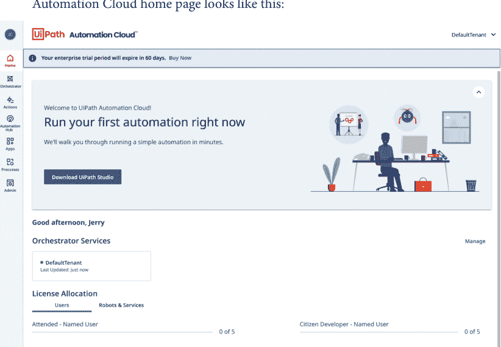

图 9.1 – UiPath Automation Cloud 主页

2. 导航到 Admin，如下面的屏幕截图所示：

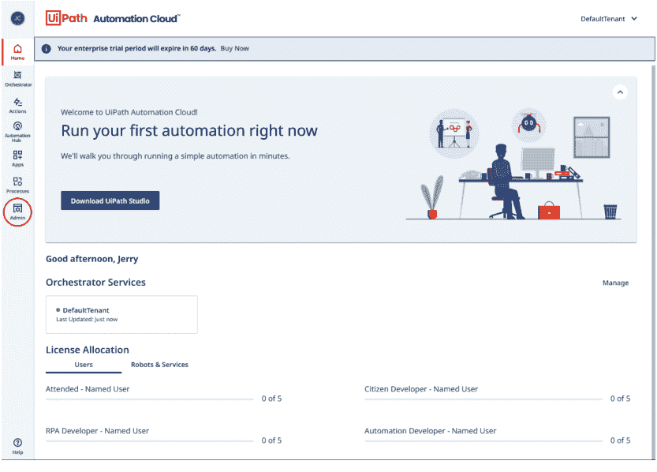

图 9.2 – 单击 Admin

3. 在 **DefaultTenant** 中，单击 **Tenant Settings**，如下面的屏幕截图所示：

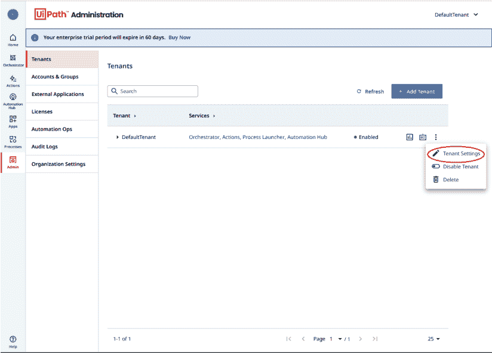

图 9.3 – 单击 Tenant Settings

4. 在 **Provision Services** 下选择 **AI Center**，然后单击 **Save**。该过程如下图所示：

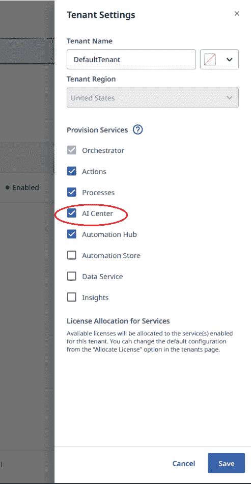

图 9.4 – 勾选 AI Center，然后单击 Save

一旦启用了 AI Center，我们就完成了本章的技术要求。在下一节中，我们将通过查看当前状态开始收集有关该用例的背景信息。

### 了解当前状态

让我们通过了解该流程的当前状态来开始这个用例。每天，*Company ABC* 的会计团队都会收到供应商提交的发票，作为其 **采购到付款（P2P）**流程的一部分，如下面的屏幕截图所示：

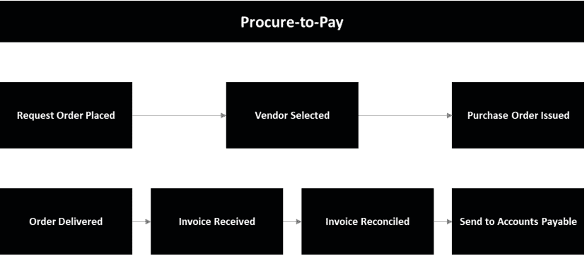

图 9.5 – Company ABC 的 P2P 流程

根据 *Company ABC* 的规定，供应商必须将发票发送到会计团队维护的中央收件箱。会计团队收到这些发票后，会对其正确性进行审核，并将其输入到记录系统中，在系统中进行核对，如果一切正确，则将其转发给**应付账款（AP）**部门进行付款。

*Company ABC* 今年表现非常好，因此采购的商品和服务比往年更多。采购量的激增给会计团队带来了压力，因为他们需要努力维持高效的 P2P 流程。造成这种压力的部分原因是共享发票收件箱中收到的垃圾邮件增多。团队希望能够有效过滤掉垃圾邮件，以便专注于处理发票。

从当前状态来看，这里似乎有大量的自动化机会——回顾 *第 4 章，识别认知机会* 中自动化机会的特征，我们可以看到这个自动化机会具有以下特征：

- **与应用程序的手动交互**：会计分析师手动操作共享电子邮件收件箱。
- **重复性**：对于收件箱中收到的每封电子邮件，都执行相同的步骤。
- **耗时**：审核垃圾邮件和清理收件箱可能非常耗时。

从可行性的角度来看，我们可以轻松创建自动化来监控收件箱中收到的电子邮件，并区分垃圾邮件和非垃圾邮件。此外，从可行性的角度来看，为这些分析师自动化此流程的部分内容可以带来以下好处：

- **提高产能**：实施自动化可以让分析师将更多时间花在高价值任务上，而不是清理电子邮件收件箱。
- **减少错误**：实施自动化可以创建一个更干净的收件箱，确保会计团队不会遗漏任何发票电子邮件。

该流程中的自动化可以为会计团队带来巨大的影响。创建自动化来过滤电子邮件收件箱中的垃圾邮件是我们可以为会计团队构建的众多潜在用例之一。在下一节中，我们将重点为实施自动化处理收据创建未来状态设计。

### 创建未来状态设计

基于我们对当前状态和会计团队痛点的新的理解，我们可以开始为自动化创建未来状态设计。由于此自动化不需要人工交互，因此为此用例创建未来状态设计通常很简单，如下面的屏幕截图所示：


## 未来状态设计

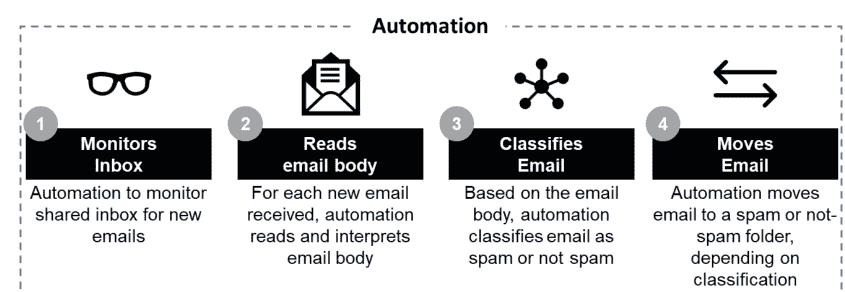

图 9.6 – 高级未来状态设计

对于这个用例，自动化的职责是监控会计团队的共享收件箱。自动化可以在后台运行，适用于有人值守或无人值守场景，扫描共享收件箱中的新邮件。一旦收到邮件，自动化将检索邮件、读取其内容，并根据邮件正文内容将邮件分类为垃圾邮件或非垃圾邮件。最后，根据分类结果，自动化将邮件路由到相应的文件夹，以便会计分析师可以审查它。自动化将路由到的文件夹列表如下：

- 发票
- 低置信度
- 垃圾邮件
- 重新训练-非垃圾邮件
- 重新训练-垃圾邮件

设置“低置信度”邮件文件夹的原因，是为了为自动化分类信心不足的邮件提供一个落脚点。我们不希望出现发票被错误地放入垃圾邮件文件夹的情况，因此任何自动化处理起来有困难的邮件都将被路由到“低置信度”文件夹。我们还将为用例添加重新训练组件，可以将错误分类的邮件移动到其中一个“重新训练”文件夹中，以重新训练我们的 ML 技能。

总之，作为本用例的未来状态设计，我们要构建的项目可以利用于有人值守或无人值守类型场景。自动化将监控电子邮件收件箱，并根据其正文内容路由传入的邮件。根据自动化的分类结果，传入的邮件将被路由到三个文件夹中的一个。最终用户随后可以更快速地审查发票，无需通过此自动化持续清理共享收件箱。

## 使用 AI Center 构建解决方案

当我们着手构建用例时，可以将开发拆分为以下两个部分：

1. 创建 ML 技能
2. 构建自动化工作流

我们将首先把我们的 ML 技能部署到 AI Center，然后在 UiPath Studio 中创建自动化工作流。让我们从创建 ML 技能开始。

### 创建 ML 技能

在本节中，我们将使用 AI Center 为我们的用例创建和训练一个 ML 技能。通过部署 ML 包，并加载数据集来训练和评估我们的 ML 模型，我们将构建一个准备好与自动化工作流配合测试的 ML 技能。

### 创建 AI Center 项目

在部署 ML 包或创建 ML 技能之前，我们必须在 AI Center 中创建一个项目。为此，请按照以下步骤操作：

1. 导航到 UiPath Automation Cloud 并点击 AI Center 开始，如下图中高亮所示：

尽管**短信服务 (SMS)** 文本与电子邮件文本略有不同，但它仍然可以验证过滤垃圾邮件与非垃圾邮件的用例。对于这个项目，我们采用了*短信垃圾邮件数据集*，并将数据划分为*训练、评估、测试*和*生产*数据集，可以在以下 GitHub 链接中找到：
https://github.com/PacktPublishing/Democratizing-Artificial-Intelligence-with-UiPath/tree/main/Chapter09/Email%20Data.

> **重要提示**
> 数据集已被划分为小型和大型数据集。大型数据集是全量数据集，而小型数据集只是大型数据集的一个子集。您可以自由选择使用哪一个，但请注意，使用大型数据集训练所需时间远长于使用小型数据集。

在将数据上传到 AI Center 之前，让我们快速查看一下训练数据集：

| 文本 | 标签 |
|---|---|
| Go until jurong point, crazy.. Available o | ham |
| Ok lar... Joking wif u oni... | ham |
| Free entry in 2 a wkly comp to win FA Cu | spam |
| U dun say so early hor... U c already the | ham |
| Nah I don't think he goes to usf, he lives | ham |
| FreeMsg Hey there darling it's been 3 we | spam |
| Even my brother is not like to speak wit | ham |
| As per your request 'Melle Melle (Oru M | ham |
| WINNER!! As a valued network custome | spam |

图 9.8 – 训练数据集

在数据集中，我们有两列，**文本**和**标签**，包含以下信息：

- `text` 是短信信息的纯文本。
- `label` 是垃圾邮件或普通邮件的分类。

现在我们对数据集有了一点了解，让我们按照下一步将训练数据集添加到 AI Center：

1. 在项目仪表盘中，点击**数据集**导航到**数据集**页面。
2. 点击**创建新项**以创建新数据集，为我们的数据集提供名称 `Email Classification`。
3. 数据集创建后，点击**上传**，将以下 GitHub 链接中的训练和评估文件夹上传到 AI Center：`https://github.com/PacktPublishing/Democratizing-Artificial-Intelligence-with-UiPath/tree/main/Chapter09/Email%20Data`。

上传完成后，Email Classification 数据集应该看起来像这样：


图 9.9 – Email Classification 数据集

将数据集加载到 AI Center 后，我们现在可以继续部署 ML 包并运行我们的流水线。

### 创建 ML 包

如*第 6 章，了解您的工具*中所述，AI Center 中的 ML 包是一个文件夹，包含服务 ML 模型所需的所有代码和关联文件。

由于我们要执行文本分类练习，我们将使用 UiPath 即开即用的 EnglishTextClassification ML 包。以下是您需要遵循的步骤：

1. 通过点击项目仪表板中的 **ML Packages** 标签导航到 **ML Packages**。
2. 当显示**创建新包**时，点击**即开即用包**。
3. 在**即开即用包**下方，选择 **Language Analysis > EnglishTextClassification**，并选择 **Package Version 6.0**。

在为 ML 包提供名称后，您应该能在项目仪表板中看到您的新 ML 包。创建我们的包后，让我们探讨创建一个可以训练我们新部署的 ML 包的流水线。

### 创建流水线

ML 流水线是一系列步骤，用于生成 ML 模型。在流水线过程中，我们将提供输入，一旦完成，流水线将产生一组可用的输出和日志，从而导致 ML 技能的创建。

在 AI Center 中，有三种类型的流水线，如下所示：

- **训练流水线**：从输入 ML 包和数据集中生成新训练的 **ML Package** 版本
- **评估流水线**：从新训练的 **ML Package** 版本和数据集中生成一组指标和日志
- **完整流水线**：完整的数据处理流水线，执行训练和评估流水线

对于这个用例，让我们使用我们新部署的训练和评估数据集来运行训练和评估流水线。请按以下步骤操作：

1. 通过点击项目仪表板中的 **Pipelines** 标签导航到 **Pipelines**。
2. 点击**创建新项**以创建新流水线，选择以下内容：

    - **流水线类型**：`Train run`
    - **选择包**：`TextClassification`
    - **选择包主版本**：`6`
    - **选择包次版本**：`0`
    - **选择输入数据集**：`Email Classification/train/`
    - **启用 GPU**：关闭此选项

    在**环境变量**下，添加以下环境变量：

    - `input_column`：`text`
    - `target_column`：`label`


图 9.10 – 创建训练流水线

3. 点击**创建**以启动训练流水线。

> **重要提示**
> 数据集的大小将影响流水线的持续时间。选择**启用 GPU**可以导致更快的输出，但 UiPath 社区版没有**图形处理单元 (GPUs)**。

4. 再次执行*步骤 2、3 和 4*，选择 `Evaluation run` 作为流水线类型，`TextClassification` 包的版本 6.1，以及 `evaluation` 数据集文件夹作为输入数据集。您的屏幕现在应该看起来像这样：


图 9.11 – 创建评估流水线


完成后，评估流水线将输出几个产物，如下所示：

- `Evaluation.csv`：用于评估模型的数据
- `Evaluation-report.pdf`：流水线运行的输出报告

如果查看评估报告，你会发现即使数据量相对较少，也能获得相当不错的性能。

在评估报告中要关注的**关键绩效指标（KPI）**是：对于二分类问题，F值应高于80%；对于多分类问题，F值应高于70%。在本例中，我们刚好达到了80%；不过，如果我们想提高这个数字，可以扩大数据集，或者通过重训练机制来闭合反馈回路，我们稍后会构建这一机制。

就这样！在下一节中，我们将部署ML技能。

## 部署ML技能

一旦部署到AI Center，ML技能便可供自动化使用。在UiPath Studio中选择**ML技能**活动，你可以从AI Fabric上已部署的ML技能列表中进行选择，按需传入输入数据并利用输出数据。

模型经过训练和评估后，我们现在可以将其部署为可与**机器人流程自动化（RPA）**一起使用的技能。操作步骤如下：

1. 在项目仪表板中，点击**ML技能**选项卡，导航至**ML技能**。
2. 点击**创建新**来创建新的ML技能，并选择以下选项：
   - **名称：** `Email_Spam_Classification`
   - **选择包：** `TextClassification`
   - **选择包主版本：** 6
   - **选择包次版本：** 1
   - **启用自动更新：** 打开此选项

你的屏幕现在应如下所示：

**创建新ML技能**

| 字段 | 值 |
|-------|-------|
| 名称* | Email_Spam_Classification |
| 选择包* | TextClassification |
| 选择包主版本* | 6 |
| 选择包次版本* | 1 |
| 技能描述 | 输入技能描述 |
| 启用GPU |  |
| 启用自动更新 |  |
| 非活动时间过后取消部署技能： | 1周 |

图9.12 – 创建ML技能

3. 点击**创建**来创建ML技能。

ML技能部署到AI Center后，我们就可以继续通过构建自动化工作流将其与自动化连接起来。回顾一下，在本节中，我们在AI Center中创建了一个项目，加载了数据集，创建了ML包，创建了训练和评估流水线，最后还部署了一个ML技能。

## 构建自动化工作流

ML技能部署完成后，我们可以将重点转向为该用例创建自动化工作流。在实现这个用例时，我们将通过以下几个步骤来构建项目：

1. 创建项目
2. 构建ML工作流
3. 构建补充工作流
4. 构建**Main**工作流

完成这些步骤后，我们的项目基础就完成了，可以进入测试阶段。

### 创建项目

对于这个项目，我们将在Studio中使用**事务处理**模板（图9.13）创建一个流程图工作流。要使用**事务处理**模板启动项目，请完成以下步骤：

1. 导航到UiPath Studio的**模板**选项卡。
2. 选择**事务处理**。
3. 将项目命名为`Email Classification`，并提供保存项目的文件夹位置。
4. 点击**创建**来创建项目并开始使用。

**事务处理**模板如下面的截图所示：


图9.13 – 事务处理模板

当你打开新建项目的`Main.xaml`文件时，你会看到**事务处理**模板，这是一个为基本自动化项目设计的流程图。在**Main**流程图中，你会注意到几个预置的容器，如下所述：

- **数据输入：** 这里的目的是检索运行项目所需的数据。在我们的用例中，将使用此序列来检索邮件。
- **是否有输入？** 这里的目的是检查是否存在输入数据。在本用例中，我们将使用此流程决策来检查是否检索到新邮件。
- **事务处理：** 这里的目的是对每个事务执行一组操作。在本用例中，我们将使用此流程图来读取和分类邮件。
- **结束流程：** 这里的目的是执行收尾活动。在本用例中，我们最初将其留空，但后续可能会用其进行测试。

项目创建完成后，在UiPath Studio中点击**管理包**，并将以下依赖项添加到项目中：

- `UiPath.MLServices.Activities`
- `UiPath.WebAPI.Activities`

创建项目到此结束。我们将在后面的章节中回到**Main**工作流，并在那里构建**Main**工作流，但目前我们先来构建ML和补充工作流。

### 构建ML工作流

自动化项目创建完成后，我们可以专注于创建一些补充工作流，这些工作流将成为**Main**工作流的构建模块。在ML工作流中，我们的目标是创建一个模块化的工作流序列，该序列以邮件正文为输入，将其传递给我们新部署的ML技能，并返回该技能的分类结果和置信度。

首先，按如下步骤创建新工作流：

1. 在`Email Classification`项目中，创建一个名为`Classify_Email`的新工作流文件。
2. 新工作流创建完成后，创建三个参数，如下面的截图所示：


图9.14 – Classify_Email 参数

每个参数的用途如下：

- `in_EmailText`：用于输入邮件正文文本
- `out_Classification`：用于输出“垃圾邮件”（Spam）或“正常邮件”（Ham）的分类文本
- `out_Confidence`：用于以double类型输出分类置信度百分比

参数添加到工作流后，我们就可以开始向空白画布添加活动。

3. 添加一个**日志消息**活动，将`in_EmailText`作为消息，`Info`作为日志级别。这样，当我们运行自动化时，它可以将邮件正文文本记录到控制台，这在进行后续调试时可能很有帮助。
4. 在**日志消息**活动之后，添加一个**ML技能**活动，参数如下：
   - **连接模式：** 机器人（Robot）
   - **ML技能：** `Email_Spam_Classification`
   - **项：** `in_EmailText`
   - **JSON响应：** `json_response`

在**ML技能**活动中，`json_response`应该是一个新建的`String`类型变量。该变量负责保存`Email_Spam_Classification` ML技能的**JavaScript对象表示法（JSON）**响应。

由于`json_response`是键值对字符串，因此在查询JSON之前，我们需要通过反序列化将其转换为对象。

5. 将一个**反序列化JSON响应**活动拖入工作流，参数如下：
   - **JSON字符串：** `json_response`
   - **类型参数：** `System.Collections.Generic.Dictionary<System.String, System.Object>`
   - **JSON对象：** `json_object`

与`json_response`类似，`json_object`应该是一个新建的`System.Collections.Generic.Dictionary<System.String, System.Object>`类型变量。这样，我们现在就可以用一组键来查询JSON响应。

`Email_Spam_Classification`的JSON响应将返回一个预测结果和一个置信度，我们需要将它们分别赋给`out_Classification`和`out_Confidence`。

6. 将一个**赋值**活动拖入工作流，参数如下：
   - **目标：** `out_Classification`
   - **值：** `json_object("prediction").ToString`
7. 再将另一个**赋值**活动拖入工作流，参数如下：
   - **目标：** `out_Confidence`
   - **值：** `Convert.ToDouble(json_object("confidence"))`

将最后一个**赋值**活动拖入工作流后，`Classify_Email`活动就基本完成了。为了便于将来调试，我们再添加一个**日志消息**活动，用于记录来自ML技能的分类结果和置信度。

8. 添加一个**日志消息**活动，在消息中包含`out_Classification`和`out_Confidence`，日志级别设为`Info`。


在添加了最终的日志消息后，Classify_Email 工作流已完成。它应如下所示：


图 9.15 – Classify_Email 工作流

如果您想测试工作流，请将 in_EmailText 的默认值设置为一组随机文本，如以下屏幕截图所示，然后尝试运行工作流：

| 名称 | 方向 | 参数类型 | 默认值 |
|---|---|---|---|
| in_EmailText | In | String | "hello, world!" |
| out_Classification | Out | String | 默认值不支持 |
| out_Confidence | Out | Double | 默认值不支持 |
| Create Argument |  |  |  |

图 9.16 – 设置默认值

在运行工作流时，请注意 UiPath Studio 的 Output 面板以及我们添加的日志消息。它应如下所示：


图 9.17 – hello, world! 测试的输出

至此，我们的 ML 工作流开发已完成。在本节中，我们创建了一个工作流，它接受一个 String 类型的邮件正文作为输入，将该输入通过我们的 ML 技能传递，反序列化 JSON 响应，并输出技能的置信度和分类。在下一节中，我们将在 Main 工作流中将所有内容整合在一起之前，先处理项目所需的其他补充工作流。

# 构建补充工作流

在将整个项目整合到 Main 工作流中之前，我们可以再构建一个补充工作流。该工作流的目的是接受一封邮件消息和邮件文件夹作为输入，并将该邮件消息移动到指定的邮件文件夹中。

创建此工作流单独存在、而不是在 **Main** 工作流中复制粘贴的原因是，复制粘贴的代码最好放在自己的工作流中，而不是多次粘贴到另一个工作流中。通过拥有一个用于移动邮件的单独工作流，我们可以在 **Main** 工作流中根据需要随时调用此补充工作流，将邮件移动到不同的文件夹中。

开始时，按如下方式创建一个新的工作流：

+   1. 在 `Email Classification` 项目中，创建一个名为 `Move_Email` 的新工作流文件。
+   
+   2. 新工作流创建后，如以下屏幕截图所示创建两个参数：

| 名称 | 方向 | 参数类型 | 默认值 |
|---|---|---|---|
| `in_MailMessage` | In | MailMessage | *Enter a VB expression* |
| `in_Folder` | In | String | *Enter a VB expression* |


*图 9.18 – Move_Email 参数*

每个参数的用途如下：

+   - `in_MailMessage`：输入我们当前邮件的邮件消息
+   - `in_Folder`：输入我们目标文件夹的文件夹位置

将参数添加到工作流后，我们可以开始向空白画布添加活动。

+   3. 添加一个 **Log Message** 活动，将 `in_Folder` 作为消息，`Info` 作为日志级别。这将允许自动化在运行自动化时将目标文件夹记录到控制台——如果以后需要调试任何内容，这可能很有帮助。
+   
+   4. 将 **Move Mail Message** 活动拖入工作流，并设置以下参数：

+   - **MailFolder**：`in_Folder`
+   - **MailMessage**：`in_MailMessage`

## 构建 Main 工作流

每个自动化项目都始于 **Main** 工作流。**Main** 工作流的目的是启动项目，并在过程中调用其他工作流。

根据我们的未来状态设计，用例的第一步是从收件箱检索邮件——我们可以通过在 Outlook 中添加一个名为 `Email Classification` 的文件夹并让自动化从该文件夹获取邮件来重现此步骤。按如下方式操作：

+   1. 打开 **Data Input** 序列。
+   2. 在 **Assign** 之后，将 **Get Outlook Mail Messages** 活动拖入工作流，设置以下属性：
+      - **MailFolder**：`Inbox/Email Classification`
+      - **MarkAsRead**
+      - **OnlyUnreadMessages**
+      - **Top**：`1`
+      - **Output**：`list_emails`
+   3. 将 **If** 语句拖入工作流，将条件设置为 `List_emails.count > 0`。
+   4. 在 **If** 语句的 **Then** 序列中，将 **Assign** 活动拖入工作流。
+   5. 在 **Assign** 活动中，将 **NewTransaction** 设置为 `True`。

在 **If** 语句内添加 **Assign** 活动后，我们的 **Data Input** 序列应如下所示：

# 图 9.20 – Data Input 序列

回顾 Data Input 序列，自动化将获取 Outlook 邮件消息，并将其结果输出到 list_emails 变量。如果 list_emails.count 大于 0，则表示 Email Classification 文件夹中有邮件，自动化可以将 NewTransaction 设置为 True。

您可以在以下屏幕截图中看到流程决策：


图 9.21 – Have input? 流程决策

通过将 **NewTransaction** 设置为 True，**Main** 工作流中的 **Have input?** 流程决策将返回 `True`，从而引导自动化进入 **Transaction Processing** 流程图。

在 **Main** 工作流中，让我们用一个名为 **Classify Email** 的序列替换 **Transaction Processing** 流程图。您的屏幕现在应如下所示：


图 9.22 – Main 工作流

将 **Transaction Processing** 部分从流程图更改为序列的原因是，邮件的分类非常顺序化，业务变化很少。

让我们按如下方式构建该序列：

+   1. 双击 **Classify Email** 以打开序列。

+   2. 将 **Invoke Workflow File** 活动拖入工作流，并设置以下参数：

+   - **Workflow file name:** `Classify_Email.xaml`

**Invoke Workflow File** 活动的目的是调用我们之前创建的 ML 工作流。在该活动中，我们需要将主文件中的参数导入到 `Classify_Email` 工作流。

+   3. 点击 **Import Arguments**，如以下屏幕截图所示：


图 9.23 – 导入参数前的 Invoke Workflow File

点击 **Import Arguments** 后，将弹出一个窗口，展示我们添加到 `Classify_Email` 的参数。

+   4. 设置以下参数：

+   - `in_EmailText:list_emails(0).Body`

+   - `out_Classification:email_classification`

+   - `out_Confidence:email_confidence`

前面参数显示在以下屏幕截图中：


图 9.24 – 已添加的参数

由于 list_emails 是来自 Get Outlook Mail Messages 活动的邮件消息列表，我们需要使用 (0) 索引第 0 封邮件，然后使用 .body 传递邮件的正文。email_classification 和 email_confidence 是我们需要创建的两个新变量，用于保存 Classify_Email 的输出。

设置好 Invoke Workflow File 活动后，Classify Email 序列的下一步是检查 ML 技能输出的置信度。在这种情况下，任何低于 75% 的置信度我们都将移动到 Low Confidence 文件夹。

5. 将 If 活动拖入工作流，条件如下：

+   - email_confidence > .75

6. 在 If 活动的 Else 块中，将 Invoke Workflow File 活动拖入工作流，并设置以下参数：

+   - Workflow file name: Move_Email.xaml

与 Classify_Email Invoke Workflow File 活动一样，对于此 Move_Email 文件活动，我们希望将低置信度邮件移动到我们的 Email Classification\Low Confidence 文件夹中。

7. 点击 Import Arguments 并设置以下参数：

+   - in_MailMessage: list_emails(0)
+   - in_Folder: "Inbox\Email Classification\Low Confidence"


添加 `Move_Email` 工作流后，我们的 **Classify Email** 序列应如下所示：


*图 9.25 – Classify Email 序列*

目前，我们的工作流可以对电子邮件进行分类、检查其置信度，并在 `email_confidence` 小于 75% 时将邮件移动到 Low Confidence 文件夹。但是，我们仍然需要在 `email_confidence` 大于或等于 75% 时添加逻辑。

8. 在 If 活动的 Then 块中，将一个 Switch 活动拖入工作流，设置以下参数：
- 表达式：`email_classification`
- 类型：`String`

在 Switch 语句中，我们要添加两个 case，一个用于 Spam，一个用于 Ham。Spam 分类结果将被移动到 Spam 文件夹，而 Ham 分类结果将被移动到 Invoices 文件夹。

9. 单击“添加新 Case”，并将该 case 命名为 `spam`。

10. 在该 case 中，将一个 Invoke Workflow File 活动拖入工作流，参数如下：
- 工作流文件名：`Move_Email.xaml`

11. 单击“导入参数”并设置以下参数：
- `in_MailMessage`：`list_emails(0)`
- `in_Folder`：`"Inbox\Email Classification\Spam"`

现在，你应该能看到创建补充 `Move_Email` 工作流的好处了。在 Ham case 中，我们执行相同步骤，将 Ham 邮件移动到 Invoices 文件夹。

12. 单击“添加新 Case”，并将该 case 命名为 `ham`。

13. 在该 case 中，将一个 Invoke Workflow File 活动拖入工作流，参数如下：
- 工作流文件名：`Move_Email.xaml`

14. 单击“导入参数”并设置以下参数：
- `in_MailMessage`：`list_emails(0)`
- `in_Folder`：`"Inbox\Email Classification\Invoices"`

通过将 Ham case 添加到 Switch 语句中，我们的 **Classify Email** 序列应与下图类似：


图 9.26 – Classify Email 工作流

以上就完成了我们用例项目中 **Classify Email** 序列和自动化工作流的配置。在本节中，我们创建了 UiPath 项目，并构建了 ML 工作流和补充工作流。然后，我们在项目的 `Main.xaml` 文件中将这些补充工作流连接在一起。在下一节中，我们将测试开发成果，并添加额外功能以闭环反馈回路并重新训练我们的 ML 技能。

在示例 UiPath 项目中，有一个名为 **Create Test Emails** 的工作流，可用于生成电子邮件。**Create Test Emails** 会读取一个**逗号分隔值（CSV）**文件，并为 CSV 文件中的每一行创建一封电子邮件。在运行之前，请按照以下方式设置该工作流的两个参数：
- `in_DataFile`：设置为你的数据 CSV 文件所在的文件路径
- `in_To`：设置为你的电子邮件地址，以便向其发送电子邮件

这两个参数如下面的屏幕截图所示：


*图 9.27 – 设置 Create Test Emails 参数*

> **重要说明**
>
> 如果你没有 Outlook，可能需要将 **Send Outlook Mail Message** 活动改为适用于你的电子邮件提供商的活动。

你可以使用 48 封邮件的子集进行测试，也可以使用所有邮件逐一测试。如果你发现结果不符合预期，那么可能需要使用完整数据集重新运行训练和评估流水线。在下一节中，我们将研究如何通过创建重新训练工作流来提高性能，从而自动重新训练我们的 ML 技能。

## 构建重新训练工作流

为了随着时间推移提高 ML 技能的性能，我们可以闭环反馈回路——本质上是建立向 ML 技能提供反馈的能力，并在新数据到来时训练该技能。

为我们的工作流添加重新训练能力需要以下两个步骤：
- 1. 构建一个可用于重新训练的完整流水线。
- 2. 构建一个自动化工作流，将新数据上传到我们的完整流水线。

完成这两个步骤后，我们的自动化流程就能根据人工提供的反馈有效地重新训练自身。

### 构建完整流水线

在本章前面构建 ML 技能时，我们运行了训练和评估流水线，使 ML 技能为自动化做好准备。虽然之前我们只运行过这些流水线一次，但在闭环反馈模型中，我们需要持续重新运行这些流水线，以随着时间推移不断训练和评估我们的 ML 包。

因此，为了有效重新训练我们的 ML 包，我们需要安排一次完整流水线运行，该运行将同时使用训练数据集和评估数据集运行流水线。要创建完整流水线，请完成以下步骤：
- 1. 在 AI Center 中返回到我们的 `Email Classification` 项目。
- 2. 在 **流水线** 页面，单击 **新建** 创建新流水线。
- 3. 单击 **新建** 创建新流水线，并选择以下属性：
  - **流水线类型：**`Full run`
  - **选择包：**`TextClassification`
  - **选择包主版本：**`6`
  - **选择包次版本：**`0`
  - **选择输入数据集：**`Email Classification/Train`
  - **选择评估数据集：**`Email Classification/Evaluation`
  - **启用 GPU：**关闭此选项
  - **计划：** **每周重复**
- 4. 在 **环境变量** 下方，添加以下环境变量：
  - `input_column`：`text`
  - `target_column`：`label`

此时你的屏幕应如下所示：

### 新建流水线运行

流水线类型
完整流水线运行

选择包*
TextClassification

选择包主版本*
6

选择包次版本*
0

选择输入数据集
Email Classification/train/

选择评估数据集*
Email Classification/evaluation/

输入参数
+ 添加新项

| 环境变量 | 值 |
|---|---|
| input_column | text |
| target_column | label |

启用 GPU

立即运行
基于时间
定期重复

首次运行，12:00 AM

图 9.28 – 创建训练流水线

5. 单击“创建”以启动训练流水线。

### 构建自动化工作流

将 **首次运行** 参数设置为每 7 天运行一次后，完整流水线将使用新数据集运行。在下一节中，我们将研究如何使用经过验证的数据更新数据集。

为了闭环反馈，我们需要一种让人类验证自动化性能的方法。使用 Document Understanding 时，我们可以借助 Validation Station 重新训练分类器和提取器；但在本用例中，我们将使用电子邮件文件夹，供最终用户将分类错误的邮件移入其中。

借助 `Retrain-Not Spam` 和 `Retrain-Spam` 文件夹，最终用户可以将被错误分类的垃圾邮件移动到 `Not Spam` 文件夹，反之亦然。然后，自动化可以检查这些文件夹，将邮件添加到训练集，并随着时间推移重新训练我们的 ML 技能。

第一步是构建我们的重新训练工作流。重新训练工作流的目标是：将 `Retrain-Not Spam` 和 `Retrain-Spam` 文件夹中的每封邮件添加到一个 CSV 文件中，将每封邮件移动到其目标电子邮件文件夹，然后将 CSV 文件上传到 AI Center，以添加到我们的训练数据集。请执行以下步骤：
- 1. 在 `Email Classification` 项目中，创建一个名为 `Retrain_Model` 的新工作流。
- 2. 创建两个输入参数，如下所示：
  - `in_listSpamEmails: List<MailMessage>`
  - `in_listNotSpamEmails: List<MailMessage>`

这些参数如下面的屏幕截图所示：

| 名称 | 方向 | 参数类型 | 默认值 |
|---|---|---|---|
| `in_listSpamEmails` | In | `List<MailMessage>` | 输入 VB 表达式 |
| `in_listNotSpamEmails` | In | `List<MailMessage>` | 输入 VB 表达式 |

图 9.29 – Retrain_Model 参数

> **重要说明**
>
> 请确保在重新训练时选择包次版本 0。

3. 将一个 **Build Datatable** 活动拖入工作流，输出到新的 `retrain_DT` 变量，并构建如下两列：
- `text:String`
- `label:String`

你可以从下面的屏幕截图中看到该数据表的样子：


图 9.30 – retrain_DT 数据表

4. 将一个 **For Each** 活动拖入工作流，循环遍历 `in_listSpamEmails` 中的每封邮件。

5. 在 **For Each** 活动内，将一个 **Add Data Row** 活动拖入工作流，设置以下参数：
- ArrayRow：`{email.Body, "spam"}`
- DataTable：`retrain_DT`


6. 将 **Move Outlook Mail Message** 活动拖入工作流，设置以下参数：

- MailMessage: email
- MailFolder: "Inbox\Email Classification\Spam"
- 参数显示在以下截图中：


图 9.31 – For Each Spam Email

通过 for 循环，将每封垃圾邮件添加到我们的数据表中，并将每封垃圾邮件移动到 Spam 文件夹中，我们可以为非垃圾邮件添加相同的步骤：

1. 将 **For Each** 活动拖入工作流，循环遍历 in_listNotSpamEmails 中的每封邮件。
2. 在 **For Each** 活动内，将 **Add Data Row** 活动拖入工作流，设置以下参数：
   - ArrayRow: {email.Body, "ham"}
   - DataTable: retrain_DT
3. 将 **Move Outlook Mail Message** 活动拖入工作流，设置以下参数：
   - MailMessage: email
   - MailFolder: "Inbox\Email Classification\Invoices"

遍历完两个邮件文件夹后，将其添加到 retrain_DT 并移动到各自的目标文件夹中，我们现在可以专注于将 retrain_DT 写入 CSV 文件并将 CSV 文件上传到 AI Center 训练数据集：

1. 将 **Write CSV** 活动拖入工作流，设置以下参数：
   - FilePath: "retrain.csv"
   - DataTable: retrain_DT
   - **Add Headers**
2. 将 **Upload File** 活动拖入工作流，设置以下参数：
   - **Project**: Email Classification
   - **Dataset**: Email Classification
   - **Path into dataset**: "train/"
   - **File**: "retrain.csv"

该过程在以下截图中进行了说明：


图 9.32 – 将 retrain_DT 上传到我们的训练数据集

完成 Retrain_Model.xaml 后，我们可以专注于将其与 Main.xaml 连接起来，并从 Retrain-Spam 和 Retrain-NotSpam 文件夹中获取邮件：

1. 打开 Main.xaml 并打开 **End Process** 序列。
2. 将 **Get Outlook Mail Messages** 活动拖入工作流，设置以下参数：
   - **MailFolder**: "Inbox\Email Classification\Retrain-Spam"
   - **Top**: -1
   - **Output**: list_retrainSpamEmails
3. 再将一个 **Get Outlook Mail Messages** 活动拖入工作流，设置以下参数：
   - **MailFolder**: "Inbox\Email Classification\Retrain-NotSpam"
   - **Top**: -1
   - **Output**: list_retrainNotSpamEmails
   提取邮件后，我们现在可以将它们传递给我们新创建的 Retrain_Model 工作流，但我们只有在有邮件时才需要运行此工作流。
4. 将 **If** 活动拖入工作流，将条件设置为 (list_retrainSpamEmails.Count > 0) OR (list_retrainNotSpamEmails.Count > 0)。
5. 在 **If** 活动内，将 **Invoke Workflow File** 活动拖入工作流，设置以下参数：
   - **Workflow file name**: "Retrain_Model.xaml"
   - **in_listSpamEmails**: list_retrainSpamEmails
   - **in_listNotSpamEmails**: list_retrainNotSpamEmails

就这样！在图 9.33 中，我们可以看到我们的 End Process 序列应该是什么样子。在本节中，我们通过首先构建一个完整的管道来每 7 天重新训练我们的 ML 包，然后构建一个自动化工作流来提取已验证的邮件并将验证添加到我们的训练管道，从而成功地为我们的自动化项目添加了重新训练功能。开发和测试部分完成后，在下一节中，我们将进入将自动化部署到 UiPath Assistant 的阶段。

## 部署时以终端用户体验为出发点

初始开发和测试用例完成后，让我们进入将自动化部署到生产环境。 在本节中，我们将致力于将自动化部署到 UiPath Assistant，以便它可以在有人值守的场景中运行。

### 部署项目

在生产环境中，我们不应直接从 UiPath Studio 运行自动化，也不应期望我们的终端用户能够访问 UiPath Studio。 因此，我们必须将自动化部署到 UiPath Orchestrator，以便其他人可以从 UiPath Assistant 运行我们的自动化。

> **重要说明**
> 有关部署自动化的更多信息，请访问以下链接：
> `https://docs.uipath.com/studio/docs/about-publishing-automation-projects`

对于此用例，我们将快速将自动化发布到 UiPath Assistant 中的个人工作区。 请按照以下步骤操作：

1. 在 `Email Classification` 项目中，单击 UiPath Studio **Design** 功能区中的 **Publish** 按钮。
2. 检查 **Publish to** 字段是否设置为 **Orchestrator Personal Workspace Feed**，如下图所示：


图 9.34 – 发布自动化

3. 单击 **Publish**。

发布后，您应该能够在 UiPath Assistant 中看到自动化。它应如下所示：


图 9.35 – 项目已部署到 UiPath Assistant

单击 `Email.Classification` 右侧的 **Play** 按钮将安装自动化到您的机器上并开始执行。

部署后，您可以自由地直接从 UiPath Assistant 运行自动化。 对代码的任何更改都可以在 UiPath Studio 中进行，然后按照刚才讨论的步骤重新发布。 在本节中，我们通过将 `Email Classification` 项目部署到 UiPath Assistant 完成了用例构建——干得好！

## 总结

在本章中，我们介绍了使用 *UiPath AI Center* 构建认知自动化用例。 在用例的构建过程中，我们学习了如何在 AI Center 中创建项目、加载训练和评估数据集、构建训练和评估管道，以及——最后——部署 ML 技能。 我们还学习了如何在 UiPath 项目中利用 ML 技能，并学习了如何通过 UiPath 的 **Upload File** 活动关闭反馈循环，从而将训练数据上传回 AI Center 的训练数据集。 有了这些基础，您现在可以继续构建自己的认知自动化。

在下一章中，我们将采取另一种实践方法，通过共同构建使用 UiPath 和 Druid 的三个用例中的最后一个用例。 我们将学习如何集成聊天机器人和 UiPath。
