## 10
用例 3 –
使用 Druid 的聊天机器人

我们可以通过智能聊天机器人将对话式人工智能（AI）与 UiPath 自动化连接起来，以实现运营现代化并增强用户体验（UX）。 通过聊天机器人，我们可以将智能通信工具集成到消息应用程序或聊天窗口中，为终端用户提供几乎即时的查询解决方案。 通过聊天机器人和 UiPath，我们可以在满足客户请求方面更进一步——我们不仅可以使用智能聊天机器人响应客户查询，还可以启动自动化流程以提供客户请求的端到端（E2E）履行。

在本章中，我们将共同构建一个可以与人类用户交互并启动 UiPath 自动化的聊天机器人。 在构建用例时，我们将遵循与前几章中概述的类似的开发生命周期。 我们将从了解自动化机会的当前状态开始，然后设计涉及自动化的用例的未来状态。 一旦未来状态设计完成，我们将使用 Druid 构建聊天机器人并使用 UiPath Studio 构建自动化。

在本章 *用例 3 – 使用 Druid 的聊天机器人* 中，我们将涵盖以下主题：

- 了解用例的当前状态
- 创建未来状态设计
- 使用 Druid 构建解决方案
- 构建自动化解决方案
- 测试以确保稳定性和提高准确性
- 生产注意事项

完成后，我们将使用 Druid 构建了一个聊天机器人，并与 UiPath 自动化相连接。

## 技术要求

本章的所有代码示例均可在 GitHub 上的以下链接找到：

```
https://github.com/PacktPublishing/Democratizing-Artificial-Intelligence-with-UiPath/tree/main/Chapter10.
```

使用 UiPath 非常容易，并且使用社区版，我们可以免费开始。

对于本节，您需要以下内容：

- UiPath Enterprise Cloud
- UiPath Studio 2021.4+
- Druid Oxygen v1.57.0+

> **重要说明**
> Druid 的试用许可证可在 https://www.druidai.com/license-activation 获取。

请查看以下视频以观看代码实战：https://bit.ly/3rt4C5x


## 了解用例的当前状态

在我们着手设计和构建用例之前，我们需要了解该机会的当前状态。随着 *Company ABC* 招聘人数的增加，**信息技术（IT）** 团队收到了大量服务请求。其中一些服务请求是简单的请求，可以通过很少的人工交互解决，例如以下内容：

- 重置密码
- 将同事的视频会议软件升级到专业版

随着 *Company ABC* 招聘人数的增加，支持代表的大量时间都花费在解决快速、简单的请求上。为了提高支持团队的容量，IT 团队被要求自动化这两个请求。

鉴于重置密码和升级应用程序许可证的任务很直接，我们可以看到这种自动化机会具有以下特征：

- **具有重复性**：支持代表必须为每个服务请求执行相同的步骤序列。
- **耗时**：完成每个服务请求可能会占用支持代表执行更有意义任务的时间。
- **基于规则且结构化**：重置用户的密码或升级其许可证类型是非常基于规则的。

自动化这些任务可以为不仅 IT 团队而且 *Company ABC* 内部的同事带来很大的影响。在下一节中，我们将重点创建用于实施此 IT 服务台机器人的未来状态设计。

## 创建未来状态设计

有了我们对当前状态和 IT 团队痛点的全新认识，我们可以开始创建自动化的未来状态设计，如下图所示：

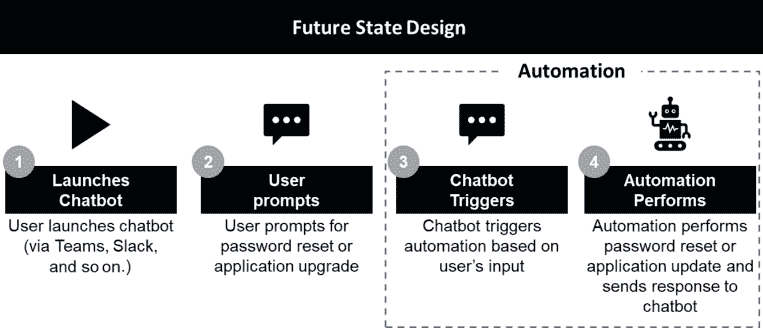

图 10.1 – IT 服务台机器人的未来状态设计

在用例的未来状态设计中，我们可以让人工启动我们的 Druid 聊天机器人（可以连接到 Slack、Microsoft Teams 或通过网络），并提示聊天机器人协助进行密码重置或应用程序升级。一旦聊天机器人收到请求，它就可以使用特定任务（密码重置或应用程序升级）的输入参数触发 UiPath 自动化。

在我们深入介绍未来状态设计之前，了解构建聊天机器人的一些基础知识很重要。所有对话流程都包含意图和对话，它们是聊天机器人的构建块。当我们表示人与聊天机器人之间的对话时，两者之间的对话将基于某种意图。如下所述：

- **意图：** 开始对话的目的（也称为话语）
- **对话：** 对意图的响应对话
- **流程：** 意图和对话的组合

所有 Druid 聊天机器人都基于此方法，即用户通过聊天机器人发起对话（话语）。根据该话语，聊天机器人会最好地匹配一个意图，然后开始一个对话，其中可能包含自由文本、按钮或其他输入。

有了这种理解，我们可以设计聊天机器人的流程。默认情况下，聊天机器人应配置以下流程：

- **欢迎流程**：用户启动聊天机器人时欢迎用户的流程
- **回退流程**：聊天机器人不知道用户输入的答案或响应时回退的流程

除了利用欢迎和回退流程外，我们还需要为自动化添加一个额外的流程。此流程将称为 UiPath_Flow，我们将在其中为用户提供一组按钮供其选择。根据用户选择的按钮，Druid 将触发一个自动化，使用参数重置其密码或升级其应用程序许可证。

这就结束了我们的未来状态设计。在本节中，我们讨论了聊天机器人基础知识，创建了一个图来模拟我们的未来状态设计，并介绍了我们将在聊天机器人中构建的三个流程。在下一节中，我们将开始开发，通过构建 Druid 聊天机器人。

## 使用 Druid 构建解决方案

当我们着手构建我们定义的用例时，我们将从使用 Druid 构建我们的聊天机器人组件开始。对于此用例，我们将从 Druid 的 **Druid Starter** 模板开始，为我们的聊天机器人奠定基础。此模板附带系统实体的定义和每个聊天机器人都应利用的常见流程。

## 创建项目

要使用 Druid Starter 模板开始项目，请完成以下步骤：

1. 在主菜单中，单击 Bot 下拉菜单并选择 AddNewBot。
2. 一旦 Create New Bot 窗口出现，输入 IT Help Desk Bot 作为机器人的名称，选择 English (United States) 作为默认语言，然后单击 Save。流程如下图所示：

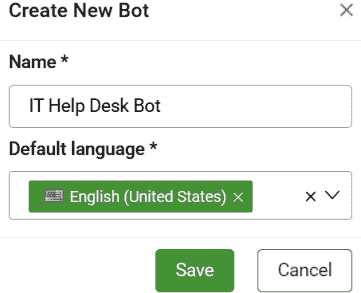

图 10.2 – 创建新机器人

现在机器人已创建，让我们导入 Druid Starter 模板以便开始。

3. 在主菜单中，单击 Solution 下拉菜单并选择 Import Solution。
4. 一旦 Solution Library 页面出现，选择 Druid Starter 然后选择 Import Solution。

安装了 Druid Starter 模板后，我们就有了良好的基础来构建。让我们开始创建一些对话流程。

## 编辑欢迎流程

Druid Starter 模板的第一个流程被称为欢迎流程。此流程的目的是在用户首次与聊天机器人交互时欢迎用户。如果您导航到项目的流程（单击 Solution Contents 下的 Flows），您会注意到我们的欢迎流程，名为 first-welcome-flow，如下图所示：

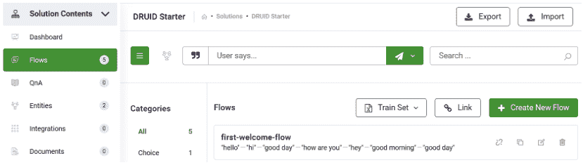

图 10.3 – 欢迎流程

在 `first-welcome-flow` 中，让我们添加我们的第一个提示，要求用户输入其电子邮件地址，如下所示：

1. 在 `first-welcome-flow` 中，单击 **Edit** 按钮以编辑流程。
2. 在父消息中单击 **AddChildStep**，如下图所示：

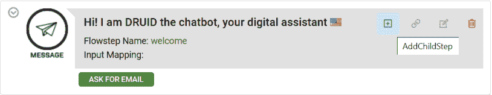

图 10.4 – 添加子步骤

3. 一旦 **newMessage** 出现，单击 **Edit** 按钮以编辑子步骤，设置以下属性：

- **步骤名称：** `Ask for Email`
- **类型：** `Prompt`
- **步骤消息：** `Please input your email address`
- **输入映射：** `@email`

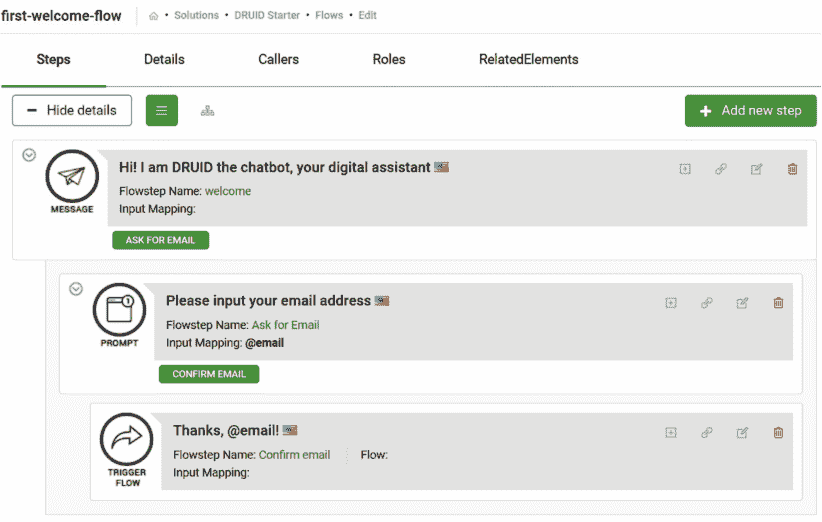

图 10.6 – first-welcome-flow

目前，这就结束了欢迎流程。当我们构建其他流程时，我们将回来进行一些小编辑。

## 创建自动化流程

欢迎流程完成后，让我们进入聊天机器人的主要流程：自动化流程。在此流程中，我们将向用户展示可供选择的选项，根据用户的输入启动 UiPath 自动化。让我们开始，如下所示：

1. 单击 **Create New Flow** 创建新流程，设置以下属性：
   - **名称：** UiPath_Flow
   - **描述：** Main Flow for IT Help Desk Bot
   - **话语：** help
   - **类别：** Automation Flow

流程创建后，让我们向流程添加一个选择步骤，让用户能够在重置密码或升级许可证类型之间进行选择。

2. 单击 + **Add new step** 创建新步骤，在 **General** 选项卡下设置以下属性：

- **步骤名称：** `Self-Help`
- **类型：** `Choice`
- **步骤消息：** `What can I help you with?`
- **输入映射：** `@self_help_choice`

3. 在 `Self-Help` 步骤的 **Metadata** 选项卡中，设置以下属性：

- **BlockUserInput：** `True`
- **Is first step?:** `True`

此外，在 **Metadata** 选项卡中，您会看到添加选择的选项（见 *Figure 10.7*）。这些选择将是用户与聊天机器人交互时可供选择的按钮选项。

4. 单击 +**AddChoice**，设置以下属性：

- **标题：** `Password Reset`
- **值：** `pass_reset`

5. 单击 + **AddChoice**，设置以下属性：

- **标题：** `Upgrade AppY`
- **值：** `upgrade_appY`

以下屏幕截图描述了添加选择的流程：


# 元数据

IsRepeater

BlockUserInput

Exception handler

Is WhatsApp template

AdvancedEditing

Choice[edit]

Preview

Password Reset

Upgrade AppY

Password Reset

Upgrade AppY

pass_reset

upgrade_appY

buttonClass

buttonClass

+ AddChoice

Is first step?

Is last step?

Figure 10.7 – Adding choices to the Self-Help flow step

+ 6. Click Save to save your choices.

Great! By clicking Save, we have added a choice that will look similar to this when we test it out. Note that by checking BlockUserInput, the user can only select from the two buttons and not add free text:

What can I help you with?

Password Reset

Upgrade AppY

Please select one of the options above

Figure 10.8 – Druid choices

With our choice step added, the next step is to add a UiPath connection.

+ 7. Use Druid's **Flow Diagram Designer** by clicking on the **Flow** button highlighted in the following screenshot:

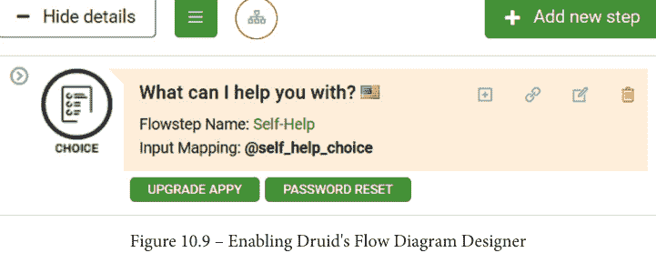

Once the **Flow Diagram Designer** appears, you should be able to see the `Self-Help` step we just added. Hovering over the + sign underneath the flow step will present several options to add as a child step, as illustrated in the following screenshot:

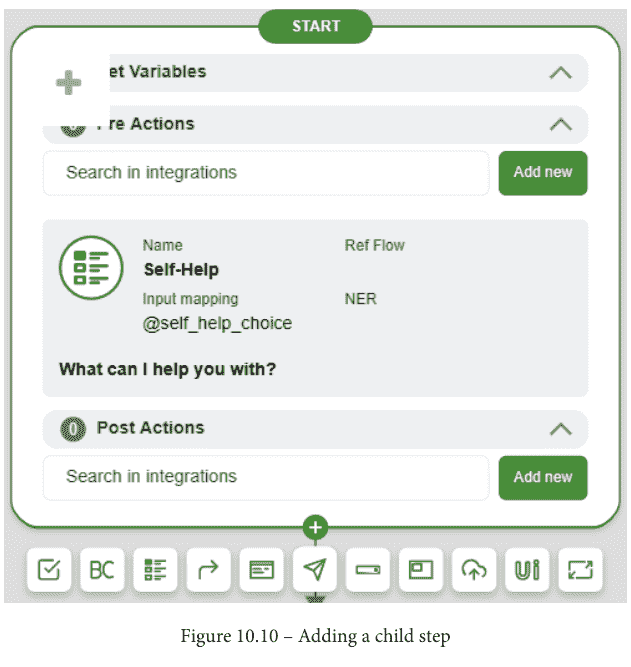

+ 8. Add **UiPath Automation** by clicking on the **Ui** button.
+ 
+ 9. Within the `Launch Automation` step, set the following attributes:
+ 
- **Step name:** `Launch Automation`
- **Type:** `UiPath`
- **Technology:** `Automation: attended (Robot.JS)`
- **Manually set process information**
- **Process:** `IT_Helpdesk_Chatbot`
- **Step message:** `Launching UiPath Automation...`

+ 10. Within `Launch Automation`, set the following process **input/output (I/O)** arguments:
+ 
- **Name:** `in_Task`; **Direction:** `In`; **Druid entity name:** `@self_help_choice`
- **Name:** `in_Email`; **Direction:** `In`; **Druid entity name:** `@email`
- **Name:** `out_SRNumber`; **Direction:** `Out`; **Druid entity name:** `@SR_Number`

The process is illustrated in the following screenshot:

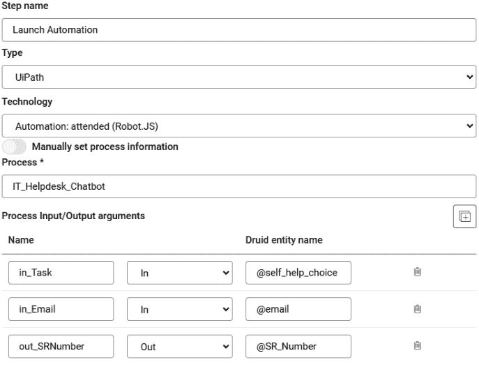

Figure 10.11 – Launch Automation step details

The process is illustrated in the following screenshot:

Step name

Ask for more Help

Type

Choice

Step message

Is there anything else I can help you with?

Input mapping

@more_help

SkipIfKnown

Hide in conversation history

NER Context

Metadata

IsRepeater

BlockUserInput

Exception handler

Is WhatsApp template

AdvancedEditing

Choice

Edit

Yes

No

Figure 10.12 – Ask for more Help choice

13. Within Flow Diagram Designer, make sure to connect both the Error sending the request and After Job Complete (Error) flow steps to the newly created Ask for more Help choice.

After Ask for more Help, we should have one final message, either thanking the user if they say no to any more help, or navigating them back to the beginning of the flow if they do ask for more help.

+ 14. After Ask for more Help, add a child step with the following attributes:
+ 
- **Step name:** Closing
- **Type:** Message
- **Message:** Okay! Have a great day
- **IsLastStep:** True

+ 15. In between the Ask for more Help and Closing steps, click on the gear icon to add a condition, adding the following:
+ 
- **Condition:** `@more_help=="No"`

The following screenshot illustrates this:

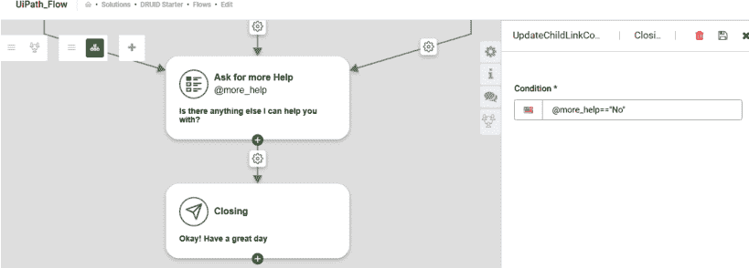

Figure 10.13 – Adding a condition to Closing

The purpose of this condition is to only route the conversation to the Closing step if the user's choice was No for additional help. If the user selects Yes, then they should be rerouted to the beginning of the flow.

+ 16. After Ask for more Help, add a child step with the following attributes:
+ 
- **Step name:** More Help
- **Type:** Message
- **Message:** Okay!

17. In between the `Ask for more Help` and `More Help` steps, click on the gear icon to add a condition, adding the following:

+ - **Condition:** `@more_help=="Yes"`

18. Drag a connecting arrow from the `More Help` step to the `Self-Help` step, as illustrated in the following screenshot:

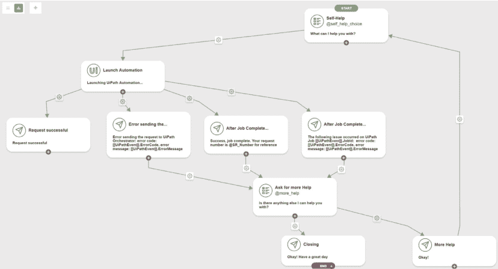

*Figure 10.14 – Completed UiPath_Flow process*

With the automation flow complete, we have one last step before we can move on to building the UiPath automation. We need to connect the Welcome flow with the UiPath flow.

19. Navigate back to `first-welcome-flow`.

20. Edit the `Confirm email` step, setting the following attributes:

+ - **Subflow:** `UiPath_Flow`

And that's it! We have successfully created a chatbot flow with Druid that connects to UiPath. In subsequent sections, we will build the UiPath automation component of this use case, and then test out the functionality.

# Building an automation solution

With our chatbot built, we can shift our focus to creating automation workflows for the use case. Approaching this use case, we will build our project in a couple of steps, as follows:

+ 1. Creating a project
+ 2. Building `Reset_Password` and `Upgrade_App` workflows
+ 3. Building the **Main** workflow

After completing these steps, we will have the foundation of our project complete and ready for testing.

# Creating a project

For this project, we'll create a new blank project in Studio. To start a project, complete the following steps:

+ 1. Navigate to the **Start** tab of UiPath Studio.
+ 2. Choose **Process**.
+ 3. Name your project `IT_Helpdesk_Chatbot`, and provide a folder location to save the project to.
+ 4. Click **Create** to create a project and to get started.

That concludes creating a project. We'll revert to the **Main** workflow in a later section where we build out the workflow, but for now, we'll transition into building supplemental workflows.

# Building Reset_Password and Upgrade_App workflows

With an automation project created, we can focus on creating some of the supplemental workflows that'll become building blocks of our **Main** workflow. Because we don't have actual accounts to reset or an application license to upgrade, our objective is to create modular workflow sequences that can simulate password resets or application license upgrades.

To start, let's create a `Reset_Password` workflow, as follows:

+ 1. In the `IT_Helpdesk_Chatbot` project, create a new workflow file called `Reset_Password`.
+ 2. Once the new workflow is created, create two arguments, as shown in the following screenshot:

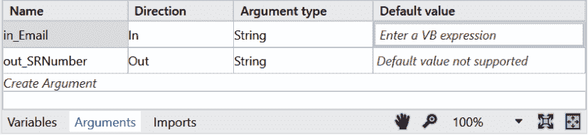

Figure 10.15 – Reset_Password arguments

The purpose of each argument is this:

+ - `in_Email`: To input an email address from the chatbot
+ - `out_SRNumber`: A random SRN that we will output in the chatbot

Once the arguments are added to the workflow, we can start adding activities to the blank canvas.

+ 3. Add a **Message Box** activity, with `"Resetting Password for"+in_Email` as the message and `Info` as the log level. This will output a message box, simulating the steps that automation could take if we were connected to a system that could reset passwords.
+ 
+ 4. After the **Message Box** activity, add an **Assign** activity with the following parameters:
 - **To:** `out_SRNumber`
 - **From:** `"SR"+Right(Now.Millisecond.ToString,2).ToString`

With the **Assign** activity added and using **Right** to generate an almost random number, we have a workflow that looks like this:

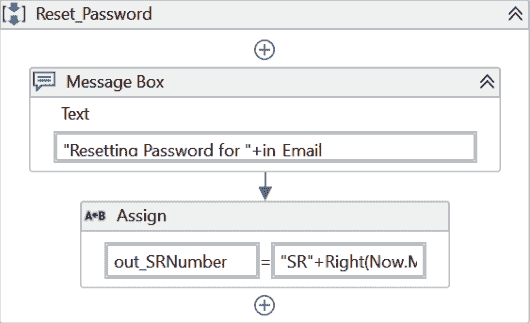

Figure 10.16 – Reset_Password workflow

That concludes the Reset_Password activity. Let's now focus on the Upgrade_App activity.

+ 5. In the IT_Helpdesk_Chatbot project, create a new workflow file called Upgrade_App.

+ 6. Once this new workflow is created, create two arguments, as shown in the following screenshot:

| Name | Direction | Argument type | Default value |
| in_Email | In | String | Enter a VB expression |
| out_SRNumber | Out | String | Default value not supported |
| Create Argument |  |  |  |

Figure 10.17 – Reset_Password arguments

The purpose of each argument is this:

+ - in_Email: To input an email address from the chatbot

+ - out_SRNumber: A random SRN we will output in the chatbot

Once the arguments are added to the workflow, we can start adding activities to the blank canvas.

+ 7. Add a Message Box activity, with "Upgrading App for"+in_Email as the message and Info as the log level. This will output a message box, simulating steps that automation could take if we were connected to a system that could reset passwords.

+ 8. After the Message Box activity, add an Assign activity with the following parameters:

+ - To: out_SRNumber

+ - From: "SR"+Right (Now.Millisecond.ToString,2).ToString

With the Assign activity added and using Right to generate an almost random number, we have a workflow that looks like this:


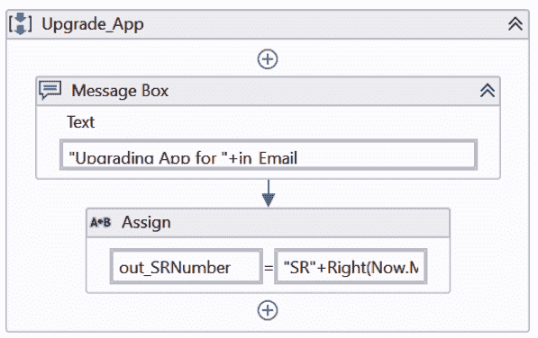

图 10.18 – Upgrade_App 工作流

至此，我们完成了 Reset_Password 和 Upgrade_App 工作流的开发。在本节中，我们创建了接受字符串邮件正文作为输入的工作流，在消息框活动中显示邮件，生成随机 SRN，并输出结果。在下一节中，我们将把所有内容整合到 Main 工作流中。

## 构建主工作流

每个自动化项目都从 Main 工作流开始。Main 工作流的目的是启动项目，并在过程中调用其他工作流。在此 Main 工作流中，我们将使用 switch 语句在聊天机器人传递的任务之间进行切换。操作步骤如下：

- 1. 打开 Main.xaml，并创建三个参数，如下图所示：

| 名称 | 方向 | 参数类型 | 默认值 |
|---|---|---|---|
| in_Task | 输入 | 字符串 | 输入 VB 表达式 |
| in_Email | 输入 | 字符串 | 输入 VB 表达式 |
| out_SRNumber | 输出 | 字符串 | 不支持默认值 |
| 创建参数 |  |  |  |
| 变量 | 参数 | 导入 |  |

图 10.19 – Main 参数

每个参数的用途如下：

- - `in_Task`：用于从聊天机器人输入任务类型
- - `in_Email`：用于从聊天机器人输入电子邮件地址
- - `out_SRNumber`：我们将在聊天机器人中输出的随机 SRN

- 2. 添加一个 **Log Message** 活动，将 `in_Task` 作为消息，`Info` 作为日志级别。
- 3. 添加一个 **Switch** 活动，将 `in_Task` 作为表达式。
- 4. 创建一个名为 `Upgrade_App` 的分支，使用 `Invoke` 工作流调用我们刚刚创建的 `Upgrade_App` 工作流。
- 5. 创建另一个名为 `Password_Reset` 的分支，使用 `Invoke` 工作流调用我们刚刚创建的 `Password_Reset` 工作流。

过程如下图所示：

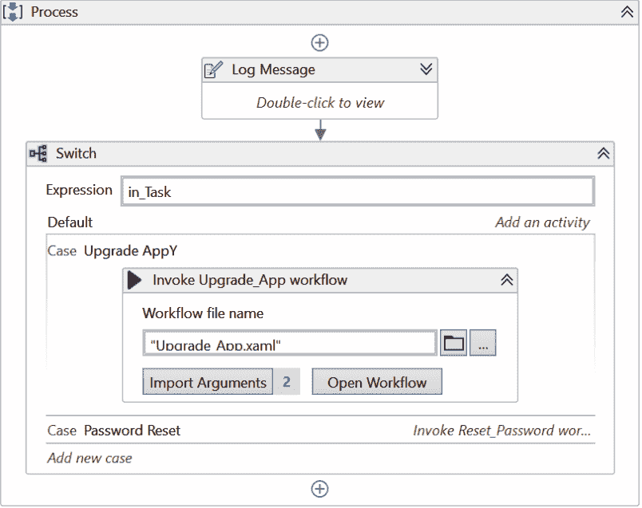

图 10.20 – Main.xaml 工作流

至此，我们完成了示例项目自动化工作流的配置。在本节中，我们创建了 UiPath 项目，并构建了辅助工作流。然后，我们在项目的 Main.xaml 文件中将这些辅助工作流连接在一起。在下一节中，我们将测试已开发的内容。

## 测试以确保稳定性并提高准确性

随着聊天机器人和自动化的开发完成，我们可以继续对这两个工作流进行联合测试。在部署前测试任何自动化工作流至关重要，以确保自动化按预期工作。在本节中，我们将同时发布 UiPath 自动化和 Druid 聊天机器人，以便测试两者之间的功能。

## 发布 Druid 聊天机器人

为了能够测试我们的 Druid 聊天机器人，并让它可供用户聊天，我们需要发布该机器人。发布机器人会自动在 DRUID 环境中配置所有必需资源。机器人只有在成功发布后才能正常运行。

发布聊天机器人所需步骤如下：

- 1. 单击 **IT Help Desk Bot** 右侧的 **Settings** 图标，如下图所示：
- 2. 进入 **Edit** 菜单后，导航到 **Details** 选项卡。
- 3. 单击 **Publish**。


单击 **Publish** 后，您应该会看到一条确认请求的通知。发布可能需要几分钟才能完成，但完成后，您可以单击页面上的绿色聊天按钮，以匿名用户身份测试聊天机器人。您的聊天机器人应与此类似：

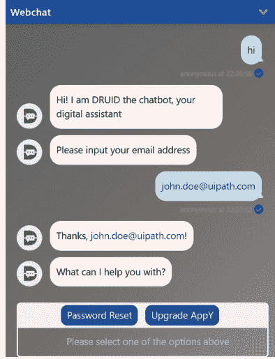

图 10.22 – 运行中的聊天机器人

请随时测试。在下一节中，我们将发布自动化，以便 Druid 聊天机器人能够触发它。

## 发布 UiPath 自动化

在前面的章节中，我们通常将发布自动化留到测试之后完成。然而，在本案例中，我们需要发布自动化，以便 Druid 聊天机器人能够触发自动化运行。

> **重要提示**
> 有关部署自动化的更多信息，请参阅以下链接：https://docs.uipath.com/studio/docs/about-publishing-automation-projects。

对于本案例，我们将在 **UiPath Assistant** 中快速将自动化发布到我们自己的个人工作区，操作如下：

- 1. 在 `IT_Helpdesk_Chatbot` 项目中，单击 UiPath Studio 的 **Design** 功能区中的 **Publish** 按钮。
- 2. 检查 **Publish to** 字段是否设置为 `Orchestrator Personal Workspace Feed`，如下图所示：

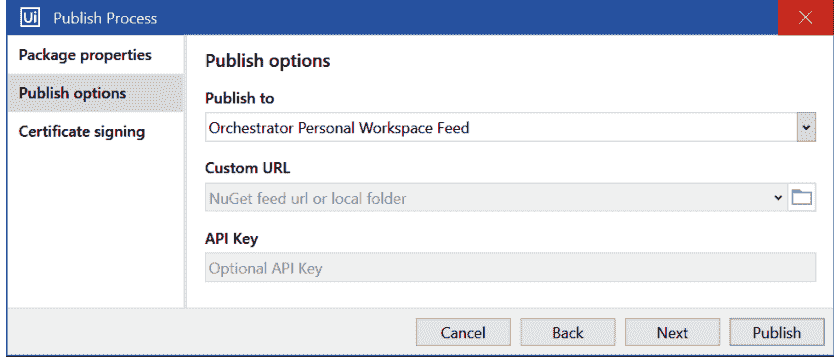

图 10.23 – 发布自动化

- 3. 单击 **Publish**。

发布完成后，您应该能够在 **UiPath Assistant** 中看到该自动化。单击 `IT_Helpdesk_Chatbot` 左侧的 **Play** 按钮将在您的计算机上安装自动化并开始执行。让我们进入下一节，一起测试聊天机器人和自动化！

## 测试用例

聊天机器人和自动化都已发布，我们终于可以开始测试自动化了！要测试自动化，请返回 DruID 并与您的聊天机器人对话。当您单击重置密码或升级应用程序许可证的选项之一时，您会注意到 DruID 会发送通知，说明自动化已启动且请求已成功处理，如下图所示：

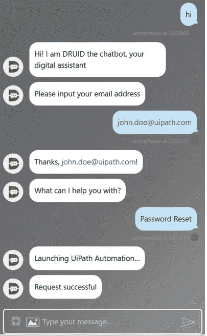

图 10.24 – 从 Druid 启动 UiPath

因为我们构建的是有人值守自动化，Druid 通过 UiPath 的 RobotJS 连接器与 UiPath 通信。UiPath 的 RobotJS 允许开发者将本地有人值守机器人上下文嵌入到聊天机器人等应用程序中。当您首次从 Druid 运行自动化时，浏览器可能会提示您是否要打开 **UiPath Assistant**，一旦接受，您可能会注意到 **UiPath Assistant** 弹出请求，如下图所示：

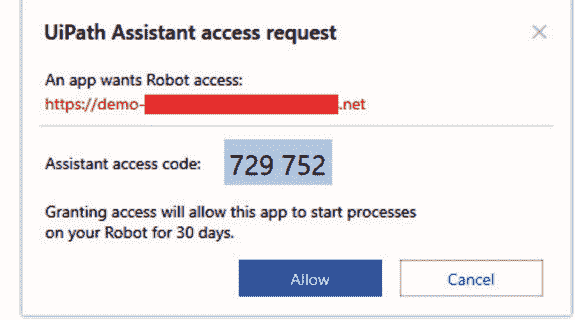

图 10.25 – RobotJS 提示

单击 **Allow** 后，自动化将启动，您应该会看到 SRN 返回给聊天机器人。请继续结合各种请求进行测试。干得好！

**重要提示**
如果您想查看实际案例的视频，请访问以下链接：https://bit.ly/3DKdXul

## 生产环境注意事项

由于我们在上一节中部署了自动化和聊天机器人，我们已经准备好将自动化部署到生产环境中。然而，即使我们的用例已经完成，如果您计划借助聊天机器人构建另一个用例，仍有一些注意事项需要考虑。

第一个注意事项是自动化组件是否可以成为无人值守机器人。在本用例中，我们使用了有人值守机器人，但大多数聊天机器人在执行 UiPath 自动化时应该使用无人值守机器人。

## 用例 3 -- 使用 DruID 的聊天机器人

通过利用 UiPath Marketplace 上提供的 **Druid Integration Framework**（https://marketplace.uipath.com/listings/druid-integration-framework），您可以让 Druid 通过向 UiPath 队列项添加事务项来触发自动化，如下图所示：

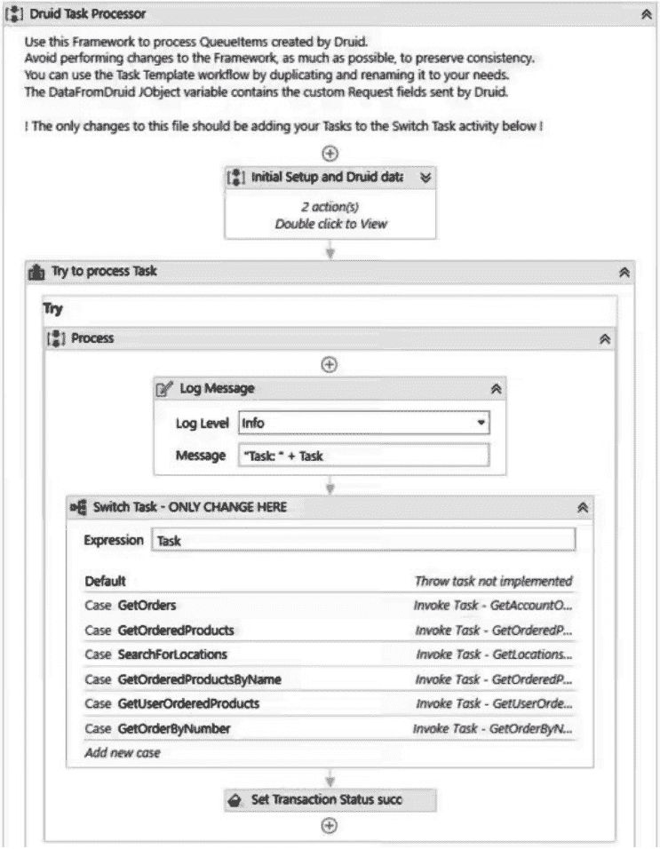

图 10.26 – Druid 集成框架

添加队列项将触发 UiPath 无人值守自动化启动，完成该过程并将任何相关信息发送回 Druid 聊天机器人。对于未来的项目，请考虑将 **Druid Integration Framework** 与无人值守自动化结合使用，以快速构建无人值守自动化项目。

## 总结

在本章中，我们介绍了使用 *Druid* 构建聊天机器人用例的过程。在构建用例时，我们学习了如何在 Druid 中创建项目、导入模板聊天机器人、构建聊天机器人流程，以及最终部署聊天机器人。我们还学习了如何利用聊天机器人与 UiPath 的连接。有了这些基础，您现在可以开始构建自己的认知自动化。

在下一章中，我们将探讨 *UiPath AI Center* 的一些高级主题。


