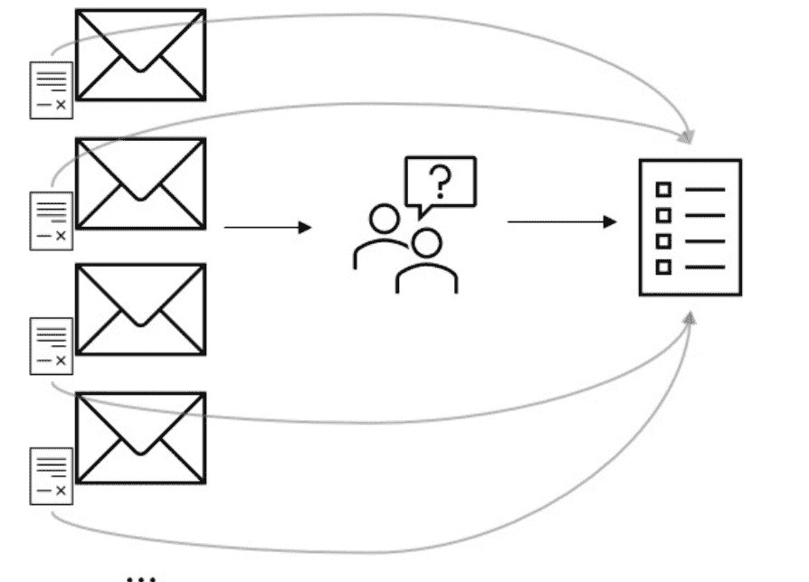
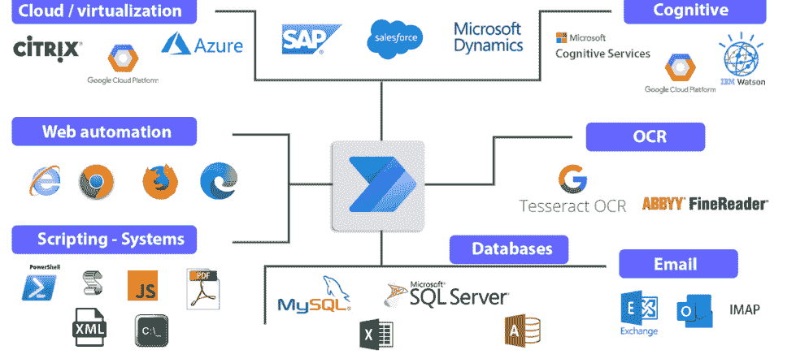
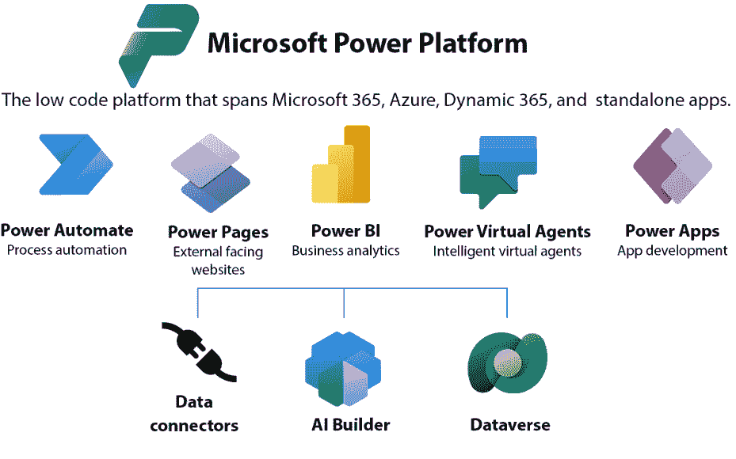
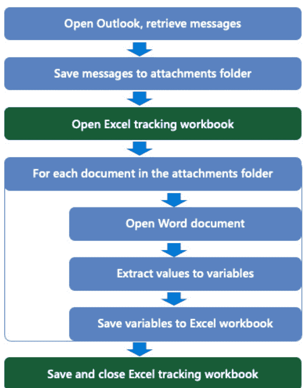
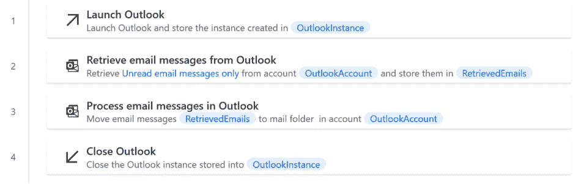

## Power Automate Desktop 入门

**Power Automate Desktop (PAD)** 基于一种称为**机器人流程自动化 (RPA)** 的原理。在本章中，我们将了解 PAD 的基本概念，并探讨微软用来创建该产品的基础。此外，我们还将了解该产品如何融入 Power Platform 生态系统，以及它能带来哪些可能性。

在本章中，我们将涵盖以下主题：

- 什么是 PAD，它能做什么？
- 这一切是如何开始的——机器人流程自动化
- Microsoft Power Platform 概览
- UI 流程揭秘及其在 Power Platform 中的作用
- 一个展示 PAD 和 Power Platform 惊人潜力的首个示例

在本章结束时，您将对 RPA 的概念以及 PAD 如何融入微软的自动化战略有全面的理解。第一个示例将向您展示 PAD 的潜力，并让您初步体验本书将要介绍的内容。

### 什么是 PAD，它能做什么？

为了更好地理解 PAD 的功能，我们将在以下小节中介绍一些最适合使用 PAD 的示例。

### 示例 1 – 自动回复信函处理

想象一下，您孩子所在的学校要组织一场活动，而您是组织团队的一员。

组织团队中的某个人已经创建了一封模板信函，发给所有学生家长，家长需通过勾选来表示是否同意其孩子参加。这些信函会以 Word 文档的形式返回，其中包含学生姓名，以及每个案例中表示同意或拒绝的勾选框。

现在您需要生成一份 Excel 列表，以汇总接受和拒绝的情况。为此，您必须打开每个 Word 文档，查看是哪个学生以及勾选了哪个选项。整个过程如下图所示：

图 1.1 – 如何根据电子邮件附件生成报告

根据学生人数以及需要查阅的信息量，这是一项繁琐且耗时的任务。正如前面的图表所示，这个过程相当枯燥且耗时。此外，我们还需要在达到报告截止日期之前每天重复此操作。

PAD 可以在这种情况下提供帮助。可以创建一个流程来检查属于特定主题的所有电子邮件并将 Word 文档保存到特定文件夹中。另一个流程可以检查该文件夹中的所有文件或文档，提取相关信息，并将其传输到 Excel 电子表格中。你只需创建一次此流程，它就会自动完成剩下的工作。

如果信件以打印输出的形式返回，甚至可以使用 **光学字符识别 (OCR)**。

## 示例 2 – 遗留应用的集成

即使在今天，仍然有大量专门为特定用例创建且因各种原因无法现代化改造的遗留应用。这些原因包括预算不足、技术过时，以及缺乏资源、能力和时间。

员工几乎被迫使用该应用，而且非常经常地，这样的应用无法通过 **应用程序编程接口 (API)** 或任何其他兼容接口以编程方式访问数据或流程。

那么，当这样的应用必须集成到更大的上下文中时会发生什么呢？例如，可能存在一个销售平台，其中记录了订单和发票。然而，这些数据也必须流入遗留应用以保持数据库一致。或者，也许在遗留应用中生成了一个唯一的客户编号，该编号必须在其他地方使用（有关示例，请参阅 *第 7 章*）。

无论如何，必须有一种方法来处理这个遗留应用并将其集成到更大的上下文中——而这正是 PAD 发挥作用的地方。

借助 PAD，我们可以远程控制任何桌面应用，记录一个始终相同的序列，然后再次运行它。借助 PAD，我们还可以远程执行此流程或从外部事件触发（作业在系统中在线输入），读取计算或输入结果，并将其作为值回放到工作流中。

这意味着一个无法从外部调用且只能手动操作的应用，仍然可以被自动化并集成。这也意味着在系统环境中，多个应用参与一个流程但没有技术连接时，可以使用 PAD 设计一个连贯的流程并在这些应用之间交换数据。

凭借其近 400 个操作（截至撰写时；可用操作的数量不断增长），PAD 可以覆盖所有用户场景，从 Web 和桌面应用到数据库、文件和文件夹，再到电子邮件和脚本集成。下面的图表说明了 PAD 在连接方面的能力：

图 1.2 – PAD 功能

除了远程控制本地安装的程序外，PAD 还可以连接到众多外部系统和环境，例如来自 Microsoft 或 AWS 的云环境，并将人工智能纳入脚本和 Web 自动化中。所有这些连接都可以在 PAD 的流程中使用，从而实现跨系统流程的映射。

这说明 PAD 可以覆盖广泛的用例。然而，这并不意味着 PAD 适用于所有事情。在下一节中，我们将看看流程应满足哪些标准才能使使用 PAD 变得合理。

## 哪些流程应该被自动化？

正如我们在前几节中看到的，PAD 功能非常强大，可用于私人以及商业环境。流程和工作流无处不在，我们每天都在使用它们，但哪个流程适合自动化呢？

使用 PAD 创建流程也需要一定的工作量，因此值得仔细研究是否值得自动化某个流程。以下是做出选择时可以参考的一些方面：

- 你是否充分理解该流程并且其执行方式是否一致？如果存在太多变体或不可预测的行为，自动化将非常困难，甚至不可能。
- 是否有足够多的重复次数或甚至高频执行该流程，以使投入的工作物有所值（**投资回报率 – ROI**）？
- 该流程是否主要为手动操作，并且存在许多可以通过自动化消除的错误？

可能还有其他影响自动化流程决策的方面，但如果你以这些问题作为起点，你就走在正确的道路上。

## 一切的开始 – 机器人流程自动化

RPA 的历史可以追溯到 1990 年代至 2000 年代。当时 **用户界面 (UI)**，有时也称为 **图形用户界面 (GUI)** 软件测试的需求变得更加强烈——即能够自动点击软件 GUI、输入值并查询输出。为此，开发了第一批工具，使首次使用记录和回放方法进行 UI 和回归测试成为可能。屏幕抓取技术也用于此目的，通过它可以实现从一个应用中提取数据的自动化，以便在其他地方进一步使用。由此产生的自动运行流程也可以称为 **bot**（**robot** 的简称）。

稍晚一些，在 2005 年，一家名为 Softomotive 的公司成立，将记录和回放的概念扩展到能够在不同 Windows 应用之间实现工作流和数据传输，从而跨应用自动化流程。该产品名为 WinAutomation，并与其他制造商一起长期成为 RPA 软件的领先提供商之一。

Softomotive 于 2020 年被 Microsoft 收购，其产品 WinAutomation 的功能被集成到 Power Automate 模块中，该模块当时对自动化基于桌面的流程的功能非常有限。尽管如此，Power Platform 在此阶段作为整体概念已经非常强大；我们将在 *第 2 章* 中讨论这一点。

## Microsoft Power Platform 一览

Power Platform 的真正起源可以追溯到很久以前，当时人们还在谈论 Microsoft 业务解决方案。那时，Microsoft

进入市场推出了一款新的 CRM 系统，为今天的 Power Platform 奠定了基础。该生态系统由多个子组件组成，它们可以非常紧密地协同工作，也可以单独使用：

跨越 Microsoft 365、Azure、Dynamic 365 和独立应用的低代码平台。

图 1.3 – Microsoft Power Platform

这些是组件：

- **Power BI：** 一种用于在仪表板和报告中可视化任何类型数据的工具。Power BI 还可以从其他组件捕获实时数据，并利用连接器功能访问几乎任何数据源中的数据，并将其与其他数据结合以创建跨系统仪表板。
- **Power Apps：** 这允许用户创建可用于特定业务流程的不同类型的应用。有不同类型的应用，它们又可根据表单因素（手机/平板电脑）或创建方式（画布与模型驱动）进行划分。Power Apps 也利用连接器概念在应用中使用任何数据源。
- **Power Automate（原 Microsoft Flow）：** 这是 Power Platform 内创建的工作流和业务流程的通用术语。PAD 也属于这一类别；我们将在下一章更详细地介绍它。但这里还有其他组件，例如 **业务流程流 (BPFs)**。
- **Power Virtual Agents：** 该模块允许你创建所谓的聊天机器人。它可以嵌入到网站或其他渠道中，为网站访问者提供一种交互方式来联系公司、询问订单状态等。
- **Power Pages（原 PowerApps Portal）：** 该模块在撰写时处于预览阶段，源自已存在相当长时间的门户领域。它是一个内容管理系统，可用于创建外部网站。

前面的图表还显示了 Power Platform 的另外三个重要构建块：

### 数据连接器

借助数据连接器，可以访问并使用通过 Power Platform 提供的所有数据源。今天已有超过 400 个可用，并且每天都在增加。然而，如果 Microsoft 或第三方制造商未提供连接器，也可以在组件中创建自己的连接器并使用它。

### AI Builder

AI Builder 允许你在应用或工作流中包含人工智能。提供的模型涵盖信息提取和文本识别，以及翻译，但也包括情感识别或根据你的标准对客户反馈进行分类。在这里，你也可以创建自己的 AI 模型，使其在平台中可用，并由应用或工作流创建者使用。

- **Cloud flows**：这类流程在云中运行，意味着它们在 Power Platform 内的 Microsoft 云基础设施上运行。云流程在特定的触发事件上运行——例如，*创建了新联系人*。它也可以立即运行，例如通过 Power App 中的按钮按下，或按计划运行——例如每小时一次。云流程可以在浏览器中的设计器中设计，并且可以集成任何在线可用的数据或系统。
- **Business Process flows**：Dynamics 365 包含大量预定义的业务流程，例如 *潜在客户资格认定*。它描述了潜在客户成为真实客户的路径，以及实现此目标所需的措施和操作。所有这些操作都记录在 BPF 中，并帮助用户确定下一步需要做什么以进一步确认潜在客户。这些流程仅在所谓的模型驱动应用中使用，在本书的上下文中不相关。为了更有效的业务流程，可以将云流程和 BPF 合并。
- **Desktop flows or UI flows**：这类流程在本地机器或工作站上运行，该工作站也可以是虚拟机。PAD 用于创建和设计这类流程，这些流程可以访问本地安装的应用程序或操作系统的资源。

## Note

本书重点关注桌面流程，PAD 是专门用于创建这类流程的工具。

PAD 包含超过 450 个所谓的 actions，可用于设计流程。这些操作和所有设计功能将在后续章节中进行探讨。在以下小节中，将解释本地数据网关的概念，以及环境的概念。

## Connecting PAD to the cloud

在上一节中，我们了解到云流程可以访问在线的数据和系统。然而，在某些情况下，云流程需要访问位于家庭或企业网络中的本地机器

（本地部署）——也就是说，它需要实现从 Microsoft Cloud/Power Platform 到本地机器的连接，正如我们在以下示例中看到的那样。

在这种情况下，安全问题变得尤为突出。例如，公司不希望外部访问内部系统，或仅在非常有限和受控的条件下允许访问。担忧是有道理的，因为此类场景通常需要调整防火墙和端口，这可能会允许外部攻击。

一方面不淡化这个问题，另一方面也不深入探讨安全主题，这里介绍了 Power Automate machine runtime 的概念。这提供了一种安全的方式，允许从 Microsoft Cloud 系统访问本地计算机。

在本地计算机上安装和配置 machine runtime 时，您需要连接到 Power Platform 并指定相应的凭据，以在环境中注册本地机器。此后，Microsoft Cloud 内的不同组件就可以利用此连接。

## Gateways for Desktop flows are deprecated

用于连接本地数据来源的常用工具是所谓的本地数据网关。该工具仍然存在，但不再支持用于连接桌面流程。相反，使用 Power Automate machine runtime 从云中调用本地桌面流程。对于 machine runtime 的使用，必须满足关于版本和许可证的某些要求。这将在第 9 章中详细介绍。

## Introducing Power Platform environments

Power Platform 是各个组件在环境中创建、存储和执行的生态系统。

因此，环境是一个容器，可以将各种组件（如应用和流程）包裹起来，反之，每个组件（应用、流程等）始终属于且仅属于一个环境。

流程是否显示在流程列表中取决于是否选择了正确的环境。我们将在本书的示例中始终考虑这一点。

在本节中，我们了解到 PAD 不仅是用于自动化本地应用程序的程序，而且它处于 Microsoft Power Platform 的更大背景中。PAD 可以集成到更大的场景中，并在企业环境中使用。下一节展示了 PAD 如何使用 Office 程序映射一个总体流程的初始示例。

## Understanding the potential of PAD by looking at an example with MS Office

让我们再回顾一下开头的示例，其中要求您作为家长委员会帮助组织一次学校活动。该场景如下所示：

- 1. 即将举行一次学校活动，家长委员会需要获得学生家长的同意。
- 2. 为此已经发出信件，并附带了一份 Word 文档。在此文档中，家长可以勾选是否同意其子女参加。之后，家长应将 Word 文档发送回特定电子邮件地址。为此示例定义了一个文档，看起来如下：

图 1.5 – 流程的结构视图

这里的想法是，您可以根据需要执行此流程，以收集收件箱中收到的所有家长回复。基于此结构化流程图，很容易创建一个 UI 流程来完成此操作。让我们看看这里的主要构建块以及它们如何在 PAD 中创建。在后续章节中，我们将学习如何详细创建这样的流程：

- 1. 启动 Outlook 并将消息保存到特定文件夹。

以下屏幕截图显示了 Desktop flow 的第一部分：

图 1.6 – PAD Outlook 操作

每个带有符号的框代表一个操作，可以通过拖放将其放置在设计画布上。PAD 中有超过 450 个操作，按 **Outlook**、**Files** 和 **Folders** 等不同类别分组。前四个操作与 Outlook 相关且不言自明：

- **Launch Outlook：** 在桌面上启动 Outlook 程序。
- **Retrieve email messages from Outlook：** 检索特定文件夹中的消息，并允许将消息中的附件存储到特定文件夹中。
- **Process email messages in Outlook：** 这允许将消息移动到其他文件夹。我们将使用它将消息从收件箱移动到某个子文件夹。
- **Close Outlook：** 关闭程序。

2. *使用跟踪工作簿打开 Excel。*

第二步负责将附带的 Word 文档存储到特定文件夹中，该文件夹将在下一个构建块中使用：

Launch Excel
Launch Excel and open document SaveAttachmentsFolder \Activity Tracker.xlsx using an existing Excel process and store it into Excel instance ExcelInstance

Get files in folder
Retrieve the files in folder SaveAttachmentsFolder and its subfolders that match *.docx and store them into Files

Get current date and time
Retrieve the current datetime and store it into CurrentDateTime

图 1.7 – PAD Excel 和文件系统操作

让我们看看这些操作：

- **Launch Excel**：打开 Excel 并打开特定工作簿以存储响应。
- **Get Files in a folder**：此操作检查本地文件系统并创建一个特定文件夹中的文件列表。也可以应用文件筛选器。在我们的案例中，我们只想要 .docx 扩展名的 Word 文档。
- **Get Current date and time**：这里，流程确定当前日期和时间，我们随后可以将它包含在 Excel 中的相应条目中。

## 3. 处理附件文件夹中的每个文档。

以下块包含对每个 Word 文档的处理。最后一句话包含 for each 关键字，该关键字也在 PAD 中用于遍历项目列表。在最后一个构建块中，此项目/文档列表是由 Get files in folder 操作创建的，并且以下块以该 for each 循环开始，如以下屏幕截图所示：

Figure 1.8 – Handling each document in a loop

The actions are as follows:

- **Rename file(s):** Used to rename one or more files. Since we are iterating through the list of Word documents, each iteration contains a different file in the folder. To identify the current file, this gets renamed to `work-in-progress.docx`.
- **Run application:** PAD does not have specific actions for Microsoft Word, but like any other application, this program can also be automated. With this action, we start Microsoft Word on the local machine with a specific document, called `work-in-progress.docx`, which is the current document.
- **Get selected checkboxes in window:** This action can extract `true` (for checked) or `false` (for unchecked) from any window of an application. In our example, we extract the information from the checkboxes of the Word document. We need this for the two checkboxes in the document, which is based on a template that was generated and sent in advance.
- **Extract data from window:** Similar to a checkbox, this action allows us to extract text data from a window. We use this to extract the name of the child in the document.
- **Get first free column/row from Excel workbook:** The workbook has already been opened in one of the actions. This action helps activate the first empty cell so that we can put content in it.
- **Write to Excel worksheet:** This action writes data to the Excel cell specified. We need to perform this action four times to put all the data in.
- **Terminate process:** This closes the Word application so that it can be opened with the next document in the next iteration.

### 4. Housekeeping.

Finally, we need to do some housekeeping, which will be covered by the actions shown in the following screenshot:

| # | Action | Description |
|---|--------|-------------|
| 21 | Delete file(s) | SaveAttachmentsFolder "work-in-progress.docx" |
| 22 | Save Excel | Save the Excel document stored into ExcelInstance |
| 23 | Close Excel | Save the Excel document and close the Excel instance ExcelInstance |

Figure 1.9 – Housekeeping PAD actions

In detail, these actions do the following:

- **Delete file(s):** Microsoft Word creates a hidden file when it opens a document that sometimes isn’t deleted and stays in the filesystem. To make sure that we will have valid documents in our folder the next time we run the flow, we just delete the hidden file, if it exists.
- **Save Excel:** Saves our entries in the workbook.
- **Close Excel:** Closes the program.

This UI flow might look quite extensive because of multiple repetitions to store data in Excel, but it is nevertheless easy to create and very powerful. The time saved is enormous and it increases the more that parents need to be contacted and the more messages that need to be processed. In addition, this process could also be extended to using physical letters as input or responding to email messages.

There are, of course, other examples of Desktop Flows and Power Automate that create connections to some external systems or UI flows that get triggered from some cloud system. We will see examples of this throughout this book.

## Summary

In this chapter, we started by providing an overview of PAD and how this product has been integrated by Microsoft into their Power Platform ecosystem. We saw that the product fits perfectly into Microsoft’s strategy and fills the gap in desktop software integration very well.

In our first example, we learned how different Office programs can be integrated to automate a repetitive process. Instead of handling each message and document separately, PAD saved the documents and extracted the relevant information. Thereby, we were able to save a lot of time by automating this process.

In the next chapter, we will create a flow by taking a small and very useful tool to help us: the recorder.

## Further reading

To learn more about the topics that were covered in this chapter, take a look at the following resources:

- *Workflow Automation with Microsoft Power Automate*, by Aaron Guilmette (Packt Pub)
- *Microsoft Power Platform Solution Architect’s Handbook*, by Hugo Herrera (Packt Pub)
- Microsoft Power Platform documentation:
  https://learn.microsoft.com/en-us/power-platform/
- About the on-premises data gateway: https://learn.microsoft.com/en-us/power-platform/admin/wp-onpremises-gateway
- Power Platform environments overview:
  https://learn.microsoft.com/en-us/power-platform/admin/environments-overview
