## Using Power Automate Desktop and Creating Our First Flow

In the previous chapter, we saw how **Power Automate Desktop (PAD)** was born and how powerful the tool can be for automating repetitive tasks. In this chapter, we will take a detailed look into the following:

- What is necessary for installing PAD on a local machine
- How the application is built up
- How to create our first flow by using the built-in recorder

To use PAD effectively, a basic understanding of the application is essential, as we will spend most of our time on the very areas presented here. Also, knowledge of the PAD recorder will be extremely helpful throughout this book because it can also save us a lot of time when creating flows. Now, let’s look at how we can get PAD running on our computers.

### Understanding the prerequisites for installing PAD

Let’s begin by taking a look at what you need to get Power Automate up and running on a local machine. Two things are required to install Power Automate:

- A Windows operating system (Windows 10 or Windows 11 Home edition or above) and some hardware requirements/recommendations
- A Microsoft work or school account to sign in to Power Automate

Since there are specific things to consider, let’s take a closer look at each of these topics now.

### Microsoft account

To be able to access the files for installing PAD, a Microsoft account (formerly known as Windows Live ID) is required. There are different types of accounts and all of them are suitable for using PAD:

- **(Personal) Microsoft account:** This is probably the most commonly used type of account in the private area. It is free and provides access to Microsoft’s consumer services such as **Outlook.com, OneDrive, and Office applications**. To sign up, an existing email address can be used or a new one can be created. This account can also be used to sign in to a Windows machine.
- **Work or school account:** This type of account is created by an organization that uses **Azure Active Directory (AAD)** as the authentication and authorization platform. Typically, additional services or subscriptions are purchased that offer additional functionality to users.
- **Organization premium account:** This is a special form of work or school account. In this case, the organization is not only managing users via AAD but has also moved certain or all parts of IT to the cloud, such as Exchange, Teams, and Business applications.

With all three types, the full potential of PAD can be unleashed. The organization’s premium account has the following capabilities on top:

- Connecting and integrating with cloud flows (see the previous comments on the operating system)
- Collaboration and advanced functionality (such as central Dataverse storage, sharing of flows, as well as centralized management and reporting)
- Additional premium functionality such as access to AI Builder and unattended execution of flows

For the vast majority of use cases, a personal Microsoft account is sufficient. Nevertheless, in the following chapters of this book, we will see scenarios where a premium account is necessary to access specific services.

### Additional notes on accounts

To install PAD, a user with administrator privileges on the device is required. A Windows local or domain account with these privileges should be used. To access PAD installation files, however, one of the Microsoft accounts mentioned previously is necessary. The Windows local account can be associated with the Microsoft account in the corresponding Windows account settings.

Now that we know the prerequisites, let’s take a look at how to install the software.

### Installing PAD

The installation files for PAD are not on the local Windows medium – you must download these from the Microsoft download center. Therefore, an active internet connection and a modern browser are required – Microsoft Edge version 80 or higher or Google Chrome. For this book, I am using a machine with Windows 11 Home edition and a freshly created personal Microsoft account. To install PAD, do the following:

- 1. Open your browser and navigate to https://www.office.com. If you are not already logged in, do so with your Microsoft account.
- 2. On the right-hand side, you should see a list of familiar icons such as those for Word, Excel, and more. Click on the last one, called Apps. Clicking this icon will make additional apps appear:

# 更多来自 Microsoft 365

# 日历

管理并共享你的日程。

# 表单

自定义调查和测验，获取实时结果。

# OneNote

创建数字笔记本。

# Power Automate

同步文件等以简化你的工作。

# Sway

创建交互式报告和演示文稿。

# 图 2.1 – Microsoft Office 主页，附带其他应用

3. 点击 Power Automate。如果看不到此图标，请向下滚动一点。接下来，你可能会看到一个欢迎屏幕，要求你选择正确的区域或国家。请选择适当的条目并按下 开始。

4. 你将被重定向到 Power Automate 的起始屏幕，这里隐藏着安装文件。点击左侧导航栏中的 我的流：

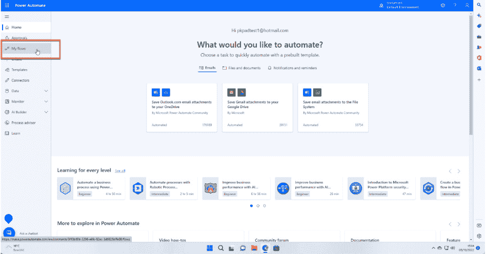

# 图 2.2 – 在 Power Automate 中访问我的流

5. 在下一个屏幕上，右上角有一个 安装 按钮，可显示 PAD 和本地数据网关的安装文件。点击第一个条目开始安装 PAD：

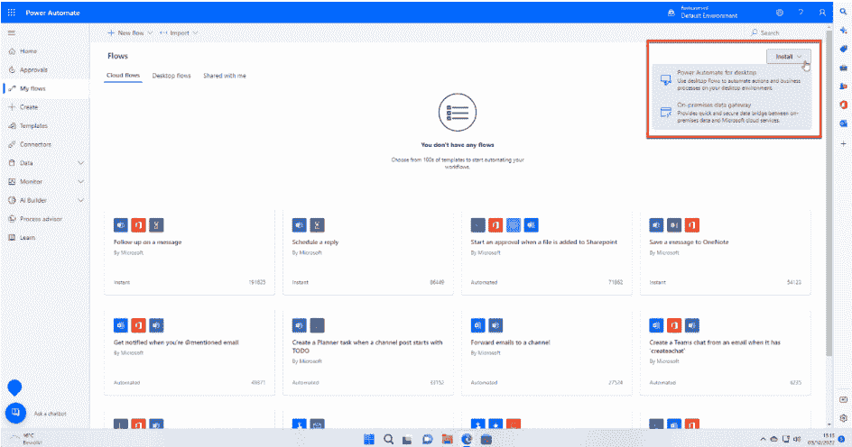

图 2.3 – 安装文件

另一种安装 PAD 的方式是通过 Microsoft Store：

+   1. 打开 Microsoft Store 应用并在搜索栏中输入 Power Automate。
+   2. 你会看到 Power Automate 作为搜索结果的第一项。点击 安装 按钮获取该工具（我已经安装过它，所以我可以打开它）：

# 图 2.4 – 从 Microsoft Store 安装 Power Automate

+   3. 无论是通过下载文件还是商店，都运行安装过程；这很简单。你会收到一条消息，说明安装成功。

+   4. 之后，点击 Windows 开始 按钮并输入 Power Automate。安装程序不会创建任何快捷方式，因此最好将此程序固定到开始菜单或任务栏：

图 2.5 – 本地固定并启动 Power Automate

5. 点击 Power Automate 图标启动程序。

# 重要说明

请注意，该程序称为 Power Automate 而不是 Power Automate Desktop。不要混淆——我们是在正确的位置。该程序可能会找到软件的更新版本并自动应用。

当程序最终启动时，你还需要使用 Microsoft 帐户登录。之后，你应该再次选择一个区域并浏览 Power Automate 的导览，这也是 PAD 已成功安装的确认。

# 创建我们的第一个流

现在我们已成功安装 PAD，是时候创建我们的第一个简单流了：

+   1. 此时，程序已启动并提供了一个欢迎屏幕。请注意不同的标签，它们允许你切换到你的流，甚至查看来自 Microsoft 的示例程序，值得一看。从流容器屏幕开始，选择 + 新建流，可以从左上角的菜单栏或屏幕中间选择：

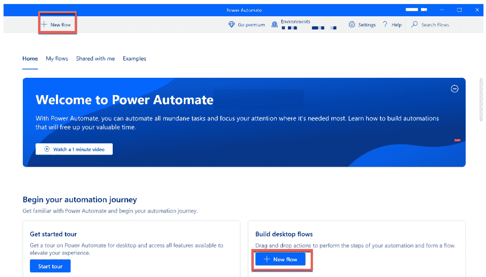

图 2.6 – 创建我们的第一个流

2. 在下一个对话框中，你将被要求为流命名。虽然这是可选的，但为流命名是良好的做法。这次让我们选择 **Welcome Flow**。你可以继续点击 **创建** 按钮开始设计器：

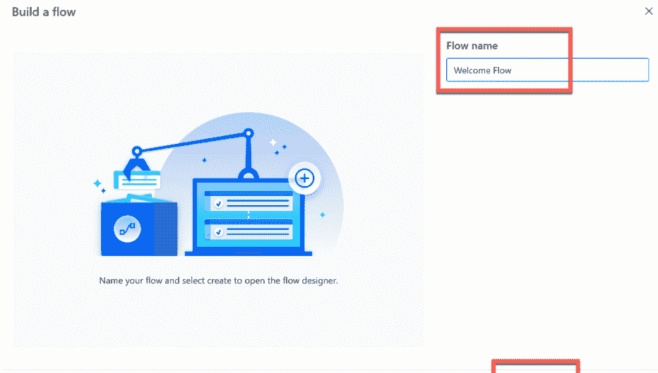

图 2.7 – 流容器屏幕，带有 + 新建流 选项

3. 这将启动 PAD 流的设计界面，这很可能就是我们在本书中将花费大部分时间的地方。在下一节中，我们将学习所有各个区域的含义以及它们的功能。但现在，让我们创建我们的第一个流。

在我们的第一个流中，想法是我们希望流询问我们的名字，然后将其用于显示一个友好的欢迎消息。为了实现这一点，我们将使用 **消息框** 动作。查看左侧的条目列表并将鼠标悬停在名为 **消息框** 的条目上，你应该会看到以下内容：

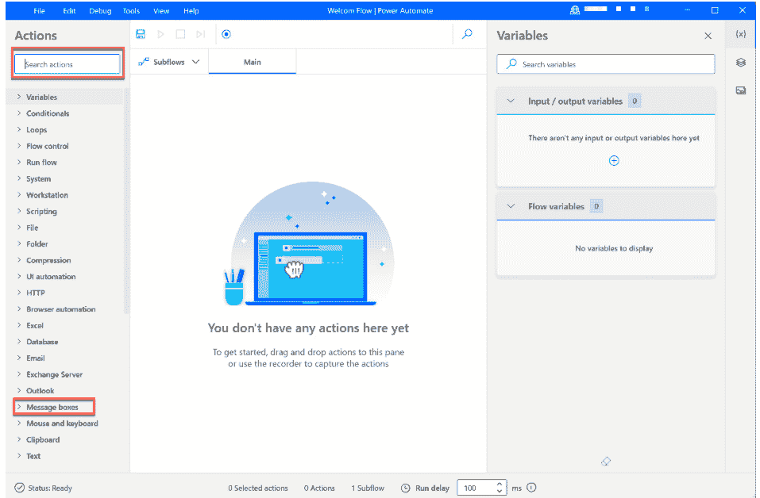

# 图 2.8 – 探索操作窗格

4. 当你对不同操作更加熟悉后，你也可以使用左上角的搜索栏来显示特定的一组操作。尝试点击搜索框并输入 display as some text。左侧操作列表会根据搜索词的结果进行调整：

# 图 2.9 – 使用搜索栏

我们现在感兴趣的是 **显示输入对话框** 操作，它是列表中的第二个条目。记住，你也可以使用左侧的完整操作列表并展开 **消息框** 操作组：

+   1. 要将操作放置到设计画布上，只需点击并按住 **显示输入对话框** 条目，然后将其拖放到窗口中间的 **主** 标签下方：

# 图 2.10 – 将操作拖到画布上

2. 松开鼠标按钮后，立即会出现一个对话框。在这里，我们需要输入所需的数据：

# 显示输入对话框

显示一个提示用户输入文本的对话框 更多信息

# 选择参数

输入对话框标题：

What is your name?

输入对话框消息：

Please tell me your name:

默认值：

输入类型：

单行

始终置顶输入对话框：

产生的变量

UserInput

ButtonPressed

出错时

保存

取消

# 图 2.11 – 显示输入对话框参数

我们需要在此对话框中提供以下信息：

+   1. 为输入对话框的标题输入一个名称。此标题出现在消息框的标题栏中。

+   2. 为对话框输入一条消息。在这种情况下，我们想知道此人的名字。

+   3. 你不需要在此处输入任何内容。然而，用户输入的名字的值必须存储在某个地方，以便稍后显示。此操作会产生一个变量作为内部存储，用于保存用户的输入。

+   4. 点击 保存 按钮保存并关闭此对话框。

3. 设计画布现在应包含第一个操作，看起来像这样：

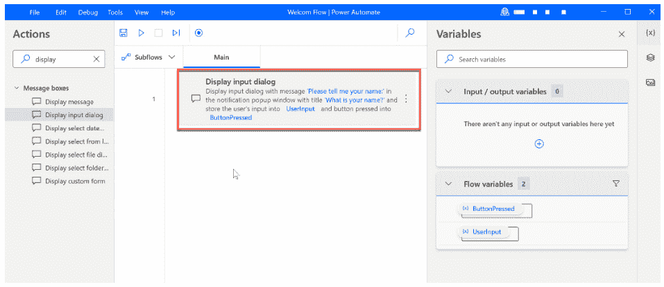

图 2.12 – 画布中的第一个操作

现在我们有了一种查询名字的方法，我们希望再次向用户显示该名字。为此，我们将使用 显示消息 操作。点击并拖动此操作，将其放置在现有操作下方：

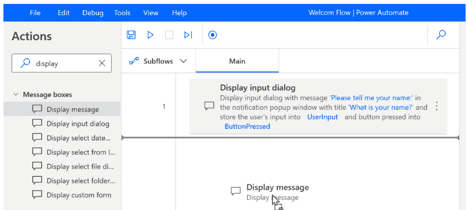

图 2.13 – 将显示消息操作拖到画布上

需要注意的是，有一条线指示操作将被放置的位置。以后，当我们有更大的流和更多操作时，这将允许我们在流中间放置一个操作并非常轻松地修改序列。就像我们的第一个操作一样，松开鼠标后立即会出现一个对话框，我们可以在其中指定此操作的参数：

# 显示消息

显示一个消息框 更多信息

# 选择参数

消息框标题：

Hello and welcome to PAD!!

要显示的消息：

Hello

消息框图标：

搜索变量

名称 类型

流变量 2

ButtonPressed 文本值

UserInput 文本值

消息框按钮：

默认按钮：

始终置顶消息框：

自动关闭消息框：

产生的变量 ButtonPre

出错时

保存 取消

图 2.14 – 显示消息操作的参数

同样，我们需要在此处输入一些信息：

+   1. 这将是用户在消息框标题中看到的文本。
+   2. 我们想要显示的消息文本。
+   3. 在消息框文本字段的右侧，有一个带括号的小 X 符号。这是一个可用于从流中的变量插入动态内容的按钮。在之前的操作中，我们将用户名字存储在一个名为 UserInput 的变量中。点击 X 按钮时，顶部会出现另一个对话框，显示此流中可用的变量。在这里，我们可以选择 UserInput 并点击 选择 按钮。变量将被插入到消息文本框中。它现在应该看起来像这样：

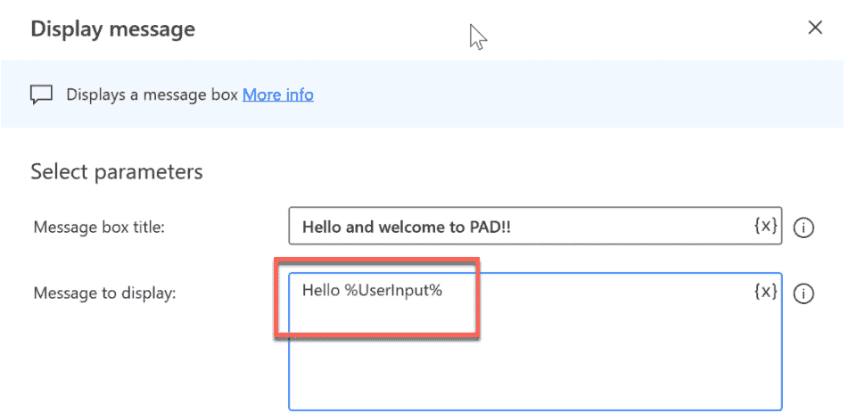

图 2.15 – 在消息中使用变量

+   4. 点击 保存 按钮保存并关闭对话框。
+   5. 我们的第一个 UI 流现在看起来像这样：

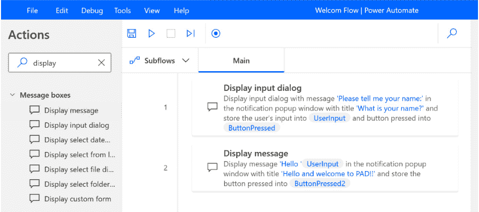

# 图 2.16 – 我们完成的第一个流程

6. 要测试此流程，我们需要运行它。可以按操作画布顶部的“播放”按钮，或者转到“调试”菜单并选择“开始”来完成。运行流程的快捷键是 F5。

果然，出现了一个输入对话框，要求我们输入姓名，现在我们可以将其输入到文本框中：

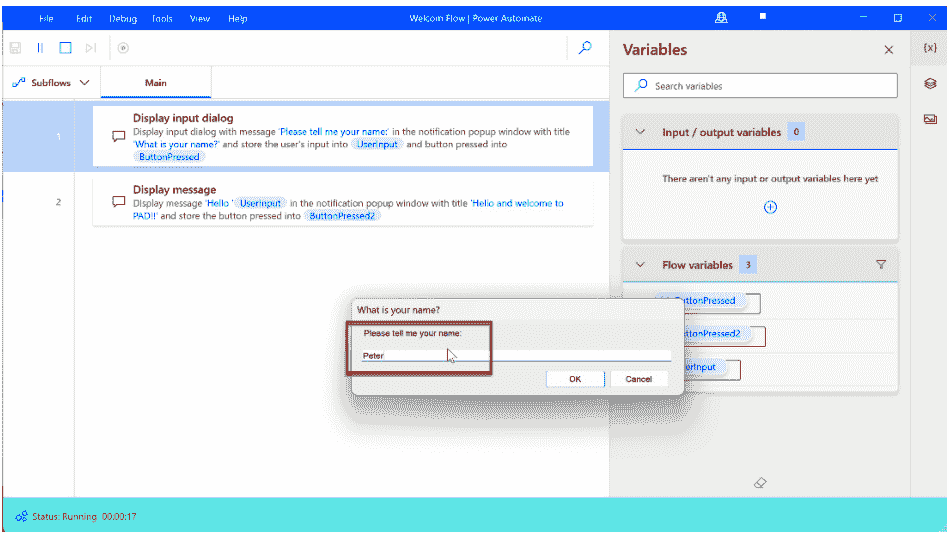

图 2.17 – 运行我们的第一个流程 – 第 1 部分

另外，请注意，后台程序的界面发生了一点变化。带有蓝色背景的条目表示流程的当前步骤。输入姓名并点击**确定**按钮。流程将继续执行下一步，并显示一个消息框，其中包含你输入的姓名：

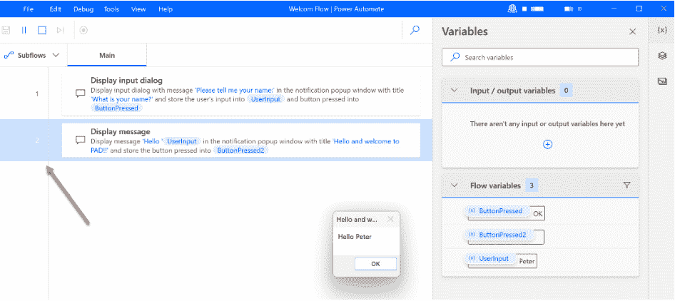

图 2.18 – 运行我们的第一个流程 – 第 2 部分

再次强调，应用程序中的蓝色背景表示当前步骤。点击**确定**关闭消息框并结束流程。恭喜——你已经创建并执行了第一个 UI 流程！

## 用户界面构成详解

现在我们已经了解了 PAD 的基本功能，接下来仔细看看这个应用程序及其可能性。PAD 由两个窗口组成：

- 容器窗口或 Power Automate 控制台

### Power Automate 容器窗口

启动程序时，我们看到的第一个窗口是容器窗口，也称为 Power Automate 控制台。以下截图显示了该窗口：

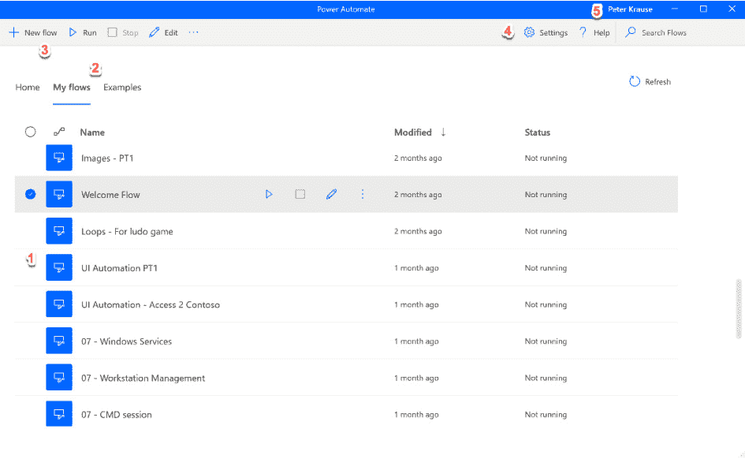

图 2.19 – PAD 容器窗口

它包含以下元素：

- 1. **UI 流程列表：** 如果将鼠标悬停在列表中的某个项目上，系统会显示其他附加选项，例如*播放*按钮或*编辑*按钮。*编辑*按钮只会打开设计器窗口（见下图），而*启动*按钮会立即运行流程，而无需先打开设计器窗口。

你还会在桌面上收到有关流程状态的通知（已启动、已成功等）：

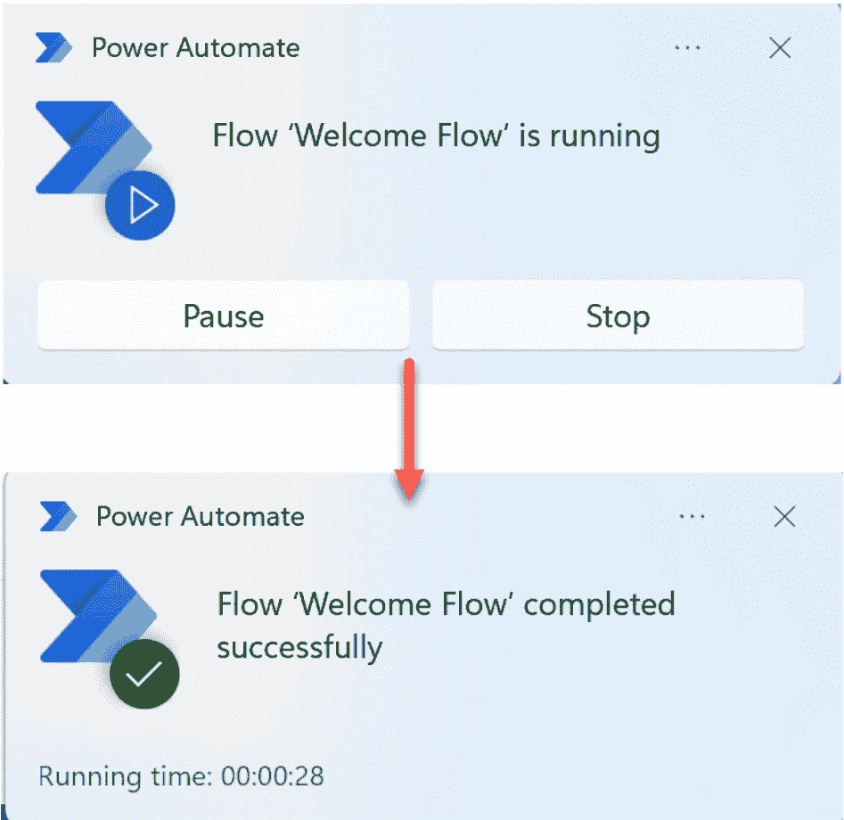

图 2.20 – 有关流程的 Windows 通知

编辑按钮右侧的三个点会打开一个上下文菜单，你可以在其中运行或编辑流程，还可以重命名、删除或复制流程：

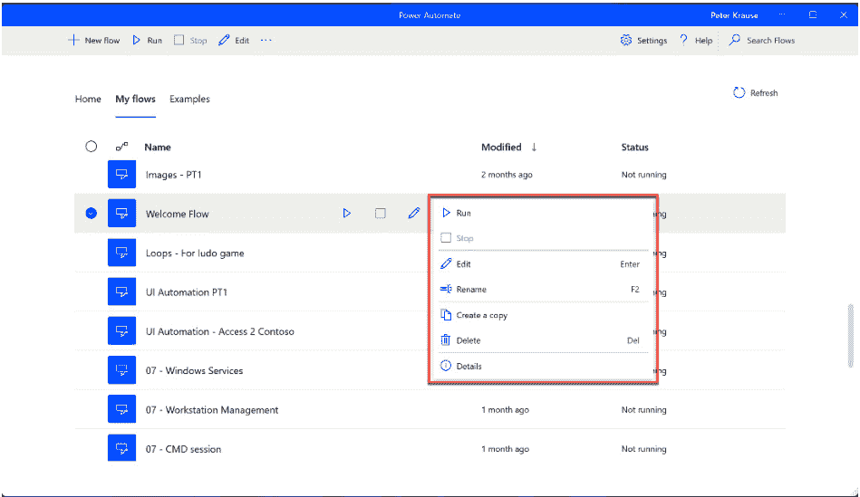

图 2.21 – 流程列表上下文菜单

**详细信息**选项会显示流程的属性，包括其名称和说明、所有者、创建日期和最后修改时间。

- 2. **控制台区域切换**：你还可以从**我的流程**选项卡切换到**示例**选项卡。这里展示的是 Microsoft 提供的各种不同示例，包括 Excel、桌面、Web 等自动化。虽然这些示例并未涵盖程序的所有功能，但还是值得一看，或许可以尝试其中某个示例。

- 3. **创建新流程**：此按钮会启动一个对话框，你可以在其中输入新 UI 流程的名称。虽然这不是必填项，但为流程提供一个有意义的名称是合理的。有一个**创建**按钮，用于确认名称并启动带有空白画布的设计器窗口。

- 4. **PAD 设置**：此按钮会启动**设置**对话框。在这里，我们可以修改 PAD 的启动行为，还可以使用热键停止正在运行的流程。此外，还可以更改监控和通知设置（Windows 通知、流程监控窗口或什么都不通知）。

- 5. 登录信息：单击标题栏中的姓名，会提供有关当前用户及其登录信息的信息。在这里，也可以注销并以其他用户身份登录。

### 设计器窗口

现在让我们仔细看看设计器窗口：

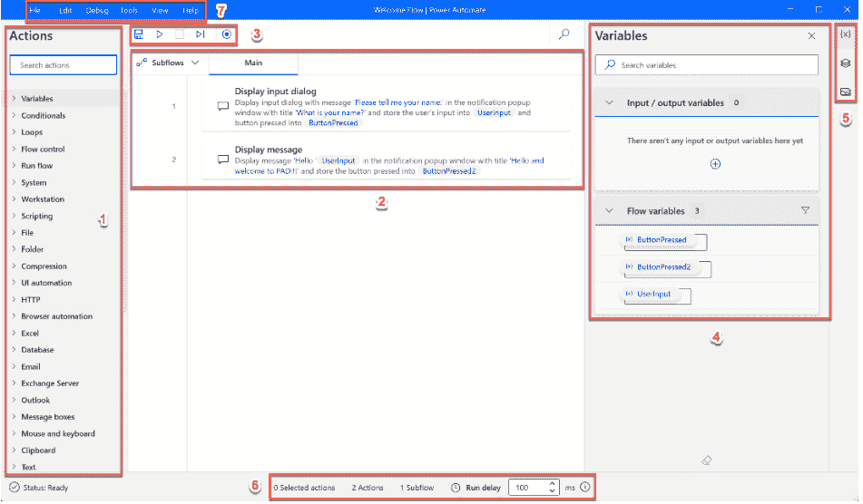

图 2.22 – PAD 的设计器窗口

这里包含以下元素：

- 1. 操作窗格：窗口左侧属于操作窗格。操作代表流程能够执行的功能，例如“打开 Excel”或“获取文件夹中的文件”。这些操作被分组到不同的类别中，例如“系统”或“文件夹”。展开相应的项目，即可看到属于某个类别的所有操作。只需点击类别左侧的箭头图标即可。在整本书中，我们都会逐一介绍这些操作。列表顶部还有一个**搜索**框。如果你在此输入搜索词，操作列表就会根据该搜索词进行筛选。我们在第一个流程中就使用了这个功能。

- 2. **流程设计器区域**：窗口中间是一个画布，包含构成此流程的所有操作。可以通过从**操作**窗格中拖放操作来将其放置到画布上。当流程启动时，操作将按照此处列出的顺序运行。只需单击并拖拽现有条目并将其放到其他位置，即可重新排列此操作列表。系统会显示一条水平线，指示操作可以放置的位置。我们在前面的示例中见过这一点。你还可以双击某个操作以打开该操作的设置对话框并修改条目。在此区域中，还有一个查看子流程的选项。子流程只是封装了一组特定操作的另一个 UI 流程。通过使用子流程，可以将大型流程划分为不同的部分。子流程始终属于某个常规流程，不会在其他流程之间共享。

- 3. **流程控制栏**：操作列表顶部的小工具栏允许你保存、启动、停止和录制流程。还有一个选项可以启动流程并逐步执行操作，这也称为**调试**。我们将在下一节中更详细地介绍这一点以及录制器。

- 4. **变量查看器窗格**：右侧是一个显示流程变量的区域。变量是流程在运行时存储信息的重要方面。变量将在*第 5 章*中介绍。

- 5. **输入元素切换器**：还需注意变量图标 {x} 下方的两个额外小图标。这些图标可用于切换到包含 UI 元素和图像的区域，该区域也将在后面介绍。你可以通过单击图标隐藏此区域。

- 6. **操作与执行摘要**：底部有一个小工具栏，用于汇总当前流程。还可以为流程运行设置特定的延迟——在此示例中为 100 毫秒。

这是应用程序的菜单栏。除典型的保存和编辑功能外，调试功能也再次在此提供，其中还可以设置断点。这样可以让流程执行到某个特定点，以便在发生错误时检查设置和变量：

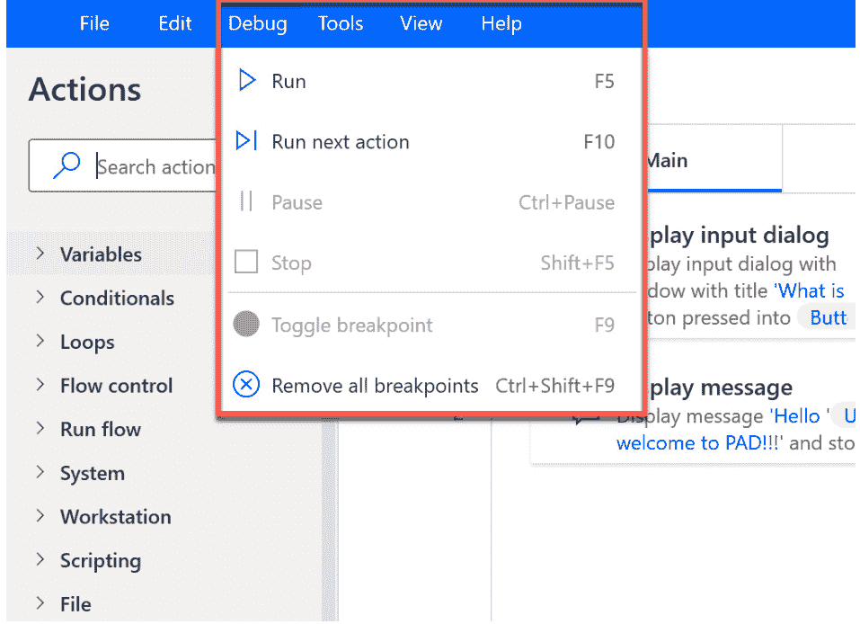

图 2.23 – 调试菜单

当流程运行出错时，设计器窗口还会出现在屏幕底部的另一个区域中。这里将显示流程在何处停止以及停止原因的详细信息。现在我们已经了解了更多细节，我们将在下一节使用录制器创建另一个流程。

### 使用录制器

正如你在上一章中看到的，PAD 设计器窗口不仅允许我们将操作拖放到设计画布上，还允许我们录制 UI 流程。此概念类似于屏幕录制器，它记录每一个步骤、每一次鼠标点击和键盘按键，以便之后按相同方式回放此系列操作。

我们想使用这一功能来创建 PacktPub 出版社所有书名的概览，以便在其他地方（例如数据库中）使用这些信息。遗憾的是，我们无法直接访问 PacktPub 的底层数据源，但可以通过其网站 https://subscription.packtpub.com/search 获取书名。然而，我们不想在网站上逐个高亮每一个书名，然后再复制粘贴到另一个工具中。那将花费很长时间，而且相当枯燥。PAD 可以替我们完成这项工作。

在下面的示例中，我们将使用一种称为网页抓取的概念——即从网页中结构化地提取信息。请注意，这也适用于许多其他网站，因此该技术可以通用。但是，使用此方法的前提是，我们必须为所使用的浏览器安装并激活一个小扩展程序，以便 PAD 可以访问网页中的元素。那么，让我们开始吧：

- 1. 创建一个新流程，并为其指定一个有意义的名称，例如**网页抓取 PacktPub**。
- 2. 在操作窗格中找到**浏览器自动化操作**组并展开它。你会看到来自 Google、Firefox 和 Microsoft Edge 的每种浏览器都有一个**启动新的...**操作。我的机器上安装了 Microsoft Edge，因此我会单击并将此操作拖到画布上：

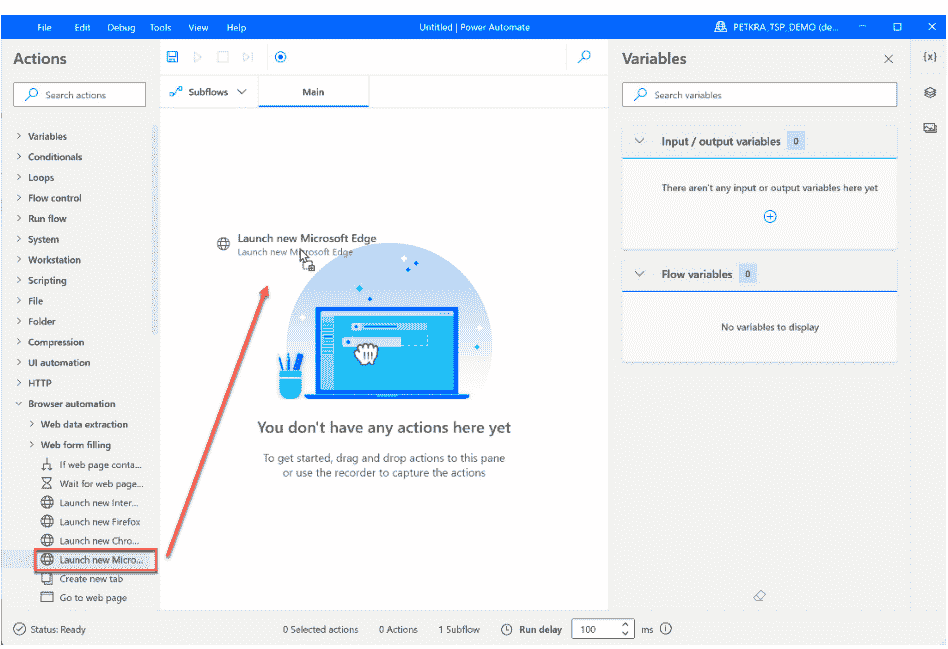

# 图 2.24 – 将浏览器操作拖到画布上

3. 此时，系统可能会要求你为 PAD 安装浏览器扩展：

# 你需要 Power Automate 扩展。

+   1. 要在你的流程中使用网页自动化，请选择“获取扩展”以下载并安装到所选浏览器。
+   2. 安装后，请确保在浏览器中启用该扩展。

# 图 2.25 – 浏览器扩展安装对话框

4. 这只会发生一次。获取扩展并确保其已激活。

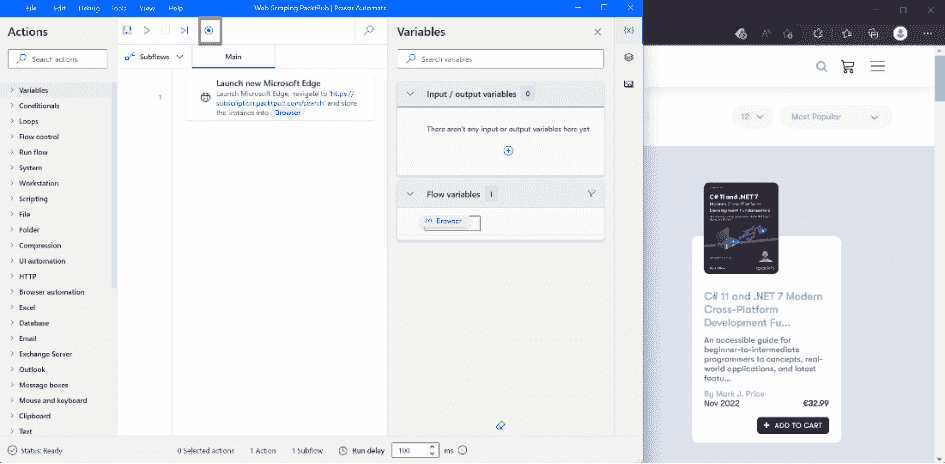

图 2.27 – 录制按钮

此时，PAD 设计器将消失，而是一个较小的录制窗口会出现。 它应该看起来像这样：

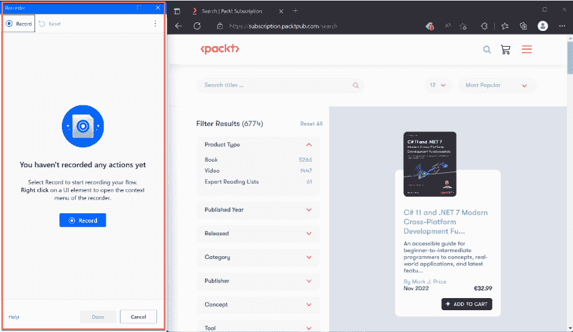

图 2.28 – 录制窗口

现在，有趣的部分开始了。 通过点击屏幕中间的按钮或顶部的按钮开始录制。 录制窗口将发生变化，并在 **Recorded actions** 下方显示一个空区域。 使用鼠标将光标悬停在网站上的不同元素上，例如书籍图片。 你会看到 PAD 尝试识别网站上的不同元素并相应地框出它们。 在下面的屏幕截图中，我将光标悬停在书籍图片上：

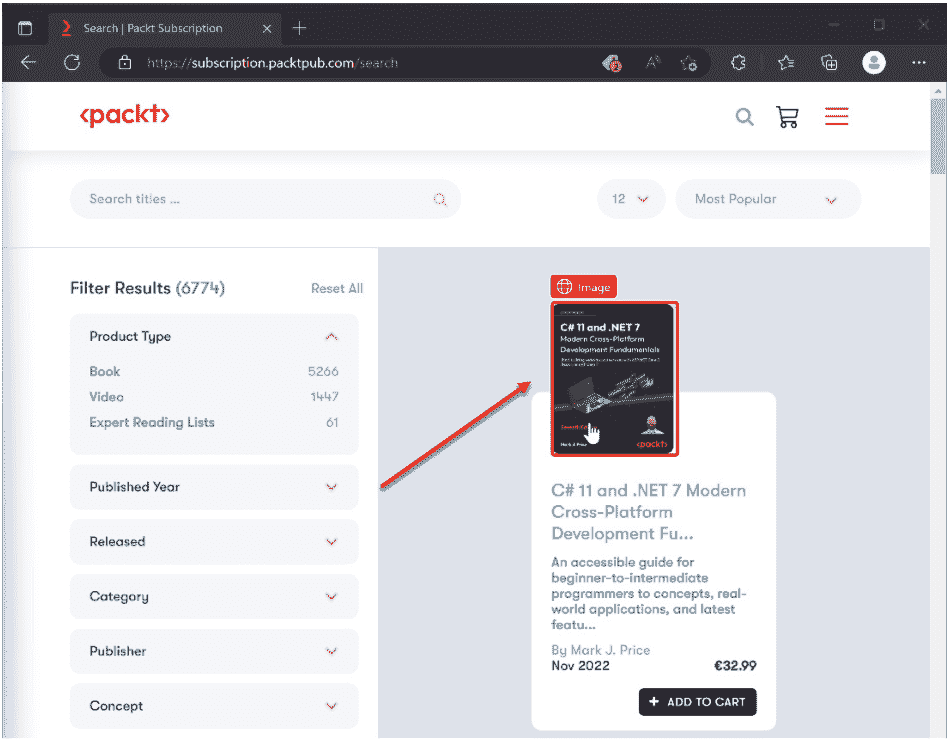

图 2.29 – 检测网页元素

为了让录制器正确识别网页元素，有时需要一点技巧。 将鼠标移出所需区域然后移回也有助于获得正确的标记。 一旦正确的元素被突出显示，请点击鼠标右键以便选择我们想要从该元素中提取的信息。 该元素的上下文菜单将出现，以便我们可以选择不同的条目：

图 2.31 – 录制器中的一个已录制操作

## 重要说明 – 删除额外操作

你可能会有其他操作被录制器记录下来，这取决于你点击的位置和可能按下的键。 对于我们的示例，录制器中只能有一个操作。 使用 **Delete** 按钮（垃圾桶符号）删除任何额外的操作。

现在，对书籍的标题重复相同的过程。 使用鼠标将光标悬停在元素和标题上，然后点击鼠标右键：

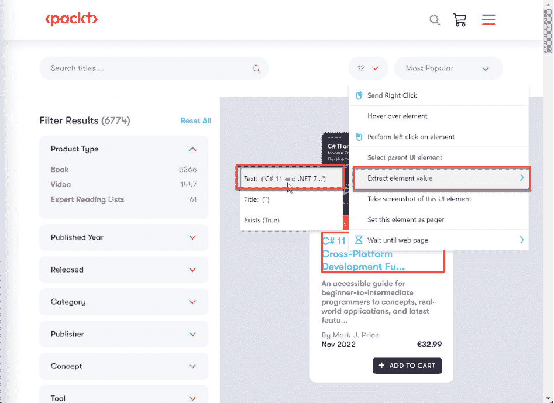

图 2.32 – 从网页元素中提取数据

这次，我们想要提取元素的标题。 这样，我们就捕获了网页上的两个元素，它们在录制器窗口中表示如下：

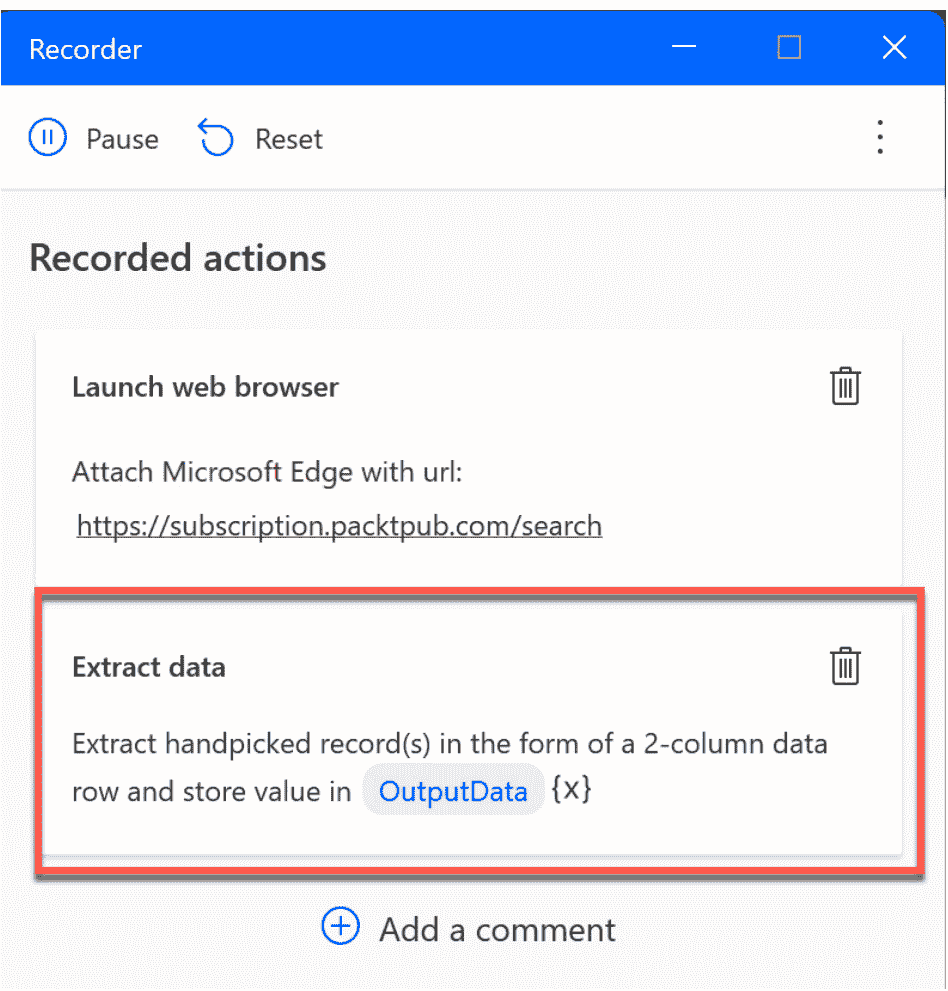

图 2.33 – 录制器中的提取数据

这里有一个重要的区别：PAD 已经识别出我们从网页上的一个记录中捕获了两条信息。 我们的下一步将是转到下一个元素，而这就是一些魔法的开始。 如果你重复第一步并标记下一本图书图片并再次提取 Src 信息，PAD 将识别出这种模式并假设你想要对第一个元素做同样的操作。 我们可以在网页上看到这一点，因为 PAD 已用绿色虚线标记了相应的元素：

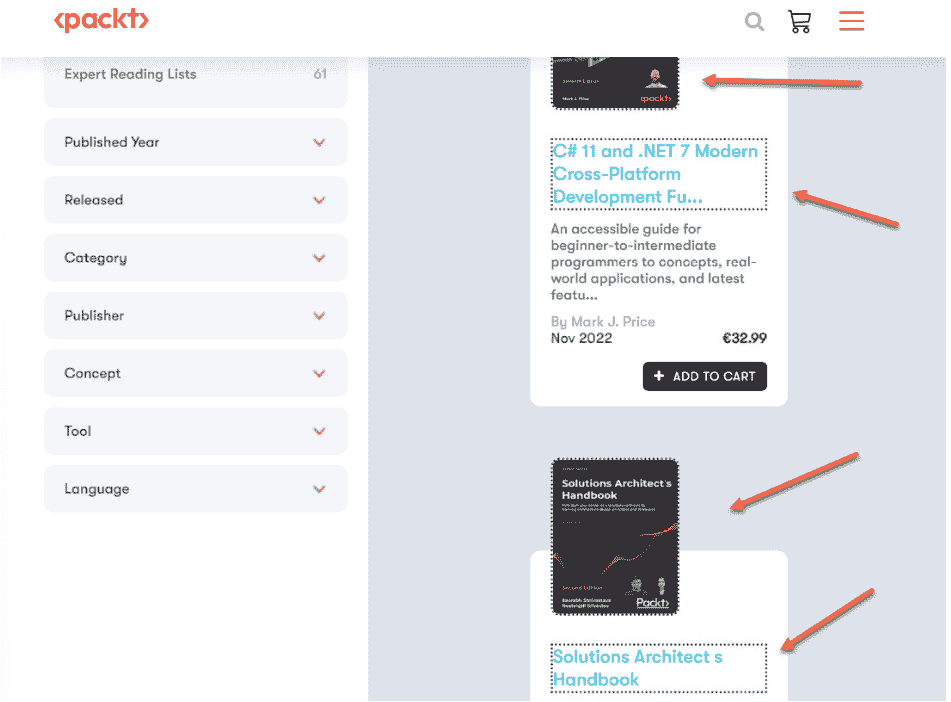

图 2.34 – 录制器的模式识别

## 模式识别

请注意，有时需要捕获不止两个结构，录制器才会识别出模式。 因此，如果 PAD 没有立即识别出模式，请继续进行下一个元素。 识别

还取决于 HTML 的底层结构。 最迟在第三或第四个元素后，模式将被识别。

这意味着 PAD 现在将捕获此页面上的所有元素。 但下一页的书籍怎么办？ 让我们向下滚动以便可以看到该网站上的分页控件：

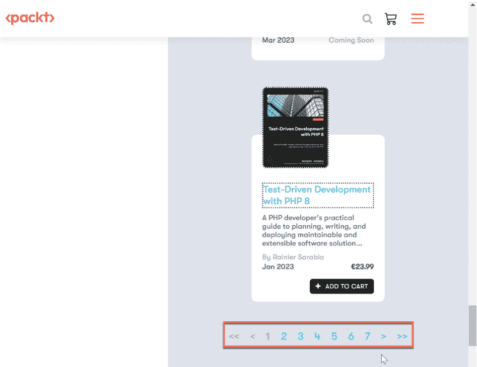

图 2.35 – 加入导航

我们现在可以使用单个箭头按钮加载下一页。 右键单击以下屏幕截图中显示的元素并选择 Set this element as pager：

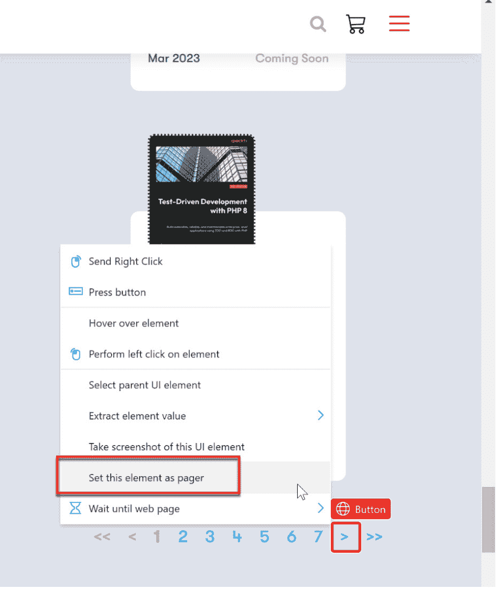

图 2.36 – 在录制中使用分页器

元素现在会带有一个小蓝色的虚线边框，表示分页功能。 查看录制器窗口，这里应该只看到一个元素：

Help

Done

Cancel

# 图 2.37 – 已录制的网页抓取操作

如果错误捕获了其他元素，只需删除它们即可。 你现在可以通过点击 Done 按钮停止录制。 现在，已录制的动作将被传输到主 PAD 设计窗口：

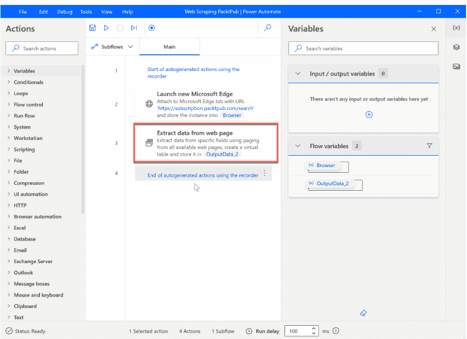

# 图 2.38 – 将已录制操作传输到设计器

操作列表中还有注释，描述了录制器生成的动作的开始和结束。 让我们通过双击它来更详细地研究 Extract data from web page 操作：

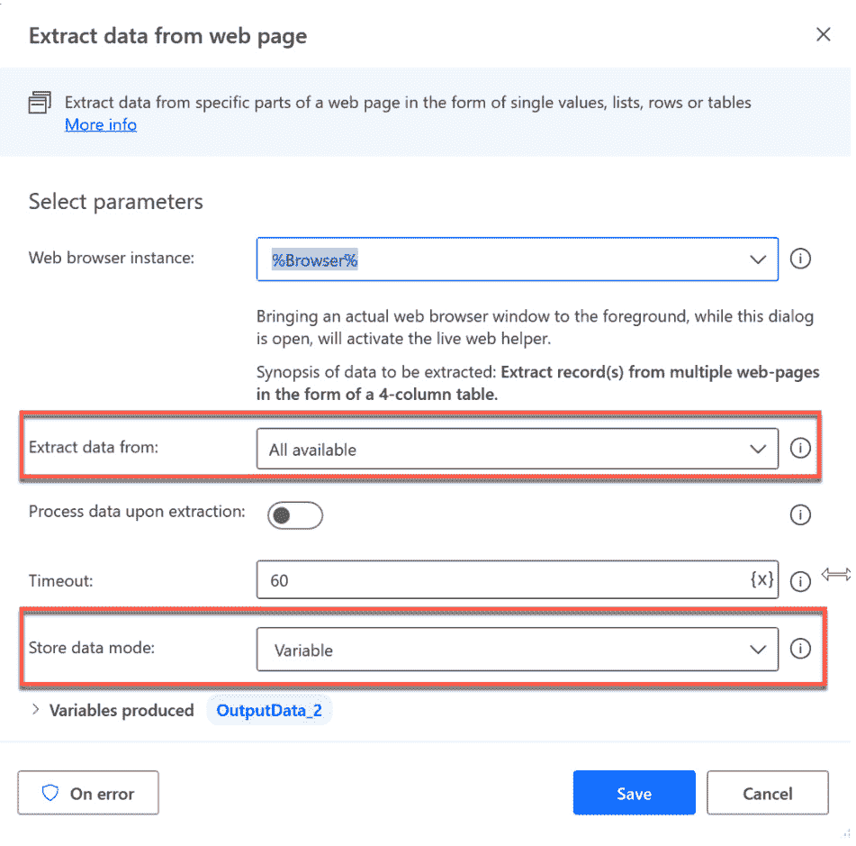

图 2.39 – 显示网页数据提取

这里有趣的部分是 **Extract data from** 和 **Store data mode**。 在流程中第一个操作加载浏览器后，此操作会提取网页上的所有数据，除非我们另有说明。 在某些情况下这可能很有用，但对于我们的测试，我们只想提取前 10 页。 点击 **All available** 条目的下拉菜单并将其更改为 **Only the first**。 现在会出现另一个文本框，我们可以在其中输入要处理的网页数量。

此示例的最后一个设置是 **Store data mode**。 到目前为止，所捕获的数据存储在一个变量中（在我的示例中为 `DataFromWebPage`）。 但当然，还有其他方法可以处理这些数据。 例如，你可以取该变量并在提取网页数据后将其用作另一个操作的输入，或者你可以选择将其存储在 Excel 中。 因此，点击 **Store data mode** 的下拉菜单并将值从 **Variable** 更改为 **Excel spreadsheet**：

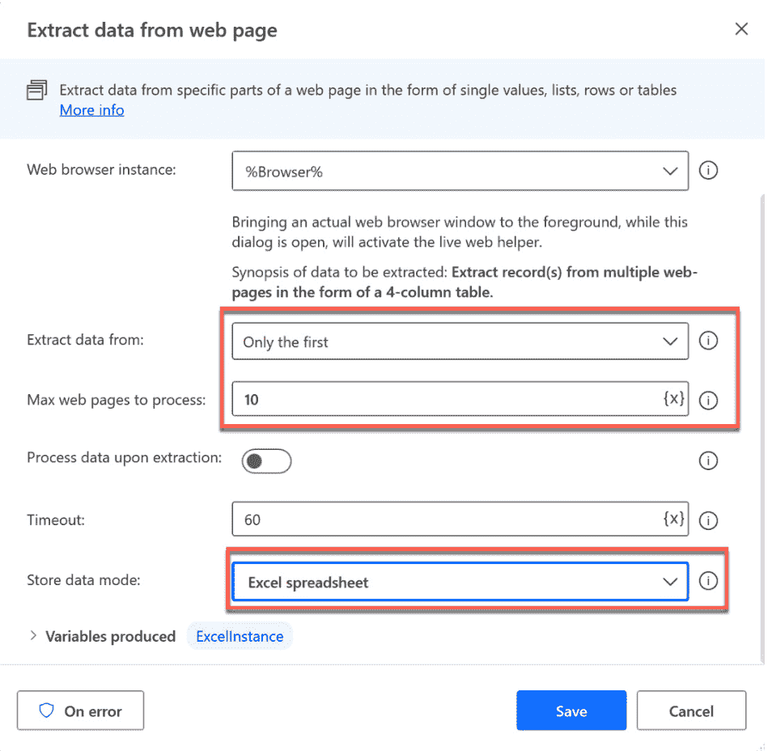

图 2.40 – 修改网页数据提取参数

现在，网页数据提取将仅运行前 10 页，获取数据，启动 Excel 并新建一个电子表格，然后将捕获的数据粘贴其中。 现在保存对话框，让表演开始吧。 在我的机器上，提取 120 条记录并将其粘贴到 Excel 中花费了 45 秒。

## 总结

安装 PAD 很简单，就像安装任何其他 Microsoft 工具一样。 一旦你为 Microsoft 帐户注册，你就可以登录该程序并立即开始创建你的 UI 流程。

建议尝试操作并使用该工具即使是自动化简单的任务。 这将使你更熟悉该程序，正如我在本章中解释的那样。 录制器可以为你节省大量工作，并且可用于新的或现有的流程。 尤其是当网页抓取是一项任务时，此工具非常方便。

在下一章中，我们将继续我们的旅程并查看 PAD 的编辑和调试功能。

## 进一步阅读

要了解更多本章涵盖的主题，请查看以下资源：

- *Install Power Automate Browser extensions:* https://learn.microsoft.com/en-us/power-automate/desktop-flows/install-browser-extensions
- *Record desktop flows:* https://learn.microsoft.com/en-us/power-automate/desktop-flows/recording-flow

图 3.2 – 操作 kebab 菜单选项

我们有以下选项：

- **Edit**: 这会弹出特定操作的 **Parameter** 对话框。 此对话框可能会根据我们使用的操作而变化。 **Launch Outlook** 操作的设置与其他 **Get files in folder** 不同。
- **Run from here**: 如果我们使用此命令（或 *Alt+F5*），流程将从此操作开始执行。 所有之前的操作都不会被执行。 如果在此之前有其他操作对于所选操作被执行是必要的，这可能会导致错误。 但尽管如此，如果流程之前出现错误，你只想从此处开始，这也可能是一个方便的功能。
- **Undo / Redo / Cut / Copy / Paste**: 这些是从其他程序（如 Office）中熟知的编辑功能。
- **Move up / Move down**: 而不是点击并拖动操作，我们可以使用这些命令或使用快捷键。
- **Disable action**: 这也是设计流程时非常有用的功能。 它允许你禁用一个操作，使其不会被执行。

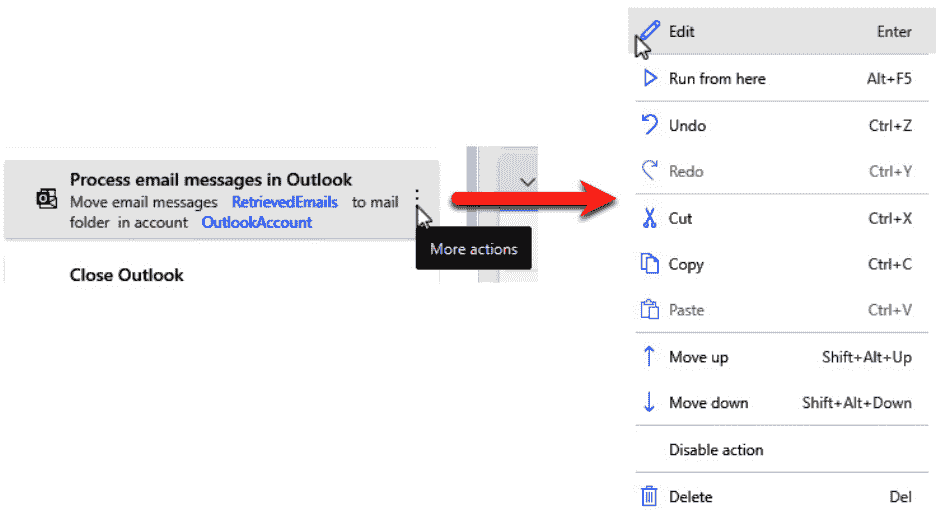

例如，你可能希望在流程结束时做一些清理工作并删除文件或关闭程序。但是，如果你仍处于设计的中间阶段，你可以禁用这些操作，以便更专注于设计。这在调试流程时也很有帮助（我们将在下一节中进行）。但请注意不要禁用循环或条件语句中的步骤。这些操作用一个开始和一个结束将一个或多个其他操作封装起来。下面的图片显示了一个 if 条件操作和另一个 if 流程操作。后者条件的对应结束语句被禁用，这导致了错误。

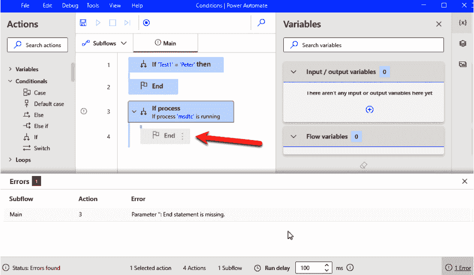

图 3.3 – 禁用操作和错误消息

删除：与其禁用操作，也可以直接删除它，这会将操作及其所有参数设置从流程中移除。

## 参数对话框

一旦我们从 **Actions** 面板将一个操作拖放到工作区，就会弹出一个对话框，要求我们提供信息——参数对话框。下面的屏幕截图显示了 **Get files in folder** 操作的参数对话框：

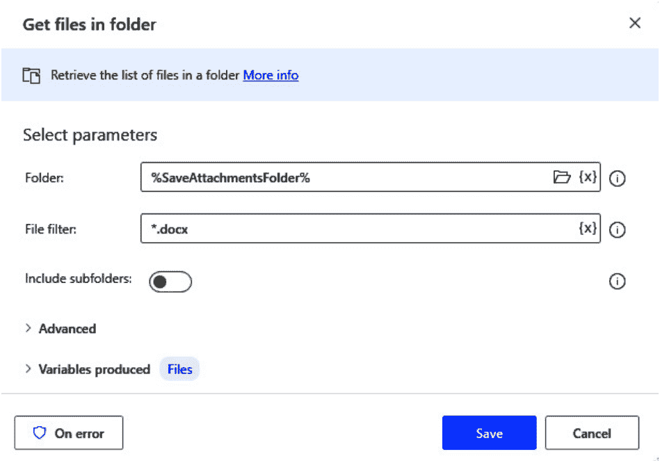

图 3.4 – 参数对话框

此对话框显示所选操作的特定参数。由于几乎每个操作都不同，对应的参数对话框也会显示不同的参数。确实有一些操作具有相似的参数，例如 **Copy file(s)** 和 **Move file(s)**，但这些更多是例外。

参数对话框让你输入操作执行所需的所有必要信息。这些信息可以是文本或数字、下拉菜单的选择、切换开关，例如上一张截图中的 **Include subfolders**，有时甚至更复杂的信息。

有时，参数也会分为最常用和高级的。它们在对话框首次出现时是隐藏的，但可以通过展开 **Advanced** 区域来显示。我们也可以在前面的截图中看到此区域。

### 重要说明

参数对话框不会显示操作正常工作所需的必填字段。判断某个参数是否为必填的唯一方法是将其留空并保存操作。缺失的信息将作为错误显示在窗口底部的消息窗口中。UI 流程在这些错误被纠正之前不会运行。

操作还可以产生或捕获可在流程中后续步骤中使用的信息。例如，在 *Figure 3.4* 中，**Get files in folder** 操作会创建给定文件夹中的文件列表。为了使此信息可供后续操作使用，会生成变量来存储它。在前面的示例中，操作创建了一个名为 **Files** 的变量。下面的屏幕截图显示此对话框部分也可以展开：

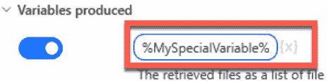

图 3.5 – 展开的变量区域

展开后，可以相应地重命名变量。在这里，我们将变量重命名为 `MySpecialVariable`。命名约定将在下一章中更详细地讨论。如果变量的数据在流程中不会被使用，可以通过按下相应的切换开关来禁用变量的创建。

在为操作提供所有所需信息后，即可保存它。操作产生的变量随后会显示在右侧的 **Flow variables** 区域中。现在，这些变量也可以作为另一个操作的输入来使用。要使用变量作为输入，

我们不会将信息硬编码到参数输入框中，而是使用右侧的 {x} 符号。有关变量的更多信息以及所有细节，请参阅第 5 章。

现在我们知道了设计器窗口的细节，让我们来看看全局菜单选项提供的额外功能。

## 全局菜单选项

我们在上一章中已经涉及过菜单栏。这些功能在我们编辑流程时非常有价值。让我们来看看最重要的菜单选项：

- **File | Save / Save As...**：保存流程或使用 Save As... 选项创建副本并为流程提供新名称。
- **Edit | Undo / Redo**：这些是众所周知的选项，允许你在设计器中撤消或重做任何操作。如果不小心删除了操作，这也非常有用。
- **Edit | Select all / Clear selection / Invert selection**：工作区中的一个或多个操作可以被 *selected*。如果你点击一个操作，它就会被选中。按住 shift 键并选择另一个操作时，中间的所有操作也会被选中。现在，这组操作可以被删除、激活或停用，甚至可以一起移动到工作区的其他位置。这些菜单选项处理此选择。
- **Edit | Go to line**：有时能够立即跳转到特定行会很方便，例如在处理大型流程和许多操作时，或出现错误时，因为错误消息也包含行号。
- **Debug | Toggle breakpoint / Remove all breakpoints**：当选择一个操作时，此菜单选项会在该行放置一个断点。另一种方法是直接点击行号左侧。我们将在下一节中更详细地讨论断点。

如果流程被停止，在该断点之前的所有操作执行结果都会被保留。如图 3.6 所示，断点位于 **Launch Outlook** 操作之后。如果我们现在停止流程执行，Outlook 仍会保持打开状态。这种行为在遵循分阶段的流程设计方法时也很方便（参见下一节）。断点在控制变量的值时也非常有用。我们将在下一节中使用断点。

暂停流程的另一种选项是使用 *pause* 按钮，该按钮在流程运行时可见。实际上，*play* 按钮会变为 *pause* 按钮，如下图所示：

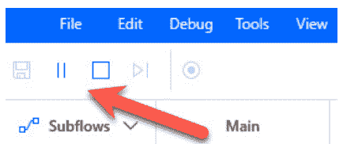

图 3.7 – 暂停按钮

这也允许你在不使用断点的情况下在任何位置暂停流程。

## 使用子流程

在每个流程中，我们还可以创建子流程。这是一种将较大的 UI 流程结构化为不同部分的概念，这些部分反过来可以在主流程中调用和引用：

### 主流程

大型流程带循环

### 主流程

起始操作

子流程中的循环

清理和流程结束

图 3.8 – 分解流程

包含任务整体逻辑的主流程因此变得更易读、更易理解。所有变量都在主流程中可用并且可以更改，无需指定传递参数。甚至可以在子流程中调用不同的子流程，如果你想进一步结构化工作的话。下面的图显示了我们之前示例中的主流程和两个子流程：

### 主流程

### HandlWordDocument 子流程

### WriteToExcel 子流程

### 图 3.9 – 主流程和子流程

子流程存储在流程本身内，只能在包含的流程中使用。如果你查看 **Actions** 面板，你也可以看到有一个 **Run flow** 操作组，其中包含一个 **Run desktop flow** 操作。此附加选项将在 *第 4 章* 中讨论。

要创建子流程，请点击工作区顶部的 **Subflows** 下拉菜单，如下图所示。在下拉菜单中，你也可以看到任何已存在的子流程：

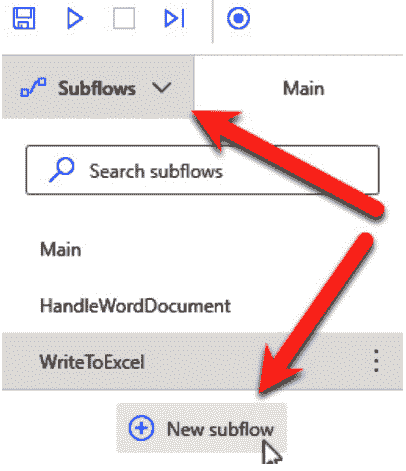

### 图 3.9 – 创建子流程

新的子流程会作为主流程旁边的额外标签出现，它开始时有一个空白工作区可供拖入操作。另一个选项是从主流程剪切并粘贴一个或多个操作到子流程中。在主流程中，你现在可以使用 **Flow control | Run subflow** 操作在相应的参数对话框中指定要运行的子流程。

现在我们已经学习了一些编辑流程的方法，让我们探索如何利用这些技能有效地创建它们。

# 创建有效流程的策略

我们已经在上一节中介绍了流程设计器窗口和菜单选项。在本节中，我们想看看如何利用这些可能性，将其纳入 UI 流程的设计中。

让我们回顾一下第一章中的初始示例。挑战是自动从通过电子邮件发送给我们的多个 Word 文档中提取信息。我们希望将这些信息保存到 Excel 电子表格中以便进一步报告。最终，这个流程大约有 22 个操作、13 个流程变量和 2 个输入/输出变量。这个流程已经具有相当大的复杂性，因此让我们探讨如何减少这种复杂性并实现该流程。

## 从简单开始

第一个建议是鼓励你从简单开始并逐步进行。以我们给出的示例为例，只需将 **Launch Outlook**、**Retrieve email messages in Outlook** 和 **Process email messages in Outlook** 操作拖到工作区并尝试使用它们。一旦你熟悉了这个主题，就可以继续下一个任务。也可以创建单独的流程来测试，然后将所学知识纳入另一个流程。

## 分解整体任务

在前一个概念的基础上，对于较大的任务，通常将整体任务分解为几个部分是有用的，如 *Figure 3.8* 所示。你可以通过使用子流程来实现这一点。参考我们之前的示例，这可能看起来像这样：

- **Part 1 — message and attachment retrieval:** 我们需要从家长那里检索所有新消息
- **Part 2 — processing of each attachment:** 我们想查看每个 Word 文档并提取相关信息以存储在电子表格中
- **Part 3 — cleanup and housekeeping:** 关闭所有打开的程序

我们现在可以分别处理各个任务，这立即降低了复杂性。

## 在循环之前先处理单个项目

在我们的示例中，我们希望处理家长发送给我们的多个 Word 文档。我们可以使用 XY 操作来访问列表中的所有文档。

然而，在遍历文档列表之前，我们必须首先为单个文档明确我们想要提取什么数据以及如何存储它。因此，在对所有文档进行循环之前，先用单个文档通过流程并设计这些步骤是有意义的。稍后，可以将循环操作拖到工作区并将单个处理放在其中。为此，你可以简单地拖放所需的操作，正如我们在本章前面学到的那样。

## 禁用以测试步骤

在某个时刻，会出现一个较长的流程，需要反复运行以进行测试。相同的步骤会一遍又一遍地从头到尾运行。然而，如果只需要测试或完善特定部分，则有意义地省略那些不在焦点上的操作。这些操作可以简单地为此目的而停用，并可以使用断点在所需操作处停止。

在我们的示例中，在 **Get files in folder** 操作中列出文档时可能会遇到错误。对于错误检测，Outlook 是否先启动以及是否获取了所有电子邮件并不重要。因此，我们可以简单地为此测试禁用这些步骤。此外，在这种情况下，在 **Get files in folder** 操作中设置断点是有意义的，以便流程在错误发生时或稍早时恰好暂停。我们可以在以下屏幕截图中看到此条件：

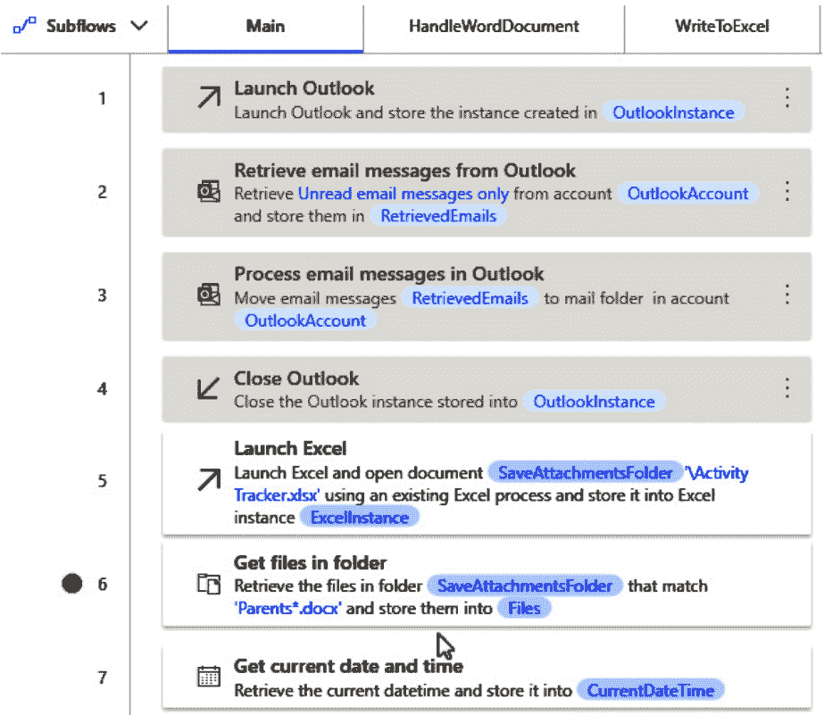

Figure 3.10 – Disabled actions and breakpoint

通过这种方式，本章中学到的技术可用于快速高效地开发和排除 UI 流程的故障。

## 适应可用选项

有时你会有关于流程的绝佳想法，以及如何让日常任务更轻松。但随后你意识到，不幸的是，流程无法按照你想象的方式映射和设计，因为没有合适的

# 基本结构元素和流程控制

流程通常从上到下执行。然而，有时我们需要包含分支甚至重复某些操作。在本章中，我们将研究如何控制处理中操作的顺序，因为控制流程逻辑是其创建的重要组成部分。

在本章中，我们将涵盖以下主题：

- Using conditionals
- Handling repetitive tasks with Loop statements
- Error handling

## 技术要求

你需要一台安装了 PAD 的工作站，并且应该知道该应用程序的工作原理以及如何创建一个简单的流程。

## 使用条件

条件用于确保在执行操作或一系列操作之前先检查某个状态。它们是编程中的基本概念之一，可以在没有编程知识的情况下构建流程。我们已经在之前的示例之一中使用了条件，在那里我们需要在创建文件夹之前检查文件夹是否存在。条件通常被称为 `If` 语句。

要使用条件，我们需要将 **Conditionals** 操作组中的一个操作拖到工作区。我们可以在列表顶部找到该操作组，如以下屏幕截图所示：

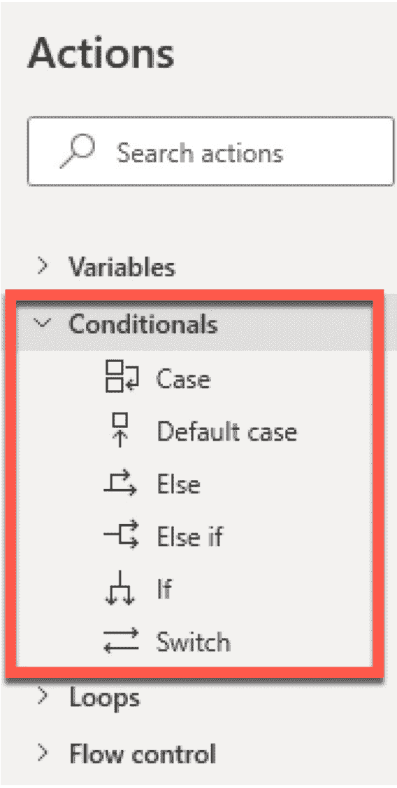

Figure 4.1 – Elements in the Conditionals action group

需要注意的是，*Figure 4.1* 中列出的这些操作必须按特定顺序和序列使用。以下小节将解释如何在上下文中使用每个操作。

## 从 If 和 Else 开始

在大多数情况下，当我们需要检查条件时，`If` 语句操作是起点。如果你将 `If` 操作拖到工作区，操作参数对话框会出现并需要信息，如 *Figure 4.2* 所示：

- **First operand:** 确定我们想要检查什么
- **Operator:** 确定检查时要使用哪个操作
- **Second operand:** 确定要与什么进行比较

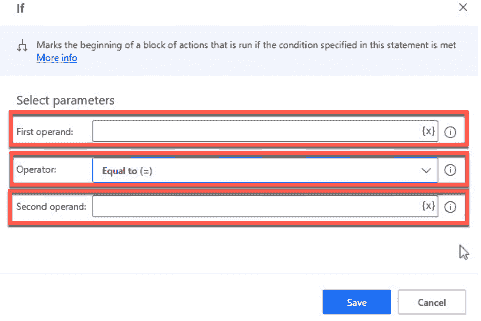

Figure 4.2 – If action parameter dialog

本质上，这里发生的是我们可以将两个值（第一个和第二个操作数）相互比较（相等或不相等、大于等），然后决定如果它们匹配或不匹配时会发生什么。如果我们现在用一些有意义的值（或一些静态文本用于演示目的）填充第一个和第二个操作数，工作区将如下所示：

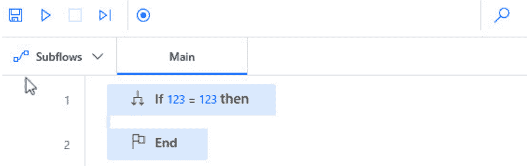

Figure 4.3 – A generic If block

正如我们所见，End 操作已自动放置在 If 操作下方，以标记此块的结束。

Do not disable or delete the End block

End 关闭块只是另一个操作，它可以被移动、禁用甚至删除。如果你这样做，流程设计器会立即显示一个错误，提示 End 语句丢失。如果你不小心删除了 End 语句，你可以转到 Flow control 操作组并将新的 End 操作拖到工作区中的正确位置。请注意也要将 End 放在条件块的末尾，而不是仅在 If 之后。

我们现在可以将其他操作直接拖到此块中。这些操作只有在 If 操作和运算符评估为真时才会被执行。例如，我们可以简单地将 Display message 操作拖到块中，如果评估返回 true，则显示消息框。但如果结果为 false 呢？嗯，在这种情况下，除非我们在 If 和 End 语句之间还拖入一个 Else 操作，否则什么也不会发生。现在放置在 Else 块下方的所有操作将在 `If` 块评估为 *false* 时执行。为了测试这一点，我们也可以将 **Display message** 操作拖到工作区中 `Else` 块下方并显示不同的消息，如以下屏幕截图所示：

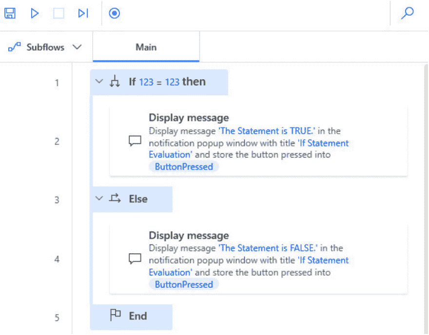

Figure 4.4 – If-Else block with different messages

另一个重要概念是 `If` 语句可以嵌套；也就是说，在 `If` 块内，可以放置另一个 `If` 块。我们将在本章的后续部分学习一些示例。

由于比较两个静态值并没有多大意义，我们希望比较存储在变量中的值。我们将在下一章更深入地探讨变量的主题，但为了本章的目的，让我们创建一些简单的变量。为此，使用工作区右侧 **Input / output variables** 区域的 *plus* 按钮，并选择 **Input**。

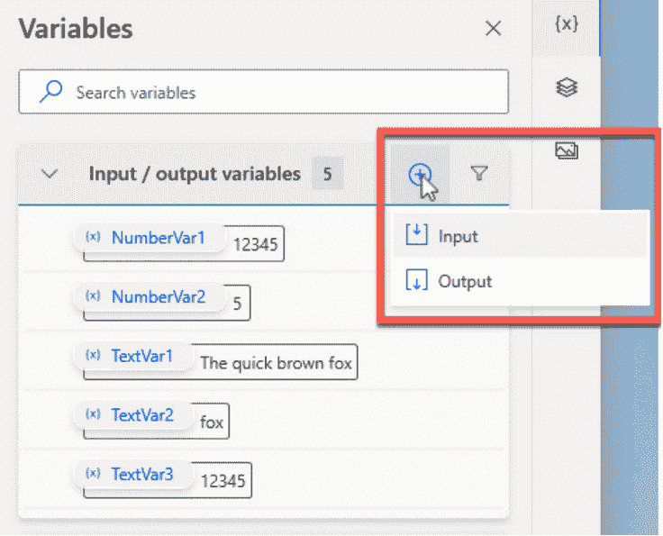

图 4.5 – 创建一个新的输入变量

在下面的对话框中，我们有选项为变量指定名称、数据类型和默认值。现在使用此对话框五次来创建以下变量：

| 变量名/外部名称 | 数据类型 | 默认值 |
|---|---|---|
| NumberVar1 | Number | 12345 |
| NumberVar2 | Number | 5 |
| TextVar1 | Text | The quick brown fox |
| TextVar2 | Text | fox |
| TextVar3 | Text | 12345 |

表 4.1 – 条件测试的变量列表

以下截图显示了 **Edit input variable** 对话框以创建变量，在此例中为 `NumberVar1`。点击 **Save** 按钮保存变量。

## Edit input variable

编辑现有输入或输出变量的属性 More info

变量名: NumberVar1

数据类型: Number

默认值: 1

外部名称: NumberVar1

描述: Add an input description

Mark as sensitive

Save Cancel

图 4.6 – 编辑输入变量

最后，你应该能看到所有变量如 *图 4.5* 所示。我们现在可以用这些变量替换 If 语句开头处的静态值。为此，双击 If 块以再次调出参数对话框。现在，我们可以用一些变量编辑第一个和第二个操作数：

- 1. 删除现有的静态值（在我们的示例中为 123）。
- 2. 按下输入框右侧的 {x} 按钮。这会启动子窗口以选择变量。你应该能看到所有变量
- 3. 为第一个操作数选择 **NumberVar1**。
- 4. 按下 **Select** 按钮。

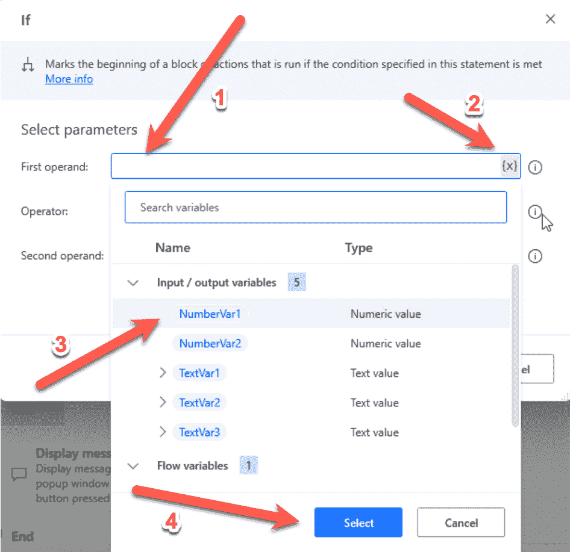

图 4.7 – 在操作参数对话框中使用变量

对第二个操作数重复上述步骤并选择 **NumberVar2** 作为变量。最终结果显示在以下截图中：

## Does not contain, Is empty / Isn’t empty, as well as Starts with / Doesn’t start with / Ends with / Doesn’t end with.

比较结果在很大程度上取决于变量的内容。我鼓励你重建本示例中的简单流程并尝试不同的选项，更改运算符和变量的值。通过使用 Display message 操作，你立即可以看到操作的结果。PAD 在这里非常友好，也允许使用不同类型的变量。

## Use Variables of the Same Type

尽管 Microsoft 关于条件语句的文档（https://learn.microsoft.com/en-us/power-automate/desktop-flows/use-conditionals）说明不同，并且在比较文本类型变量与数字类型变量时不会报错。对于此操作，两个变量都需要转换为相同类型。此转换的结果并不总是可预测的，即使在某些情况下结果是有意义的，也建议使用相同类型的变量以避免不一致或意外行为。

## Else If action

有时一个条件操作不足以分支到需要执行的动作的正确路径。使用常规 Else 语句时，该部分中的动作始终作为唯一的替代分支执行，因为条件不会再次评估。

使用 Else If，也可以在 Else 部分定义另一个条件，该条件也可以完全独立于第一个条件。为此，只需将 Else If 操作拖放到开始的 If 块和 Else 块之间，Else 块必须始终是此构造中的最后一个块。以下示例应说明条件语句的使用。思路如下：

- - 评估某支曲棍球队是否赢得了一场比赛，如果赢了，净胜球是多少。
- - 这只是一个示例实现，其中球队可以在获胜信息中获得特别认可或公平信息。这只是为了演示 `Else if` 语句的使用，并不意味着一支球队不能同时获胜且非常公平，当然。
- - 运行此流程时只会显示一条消息。流程完全分支到评估条件为真的部分。如果都不匹配，则分支到 `Else` 分支。你可以在循环内使用多个 `else if`，
- - 你可以轻松更改变量及其值以测试不同的分支。

条件语句在设计流程时非常有帮助。PAD 创建 UI 流程的简单性使你能够立即上手设计。然而，在更复杂的场景中，退一步在流程图中绘制逻辑也非常有用。多个嵌套的条件语句和 `Else if` 尤其难以以后维护，因此始终最好尽可能简化逻辑。

## Special If actions

上一节描述的条件概念能够处理硬编码值和变量。但如果我们需要做一些更复杂的事情，例如检查文件是否存在呢？

PAD 为这些目的提供了特殊的 `If` 操作，我们将在相应章节中介绍它们。为了先有个印象，这里列出了特殊 `If` 操作及其功能简要说明：

| 操作名称 | 位于操作组 | 功能 |
|---|---|---|
| `If file exists` | Files | 检查文件是否存在或不存在 |
| Name of the action | Located in action group | Functionality |
| If Folder exists | Folder | 检查文件夹是否存在或不存在 |
| If service | Windows services | 检查服务是否已停止、已安装或未安装、正在运行或已暂停 |
| If process | System | 检查进程是否正在运行或未运行 |
| If window | UI automation | 检查窗口是否打开或未打开，以及是否为前台窗口 |
| If window contains | UI automation | 检查窗口中是否存在特定的文本或 UI 元素 |
| If image | UI automation | 检查屏幕上是否找到选定的图像 |
| If web page contains | Browser automation | 检查网页上是否存在特定的文本或元素 |
| If text on screen (OCR) | OCR | 检查屏幕上是否出现字符串/字符序列 |

表 4.2 – 特殊 If 操作列表

正如我们在前表中看到的，PAD 提供了大量功能来利用我们流程中的条件动作序列。甚至可以为条件设置多个分支，这将在下一节中探讨。

## Conditionals with multiple branches

有时也需要将一个值分类到多个类别之一，而不是执行单一测试。例如，可以根据达到的百分比确定学校成绩。有多个分支，每个分支都可以列出自己的动作序列。这时我们会使用 `Switch-Case` 构造。

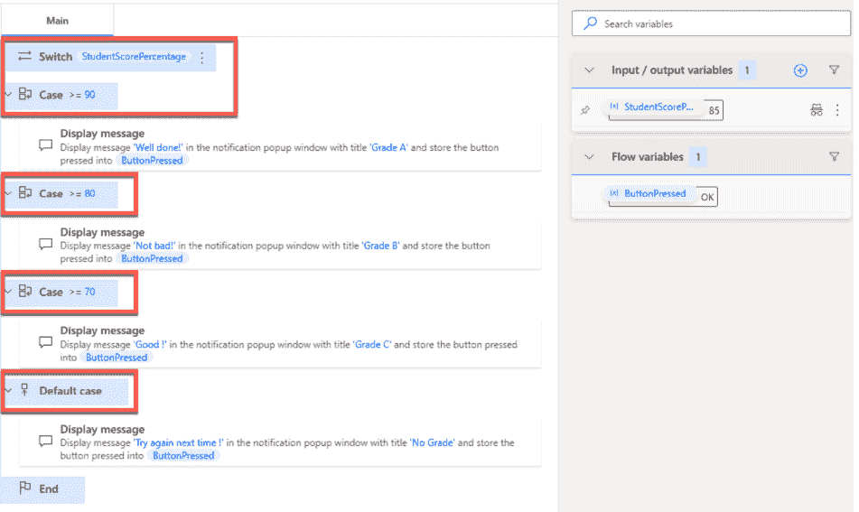

图 4.10 – 使用 Switch-Case 操作评估学生成绩

在前面的示例中，我们可以看到如何使用 `Switch-Case` 构造确定学生成绩。这些操作也位于 **Conditionals** 操作组中。在前面的示例中，我们希望创建一个流程，根据以下规则根据成绩百分比显示单独的消息框：

- - Grade A > 90 – 100%
- - Grade B > 80 – 89%
- - Grade C > 70 – 79%
- - Grade D > 60 – 69%

Grade F > 0 - 59%

要创建前面的流程，请按照以下说明操作：

- 1. 创建一个名为 `StudentGradePercentage` 的输入流程变量，类型为 `Number`，并赋予一些默认值，在我的例子中为 85。
- 2. 在 **Conditionals** 操作组中找到 **Switch** 语句并将其拖到工作区。注意也会创建对应的 `End` 语句。
- 3. 在该操作的操作参数对话框中，使用 *步骤 1* 中的变量作为要检查的值。
- 4. 从 **Conditionals** 操作组拖动一个 **Case** 操作到 `Switch` 和 `End` 操作之间。
- 5. 使用 `Greater than or equal to (>=)` 作为运算符，并使用值 90 作为比较值。
- 6. 使用搜索栏或 **Messages** 操作组找到或定位 `Display message box` 操作，并将其拖到 `Case` 操作正下方。
- 7. 在该操作对话框中，输入标题和根据成绩的消息。
- 8. 对成绩 `A` 到 `D` 重复 *步骤 4 到 7*，使用不同的值和消息。
- 9. 对于成绩 `F`，我们使用 `Default case` 操作，它是整个语句中的最后一个操作。我们不需要为此指定任何值。如果之前的条件都不为 `true`，则会执行此操作。别忘了在这里也放置 **Display message**。

请注意，在 `Switch` 语句中，即使某个值可能适用于多个条件，也一次只执行一个分支，并且将是第一个匹配条件的分支。顺序起决定性作用。例如，如果我先列出 `Case >= 80` 指令，值 95 将落入其中，对应的操作将被执行，构造将被退出，尽管实际上另一个分支（`Case >= 90`）才是正确的。我们现在已经了解了如何控制

动作序列，取决于某些条件，无论是单分支还是多分支。下一节将介绍我们需要做什么才能根据参数重复执行某些动作。

## 使用循环语句处理重复任务

在编程语言中，另一个有价值的概念是通过列表迭代或在特定次数内运行一组特定的语句和动作。这也可以在 PAD 中通过使用循环动作来实现。这些位于 **Loops** 动作组中。

### 循环动作

让我们从循环动作开始，并为 *Ludo* 桌游创建一个骰子模拟器。在这个桌游中，玩家必须使用在游戏开始前选择的颜色的棋子绕行棋盘。骰子掷三次。如果结果为 6，玩家可以移动棋子。如果不是，他们需要再次尝试。以下是模拟此情况的流程：

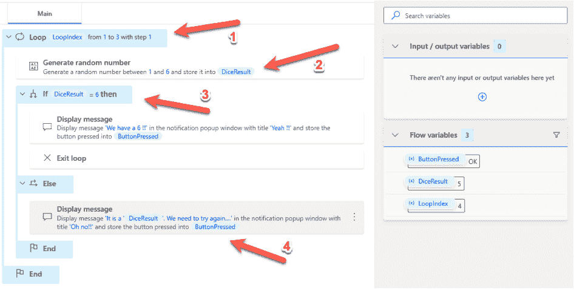

*Figure 4.11 – Roll the dice flow with a loop statement*

以下是前一图中步骤的详细说明：

1. 打开 **Loops** 动作组并找到 `Loop` 动作。将其拖到工作区并设置以下值：

   - **Start from:** 1
   - **End to:** 3
   - **Increment by:** 1

   这将导致循环执行三次。

2. 我们现在需要创建一个随机数作为掷骰子的结果。使用 **Actions** 组上方搜索栏搜索 `random` 关键字。你会找到一个名为 **Generate random number** 的动作。将其拖到 `Loop` 动作正下方。在动作参数对话框中，最小值输入 `1`，最大值输入 `6`。还尝试通过展开 `Variables produced` 区域并双击名称，将默认变量名 `RandomNumber` 重命名为 `DiceResult`。确保新变量名被百分号包围，像这样：`%DiceResult%`。

3. 现在，我们需要检查结果是否等于 `6`，这意味着我们将继续游戏并停止再次掷骰子。我们现在将使用本章上一节中的条件来检查 `DiceResult` 的值。如果结果等于 `6`，我们将显示一个消息框确认这一点。

### Important Note

在消息框之后，我们使用 `Exit loop` 动作来停止再次掷骰子。该动作也位于 **Loops** 动作组中，不需要任何额外配置。

4. 在 If 动作的 Else 分支中，我们只想在结果不等于 6 时显示骰子的结果。

请注意，在前面的示例中，我们使用了 Exit loop 动作来离开循环过程。还有一个 Next Loop 动作，可以在 Loop 动作内部使用。根据动作在 Loop 动作内部放置的位置，所有后续动作将被跳过，并强制进行下一次迭代。

### 循环条件

另一种遍历动作列表的方式是使用循环条件动作。在编程语言中，这被称为 while 循环。只要特定条件为真，一组动作就会被重复执行。

在下一个示例中，我们将看到这是如何工作的。以下流程实现了一个猜数字游戏。开始时，会确定一个随机数，用户必须猜出它是什么数字。如果用户输入正确数字，游戏获胜且循环结束；否则，尝试次数会增加。以下是流程的实现：

*Figure 4.12 – The guessing game implementation*

以下是步骤的详细说明：

1. 流程从定义两个变量开始，Counter（一个数字，初始化为 0）和 GuessRight（一个布尔值，初始化为 False，用于存储用户猜测的状态），以及一个 Generate random number 动作。为了让用户更容易一些，将在 1 到 20 之间生成一个数字并存储在 RandomNumber 变量中。

2. 接下来，将使用循环条件动作。操作参数对话框中的第一个操作数将是 GuessRight 变量，我们希望将其与固定值 False 进行比较。这意味着只要 GuessRight 的值为 false（用户未输入正确数字），循环就会继续。

3. 接下来，我们想显示一个输入屏幕，允许用户输入数字。我们为此使用 Display input dialog 动作，该动作也位于 Message boxes 动作组中。我们只需在此处输入标题和消息。输入值将存储在名为 UserInput 的变量中。

4. 用户输入猜测后，我们需要检查随机数是否等于用户输入。我们使用 If 条件来执行此操作。如果两个值相同，我们使用 Set variable 动作将 GuessRight 变量修改为 true 并显示成功消息。通过修改变量，我们也导致循环结束。

**Set variable**

设置新变量或现有变量的值，创建新变量或覆盖先前创建的变量 More info

| Field | Value |
| --- | --- |
| Variable | GuessRight |
| Value | True |

Save Cancel

*Figure 4.13 – Set variable action*

5. 在 Else 分支中，我们只是增加用户的尝试次数计数器，如图 4.12 所示，并显示一个消息框。

Spoiler alert: 你可以在窗口右侧的 Flow variables 部分看到你需要猜的数字。

### For each

另一个非常常见的场景是遍历给定元素，例如文件夹中的文件，就像我们在之前的示例中已经看到的那样。For each 动作用于此目的，并且需要一个项目列表、数据表或数据行作为输入，以便为每个元素执行一组动作。

有一些内置动作已经生成项目列表，例如 Get files in folder 或 Get subfolders in folder，但也可以创建自己的项目列表作为变量并使用它们。

我们将在下一章详细讨论变量和列表的主题，并查看如何使用 For each 动作的示例。

### 流程控制的附加动作

在前面的章节中，我们学习了条件和循环结构，控制流程的基本构建块。在本节中，我们将查看影响流程中动作流程的额外方法。这些动作包含在相应的动作组 Flow control 中。

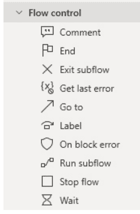

*Figure 4.14 – Flow control actions*

让我们看看这些动作能带来什么。我们还将在一个示例中看到这些动作的使用：

- **Comment:** 此动作可用于在流程中添加注释并记录动作。
- **End:** 不能单独工作，但如果我们意外删除了属于 `If` 动作或循环的 `End` 动作，我们可以使用此动作来完成流程。
- **Exit subflow and Run subflow:** 我们已经在一个早期的示例中使用了 **Run subflow**。**Exit subflow** 只能在子流程中使用以停止子流程并返回调用它的位置。
- **Get last error:** 检索流程中发生的最后一个错误并将其存储在变量中以供进一步处理。
- **Go to and Label:** `Label` 在流程中设置一个标记，即动作列表中的特定位置。通过 **Go to**，可以使用标签将执行流程转移到该位置。例如，可以将 **Label** 动作拖到流程中的任何位置并将其命名为 `Position1`。使用 **Go to**，我们现在可以说 `jump to the label called Position1` 并从那里执行。
- **On block error:** 允许我们将一组动作封装在块中并最终捕获执行中的错误。我们将在下一节讨论这一点。
- **Stop flow:** 当此动作执行时立即停止流程。可以配置流程是成功结束还是以错误消息结束。如果是后者，还可以定义错误消息。
- **Wait:** 此动作暂停流程特定秒数。这在流程需要等待程序启动或屏幕刷新时尤其有帮助。

让我们使用我们之前猜数字游戏来制作一个不使用循环语句但利用我们额外流程控制元素的替代实现。流程的工作方式完全相同，看起来如下：

# 图 4.15 – 第二个猜数字游戏实现

详细流程说明如下：

+   1. 这里，我们插入了注释以便更好地记录流程。
+   2. 在输入对话框之前放置了一个名为 StartOver 的标签动作。这是当答案错误时我们希望执行重新开始的流程位置。
+   3. Wait 动作会暂停流程一段时间。为了让它更有趣一些，我们可以使用失败尝试次数的计数器作为这里的数值。这意味着用户需要的尝试次数越多，下一次猜测的新消息框出现所需的时间就越长。
+   4. Go to 动作会跳回到 StartOver 标签并从那里执行。

创建一个新的流程并定义一个简单的文本类型变量，FileToDelete，默认值为 C:\deletethis.txt。

接下来，在 File 动作组中定位 Delete file(s) 动作并将其拖到工作区。动作参数对话框会出现，我们可以将变量名作为要删除的文件填入。但在现在按下 OK 之前，我们希望使用 On error 功能来处理错误。如果我们按下对话框中的相应按钮，它应该看起来像这样（我稍微展开了对话框）在左侧：

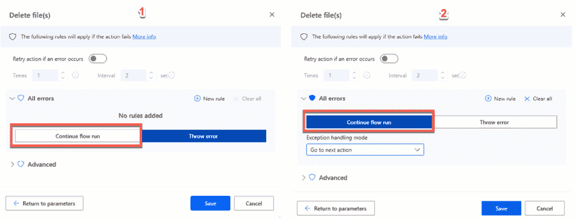

图 4.16 – On error 对话框

这里我们可以选择两个主要选项：

+   - **Throw error**（右侧）：这是默认设置，会停止流程的运行。
+   - **Continue flow run**（左侧）：如果我们点击此选项，对话框会变为前一张截图左侧的那个。现在我们可以决定如果发生错误会发生什么。

当我们选择继续流程运行时，我们可以通过该选项下方的下拉框来确定会发生什么。这里，我们有以下选项：

# Delete file(s)

如果动作失败，以下规则将适用 更多信息

发生错误时重试动作

# All errors

变量 NewVar {x} 文件在哪里？ {x}

Continue flow run

Throw error

异常处理模式

转到下一个动作

# Advanced

文件路径包含无效字符

文件未找到

无法删除文件

返回参数

保存

取消

# 图 4.17 – 高级错误处理

只能有一个部分处于活动状态，可以通过图 4.17 中显示的蓝色盾牌图标来识别。Advanced 部分包含与应删除的文件相关的所有可能发生的错误。如果我们选择另一个动作，这些选项会相应改变。但这允许针对某个动作检查特定错误。

在我的示例中，我选择使用 **All errors** 部分并设置一个名为 **NewVar** 的新变量，其中包含一些附加信息。在这里按下 **Save** 并设计其余流程后看起来像这样：

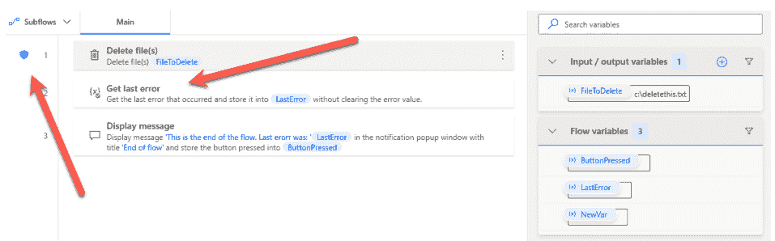

图 4.18 – 带有错误的流程

请注意，第一个动作 **Delete file(s)** 现在在行号左侧有一个新图标，表示错误处理已激活。我们也可以使用 **Get last error** 动作来获取错误本身并将其存储在另一个变量中，然后在消息框中显示。

现在我们知道如何为动作提供错误处理了。现在，让我们看看如果我们不确定列表中哪个动作会发生错误时该怎么办，以及如何捕获它。

# On block error

我们在之前的示例中看到，为动作定义错误处理并让流程在发生错误时仍运行到结束是很容易的。但如果我们有多个可能失败的动作呢？或者甚至是一组带有某些逻辑的特定动作可能会出错？On block error 动作可以在这里提供帮助。此动作允许将一个或多个动作放在此块内并定义发生错误时应做什么。这与我们之前查看的错误处理非常相似，只是没有针对动作特定错误的高级部分。在编程中，这被称为 try-catch 块。

与之前相同的示例，但现在使用 On block error 动作看起来像这样：

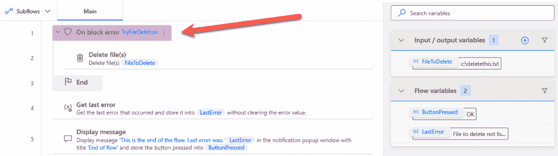

图 4.19 – 使用 Onblockerror 的错误处理

On block error 的动作参数对话框定义与单个动作相同。流程将运行到结束，消息框将显示相应的错误消息。

# 总结

能够控制流程执行对于流程设计师来说至关重要。在本章中，我们学习了如何使用条件和循环以及控制流程的其他方法一起使用。最后，我们研究了如何在流程中处理错误并使流程有序结束。

在本书的其余部分，我们将继续应用本章学到的内容，而下一章也同样如此，在下一章中我们将学习另一个重要概念：变量。
