# 变量、UI 元素和图像

通常，流程会使用来自外部的输入，无论是传递的值还是需要远程控制的应用程序。在本章中，我们将查看这些输入元素。它们位于设计器窗口的右侧，也是我们可以在此处找到变量、UI 元素和图像区域的地方（见图 5.1）。我们将详细介绍以下主题：

+   - 变量到底是什么，有哪些类型的变量？
+   - UI 元素是什么，它们在 UI 流程中如何使用？
+   - 图像在 PAD 的上下文中扮演什么角色，如何使用它们？

这三个主题的共同点是它们都可以作为自动化的输入使用。

# 变量及其使用方法

**变量**是一个可以存储值的对象（或设计元素）。你也可以把它想成一个可重用的组件，可以存储任何值。没有至少一个变量就没有有意义的流程。变量可以在设计器窗口的右侧创建和使用，如下图所示：

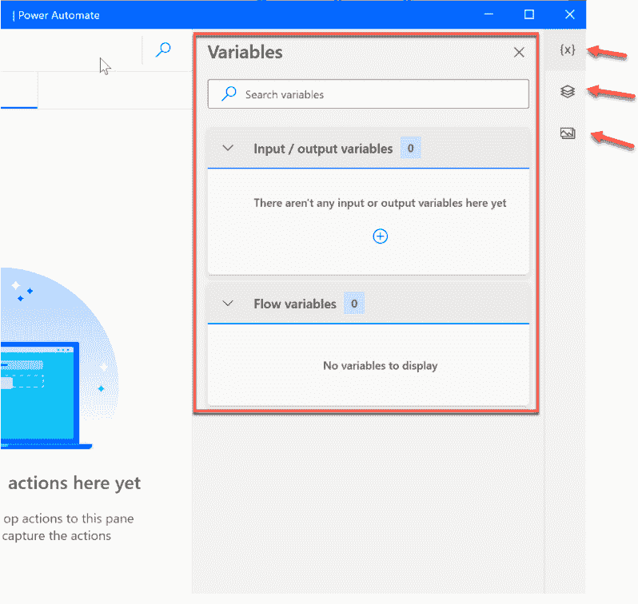

图 5.1 — 设计器工作区中的变量

在最右侧，还有 UI 元素和图像的符号，我们在本章中也会介绍它们。通过此面板，我们可以搜索变量、创建新的输入/输出变量（见下一节），并检查变量值。以下图显示了同一区域，称为 **Variable value viewer** 区域，其中包含一些已填充的值和附加功能：

变量始终具有特定类型，例如 **text** 或 **number**。这决定了可以存储在该变量中的数据类型。有多种类型可用，我们将在后续部分深入探讨。

我们可以区分我们自己创建的变量（输入和输出）或由动作创建的变量（流程变量）。这些变量都会显示在相应的区域。让我们逐一查看它们。

# ## 流程变量

这组变量是由流程动作产生的，以便在流程中稍后使用。让我们看一下：

+   - **Run application** 动作（`System` 组）启动给定应用程序并创建一个名为 `AppProcessId` 的变量，其中包含该应用程序的 Windows 进程标识符。我们可以使用 `Terminate process` 和此变量来关闭应用程序。
+   - **Get files in folder** 动作（`Folder` 组）创建一个包含该文件夹中文件列表的变量。此列表可用于迭代并读取或修改这些文件。
+   - **Display message** 动作（`Message boxes` 组）显示一个用于确认（例如 **Ok** 或 **Cancel**）的消息框，因此会创建一个包含所按按钮文本的变量。

流程变量不能直接在设计器中设置。但是，可以使用 `Set variable` 动作为其分配值。根据动作的不同，会创建不同类型和不同类型的变量。在前面的列表中，第一个变量将是 `number` 类型，而第二个将是 `list` 类型。此类型无法更改，因此我们必须按原样使用这些变量。

让我们创建一个新的流程并仅将 **Display message** 动作拖到工作区。在即将出现的对话框中，查看下半部分


**生成的变量**部分，并使用向下箭头符号展开。  
它看起来应该像这样：

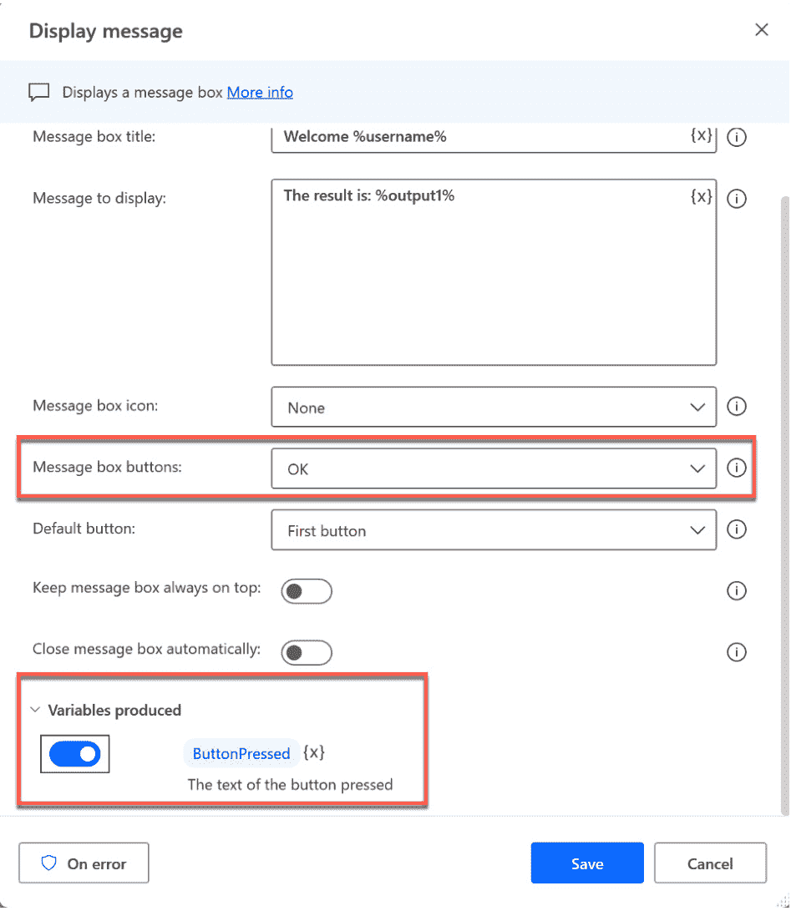

图5.3 – 流程变量的创建

由于此操作会显示一条消息并提供按钮来关闭对话框，因此会创建一个名为**ButtonPressed**的变量。请注意，我还将**消息框按钮**的值更改为了**OK – Cancel**，这样在对话框中就不会只提供一个**OK**按钮，而是两个。`ButtonPressed`变量的值将包含用户将要按下的按钮的名称：**OK**或**Cancel**。这样，流程设计者就可以根据按下的按钮来评估该值并执行相应的操作。Microsoft提供的示例大量使用了此功能。提醒一下，您可以在PAD主窗口中访问这些示例，点击**我的流程**右侧的**示例**即可：

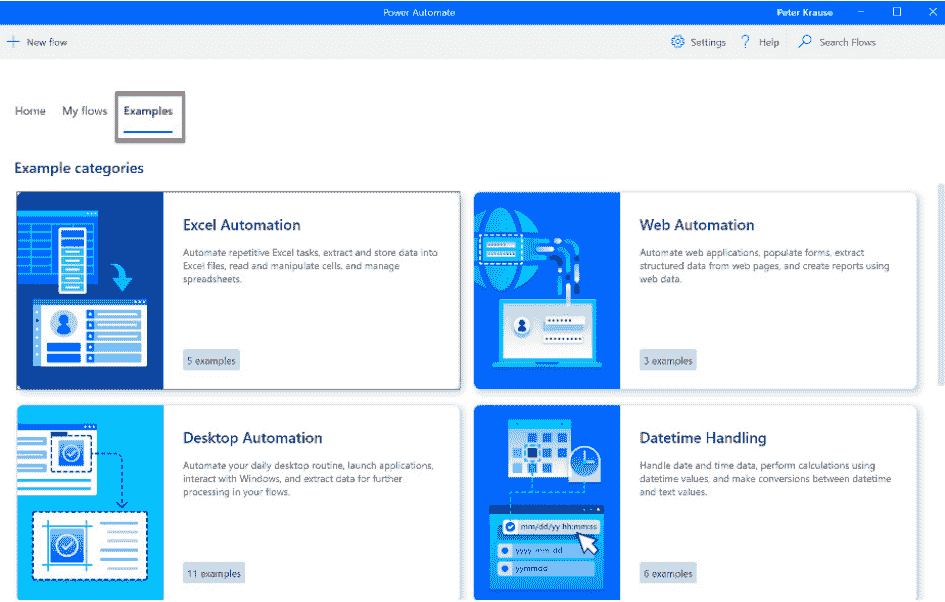

图5.4 – Microsoft提供的PAD示例

另外，请注意，我们可以使用相应的切换开关来禁用变量的生成。这适用于PAD中所有可能暴露变量的操作。如果我们对变量的内容不感兴趣，并且在后续处理中不需要它，这样做也是合理的，并且可以使变量列表更清晰（参见*图5.3*）。

为了清晰起见，也可以重用流程变量。假设我们稍后需要在流程中使用另一个消息框。将另一个操作拖入设计器将产生另一个变量——在本例中为`ButtonPressed2`。如果我们不想保留第一个消息框的结果，我们可以将变量重命名为`ButtonPressed`。要做到这一点，我们可以双击对话框中的变量名称并进行更改。这样，我们可以覆盖现有变量的名称，而不是创建一个新变量。但是，我们也可以使用另一种方法，可以在kebab菜单中找到，以及其他操作，如下图所示：

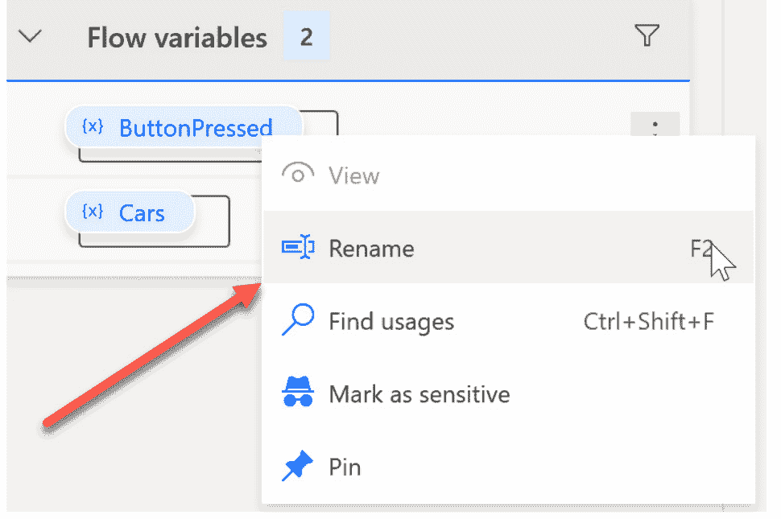

图5.5 – 流程变量的选项

可以选择以下操作；每个操作都针对选中的变量：

- **查看**：显示一个包含该变量当前值的对话框。
- **重命名**：为这个变量赋予另一个名称。
- **查找使用位置**：在流程中搜索此变量，并在窗口下部的单独窗口中显示结果。这是一个非常方便的功能，可以找到使用变量的所有位置。
- **标记为敏感**：详见下文说明。
- **固定**：将此变量固定到窗口顶部。所有其他变量将显示在固定的变量下方。

如果将一个流程变量重命名为现有名称，我们需要确认这两个变量是否应合并。如果我们采用前面两个消息框的示例，并将**ButtonPressed2**重命名为**ButtonPressed**，效果如下：

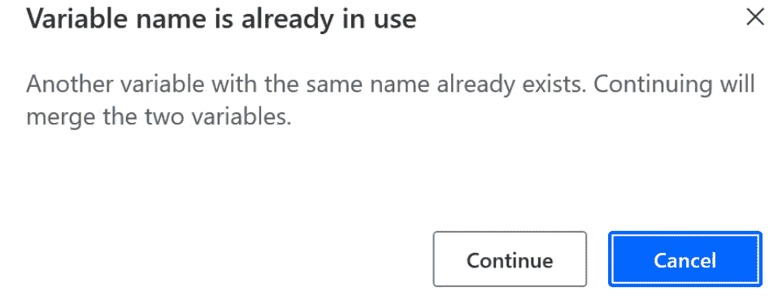

图5.6 – 合并流程变量

合并仅适用于流程变量

合并功能仅适用于流程变量，不适用于输入/输出变量。要更改输入/输出变量的名称，只需编辑它并更改名称，但该名称在所有其他输入/输出变量中必须是唯一的。否则，变量编辑器中会直接显示错误消息。但是，流程变量可以与输入/输出变量同名。流程变量不能被显式删除。当相应的操作（依赖关系将自动设置）从流程中移除时，这些变量会被移除。但是，如果某个操作重用了某个变量（如我们的示例所示），则流程变量将一直保留，直到最后一个使用该变量的操作被移除（这是出于安全原因）。

如果相应的操作被禁用，流程变量也会消失。稍后在流程逻辑中使用此变量的任何操作都将失败。

## 输入和输出变量

我们在前面的示例中使用了输入变量。输入和输出变量使我们能够将外部数据引入流程（输入变量），也可以将数据暴露给外部（输出变量）。后者尤其有意义，例如，当流程是更大体系的一部分，并且需要将某些值返回给另一个云流程时。

我们在前面的示例中使用这些类型的变量来定义一些输入数据，方法是手动设置值（我们在定义变量时可以将其设置为默认值），这在某些情况下非常有用，而流程变量则不能这样做。当我们在流程的不同位置需要相同的数据时，应该为此数据使用变量。

例如，假设我们想要创建一个流程，在特定文件夹中执行一些复杂的文件夹操作和文件移动。这个特定文件夹将用于流程中的多个操作。如果我们出于某种原因想要更改这个基础文件夹，我们需要在许多位置进行更改。相反，可以引入一个变量来存储所有操作都将运行的基础文件路径。更改此变量将导致它在所有使用它的位置更新。

创建变量非常简单。在*图5.1*中，输入/输出变量字段中间有一个小的+号。单击它，我们可以在输入或输出变量之间进行选择。以下创建变量的对话框对于两种类型都是相同的：

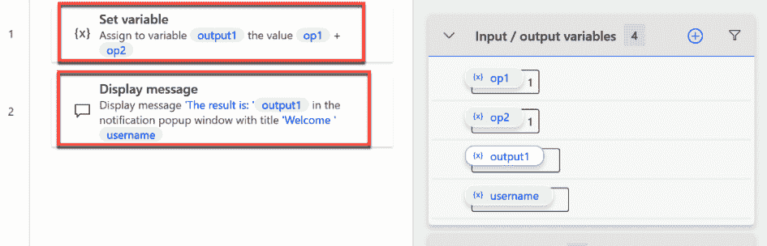

图5.8 – 一个简单的计算流程

这是此流程的操作列表，具有以下功能：

- 使用**设置变量**操作，将`op1`和`op2`相加的结果赋值给`output1`变量。请注意`%`表示法，我们将在本章后面介绍：

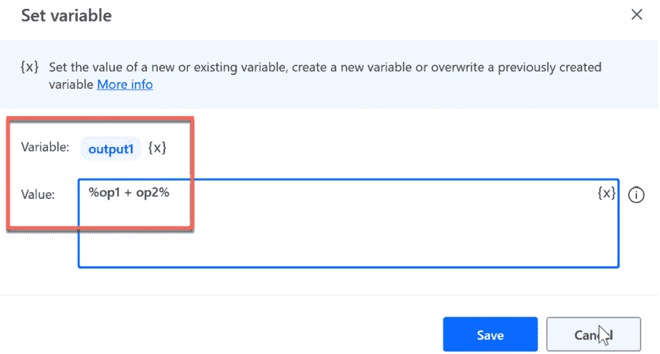

图5.9 – 使用带有%表示法的设置变量

创建一个**显示消息**操作，在标题中使用`username`变量，并在消息文本中显示计算结果：

### 显示消息

显示一个消息框 更多信息

选择参数

消息框标题：欢迎 %username%

要显示的消息：结果是：%output1%

图5.10 – 显示计算结果

请注意，您可以手动输入变量，也可以使用 {x} 按钮访问变量查看器。现在，保存并关闭流程设计器，然后通过按播放按钮从控制台窗口启动流程。您应该会看到以下对话框：

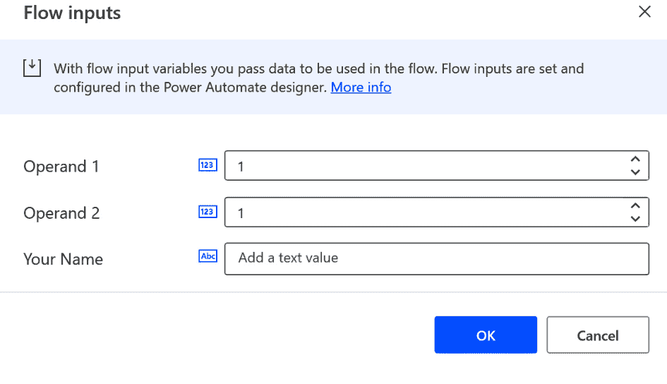

图5.11 – 流程输入对话框

您将看到不同输入的外部变量名称。如果您为操作数输入一些值和一个名称，流程将继续执行，并显示消息框和输出值。

## 变量类型

输入/输出变量可以是简单类型（文本、数字或布尔值），也可以是复杂类型（自定义对象、列表或数据表）。简单类型只能包含一个值（text = “some text value”，number = 5，或 boolean = True 或 False），而复杂类型可以包含多个条目甚至记录。这很有意义，特别是当桌面流程是更大场景的一部分时，不仅要传输和处理简单值，还要传输和处理列表和表格。让我们探讨有哪些可用的复杂变量类型。

要使用变量，我们在操作组列表的最顶部有一个专门的操作组，叫做**变量**。在这里，我们会发现许多处理复杂数据类型的操作，但也有一些针对简单类型的操作，例如数字数据类型：

- **截断数字**：允许您提取数值的整数部分或小数部分。
- **生成随机数**：用于在给定边界内创建随机数。我们在上一章的骰子模拟中使用了这个功能。
- **增加变量**和**减少变量**：顾名思义。

其余操作与复杂数据类型相关，我们接下来将介绍。

### 列表数据类型

如果需要分别存储多个值，可以使用列表。在编程术语中，这相当于一维数组。可以使用相应的操作**创建新列表**来创建列表，或者定义具有该类型的输入/输出变量。其他操作也会创建列表，例如**从Outlook检索电子邮件**或**获取文件夹中的文件**。当您有一个列表时，使用`for each`循环遍历所有项目非常方便。我们在前面的章节中见过。尽管如此，也可以通过索引访问列表的各个成员，索引以0作为第一个元素。语法如下：

```
%Listname[StartIndex:NumberOfEntries]%
```

示例：假设有一个汽车列表，包含以下条目：`Mercedes, Aston Martin, BMW, Chrysler, Fiat, Toyota, and so on.` `%Cars[0:3]%`表达式会选择`Mercedes, Aston Martin, and BMW.` 记住：我们从0开始计数。

我们还有其他可用于列表的操作。要操作列表的内容，我们可以使用以下方法：

- 清除列表


- 添加项目到列表
- 从列表中移除项目
- 排序列表，洗牌列表
- 反转列表
- 从列表中移除重复项目

所有这些都相当自解释，并且会按其名称所暗示的方式执行。它们不会暴露任何额外的变量。

某些操作需要两个列表来运行。这些是合并列表、查找公共列表项和减去列表。然而，这些操作会创建一个新的列表，即相应操作的运算结果。

## 数据表

除了单维列表数据类型之外，我们还可以使用二维或表格型数据表来存储值。你可以将数据表视为一个简单的 Excel 电子表格。有一个特定的操作可以从 Excel 电子表格中读取数据并返回一个数据表。这些操作会创建和操作数据行，它们也位于 Variables 操作组中，但在 Data table 文件夹下。

要创建数据表变量，我们可以使用创建新的数据表选项。操作参数对话框中包含一个编辑按钮用于定义表格：

Figure 5.12 – Creating a data table

我们可以双击现有列来重命名它们，或按 + 按钮添加新列和行。保存将存储值并返回到操作参数对话框，显示新数据表包含的行数和列数。为了演示数据表的不同操作，我创建了一个包含六行两列的简单表格，并将其命名为 CarsTable，如以下屏幕截图所示：

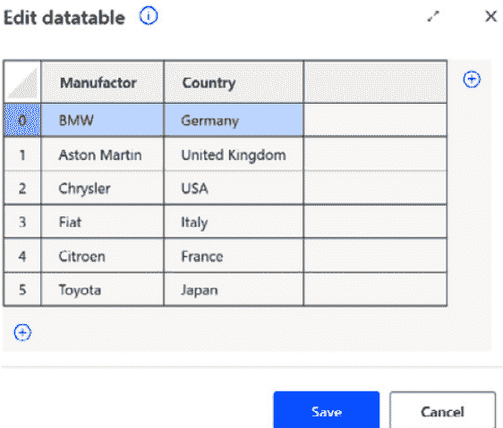

Figure 5.13 – The Cars table

现在，如果我们想向该表格添加新行，可以使用 **Insert row into data table** 操作。在相应的操作参数对话框中，我们需要选择数据表及其 **Into location**。在这里，我们可以选择 **End of the data table** 或 **before a row index**，选择后需要指定。添加的新值必须符合特定的语法。要添加一条制造商为 Chevrolet 且国家为 USA 的新汽车记录，我们需要输入 `%['Chevrolet', 'USA']%`。

我们将在下一节讨论 `%` 记法，但本质上，我们需要在 **New value(s)** 参数中传递一个列表或数据行，并用百分号封装。

**Update data table item** 的工作方式略有不同，因为它只是更新某个特定的单元格或项目。我们需要将列和行号作为参数值传递，以及要设置的新值。

要删除一行，请使用 **Delete row from data table** 并将行索引作为参数传递。

**Find or replace in data table** 操作是最复杂的，因为它具有很多功能。如其名称所示，它可以只是查找或查找并替换。可以利用正则表达式查找某些文本，并指定是否使用大小写敏感搜索。此操作的结果是另一个数据表，其中包含匹配项的列和行作为单独记录。

让我们看一下以下示例，看看它是如何工作的。

基于 Cars 表，我们想要插入包含一辆新汽车的新行。现在，我们想在所有位置将文本 USA 替换为 United States。我们可以创建一个如下所示的流程：

Figure 5.14 – Working with data tables

这里使用了 **Find or replace in data table** 操作来查找术语 USA 的所有出现。我将其配置如下：

**Main**

| Action | Description |
| --- | --- |
| Create new data table | Create a new data table and store it into CarsTable |
| Insert row into data table | Appends the row `['Chevrolet', 'USA']` at the end of CarsTable |
| Find or replace in data table | Finds all items in CarsTable containing the text `'USA'` and stores the matched cells into DataTableMatches |
| For each CurrentItem in DataTableMatches | |
| Update data table item | Updates the data table CarsTable at row index `CurrentItem['Row']` and column `CurrentItem['Column']` with the value `'United States'` |
| End | |

## Variables

Search variables

Input / output variables 0

There aren't any input or output variables here yet

Flow variables 3

- CarsTable
- CurrentItem
- DataTableMatches

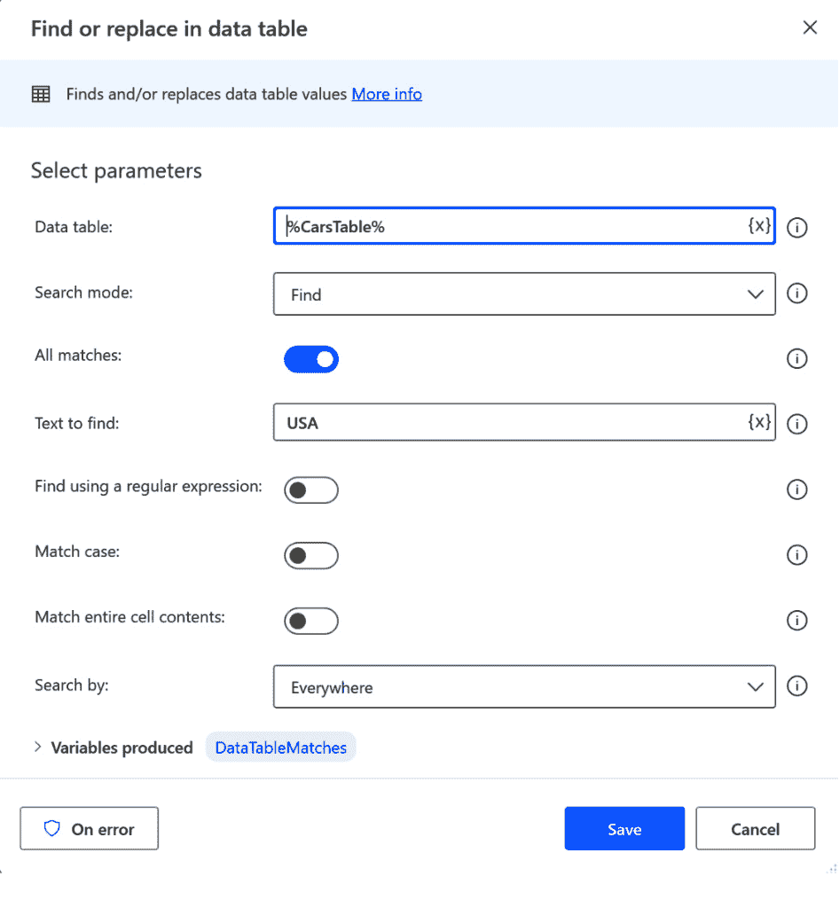

Figure 5.15 – The Find and replace in data table action

此操作会创建一个名为 **DataTableMatches** 的新数据表，在我们的例子中包含两条记录，即美国汽车的记录。流程运行后双击此变量会显示此表格的内容：

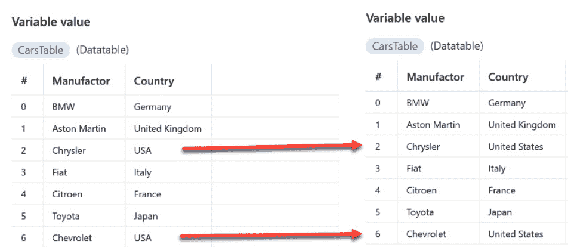

Figure 5.18 – The data table before and after the update

### Find and replace with “Replace” mode

请注意，我们本可以使用“Replace”模式的 Find and replace 操作，而不是仅查找。通过这样做，我们可以在参数操作对话框中确定用于替换的文本片段。这将是一种更方便的方式来替换数据表中的文本，我们就不需要遍历此操作产生的数据表了。但有时，我们只需要查找给定的文本片段，而不直接用其他文本替换它或执行更复杂的操作。前面示例中展示的技术就可以用来完成这些任务。

这个小例子说明了数据表的工作方式。在本书中，我们还将使用其他会产生数据表的操作。它们如下：

- Read from Excel worksheet (the Excel action group)
- Execute SQL statement (the Database action group)
- Extract data from web page (the Browser automation action group in the Web data extraction subfolder)

这些操作将在相应的章节中介绍。

## 自定义对象

到目前为止，我们查看的数据类型都表现出相似的结构，例如数据表，其中相关记录始终具有相同的结构。然而，我们也可以使用一种称为 **object** 的数据类型，它由一组属性和相关值描述。让我们以本章前面出现的 `cars` 示例为例。例如，一辆汽车具有以下属性：品牌、颜色、制造年份、车辆类型等。有一段时间以来，所谓的 **JavaScript Object Notation (JSON)** 格式在此类对象的表示中占据主导地位。这可能看起来如下：

```
{
  'Brand': 'BMW',
  'Color': 'blue',
  'year of manufacture': '2020',
  'type of vehicle': 'SUV'
}
```

可以为自定义对象创建输入/输出变量。你所要做的就是选择 **Custom object** 作为数据类型。然后，你可以在单独的对话框中编辑对象的数据：

**Tip:** If you want to have a readable JSON file that you can easily edit, you can use the free JSON Formatter at https://jsonformatter.org/.

Figure 5.19 – Creating and editing a custom object

当我们需要创建与某些外部 Web 服务通信的流程时，此数据类型特别有用，这些服务期望或返回 JSON 对象。我们将在本书后面发现这一点。

要将自定义对象转换为有效的 JSON 字符串，我们可以使用 Convert custom object to JSON 操作，它期望自定义对象作为输入并生成包含 JSON 字符串的新变量。反向操作是 Convert JSON to custom object。两个操作都在 Variables 操作组中。我们将在本书后面查看这些操作的使用示例。

## 文本数据类型及对应操作

我们现在已经了解了 PAD 自带复杂的复杂数据类型。文本数据类型不属于这一组数据类型，但有大量操作仅处理此数据类型。因此，从我的角度来看，在这里简要提及是有意义的。

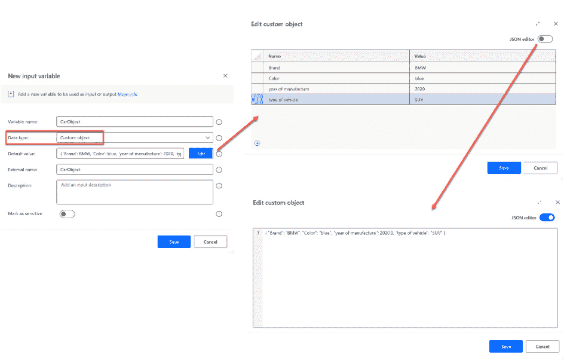

这些操作位于 Text 操作组中，执行你期望文本编辑器完成的所有任务，并且在流程设计中非常有用。其中包括 Split text、Get subtext、Crop text 等等。我想特别强调 Recognize entities in text 操作，它能够使用 AI 从一段文本中提取某些实体。我鼓励你为此目的尝试 Microsoft 的相应示例。为此，切换到 Console 窗口并进入 Examples 部分。在 Text Manipulation 标题下，你会找到一个名为 Extract phone numbers and emails from text 的条目。编辑此流程并查看调用，以体验首次与 PAD 交互时 AI 的强大功能。

## % 记法

在我们之前看到的所有示例中，我们都需要使用 % 记法，每当我们想使用变量时都需要它。变量或其中包含一个或多个变量的表达式必须始终用 % 字符括起来，因为正是这部分会被 PAD 评估。在两个 % 字符之间，可以使用变量或硬编码值一起使用简单的算术运算、逻辑比较或表达式。以下是一些示例：

- `%CarName%`: Returns the content of a variable called `CarName`.
- `%'CarName'%`: Please notice the quotes. This returns the hard-coded `CarName` value.
- `%Counter + 1%`: Returns the value of the `Counter` variable increased by 1.
- `%(Counter + 1) > 15%`: Makes use of parenthesis and returns a Boolean value of `True` if the `Counter` variable has a value of 15; otherwise, it returns False.
- `%NettoPrice + VAT%`: Returns the sum of the values of the `NettoPrice` and `VAT` variables.

### Using the % sign as a simple character


有时，我们可能想使用 % 符号而不是在表达式中，而只是作为一个普通字符。在这种情况下，可以通过另一个百分号（%%）来转义该字符。

这种记法非常直接易用，有时在我们本应只放置变量本身的字段中直接进行简单计算非常方便。除此之外，在这些表达式中，还可以使用变量的数据类型属性。这指的是由非内置数据类型提供的那些属性。例如，日期、列表、文件、文件夹、Outlook 消息、Web 浏览器实例等。例如，**获取文件夹中的文件** 操作会返回一个文件列表，每个文件都是 **File** 数据类型。我们可以遍历此列表，并在名为 `currentItem` 的变量中保存当前项，以访问以下等属性：

- `% currentItem.FullName%` 包含文件的完整路径
- `% currentItem.Size%` 是文件的大小（以字节为单位）

请参阅 *进一步阅读* 部分，以获取所有数据类型及其属性的官方文档链接。

变量和 % 记法是创建流的极其重要部分。熟悉这一概念以及如何创建和操作变量至关重要。现在，让我们看看如何创建 UI 元素以远程控制外部应用程序。

## 识别和创建 UI 元素

在 *第 1 章* 中，我们了解到 PAD 来自 **机器人流程自动化（RPA）** 领域，这涉及远程控制本地应用程序。正是这些应用程序提供了可用于流程处理的输入选项。这些输入选项由 PAD 识别

## 图 5.20 – 使用录制器捕获 UI 元素

如你所见，我使用了按钮序列 3，然后是 *（乘以），然后是 9，后跟 =（等于按钮），最后点击结果文本字段内部。

现在你可以在录制器中按下 Done 按钮，将捕获的元素传输到流程设计器。UI 元素窗格应如下所示：

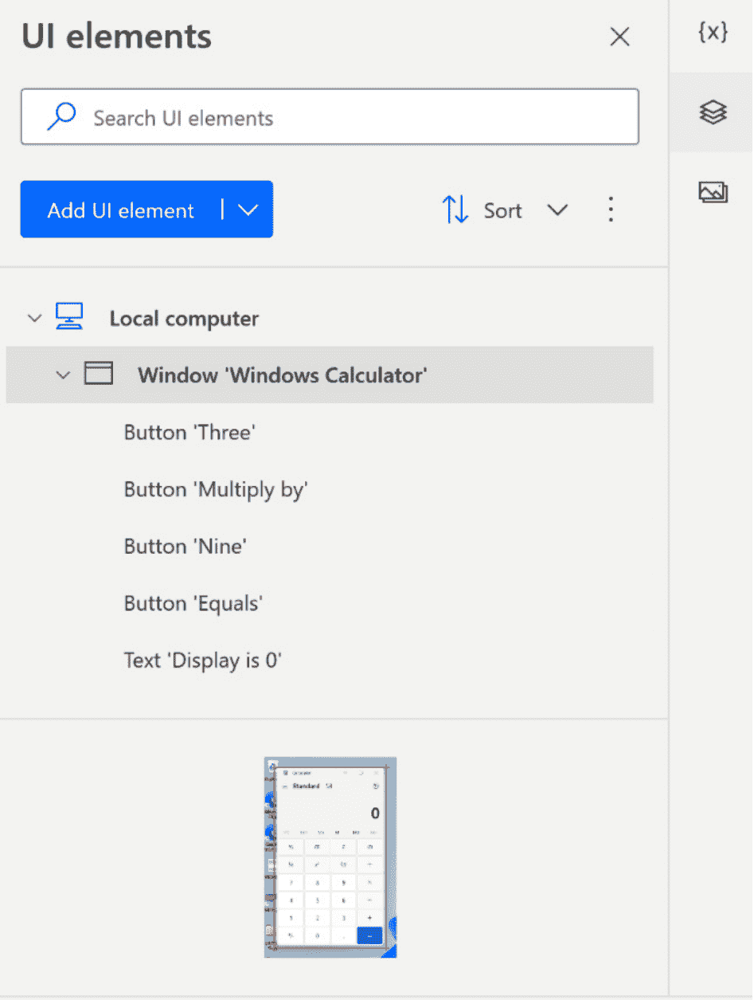

图 5.21 – UI 元素层次结构

现在我们有了一些 UI 元素，也可以演示其用法。PAD 为不同 UI 元素提供了专用操作。由于我们捕获了按钮，因此可以使用 Press button in window 操作（UI 自动化 | 表单填充 操作组）来模拟 PAD 的计算。只需将此操作四次拖入设计器并选择正确的 UI 元素序列。应如下所示：

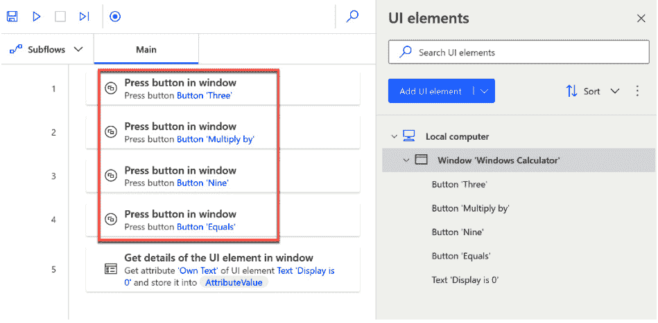

图 5.22 – 模拟计算的流程

我们也可以使用 Get details of the UI element in window 操作来提取结果文本字段的数据以在其他地方使用。执行此流程将根据流程中的序列神奇地按下按钮。这就是 UI 自动化。

也可以为桌面图标或任务栏图标创建 UI 元素。结合 UI 自动化操作组中的操作，这为我们提供了广泛的自动化选项。

然而，不仅 Windows 应用程序可以被远程控制。PAD 还可以访问和远程控制 Web 应用程序和页面。流程与 Windows 应用程序相同。但是，必须为所使用的浏览器安装相应的浏览器扩展，以便 PAD 能够识别 Web 元素。Microsoft 提供了

适用于 Google Chrome、Mozilla Firefox 和 Microsoft Edge 的浏览器扩展（有关更多信息，请参阅 *进一步阅读* 部分）。

虚拟桌面也可以纳入自动化。然而，要在其中识别 UI 元素，也需要一个小型扩展——所谓的虚拟桌面 Power Automate 代理。有关此内容的更多信息可在本章的最后一节以及 *进一步阅读* 部分找到。

因此，识别 UI 元素发挥着非常重要的作用，以便可以执行相应的操作，例如点击或 *按下按钮*。PAD 将每个 UI 元素在所谓的 selector 下进行层次化排列，并分配名称和属性，使该元素在相应应用程序和操作系统中唯一。双击创建的 UI 元素会显示该选择器及其属性，如下图所示：

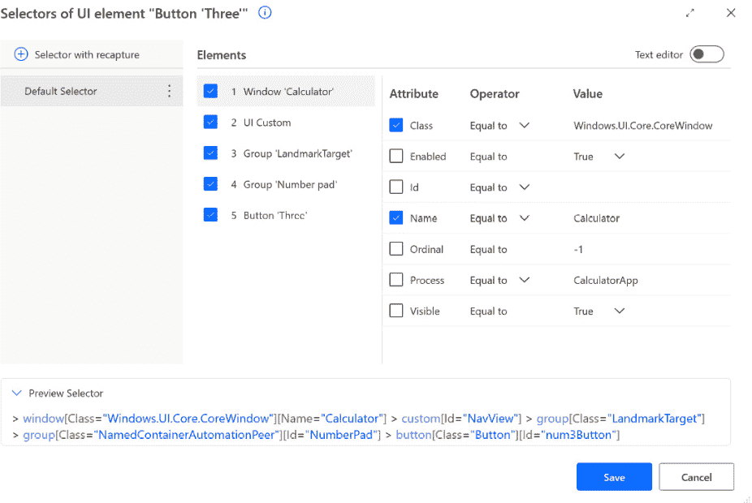

图 5.23 – Windows 按钮的选择器视图

也可以创建选择器并禁用元素的现有选择器。这在测试时尤其有帮助，因为正确识别 UI 元素对自动化至关重要。

我们将在 *第 6 章* 中查看更多细节和示例。

## 如何在 PAD 中使用图像

正如我们在上一节中所了解的，PAD 可以通过特定的选择器识别 UI 元素。但在某些情况下，我们需要其他机制来执行某些操作，例如将鼠标移动到特定位置并执行操作。这时图像就派上用场了。我们有以下使用图像作为输入的操作：

- **if image** 检查屏幕上是否存在图像
- **Wait for image** 等待图像出现在屏幕上或从屏幕上消失
- **Move mouse to image** 将鼠标移动到屏幕上的图像

结合 **Send mouse click**，甚至可以在不知道 UI 元素的情况下执行操作。这种技术也很有用，如果我们需要在没有代理的虚拟或远程桌面上进行自动化，例如 Linux 或 Unix。任何系统上的任何程序都可以通过这种技术远程执行和控制。因此，例如，如果有一个在 Linux 系统上运行且没有任何 API 的业务应用程序，也可以用 PAD 自动化该程序。

Power Automate agent for virtual desktops

运行 PAD 的计算机原则上也可以远程控制 **远程桌面协议（RDP）** 会话。如果远程系统也是 Windows 系统，可以在该系统上安装 Power Automate agent for virtual desktops。这使得在 RDP 会话内也能使用 UI 元素成为可能。这适用于 Citrix 和 Microsoft Remote Desktop。

对于所有其他操作系统，你只能使用 PAD 图像进行远程控制。

要创建或捕获图像，我们可以使用流程设计器窗口最右侧的第三个选项，它会显示图像区域。按下 **Capture image** 按钮即可让你在屏幕上点击并拖动选择区域。这由放大镜支持，以便尽可能精确。释放鼠标后，你将被提示为图像输入名称。如果我们对屏幕上任何所需区域执行此操作，我们将很快拥有一个图像库，可以使用 PAD 操作进行操作。

以下基本示例演示了图像的用法。因此，我通过 Microsoft Remote Desktop 程序访问 Linux 会话。对于此演示，我只想在该会话中启动文件资源管理器。为此，请执行以下步骤：

- 1. 导航到 **Activities** 菜单并左键单击它。
- 2. 等待任务栏出现。
- 3. 按下文件资源管理器的按钮，如下图所示：

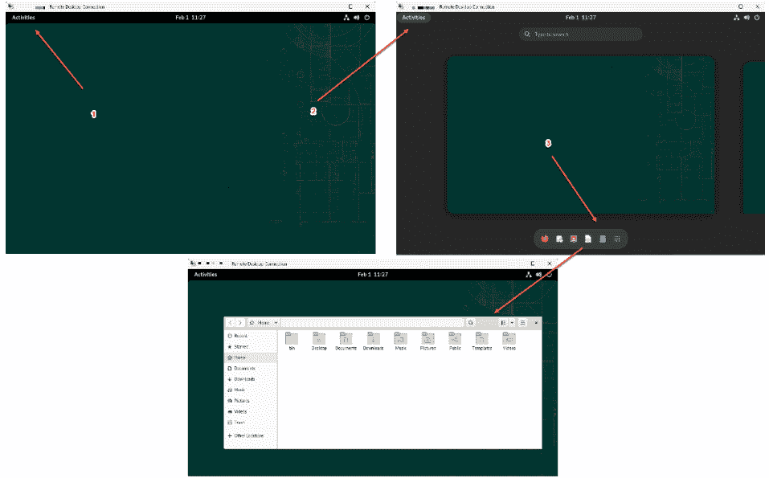

图 5.24 – 远程控制 Linux 系统

为了能够做到这一点，我需要通过前面描述的流程在 PAD 中创建两个图像：一个用于 Activities 菜单项，另一个用于文件资源管理器图标。下图显示了执行此操作所需创建的流程：

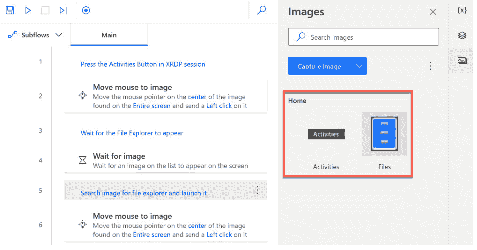

图 5.25 – 流程中的图像

让我们看一下流程的各个步骤：

- 1. **Move mouse to image**：要使用此操作，需要提供图像——在本例中为 **Activities** 图像。此操作还允许我们在移动后直接发送鼠标点击。此外，我使用了高级图像识别算法在屏幕上查找图像：


- Power Automate 浏览器扩展：https://learn.microsoft.com/en-us/power-automate/desktop-flows/install-browser-extensions
- 在虚拟桌面上自动化：https://learn.microsoft.com/en-us/power-automate/desktop-flows/virtual-desktops
- 在虚拟桌面上自动化：https://learn.microsoft.com/en-us/power-automate/desktop-flows/virtual-desktops?source=recommendations

## UI 自动化的操作

在上一章中，我们学习了 UI 元素以及它们如何识别应用程序交互的区域。在本章中，我们将重点介绍 PAD 可以通过 UI 元素操作实现的功能。这包括涵盖以下内容：

- 探索不同的 UI 操作及其用途
- 使用 UI 操作实现数据交换（提取数据和表单填写）以及两个应用程序之间的自动化

到本章结束时，你将了解识别必要的按钮和 UI 元素所需的内容，并通过 UI 操作触发它们，以安全可靠地重复所需任务并在流程中配置它们。

### 为什么我们需要 UI 操作？

随着时间的推移，创建了无数适用于 Windows 的应用程序，其中许多至今仍然存在。微软本身也创建了出色的选项，可以使用 Visual Basic 和 Visual Studio 等工具定制你的应用程序。然而，其中许多应用程序仍然无法通过 API 访问，必须手动操作——也称为人机界面。

正如我们将在本书后面看到的那样，PAD 可以直接与众多广泛使用的标准应用程序（如 Office 和 Outlook）一起工作，但不可能用专用操作覆盖各种不同的应用程序的丰富内容。而这正是 UI 元素操作存在的理由。术语 **UI 自动化** 指的是 PAD 的通用能力，可以与任何应用程序窗口一起工作，从而远程控制任何应用程序和控制元素。

为了强制执行这种非常通用的方法，该操作组中的操作相应地通用，可以分为以下几部分：

- 识别一个窗口
- 与应用程序控件交互
- 从窗口中提取数据
- 在窗口中填写数据

在深入另一个示例以利用这些操作之前，让我们先仔细看看每个操作。

### 识别一个窗口

我们需要做的第一件事是获取我们想要控制的应用程序的窗口。我们已经知道有几种启动程序的方法，例如使用 *run application* 操作或使用 Excel 或 Outlook 等程序的专用操作。以下操作可识别窗口或使其可供 PAD 访问，尤其是在与其他窗口结合使用时：

- **Get window/focus window**：可在 **Windows** 子组中找到。你可以获取或聚焦正在运行的窗口并返回标题和/或窗口句柄。
- **Set window state/set window visibility**：可在 **Windows** 子组中找到。你可以将窗口的状态设置为 **restored**、**maximized** 或 **minimized**，从而隐藏窗口或使其再次可见。
- **Move/resize/close window**：也在 **Windows** 子组中，此操作可通过提供 *X* 和 *Y* 坐标将窗口移动到桌面的特定位置，可将窗口大小更改为特定宽度和高度，或直接关闭窗口。
- **If window/wait for window/wait for window content**：此操作根据窗口是否打开/聚焦与否，在条件块中执行操作，等待窗口打开/关闭/成为焦点/失去焦点，并等待应包含在窗口中的特定 UI 元素。

这些操作在应用程序打开或操作期间可能存在延迟的情况下尤其有帮助。如果 PAD 要访问尚未显示的 UI 元素，则可以使用这些操作等待元素出现。

### 与窗口交互

PAD 还需要能够远程控制应用程序。这意味着单击按钮或区域或拖放元素。这可以通过以下操作实现，这些操作不言自明：

- Select a tab in a window
- Hover the mouse over a UI element in a window
- Click on a UI element in a window
- Drag and drop a UI element in a window
- Expand/collapse a tree node in a window

这些操作使用之前已定义的 UI 元素；例如，使用录制器。在本章的示例中，我们将使用其中一些操作来远程控制应用程序。

### 从窗口中提取数据

我们在之前的示例之一中使用了一些这些操作，在其中提取了 Word 文档中复选框的值。提取应用程序数据时还有更多可能性：

- **Get the details of window**：此操作会生成一个包含窗口属性（如其标题或源文本）的变量。所需属性可在操作对话框中选择。
- **Get the details of a UI element in a window**：此操作与前一个操作相同，只是它针对特定 UI 元素以及不同的数据库和 Windows 桌面应用程序。此场景在下图中说明：

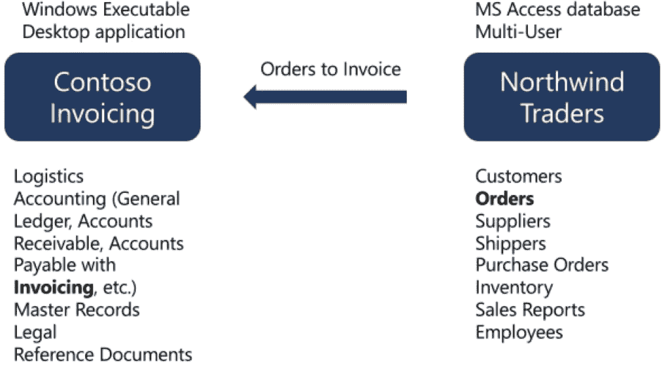

图 6.1 – Orders to Invoices 结构视图

在此场景中，使用 MS Access 创建了一个数据库应用程序。此应用程序可能通过网络共享被多个用户使用，并包含有关客户和供应商的信息。用户还可以在此数据库中存储来自客户的订单，但出于某种原因，客户的发票需要通过另一个应用程序处理。此应用程序是一个在用户桌面上运行的 Windows 可执行程序。

### Microsoft Access 数据库作为源系统

我们在本示例中使用的数据库是微软提供的一个示例数据库。从 Windows 程序任务栏启动 MS Access 也会提供大量示例数据库，其中 *Northwind* 数据库是其中之一。我们可以使用搜索功能查找此示例，双击它，并将其本地存储在我们的 `Documents` 文件夹中。

此数据库包含大量功能，从具有不同用户角色的可能性和输入数据的漂亮对话框开始（见下图）：

Northwind Login

Select Employee
Andrew Cencini
Login

Northwind Traders

I am: Andrew Cencini

- Quick Links
- View Inventory
- View Orders
- View Customers
- View Purchase Orders
- View Suppliers
- View Employees
- View Shippers
- Sales Reports

Active Orders

| Status | Date | Customer |
| --- | --- | --- |
| New | 25/04/2006 | Company C |
| New | 25/04/2006 | Company D |

Inventory to Reorder

| Product | Qty Available | Reorder Level |
| --- | --- | --- |
| Northwind Traders Boysenberry Spread | 0 | 25 |
| Northwind Traders Dried Pears | 0 | 10 |
| Northwind Traders Curry Sauce | 0 | 10 |
| Northwind Traders Fruit Cocktail | 0 | 10 |
| Northwind Traders Scones | 0 | 5 |
| Northwind Traders Beer | 0 | 15 |
| Northwind Traders Clam Chowder | 0 | 10 |
| Northwind Traders Chocolate | 0 | 25 |
| Northwind Traders Gnocchi | 1 | 30 |

Order List

Add New Order

| Status | Salesperson | Customer | Ship Date | Shipping | Taxes | Total |
| --- | --- | --- | --- | --- | --- | --- |
| New | Nancy Freehafer | Company A |  | 0.00 € | 0.00 € | 1,674.75 € |
| New | Nancy Freehafer | Company A |  |  |  | 736.00 € |

Order # (New)

Order Details

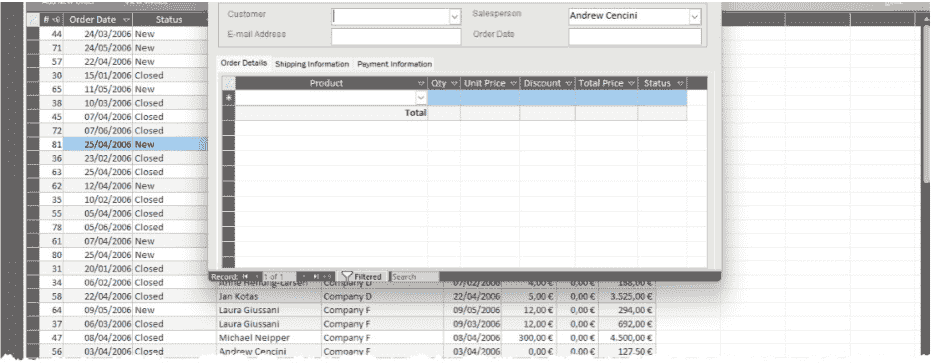

图 6.2 – Northwind Access 应用程序

在我们的示例中，我们假设多个用户会将订单添加到数据库中。但要创建发票，数据必须传输到开票应用程序。两个应用程序都没有内置将数据传输到其他地方的能力。

将 Access 数据库作为核心应用程序之一是非常常见的场景，在小型甚至有时较大的公司中也是如此。这对于我们场景中将要使用的第二个应用程序也是如此。

### Windows 可执行文件作为目标系统

我们将使用微软提供的一个示例应用程序 Contoso Invoicing 作为目标系统。这只是一个普通 Windows 应用程序的示例，具有导航树、菜单、工具栏以及用于查看和捕获数据的一些表单等特定特征。请参阅进一步阅读部分，了解有关如何安装此应用程序的更多详细信息，其外观如下：


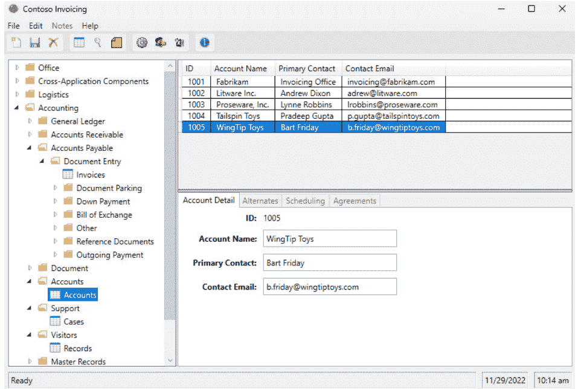

**图 6.3 – “Contoso 发票”应用程序**

安装过程中还会创建一个桌面图标，我们很快就会用到它。这里还需要说明的是，安装程序还会提供一个 Excel 工作簿，其中包含此应用程序的所有数据。该文件位于标准用户的文档文件夹中，路径为 Contoso Invoicing - 1.0.15.0。我们可以根据需要修改此 Excel 工作簿，例如再次删除示例数据。

要创建发票，我们必须调用导航树中的“发票”菜单项，如前一张屏幕截图所示，然后输入数据。这概括了中小型企业中一种非常典型的设置示例。

## 分解工作流

这是一个并不简单的流程，因此最佳实践是将其拆分成更小的部分。由于 UI 元素交互始终会使用大量操作，这些较小的流程将更易于维护和测试：

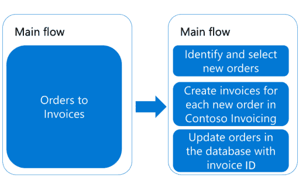

**图 6.4 – 分解“订单到发票”工作流**

1. 要确定需要创建哪些新发票，我们首先需要在 Northwind 数据库中识别这些订单，并将订单存储在数据表中。接下来，我们必须遍历此数据表，并在 Contoso Invoicing 应用程序中创建新发票。每张新发票都会生成一个发票 ID，我们也可以将其保存到数据表中。
2. 最后一个例程会获取这些新的发票 ID，并使用相关信息更新数据库。

提示：这三个例程被拆分为以下子流程。这样做的原因是，可以识别与特定操作相关的问题，并改进流程的维护：

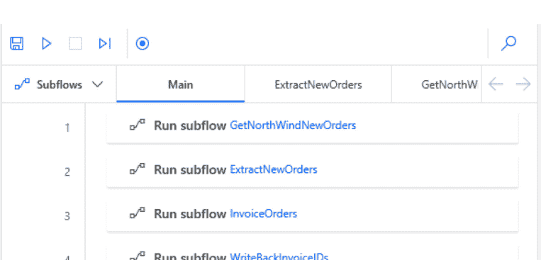

**图 6.5 – “订单到发票”的子流程**

要创建整个工作流，我们需要应用本书中讨论的所有知识，包括流程控制、变量和 UI 元素。下面来看看可以使用哪些不同的子流程来完成这些任务。

### GetNorthWindNewOrders 子流程

在此子流程中，我们希望启动数据库应用程序，并最终获取数据库中所有新到达订单的列表。

要远程控制该应用程序，我们需要定义或捕获相应的 UI 元素，以便实现所需的结果。在上一章中，我们学习了如何完成此操作。此外，还需要定义一些变量。以下是获取新订单的详细流程：

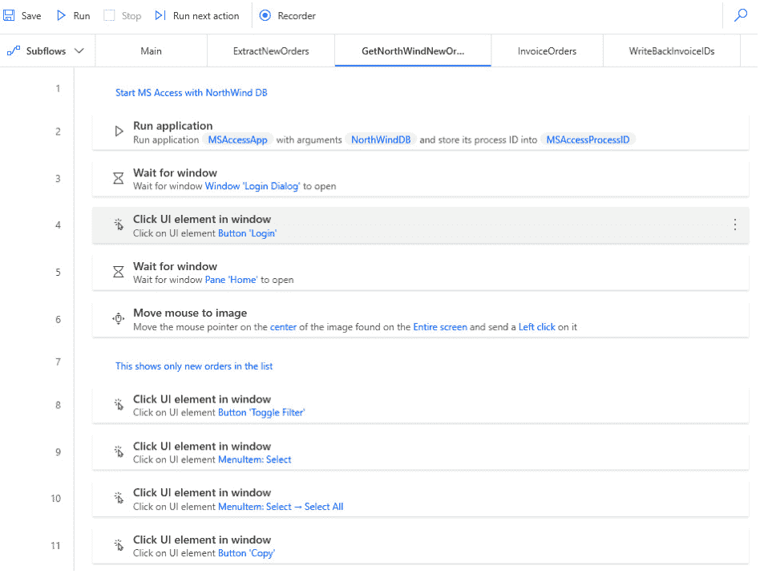

**图 6.6 – 提取新订单的子流程**

以下是对不同步骤（行号）的说明。

*步骤 2* 使用 Northwind 数据库启动 Microsoft Access。这里使用了两个变量。`MSAccessApp` 包含 Microsoft Access 可执行文件的完整路径，而 `NorthWindDB` 包含数据库本身的路径。

在*步骤 3*中，我们使用第一个 UI 操作，称为**等待窗口**。旧程序或性能较低的计算机（处理器、RAM 等）在启动程序时可能会有一定延迟。此操作会暂停流程，直到指定窗口出现。在本例中，流程会等待登录屏幕出现。登录窗口之前已被捕获为 UI 元素。

*步骤 4*会触发登录按钮的单击操作。如*图 6.2*所示，数据库应用程序首先要求用户登录。这里，我们只需选择第一个用户，然后按下登录按钮。

现在，我们应该等待主应用程序窗口出现。因此，在*步骤 5*中，我们再次使用**等待窗口**操作。

在*步骤 6*中，我使用图像来定位应用程序右侧的**查看订单**链接。记录器无法将其检测为独立的 UI 元素，因此我必须使用 PAD 的图像功能将鼠标移动到该链接并单击它。这是一个很好的示例，说明 PAD 甚至可以处理这类情况。

在*步骤 8 到 11*中，我使用 MS Access 功能区按钮筛选订单列表，使其只包含新订单，然后选中所有新订单并将其复制到剪贴板。这样，便可以在下一个子流程中解析其内容。

请注意，此时我们并没有关闭应用程序。

### ExtractNewOrders 子流程

此时，我们只有剪贴板中的一些文本。但要遍历新订单列表，我们需要以某种方式将这些文本转换为数据表。下图展示了相应流程以及实现方法：

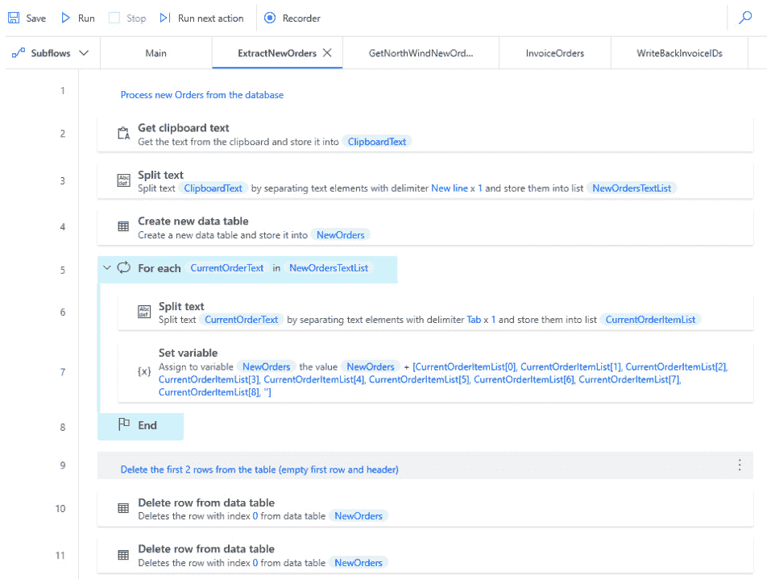

**图 6.7 – 从剪贴板文本生成数据表**

在步骤 1 中，我们通过使用剪贴板操作组中的“获取剪贴板文本”操作，将剪贴板文本存储到文本变量中。现在，我们可以将该文本拆分为文本列表（步骤 3）。

接下来，我们创建一个具有正确列的数据表变量。这些列包括 MS Access 订单表中的所有列，以及一个额外的发票 ID 列，该 ID 稍后由 Contoso Invoicing 应用程序生成：

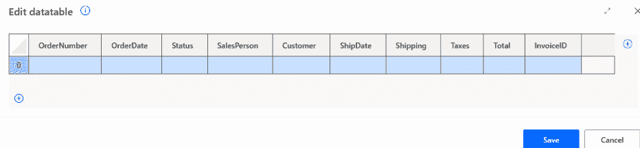

**图 6.8 – 内部订单数据表定义**

在步骤 5 中，我们开始遍历文本列表。对于列表中的每个条目，都需要再次拆分文本，以获取每一列的单独值。这些值会在步骤 7 中存储到数据表中。

最后，我们需要清理数据表并删除前两行（第 1 行为空行，是在定义数据表时创建的；第 2 行包含剪贴板文本中的列标题信息）。

现在，我们就有了一个包含所有新订单的数据表，可以对其进行处理。

### InvoiceOrders 子流程

此子流程负责在 Contoso Invoicing 应用程序中创建发票。这里，我们也需要首先识别相应的 UI 元素，例如“发票”树节点、新建按钮（加号图标）、保存按钮（加号图标）等。下图展示了所需的 UI 元素：

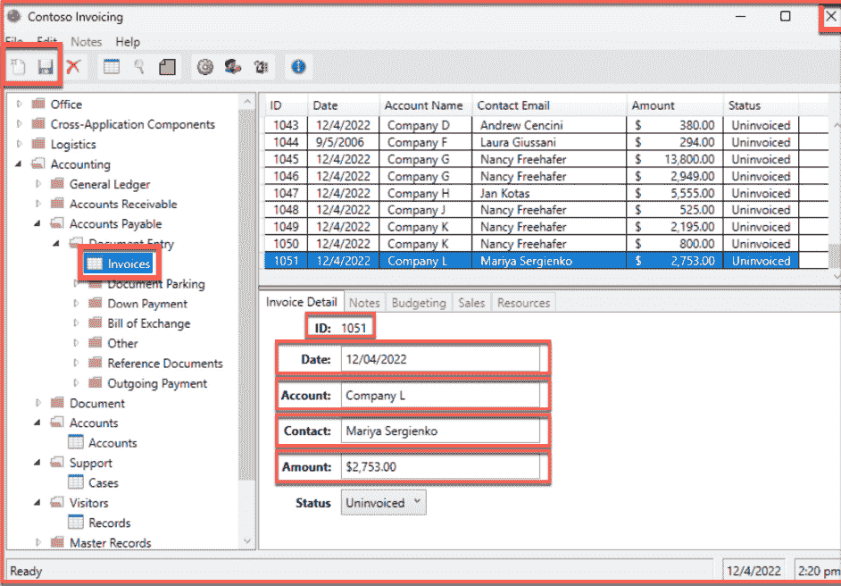

**图 6.9 – Contoso Invoicing 中的 UI 元素**

如我们所见，我们需要更多 UI 操作来填充数据并提取数据。下图展示了为我们完成所需步骤的流程：

- 保存
- 运行
- 停止
- 运行下一个操作
- 记录器
- 子流程
- 主流程
- ExtractNewOrders
- GetNorthWindNewOrd...
- InvoiceOrders
- WriteBackInvoiceIDs

| 步骤 | 动作类型 | 动作详情/注释 |
|------|---------|---------------|
| 1 | 运行应用程序 | 使用参数运行应用程序 ContosoInvoiceApp，并将其进程 ID 存储到 ContosoInvoiceAppID |
| 2 | 等待窗口 | 等待窗口 Window 'Contoso Invoicing' 打开 |
| 3 | 在窗口中单击 UI 元素 | 单击 UI 元素 Treeviewbutton 'Invoices' |
| 4 | 循环 | LoopIndex 从 0 到 NewOrders.RowsCount - 1，步长为 1 |
| 5 |  | 单击“新建”按钮 |
| 6 | 在窗口中单击 UI 元素 | 单击 UI 元素 Button 'New' |
| 7 |  | 填写日期、账户、联系人和金额 |
| 8 | 在窗口中填充文本字段 | 使用 NewOrders [ LoopIndex ][1] 填充文本框 Textbox 'Date' |
| 9 | 在窗口中填充文本字段 | 使用 NewOrders [ LoopIndex ][4] 填充文本框 Textbox 'Account' |
| 10 | 在窗口中填充文本字段 | 使用 NewOrders [ LoopIndex ][3] 填充文本框 Textbox 'Contact' |
| 11 | 识别文本中的实体 | 识别文本 NewOrders [ LoopIndex ][8] 中的所有 Currency 实体，并将结果存储到 RecognizedEntities |
| 12 | 设置变量 | 将变量 AmountNumber 赋值为 RecognizedEntities [0][0] |
| 13 | 替换文本 | 将 AmountNumber 中的 '\' 替换为 ''，并将结果存储到 AmountNumber |
| 14 | 在窗口中填充文本字段 | 使用 AmountNumber 填充文本框 Textbox 'Amount' |
| 15 |  | 提取 InvoiceID |
| 16 | 从窗口提取数据 | 从 UI 元素 Textbox 'InvoiceID' 中提取所有记录，并将结果存储到 InvoiceID |
| 17 |  | 在数据表中填写 InvoiceID |
| 18 | 更新数据表项 | 更新数据表 NewOrders 的第 LoopIndex 行、第 9 列，将其值设置为 InvoiceID |
| 19 |  | 单击“保存”按钮 |
| 20 | 在窗口中单击 UI 元素 | 单击 UI 元素 Button 'Save' |
| 21 | 结束 |  |
| 22 | 终止进程 | 终止 ID 为 ContosoInvoiceAppID 的进程 |


**图 6.10 – 将订单开具发票到 Contoso Invoicing**

再次，让我们逐步了解细节：

1. *步骤 1* 启动应用程序。
2. *步骤 2* 等待主应用程序窗口出现。
3. *步骤 3* 点击 **Invoices** 树节点。现在我们准备插入发票了。
4. *步骤 4* 启动一个循环并遍历新订单的数据表。

请注意，我选择使用索引版本进行迭代。这样在最后填充生成的发票 ID 数据时更容易，因为我可以通过循环索引引用当前迭代步骤。

在循环中，我们对表中的每一行数据都做同样的操作：

1. 点击 **New** 按钮（*步骤 6*）。
2. 填写日期、账户、联系人和金额的数据（*步骤 8 至 14*）。这里，我们使用 **Form filling** 操作子组中的 **Populate text field** 操作。还有一件特别需要注意的事情。因为我们将数据从数据库中作为文本提取出来，货币字段包含一个 Invoicing 应用无法理解的值。需要进行转换才能输入正确的值。要转换金额值，我们可以使用 **Recognize entities in text** 操作。在这种情况下，实体是指诸如电子邮件、IP地址或货币值之类的东西。此操作使用人工智能并分析给定的文本，以及检测规则。操作返回包含所有检测到的值的 data table。它可以这样配置：

> **Recognize entities in text**
> Recognizes entities in text, such as numbers, units, date/time and others expressed in natural language across multiple languages More info
>
> Select parameters
>
> Text to recognize from %NewOrders[LoopIndex][8]% {x}
> Entity type: Currency
> Language: English
>
> Variables produced RecognizedEntities
>
> Save Cancel

**图 6.11 – Recognize entities in text 配置**

3. 提取生成的发票 ID 数据并将其存储在数据行的最后一个元素中。这里，我们使用 Extract data from window 操作来捕获生成的发票 ID。
4. 步骤 18 使用提取的发票 ID 更新订单数据表。
5. 在步骤 20 中，我们点击 Save 按钮。

在这一阶段，我们已经建立了两个应用程序之间的通信，并将新订单作为发票插入到 Contoso Invoicing 应用中。此外，我们现在知道每个订单的所有发票 ID，以便我们可以为参考而更新 MS Access 数据库本身。让我们看看这里需要做什么。

### WriteBackInvoiceIDs 子流程

最后，我们希望更新 MS Access 数据库，以便用户可以看到已创建发票。现在，这可以通过多种方式实现。不幸的是，数据库本身并没有为我们提供一种简单的方法来标记订单以便开具发票。这就是为什么我们可以选择一种简单的方法将此信息传回数据库，通过更新每个订单中的 Notes 字段。我们将通过动态创建包含订单 ID 以及发票 ID 的 SQL 语句来实现这一点（两者都在我们的数据表中）。该语句可能如下所示，例如：

```sql
UPDATE Orders SET Notes = "Invoice ID: 1159" WHERE [Order ID] = 59
```

执行此操作的流程显示在以下图中：

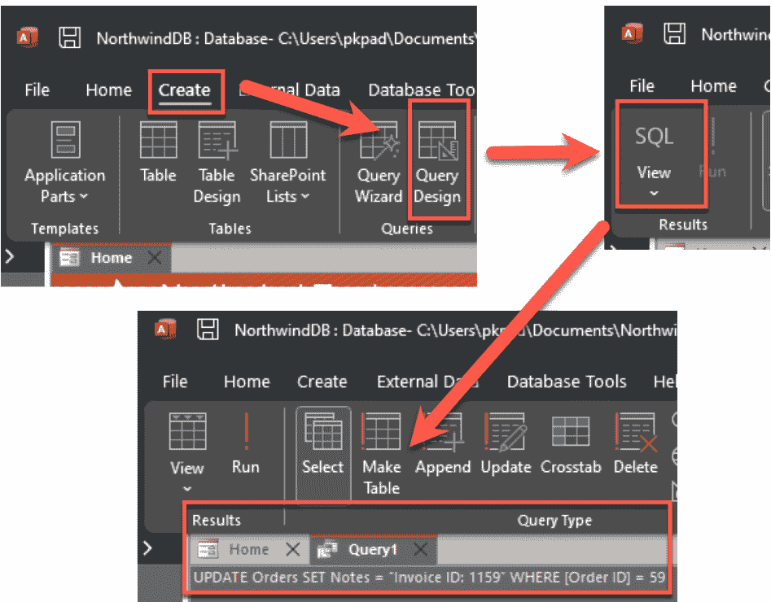

**图 6.12 – 导航到 SQL 面板**

为了能够将查询文本粘贴到 MS Access 中，我们需要 PAD 导航到可以处理查询的位置。您可以通过点击 Create 功能区，然后点击 Query Design 按钮来执行此操作。之后，我们需要切换到 SQL 视图，以便在那里输入查询。这就是流程在 *步骤 3 至 6* 中所做的。

请注意，我们正在对订单数据表中的每条记录运行此例程。在 *步骤 8* 中，我们创建更新后的 SQL 语句，并再次使用名为 **Populate text field in window** 的表单填充 UI 操作。

MS Access 中有一个 **Run** 按钮可用于执行查询。在 *步骤 9* 中，我们指示 PAD 按下此按钮。MS Access 的默认行为是弹出一个对话框，之后我们必须确认操作。在 *步骤 12* 中，我们告诉 PAD 执行此操作。

接下来，我们希望关闭查询窗口并重新开始。在 *步骤 13* 中，我们按下关闭查询窗口的按钮；再次，我们需要让 PAD 确认我们不希望保存查询。这标志着循环的结束，以便我们可以重新开始：

```text
Subflows

NewOrders
InvoiceOrders
WriteBackInvoiceIDs

For each CurrentItem in NewOrders

navigate to SQL input pane

Click UI element in window
Click on UI element Tab Item 'Create'

Click UI element in window
Click on UI element Button 'Query Design'

Click UI element in window
Click on UI element MenuItem: More Options

Click UI element in window
Click on UI element MenuItem: SQL View

create dynamic SQL statement

Populate text field in window
Populate text box Pane 'Query1' with 'UPDATE Orders SET Notes = "Invoice ID: ' + CurrentItem[9] + '" WHERE [Order ID] = ' + CurrentItem[0]

Click UI element in window
Click on UI element Button 'Run'

Wait for window
Wait for window Window 'Microsoft Access' to open

close the query and start over

Click UI element in window
Click on UI element Button 'Yes'

Click UI element in window
Click on UI element Button 'NetUIDocumentTabCloseButton'

Wait for window
```

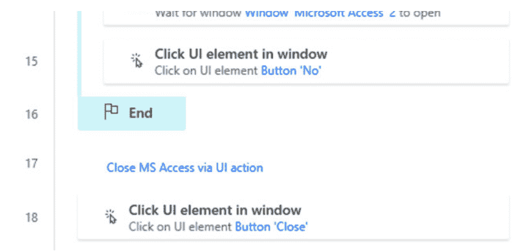

**图 6.13 – 使用发票信息更新 MS Access**

乍一看，整个过程似乎有点繁琐，但它揭示了以下几点：

- PAD 完全有能力与应用程序交互并确认对话框
- 无论是 Microsoft 的应用程序还是不是，都无关紧要，因为 UI 元素的概念是通用的
- PAD 可以从其他应用程序中提取数据并使用它们与 UI 元素一起创建进一步的操作
- 如果此处介绍的任务必须每天执行一次甚至多次（这种情况完全可能），那么这里展示的集成和自动化将获得数倍回报

除了这些重要点之外，我还想做出以下评论：

- 如前所述，数据库中也有计费功能。然而，在创建发票之前，必须满足进一步的条件，我为了这个示例的利益而忽略了它们。
- 在移交金额时，我们为了简单起见没有执行任何货币转换。
- 我们使用的所有 UI 元素之前都已通过记录器插入到 PAD 中。[第 5 章](Chapter 5) 详细描述了如何实现这一点。

在本节中，我们了解了 PAD 如何弥合两个需要相互交换数据的不同应用程序之间的差距。通过执行数据提取，我们可以从一个应用程序读取信息，将其转换为另一种格式，并使用表单填充 UI 操作将其插入到第二个应用程序中。

## 摘要

在本章中，我们了解了 PAD 如何允许两个原本没有连接的应用程序交换数据。通过定义 UI 元素并使用 UI 操作，任何应用程序都可以被远程控制，从而集成到更大的自动化上下文中。在这里，PAD 充当一个高级实体，允许应用程序环境相互通信；否则，除非手动操作，否则根本不可能进行数据交换。

在下一章中，我们将查看可用于管理和远程控制计算机、其文件和服务的其他操作。

## 进一步阅读

以下演练 *Microsoft ‘RPA in a Day’ Training Material Update* 提供了完整的课程，其中包含不同的模块，也利用了本章中使用的示例应用程序。该文章包含一个链接供您下载材料。在 `Lab data packages` 文件夹中，有另一个名为 `Prerequisites` 的文件夹，其中包含 Windows 应用程序的安装程序：https://powerautomate.microsoft.com/en-us/blog/announcing-microsoft-rpa-in-a-day-version-2/。

UI 自动化参考：https://learn.microsoft.com/en-us/power-automate/desktop-flows/actions-reference/uiautomation


