## 自动化你的桌面和工作站

在本章中，我们将查看系统管理的一部分且具有高度实用性的大量操作。其中一些操作将在本章中介绍，具体如下：

- 工作站管理操作，包括脚本编写
- 文件和文件夹
- 计算机外设，如鼠标和键盘、打印机和剪贴板

我们将用本章的第一部分来介绍使系统管理成为可能的操作组，然后再探讨文件夹和文件管理的可能性。

最后一部分涉及计算机外设的自动操作。我们将创建一个 PowerPoint 幻灯片演示文稿来记录本地工作站的状态。到本章结束时，我们将了解到 Power Automate Desktop（PAD）可以管理本地计算机的所有重要方面，并且这为文件夹和文件管理提供了强大的工具。

## 技术要求

操作系统（OS）进程和 Windows 服务是至关重要的组件，不当操作可能会影响 Windows 操作系统的稳定性和可靠性。这就是为什么需要管理员权限来操作这些组件。

你可以在以下链接找到技术要求：
https://learn.microsoft.com/en-us/power-automate/desktop-flows/requirements.

## Windows 和桌面管理

在小型和大型网络中对工作站进行大规模管理，今天可以由众多工具支持，例如 Active Directory 组策略、Microsoft Intune、Microsoft System Center 等。管理区域中的典型管理任务如下：

- 安装和设置操作系统
- 创建、配置和授权用户访问
- 为用户安装额外的标准软件，如 Office 或其他应用程序
- 通过执行命令或脚本并监控和管理进程和 Windows 服务来执行定期维护和健康检查

如前所述，这些任务可以部分由其他机制覆盖，例如 Active Directory 组策略、Microsoft Intune、Microsoft System Center 功能或其他第三方管理软件。通常，此类工具需要更大的采购和维护成本，并且软件面向大型环境中的专业 IT 管理员。这些工具还需要在本地安装代理软件（一个安装的 Windows 服务），该服务会频繁地与中央管理实例联系以获取新更新，然后可以部署这些更新。

在下一节中查看 PAD 的功能后，它似乎在该领域是一个有用的工具。为了阐明远程管理软件和 PAD 的不同方法在定位上的差异，我们可以查看以下表格：

| Feature | Remote Management Software | Power Automate Desktop |
|---|---|---|
| Feature | Remote Management Software | Power Automate Desktop |
| General approach | Consistently manage desktops and OSes by providing a set of software packages and monitoring devices and OS security | Executes desktop actions that cannot be performed automatically and remotely controls the operation of software by simulating a user |
| Provide management of desktops | Centrally, with remote agents to be installed on each machine | Distributed – a desktop flow is created on one machine and can be shared afterward |
| Install software packages | Automatically after central configuration | The creation of a flow is required for each package to be installed |
| Ability to operate software | Not available | The creation of a flow is required for operating software |

表 7.1 – 远程管理软件与 PAD 的比较

正如我们在前面的表格中所看到的，PAD 并非旨在覆盖集中式网络管理，尽管我们发现了一些操作组，可用于创建流程以执行管理任务，其中一些任务在集中式网络管理中无法实现或不可用。

另一方面，使用此类管理软件无法映射桌面上一个或多个软件产品的单个操作。

因此，在此环境中 PAD 出现了以下用例：

- 需要对工作站进行管理，但没有可用的管理软件
- 必须在本地计算机上执行一项任务，而此类管理软件无法映射该任务

## 操作

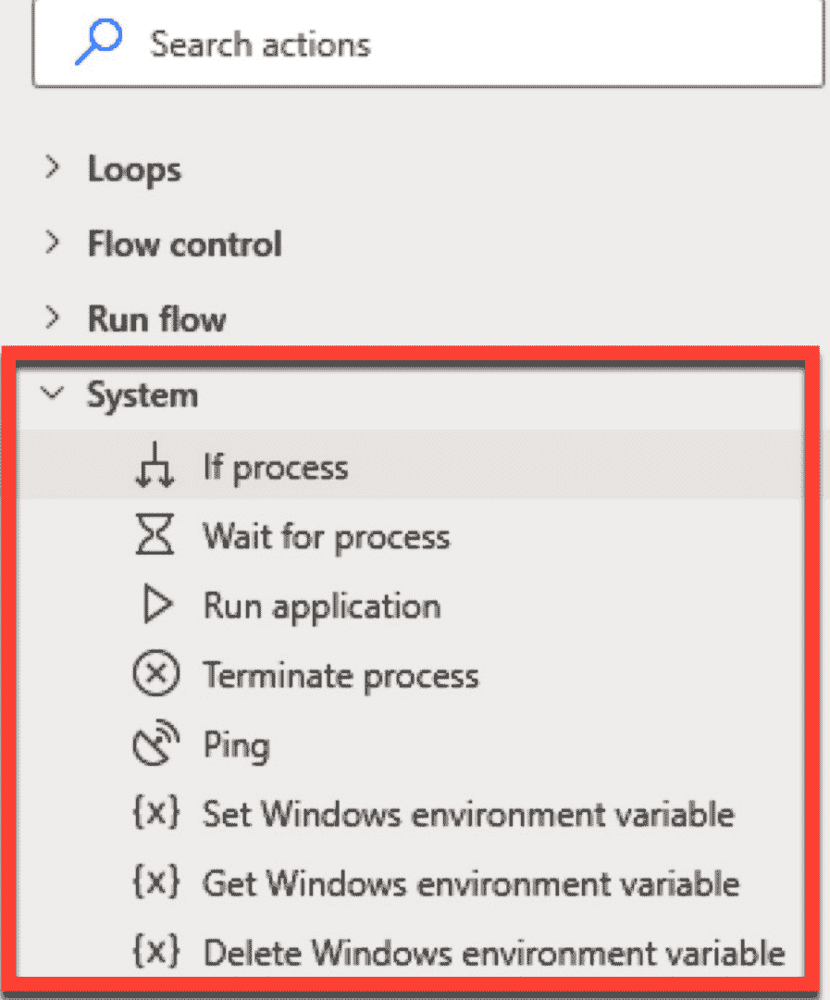

图 7.1 – PAD 中的系统操作

Windows 中的一个进程代表已启动的程序。这样的进程既有名称也有唯一的 ID。我们可以通过在命令行上执行 `tasklist` 命令来查看 Windows 中所有已启动的进程。因此，如果我们运行 Microsoft Word 或任何其他程序，对应的进程将被启动。通常，用户会与为特定程序启动的进程进行交互。PAD 有一个 **Run application** 操作也可以做到这一点。我们在之前的示例中多次使用过此操作。我们可以使用此操作在桌面上启动任何应用程序，或通过提供一些命令行参数来打开与特定应用程序关联的文档，如下图所示：

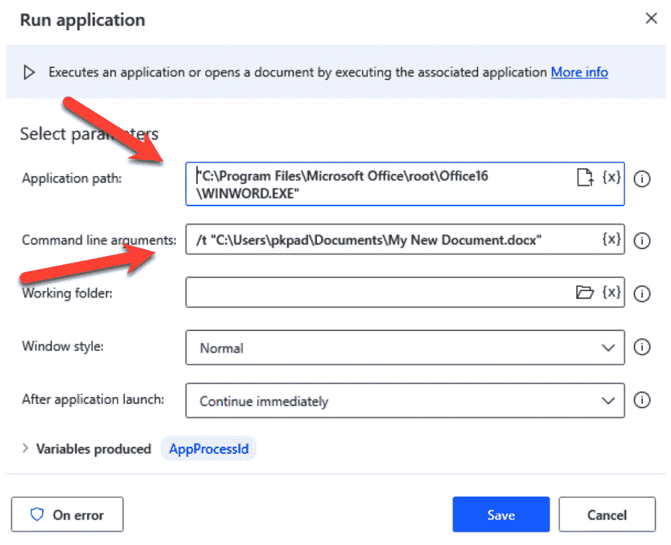

图 7.2 – 运行应用程序操作参数

**Application path** 参数确定可执行程序，包括应用程序的完整路径。

在 **Command line arguments** 参数中，我们可以输入应用程序所知道且我们想要传入的所有额外参数。在前面的示例中，我们使用了打开文档的命令行开关。

查找应用程序完整路径的提示

如果您想知道应用程序的完整路径，而 Windows 开始菜单中只有条目，请执行以下操作：

- 1. 通过输入其名称来识别应用程序，然后右键单击图标并选择 **Open file location**。这将打开 Windows 资源管理器到应用程序的快捷方式
- 2. 现在右键单击快捷方式并再次选择 **Open file location**。这将在 Windows 资源管理器中定位可执行程序。
- 3. 最后，右键单击应用程序并选择 **Copy as path** 或 *Ctrl + Shift + C* 并将此值粘贴到 **Application path** 参数字段中。

如果您想为应用程序使用特定的工作文件夹，可以在相应参数中指定。**Window style** 确定应用程序窗口将显示为正常、最大化、最小化或隐藏。

某些应用程序在显示应用程序窗口之前需要一些时间。这意味着进程已经启动，但 **用户界面（UI）** 尚未显示。另一个原因可能是本地计算机的性能。但如果我们需要此应用程序窗口进行进一步处理，我们可以指定应用程序启动时要执行的操作：立即继续或等待应用程序加载或完成。

执行此操作后，应用程序的进程 ID 将存储在相应的变量中。此变量稍后可用于通过终止进程来关闭程序。

为了弥补配置较差的计算机的延迟，如果 PAD 可以等待应用程序的可用性以及进程的可用性，或者检查进程是否已在运行（或不再运行），以便在必要时启动下一个资源密集型应用程序，这将很有帮助。这就是 **If process** 和 **Wait for process** 操作发挥作用的地方，它们做它们所说的，并且需要一个进程名称：

- **If process:** 这会检查给定的进程名称是否正在运行或未运行
- **Wait for process:** 这会暂停流程的执行

接下来，让我们讨论一个场景，这些操作可能非常有用：

- 我们假设有一个非常庞大、占用资源大的桌面应用程序，由于 CPU 和 RAM 的限制，我们只能在计算机上运行一次。
- 当我们手动启动应用程序时，在 UI 加载并应用程序变为可用之前需要一些时间。在这里，我们可以使用 **Run application** 操作并将 **After application launch** 参数设置为 **Wait for the application to complete**。
- 我们必须确保该应用程序只有一个实例。否则，计算机将不再响应。应用程序有时也会崩溃，因此我们希望确保在启动新实例之前终止任何孤立的进程。**If process** 操作可以在这里帮助检查是否仍有另一个进程正在运行该应用程序，并且我们将使用 **Terminate process** 操作来关闭该进程。
- 我们需要在该应用程序中非常频繁地运行一些操作，因此我们希望使用 PAD 来自动化这些任务。在此步骤中，我们将设计流程并创建 UI 元素和操作来执行我们需要的任务。
- 在对应用程序的工作完成后，我们希望确保应用程序已正确且完全关闭。我们可以利用

**Wait for process** action here and check whether the process is terminated. We could also take care of any timeouts for this action and retry terminating the process.

## 避免多种设备配置的技巧

由 IT 部门负责的设备策略将避免组织内部硬件的碎片化。

**System** 动作组还具有其他动作，我们已将其总结如下：

- **If process/Wait for process**：之前已讨论过。
- **Run application/Terminate process**：之前已讨论过。
- **Ping**：此动作向远程计算机发送网络消息并检查远程机器是否可访问。
- **Set/Get/Delete Windows environment variable**：这些环境变量可以以中央位置存储数据和值，供操作系统和所有其他已安装程序使用。存在标准环境变量，例如 **WINDIR**（Windows 操作系统的安装位置）或 **PATH**（包含可通过命令行直接访问的重要程序的目录列表）。这些对应的动作可以在 PAD 流程中管理这些条目。

除了使用 UI 运行应用程序（进程）外，操作系统还具有不与用户交互的后台服务概念。这些服务也是进程，因为一旦启动，它们就会出现在活动进程列表中，通常由名为 `svchost.exe`（服务的宿主应用程序）的应用程序包装。但它们需要特殊处理，我们为此专门提供了 PAD 动作，位于 **Windows services** 动作组中（见下图）：

要成功执行前面的流程，PAD 必须以更高的授权执行。为此，PAD 必须先完全关闭。系统托盘中的后台进程也必须关闭。然后，可以从 Windows 菜单启动 PAD。为此，右键单击程序图标并选择 **Run as administrator** 选项。此后，PAD 可以正常使用，流程将无错误运行。

另一个值得提及的话题是 **Processes and Services** 动作的有用功能，这使得创建桌面流程时的工作更轻松。对于 **Processes** 和 **Services**，相关元素的选择通过预填充的下拉列表变得更加容易。以下截图显示了可由 PAD 操作的预填充服务列表：

list of processes and use it afterward in our flow. And, of course, it is still possible to use a variable in these parameters.

## 命令行会话和脚本

在本节中，我们将查看使用 PAD 通过 Windows 命令行（CMD）执行自己的命令并通过脚本语句、拦截结果并进一步处理结果的可能性。为此，我们将查看以下动作组：

- **CMD session**：执行以下动作：**Open CMD session**/**Close CMD session** 以及 **Read from CMD session**/**Write to CMD session**/**Wait for text on a CMD session**
- **Scripting**：运行 DOS 命令/VBScript/JavaScript/PowerShell 脚本/Python 脚本

每个操作系统都有一个命令行（有时也称为 **console**），有时这是访问系统的唯一形式。因此，可能性非常广泛，任何原本需要 UI 完成的操作都可以通过命令行执行，甚至更多。Windows CMD 是目前发出命令的标准工具。命令行当然也可以通过 Windows 程序菜单、Windows 键 + R 快捷方式以及 cmd 命令手动启动。以下流程使用了我们在 **CMD session** 动作组中找到的所有动作：

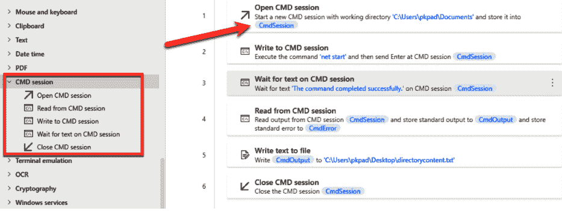

Figure 7.6 – Using the command-line actions in PAD

该流程具有以下步骤：

1. **Open CMD session**：这是使用 CMD 时的第一个动作，因为该动作创建了 `CmdSession` 变量，后续动作使用该变量发出命令。也可以在参数中设置会话的特定工作文件夹。
2. **Write to CMD session**：这里，将指定参数中的命令传递给命令行并执行。在我们的示例中，我们使用 `net start` 命令，它返回工作站上所有已启动服务的列表。
3. **Wait for text on CMD session**：如果命令执行需要一些时间，此动作会暂停流程的进一步执行并等待特定文本出现在命令行上。在我们的示例中，命令返回 `The command completed successfully` 文本，我们在此使用它。其他命令可能返回其他结果甚至什么都不返回。请注意，此动作会阻塞流程，直到给定文本返回。可能需要为此动作设置超时并处理错误。
4. **Read from CMD session**：此动作获取命令的输出并将其存储在 `CmdOutput` 变量中。除了常规返回值外，还有错误输出，也会创建变量以便进一步处理。
5. **Write text to file**：此动作不属于 **CMD session** 动作组，而是属于稍后本章讨论的 **File** 动作组。该动作接收一个变量并将内容写入可在参数中定义为文本文件的文件。我们正在创建保存在用户工作站桌面上的文件。
6. **Close CMD session**：关闭之前打开的会话。

我们在此流程中创建了一个包含所有已启动服务的文本文件，我们可以对此进行进一步调查，或现在通过电子邮件将其发送到中央维护邮箱以便进一步处理。

执行特定命令集的另一种方法是使用 PAD 中的 **scripting** 功能。**Scripting** 动作组提供了五个脚本引擎，其工作原理如下图所示：

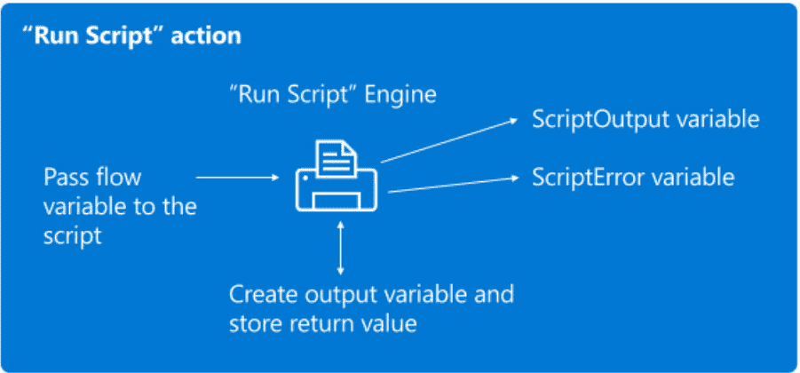

Figure 7.7 – The basic function of a Run Script action

让我们更仔细地看看前一图中描述的概念：

1. 首先要注意的是提到了 **Run Script** 动作，这使我们能够使用 PAD 中可用的所有代表性引擎，包括 DOS 命令、VBScript、JavaScript、PowerShell 脚本和 Python 脚本。脚本对于某些功能的小代码块非常有用，否则会非常繁琐或根本不可用。不同的脚本引擎各有优势，让我们可以选择我们已知的脚本语言。也可以设想某些功能已在其他地方使用脚本语言实现，因此此实现可以在此处再次使用。
2. 现在，要将脚本集成到 PAD 流程中，我们需要将数据和值传递给脚本并回放结果。我们可以使用我们在变量章节中已学到的 % 标记非常轻松地完成此操作。
3. 下一步是用相应的脚本语言实现实际功能。在此实现的末尾，应定义另一个变量，其中包含返回值，并通过标准输出写回。此值随后可在通过调用脚本块的动作定义的变量中使用。让我们看一个小例子：

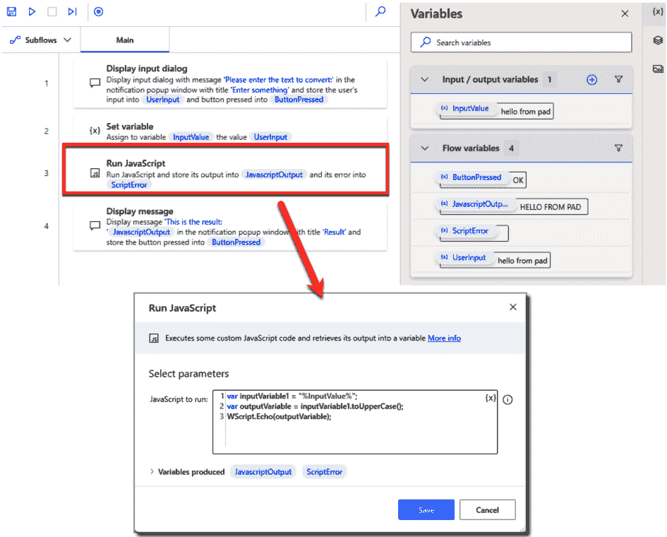

Figure 7.8 – Using a Scripting action in PAD

该流程显示了在 PAD 流程中使用 **Scripting** 动作的一般概念，通过实现一些简单的脚本。在此示例中，我们希望要求用户输入一些应转换的文本：

1. **Display input dialog**：这会向用户显示消息框以输入一些文本。

+   2. **设置变量**：在此，我们将 `InputValue` 输入变量设置为用户输入的文本。
+   3. **运行 JavaScript**：我们在此以 **Run JavaScript** 动作为例。在脚本中，`inputVariable1` 内部变量被设置为 `InputValue` 流程变量的值。也可以将多个变量传递到脚本中。脚本随后定义了 `outputVariable` 输出变量，并通过调用 `toUpperCase()` JavaScript 函数将输入变量的值转为大写，并通过 `Wscript.Echo(outputVariable)` 将该值写入标准输出。通过此操作，该值随后可在 `JavascriptOutput` 流程输出变量中使用。
+   4. **显示消息**：流程中的最后一步只是显示 JavaScript 处理的结果。

我希望对之前的示例添加以下评论：

+   - 该流程只是一个示例，用于展示使用 **Scripting** 动作时的基本功能。当然，使用内置函数也可以实现此过程的结果。
+   - 底层的 Scripting 主机具有特定版本，这也决定了可用的 Scripting 功能。**Windows Script Host (WScript)** 的版本号为 5.812（只需在变量中输出 `WScript.Version`）。Python 主机允许使用 Python 2 脚本，而 PowerShell 版本为 5.1.22621。由于我们使用 PAD 在 Windows 机器上运行，因此也可以实例化一个 ActiveX 对象，例如 Microsoft Word 的实例，并使用此类技术执行所有可能的操作（参见 https://learn.microsoft.com/en-us/power-automate/desktop-flows/how-to/extract-text-word-document）。
+   - 每个 **Scripting** 动作都有一个开关，用于将脚本输出与潜在的脚本错误分开。建议启用此开关并为脚本错误设置专用变量。这样调试脚本会更容易，因为第二个变量直接包含错误消息。出于简化的考虑，我们没有实现任何错误
+   - 你可能已经注意到，在此动作组中还有一个 **Run DOS command** 动作。与 **CMD session** 的区别在于，在那里我们可以依次发出一个又一个命令并检查结果，而使用 **Run DOS command** 时，我们定义包含多个命令的脚本并将其作为一个块运行。

在本节中，我们了解到 PAD 为配置本地计算机提供了大量可能性。在下一节中，我们将查看处理文件夹和文件的可能性。

## 在桌面上处理文件和文件夹

使用 PAD 也可以自动化文件夹和文件的操作，例如执行复制或排序操作，或将文件归档到特定的文件夹结构中。我们在本书的开篇示例中已经了解了一些这些动作。首先，让我们看看与文件夹相关的动作，包括以下内容：

+   - `If folder exists`：此操作启动条件块并检查文件夹是否存在与否
+   - `Get files in folder / Get subfolders in folder`：这会创建包含在特定文件夹中的文件或文件夹的列表
+   - `Create / delete / empty / copy / move / rename folder`：这些操作在给定文件夹上执行特定操作
+   - `Get special folder`：这会检索 Windows 中特殊文件夹的路径，例如 **Desktop**、**Internet Cache** 等

正如我们在此看到的，没有愿望得不到满足。结合以下用于文件的动作，这些功能得到了进一步完善：

+   - `If file exists / Wait for file`：可用于检查文件是否存在/不存在或文件是否被创建/删除。
+   - `Copy / Move / Delete / Rename files`：针对一个或多个文件的操作。
+   - `Read / Write text to file / CSV file`：已在之前的示例（CMD 会话）中使用。
+   - `Get file path`：此操作会生成多个变量，包含根路径、目录、带扩展名的文件名、不带扩展名的文件名以及扩展名本身。
+   - `Get temporary file`：与名称不同，这里会创建一个临时空文件，可用于进一步用途。
+   - `Convert file to Base64 or back/t4o binary or back`：在某些情况下可能需要文件转换，以便通过特定协议传输文件并转换回可读格式。例如，Base64 编码将二进制数据编码为可打印文本。

在这种情况下另一个值得提及的动作组是 **Compression**，它处理需要压缩或解压缩的一个或多个文件。这与我们在使用 Windows 资源管理器时右键单击任意文件并选择 **Compress to Zip** 时可用的功能相同。

现在让我们看一个示例，说明如何使用这些动作创建流程，将特定文件的每日备份复制到网络共享。从概念上讲，流程应执行以下操作：

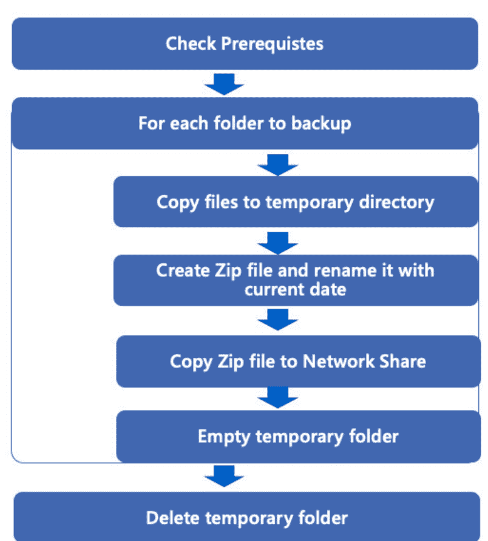

图 7.9 – 使用桌面流程备份数据

首先，让我们看看在实际执行备份之前需要检查的先决条件。为了灵活地处理要备份的文件，可以在文本文件中定义所有要备份的文件夹并先读取它们。之后，我们仍可以检查所有必要的临时文件夹是否存在。

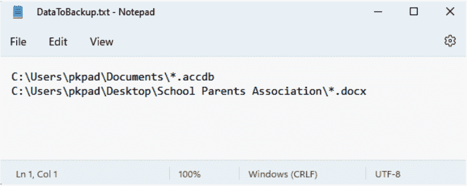

图 7.10 – 备份控制文本文件

这些准备工作可以很容易地外包给子流程。这将如下所示：

### 提示

创建子流程的原因纯粹是为了维护和性能。技术上在一个流程中也能工作。

我们无法详细讨论每个动作；这超出了本书的范围。然而，了解动作组中隐藏的基本功能非常重要，这样你就知道在哪里查找以掌握特定任务。

在最后一节中，我们将探索用于与工作站交互并处理外设的动作。

## 操作计算机外设

本节介绍的动作完善了 PAD 管理工作站的能力，通过模拟操作或当然覆盖其他用例。以下组件可以被控制，并作为动作组存在：

+   - 工作站本身和连接的打印机
+   - 鼠标和键盘
+   - 剪贴板

通过这些动作组，可以通过移动鼠标或按下按键来模拟完整的用户会话。

这在例如无法使用之前讨论的选项（UI 元素或图像）与应用程序通信时也可能有所帮助。也许我们无法捕获 UI 元素，但仍然可以将鼠标导航到特定位置并发送点击甚至按键。

然而，在这一点上，我们必须非常精确，原因如下。我们将在本示例中看到，**Send mouse click** 动作使用屏幕的 X 和 Y 坐标。这意味着鼠标会被精确引导到这些坐标，然后触发点击。这将一直有效，直到本地机器的屏幕分辨率最终被更改或流程在具有不同分辨率的另一台机器上运行。相同的坐标随后会导致完全不同的

位置，因此流程不再正常工作。关系如下图所示：

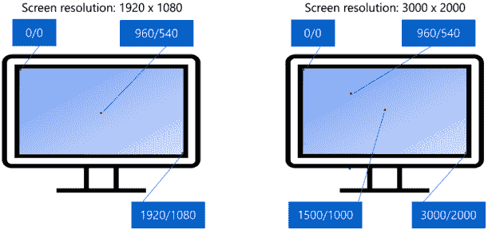

图 7.13 – 不同的屏幕分辨率和相同的坐标

正如我们在前面的图中看到的，坐标 **X=960** 和 **Y=540** 在左侧屏幕的正中间。但当屏幕分辨率发生变化时，这些坐标位于左上角而不是中间。这意味着在使用使用鼠标坐标的动作时，必须始终确保屏幕分辨率与创建流程时使用的分辨率相同。通过 **Get screen resolution** 和 **Set screen resolution** 动作，可以检查这些设置并在必要时进行更改。

让我们详细看看选项。

### 工作站

此动作组包含所有与工作站更狭义相关的动作。包括以下内容：

+   - **Workstation: Lock Workstation/Log off User/Shutdown computer:** 区分不同的动作很重要。**Lock** 对应于 Windows 中的相同锁定功能，也可通过 *Windows* 键 + L 快捷方式使用。流程随后将在后台继续运行。注销当前用户将从该点起终止流程，**Shutdown computer** 动作也是如此。最后一个

也提供了一个参数来定义是仅关机、重启、休眠，还是将工作站设为睡眠。

+   - **Print: Print document/Get default printer/Set default printer:** 这些操作使用文档名称的文本字段，获取或设置打印机。
+   - **Screen: Get screen resolution/Set screen resolution/Control screen saver:** 这些操作需要一个已连接的控制台会话才能工作。此会话在用户登录到工作站并且 PAD 由该用户执行时可用。这意味着用户已登录并启动了 PAD 控制台。在无人值守场景中，这些操作没有任何效果。设置屏幕分辨率有助于以标准化方式运行场景，例如使用屏幕坐标的场景，如鼠标移动（参见下一节）。
+   - **Miscellaneous other actions: Show desktop/Play sound/Empty recycle bin/Take screenshot:** 这里值得一提的是，**Show desktop** 既可以显示桌面，也可以恢复所有窗口。此外，**Take screenshot** 对于收集和记录有关系统的信息非常有用，适用于整个桌面或前台窗口。

在查看另一个示例之前，让我们先来看一下键盘和鼠标的操作。

## Mouse, keyboard, and clipboard

该组中的操作完成了本章关于模拟用户会话的可能性，并提供了真实用户可以执行的所有操作，从特定的鼠标序列到发送快捷键和预定义键组合。以下是详细信息：

+   - **Block Input**: 此操作有一个开关，可阻止或解除阻止用户进行的任何按键或鼠标点击。这在执行期间很有用，可以防止用户额外的按键或鼠标点击干扰流程。但请注意。一方面，请务必在流程的末尾插入 `Unblock` 操作。并且
请不要在中间创建断点，因为这会停止流程，并且由于输入被阻止，没有机会继续流程。
+   - **Get mouse position**: 这会将鼠标指针的坐标存储在两个变量中（x 位置和 y 位置），相对于屏幕或前台窗口。
+   - **Move mouse / to image / to text on screen (OCR)**: 可用于将鼠标指针移动到屏幕上的特定位置。你也可以将鼠标指针放置在所需位置并按 Ctrl + Shift。这会将当前坐标传输到操作参数中。还有多种运动行为，从 **instant** 到 **with animation (high speed)**。使用 **Move mouse to image** 操作时，可以定义或选择一个图像（参见 *第 5 章* 关于图像）来移动鼠标，甚至在移动后发送点击。PAD 还可以通过使用 **光学字符识别 (OCR)** 技术来检测屏幕上的文本。**Move mouse to text on screen (OCR)** 允许你选择 OCR 引擎、应查找的文本以及一些附加选项。例如，如果你已确定屏幕上想要执行鼠标点击的区域，该区域可能带有文本标签，则可以使用此操作成功地将鼠标移动到该区域并触发点击。
+   - **Send mouse click**: 此操作可以发送各种鼠标事件，从标准的左键单击和右键单击、双击到中键单击。也可以仅发送按钮按下事件，并在另一个时间发送按钮抬起事件。此操作还包括一个开关，允许将鼠标指针移动到特定坐标，这本质上与 **Move mouse** 操作相同。
+   - **Wait for mouse**: 当应用程序接收到鼠标点击时，鼠标光标可能会变为 **wait** 光标或 **hourglass** 光标。此操作可用于等待光标再次变为普通光标/不变为普通光标。

通过这些鼠标控制操作，可以模拟工作站前可能不存在的硬件，例如，如果鼠标上没有中键。我们还可以实现并模拟 *click-and-drag*
或 *drag-and-drop* 操作。然而，大多数应用程序不仅可以通过鼠标操作，通常还可以通过键盘直接输入的一整套快捷键立即触发操作。为了使 PAD 也能使用这种非常高效的操作方式，提供了以下键盘操作：

**Send keys**: 如果我们想在前台窗口/窗口实例/标题或类或 UI 元素中光标当前位置输入一些文本，这就是要使用的操作。以下屏幕截图显示了此操作的<|message|>

## Send keys

向当前活动的应用程序发送按键 更多信息

## Select parameters

Send keys to: Foreground window

Text to send: Input as text, variable or expression

Insert special keys Insert modifier

Delay between keystrokes: 10

Send Text as hardware keys:

On error Save Cancel

以下示例使用了我们刚刚学习的一些操作。我们想要创建一个流程，收集有关当前系统的一些信息，将其存储在 PowerPoint 幻灯片中，并将该报告保存到 OneDrive。这将需要一系列鼠标点击和按键发送来完成此操作。

请注意，我们在此示例中没有使用 UI 元素，这也将是一个非常好的选择。相反，我们想要使用之前定义的操作来模拟用户会话。所以，让我们看看流程是什么样的：

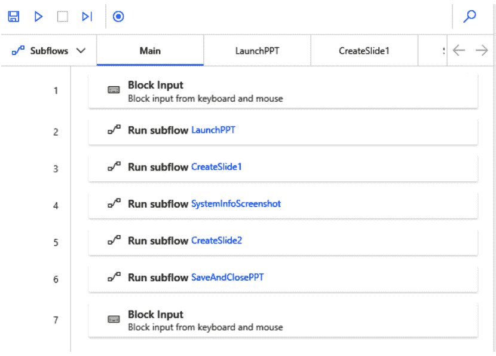

Figure 7.15 – A flow to create a PowerPoint system report

正如我们在这里看到的，流程再次被结构化为一些子流程，以便更易于阅读和维护。第一个子流程通过使用 Windows 按钮打开 PowerPoint，第二个子流程使用当前日期创建第一个介绍幻灯片。第三个子流程启动 Windows 系统信息窗格，截取屏幕截图并将其放入剪贴板。在第四个流程中，此屏幕截图被插入到第二张幻灯片中，经过一些格式设置后，我们将幻灯片保存并关闭到
默认的 OneDrive 文件夹。所有子流程都嵌入在 **Block Input** 操作中，其中第一个打开阻止，第二个解除阻止。

让我们看看第一个子流程的细节：

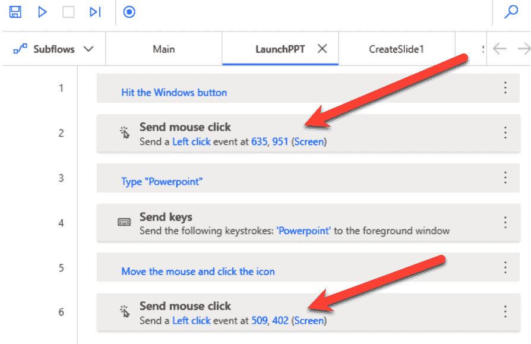

Figure 7.16 – Launch PowerPoint with the Send mouse click action

在第一个操作中，我们触发对 Windows 按钮的点击以激活 **Start** 菜单。这里显示的坐标是我的桌面的坐标。在另一个桌面上可能不同。

Different desktops for flow creation and execution

我们稍后会看到，可以使用一台计算机进行流程创建，而潜在的另一台（或多台）计算机用于流程执行。当 **Send mouse click** 操作在 UI 流程中使用时，建议确保用于创建的计算机与用于执行的计算机具有相同的屏幕分辨率（标准化环境）。否则，**Send mouse click** 操作的坐标
可能无法工作。或者，我们也可以使用屏幕分辨率的操作来为执行桌面建立标准化

在第二个操作中，我们只需使用键盘输入将 Powerpoint 文本发送到开始菜单，这会触发对相应程序的搜索。在最后一步中，我们再次使用鼠标点击来启动搜索列表中的第一个程序。这里也适用关于坐标的注释。这将启动 PowerPoint，我们可以继续下一个子流程：

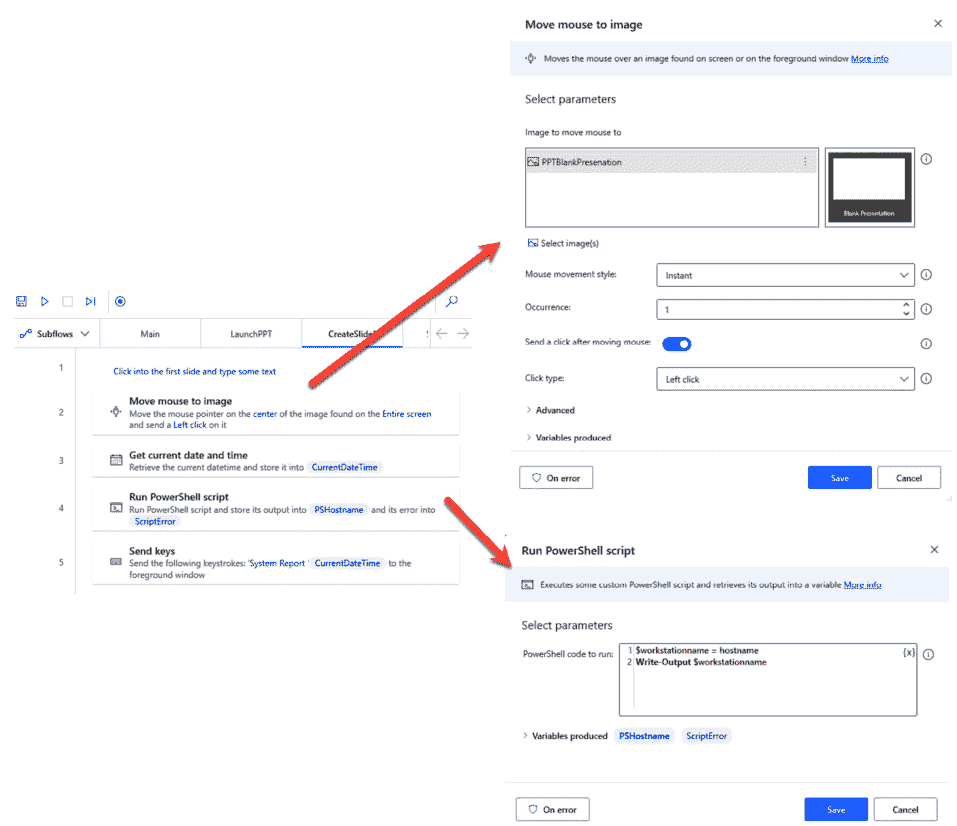

Figure 7.17 – Creating the first slide with PAD

在第一个操作中，我们点击 PowerPoint 中标准布局的图像。**Move mouse to image** 操作允许我定义一个我刚刚在该操作中创建的图像。这现在会导致 PowerPoint 显示具有默认布局和第一个起始幻灯片的演示文稿。

接下来的两个步骤确定当前日期和工作站的名称。对于后者，使用了 PowerShell 的脚本操作。在此子流程的最后一步中，由 **System Report** 文本和当前日期组成的标题被插入到幻灯片中。我们稍后在保存文件时会使用工作站名称。这就把我们带到了下一个子流程：

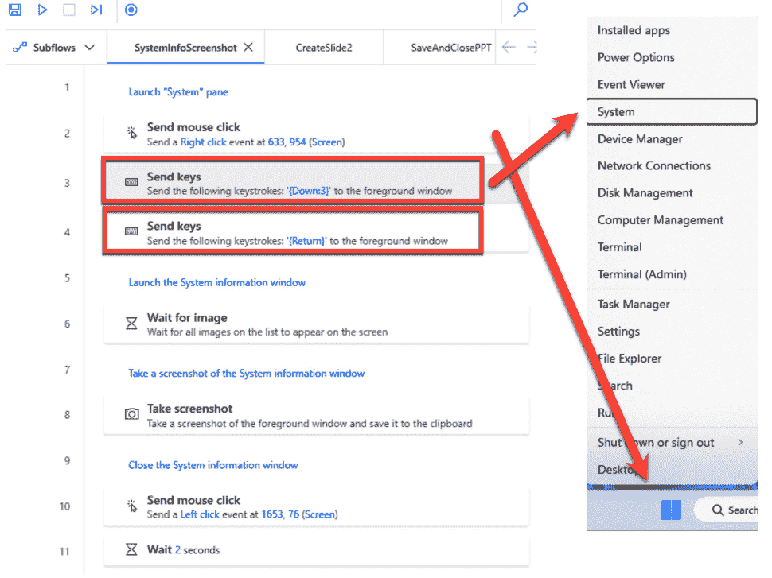

Figure 7.18 – Create a screenshot for System information with PAD

此子流程再次使用 **Send mouse click** 操作来访问 Windows **Start** 菜单，但这次我们使用右键单击事件来启动

这是用于管理程序的特设菜单。在该菜单中，我们使用 **发送按键** 操作触发向下箭头键三次，然后按 *回车* 键启动 **系统信息** 窗格。接下来，我们使用 *第4章* 中的 **等待图像** 操作，将前台窗口的截图保存到剪贴板，然后再次关闭 **系统信息** 窗口。现在，我们已有足够的信息，可以在下一个子流程中继续处理演示文稿的下一张幻灯片：

## 子流程

### SystemInfoScreenshot

### CreateSlide2

### SaveAndClosePPT

1
发送按键
向前台窗口发送以下按键：'{Control}({M})'

2
发送按键
向前台窗口发送以下按键：'{Control}({V})'

3
将图像向右移动

4
发送鼠标单击
在 711, 442（屏幕）处发送左键按下事件

5
发送鼠标单击
在 880, 442（屏幕）处发送左键松开事件

6
调整图片大小

7
发送鼠标单击
在 725, 210（屏幕）处发送左键按下事件

8
发送鼠标单击
在 844, 334（屏幕）处发送左键松开事件

9
向上移动图像

10
发送鼠标单击
在 1024, 493（屏幕）处发送左键按下事件

11
发送鼠标单击
在 1024, 445（屏幕）处发送左键松开事件

12
点击幻灯片标题并保存

13
将鼠标移动到图像
将鼠标指针移动到整个屏幕上找到的图像中心，并对其发送左键单击

14
发送按键
向前台窗口发送以下按键：'System Information'

## 图 7.19 – 在 PowerPoint 中粘贴并调整截图大小

第一个 **发送按键** 操作使用了特殊的按键组合。通过键盘快捷键 *Ctrl + M*，我们可以在当前幻灯片中插入一张新幻灯片。要在 PAD 中触发此按键组合，我们需要为 M 指定带花括号的 `{Control}({M})`。标准命令 *Ctrl + V* 也是如此，用于将剪贴板中的内容粘贴到当前位置。

在第 4 行和第 5 行中，我们使用 **左键按下** 和 **左键松开** 鼠标事件将截图稍微移动到幻灯片的右侧。第 7 行和第 8 行使用了相同的技术来调整图片大小。我们将图像缩小一些，以便更好地适应幻灯片。为了向上移动图片，第 10 行和第 11 行再次使用了该技术。第 13 行和第 14 行填写了此幻灯片的标题信息，这标志着创建的结束。最后一个子流程负责保存并关闭 PowerPoint：

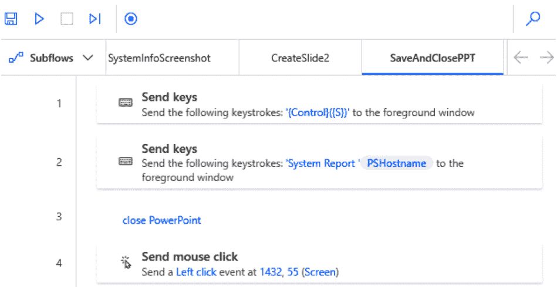

## 图 7.20 – 使用 PAD 保存并关闭 PowerPoint

同样，**发送按键** 操作用于发出保存幻灯片的键盘快捷键。这会使 PowerPoint 显示 **保存** 对话框。在这里，我们只需发送 **System Report** 以及之前在我们的 PowerShell 脚本中提取的工作站名称的按键。最后一个 **发送鼠标单击** 操作只是关闭程序。

## 最后说明

此处展示的流程是在分辨率为 1,920x1,200、缩放比例为 100%（即不放大字体或图标）的桌面上创建的。如果该流程在具有不同分辨率的另一台桌面上运行，则可能无法正常工作。因此，这里展示的流程是对可行性的演示。在实践中，肯定会使用其他机制来创建此类报告。

## 总结

在本章中，我们了解了大量用于管理工作站的操作。此外，通过脚本集成可以获得更多信息，并且可以执行比单独使用 PAD 更多的操作。同时，鼠标和键盘的使用扩展了 PAD 在任意程序中的适用范围。在此基础上，下一章我们将研究特殊应用程序，包括 SAP 和大型机自动化。

## 延伸阅读

- Office 程序的命令行开关：https://support.microsoft.com/en-us/office/command-line-switches-for-microsoft-office-products-079164cd-4ef5-4178-b235-441737deb3a6
- 命令行参考：https://learn.microsoft.com/en-us/windows-server/administration/windows-commands/windows-commands
- PAD 操作参考：https://learn.microsoft.com/en-us/power-automate/desktop-flows/actions-reference
