## 自动化标准业务应用程序

到目前为止，我们已经遇到了许多使用 PAD 集成和自动化各种应用程序的示例。本章旨在深化其中一些内容，并使用 PAD 连接新的广泛应用领域。本章将涵盖以下主题：

- 自动化 Microsoft 365（也称为 Office）应用程序
- 集成和自动化 SAP
- 连接和使用大型机应用程序
- 自动化基于浏览器的业务应用程序

到本章结束时，我们将了解如何自动化两种非常常见的业务应用程序场景，以便您可以连接其他应用程序。此外，您将对如何自动化基于 Web 的业务应用程序有更深入的理解。

### 技术要求

本章的各节介绍了如何自动化不同的软件产品，每种产品也有不同的先决条件。这些先决条件的详细信息在相应章节的开头列出。

本章的最后一节提供了一个如何自动化基于 Web 的业务应用程序（如 Dynamics 365）的示例。您需要申请一个 Dynamics 365 for Sales 的试用实例。该试用版是免费的，并且对于此练习来说完全足够（您可以在此处申请试用版：https://dynamics.microsoft.com/en-us/dynamics-365-free-trial/）。但是，由于这是一个业务解决方案，您还需要一个 Microsoft 商业帐户才能申请试用版。

## 自动化 Microsoft Office

在本书的前几章中，我们几乎在示例中使用了所有 Office 产品。我们在*第1章*的入门示例中使用了 Excel 和 Outlook，而在最后两章中，我们了解了如何将 Microsoft Access 和 PowerPoint 用作 UI 自动化的一部分。虽然后一种概念可以与鼠标和键盘操作结合使用以包含任何应用程序，但 Outlook 和 Excel 有专门的 PAD 操作可以在流程中使用。在本节中，我们将仔细研究这些操作组。

## 使用操作自动化 Outlook

能够将 Outlook 集成到 PAD 中在许多情况下都非常有用。正如我们在*第1章*的示例中已经看到的，可以接收许多相同性质的电子邮件或附件，将它们移动到特定文件夹，保存它们，甚至在必要时回复。另一种场景可能是，您从支持地址检索消息，并使用该信息触发进一步的内务处理，例如将某些数据输入其他系统。本章中的示例将向您展示另一个用例。在这里，必须定期向新用户提供信息，以便他们能够登录 SAP 系统。同样，Outlook 可以直接集成到流程中并直接发送此通知。在相应的 *Outlook* 操作组中，以下操作可用于帮助我们完成这些任务：

- **启动/关闭 Outlook**：此操作启动或结束一个 Outlook 实例。在 **启动** 操作中会创建一个相应的变量，该变量可在之后的 **关闭** 操作中用于终止程序。
- **检索电子邮件消息**：此操作可以接受一个电子邮件帐户，并允许您为要接收的电子邮件定义筛选参数。此外，还可以对任何附件进行设置。
- **发送消息/回复消息**：这些操作创建一条新消息，其中包含所有必填字段，例如邮件正文、主题和

## 使用 SAP

SAP 既是公司名称，也是企业管理软件。至少从名称上看，这个软件产品应该为所有人所知，因为它在全球范围内非常普及，尤其是该公司代表了软件和编程领域全球第四大公司。在很长一段时间里，**SAP ERP** 是 **企业资源规划（ERP）** 领域的标准软件，而它又基于 **SAP R/3**，该软件于 1992 年首次推出。SAP ERP 的最新版本是 6.0 版，于 2006 年推出，此后一直通过服务包和小型增强功能进行维护。它现在被视为遗留技术，新版本是 **SAP S/4HANA（高性能分析设备）**。

然而，不久前，SAP 宣布 SAP ERP 将继续支持到 2027 年或 2030 年（提供扩展支持；详情请参阅 *延伸阅读* 部分），这当然是有充分理由的。这种向新版本 S/4HANA 的迁移和切换对许多客户来说都伴随着高昂的成本。除了软件，硬件通常也必须更换，如果不同时计划使用云，这对 ERP 软件来说可能代价高昂——所有这些原因使得我们今天仍然能找到许多 SAP R/3 安装。PAD 自动化可能非常有用，因为公司会非常仔细地考虑是否以及愿意在一个过时的软件系统上投入多少资金。那么，为什么不使用一个轻量级集成解决方案，把节省下来的钱投入到未来 ERP 系统的项目中呢？那么，让我们来看看如何使用 PAD 连接到称为 **SAPGUI** 的 SAP 界面，以下示例需要在本地安装该界面，它是 SAP ERP 系统的标准客户端软件。该软件包含在用于开发目的的 SAP 测试系统试用版中，本示例就是在此基础上构建和使用的。

### 提示

必须安装并启用脚本编写功能，PAD 才能捕获和定位此程序中的元素。以下屏幕截图显示了如何在 SAPGUI 中允许脚本编写：

## 使用 PAD 进行分布式用户管理

让我们想象一下，我们负责为下个月入职我们小公司的用户设置账号。除了登录名和邮箱之外，当然还需要 SAP 登录名。人力资源部门已经在 Active Directory 中创建了账号，并在 Excel 电子表格中收集了这些用户的信息。我们的任务是在 SAP 中创建其中列出的用户，并通过电子邮件发送登录信息。这也包括创建初始密码。因此，我们需要一个流程来为我们执行以下操作：

- 从 Excel 电子表格中读取所有用户并提取数据
- 启动 SAPGUI 并调用创建新用户的相应事务（SU01）
- 遍历 Excel 数据，生成新密码，将其存储在表格的对应行中，并使用该数据在 SAP 中创建用户
- 向用户发送包含初始密码的电子邮件

### 存储 Excel 工作表并关闭 Excel 和 SAPGUI

由于我们没有用于自动化 SAPGUI 的单独操作，因此我们必须使用已知的技术远程控制该应用程序。然而，由于该应用程序也可以通过键盘输入出色地操作，我们希望尽可能避免创建 UI 元素和图像。使用键盘输入作为在应用程序中导航的选项有时会是一个优势，因为这样用户就不会依赖屏幕分辨率以及提前捕获所有 UI 元素的需求。

此外，这次我们希望应用我们已证实的将整体流程划分为更小子流程的做法。完整的流程将如下所示：

顾名思义，该区域启动 SAPGUI，该程序必须安装在您的计算机上。程序在第一个操作中直接调用。该程序由两个窗口组成——一个用于选择要登录的系统，另一个用于登录和运行程序。为了能够在后续流程中直接寻址这些窗口，这些窗口以 UI 元素的形式定义。为了做到这一点，最好先手动启动一次程序，并通过 PAD 将两个窗口定义为 UI 元素。

要启动 SAPGUI 程序，我们可以实现如下流程：

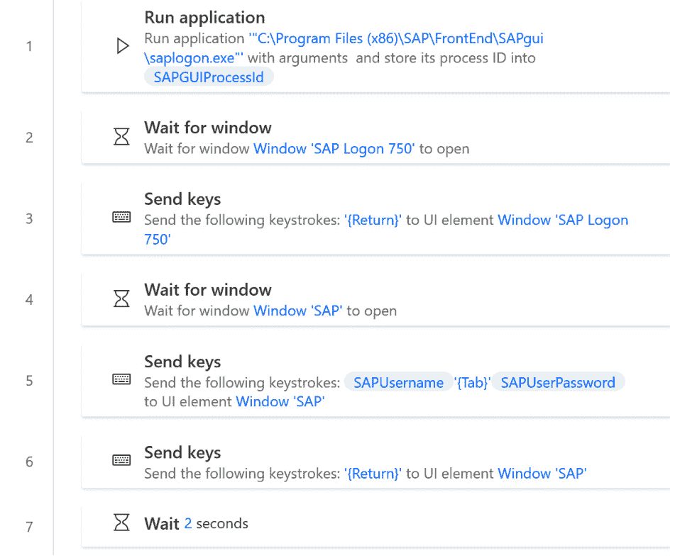

图 8.3 – 使用 PAD 启动 SAPGUI

首先，我们必须通过 **Run application** 操作（第 1 行）运行主 `saplogon.exe` 可执行文件。该可执行文件在 SAP 客户端软件的标准安装后可用。这基本上等同于在 Windows 桌面上双击相应的快捷方式。第 2 行中，我们等待窗口出现；之后我们将看到 **SAP Logon** 屏幕，在此我们可以选择要登录的系统：

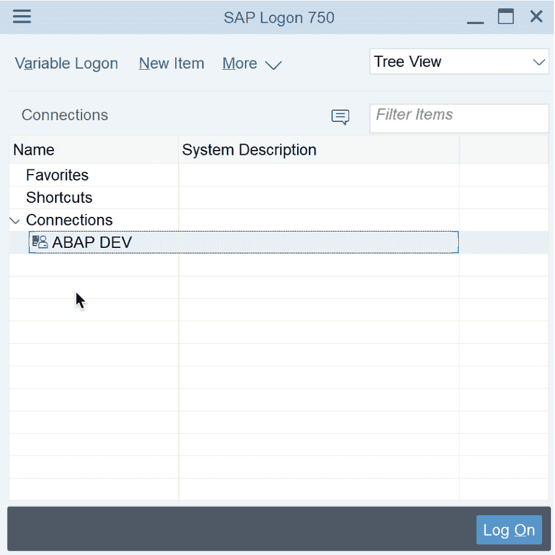

图 8.4 — SAP 系统选择

正如我们所见，我只注册了一个系统。因此我只需在此处发送按键（第 3 行）按下 *Enter*。如果您注册了多个系统并希望登录到特定系统，则需要确保首先选中了正确的条目。

第 4 行中，我们等待主 SAP 窗口出现，其外观如下：

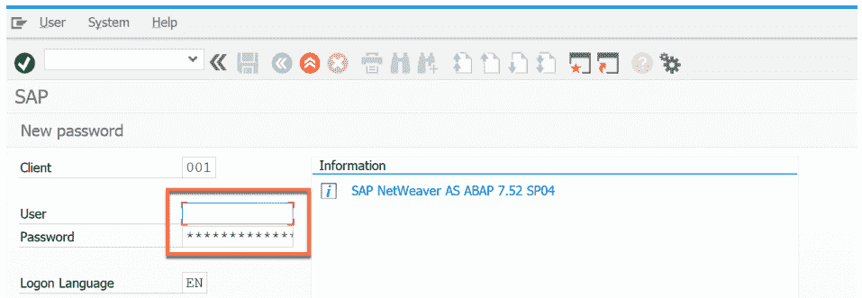

图 8.5 – SAP 登录屏幕

如前所述，该软件也设计为仅使用按键操作。我们可以通过 UI 元素的淡红色边角看到光标所在位置——在本例中为用户名文本框。同样，这是该软件的默认行为，我们可以利用这一点。然而，如果我们需要登录到不同的客户端（参见前一屏幕截图中的 Client 字段），我们就需要确保这些设置已完成。

在流程的第 5 行和第 6 行中，我们输入用户名和密码。要从一个字段跳转到下一个字段，我们只需使用 Tab 键。这些值存储在两个输入变量中，并标记为敏感。最后一步是按 Enter 并等待登录过程完成（第 6 行和第 7 行）。此时，我们已成功登录系统，可以开始在 SAP 中使用程序。

### “Launch_Excel” 和 “Launch_Outlook” 子流程

我们主流程中的下一步是查找需要在 SAP 系统中注册的用户，然后通过

由于我们希望将生成的密码存储在用户的对应行中，因此我们此时不会关闭 Excel。从这里开始，我们可以开始处理每个用户。

### 用户数据处理

现在我们已经启动了 SAPGUI 以及 Outlook 和 Excel，我们准备好处理每个用户的数据了。我们必须做的第一件事是在 SAP 中调用一个名为 SU01 的特定事务——这正是我们在主流程第 4 行中所做的。

### SAP 和事务代码

在使用 SAP ERP 时，我们经常谈论所谓的报表和事务，它们用于执行业务需求和流程。事务代码（例如 SU01）启动一个用于输入参数的程序，并且非常经常随后启动一个报表。此处使用的事务例如允许输入用户名，可以对其进行搜索或创建。因此，这里展示的过程代表了使用 SAP 的非常典型的例行操作。

以下屏幕截图显示了此步骤的操作参数对话框：

**Send keys**

Sends keys to the application that is currently active (More info)

**Select parameters**

| Parameter | Value |
| --- | --- |
| Send keys to | UI element |
| UI element | `appmask > Window 'SAP'` |
| Text to send | Input as text, variable or expression {x} |
|  | `su01{Return}` |
| Insert special keys | (button) |
| Insert modifier | (button) |
| Delay between keystrokes | 10 |
| Send Text as hardware keys | |
| On error | |
| Save | (button) |
| Cancel | (button) |

图 8.7 – 调用 SAP 事务 “SU01”

我们在这里更仔细地查看此步骤的原因是，我们将在本示例中始终使用这一基本概念：

- 因为我们也可以使用此操作选择之前定义的 UI 窗口，所以我们不必注意该窗口是否也在前台。这在流程中处理多个程序且无法始终知道当前哪个窗口在前台时尤其有用。通过指定 UI 元素，按键将被发送到指定的窗口——在我们的例子中是 SAPGUI。
- 我们可以通过键盘输入完全完成任务，使我们独立于按钮或列表项等额外的 UI 元素。因此，此流程也独立于屏幕分辨率。
- PAD 操作还允许我们执行特殊按键，例如 *Shift + Tab*（在界面中向后跳转一个字段）或 *Ctrl + S*（保存的快捷方式，也适用于 SAP）。
- 除此之外，我们可以以毫秒为单位指定按键之间的时间。这在 SAPGUI 在较慢的计算机上运行时很有用。

执行此操作后，我们将进入 SAP 中维护用户的屏幕。接下来，我们遍历循环（第 5 行至第 9 行），其中我们完成以下子任务：

- 确定要处理的用户信息（`Read_ExcelUserRow` 子流程）。我们之前读取了用户表。
- 使用该信息在 SAPGUI 中输入（`Enter_SAPUserData` 子流程）。
- 向用户发送包含初始登录凭据的电子邮件。

对于循环本身，我们并不是使用 `For each` 循环遍历行列表。相反，我们可以使用基于索引的方法，因为这使得更容易将数据写回 Excel 中的正确行。让我们看看 `Read_ExcelUserRow` 子流程的细节，看看这是如何工作的：

图 8.8 – 读取用户数据并生成随机密码

请注意，我们在第 1 行立即为登录创建随机密码。我们使用文本操作组中的 Create random text 操作。此操作正是为此目的而创建的，因为可以定义长度和复杂性等可能性。第 2 行至第 6 行中，我们创建流程变量，以便在流程后续更轻松地使用这些数据。第 7 行负责将生成的密码保存到 Excel 工作表的对应行中。在这里，我们使用了 LoopIndex 变量，其中包含我们当前正在处理的行的编号。

Subflows: Read_ExcelUserRow, Enter_SAPUserData, Launch_Outlook

| Step | Action | Description |
| --- | --- | --- |
| 1 | Create random text | Create a random text of length between 8 and 10 characters using uppercase letters, lowercase letters, symbols and digits and store it in InitialPassword |
| 2 | Set variable | Assign to variable UserName the value ExcelData[LoopIndex][0] |
| 3 | Set variable | Assign to variable UserFirstName the value ExcelData[LoopIndex][1] |
| 4 | Set variable | Assign to variable UserLastName the value ExcelData[LoopIndex][2] |
| 5 | Set variable | Assign to variable UserEmail the value ExcelData[LoopIndex][3] |
| 6 | Set variable | Assign to variable UserAlias the value ExcelData[LoopIndex][4] |
| 7 | Write to Excel worksheet | Write the value InitialPassword into cell in column 6 and row LoopIndex + 2 of the Excel instance ExcelInstance |

在下一个子流程中，我们再次使用 SAPGUI 并操作程序以创建新用户。如前所述，这完全可行

使用仅键盘操作。我们想要创建的序列可以用以下键盘命令或输入来表示：

- 1. 输入用户名，然后按 *Tab*。
- 2. 输入用户别名，然后按 *F8*（这是 *create* 的功能键）。
- 3. 按两次 *Tab*（跳转到姓氏字段）。
- 4. 输入用户的姓氏，然后按 *Tab*。
- 5. 输入用户的名字，然后按 *Tab*，
- 6. 依此类推…

该序列对每个新用户重复，最后以 *Ctrl + S* 结束以进行 **Save**，之后我们会回到屏幕以输入下一个用户：

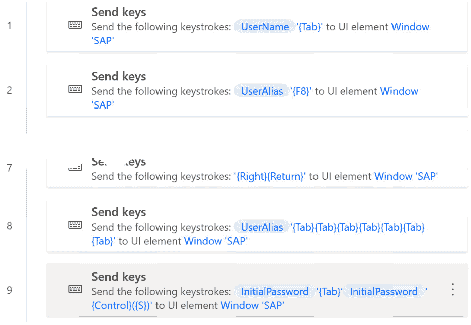

图 8.9 — “Enter_SAPUserData” 子流程

循环的最后一步是向用户发送包含登录信息的电子邮件。为此，我们必须使用 **Send email message through Outlook** 动作。由于我们在主流程开始时已经打开了 Outlook，我们可以只使用此动作，其配置如下：

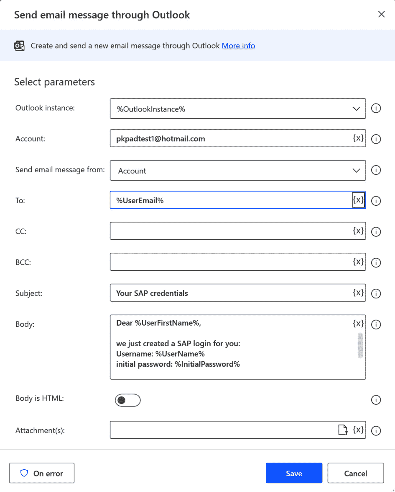

图 8.10 – “Send email message through Outlook” 动作参数

在这里，我们使用了之前创建的不同变量。它们使设置比使用带索引的表变量更易读。

此时，循环结束并为该 Excel 工作簿中的每条记录重新开始。之后，Outlook 和 Excel 会通过其对应的动作关闭。SAPGUI 可以通过适用于所有 Windows 程序的键盘命令关闭：*Alt + F4*。之后，程序会要求确认注销，这也可以通过另一个按键提供。

## Additional thoughts and automation options

当然，对于每个挑战，通常有几种可能的解决方案，这里介绍的方法并不是唯一一种。例如，也可以在处理完 SAP 中的数据并向用户发送电子邮件后才打开 Outlook。这对于内存较小的计算机来说可能也是更好的变体。而且正如前面提到的，SAPGUI 也可以通过其他方式进行自动化。

微软最近在其文档中添加了关于 SAPGUI 集成和自动化的大量信息，这也再次强调了这种可能性的重要性。

在这里，我们将讨论多种实现选项：

- - **Pro-code**：在此方法中，使用 VBScript 与底层的 SAPGUI Scripting API 交互。这里，SAPGUI 以 VBScript 命令的形式记录要执行的动作，然后可以导入并在 PAD 中使用。乍一看听起来很简单。然而，除非你恰好是这种脚本语言的专家，否则流程的更改将难以实现。
- - **Low-code/no-code**：这两种方法使用记录器来捕获特定的字段，如按钮和文本字段，然后进行调整

> 之后。这遵循了我们在 *第 5 章和第 6 章* 中学到的创建 UI 元素的概念。

本节介绍了一个非常流行的业务应用程序，我们学习了如何使用 PAD 来自动化这个有时非常复杂的程序。下一节将介绍所有业务应用程序 IT 的开端，并展示如何自动化和集成仍然非常流行的主机应用程序。

## Integrating mainframe scenarios

术语 **mainframe** 指的是一个可追溯到 1950 年代的计算机家族。这些机器的操作较少依赖图形界面，而更多依赖基于字符的用户界面。它们的特点是可靠性非常高，以及对输入/输出和算术运算的吞吐量非常高。尽管从今天的角度来看该技术似乎过时，但主机仍然被广泛使用。在经典 IT 领域，区分了批处理和对话程序。此类环境中不存在 API。信息交换大多基于文件或通过数据库访问。主机应用程序最常用于 **企业资源规划 (ERP)**、财务会计、仓储、订购等领域。因此，可以设想许多集成主机应用程序可能有用的场景：

- - 网上商店接收客户订单，这些订单必须输入到中央仓储系统
- - 供应商使用网络门户确认其交付，这些交付反过来必须输入到中央系统

特别是在必须通过对话程序进行输入时，自动化是一个挑战，但我们可以用 PAD 很好地应对。主机的主要制造商有 Unisys、Fujitsu Siemens，当然还有最大的 IBM，其 zSeries 和 AS/400 机器。其中最常用的操作系统之一是 **Multiple Virtual Storage (MVS)**，后来更名为 OS/390，最后为 zSeries 机器提供 64 位支持的 z/OS。幸运的是，对于我们这些没有主机可用或无法连接到这些主机的人来说，有一个较旧版本的 MVS 的仿真可用，它在 Linux 安装上运行得非常好。此外，在我们的 PAD Windows 机器上，必须安装终端仿真软件，并且必须存在对仿真的网络访问。如果一切都已配置好，我们可以启动终端仿真并会看到 MVS 的欢迎屏幕：

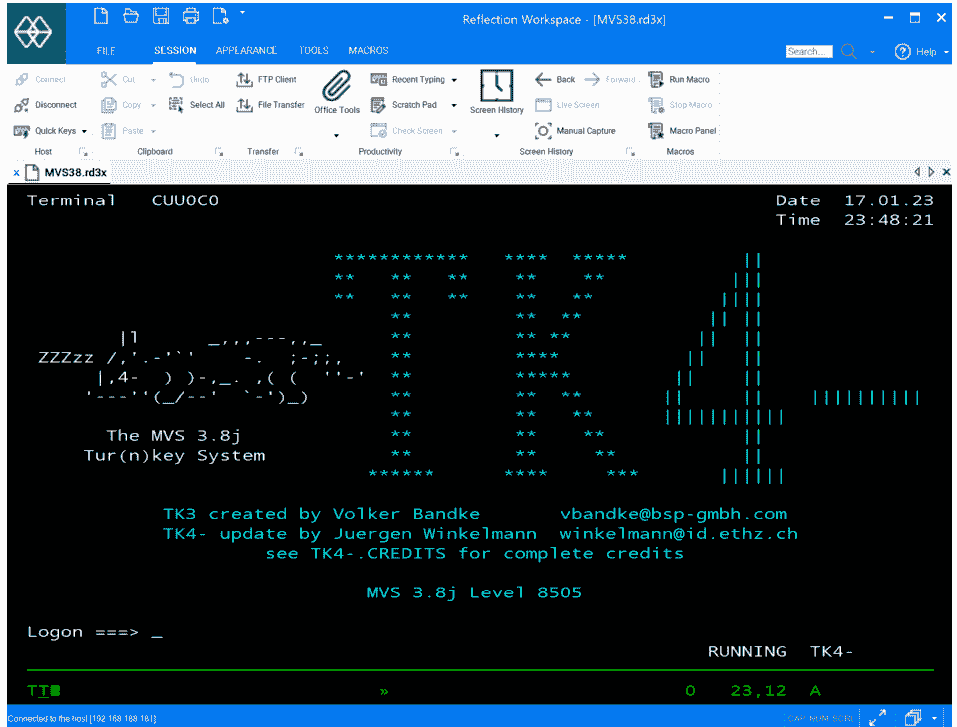

图 8.11 – 用于访问 MVS 的终端仿真

## Software prerequisites

要控制终端应用程序，需要终端仿真软件以及对主机的访问。PAD 提供了与 Micro Focus Reflection 或任何提供 HLLAPI 实现的其他软件（如 RocketSoftware BlueZone、IBM Personal

Communications 和 Cybelesoft zScope）配合使用的终端仿真动作。对于本书，我使用了一个 Micro Focus Reflection 的试用版，并创建了一个基于 IBM 技术的常见主机系统的仿真虚拟机。请参阅相应章节了解更多信息。

现在我们已经具备了所有先决条件，可以登录系统并探索其功能。要访问程序，需要提供有效的用户 ID 和密码。此版本附带了文档中提供的预配置用户和密码。主机场景的虚拟设计足够复杂。通常，用户会找到满足特定目的的某些程序，例如 **update inventory** 和 **trigger supplier order**。这些程序以库的形式组织；最终用户可以通过键盘输入直接启动这些程序，然后使用数据和参数启动业务流程。在我们的测试环境中，不幸的是，我们没有触发业务流程的程序，但原理是相同的，因此我们可以使用示例流程来演示这种交互模式。

我们可用于终端会话的动作列表显示此类应用程序完全通过键盘操作：

- - **Open/close terminal session**：当使用 **Open terminal session** 时，会创建一个包含终端会话对象的变量。在这里，可以在不同的提供商之间进行选择（*Micro Focus Reflection* 或通用 HLLAPI），也可以选择安装路径和要连接的会话。在我的示例中，我创建了一个包含连接信息的会话文件并将其提供给参数：

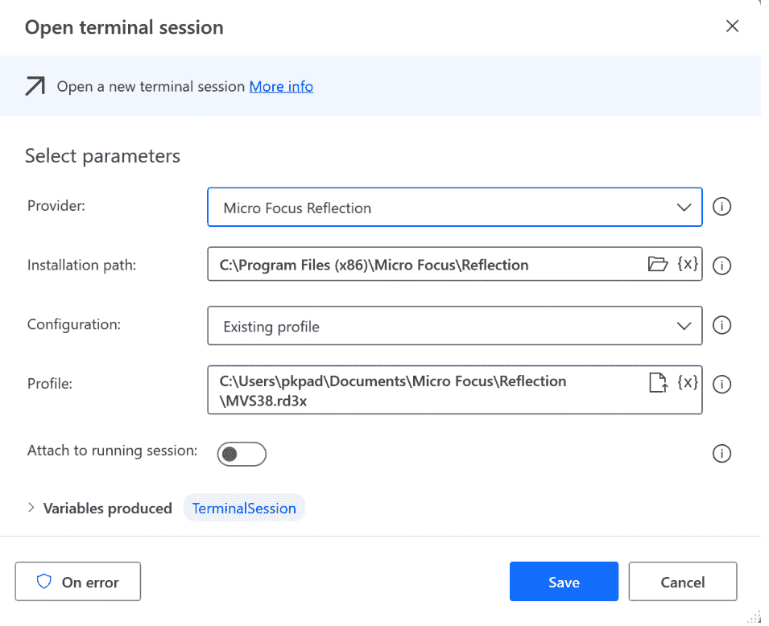

# 图 8.12 – “Open terminal session” 动作参数

- - **Move cursor on the terminal session:** 有时需要将光标放在特定位置以输入一些数据。此动作可用于通过提供行号和列号的值将光标放在所需位置。
- - **Get/set text from or to the terminal session:** 这些动作用于向主机程序输入或读取数据——例如，要输入的订单的数据，包括订单项目，可以使用 `set text` 输入。然后，后来可以读取自动创建的订单号 `get text`。
- - **Send key to terminal session:** 此动作用于在终端仿真中执行控制——例如，通过发送 `Transmit`

在再次发送 `<transmit>` 消息两次之前，需要一些时间进行处理。我们需要这样做，因为在到达主屏幕之前，操作系统将呈现两个额外的屏幕（广播消息）：

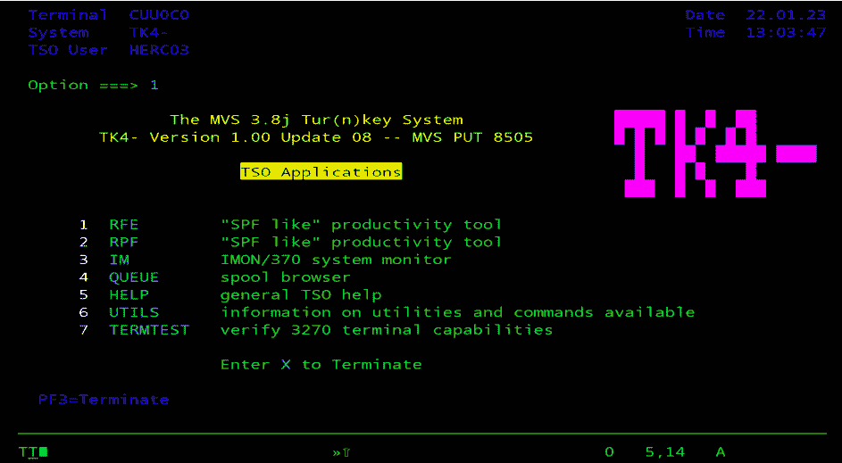

图 8.14 – MVS 主屏幕

在接下来的操作序列中，我们必须通过发送一些文本并再次发送 `<transmit>` 消息（第 12 和 13 行）来导航到 **IMON/370** 应用程序。该应用程序是一个交互式监控程序，也显示有关系统的一些信息：

Press '3' to start IMON / 370 system monitor

# Set text on terminal session

Set text 3 on Cursor position on terminal session TerminalSession

# Send key to terminal session

Send key Transmit to terminal session TerminalSession

extract field 'CPU serial '

# Get text from terminal session

Get text from Field with label 'CPU-SERIAL-' of terminal session TerminalSession and store it into TerminalText

# Set text on terminal session

Set text 'x' on Cursor position on terminal session TerminalSession

# Send key to terminal session

Send key Transmit to terminal session TerminalSession

图 8.15 – 在 MVS 中启动程序并提取值

在第 15 行，我们在再次退出程序（第 16 和 17 行）之前，将 CPU-SERIAL 字段的值提取到一个 PAD 变量中。

为了正确完成处理，我们仍然需要注销终端会话：

图 8.16 – 使用 PAD 从终端会话注销

我们必须做的第一件事是从用户会话注销（第 19 和 20 行），然后通过发送相应消息后跟 `<transmit>` 来注销。最后，我们可以关闭终端会话（第 24 行）。

在本节中，我们看到了自动化大型机应用程序是可行的，而且并不复杂。PAD 提供了调用和运行大型机程序所需的所有要素。此外，已生成的结果或计算可以被读出并在其他地方进一步处理，因此实现了双向接口。

在下一节也就是最后一节中，我们将重点讨论当今大多数业务流程发生的领域：基于浏览器的应用程序。

## 基于浏览器的业务应用程序

到目前为止，在本章中，我们讨论了安装在计算机本地的业务应用程序。尽管如今这类应用程序很多，但为浏览器开发业务应用程序也变得越来越流行和普遍。当然，这也与许多软件产品由主要制造商作为**软件即服务（SaaS）**开发和提供有关。这些产品包括例如 ServiceNow、Salesforce、SAP、Microsoft 等等。通常，这些软件产品还具有**应用程序编程接口（API）**，通过该接口可以访问所有功能和数据。在 Microsoft 生态系统中，我们有作为 Power Platform 一部分的 Power Automate，其中可以使用不断增长的连接器集合，例如，与上述系统建立数据连接并与之交互。

但有时，无法使用 API，必须通过界面输入数据。这正是 PAD 可以发挥作用的地方。针对这种用例，可以推导出一种适用于所有基于浏览器的业务应用程序的模式：

- PAD 中没有针对这些应用程序的默认操作；相反，可以使用来自**浏览器自动化**操作组的操作
- 必须为流程映射创建 UI 元素，并与界面交互
- 要与应用程序交互（输入数据、读取信息等），可以使用**Web 数据提取**和**Web 表单填充**操作子组中的操作

在深入探讨示例之前，让我们了解一下可用于浏览器自动化的各种操作。

浏览器自动化操作组：

- **启动新浏览器/关闭 Web 浏览器**：PAD 提供了标准操作，用于打开新实例或连接到 Internet Explorer、Firefox、Chrome 或 Microsoft Edge 的正在运行的实例。这些操作还允许你清除浏览器缓存、清除 Cookie，并在给定超时时间内等待给定网页加载。系统会创建一个名为 `Browser` 的变量，供其他操作引用。**关闭 Web 浏览器**操作则没有任何意外之处。

- **创建新标签页/转到网页**：此操作需要一个正在运行的浏览器实例，它可以用来创建带有特定 URL 的新标签页，或用于导航。**转到网页**操作还可以使用浏览器导航进行**后退**、**前进**甚至**刷新**。
- **点击链接/下载链接**：前一个操作可能是此类场景中最常用的操作之一。要使用它，必须选择一个 UI 元素。然后，可以选择不同的点击类型（简单的左键单击，但还有右键单击、中键单击、双击，以及左/右和按下/弹起的单独类型）。要将文件下载到特定文件夹，可以使用后一个操作。
- **在网页上运行 JavaScript 函数**：此操作允许你在网页上执行自行编写的 JavaScript 函数。任何 JavaScript 函数都可以注入到此处。一个示例是使用它向下滚动网页以填写或提取更多数据。
- **将鼠标悬停在元素上**：有时，当鼠标悬停在某个元素上时，已经会显示有价值的信息——这正是此操作的设计目的。要使此操作生效，必须提供一个 UI 元素。
- **等待网页内容/如果网页包含**：这两个条件操作也使用 UI 元素。为了确保某个元素存在于网页上——例如，在按下按钮并且触发了某些处理之后——可以使用这些元素中断流的执行，直到某个元素在网页上出现（或消失）。第二个操作还可以检查网页上是否包含/不包含给定的文本。

除了这些常规操作，还有 **Web 表单填充** 和 **Web 数据提取** 子组。要将数据从 PAD 传输到 Web 应用程序，我们有一些操作可以聚焦并填充文本字段、设置复选框、单选按钮或下拉列表的值，以及按下网页上的按钮。这些操作都位于 **Web 表单填充** 子组中，并且同样使用 UI 元素。

**Web 数据提取** 子组包含一些操作，用于获取网页本身或元素的更多详细信息，以及一个需要更多解释的通用 **从网页提取数据** 操作。如果我们只是将这个操作拖入流程设计器，将无法定义任何有意义的新参数。相反，此操作应与 PAD 录制器结合使用。我们在*第 2 章*中了解过它，当时我们看到了一个如何从网页捕获数据列表的示例。

此操作功能相当强大，允许我们根据想要提取数据的网页结构，提取单个值、列表、行甚至完整的表格。我们可以将提取 Web 数据的一般过程描述如下：

1. 确定要操作的网页的 URL。
2. 启动 PAD 录制器，并逐步执行应执行的操作。录制器还会创建相应的 UI 元素，这些元素稍后必须执行。
3. 使用 Web 元素的上下文菜单来插入数据或捕获数据。单击只会选择 Web 元素并捕获此操作，但右键单击元素时，会有更多选项，尤其是用于数据提取的选项。
4. 观察录制操作列表。点击顺序不必完美，如果你不小心点击了不需要的元素，只需在录制器中删除它。
5. 完成后，检查生成的 UI 元素，并为它们指定有意义的名称。这样之后在相应的操作中更容易识别这些元素。
6. 测试你的流程并修改选择器。录制期间会捕获 Web 元素，但有时需要进一步调整。这可以通过在设计器外部编辑选择器来完成。

现在，是时候举一个如何使用浏览器自动化的小例子了。为此，我们将在 Dynamics 365 Sales 中插入一条新报价，Dynamics 365 Sales 是 Dynamics 365 的 CRM 模块之一。在此场景中，我们希望使用 Dynamics 365 Sales 模块创建报价，读取生成的报价编号，并将其存储在变量中以便进一步处理。

像其他基于 Web 的业务解决方案一样，Dynamics 365 有一些需要考虑的功能：

> > 用户要使用该应用程序，需要进行一般的设置和登录。如果你刚刚开始试用，一切都会在后台为你设置好。在下面的示例中，登录到工作站的用户也登录到了底层的 Azure Active Directory 实例以及 Dynamics 365。这意味着浏览器窗口不会单独要求登录。系统登录可能需要单独考虑——例如，通过存储的凭据。

可选：在启动 PAD 之前先进行身份验证。这将确保你的自动化顺利运行。

> > 使用特定 URL 访问系统，并且该 URL 需要提供给 **Launch new Browser** 操作。对于 Dynamics 365，甚至可以使用特定业务操作的专用 URL，例如 **create account** 或 **edit contact**。在此示例中，我们将直接使用创建新报价的 URL。

在具备这些先决条件后，如下图所示的 PAD 流程可以立即录制。在这里，我们需要执行以下操作：

+   1. 创建一个新的流程并为其指定一个有意义的名称（例如，`Dynamics 365 Quote Creation`）。
+   2. 设计器出现后，按顶部按钮菜单中的录制按钮。
+   3. 执行创建报价所需的步骤。在我们的例子中，我们需要输入报价名称，选择价格表和客户，保存记录，并提取生成的报价标识符。
+   4. 美化生成的 UI 元素和变量，使其更易读。

在下图中，我们可以看到由此生成的流程左侧和改进后的流程右侧：

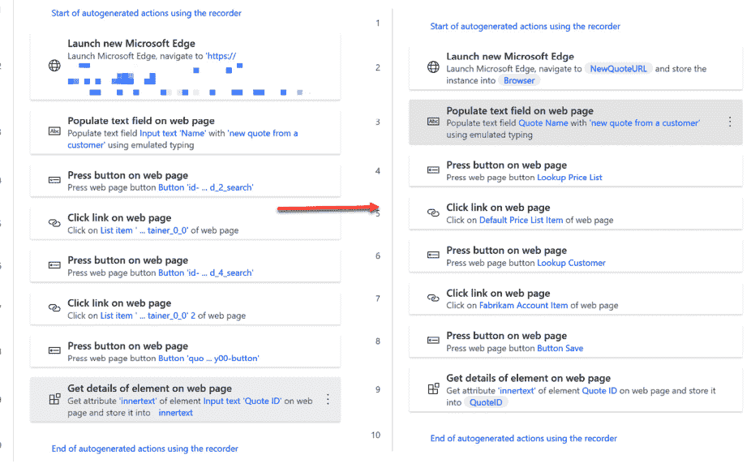

图 8.17 – 在 Dynamics 365 中创建新报价

除了重命名 UI 元素和变量之外，在使用此应用程序时还有一件事需要注意。在第 3 行，我们使用一些文本填充报价名称。对于此操作，我们需要禁用使用物理按键填充文本的选项，而改用模拟输入，这通常在复杂的网页上是必需的：

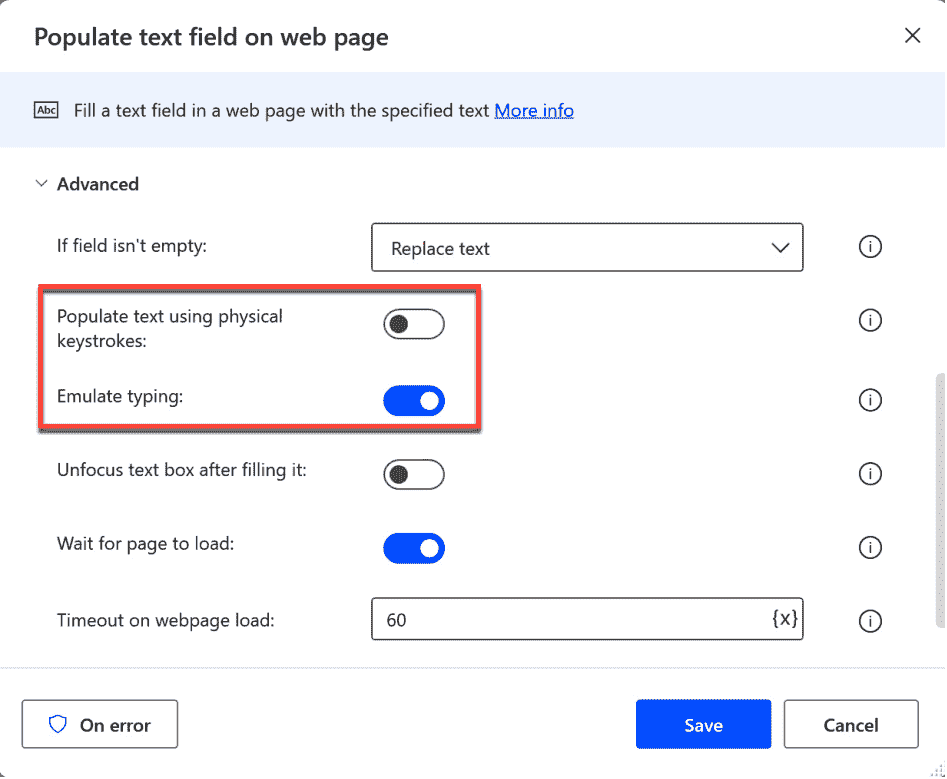

图 8.18 – 在复杂网页上使用模拟输入

对于其他所有 UI 元素，记录器做得非常好，并且流程可以可靠地重复执行。请注意，流程之后可以在设计器中通过进一步操作进行丰富。这是通常插入 **Wait for web page content** 操作的程序。作为结果，Dynamics 365 中将创建一个新报价：

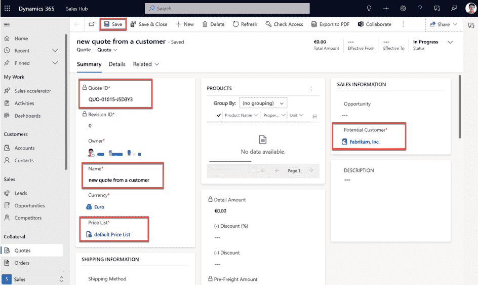

图 8.19 – 由 PAD 创建的新报价

## 本示例的说明

此时，我们可能会问自己，使用这种方法在 Dynamics 365 中执行操作是否有意义。这可能有几个原因：

+   - 目前没有其他人可以通过其他接口（例如云流）向我们提供这些数据
+   - 此流程可能只是子流程，其他系统必须在本地提供服务

此外，还应注意，由于篇幅限制，我们仅在此处映射了流程的一部分。当然，报价还包括报价项目，这自然必须予以考虑并相应处理。在真实场景中，报价名称、客户以及价格表等信息将通过变量提供。

像 Dynamics 365 这样的业务应用程序具有足够复杂的 HTML 结构。界面大多是底层框架执行渲染过程的结果。例如，在 Dynamics 365 中，使用 React 框架来实现此目的。然而，这也意味着 HTML 元素的选择器可能具有非常复杂的结构。因此，如果你有任何疑问，则需要一些手动工作来找到正确的元素。关于这一点将在第 12 章中提供更多信息。

这里介绍的想法和概念也适用于普通和公共网站。作为规则，这里可以找到更简单的结构，这些结构也更能被 **Web Data Extraction** 操作识别——例如，HTML 表格。

然而，这个例子已经很好地过渡到我们下一章，我们将在其中更仔细地研究 Power Platform 的功能，Dynamics 365 也位于 Power Platform 中。

## 进一步阅读

要了解本章涵盖主题的更多信息，请查看以下资源：

+   - Innovation Commitment for SAP S/4HANA, clarity and choice on SAP Business Suite 7: https://support.sap.com/en/release-upgrade-maintenance/maintenance-information/maintenance-strategy/s4hana-business-suite7.html
+   - *Introduction to SAP GUI-based RPA in Power Automate Desktop* (contains video) – Power Automate | Microsoft Learn available at https://learn.microsoft.com/en-us/power-automate/guidance/rpa-sap-playbook/introduction
+   - Mainframe computer: https://en.wikipedia.org/wiki/Mainframe_computer
+   - MVS: https://en.wikipedia.org/wiki/MVS
+   - MVS 3.8j Tur(n)key 4 – System: https://wotho.ethz.ch/tk4-/
+   - *Browser automation actions reference* – Power Automate | Microsoft Learn available at https://learn.microsoft.com/en-us/power-automate/desktop-flows/actions-reference/webaautomation
+   - *Install Power Automate browser extensions* – Power Automate | Microsoft Learn available at https://learn.microsoft.com/en-us/power-automate/desktop-flows/install-browser-extensions
