## 利用云服务和 Power Platform

在本章中，我们将介绍如何将 PAD 与 Power Platform 集成，并了解如何使用该技术弥合云世界与本地执行的 UI 流程之间的差距。此外，我们将查看用于从 UI 流程操作 Microsoft SharePoint 的操作。

最后，我们将使用 **Amazon Web Services (AWS)** 和 Microsoft Azure 的操作，以使用 **Infrastructure-as-a-Service (IaaS)** 服务来托管 UI 流程。我们将在本章中涵盖以下主题：

+   - Power Platform 和相关服务
+   - 使用 SharePoint 管理列表、文件和文件夹
+   - 使用 IaaS 服务（Azure/AWS）

## 技术要求

本章展示了如何将桌面流程与 Microsoft 的 Power Platform 集成并使用它。此场景需要一个工作或学校账户，可用于创建 Dynamics 365 的试用版。本章中的示例使用 Dynamics 365 Sales 模块，可在几个步骤中设置（详细信息的链接包含在 *Further reading* 部分）。调用和操作 SaaS 服务的基本知识是先决条件。此外，还需要 Power Automate 许可证，其中包括 UI 流程。这也可以是测试许可证。

为了展示 Microsoft Azure 和 AWS 的功能，需要两个环境的试用。提供商为资源有限使用提供免费套餐，这对于我们的目的来说完全足够。

此外，还需要对提供商及其服务有基本了解，以及如何创建简单的标准化虚拟机的知识。

## Power Platform 和相关服务

在 *Chapter 1* 中，我们了解到 Power Automate Desktop 是 Power Platform 的一部分。凭借这种直接关系，可以利用一个独特的优势，与 Power Platform 家族的其他成员结合使用。在之前的示例中，我们看到 UI 流程基于特定用例连接到另一个应用程序，或使用浏览器自动化远程检索信息。通过使用 Power Platform，此出站连接场景现在可以扩展为入站场景——例如，UI 流程可以从外部自动调用并执行其工作。在这方面，PAD 可以弥合云与本地网络之间的差距，从而确保互联的流程。

为了更好地理解这一概念以及所有这些如何融入 Microsoft 生态系统，我想从高层次解释一下这意味着什么。下图显示了 Microsoft 云的概念结构：

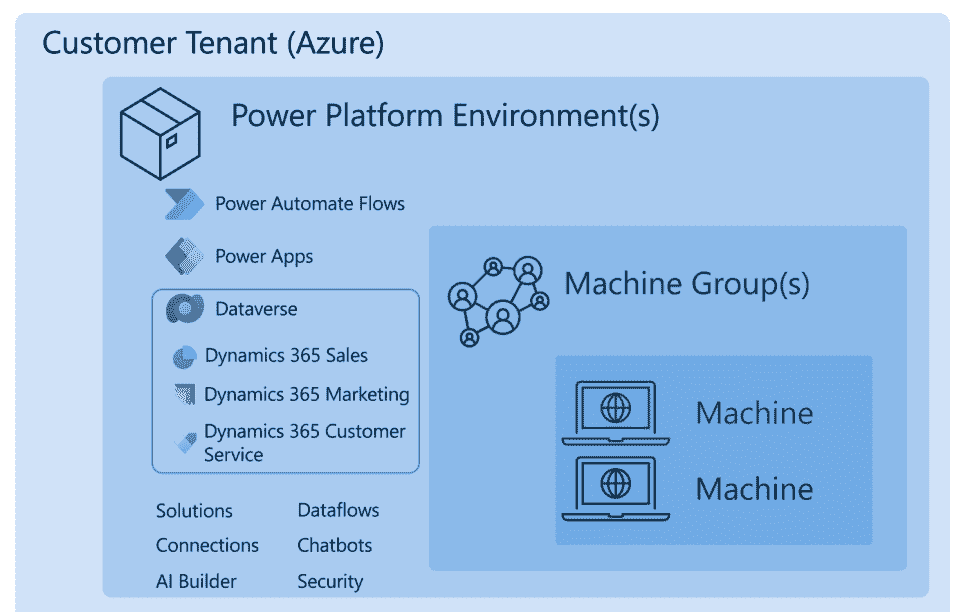

## Figure 9.1 – Power Platform environment(s) structure and elements

如果任何客户想要使用 Microsoft 云服务，必须创建一个客户租户。在这里，我们会找到 Azure 中可用的所有资源，也包括所谓的 环境。 这个术语与 Power Platform 功能相关，可以被视为一种服务于特定主题或目的的容器。租户中可以有多个环境，例如用于开发、测试，当然还有生产环境，也可以为 HR 工作负载、内部服务管理或任何其他主题设置单独的环境。

在每个环境中，我们可以找到 Power Platform 提供的不同工具，例如 Power Apps、Power BI、Power Automate 等等。此外，每个环境的访问权限也可以单独控制。前图显示了可在环境中提供的服务的选集。这也取决于公司已购买的具体许可和订阅。环境的全部工件都存储在 Dataverse 仓库中。Power Automate 与本章的主题相关。让我们来看看将云流连接到 UI 流所需的内容。

## Machine and Machine Runtime

正如我们所知，UI 流是在本地机器上执行的，通常在公司的本地网络内。为了能够将 Microsoft 云和环境连接到该本地机器，Microsoft 提供了 **Power Automate Machine Runtime**。下图显示了组件之间的关系：

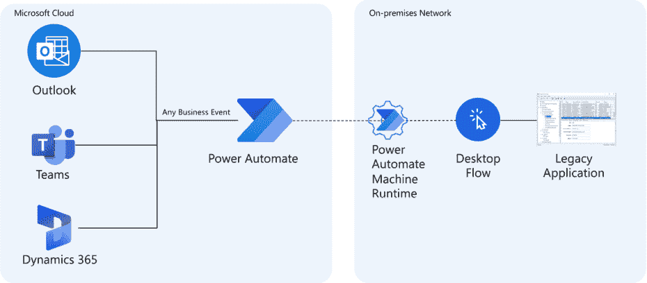

Figure 9.2 — PAD and Power Platform

它在 Windows Professional 和 Enterprise 上会自动安装，但在 Windows Home Edition 上不会。**Power Automate Machine Runtime** 允许您在云环境和本地网络之间创建直接连接。要使用此组件，需要满足一些先决条件：

- 此类连接由 Power Automate 版本 2.8.73.21119 或更高版本支持
- 环境需要一个名为 **MicrosoftFlowExtensionCore** 的特定解决方案，版本为 1.2.4.1 或更高
- 需要一个带有受管 RPA 的高级按用户计划，这是一种需要购买的特殊许可
- 需要注册新机器的用户在环境中必须至少具有 **Environment Maker** 或 **Desktop Flow Machine Owner** 用户角色

安装运行时非常简单。具有适当权限的用户可以选择并在环境中注册本地机器。以下屏幕截图显示了一台已成功注册的机器：

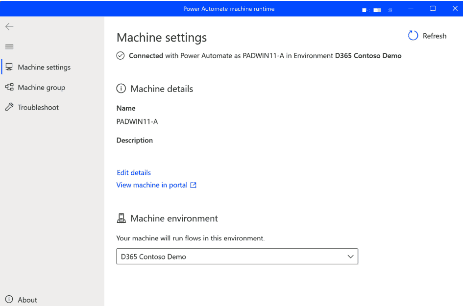

Figure 9.3 – Power Automate Machine runtime settings

如果预计某台机器的负载很高，也可以定义一个机器组并将机器添加到其中。假设有几台机器可用于执行，执行可以分布在它们之间。创建机器组非常容易。可以通过 Power Automate 门户或在 Power Automate Machine Runtime 中完成。只需分配一个名称和可选的描述。然后，该组是

整体流程分为两个部分：云流和桌面流。

桌面流提供以下功能，我们应该已经非常熟悉了：

- 接收传入的值并启动开票程序
- 远程控制输入开票数据的过程
- 提取生成的发票 ID 并将其返回给云流

接收和提供值通过 **Input / output variables** 来保证。为了将新发票输入到 Contoso Invoicing 应用程序中，我们需要提供一个账户名称、一个联系人名称和一个金额。在这里，我们又回到了关于变量的章节。如以下屏幕截图所示，流程中已定义了三个输入变量和一个输出变量：

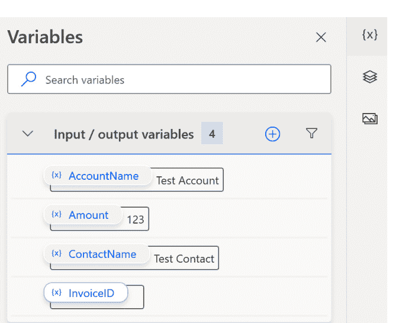

Figure 9.7 – Input/output variables for cloud communication

Figure 9.8 – Power Automate cloud flow triggering a desktop flow

不深入 Power Automate 的细节，这里有一些创建此类流程的提示：

1. 一个流程始终需要一个触发器。这可以是记录的更改或新电子邮件。手动触发也是可能的。在任何情况下，都必须使用相应的连接器确定触发系统。有数百个连接器可用于各种系统，并且这个数字一直在不断增长。在我们的示例中，我们使用了 Dataverse 的连接器，它是 Dynamics Sales 模块的基础，并由绿色符号表示。这也意味着，原则上，Power Automate 中可以使用任何其他系统——例如 ServiceNow、Salesforce 或简单地是一个数据库。
2. Power Automate 允许您通过循环和条件来控制流程，如图所示顶部的灰色框。在这里，我们检查记录是否具有某个状态，以便相应地分支。
3. 在条件的 `Yes` 分支中，使用 Dataverse 连接器检索有关客户和联系人的额外信息，这对于生成发票是必要的。之后，调用桌面流（蓝色框）。
4. 桌面流完成后，会为机会创建一个任务活动，其中包含生成的发票号码，以便销售代表也知道为销售交易记录创建了哪个发票号码。

当云流最初创建时，会在后台为所使用的连接器设置适当的连接。这些包含指向它们后面的服务的凭据，这些凭据与连接器一起使用。因此，当首次使用时，必须为桌面流创建连接。要添加此步骤，可以使用两个现有步骤之间的 *plus* 号或 Power Automate Designer 中的 + **New step** 按钮，如以下屏幕截图所示：

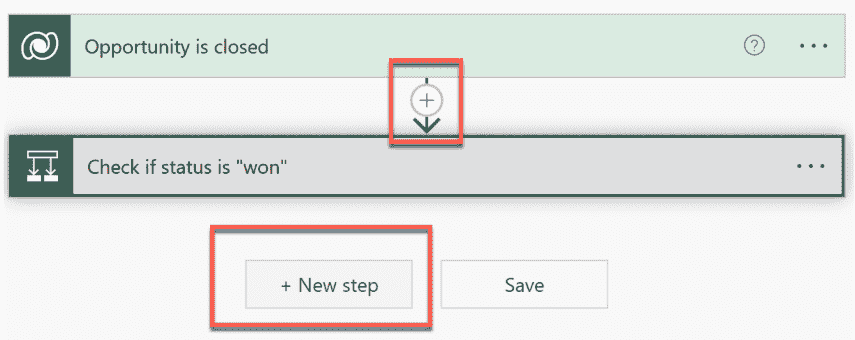

## Figure 9.9 – Adding a new step to Power Automate

接下来，可以选择要包含在流程中的系统。在此示例中，使用了 **Microsoft Dataverse** 和 **Desktop flows** 连接器：

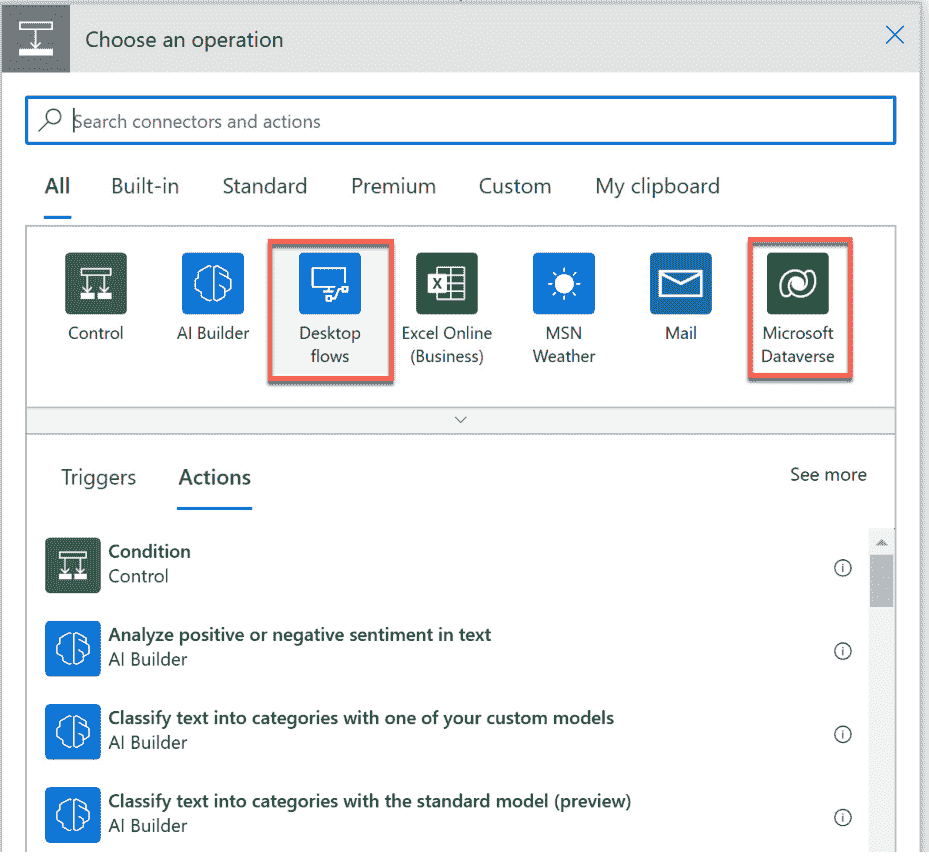

## Figure 9.10 – The Desktop flows connector in Power Automate

选择系统后，窗口下部会显示可用的操作。对于 Power Automate Desktop，可用 **Run a desktop flow** 操作。然后会显示一个窗口，需要输入连接信息。在这里，您还可以选择要用于执行的机器/机器组：

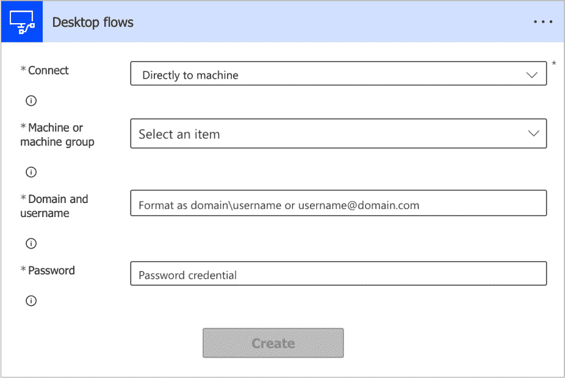

Figure 9.11 – Creating a connection for PAD

之后，可以选择要在本次处理范围内执行的桌面流。这里定义了所谓的 **Run Mode**（见下一节），以及桌面流希望用于执行的全部输入变量（见下图）：

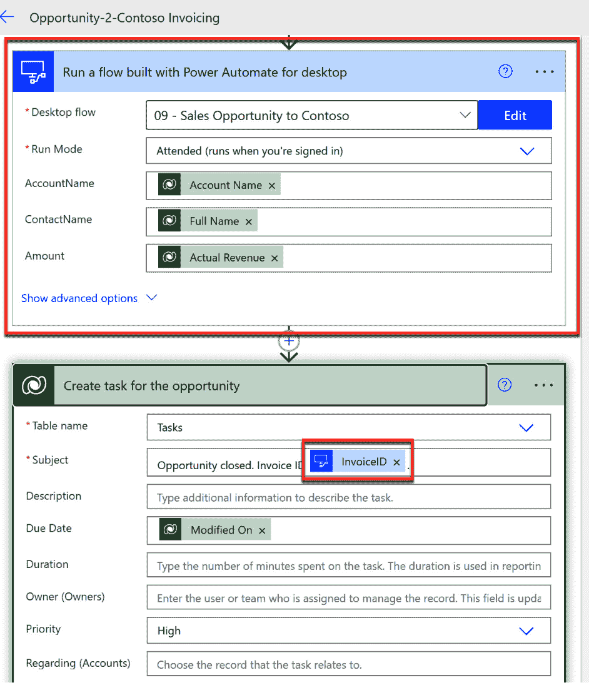

Figure 9.12 – Configured Desktop Flow action and parameters

然后可以使用整个云流中的动态值。在这种情况下，会传递账户名称、联系人姓名和相应数据集中的金额。生成的发票号码由桌面流返回；这也可在后续步骤中使用。在前图的下部，您可以看到此信息如何用于后续步骤，以为销售代表生成信息活动。

## Unattended execution (Run mode)

到目前为止，我们手动启动了 PAD 流程，并能够交互式地观察流程如何运行操作。在这里，系统上有一个用户已登录。这就是所谓的 **attended execution**。相应地，**unattended execution** 在没有查看执行选项的情况下运行。这也意味着执行流程的机器上不能有活动用户会话。流程的无人值守执行只能由云流触发。这是因为我们提供了流程登录机器并启动流程所需的所有必要信息。在执行期间，会创建一个锁定的 Windows 用户会话。执行完成后，该会话将被释放。

要以无人值守模式运行前面的示例，只需在 Power Automate 连接器中进行相应的设置并退出本地 Windows 会话即可。当然，如果在流程执行期间不希望有观众——例如因为正在处理敏感数据——这尤其有意义。

正如我们在本节中所看到的，借助 Power Platform 中的连接器功能，可以无缝地将桌面流整合到更大的集成场景中，而无需编写一行代码。借助 PAD 的这些功能，本地应用程序不再孤立，可以将其功能和数据提供给业务，从而做出宝贵的贡献。

Microsoft 云中另一个非常受欢迎的服务是 SharePoint。我们将在下一节中查看其交互功能。

## Managing lists, files, and folders with SharePoint

Microsoft SharePoint 仍然非常受欢迎，是 Microsoft 365 产品套件中用于管理团队页面、项目工作区、列表和文档库的平台。 通常，该平台还被用作文档管理系统，并作为 Microsoft Teams 管理文档的基础结构：

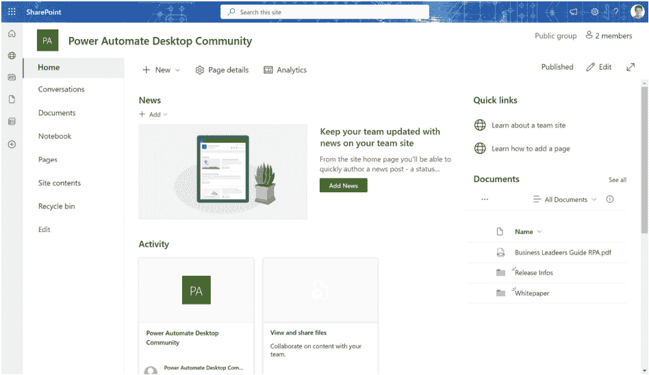

图 9.13 – 标准 SharePoint 示例团队站点

文档库包含许多有用的设置，例如版本控制、文档协作工作等。 因此，如果经常使用的系统如 SharePoint 也可以被 PAD 原生访问，则提供很大的优势。 桌面流创建者不再需要转向云流来处理 SharePoint。 因此，存储在 SharePoint 中的所有数据都将自动对更大的团队甚至整个公司可用。 在撰写本文时，SharePoint 的操作仍处于预览阶段。 让我们看看按类型分组的操作：

- File:
  - 从一个站点地址复制或移动文件到另一个站点地址
  - 从二进制数据创建或更新（新）文件
  - 签入、签出或丢弃文件以防止他人覆盖更改
  - 通过文件标识符获取元数据、删除文件并获取文件内容
- Folder:
  - 从一个站点地址复制或移动文件夹到另一个站点地址
  - **List folder and list root folder**: 返回给定文件夹或 SharePoint 根文件夹中包含的文件
  - **Get folder metadata**: 返回有关文件夹的元数据信息
  - **Extract folder**: 将 ZIP 文件的内容提取到文件夹
- List:
  - **Get lists, get all lists and libraries**: 返回给定 SharePoint 站点中的所有列表或列表和库
  - **Get list views**: 返回给定 SharePoint 列表中的所有视图

文件和文件夹在这里应理解为与本地计算机上的方式相同。 列表和库代表一个上层容器，其中可以相应地包含文件和文件夹。 请注意，没有直接上传或下载文件的操作。 但这可以通过使用额外的 PAD 操作来实现，这就是本节示例中将看到的内容。

SharePoint 操作可以同时使用在线版本和本地安装。 对于后者，必须通过数据网关建立连接。

# Copy file (Preview)

没有可用的有效连接引用。 修复无效的连接引用，使用现有引用，或创建新引用以使用连接器。 连接引用

复制文件。 工作方式与 SharePoint 库中的“复制到”命令类似。 复制后返回有关新文件的信息。 更多信息

## Select parameters

Current Site Address:

File to Copy:

Destination Site Address:

On error

Connection references

## Connection references

Add new connection reference

## No Connection references available

请尝试以下操作之一：

1. 创建新的连接引用
2. 确保为运行时所需桌面流服务端点未被阻止
3. 检查您的互联网连接或运行 Windows 互联网连接疑难解答

Retry

图 9.14 – 创建 SharePoint 连接和引用

# Connections and connection references

要在 PAD 中使用 SharePoint 操作，我们需要一个连接，以及一个连接引用。 两者都可以在 PAD 内部创建。 连接引用的概念由 Microsoft 引入，以从特定 API 或服务的特定连接中抽象出来，该连接在不同环境中可能不同。 此外，连接引用可以是解决方案的一部分（可传输的定制单元）。 所有这些只是背景信息，在 PAD 的上下文中不一定重要，除非我们进入企业领域。

作为示例，我在 SharePoint 中创建了一个简单页面。 这已经包含列表，以及文档库。 单个操作对 SharePoint 用户来说应该很熟悉，并且在很大程度上不言自明。 只有与本地计算机数据连接的部分不被 SharePoint 操作单独覆盖。 因此，以下小示例展示了如何通过 PAD 将本地文件上传到 SharePoint（见下图）：

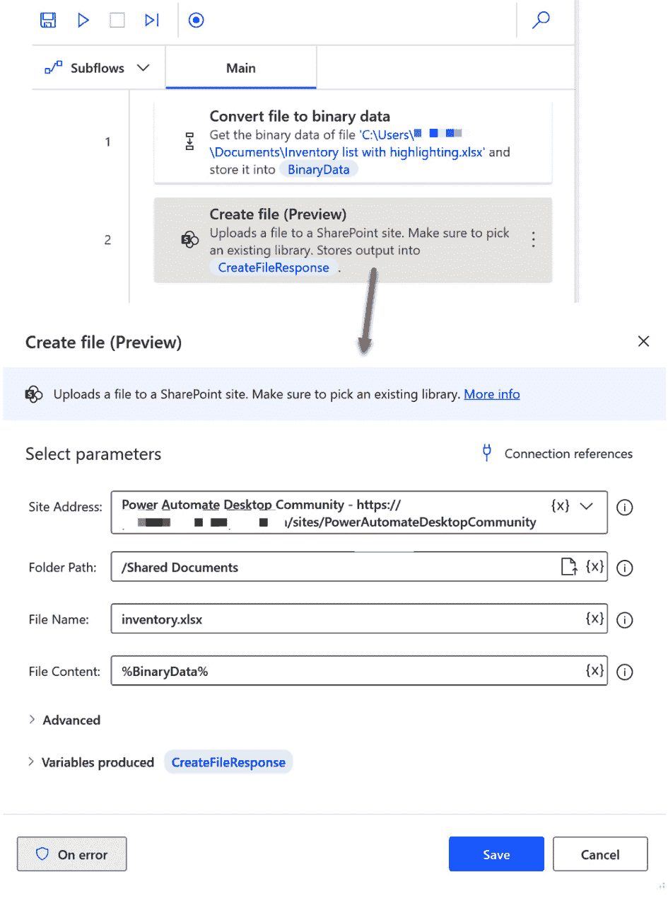

图 9.15 – 通过 PAD 将文件上传到 SharePoint

我们不想也不可能在我们的 PAD 机器上安装它们。

- VM 可以随意启动和关闭。 这意味着如果某个应用程序每月仅需一次用于特定工作负载，例如，可以节省大量资源，并且机器只能在使用的时间内启动。

因此，相应的 PAD 操作旨在控制虚拟机（启动、停止、重启）。 此外，可以使用虚拟磁盘进行工作，可以创建和删除。 创建后，磁盘需要附加。 请注意，我们没有创建或删除 VM 的操作。 因此，假设要在 VM 上运行的应用程序已经安装。

下表显示了可在 PAD 中用于管理虚拟机和存储的操作：

|  | AWS | Azure |
|---|---|---|
| Name of the offering | Elastic Compute Cloud (EC2) | Azure Virtual Machines |
| PAD actions group | AWS and subgroups | Azure and subgroups |
| Connection via | Create EC2 session and end EC2 session | Create session and End session |
| VM capabilities |  |  |
| Start/Stop/Reboot | Start EC2 instance, Stop EC2 instance, Reboot EC2 instance | Start virtual machine, Stop virtual machine, Shutdown virtual machine, Restart virtual machine |
| Get list of machines | Get available EC2 instances | Get virtual machines |
| Get description of machines | Describe instances | Describe virtual machine |
| Snapshot capabilities |  |  |
| Create/delete | Create Snapshot, Delete Snapshot | Create snapshot, Delete snapshot |
| Describe | Describe snapshots | Get snapshots |
| Disk storage capabilities |  |  |
| Create/delete | Create volume, Delete volume | Create managed disk, Delete disk |
| Attach/detach | Attach volume, Detach volume | Attach disk, Detach disk |
| Get information on disks | Describe volumes | Get disks |

表 9.1 – VM 操作比较

Azure 操作已完成，可使用所谓的资源组（获取、创建、删除）的可能性。 这些提供了一个逻辑和主题容器，可以将 Azure 工件分配给它，以便轻松识别，例如，属于订单管理主题的所有资源。

要使用每个提供商的操作，必须通过相应的会话操作建立连接。 两个提供商的连接设置方式不同。

# AWS actions in use

AWS 会话操作在以下屏幕截图中显示。 创建会话有两种方式：使用配置文件名和区域或使用

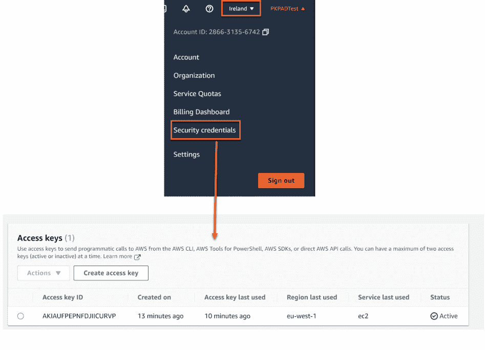

图 9.17 – AWS 访问密钥和密钥

单击 **Security credentials** 链接会打开 **Identity and Access Management** 页面。 在此页面稍下方有一个访问密钥部分。 在这里，您可以轻松生成新的访问密钥。 密码（或密钥）仅显示一次。 建议将此密码复制到其他位置。 根据所选区域，可能仍需为此参数进行条目。 可用服务端点及其条目的列表可在 *Further reading* 部分找到。 对于我们在此选择的 **Ireland**，字符串为 `eu-west-1`。

有了这三个条目，现在可以成功创建 EC2 会话，从而可以使用所有进一步操作。

为了使以下演示 UI 流正常工作，我们还需要在 EC2 中预配一台机器。 有大量指南说明如何在 EC2 中创建 VM。 测试帐户可用于创建 Linux 和 Windows VM，

which are then managed via the console. For this flow, a simple Windows machine was created.

The UI flow shown in the following figure logs into AWS with the credentials (1), then calls the available EC2 instances and stores them in a variable (2).

The subsequent loop goes through all instances (3) and checks each one to see whether it is stopped or not (4). If stopped, a message box asks whether the machine should be started (5). This is what the flow looks like:

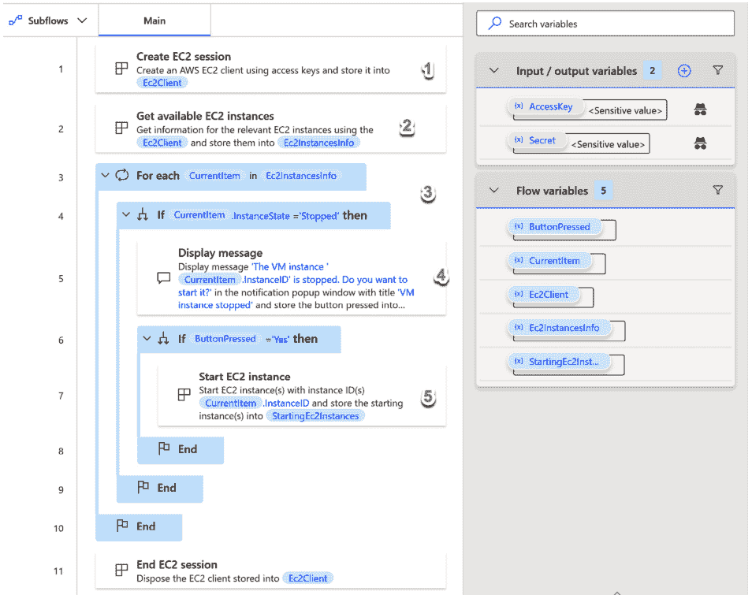

Figure 9.18 – Working with AWS EC2 instances

## Working with Azure actions

In the first section of this chapter, we saw that Azure is the foundation for all Microsoft Cloud services. To explain the concept of Azure without going too much into the details, take a look at the following diagram:

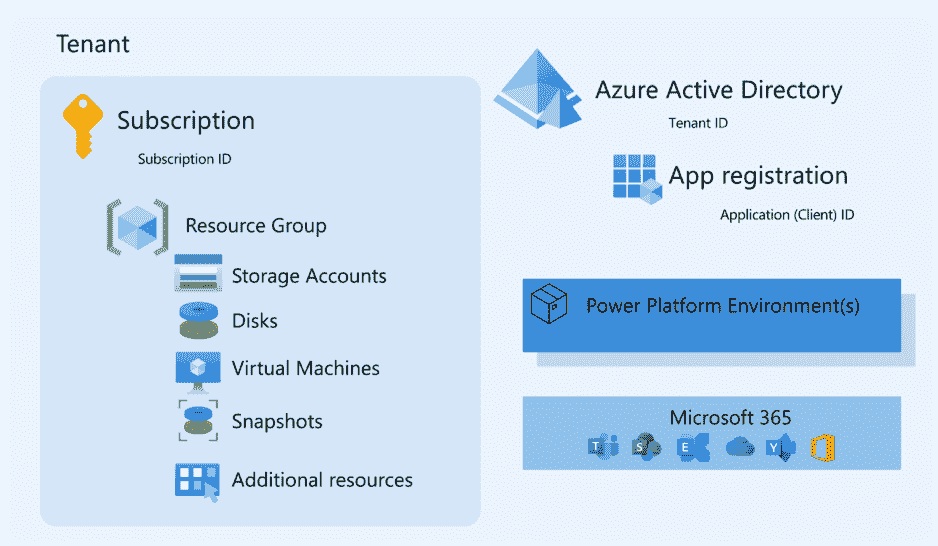

Figure 9.19 – Azure relationship between different components

The tenant is equivalent to an organization or a company. Typically, the tenant contains an Azure Active Directory where we can define and register new applications that need to access resources within the tenant.

A subscription is a financial boundary for any kind of resource. Because resources consume CPU and/or memory, there must be financial coverage of the consumption. There can be multiple subscriptions within a tenant.

The next level is a resource group, which usually relates to a specific purpose or topic. For example, it could be possible to create a resource group that contains all resources for automating a specific workload or application. These resources can be storage (disk or volume to persist data) or virtual machines and many more types of resources.

For PAD to be able to access resources in Azure, we need to register a new app within Azure Active Directory. This would have a new client ID as a result, which we can use for the corresponding field in the Actions Parameter dialog. Within this app registration, it is also possible to create a client secret, which is a fixed password to use for logging in with this client. In the Azure portal, go to Azure Active Directory | App registrations and create a new registration:

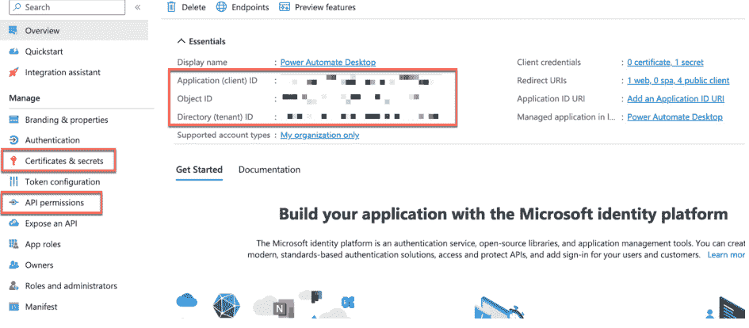

Figure 9.20 – Azure Active Directory – App registrations

Together with the Tenant ID (or Directory (tenant) ID in the preceding screenshot) and Subscription ID properties (needs to be looked up in the subscription), we have all the information for the Azure session to log on:

### Create session
Creates an Azure session using service principal More info

### Select parameters
Client ID :

Client secret:

Tenant ID:

Subscription ID:

Variables produced AzureClient

On error

Save

Cancel

Figure 9.21 – Creating a connection to Azure

### Configuring additional security settings

For the Azure session to work, additional security-related steps must be taken. First, the app registration must be granted API permissions for Azure resources to access. These include permission for Azure Service Management and Azure Storage. Second, the app registration must be given additional role assignments at the subscription level. For this, go to the subscription management in the Azure portal, switch to the Access Control (IAM) area, select the Role Assignment tab, and use the +Add button to start the wizard. Select the Virtual Machine Contributor role and add the app registration that was previously created as a member of the role assignment.

The following example shows how to work with actions for Azure virtual machines and disks:

the background. Finally, the new disk is attached to the VM and is available directly in **Disk Management** as an unformatted drive.

As a consequence, other scenarios can be feasible. For example, it would be possible to fill a new disk with data from a snapshot or another storage account.

Furthermore, the VM could also be equipped with an agent for virtual desktops so that UI elements can be identified and used in a flow.

In this section, we learned that we can use IaaS providers such as Microsoft or AWS via the native PAD actions to move workloads from on-premises machines to VMs and then control them through a locally executed UI flow.

This can save resources, especially if an application is not used for automation daily or uses a lot of compute capacity (CPU/memory).

## Summary

Through integration with Power Platform, PAD can close the gap between workflows in the cloud and the local network. We have seen that this can create a seamless overall concept for an automation solution, as the various components are very well integrated.

Additionally, we learned about native actions for using IaaS offerings from Microsoft and AWS, which allow us to outsource the execution of desktop programs or add more resources to our flow as needed.

In the next chapter, we’ll look at how we can incorporate artificial intelligence into a UI flow while learning about offerings from various vendors.

## Further reading

Further information is listed here:

- Sign up for a free Dynamics 365 Sales trial:
  https://learn.microsoft.com/en-us/dynamics365/sales/sign-up-for-sales-trial
- Power Platform environments overview:
  https://learn.microsoft.com/en-us/power-platform/admin/environments-overview
- Connection versus Connection references:
  https://learn.microsoft.com/en-us/power-apps/maker/data-platform/create-connection-reference
- Introduction to Amazon EC2:
  https://docs.aws.amazon.com/AWSEC2/latest/UserGuide/concepts.html
- Amazon Service endpoints:
  https://docs.aws.amazon.com/general/latest/gr/rande.html
- Get started with Amazon EC2 Windows instances:
  https://docs.aws.amazon.com/AWSEC2/latest/WindowsGuide/EC2_GetStarted.html
- Register an application with the Microsoft identity platform:
  https://learn.microsoft.com/en-us/azure/active-directory/develop/quickstart-register-app
