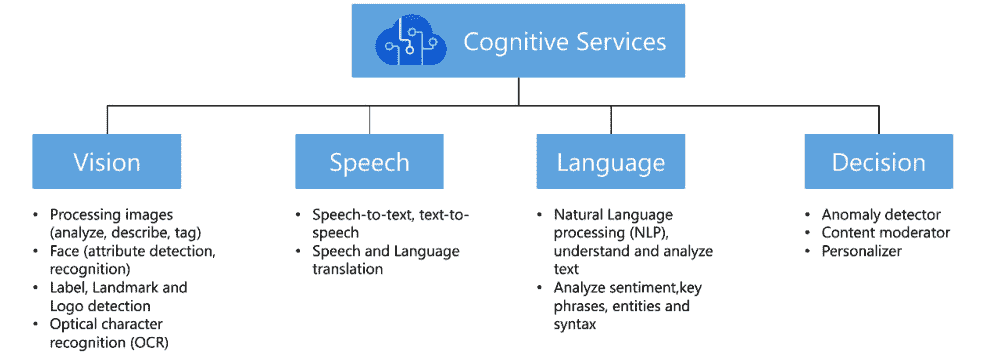
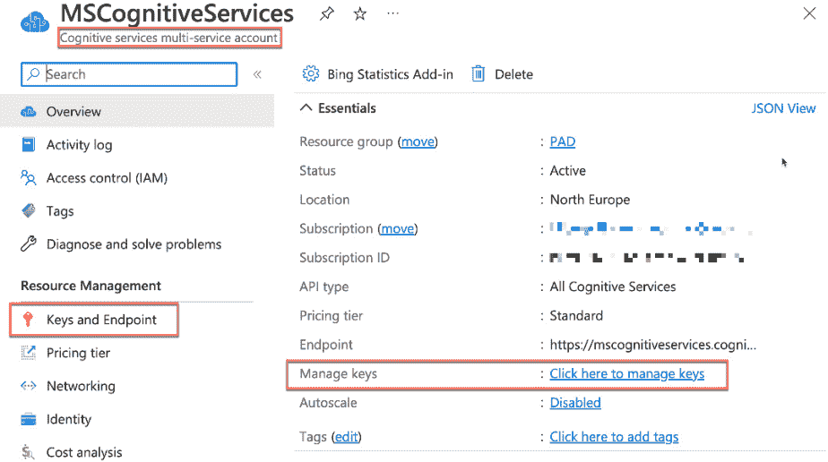
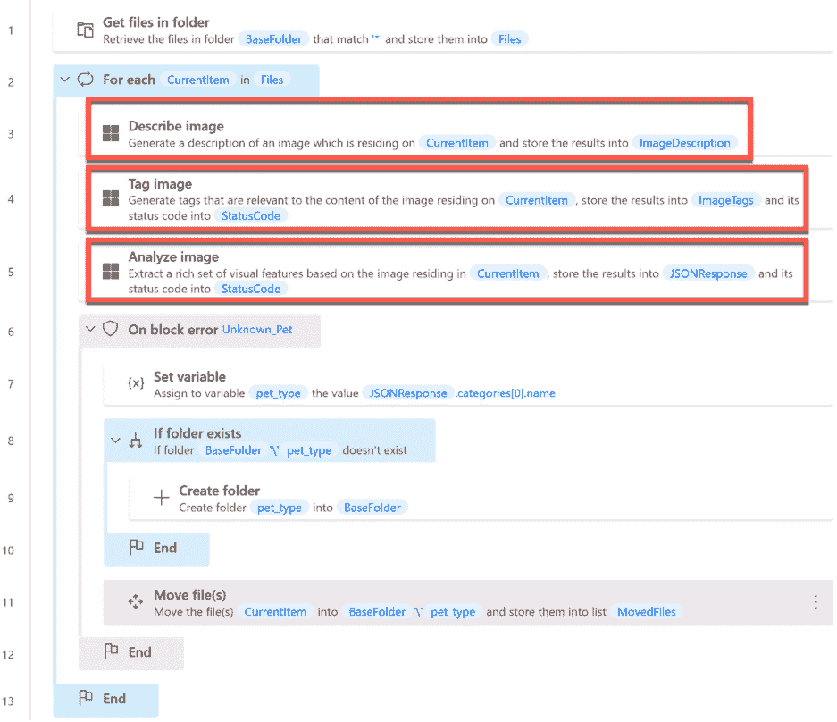
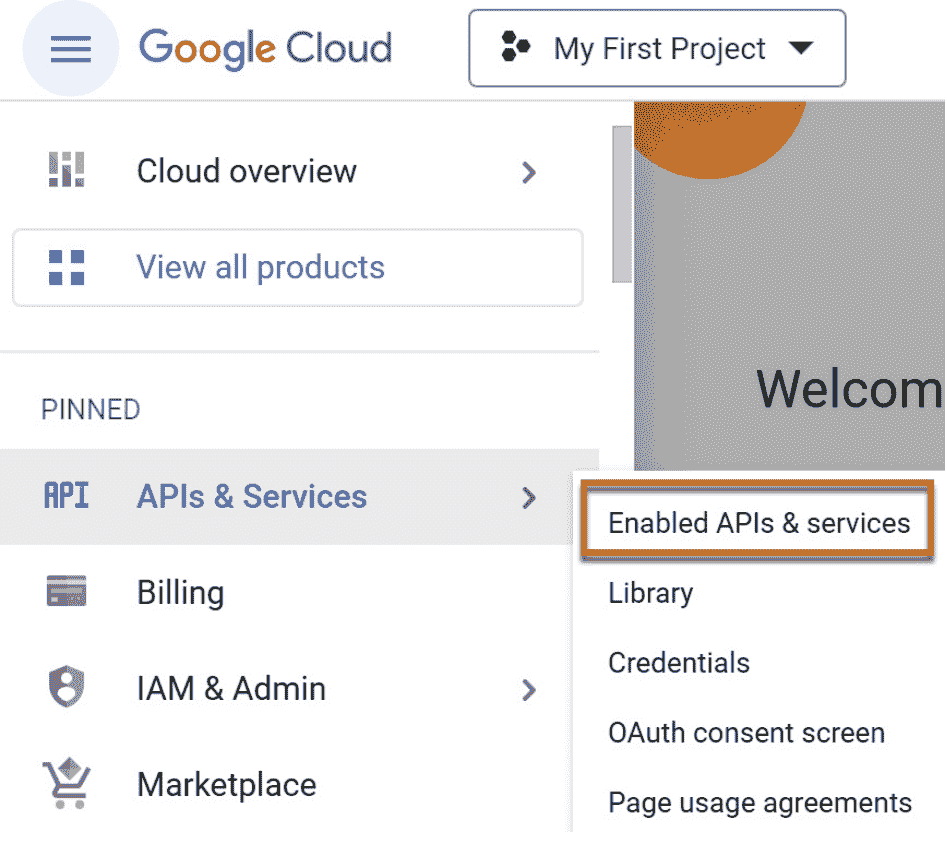
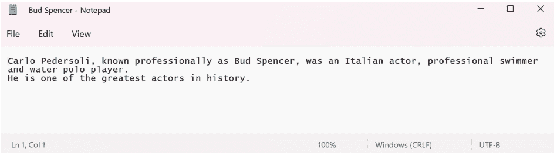
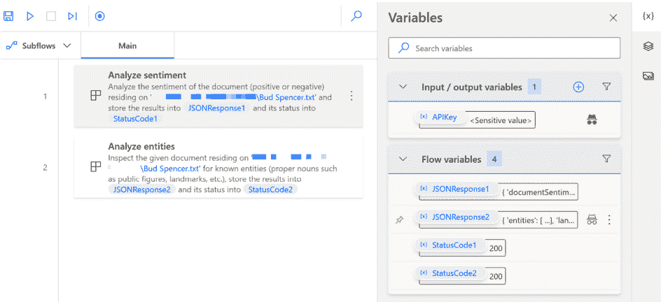
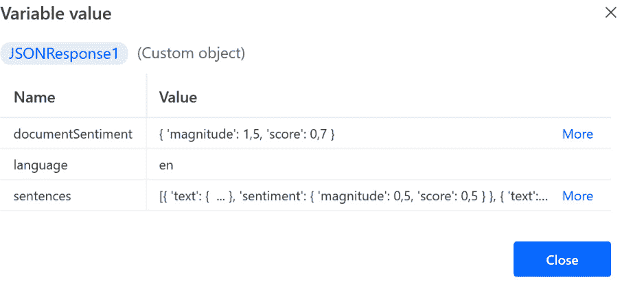
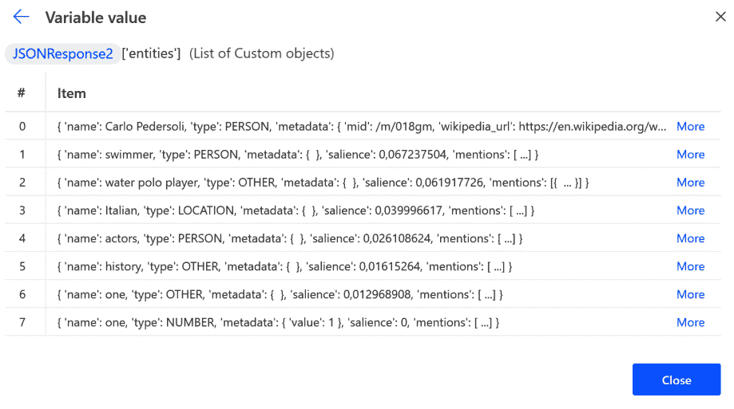

## Leveraging Artificial Intelligence

The topic of **artificial intelligence (AI)** has been hotly debated for some time and has gained further popularity with the advent of OpenAI and ChatGPT. In this chapter, we want to shed light on what possibilities we have within PAD in this regard and look at the following areas:

- An introduction to cognitive services
- Diving into the offerings of Microsoft, Google, and IBM
- Classification in the practical work with PADT

After reading this chapter, we will have a solid understanding of what AI means, in which areas this technology helps optimize business processes, and how these functionalities can be deployed and used with PAD.

## Technical requirements

The services addressed in this chapter are accessed online by the respective providers. This requires a corresponding subscription with the vendors, who all provide a test period with certain credits free of charge. The process for starting a trial and subsequent steps are different in each case and are highlighted in the corresponding sections.

## Introduction to cognitive services and artificial intelligence

The functionalities discussed in this chapter all deal with AI and **machine learning (ML)**. Before we turn to the individual providers and their functionality, we will first classify the topic in general and consider what benefits AI can bring to everyday life and in the business context.

In general, it can be said that AI can help to recognize structures in text, image, or sound information so that they become machine-readable. Cognitive services hereby refer to a set of cloud-based **application programming interfaces (APIs)** and tools provided by Microsoft, IBM, Google, and other vendors that enable developers and creators to add advanced AI capabilities to their applications without needing to have deep expertise in ML or data science. The actions offered in PAD by the different vendors provide more or less the same functionalities, shown in the following diagram. Only the naming of the services is slightly different in some cases.

Figure 10.1 – An overview of cognitive services

Let’s take a slightly closer look at these capabilities and how they can be used in a business context.

## An overview of cognitive services

Cognitive services can also be described as a set of APIs and tools that use ML algorithms to enable computers to perform tasks that normally require human-level intelligence. These services are typically hosted in the cloud and can be accessed through a REST API or **software development kit (SDK)**. The technology behind cognitive services can be broken down into a few key components:

- **ML**：认知服务的核心是 ML，即人工智能的一个子领域，涉及训练计算机在数据中识别模式。认知服务使用的 ML 模型通常在大量标记数据上进行训练，并且随着接触新数据，其准确性会随时间推移而提高。最新的 ML 模型起步时就已使用 100 个数据集，并且仍在不断改进。
- **深度学习**：许多认知服务还使用深度学习，这是一种涉及训练具有多层的人工神经网络的 ML 类型。深度学习模型对于图像和语音识别以及**自然语言处理（NLP）**尤其有效。
- **NLP**：一些认知服务，例如语言翻译和文本转语音，使用 NLP 算法来分析和理解人类语言。NLP 涉及将文本解析为其组成部分，例如单词和句子，并使用统计模型来识别这些部分之间的模式和关系。**语言理解（LUIS）**例如，就是一种 NLP 服务，使开发人员能够构建聊天机器人和其他对话界面。
- **计算机视觉**：计算机视觉是人工智能的一个分支，涉及训练计算机从图像和视频中识别和解释视觉信息。使用计算机视觉的认知服务可以执行对象检测、人脸识别和图像分类任务。
- **云计算**：最后，认知服务通常托管在云中，这使得开发人员可以从世界任何地方访问它们。云计算还提供可扩展的按需计算资源，有助于降低成本并提高性能。

总体而言，认知服务由先进的 ML、深度学习、NLP 和计算机视觉算法的组合提供动力，并通过云计算技术实现访问。这些服务可以帮助自动化许多原本需要人类水平智能的任务，例如语音识别、语言翻译和图像分析。认知服务使人们更容易在应用程序中添加强大的 AI 功能，而无需具备 ML 或数据科学方面的广泛专业知识。

## AI 在业务背景下的应用

但这些技能如何在业务背景下有意义地应用呢？以下是认知服务和图像分析在不同业务场景中如何使用的一些示例：

- **客户服务**：由认知服务驱动的聊天机器人可用于 24/7 提供客户服务，回答常见问题，帮助客户查找产品和服务，并解决简单问题。这些聊天机器人可以集成到网站、消息应用程序和社交媒体平台中。通过包含情感分析，此类聊天机器人可用于分析社交媒体平台和评论网站上的客户反馈和情绪。这可以帮助企业快速识别问题并加以解决，同时识别出表现优异的领域。认知服务可用于驱动可用于客户服务的语音助手。例如，客户可能会使用语音助手来跟踪订单、更新其账户信息或请求产品推荐。认知服务可用于根据通过电子邮件、聊天或社交媒体收到的客户咨询自动创建支持工单。这可以帮助客户服务团队更高效地管理工作量并及时响应客户。
- **电子商务**：认知服务可用于分析产品图像并根据客户偏好推荐类似产品（向上销售和交叉销售）。例如，客户可能会拍摄他们喜欢的连衣裙的照片，而电子商务网站可以使用图像识别来建议不同款式或颜色的类似连衣裙。认知服务可用于分析客户作为支持请求的一部分提交的产品图像。这可以帮助客户服务代表快速了解问题并提供更准确、更高效的支持。认知服务可用于检测电子商务中的欺诈活动，例如使用

- 所有请求都需要 API 密钥来授权请求
- 所有结果都附带一定的置信度以及作为响应的状态码

让我们来看看每个厂商在 PAD 中提供的 AI 功能。

## 探索 Microsoft Cognitive Services

要使用 Microsoft Cognitive Services 的操作，我们需要拥有 Azure 订阅并配置一个名为 **Cognitive services 多服务账户** 的资源。在下面的屏幕截图中，您可以看到一个已配置好的服务：

图 10.2 – Azure 中的 Microsoft Cognitive Services

设置此资源不需要复杂的设置。之后即可使用 Microsoft Cognitive 的操作。每个操作都期望一个 **订阅密钥**。然而，这并不是订阅本身的 ID，而是

包含一个段落列表，其中包含包含单词列表的文本行列表。

让我们来看一个在 **用户界面（UI）** 流程中如何使用计算机视觉中操作的示例。

## 基于 AI 的图像排序

假设您举办了一场竞赛，从某个群组的所有发送者中选出每种物种最漂亮的宠物。现在，您收到了无数封包含大量图片的电子邮件，并将它们放在桌面上的一个文件夹中。我们现在可以使用 AI 按宠物类型对图像进行排序，并为每种宠物创建单独的文件夹。此 UI 流程如下所示：

# 图 10.3 – 在 PAD 中使用计算机视觉

作为先决条件，我在桌面上创建了一个包含一些狗和猫的随机图片的基础文件夹。我创建了一个 `BaseFolder` 输入变量，其中包含该文件夹的位置。以下是此流程的作用：

- 第 1 步，创建图片集合并将其存储在 `Files` 变量中。
- 第 2 步开始循环以遍历图像列表。
- 在第 3 步和第 4 步中，我插入了 **描述图像** 和 **标记图像** 操作以作说明。

# 图 10.4 – 图像标签、描述和分析

请注意 `ImageDescription` 中的 **captions** 条目，**一只正在看摄像头的猫**，这向我们展示了 AI 的强大功能。让我们来看下一个厂商及其提供的操作。

## Google cognitive

Google 的 AI 功能可通过 **Google Cloud Platform（GCP）** 访问。首先，您需要创建一个相应账户。提供商提供一定的配额，可用于试用服务。入口通过 [https://cloud.google.com](https://cloud.google.com) 进行，也可以在此处创建新账户。然后您将进入 Cloud Console，您可以在其中搜索资源并创建新项目以使用这些 API。例如，您可以使用 **搜索** 框并查找术语 `sentiment`，它是 Cloud Natural Language API 的一部分。每个 API 都需要单独启用。您可以通过屏幕左上角的汉堡菜单查看所有已启用的 API，如下图所示：

图 10.5 – Google Cloud Console

激活 API 后，还必须创建凭据才能从外部调用此接口。这也适用于 PAD 中的操作，因为这些操作需要 API 密钥才能执行。对于每个服务，都有一个 **凭据** 部分，可用于创建 API 密钥（见下图）。

# 图 10.6 – 在 Google Cloud 中创建 API 密钥

之后，API 密钥将显示在窗口中，以便复制并粘贴到 PAD 的其中一个操作中。此过程必须针对要使用的每个 API 重复。在 PAD 中可以使用两个 API，Natural Language 和 Vision：

- Natural Language：这使我们能够分析给定文本的情感（文本中的情绪）、实体（文本所涉及的内容）或语法（文本的结构方式）。
- Vision：这接收一张图像，可以检测不同的对象，例如标签（或对象）、地标、文本、徽标和图像属性。它还允许检测保存的搜索。

让我们来看一个非常简单的 UI 流程来演示这些结果。

## PAD 中的情感分析

在此示例中，我们以一份包含内容的文本文档为例：

图 10.7 – 用于 AI 分析的示例文本文件

我们现在可以创建一个流程并将 Analyze sentiment 和 Analyze entities 动作拖入设计器，并配备 API 密钥和此文件的路径。

图 10.8 – 使用 Google Natural Language 动作

情感分析的结果如下所示（双击 JSONResponse1 变量）：

图 10.9 – 情感分析的结果

我们可以看到，我们收到了文档整体情感的评分和强度。此外，每个句子也会单独进行情感评估。根据文档说明，约 0.0 的分数表示中性，以及强度值较低。这可以解释为略微积极的情感。

第二个 **Analyze entities** 动作的结果为我们提供了有关此文本内容的某些见解（见下图）：

图 10.10 – 实体分析的结果

在这里，我通过在对话框中点击 **More** 链接展开了 `entities` 分支。我们可以看到人物姓名已被识别，甚至还链接到了维基百科，并且文本中还有其他实体。

所有这些功能单独来看可能一开始并不特别有帮助。然而，从更大的上下文来看，通过这些功能可以获得重要的、有帮助的见解和自动化。例如，通过提取这些信息并在之后进行智能连接，也可以创建更长文本的摘要。这不可避免地也导致公司创建非常大的语言模型，这些模型可以分析和理解文本并提供智能答案。这在 ChatGPT 等模型的不断增长的流行中可见一斑。

## 使用 IBM cognitive

也许你们中的一些人还记得 1997 年的头条新闻，报道了一款名为 Deep Blue 的计算机程序，它在仅 19 步内就击败了当时世界国际象棋冠军加里·卡斯帕罗夫。 该程序运行在 IBM 建造的超级计算机上。击败世界国际象棋冠军是 AI 历史上的一个里程碑。如今，IBM 以 Watson 的名义提供其基于 AI 的解决方案。如本章前面所述，各提供商的功能存在重叠。IBM 提供的功能如下：

- **Visual recognition**：此动作组包含一个 **Classify image** 动作，允许我们提供一张图像
- **Language translator**：这使我们能够识别语言并翻译给定的文本
- **Document conversion**：这将给定的文档转换为另一种格式

**Tone analyzer** 动作组包含一个 **Analyze tone** 动作，该动作现已弃用，在此不再进一步考虑。如果已有对 IBM Cloud 的 AI 投资，这些产品也可以在 PAD 中可用的动作中使用。

与其它提供商一样，这里也需要一个 IBM Cloud 账户，通过该账户可以生成相应的 API 密钥。此信息也必须为 PAD 动作指定，以便执行请求。否则，其基本功能与迄今为止所示的提供商完全相同。

既然我们已经了解了不同提供商的功能，让我们来看看在何种上下文中使用这些功能是有意义的。

## 对 PAD 的实际相关性

除启动本地应用程序并控制它之外，PAD 下提供的动作并不独属于 PAD。 这些动作调用的所有 API 都在云中，因此可供任何应用程序使用。

我们也在 PAD 中看到这些动作的原因是，它使我们能够在 UI 流程的上下文中直接访问，而无需添加更多云流程或其他技术。这使我们能够为 UI 流程构建一些智能。在选定的场景中，这些动作当然是有意义的，但通常，这种功能主要在云场景中使用。然而，在需要确定 PAD 中图像的内容或确定电子邮件中的情绪的情况下，这些动作的可用性当然非常有帮助。所有这些都依赖于预先构建和训练的 AI 模型。更适合业务的另一种使用 AI 的方式在下一节中描述。

## 更多使用 AI 的方式

AI 及其能力在近年来越来越受欢迎，我们可以看到这种技术的应用不断增加。仅在 Power Platform 和 Dynamics 365 中，AI 就被用于许多地方，例如以下内容：

- **Conversational intelligence**：通过使用分析和数据科学从销售人员的通话录音中提取信息和见解，以主动指导销售人员。
- **Intelligent content suggestion**：可以根据之前的对话建议电子邮件回复。可以检测问题并建议可能的答案，这有助于销售人员快速高效。
- **Power Virtual Agent**：Power Platform 中的智能聊天机器人可以利用 LUIS 模型来理解聊天对话的含义并提供相应的回复。
- **Copilot for Power Automate**：这允许通过口头和自然语言描述创建 Power Automate（见 https://powerautomate.microsoft.com/en-us/blog/new-ways-to-innovate-with-ai-and-microsoft-power-automate/）。

然而，有一个场景我想在此简要讨论一下，这对于实际使用来说可能具有一定的相关性。日常业务中总会出现需要处理某些纸质表格的情况：

- 学校表格，要求家长勾选某些项目以表示同意或填写信息
- 来自供应商的订单确认或送货单，其中包含交易数据
- 医院或诊所的患者登记表格

基本机制始终相同，因为总是有特定的表格，数据始终输入在相同的位置。例如，Microsoft 和 Google 提供预制但尚未训练的模型来数字化并读取这些表格。Microsoft Power Platform 包含这样一项服务，称为 AI Builder。在这里，我们可以找到预定义模型用于以下目的：

- 从 PDF 文档、身份证明文件、名片等中提取数据
- 将客户反馈或任何其他文本分类到预定义类别中
- 从文本中提取关键元素或文本中最相关的词语和短语

如果这些模型不足以满足需求，也可以创建自己的 AI 模型。模型配备训练和测试数据后，可以直接部署并在云流程中使用。因此，这项技术允许您使用自己的表格与 AI 结合并将其纳入流程中。

原则上，此类模型也可以通过标准的 HTTP 请求检索。在下一章中，我们将学习如何使用 PAD 使用此和其他 Web 协议。

## 摘要

在本章中，我们研究了 AI 主题以及为 UI 流程添加智能的选项。我们了解到，这些选项通常在更大的上下文中发挥作用，并且在 PAD 中，我们今天也可以访问常见的模型。然而，如果我们发现需要在 UI 流程的一部分中访问此类功能，我们可以使用此处介绍的动作在 PAD 中实现，而无需考虑其他解决方案和技术。

## 进一步阅读

- *Microsoft Computer Vision documentation:* https://learn.microsoft.com/en-gb/azure/cognitive-services/computer-vision/

- *卡斯帕罗夫对战深蓝：* https://en.wikipedia.org/wiki/Deep_Blue_versus_Kasparov,_1997,_Game_6
- *Google 自然语言 AI 文档：* https://cloud.google.com/natural-language
- *Google Vision AI 文档：* https://cloud.google.com/vision
