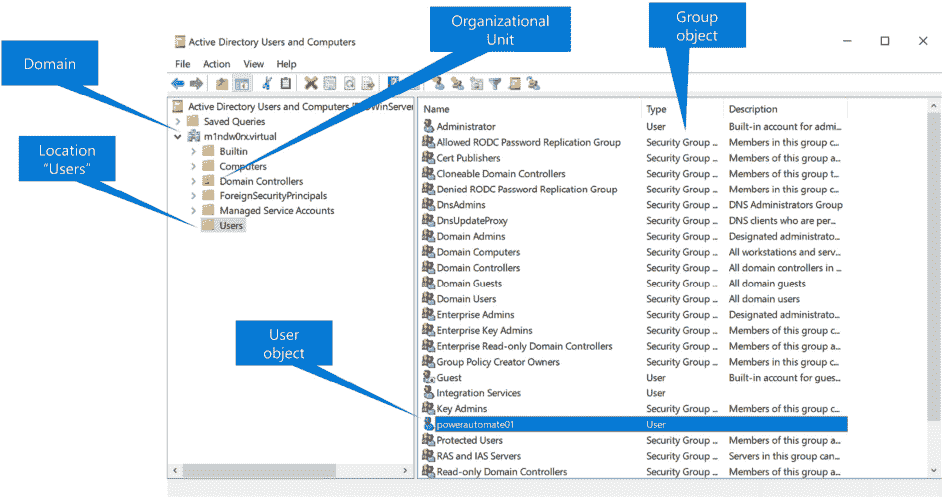
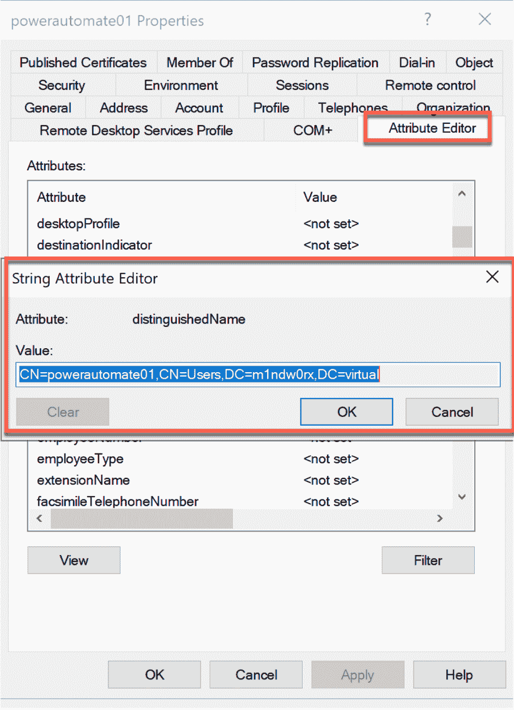
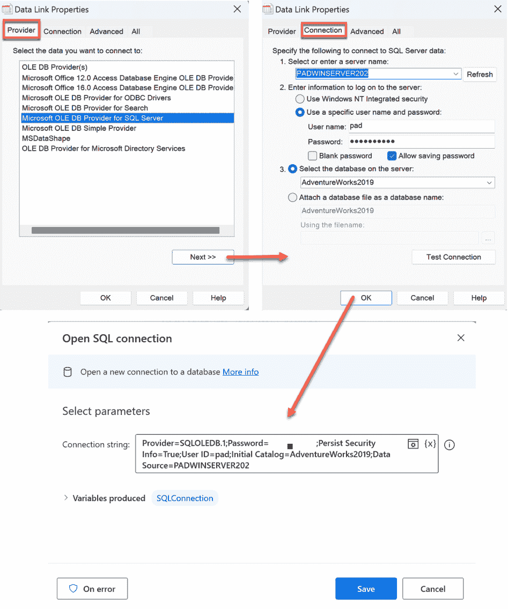
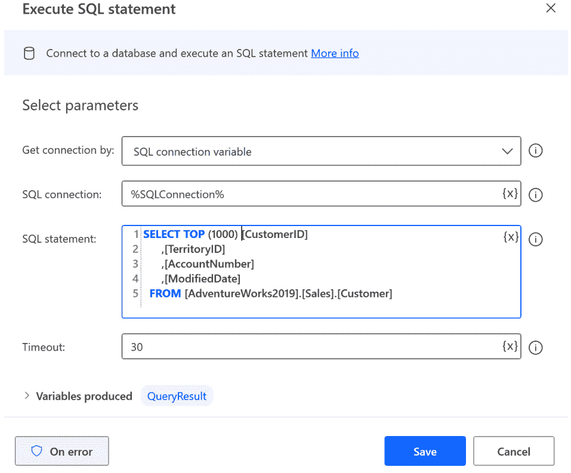
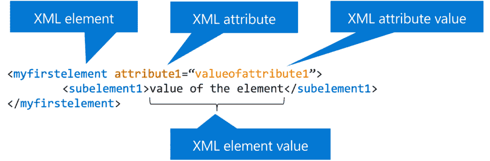
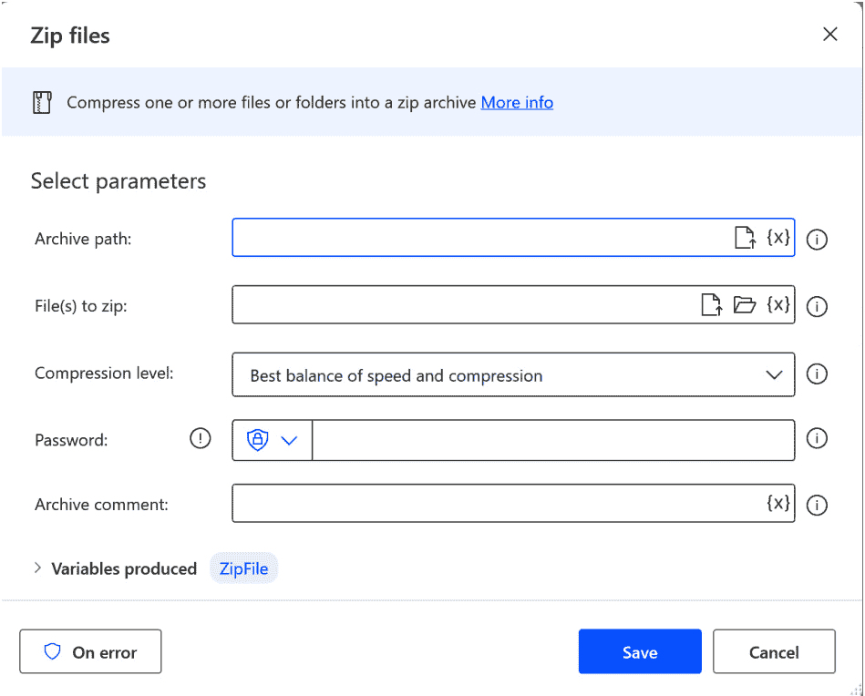
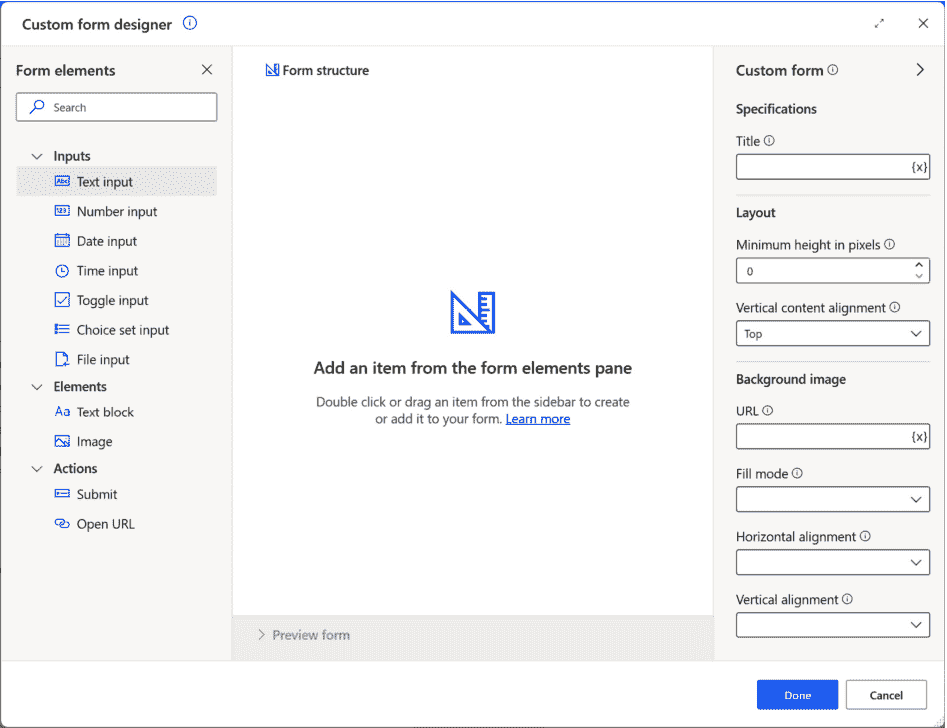

## 使用 API 和服务

到目前为止，我们使用 PAD 使没有 API 的应用程序能够通过其 **用户界面 (UI)** 与自动化流程一起使用。尽管这是 PAD 的主要用途，但我们也可以在 UI 流程的上下文中与 API 通信，以实现最佳的集成选项。这些可能性形成了闭环，使我们能够完全在 PAD 中实现完整的业务流程，而无需添加其他机制。因此，在本章中，我们将了解 PAD 可以直接通信的哪些 API 和协议，以及 PAD 可以处理的哪些基于 Web 的数据格式。我们将重点介绍以下几点：

- 管理本地 **Active Directory (AD)** 服务并访问本地数据库和电子邮件服务
- 利用使用 **超文本传输协议 (HTTP)** 和 **文件传输协议 (FTP)** 的 Web 服务以及处理 Web 格式（**Javascript 对象表示法 (JSON)**、**可扩展标记语言 (XML)** 和 **便携式文档格式 (PDF)**）
- 密码学和 CyberArk
- 内置数据功能 – 日期时间、文本、压缩和消息框

学习完本章后，我们将能够在 UI 流程中使用内部服务，例如数据库和 AD，以及任何 Web 服务，并处理各种数据格式。*第 12 章* 中将展示此处介绍的操作的示例流程。

## 技术要求

在第一个示例中，我将使用本地安装的 SQL Server，并安装了 Microsoft 示例数据库 **AdventureWorks2019**。此外，我已在此服务器上设置了一个数据库用户，并授予其访问该数据库的权限。

## 本地网络服务的使用和自动化

在许多大公司和小公司中，都使用基于 Windows 的本地网络，提供额外的 Microsoft 服务。首先，当然包括 AD，但也包括 Microsoft Exchange、SQL Server 等。这些和其他服务被分配到 Office Server 产品线。

由于 PAD 非常适合自动化管理任务，因此为这些服务提供相应的操作也是显而易见的。与我们在 *第 7 章* 中了解的本地 Windows 服务不同，这些是本地网络上的网络服务，因此不在云中。因此，这里介绍的操作也仅用于本地安装的服务器产品。为了自动化相应的云服务，Microsoft 建议使用在线产品的相应连接器（Azure AD、Exchange Online 等）。越来越多的公司选择云技术的原因可能也在于此，因为 Microsoft Exchange 支持的服务器版本有些老旧（Microsoft Exchange Server 2010-2013 Service Pack 1）。虽然 AD 的操作允许有限的管理，但 Exchange 和数据库的操作只能用于使用这些服务，例如检索消息或执行 SQL 命令。让我们来看一下操作的细节。

### 访问和管理本地 AD

AD 基于 **轻量级目录访问协议 (LDAP)**，该协议基于 X.500 标准中包含的更简单的子集。Microsoft AD 是本地 Windows 网络中管理网络对象（例如用户和组、计算机、打印机等）的中央系统。

### AD 服务的背景信息

Microsoft AD 由诸如 **联合服务 (FS)**、**证书服务 (CS)** 以及 **域服务 (DS)** 等服务集组成。在各种 AD 服务中，这里指的是所谓的 DS，可以通过 PAD 操作与之交互。它们是 Windows 域网络的基础。

在使用 AD 和相应的 PAD 操作时，您通常会遇到以下术语：

- **对象**：这是 AD 内管理的每个项目的通用术语。每种不同的对象类型都有特定的属性。
- **用户**：此对象类型由用户登录名、名字和姓氏等属性组成，表示使用此用户帐户登录 Windows 域的某个人。
- **组**：由用户帐户、其他组或计算机帐户组成。
- **计算机**：这是域内计算机的相关信息。
- **组织单位 (OU)**：这些是逻辑容器，可以包含对象，也可以包含其他 OU。通常，OU 用于镜像组织结构。它们还允许委派管理控制。

AD 通过随 Windows Server 提供的管理工具进行管理。下面的屏幕截图显示了用于管理前面列表中描述的对象的 **Active Directory 用户和计算机** 控制台。

图 11.1 – 使用服务器工具进行 AD 管理

另一个重要概念是区别名称。此名称由域名、位置和对象的名称组成。这些条目的组合必须是唯一的，这也是不能有两个具有完全相同名称的用户帐户的原因。区别名称是描述 AD 中对象的特殊语法。在前面的屏幕截图中，我们看到 Users 文件位置中名为 **powerautomate01** 的用户帐户。此条目的区别名称为

`CN=powerautomate01,CN=Users,DC=mlndw0rx,DC=virtual.`

### 专业提示 – 在管理控制台中查看区别名称

前面显示的管理控制台还能够公开任何对象的区别名称。要查看此信息，您需要在控制台中打开 **高级功能** 选项，方法是单击 **查看** 菜单并选择 **高级功能**。这会在对象列表中显示一些额外条目，也会在对象的 **属性** 对话框中显示额外的选项卡。现在右键单击一个用户帐户并从上下文菜单中选择 **属性**。您将看到一个额外的选项卡，称为 **属性编辑器**。向下滚动列表，直到找到 `distinguishedName` 属性并双击它以查看条目。

# 字符串属性编辑器

**属性：** distinguishedName

**值：** `CN=powerautomate01,CN=Users,DC=m1nd0rX,DC=virtual`

按钮：清除、确定、取消

图 11.2 – AD 中的 distinguishedName

文档中提供了 AD 操作的其他示例（请参阅进一步阅读部分）。现在，让我们利用这些知识来了解 PAD 在管理 AD 方面提供了哪些操作：

- **连接到服务器 / 关闭连接**：这通过提供目录的 LDAP 路径、完全限定的服务器名称（包括域信息）或甚至 IP 地址来建立与 AD 服务器的连接。还有一个选项可以提供用户名和密码，如果当前用户没有访问服务的权限。
- **创建 / 修改组**：**创建** 操作通过提供名称、位置、组范围（全局、本地或通用）和组类型（安全或分发）来创建组。`location` 属性指定组应作为区别名称创建的容器/文件夹。**修改** 操作允许您重命名或删除组，还可以向其中添加或删除用户。
- **获取组信息 / 获取组成员**：这为要获取信息的组提供区别名称。第一个操作返回该组的属性列表，第二个操作返回组成员列表。
- **创建 / 删除 / 移动 / 重命名对象**：此处的 AD 对象是 *计算机* 或 *OU*。同样，我们需要提供一个位置（区别名称）来执行这些操作。
- **创建 / 修改 / 解锁用户**：**创建** 操作也需要用户应创建的位置，以及常见的属性，例如名字、姓名缩写、姓氏、用户名和密码。它还允许您指定密码是否永不过期或用户帐户是否将被禁用（用户无法登录）。
- **获取用户信息 / 更新用户信息**：这为要检索或更新用户对象属性的用户提供区别名称。

提示 – 无需成员资格管理 AD

通常，工作站是 AD 的一部分，这意味着它们已加入该域，并且该域的用户可以登录。运行 PAD 的交互用户也可能是这样的用户。在这种情况下创建与 AD 的连接不应成为问题。如前所述，可以通过域控制器的 IP 地址和适当的用户凭据创建与 AD 的连接。在这种情况下，运行该 UI 流程的计算机不需要是该域的成员，并且可以通过 IP 地址建立连接。但是，要使用操作，例如创建用户，需要对域有一定的了解，以便提供可分辨名称的信息。

在 *第 8 章* 中，我们讨论了新入职员工进入公司因此需要 SAP 登录的场景。我们创建了一个 UI 流程，读取 Excel 列表并为每个条目创建一个 SAP 用户。作为附加任务，我们也可以以同样的方式在 AD 中创建用户。我鼓励你采用此示例并将此附加任务添加为子流程。如果没有 SAP 系统可用，也可以采用 *第 8 章* 中的 UI 流程并将 SAP 部分替换为 AD 部分。

尽管仍然存在许多本地 Windows 网络，但 PAD 包含对本地 AD 的管理操作这一事实表明了该软件的来源以及它在市场上存在的时间。除 AD 外，没有提供其他可以管理本地 Windows 网络服务的动作。尽管如此，使用以下服务也为 PAD 整体带来了巨大的价值。

## 与数据库协作

**Database** 操作组仅包含三个操作（**Open SQL connection**、**Execute SQL statement** 和 **Close SQL connection**），但这些操作打开了全方位的可能性，因为可以访问所有数据库以发出任何类型的 SQL 命令。迄今为止，重点一直放在没有任何 API 的系统上。然而，PAD 也能够集成具有 API 的系统，以便在 UI 流程中也可以完成需要调用 API 的任务。数据宇宙的关键在于将 **Open SQL connection** 操作拖到设计器上，连接字符串参数的右侧（见以下屏幕截图）。

### Open SQL connection

Open a new connection to a database More info

Select parameters

Connection string:

Variables produced SQLConnection2

On error

Save

Cancel

Figure 11.3 – Open SQL connection

要使用数据库，我们需要提供连接字符串，单击上一张屏幕截图中显示的红色边框图标将打开一个向导来完成此操作。

Figure 11.4 – Create a connection string

在我的示例中，我使用的是远程服务器上的 SQL Server 数据库，但如前面的屏幕截图所示，**Provider** 选项卡包含许多条目，可用于连接其他系统。在这里按下 **Next** 按钮会带我们进入 **Connection** 选项卡，其中需要根据上一屏幕选择的提供程序进行额外的输入。我输入了远程服务器名称和提供的凭据，这使我能够在该服务器上选择一个数据库。如果我现在按下 **OK** 按钮，连接字符串将为我生成并输入到相应的文本字段中，我也可以复制该条目并将其输入到敏感变量中。

通过这项简短的准备工作，我现在可以针对数据库执行任何 SQL 语句。请注意，如果相应用户没有必要的权限，语句可能无法成功执行。以下屏幕截图显示了 **Execute SQL statement** 操作。查询结果将存储在变量中以供进一步处理。

Figure 11.5 – Execute SQL statement

关于 SQL 语句可以做出以下评论：

- 非常频繁地，语句的质量对数据库的性能以及整个系统的性能至关重要。因此，如果可能，应避免使用诸如 `SELECT * FROM ...` 之类的查询。
- 当然，现在也可以将存储在变量中的先前流程步骤中的其他内容插入到语句中。

在下一个主要部分中，我们将看一个数据库如何集成到更大上下文中的示例。在此之前，让我们先看看此类别中的其他服务。

## 使用本地 Exchange 和其他邮件服务

我们已在 *第 2 章* 和 *第 8 章* 中学习了如何使用本地安装的 Outlook 应用程序以及相应的 PAD 操作来接收、处理和发送电子邮件。除了这种可能性之外，PAD 还提供了其他操作组来处理电子邮件。这些操作组的行为与我们之前学到的非常相似，只是连接设置不同。这些操作组是 **Exchange Server** 和 **Email**。为了提供概述并了解这些操作组之间的差异，包括 **Outlook** 的操作组，让我们看一下下面的表格。

| Feature/Action group | Outlook | Exchange Server | Email |
|---|---|---|---|
| Connection through | Local Outlook client | Local/on-premises Exchange Server deployment | Any **Internet Message Access Protocol (IMAP)** mailbox |
| Feature/Action group | Outlook | Exchange Server | Email |
| Connection capability | Any mailbox that is connected through Outlook, including Outlook 365 | One personal or shared mailbox | Any IMAP server |
| Retrieve email messages | Yes | Yes | Yes |
| Send email messages | Yes | Yes | Yes |
| Process email messages | Yes | Yes | Yes |
| Save messages | Yes | No | No |
| Respond to messages | Yes | No | No |

Table 11.1 – A comparison between different email options in PAD

正如我们在此看到的，不同操作组之间有很多相似之处，也有一个主要区别。虽然 **Exchange Server** 和 **Email** 操作组通过网络请求执行操作，但 Outlook 操作针对的是本地安装的 Outlook 客户端的功能。这导致了以下后果：

- 使用 Outlook 时，会启动本地程序；例如，该程序也必须可用、已安装并已设置。
- 优点是操作可以用 Outlook 设置的所有邮箱使用，包括 Outlook 365、本地 Exchange Server 或任何其他邮箱。
- 出于同样的原因，使用 Outlook 操作也提供了更高级的选项，例如 **Save messages** 或 **Reply to a message**。
- 如果运行 UI 流程的计算机上未安装 Outlook，则必须使用其他操作组之一。
- 然而，这也有利于节省本地计算机资源，从而为其他任务提供资源。

对于电子邮件来说，最轻量的选项是使用 **Email** 操作组中的 **Retrieve email messages**、**Process email messages** 和 **Send email** 操作。连接到邮件服务器的创建必须在三个操作中分别定义，因此没有单独用于建立或关闭连接的操作。然而，这只需要一个操作，例如接收电子邮件。需要邮件服务器的地址，以及有效用户名和密码来使用操作。

如果你想使用访问本地 Exchange Server 的操作，请注意 Exchange Server 直到版本 **2013 Service Pack 1** 才受支持。

除了这里介绍的差异外，用于处理电子邮件的操作都以相同的方式工作。唯一需要决定的就是是否可以使用 Outlook 客户端以及是否应该使用。这一决定必须单独做出，我希望你能自行尝试进一步的电子邮件操作。

我们将在下一节学习 PAD 还可以使用哪些其他基于 Web 的协议和格式。

## 与 Web 协议和格式协作

在上一节中，我们讨论了 LDAP 和 IMAP 等各种 Web 协议，并看到了 PAD 如何支持它们。接下来，我们将继续

to probably the most common and well-known protocols FTP and HTTP, before we take a closer look at the different data formats for the web

## FTP

Not so common nowadays, FTP was and still is a very efficient way to upload and download folders and files to and from a server. PAD is also able to use this protocol and access an FTP server. The following actions are provided within the FTP actions group:

- **Open / Open secure / Close connection**: These are required to establish a connection to the FTP server.
- **List directory / Change working directory**: Comparable to **DIR / CD command** in Windows command prompt to list the content of the current directory or change the current directory.
- **Create / Delete / Synchronize directory**: These actions do exactly what they are named after. We will look at the synchronization action at the end of this list.
- **Upload / Download / Delete / Rename FTP file(s)**: These are self-explanatory and simple to use.
- **Invoke FTP command**: Several FTP commands can be issued on the FTP server, such as FEAT (list extended features) or STAT (returns information about a current file transfer).

The certainly most interesting action here is the **Synchronize directory** action. Instead of comparing remote files and directories with different other actions, this one is really a big time-saver, but it can only work in one direction at a time. It offers the following action parameters:

## Synchronize directories

Synchronize the files and subdirectories of a given folder with a given remote FTP directory More info

## Select parameters

FTP connection: %FTPConnection%

Synchronization direction: Remote -> Local (Download)

Files to sync: All files

Local folder:

FTP directory: /

Delete if source is absent:

Include subdirectories:

Time difference in hours: 0

Time difference in minutes: 0

Time difference ahead:

Variables produced FilesAdded FilesModified FilesDeleted

On error

Save Cancel

# Figure 11.6 – Synchronize FTP directories with PAD

As you can see in the previous screenshot, this action provides all the setting options that are required for directory synchronization. The option to
specify one or more filters for the files brings a lot of flexibility. The action produces three result lists, which can be used in the following:

- `FilesAdded`
- `FilesModified`
- `FilesDeleted`

While FTP was primarily designed for file exchange, the following protocol is responsible for the vast majority of internet traffic: HTTP.

## HTTP

HTTP is the standard protocol on which most traffic on the internet is based. The PAD actions in this group represent API calls that PAD can perform, as well as file upload and download. Any API call works according to the request-response principle, where different methods (verbs) are available to describe the desired action. The most common methods used in such requests are the following:

- `GET`: This allows querying content via the URL
- `POST`: This is used for requests where the supplied contents are to be processed in a target resource, for example, saving a data record or other transactions
- `PATCH`: This represents a request for the target address to update the partial aspects transmitted

API services are very commonly used when companies want to provide their services and data controllable electronically or interact with other services. Modern web APIs thus represent the interface to the data and processes with which electronic communication can take place. While many such services use standard methods (as described previously) and are based on the **representational state transfer (REST)** principle, some services use the **Simple Object Access Protocol (SOAP)** protocol. SOAP
was created to establish a standard for communication between the client and server. However, SOAP is (contrary to its name) more elaborate and complex to implement and expects a predefined structure. This and other factors have led to a tendency for new web services to be built based on the REST architecture. In PAD, of course, we have corresponding actions for both versions that can be used for this, plus another action:

- **Download from web:** Used if we want to download a specific text or a file from a web server.
- **Invoke SOAP web service:** This is the action to use if we need to communicate with a web service that is based on SOAP. This action also provides a little wizard that helps to determine the values for the different parameters.
- **Invoke web service:** This action calls a RESTful web service.

PAD manages to hide the possible complexity in web service communication. Sometimes, however, more advanced settings have to be made because, for example, certain settings, such as authentication, are expected. Therefore, the two actions for web service calls can also make advanced settings, which are stored in the **Advanced** area, such as **Connection timeout, User agent, Encoding**, and more.

## Working with web data formats

When applications communicate with each other via web services, this is also done using a language. REST-based web services use JSON as a language here, which is built-in to PAD. There is, for example, an action to convert a variable into JSON and back.

## Background information – custom object versus JSON object

Internally, PAD can handle JSON objects but prefers to use a so-called custom object. This is a more flattened structure that is easier to handle in loops and contains a list of attribute names and values. A JSON object, instead, can be of any complexity with multiple levels of nesting structures.

It is possible to convert such a structure into a custom object. In this case, the custom object contains this flattened structure with nested objects as values.

Another very well-known concept is markup languages. The two best-known representatives here are **HyperText Markup Language (HTML)** and **XML**. HTML is used to represent content and web pages, and XML is for the structured storage of data or configuration information but also for communicating with web services. SOAP, as mentioned previously, communicates via XML. The basic structure of a simple XML file is depicted in the following diagram:

Figure 11.7 – XML structure explained

There is also a special notation to describe the way to an element or a value within an XML document. This is called XPath and looks like this: `/myfirstelement/subelement1`. This would give us the value of `subelement1`, which is `value of the element`. This is also referred to as an XPath query. PAD also includes actions to handle XML:

- **Read / Write XML file**: This handles the XML file that should be used in the UI flow.
- **Insert / Remove XML element**: This allows us to add a new element at a specific position of the XML document, which is provided by an XPath expression. The XML element to insert can also be a larger structure as long as there is only one root element. To remove an element, an XPath expression has to be provided.

- **Get / set XML element value**: As can be seen in the previous example, an XPath expression can also be used here to read or set the value of an element.
- **Get / set / remove XML element attribute**: These correspond to the operations that can also be performed for the XML elements, only here with the attributes.
- **Execute XPath expression**: This provides an XPath expression to select or even search for specific elements (nodes) or attributes. Please refer to the *Further reading* section to find out more on this topic.

To further complete the list of data formats, of course, a specific document format must be defined. Adobe PDF is the de facto standard for generating and exchanging documents. These are characterized by many important features that are required in the internet-based communication world:

- They can be read from almost any device and browser
- They are considered safe (do not contain viruses or malicious code)
- They cannot be modified or changed if the author does not allow it
- Their creation and consumption are free of charge

In particular, because in the context of business applications, we usually also work with documents and PDFs, PAD has a set of actions that allow working with these types of documents. These include the following:

- **Extract text / tables / images from PDF**: These actions extract content from a PDF file. The images for example can be extracted and stored in a specific location of the workstation.
- **Extract PDF file pages to new PDF file**: This action allows us to create a new PDF document from the specific pages of another document.
- **Merge PDF files**: This takes a list of PDF documents and creates one combined document.

请注意，没有任何操作可以从其他内容（例如 Word 文档或 Excel）创建新的 PDF 文档。此功能必须通过相应的应用程序本身提供。

最后但同样重要的是，我们还可以使用 PAD 原生压缩文件或文件夹，以及解压缩文件。**压缩**操作组包含用于此目的的两个操作。如果我们需要创建存档（ZIP 文件），可以提供以下参数：

图 11.8 – 在 PAD 中创建 ZIP 存档

正如我们在这里看到的，我们不仅可以指定存档和要使用的文件，还可以指定压缩级别，以及如果需要，还可以指定存档密码，这将直接引导我们进入下一节，在下一节中我们将讨论其他安全机制。

当然，我们还需要 PAD 中的函数来处理数据、创建、转换和显示数据。其中一些功能也可以在变量操作组中找到，例如创建随机数以及处理列表和对象。然而，也经常出现需要处理日期值的情况，尤其是在业务环境中：

- 应为报价保存当前日期
- 发票的到期日应从现在起 2 周计算
- 应计算两个日期之间的间隔天数

为此，可以使用**日期时间**组中的操作。我们有以下操作：

- **添加到日期时间**：需要一个日期值和一个要添加的数字。**时间单位**字段允许我们确定要添加的值被解释为秒、分钟、小时、天、月还是年。
- **日期相减**：需要两个日期进行相减，并生成一个`时间差`变量。结果数字可以受第三个参数影响，该参数允许我们在天、小时、分钟和秒之间选择一个值。
- **获取当前日期和时间**：生成一个包含当前日期和时间的变量。可以使用不同的时区。

## 处理文本的操作

除了日期和时间之外，操作文本值也非常重要。PAD 也为此提供了大量操作，这些操作位于**文本**操作组中。除了语言之外，你还可以选择具体要识别的内容：

- **转换操作**：文本转数字 / 数字转文本 / 文本转日期时间 / 日期时间转文本 / 替换
- **创建操作**：创建随机文本、识别文本中的实体，以及连接 / 拆分 / 向文本追加行
- **操作操作**：填充 / 裁剪 / 反转 / 更改大小写 / 转义文本以用于正则表达式
- **提取操作**：获取子文本 / 裁剪 / 解析

各个操作大多是不言自明的，Microsoft 文档提供了很好的相关信息。不过，我想仔细看看以下操作。

- 如果需要识别给定文本中的特定主题或事实，并且确切位置未知，则**识别文本中的实体**操作非常有用。除了语言之外，你还可以选择具体要识别的内容。条目范围从日期和时间到维度、温度、货币、电子邮件、URL、IP 地址、**全局唯一标识符（GUID）**等。想象一下，你需要从供应商的电子邮件回复中确定交货日期或电话号码。可以使用正则表达式来完成此任务，但这需要了解其工作原理。使用此操作更简单。它会生成一个结果变量，作为包含已识别术语的列表。在*第 2 章*中已经给出了一个合适的示例。
- 另一个有用的功能是**创建随机文本**，如下面的屏幕截图所示。如屏幕截图所示，可以设置许多参数来创建随机文本。此操作对于创建随机密码或加密密钥特别有用。

### 创建随机文本

生成由随机字符组成的指定长度的文本。这对于生成密码很有用。更多信息

### 选择参数

使用大写字母（A-Z）：

使用小写字母（a-z）：

使用数字（0-9）：

使用符号（ , . < > ? ! + - _ # $ ^ ）：

最小长度：

最大长度：

生成的变量 RandomText

保存 取消

图 11.9 – 创建随机文本操作属性

最后但同样重要的是，让我们看看位于“消息框”组中的操作。

## 使用消息框的交互式流程

整本书中多次使用消息框。这些操作有助于使流程具有交互性。不仅可以在消息框中显示变量或文本，还可以请求用户输入、选择文件等。当然，这些输入可以而且应该在后续操作中使用。有用于显示消息和输入的对话框，以及从列表中选择日期或条目，以及选择文件或文件夹的对话框。

同样值得注意的是，可以选择创建自己的对话框。为此，必须将**显示自定义表单**操作拖到设计器上。会显示一个按钮，用于打开**自定义表单设计器**，如下所示：

图 11.10 – 自定义表单设计器

此选项允许你创建具有多个输入和输出的对话框，因此可以适应特定情况。例如，对于更复杂的任务，应在流程开始时显示一个对话框，收集整个流程所需的所有输入和设置，并在执行期间应用它们。不过，更多内容将在下一章中介绍。

## 总结

本章表明，PAD 可以集成和自动化没有 API 的应用程序。能够处理带接口的系统使 PAD 成为完整且自给自足的自动化工具，因为通常在自动化场景中，既需要集成旧版应用程序，也需要集成带接口的现代应用程序。本章介绍的操作使 PAD 能够执行原本由云流覆盖的所有任务，例如包含 Web 服务、传输和接收数据以及在 UI 流中进一步处理。这使得 PAD 非常适合作为中小型集成和自动化任务的唯一工具。然而，在某些情况下，这也可能变得复杂，例如，无法为 Web 应用程序使用专用连接器，而专用连接器可以隐藏很多复杂性。此外，在本地计算机上使用 PAD 几乎无法扩展。

在下一章中，我们将更详细地了解如何应对这些挑战，并看到一个示例，说明这里介绍的操作如何发挥作用。

## 进一步阅读

- Power Automate Desktop AD 操作参考：https://learn.microsoft.com/en-us/power-automate/desktop-flows/actions-reference
- AD：https://en.wikipedia.org/wiki/Active_Directory
- PAD 自定义对象和 JSON：https://learn.microsoft.com/en-us/previous-versions/troubleshoot/winautomation/product-documentation/best-practices/variables/custom-objects
- XPath 语法：https://www.w3schools.com/xml/xpath_syntax.asp
- 文本操作参考：https://learn.microsoft.com/en-gb/power-automate/desktop-flows/actions-reference/text
