## PAD 企业最佳实践

前几章重点关注了 PAD 本身的详细功能。我们已经看到了许多以交互方式执行的**用户界面（UI）**流示例。然而，在大型企业中的部署通常看起来有所不同。在这里，UI 流通常是更大概念的一部分，其中安全性和扩展性等问题起着重要作用。本章重点介绍以下方面：

- 企业中的典型需求，包括开发方面、安装、可扩展性、安全性、治理和合规性，以及如何使用 PAD 解决这些需求
- Microsoft 针对超自动化和 Automation Kit 的最佳实践
- 使用 PAD 呈现企业自动化场景

## 章节前提条件

在本章中，我们将学习 PAD 的功能，其中大部分仅在 Premium RPA 功能下可用。这需要相应的许可证，也在 *合规* 部分有更详细的描述。Microsoft 为这些功能提供 30 天试用期，适合尝试这些功能。

此外，在此类场景中通常会使用多台本地或虚拟 Windows 机器，例如用于测试负载均衡。更多信息请参阅 *安装和部署* 部分。

## 企业中的典型需求

到目前为止，我们一直专注于 PAD 的功能，并查看了应执行特定任务的单个 UI 流程。这使我们能够查看某个业务流程的自动化选项，并使用 UI 流程实现它们。然而，在企业环境中，今天的许多组织通常都有额外的挑战，我们将对其进行详细研究。

## 超自动化

自动化业务流程通常需要同时考虑传统技术和新技术。公司的应用环境往往非常多样化，从云和本地系统开始，到有 API 和无 API 的应用、现有的工作站和移动应用、用于大规模数据处理的应用等等。这可能还需要一套工具来连接和自动化所有这些应用，而且在大多数情况下，已经在使用各种工具。这里建立统一的方法通常需要使用能够处理 API、UI（RPA）和 AI 的技术。这个三元组合催生了 **超自动化** 这一术语，通过这个工具箱，可以实现比较以满足任何自动化需求，从而变得更高效、更具生产力。

## 开发方面

正如我们所知，PAD UI 流程是使用相应的 Windows 应用程序开发的。我们也知道该应用程序始终连接到 Power Platform 环境。UI 流程在物理上存储在此处。对环境的访问通过用户进行控制。重要的是要考虑与 Power Automate Desktop 以及所有其他 Power Platform 组件一起使用的环境策略。除此之外，还应考虑以下方面：

- **使用通用数据模型：** 使用通用数据模型以确保所有工作流中数据的一致性和准确性。也许数据模型的大部分可以直接映射到 Dataverse，因为该存储库提供了企业级数据模型所需的许多功能。然而，PAD 还集成和自动化无法插入其中的应用程序。因此，有必要在业务流程中设计一个包含所有集成应用程序的概念性整体数据模型。
- **使用集中式容器：** 为了打包自动化项目所需的所有工件，建议使用集中式存储库来存储和管理工作流、数据和其他资源。在 Power Platform 世界中，这些存储库称为 **解决方案**。桌面流是解决方案感知的，这意味着它可以包含在解决方案中。然后，可以使用应用程序生命周期方法将解决方案导出并导入到另一个环境中。
- **利用应用程序生命周期管理（ALM），包括版本控制系统以及测试和验证流程：** 通常存在不同的阶段，在这些阶段中开发和运行应用程序和解决方案，例如 *开发*、*测试* 和 *生产*。ALM 技术允许以自动化的方式将此类解决方案从一个阶段传输到另一个阶段。使用版本控制系统来管理对工作流和其他资源所做的更改。此领域还包括使用 Git 等版本控制存储库以及测试流程，以确保解决方案在后续阶段也能正常工作。阅读更多

关于这些主题的信息请访问 https://learn.microsoft.com/en-us/power-platform/alm/。

下图说明了关于开发方法的最佳实践：

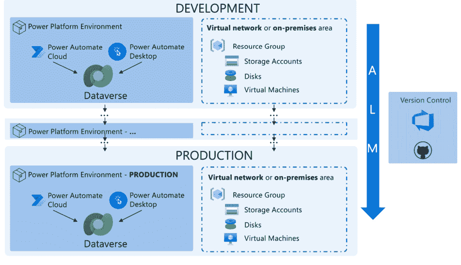

图 12.1 – 使用 PAD 的企业开发方法

在 PAD 的特殊情况下，我们还需要考虑 UI 流程在物理或虚拟桌面上运行。这些机器需要在本地安装 PAD，并且可以在公司的本地网络中运行，也可以在 Azure 或其他任何提供虚拟机（VM）的云提供商中虚拟运行。这就是为什么也很重要要涵盖解决方案的这一部分，并确保为开发、生产和所有其他阶段维护 VM。我们将在下一节中查看我们在这里拥有的选项。

然而，考虑到所有这些，我们也不要忘记，本书中介绍的概念，例如子流程、异常处理等，有助于创建有意义且健壮的 UI 流程。

## 安装和部署

PAD 应用程序是先决条件，必须安装在用于执行大型自动化场景的物理机器或 VM 上。不要忘记我们最终需要在该机器上安装一个传统应用程序。由于手动选项的可扩展性不佳，因此还有其他选项：

- 使用系统管理软件，如 Microsoft **System Center Configuration Manager (SCCM)** 或 Microsoft Intune 来部署和配置本地机器
- 使用 Azure 或任何其他云提供商中的 VM 来为 PAD 和相应的管理工具提供虚拟环境

Microsoft 提供了使用其名为 **Desktop-as-a-Service (DaaS)** 的功能 **Azure Virtual Desktop** 来直接在 Power Platform 内管理 PAD 的 VM。已创建了一个入门套件，其中包含不同的流程和一个用于配置设置的附加应用（见以下屏幕截图）：

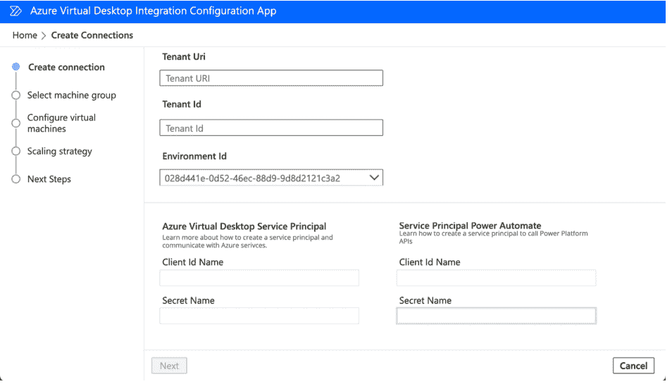

图 12.2 – 入门套件配置应用

此选项需要在后台配置适当的机器时设置一些参数。然而，这也允许非常轻松地添加（扩展）或删除（缩减）额外的机器，这在负载高峰期非常有帮助。更多内容将在下一节中介绍。

## Starter Kit 不是官方的 Microsoft 产品

应提及的是，Starter Kit 并不是 Power Platform 中的官方模块，应被理解为使用 Microsoft 技术实现自动配置和扩展的示例实现。所有实现工件都已发布在 GitHub 上。如果此产品出现问题，Microsoft 不提供任何支持，因为它不受官方支持。相反，鼓励客户为 GitHub 项目做出贡献并在那里提出问题。

部署的另一个方面是 UI 流程本身的部署。当用户创建并保存 UI 流程时，它会存储在给定环境的 Dataverse 存储库中。但是，默认情况下，其他用户无法查看或使用此流程。

有多种方式可以向另一用户提供对 UI 流程的访问权限。下图显示了这些选项：

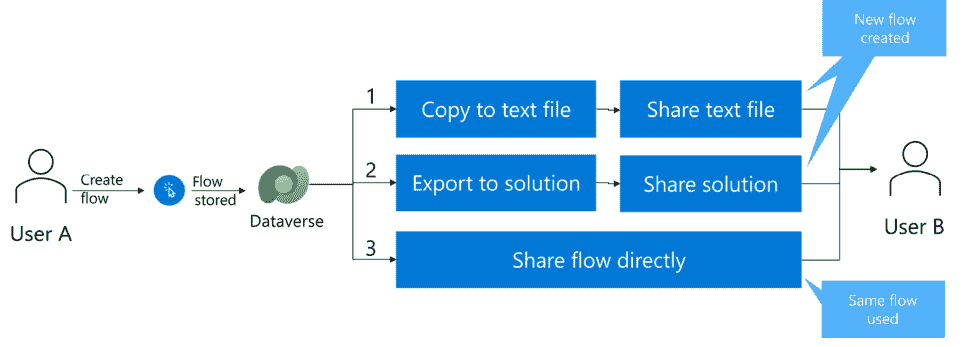

图 12.3 – 分享流程的方式

请注意，选项 1 和 2 会创建原始流程的副本。让我们看一下细节。

## 使用文本文件

第一个选项是将流程及其操作复制到文本文件并与用户共享。为此，您需要执行以下步骤：

1. 打开一个 UI 流程。
2. 通过按 Ctrl + A 选择所有操作。
3. 通过按 Ctrl + C 将操作复制到剪贴板。
4. 打开一个新文本文档（例如使用记事本）。
5. 将剪贴板内容粘贴到文本文件中。
6. 保存文本文件。

我们现在可以将此文本文件与另一用户共享，该用户可以打开它，复制内容并将其粘贴到空白 UI 流程设计器窗口中。

## 使用解决方案

如前所述，解决方案是可包含各种 Power Platform 工件的容器，因此可被视为完整的业务解决方案包。它们代表 Power Platform 中的一个非常重要的概念，并用于使用 ALM 技术将工件（如应用、流程等）从一个环境传输到下一个环境。要创建解决方案，请转到 Power Automate 门户中的解决方案菜单项，然后在菜单栏中单击 + New solution 按钮，如以下屏幕截图所示：

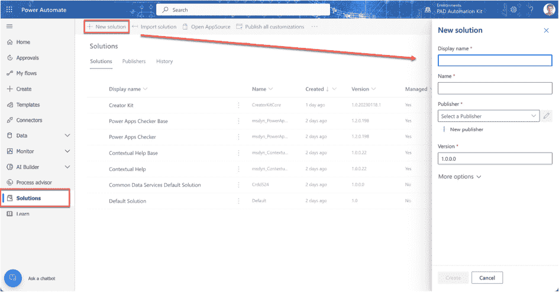

图 12.4 – 在 Power Automate 中创建解决方案

右侧将出现一个对话框，要求你输入解决方案的数据。Microsoft 文档对解决方案的一般概念进行了非常详尽的说明，包括发布者、版本控制等内容。在本示例中，可以选择默认发布者来创建解决方案。随后，可以创建新的解决方案组件，或将现有组件添加到解决方案中。现在，我们可以使用**添加现有项**按钮来选择一个桌面流，并将其添加到解决方案中（请参见下图）：

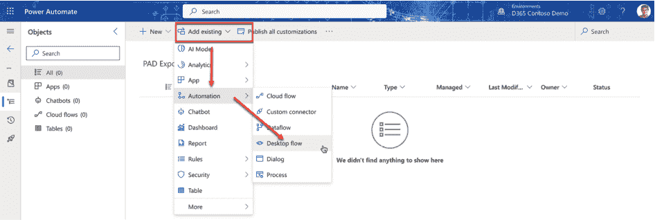

图 12.5 – 将现有桌面流添加到解决方案

系统会显示此环境中现有桌面流的列表，你可以将它们添加到该解决方案中。之后，会出现一个**导出解决方案**按钮，用于创建可下载的 ZIP 存档，以便与其他用户及其他环境共享。与前面的解决方案一样，导入此解决方案会创建 UI 流的副本。对原始流所做的更改不会应用到此副本；如果要将第一个环境中的更改更新到第二个环境中的流副本，还需要再次导出和导入解决方案。

## 在 Power Platform 中管理和共享 UI 流

使 UI 流（以及其他任何构件）可供其他用户使用的最简单方法，是使用 **Power Automate** 门户中的**共享**功能。下图展示了该功能的位置：

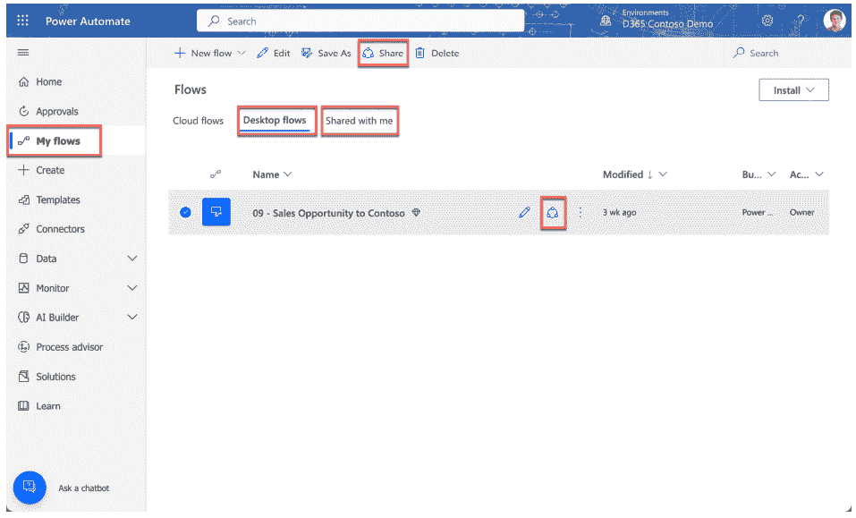

图 12.6 – Power Automate 门户中的共享功能

在左侧导航面板中，转到**我的流**，然后切换到**桌面流**选项卡。你将看到此环境中所有桌面流的列表。选择一个流后，可以点击相应行中的*共享*图标，或点击顶部按钮栏中的**共享**按钮，以打开共享对话框。此对话框允许你选择要与之共享流的其他用户。你还可以指定该用户只能查看和执行流（用户），还是也可以修改流（共同所有者）。如果有其他用户与您共享了流，这些流将显示在**与我共享**选项卡下。请注意，此处并不会创建副本。如果你授予另一位用户共同所有者权限，这一点尤其重要。如果要创建副本，可以使用顶部按钮栏中的**另存为**按钮。

另一种选择是将流分配给其他用户。这会将所有权移交给该用户。要实现这一点，我们需要在存储此 UI 流的环境中编辑 Dataverse 中相应的流。为简单起见，可以将 Dataverse 看作一个包含各种业务流程表的关系数据库。UI 流存储在名为 `Process` 的表中。相关文档（请参阅*延伸阅读*部分中的*管理桌面流*）详细说明了需要执行的步骤。如果流的创建者不应是实际执行用户，将 UI 流重新分配给其他所有者会非常有用，例如，因为执行用户需要特殊权限，或已经拥有并应执行其他流。

请注意，还可以使用 Web API 对 UI 流执行管理操作。与 Dataverse 中的其他构件一样，可以列出可用的桌面流、获取架构信息和状态、获取流输出，当然还可以触发流或取消 UI 流运行。这意味着，UI 流不仅可以通过 Power Automate 中相应的连接器调用，原则上也可以由任何程序或脚本调用。这为集成提供了各种新的可能性，也可能导致需要并行或高频率地执行一系列 UI 流。因此，下一节将讨论如何创建可扩展的 PAD 环境。

## 可扩展性

对于面向企业的部署而言，处理平台的可扩展性是一个重要标准。这意味着必须能够将任何峰值负载分配到多个工作节点，并在必要时实现排队机制，以确保请求得到有序且可靠的处理。这可以通过一台或几台独立计算机实现，也可以通过负载均衡管理及相应的计算机管理实现，下面将对此进行详细介绍。对于这两种场景，我们都假设计算机已在 Power Platform 中注册，从而可以将其包含在云流中，并且旧版应用程序已安装在相应的计算机上。更多详细信息，请参阅第 9 章。

### 单机方案

如果具备足够的**随机存取内存（RAM）**和处理器时间，就可以使用配置更高的工作站来安装 PAD 并执行处理任务。实际上，通过使用 Windows Server 2016、2019 或 2022，并以无人参与方式运行流，可以让多条流同时在同一台计算机上运行，从而降低基础设施成本。此场景可以如下图所示：

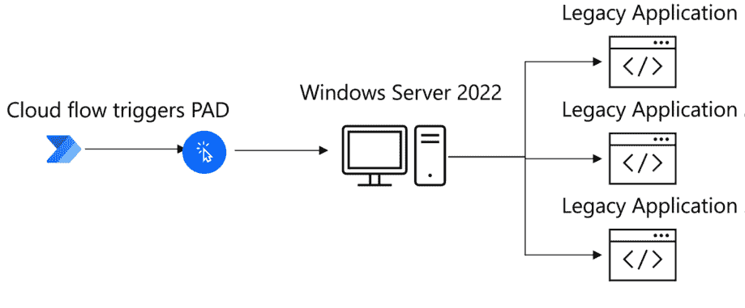

图 12.7 – 单机概念下的可扩展性

不过，这也需要调整 UI 流，因为必须由不同用户运行这些流，才能在服务器上创建不同的用户会话。但该场景存在形成单点故障的风险。换句话说，如果计算机发生故障，则任何 UI 流都无法运行。

### 计算机组和流队列

一种更动态的方法是使用计算机组，以及 Power Platform 直接提供的负载均衡概念。其概念如下图所示：

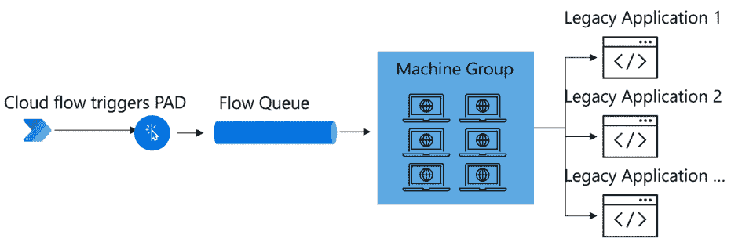

图 12.8 – 计算机组和流队列

在此设置中，一台用于执行 UI 流的计算机会在 Power Platform 中注册，同时加入一个计算机组。在 PAD 对应的云流操作中，可以选择该计算机组作为执行环境，其余工作由平台处理。如果需要同时或连续快速地执行多个流，请求会先汇集到队列中。随后，平台决定将执行请求发送到哪台计算机，并均衡分配请求负载。如果其中一台计算机发生故障，一方面会导致容量暂时降低，但不会使整个处理系统完全崩溃。另一方面，可以非常轻松地向池中添加更多计算机，以增加总容量，而不会中断处理过程。通过自动部署装有 PAD 的工作站，以及以无提示方式注册计算机并将其无提示加入计算机组，即可实现这一点。

Microsoft 还提供了直接在平台中使用虚拟机（VM）执行 UI 流的选项，可以通过使用 Starter Kit 进行预配（另请参阅*安装和部署*部分）。借助该选项，还可以定义扩展策略，用于测量负载并预配或取消预配其他计算机。

## 安全性

在自动化场景的各种安全要求中，本节将重点介绍两个与 PAD 相关且对企业使用十分重要的方面：**数据丢失防护（DLP）**策略和安全的凭据存储。

### 使用策略保护数据

在每个集成和自动化场景中，数据都发挥着核心作用。同时，数据本身也是非常有价值且值得保护的资产，因此必须确保在任何情况下都不会发生无意的数据泄露。尤其是在 Power Platform 这类环境中，几乎每位员工都可以通过低代码应用帮助优化流程，因此必须能够应用策略来防止不必要的数据流动。数据访问和数据提供（向接收方发送数据）通过连接器完成，我们已经在*第 9 章*中介绍过连接器。现在，我们可以使用 DLP 策略来定义流中哪些连接器可以彼此配合使用，哪些连接器不能组合使用。例如，这可以防止内部系统连接器与用于向外部提供数据的连接器出现在同一个流中，从而避免数据意外泄露到外部。DLP 策略在 **Power Platform 管理中心**中定义，如下图所示：

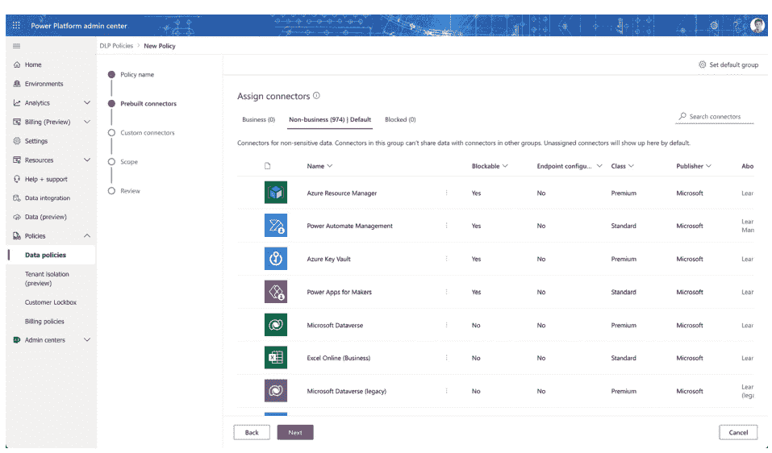

Figure 12.9 – Definition of DLP policies

## Note on DLP policies

At the time of writing, this feature is in preview, and the use of these capabilities must be confirmed by an opt-in (announcement to Microsoft). Subsequently, the action groups and also individual actions can be blocked or restricted so that UI flows are disabled if a DLP policy is violated in the flow (prohibited connector or unauthorized combination with another connector).

When the feature comes into general availability, it will only be available for managed environments for which additional security mechanisms exist beyond that. The Further reading section contains a link to get more information about managed environments.

Apart from the actual data, there is also other information worth protecting, such as access data and passwords. We will look at the possibilities for this in the next section.

## Secure credential storage

not been released yet. The *Further reading* section contains the link to the announcement for this. It is strongly recommended to use this service for the storage of sensitive information. Now let’s take a look at additional considerations for governance and compliance.

## Governance and compliance

In Microsoft’s documentation, there is a separate article on the topic of governance, which describes in detail the settings for the Windows operating system (registry settings) to restrict and monitor the functionality of PAD. We want to take the topic of governance a bit further here and look at what options are available to monitor UI flows and thus monitor the overall operations. Furthermore, on the topic of compliance, we will take a look at licensing.

## Monitoring flow execution

Two portals can be used to monitor the execution of flows: the **Power Automate** portal and **Power Automate admin center.**

The **Power Automate** portal provides a more operational monitoring capability. These functions are addressed to those who want to develop the flows, test them, and also monitor their operational functionality. The first view provides various charts, aggregated views, and filtering options (see the following screenshot):

## Figure 12.11 – Monitoring PAD flows

The second view in the Power Automate portal provides a section for monitoring the real-time execution of Power Automate Cloud and UI flows. This shows each execution of the flows and their status: Queued, Running, Succeeded, or Failed. This makes it very easy to monitor which flows are routed to which machine and which flows fail.

The reports in Power Platform admin center are aimed more at administrators who monitor the workload in the context of the environments. To do this, we need to go to Power Platform admin center and go to the Analytics | Power Automate section (see the following screenshot):

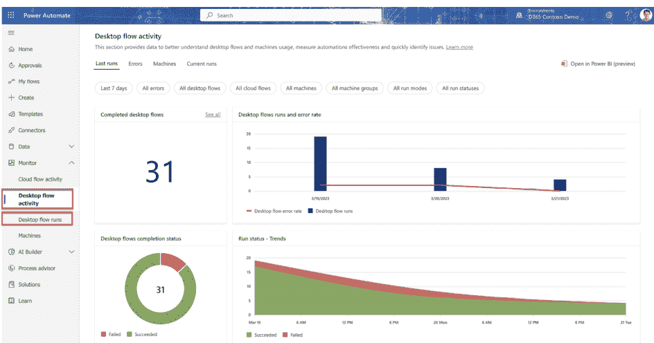

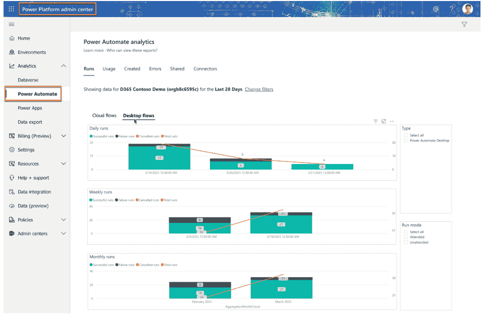

## Figure 12.12 – Flow monitoring in Power Platform admin center

There are different tabs available to provide information about the runs, usage, number of flows created and shared, and analysis of the connectors being used in flows. Governance requirements about the monitoring of Power Automate can thus be addressed very well. Another part is licensing, which we will look at in the following section.

## Licensing

In the course of the book, we have already learned about many functionalities of PAD, most of which are available with the free version. This is especially true for single use on a workstation, where flows are started manually and run interactively. Requirements such as scaling, parallel execution, centralized management, and rolling out flows are more typical for use in large enterprises and require the appropriate licensing. There are several license types available for this purpose, which then unlock a number of features and benefits and include the following features:

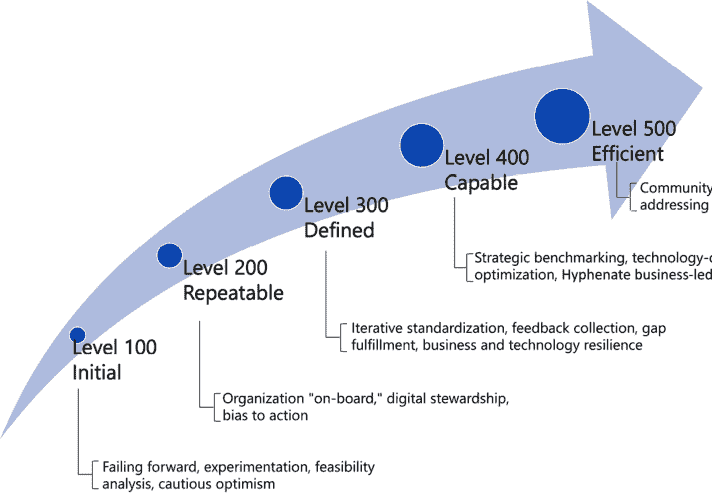

## Figure 12.13 – The Power Platform maturity model

This model can help determine the current state of automation capabilities and, from there, take the next steps, if necessary, to achieve a better level of automation and thus increase the company’s efficiency and productivity. In general, the idea here is not to look at individual applications but to take a holistic view of automation practices across an enterprise to embed them in an overall concept. For each individual automation project, so-called *holistic enterprise automation techniques (HEAT)* techniques can then be used to help design and roll out the solution in the context of the organization and manage the overall life cycle of the solution.

Another important building block is to build a team that addresses the various aspects of an automation solution and includes or builds experts to look at the solution from any facet, such as business content, ALM, infrastructure, security, and governance, as well as operational reporting and analytics. Another term for such a team is **Center of Excellence (CoE)**, and in relation to automation projects, **Automation Center of Excellence**.

In the meantime, many companies have also implemented these concepts in tools and processes. Microsoft has embedded this information into a so-called Automation Kit and, thus, a collection of applications and flows

based on Power Platform. This kit can be installed and configured as a solution in an environment. The basic idea is to use the artifacts and apps installed there to support an automation project from start to finish, including the following aspects:

- Definition of goals
- Review and release of the project
- Development and deployment
- Operational use and monitoring

This also supports different enterprise roles such as CVP, process owner, end user, and others. The following diagram illustrates the life cycle of such a project:

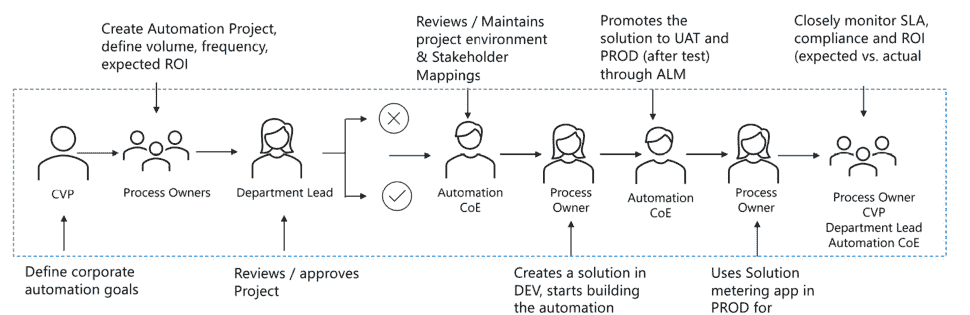

Figure 12.14 – Automation project life cycle

The fact that the kit can also be customized and that not all functions necessarily have to be used makes it easy to get started and shows what is possible with this technology. It is thus definitely worth a look and can bring added value and acceleration to automation projects.

## Enterprise automation scenarios with PAD

- The CRM system is implemented with Dynamics 365, and Power Platform with Power Automate is also in use.
- The internal invoicing system is represented by Contoso Invoicing (a desktop application), and the ERP system is accessible via a database (SQL Server).

At this point, we probably already have enough information to sketch an initial idea for the overall process. This could look as follows:

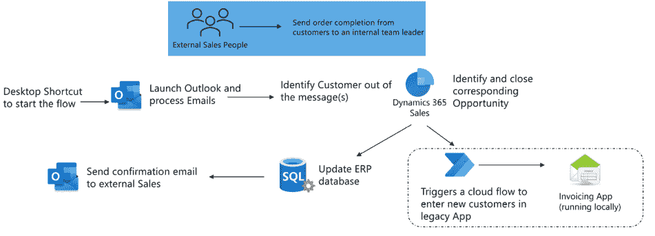

Figure 12.15 — Automation project scenario

Now, as always, there are several ways to implement this requirement, but there is a lot to be said for using a UI flow for this:

- The processing should be started individually by a team leader, which can be enabled via a shortcut on the desktop thanks to the advanced features.
- Outlook actions enable us to retrieve and process emails.
- We can extract the relevant information by using the text actions from *Chapter 11* (**Parse text** or **Recognize entities in text**). Of course, it would be beneficial if the email were standardized, making it easier to identify the customer ID.
- The next step would be to call the Dynamics 365 web API, retrieve all opportunities for the customer, and close these. An HTTP action will help us here to accomplish this action (**Invoke web service**).
- From a design perspective, we can outsource the processing for the invoice program to a separate cloud flow, which, in turn, includes the integration of the invoice program using the Desktop Flow connector. For the invoice application, we can then use the concepts for scaling that we learned about in this chapter.
- The ERP database will be updated by using the database actions, which we learned about in *Chapter 11*.

So, we can divide the overall processing into the following sections as subflows:

- `GetEmailMessages`: This should retrieve all emails and create a list of customers we need to feed into our systems.
- `CloseOpportunities`: For each customer, this subflow queries all open opportunities in Dynamics 365 and closes them. This will automatically trigger a cloud flow that listens to the **Opportunity Close** event and starts the processing with the invoicing app.
- `UpdateERP`: This will also take the customer information and create new customer records in the database.
- Subflow `NotifySeller`: This will send out a confirmation to the external seller.

You will notice during the projects that in many places, already known concepts can be reused, as in this case, we have already covered the use of Outlook, information extraction with text actions, as well as database queries in this book. So let’s take a look at a topic that hasn’t been looked at in detail yet: using the **Invoke web service** action to integrate Dynamics 365 from our UI flow.

## Calling web services within PAD

Another very powerful tool within PAD is the **Invoke web service** action. Almost all applications today provide web services as interfaces to trigger processes or work with data, and so does Dynamics 365. However, in an

在企业环境中，这些 Web 服务通常受到未经授权访问的保护，并且必须执行某种形式的登录。这里一切都取决于服务，因为身份验证和授权有不同的选项。对于 Dynamics 365 以及 Microsoft 环境中的所有资源，我们通常使用所谓的服务主体登录，例如通过在 Azure **Active Directory (AD)** 中注册的实例进行登录，并使用相应的密码（客户端密钥）。我们已在 *第 9 章* 中学习过这种类型的登录，当时我们使用 Azure VM。Microsoft 和大多数其他提供商对此使用 OAuth 登录流程。此处理的目的是执行以下操作：

- 使用租户 ID、客户端 ID 和客户端密钥登录 Dynamics 365 并获取访问令牌，可用于访问后续服务
- 使用给定的客户查询 Dynamics 365 并检索所有开放的机会
- 通过调用 Dynamics 365 中的相应 Web 服务操作关闭每个机会

下面的屏幕截图显示了此子流程：

## 图 12.16 – 调用 Dynamics 365 Web 服务

此流程执行以下操作：

- 1. 调用 Microsoft 服务的身份验证 URL，并使用所需参数检索访问令牌。此令牌存储在相应变量中，并转换为自定义对象以在后续操作中使用（第 1 行和第 2 行）。
- 2. 调用 Dynamics 365 Web 服务并使用查询参数检索给定账户名称的所有机会记录，该名称已由之前的子流程设置。其结果是该客户需要关闭的机会列表。该列表也转换为自定义对象（第 3 行和第 4 行）。
- 3. 在循环中，调用特定的 Dynamics 365 操作以关闭机会（第 5 行至第 7 行）。

请注意，我们在这里是从 UI 流程调用 SaaS 服务。在当前情况下，使用云流程来执行此操作将非常不方便。通信非常快速且稳定，是一项真正的生产力提升，因为否则这些记录必须手动关闭，这肯定会花费更多时间。

然而，正如前面提到的，可能有多个团队领导同时启动此流程。因此必须确保可能的负载峰值得到吸收。我们将在下一节中查看此设置。

## 使用机器组和队列提供可扩展性和可靠性

桌面流程的执行通常比云流程慢。原因如下：

- 必须建立到远程机器的连接
- 可能需要启动遗留应用程序
- 实际处理、调用不同屏幕等必须进行

所有这些都需要时间，在此期间云流程可能被阻塞执行。而且在此过程中，没有其他流程能够在此机器上启动另一个进程。

Power Platform 中的排队和扩展选项可以解决这些问题。桌面流程的执行由队列管理，并且可以分发到机器组内的多台机器。

本章详细描述了这一概念。对于此处的设置，我创建了两台配备 PAD 的 Windows 11 机器，并且它们在同一个机器组中。

如果现在在另一台机器上执行此处描述的桌面流程，这将导致多个机会被非常快速地标记为已赢。速度快到甚至无法开始单独处理。

尽管如此，请求会被排队记录，并且平台会控制将下一个执行发送到哪台机器（请参阅本章中的 *机器组和流程队列* 部分）。下面的屏幕截图显示了已排队一些流程的机器组的 **运行队列** 选项卡：

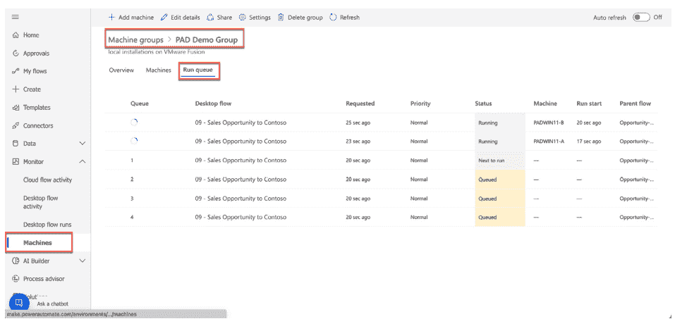

图 12.17 – Power Automate 中的运行队列

## 摘要

本章介绍的概念建立在 Power Platform 工具的完整范围之上，以满足所有自动化需求。PAD 是这些概念中的一个构建块，并且无缝契合。使用 Power Platform 还有一个优势，即所有工具的通用需求，例如监控和管理，以及遵守法律要求，可以在中央位置进行。

PAD 不断得到扩展和改进，并且已经提供众多功能，使其能够在大型公司中使用并支持自动化项目，正如我们在本章中所看到的。

预计 Power Platform 的更深层次集成将会发生，建立在本书中介绍的概念和功能之上。这为基于 Power Automate Desktop 的进一步自动化项目提供了非常坚实的基础。

## 进一步阅读

- *Power Platform 自动化成熟度模型概述：* https://learn.microsoft.com/en-us/power-automate/guidance/automation-coe/automation-maturity-model-overview
- *HEAT：* https://learn.microsoft.com/en-us/power-automate/guidance/automation-coe/heat
- *管理 Windows 上的 Power Automate for Desktop 白皮书：* https://learn.microsoft.com/en-us/power-automate/guidance/automation-coe/manage-pad-on-windows
- *使用 API 使用桌面流程：* https://learn.microsoft.com/en-gb/power-automate/developer/desktop-flow-public-apis
- *管理桌面流程：* https://learn.microsoft.com/en-us/power-automate/desktop-flows/manage#share-desktop-flows
- *Power Automate Azure Virtual Desktop 集成入门套件简介：* https://learn.microsoft.com/en-us/power-automate/desktop-flows/avd-overview
- *数据丢失防护 (DLP) 策略（预览版）：* https://learn.microsoft.com/en-us/power-automate/desktop-flows/data-loss-prevention
- *托管环境概述：* https://learn.microsoft.com/en-us/power-platform/admin/managed-environment-overview
- *管理低代码智能自动化平台白皮书：* https://learn.microsoft.com/en-us/power-automate/guidance/automation-coe/automation-admin-gov
- *Power Automate 中的治理：* https://learn.microsoft.com/en-us/power-automate/desktop-flows/governance
- *在桌面流程连接中使用来自 Azure Key Vault 的凭据：* https://learn.microsoft.com/en-us/power-platform-release-plan/2022wave2/power-automate/planned-features
- *高级 RPA 功能：* https://learn.microsoft.com/en-us/power-automate/desktop-flows/premium-features
- *介绍 Power Platform 的自动化工具包：* https://powerautomate.microsoft.com/en-us/blog/introducing-the-automation-kit-for-power-platform/
