## 1 无人机入门

恭喜！您已经迈出了设计和开发自己的专用无人机的激动人心的世界的第一步。人类一直在不断推动技术的边界。我们的技术进步深深植根于DNA之中，以至于我们以最先进的技术状态来标记整个历史时代。青铜时代、工业时代、太空时代、信息时代，以及现在的“无人机时代”。生活在无人机时代确实令人兴奋。好了，我们有很多内容要讲，让我们开始吧：

我们将在本章中涵盖以下主题：

- 无人机简介
- 无人机的用途
- 无人机的类型
- Ardupilot入门
- 安全与最佳实践

### 无人机简介

什么是无人机？二十年前，答案很简单。忽略与昆虫相关的定义，“drone”一词严格用于指军用自主飞行器。无人机（大多）用于靶标练习或情报收集（侦察）。后来，一家名为Dragan的公司推出了首批商业化四旋翼飞行器之一（DraganFlyer），“Quad Helicopter”一词由此诞生。

他们的第一款商用多旋翼飞行器简称为**Quad Helicopter**，于1997年推出（如下图所示）：

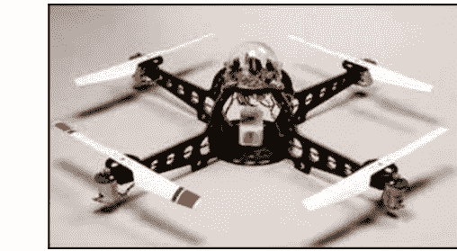

最初的DraganFlyer四轴直升机（1997年）。图片由DraganFlyer提供

进入21世纪初，*drone*一词成为军事打击的代名词。在美国总统布什和奥巴马任期内，美国对与恐怖主义有联系的目标发动了多次攻击。因此，“drone”一词带有一种不祥的意味。

2010年，Parrot推出了一款在手机上实现**增强现实（AR）**的多旋翼飞行器。这款游戏允许玩家击落对方现实中的多旋翼飞行器。该多旋翼飞行器被命名为**AR Drone**（可能是为了利用“drone”一词的阴森含义而进行营销）。实际上，这是第一款可以在当地购物中心和广场买到的多旋翼飞行器（所有Sharper Image门店均有销售）。公众终于第一次近距离看到了多旋翼飞行器。就在那里——盒子的正面用大写字母印着“DRONE”。

谁能抗拒呢？我花了数天、数周，甚至数年时间，通过拆解其他电子设备来获取加速度计、GPS模块和其他组件，以建造自己的无人机。难道真的可以这么简单，只需要去商场买一架就行了吗？是的。下图展示了我在2010年测试从Sharper Image购买的AR Drone：

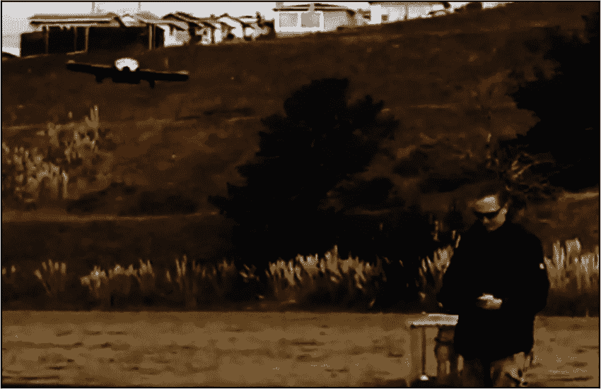

2010年在“Sharper Image”（加利福尼亚州帕西菲卡）测试AR Drone（1.0）

2011年，军事无人机的荣耀蒙上了巨大的污点。事实证明，这些精准的无人机打击有时会误伤平民、在国外的美国公民，甚至完全错过了恐怖分子。突然，“drone”一词开始与公众的恐惧乃至愤怒联系在一起。抗议活动随之而来（如下图所示）：

知识共享图片，作者：Fibonacci Blue

很快，一体化系统（如DJI Phantom）问世，它们已预先安装好摄像头，并在大型零售商处销售。这引发了反对者对该飞行器的隐私担忧。他们获得了一个现成的多旋翼飞行器新词——一个让全球人民心生恐惧和厌恶的词，一个甚至与杀戮无人机同义的词。在下图中，您可以看到DJI Phantom系列无人机的第一代：

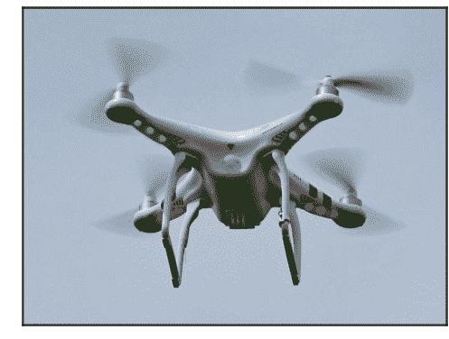

DJI Phantom（版本1）——有史以来最受欢迎的无人机系列中的第一款。机壳中央的三个凸起是GoPro摄像机的安装座

多旋翼飞行器社群全力抵制“drone”一词。人们情绪激动。2013年在加利福尼亚州圣罗莎，一名警官甚至没收了一位业主的无人机。他在自己的葡萄园上空飞行，并将视频发布到YouTube上。该警官声称，用不了几个月就会看到飞车枪击事件。警察局没有法律依据，最终被迫归还了Phantom。

全国各地的立法者都在制定针对无人机的当地法律。在洛杉矶（好莱坞和大部分航空摄影产业所在地），无人机被禁止。（后来这些法律被推翻，因为联邦航空管理局最终介入，声明地方和州政府对空域没有管辖权。）当时，无人机看起来可能会像秃鹫一样走向灭绝。但随后，一些美妙的事情发生了。

行业不再抗拒“drone”（无人机）这个词。我记得在我和Packt合作的第一本无人机书籍*《建造多旋翼视频无人机》*中，我曾反对在标题中使用*无人机*一词。但他们说服我，这将有利于搜索引擎优化。随着我们（业内）不再抗拒这个词，并开始向公众普及无人机的安全性、最佳实践和用途，负面含义便失去了意义。而且（如下图所示），无人机甚至有了全新的含义：

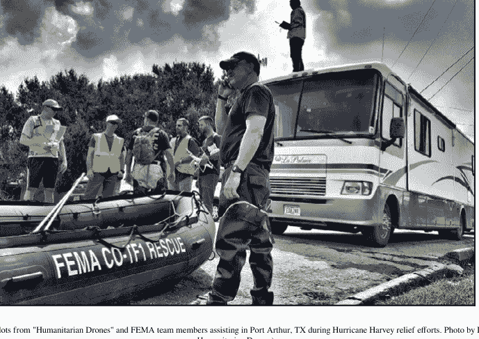

一群来自“人道主义无人机”组织的无人机飞行员和FEMA团队成员在飓风哈维救灾工作中协助得克萨斯州亚瑟港。照片由丹尼尔·赫伯特（人道主义无人机组织）拍摄。

突然间，无人机能够通过搜索和救援拯救生命，通过损害评估帮助人们从灾难中恢复（如下图所示），并在故事片和人们最喜爱的纪录片中贡献精彩镜头。然后，一件非常奇怪的事情发生了：

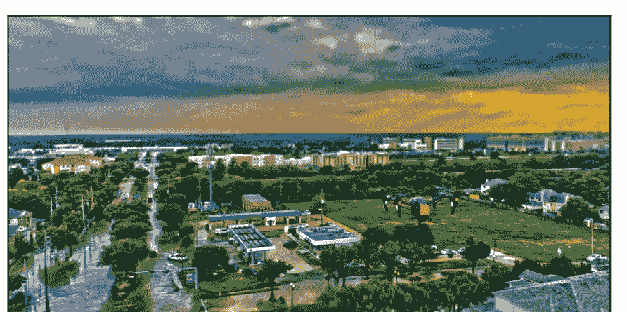

一架DJI Inspire 2在德克萨斯州休斯顿的飓风哈维过后进行损害评估和测绘。照片由人道主义无人机组织的布莱恩·斯科特拍摄。

无人机不再只是多旋翼飞行器。这个术语涵盖了任何在遥控下飞行的东西。这是随着美国联邦航空管理局（FAA）的小型无人机系统（sUAS）规则而发生的。媒体将这些规则称为无人机法规。突然间，无人机有了翅膀，甚至有了喷气发动机。如今，它们甚至不必自主飞行；爷爷周末玩的无线电遥控飞机，也是无人机。

然后，事情更进一步。多旋翼无人机中使用的导航系统被重新用于控制地面车辆（漫游车）和水上车辆（船只和潜航器）。现在，在2017年，你确实会听到公司推出水下无人机。

简而言之，最初的问题“（到底）什么是无人机？”的答案很简单：一个机器人——一种任何类型的运载工具，要么不由人类控制（自主），要么由人类通过远程控制。这可能不是牛津英语词典的定义，但这是公众听到“无人机”一词时普遍接受的定义。

至于我们生活在无人机时代的证据？在太空时代的高峰期（20世纪80年代中期），人们背着喷气背包飞进体育场，参加1984年奥运会开幕式，甚至在第19届超级碗中场秀上表演。如今，我们在同样的场所有了无人机表演。当然，要完全接受无人机，我们还有一段路要走。毕竟，中场秀中的无人机部分必须提前几天拍摄，因为担心表演期间发生无人机袭击，或至少担心场馆内出现群体性恐慌。但我们接受这一点。

## 无人机的用途

无人机只是用来拍照的，对吧？错了！无人机几乎无所不能。这里仅举几个例子：

- 你正遭受干旱（你好，加利福尼亚）却需要给庄稼浇水？你可以用无人机绘制整个农场的分布图，然后对作物健康状况进行分析，从而知道该把水引到哪里。整个过程你在门廊上喝着冰茶就能完成。
- 想走高尔夫球场，但不想雇球童或自己背球杆？球童无人机来救场！制作一辆电动高尔夫手推车，当你在球场步行时，让它跟随你手机上的GPS信号。
- 也许你是一名爬虫学家，在偏远地区探险时发现了一种新的树蛙。用一架自主动力滑翔机从几英里外把它送回大本营。只需把青蛙装入载荷舱，在树线上方抛出去，让它飞回（并降落在）基地！然后，只需等待大本营收到标本，再把动力滑翔机送回你身边，继续你的探险。
- 你是海滩救生员，看到有人遇险。发射一架空中无人机，让它投放一艘船型无人机，把那个人拖回岸边。整个过程，你都不必离开岗位（不会让其他海滩游客无人看护）。你可以在海滩带着可能需要的医疗用品迎接遇险者，而且你不会累到无法施救！

这样的例子数不胜数。只要你能想到需要运送物品、需要人工移动到别处，或只是为了节省时间的事情，都能找到无人机的用途。可能性真的是无穷无尽。

这些无疑是无人机蜂群的一些利他且高尚的用途，但军方也看到了无人机蜂群的好处。下图展示了一次最近的无人机蜂群测试（通过从两架F-18“大黄蜂”上投放部署），用于为任务指挥官和地面士兵实时绘制战场地图：

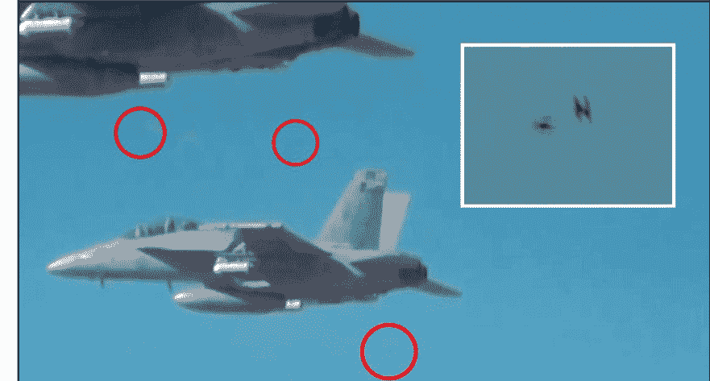

无人机蜂群也可以被娱乐行业用于报道体育赛事，如果一架无人机电量不足，另一架就会起飞接替它。无人机蜂群可以部署在高尔夫球场上空，帮助爱好者找到他们打偏飞入草丛中的球。农民可以使用无人机蜂群监测作物、播种、监测灌溉模式（以及水分蒸发造成的浪费，或雾化喷洒器进入空气中的水分）。

再次说明，无人机的用途是无限的。

我们可以一辈子日日夜夜、年年岁岁地列出无人机的潜在用途。那么，我们如何实现这种潜力呢？

嗯，要弄清楚如何制造无人机，我们总是首先要从如何利用现有技术和组件来实现我们想要的目标开始。第一步是了解当前存在哪些类型的无人机。

## 无人机的类型

无人机分为两大类，下面有若干子类。有水面/水下无人机和空中无人机。让我们进一步深入探讨每一类。

### USV 无人机

USV既可以指无人水面航行器，也可以指无人潜航器。同一个缩写USV同时用于两者。这类无人机通常分别被称为“漫游车”或“潜航器”。

### 漫游车

漫游车通常有履带（如坦克）或车轮（如汽车）。火星漫游车是USV漫游车的绝佳例子。它们沿着火星表面移动，进行各种读数测量，以探索另一颗行星的表面，而不危及人类生命。下图展示了其中一辆火星漫游车：

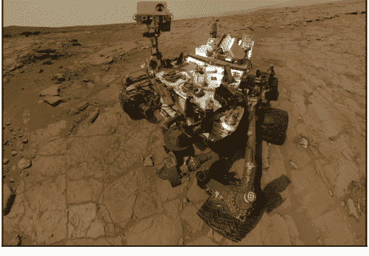

并非每项漫游车任务都需要像探索另一颗行星那样崇高。漫游车目前已被用于我们日常生活的方方面面（iRobot Roomba就是USV漫游车在日常生活中的一个例子），一直到探索我们自己的星球（专为探索熔岩流而设计的漫游车——这些区域对人类来说太危险、太不宜居）。

然而，漫游车不必只能在地面上行驶。有些漫游车实际上是船，设计用于在水面上滑行，实现各种目的。船型无人机USV的一个例子是由美国海军设计的，用于护送船只通过海盗出没的水域，并保护海军舰艇免受危险水域中其他敌对船只的攻击（消除或至少减少对臃肿战斗群的需求）。

在本书中，我们将设计三种水面漫游车：

- 一辆基础自主遥控车，除了让你学习Ardupilot接口实现的基础知识之外，没有其他用途。
- 一种水面USV，用作鸭诱饵，可自主沿预设路线在池塘周围导航，供猎人使用。嗯……不知道它在商店里能卖多少钱？
- 一种地面USV高尔夫球童。这将展示如何让漫游车跟随GPS跟踪器（以用户手机的形式）。这款球童的设计目的是在高尔夫球场周围运送你的球杆，你无需携带球包，甚至无需告诉球童要去哪里。它只会跟着你。

### 潜航器

潜航器是设计用于进入液体表面以下的运载工具。传统上，这种液体是水。然而，潜航器也可能用于监测其他液体，例如啤酒厂的发酵罐、化工厂的混合罐，以及潜入原污水池。除了跳进啤酒缸之外，我相信你能明白使用无人机比自己跳进去更可取。

本书不会尝试制造潜航器。然而，所采用的技术与本书的主题非常相似。潜航器只应由经验丰富的无人机设计师尝试，因为他们必须应对GPS利用能力减弱、无线电传输距离缩短以及水中（或其他液体）能见度大幅降低的问题。因此，应考虑诸如**前视红外（FLIR）**、信号中继器和避碰（通过声纳）等技术。然而，从下图中可以看出，水下无人机与固定翼空中无人机（飞机）之间的相似之处相当明显：

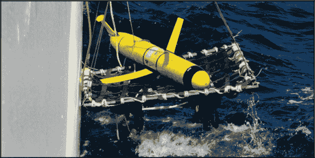

海军的“海洋滑翔机”水下无人机与最初的 X-1 飞机（首次突破音障的飞机）之间的相似之处令人惊讶。

## UAV 无人机

**UAV** 代表 **无人驾驶飞行器**。简单来说，这就是任何会飞的无人机。然而，就像术语 UUV 也可包括水下航行器一样，这一类别也可以涵盖进入太空的飞行器（例如先驱者卫星、卡西尼探测器，甚至空军的航天飞机替代品——X-37B）。

美国空军的 X-37B 可以从高空飞行飞机上投放发射，或安装在火箭上。它还可以自主在太空中停留数年，改变轨道路径，并返回地面进行自主着陆。实际的载荷和任务是保密的。你真的以为我们会依赖俄罗斯和民间机构来满足美国在太空的所有需求吗？

我们不会再进一步谈论太空了。毕竟，如果你为 NASA 工作，你可能不需要这本书。尽管如此，提到这一点还是很酷的。在空中，UAV 可以分为五个基本类别：

## 多旋翼

有时，人们称它们为 *四轴飞行器* 或 *四旋翼飞行器*。严格来说，除非多旋翼有四个螺旋桨，否则这种说法不准确。还有六轴飞行器（六个螺旋桨）、八轴飞行器（八个螺旋桨），甚至多达三十二个螺旋桨（虽然我不知道那个词会是什么）。所以，你可以看到多旋翼如何简化了这一切。毕竟，它们本质上是同一种类型的飞机，只是电机和螺旋桨的数量多一些或少一些。（这就像把单翼机和双翼机都叫做飞机，但把单翼机叫做 *双翼机* 是错误的）。

### 多旋翼如何飞行？

原理很简单。简单到（事实上）你可能会想知道为什么这些东西直到最近才出现。螺旋桨向下吹气以提供升力，而机身（整个机体）倾斜以将该推力导向后方（向前飞行）、前方（向后飞行）或任一侧（向左或向右滑动）。你可以在以下插图中看到这一点：

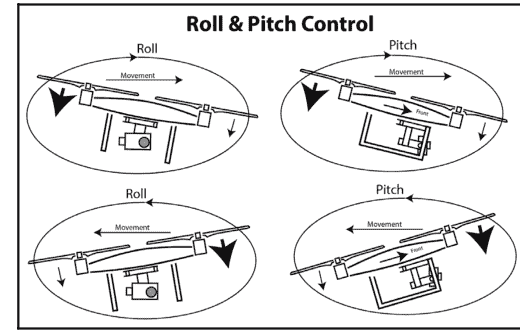

但随后就是控制问题。

需要每秒数千次的计算来决定应向每个电机提供多少功率，以使飞机在空中保持水平和稳定。没有两个电机完全相同。因此，这不仅仅是向每个电机提供相等电压的问题。这是根据飞机当前的状态调整每个电机的电压的问题。因此，从本质上讲，飞机并不是在飞行；它对自己无法飞行的情况做出反应并进行补偿。然后还有转向（偏航）。

你可能会注意到多旋翼上没有尾桨。传统直升机上的尾桨有两个功能：

- 防止机身（机体）失控旋转。毕竟，牛顿物理学告诉我们，作用力与反作用力相等且相反。如果电机正在转动主旋翼，有什么能阻止机身向相反方向旋转呢？
- 通过改变尾桨叶片的螺距，可以控制更多或更少的推力（以及推力的方向）。这使飞行员可以偏航飞机（转动它）。

那么，多旋翼如何实现偏航呢？答案在于前述的第一个原因。多旋翼（通常）有偶数个旋翼。其中一半的旋翼朝一个方向旋转（顺时针），另一半朝相反方向旋转（逆时针）。当你想向左转时，朝右旋转的叶片加速，而朝左旋转的叶片减速。这样，有效升力保持不变，但电机的扭矩使飞机向左偏航。向右转时则相反。以下插图显示了这一过程：

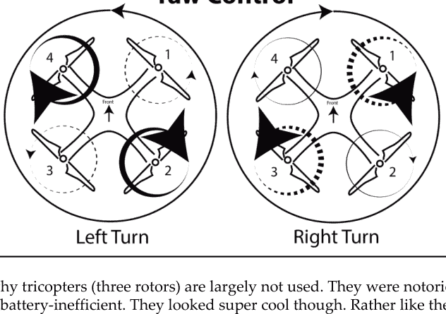

这也是三旋翼（三个旋翼）基本不被使用的原因。它们 notoriously 不稳定且电池效率低下。它们看起来超级酷。很像电影《异形》中的投送飞船。然而，六轴飞行器（六个旋翼）的一种变体使用了这种主题（这就引出了另一个叶片配置的变体）。平放六轴飞行器的所有六个叶片都位于同一平面上。上下交错版的六轴飞行器看起来像三旋翼，有三个基本升力点，但叶片相互叠加、逆向旋转，因此一个平面的叶片朝一个方向移动；而随后的叶片则朝相反方向移动。

下图显示了标准四轴飞行器（左上）、上下交错六轴飞行器（右上）和平放六轴飞行器（底部）。目前多旋翼的大多数配置都是平放的，因为它对电池续航时间和升力能力更有效率：

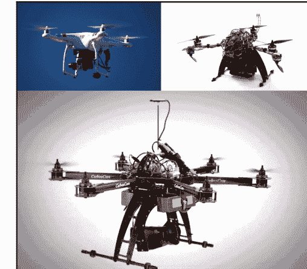

所以，正如你所见，多旋翼是一种基于简单原理的平台，但使其工作起来极其复杂。你（飞行员）实际上并不驾驶多旋翼。它自行飞行。相反，你只是告诉它去哪里做什么。你不是驾驶多旋翼，你是在驯服它。

为了让引导系统（在我们的例子中我们将使用 Pixhawk 2.1——基于 Ardupilot 的系统）准确计算每个电机应该做什么，它需要大量的传感器：

- **加速度计**：测量飞机的姿态，以查看其是否水平、相对于上一次姿态移动的方向。这些本质上测量线性速度。因此，需要多个此类传感器来测量所有轴的运动。Pixhawk 有三个加速度计，性能相当好且非常快。但是可以添加更多。
- **陀螺仪**：这些与加速度计不同，因为它们感应角运动（滚转、俯仰和偏航）。每个陀螺仪测量一个轴的运动，因此需要三个。Pixhawk 包含三个陀螺仪。
- **磁力计**：该传感器本质上充当罗盘。它测量地球磁场，可以告诉飞行器的相对航向指向北方。然而，由于飞机可以滚转和俯仰，应为每个轴实现一个并相互比较（因为一个磁力计如果与正北垂直可能会被锁定）。Pixhawk 有三个。
- **气压计**：气压计测量气压。由于气压在不同高度会发生变化，因此该方法可以告诉相对于起飞点的相对高度。令人惊讶的是，这些可以根据传感器的数量和灵敏度非常准确（精确到英寸）。Pixhawk 内置了两个。
- **全球定位系统（GPS）**：GPS 告诉 Pixhawk 它在（地球上）的位置。我们将在后面的章节中更深入地了解 GPS 的工作原理，但简单来说，并非所有 GPS 接收器都是一样的。GPS 是一种近似值，各种因素决定了其准确性。Pixhawk 不包含 GPS。你必须自行购买 GPS 模块。

因此，正如你所见，传感器的准确性对于飞行多旋翼至关重要。如果它真的自行飞行，而你只是告诉它去哪里，你希望那个机器人大脑拥有尽可能多的（且尽可能准确的）信息。

关于多旋翼的迷思是它们极其简单。这可能是因为它们相对容易飞行。这个迷思应该在这里和现在就被打破。在所有无人机类型中，它们是最难设计和制造的。你会发现零件应该配合使用，但却不配合。你会发现平衡升力与飞行时间极其困难。而且你会发现，当事情出错时，它们会非常糟糕。相信我，我有伤疤可以证明。所以，当我们进入多旋翼时，请务必极度注意安全。它们本质上是会飞的 Cuisinart。

## 固定翼无人机 – 飞机

飞机被许多人认为是 UAV 的圣杯。它们通常可以比多旋翼飞行更长时间（因为它们有翅膀，不必消耗电池电力来提供升力）。它们也更容易飞行（因为它们可以真正滑翔，如果电机停止，它们也不会像石头一样坠落）。然而，飞机的难点在于起飞和着陆。

由于飞机不能悬停，它们必须以一定的速度移动才能起飞和着陆。着陆飞机也不太容易。它们必须轻轻触地，否则可能会再次弹起、失速并坠毁。那么，你如何设计一架无人机以高速柔软地着陆呢？这并不容易。但 Pixhawk 已被证明在这方面做得相当不错。

此外，由于飞机在空中需要保持一定的速度以使气流流经机翼从而产生升力（称为**空速**），因此引导系统需要知道它相对于空气的运动速度（而不仅仅是相对于地面）。除了多旋翼无人机使用的所有传感器外，飞机还需要一个额外的传感器：皮托管。

任何真正的飞机上都会找到皮托管来测量空速。这个装置就是你看到从飞机侧面或机头伸出的小*杆*。下面的图片展示了皮托管的工作原理：

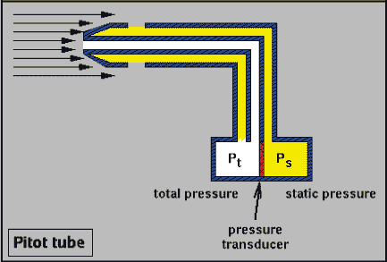

图片由 Wikimedia commons 提供

下面的图片展示了有人驾驶飞机上的皮托管：

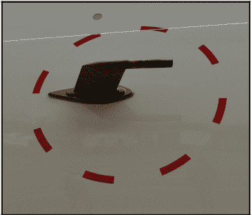

Pixhawk 本身没有这个传感器，但可以购买一个与之配合使用。

固定翼无人机也可以以多种方式发射。有些是投掷的；有些是在弹射系统上发射，而另一些则是像传统飞机一样起飞（带轮子的滑跑起飞）。

下面的图片展示了我的一架无人机（2012 年）通过一种名为 Jetapult 的弹射系统发射：

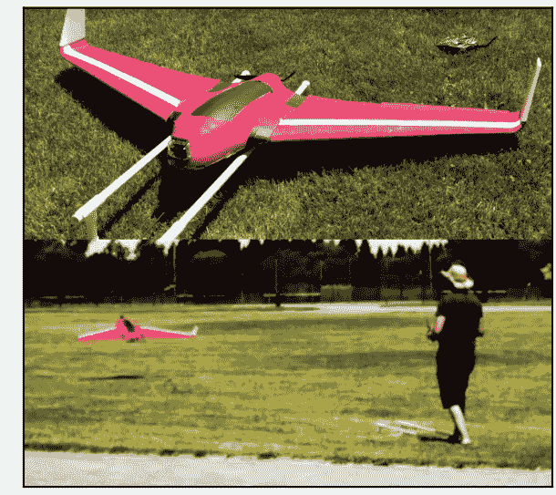

由于这架无人机的翼展长达七英尺，太大而无法通过投掷的方式发射。该系统非常简单。它使用 PVC 管将飞机倾斜并以轻微的角度将其滑出，同时橡皮筋以很高的加速度将飞机向前拉。如果你仔细观察，可以看到黑色的橡皮筋团成一团，堆在地面上，就在（现在正在飞行）无人机后面。释放装置是一个简单的脚踏板，可以将一个环从销钉上滑落。

尽管这是一个简单的机制，但即使是军用无人机有时也会从弹射器发射（如下面的图片所示）：

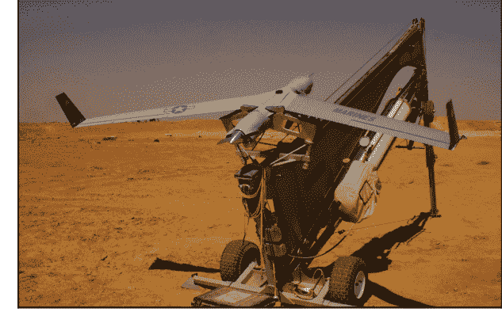

## 混合无人机 – VTOL

你可能会想知道我们为什么花了这么多时间在起降上。**垂直起降（VTOL）**无人机解决了许多问题，但也带来了很高的复杂性。这些无人机可以像直升机（或多旋翼）一样起飞，像飞机一样飞行，然后像直升机/多旋翼一样再次降落。

XplusOne（由 Xcraft 生产）可以像四轴飞行器一样起飞甚至飞行，但随后可以过渡到像飞机一样的向前飞行。正如你所见，设计这样一架飞机是极其困难的。机翼在垂直状态下产生的风阻会在多旋翼飞行期间造成不稳定，而过渡到飞机飞行也同样困难。然而，最困难的挑战是返回四轴飞行以进行降落。你如何防止飞机上浮（增高）然后失速坠毁？你只有在拥有高度资金和经验时才应尝试此操作，因为在调整设计使其恰到好处之前，你几乎肯定会坠毁几次。

## 直升机无人机

传统直升机确实有一些优势。它们通常比多旋翼飞行更快，在向前飞行时更稳定（由于尾鳍和水平尾翼）。它们有时还能在空中停留更长时间，因为它们不需要电动机的快速响应。因此，它们可以使用燃烧发动机甚至涡轴发动机飞行，这意味着它们可以携带更多燃料并飞行更久。下面的图片展示了一架美国海军直升机无人机：

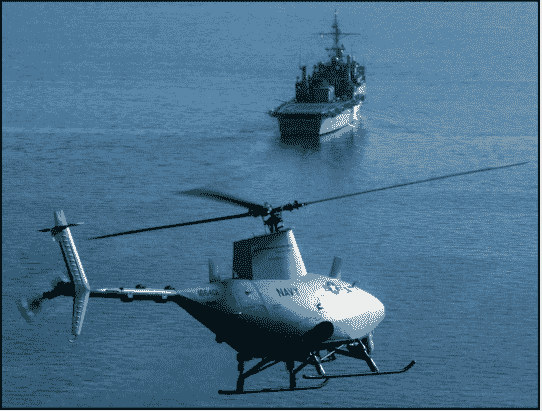

然而，传统直升机通过使用*摆动盘*来改变桨叶的螺距。它们通常（也）通过类似的方法（尽管更不复杂）来改变尾桨桨叶的螺距。摆动盘基本上是由两块板组成，它们围绕旋翼轴旋转并上下移动以改变桨叶的螺距。直升机如何向前倾斜以开始移动？摆动盘倾斜并向下延伸的轴使桨叶在直升机后部咬入空气更多，而在前部咬入更少（在后部产生更大的下压力，在前部产生更小的下压力）。

所有这些运动机械部件需要在每次飞行之间进行润滑和维护。机器越复杂，出现故障的机会就越多。因此，尽管传统直升机有一些优势，但就成本和维护计划而言的缺点使其对许多人来说不可行。

下面的图片展示了摆动盘的工作原理。红色圆盘保持静止并旋转或上下移动。与此同时，米色部件随旋翼头转动，水蓝色控制杆根据它们在旋转周期中的位置来改变桨叶的螺距：

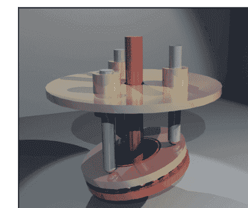

就本书而言，直升机的介绍到此为止。因为就我们的 Pixhawk 而言，直升机和多旋翼机之间几乎没有区别，我们选择在本書中介绍多旋翼机。

## 飞艇无人机 – 飞艇

飞艇其实相当不错。它们可以在极长的时间内保持在空中。它们也很稳定。然而，它们对景观来说有点碍眼，因为它们必须相当大才能携带任何有效载荷。下面的图片展示了一架海军飞艇无人机：

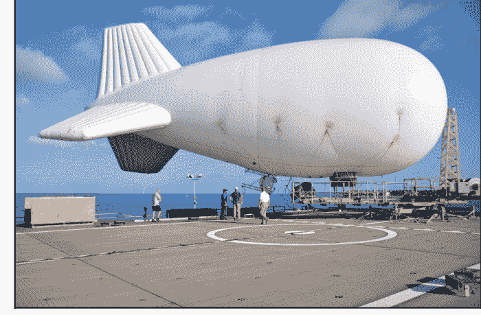

飞艇无人机还有一些其他缺点。它们必须充气，每次飞行都要花费大量资金用于你选择的任何轻于空气的气体（氦气、氢气等）。由于其轻于空气的特性，它们也极易受到强风流的影响。因此，必须使用强劲的发动机来抵消这些气流。这增加了重量，从而使飞艇的尺寸更大。由于这些限制和成本，飞艇并未得到广泛使用。

这很遗憾，因为从机械上讲，它们是最简单的无人机设计。只是实际上，它们昂贵且在很大程度上不切实际。

## Ardupilot 101 – Pixhawk 2.1 的快速概述

Ardupilot 平台（基于 Arduino 机器人平台）已经存在很长时间了。2007 年，它由一家名为 3D Robotics 的公司构想。它是一个开放的代码库（完全可编程），自 2013 年 Pixhawk 系列问世以来，其多功能性和能力得到了爆炸式增长。最新版本（本书撰写时为 2.1）通过可选的 Intel Edison 计算模块扩展处理能力以及立方体的添加实现了更强的多功能性和稳定性。立方体包含一个三重冗余传感器阵列，包括陀螺仪、加速度计、磁力计和气压计，安装在一个缓冲的立方体平台中，旨在最大限度地减少振动和电子干扰。

除了 Intel Edison，你还可以使用 Raspberry Pi、ODroid、NVidia TX1 和 BeaglePilot 项目协处理器以任何你想要的方式自定义你的 Pixhawk 2.1 的功能。虽然并非每个 Pixhawk 2.1 都有 Edison 端口（如果你计划使用 Edison，你购买的 Pixhawk 的说明应明确标有 *Edison Ready*），但其他协处理器可以添加到任何 Pixhawk 板上。

感到不知所措吗？好。 那么关于向你展示 Pixhawk 的能力是巨大的这一目标就实现了。事实上，它的范围如此之大，以至于它是一个功能强大的机器人平台大脑，能够实现你能想象到的几乎任何事情。Pixhawk 的局限性仅在于你的编程技能。

在此完全披露，我们不会深入探讨用于自定义 Pixhawk 的编程语言和其中的命令。那本身就可以是一整本书，甚至是一系列书籍。相反，我们将探讨 Pixhawk 在其原装状态下（经过少量调整）可用于实际用途的情况。

重要的是，如果 DJI 代表专有系统（尽管是非常高质量的专有系统），那么 Pixhawk 代表开放架构。DJI 就像 Apple，而 Pixhawk 就像 Linux。

现在，你可以松口气了。我们不会用屏幕又屏幕的代码来吓唬和压倒你。让我们进入设备本身。

- **GPS 端口：** 这只是你的 GPS 传感器插入的地方。但为什么有两个呢？这是 3D Robotics 根据用户请求听取的意见。双 GPS 可以提供更好的定位感知。Pixhawk 使用信号更好的那个传感器。如果只插入一个传感器，它将全程使用该传感器。
- **电源端口：** 与你可能想的不一样，这些端口并不是为向 Pixhawk 控制的设备供电。相反，这些端口读取电源（电池）的状态并向传感器和单元本身供电电压。舵机、速度控制器或其他由 Pixhawk 控制的设备的电源必须通过 BEC 供给舵机导轨（我们将在 *第 2 章、你的第一架无人机 - 一辆自主遥控汽车* 中设计我们的第一架无人机时详细介绍）。
- **MAIN OUT/AUX OUT：** 这些是我们用 Pixhawk 控制的东西插入的端口。这些通常是舵机和电机用的速度控制器。

### 安全和最佳实践

这听起来都很明显，像是常识。嗯，确实是。遗憾的是，有时当有人兴奋地测试新车辆时，常识就会被抛到九霄云外。过于紧张也会产生同样的效果。因此，这里有一些基本准则供参考：

- **永远不要在人附近测试新设置：** 这适用于所有类型的无人机。无论你是在指定的飞行场、遥控汽车赛道还是导弹测试场。选择观察者尽可能少的时间。如果出现问题，你不想伤害任何人。
- **测试时要循序渐进：** 你刚组装了一架新无人机吗？不要直接全自主。你永远不想直接全自主。至少不是一开始。先以全手动控制运行，以确保所有连杆都正常工作。然后，逐步进行一些小的自主机动，并逐步提升到全速，或起飞和降落。
- **取下螺旋桨：** 当你确保系统通电并对系统进行编程时；请取下任何空中飞行器的螺旋桨。将任何地面车架起来以使车轮离地。将任何船只抬高以使螺旋桨离开桌面。如果油门突然全开，你不想造成任何人身或财产损失。
- **始终记住你的无人机是实验性的：** 你自己组装的无人机不是量产机器。它们没有一整支工程师和质量保证技术人员团队，而且它们绝对不是由可以在事故中对装配缺陷负责的公司制造的。你对可能发生的一切负责。因此，要负责任。这些东西可能会伤人甚至致命。一架重 20 磅的无人机从天而降砸向人群绝对不会让任何人度过愉快的一天。
- **带一个观察员：** 测试无人机是团队合作。当你很可能把脸埋在屏幕上监控遥测数据，或盯着无人机试图让你的财务投资保持在空中、四轮着地或在池塘表面滑行时；请带上一个人来提醒你可能遇到的障碍和问题。他们还可以帮助让偶然路过的围观者远离危险区。在发生灾难性事件时，他们还可以帮助你找到所有碎片。

### 总结

哇，这确实是一大堆信息要吸收，但至少基础已经奠定，现在我们可以进入有趣的部分了！在本章中，我们了解了所有不同类型的无人机。我们还讨论了一些无人机技术的潜在用途和市场。最后，我们介绍了 Pixhawk 平台的强大功能，并为你提供了 Pixhawk 连接的高级概述，以及每个端口的用途。不要担心如果你有点困惑。这信息量很大，但当你在后续章节中看到实际操作时，它会变得清晰得多。

现在，做好准备吧，因为我们将直接进入将 Pixhawk 实施到你的第一辆车辆中。在下一章中，我们将改装一辆简单的遥控汽车，并使用 Pixhawk 将其改造成一辆自主漫游车。一辆加装助推器的漫游车。
