# 2 你的第一架无人机 - 一辆自主遥控汽车

本章更少关于 Pixhawk，更多关于如何设计和改装车辆以实现 Pixhawk。我们将涵盖：

- 套件拼装
- 围绕限制进行规划
- 规划组件的放置
- 制造新零件
- 基础组件
- Mission Planner 的基础知识

### 我们的漫游车

认识 Traxxas Rustler VXL 无刷版（如下图），一辆使用 3S 电池时时速超过 70 英里的越野速度怪兽。如果你熟悉这辆车，你会认识到它绝对不是（完全）原装。更大的、更宽的轮胎已经安装，胎纹更深以获得更好的牵引力和抗侧翻能力。此外，这些轮胎非常柔软（增加了车辆的悬挂）以减少底盘振动。最后，还加装了一个防翘头杆，以防止加速和颠簸时翻车。

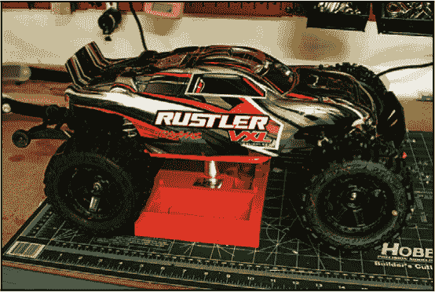

你可能还会注意到，我们在前面加装了一个保险杠，以保护悬挂免受正面碰撞。让我们开始吧。

### 套件拼装

套件拼装是一个在电影微缩模型（制作视觉效果微缩模型艺术）世界中创造的术语。它通常意味着购买预成型模型（如用于陈列的塑料模型飞机），取下该套件的零件，并与其他零件（或你自己的定制零件）结合起来创造出新事物。例如，你可以看到原版《星球大战》千年隼号中的部分包含来自各种军事模型套件的枪支和排气口。

一些纯粹主义者可能认为这是作弊。他们是业余爱好者。专业人士经常这样做。毕竟，当时间就是金钱时，为什么要重新发明已经存在的东西呢？

在本書中，我们将采用同样的理念。我们将把笨重的物体变成通过 Pixhawk 控制器和组件变得智能的物体。在某些项目中，我们甚至会进行全套件拼装，将两个或多个物体组合成一个智能物体。

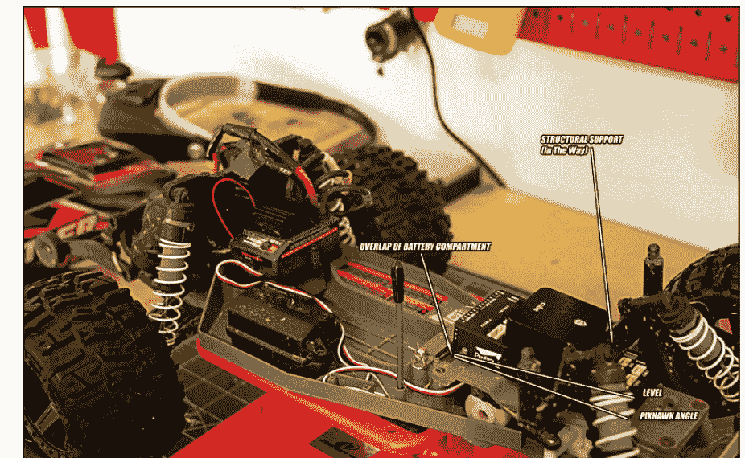

在安装组件之前，先进行测试放置总是一个好主意。在这种情况下，我们可以看到我们最初认为可以放置 Pixhawk 的位置是一个糟糕的位置。

Pixhawk 的后部与电池仓重叠。这意味着当我们要把电池放入车辆驱动它时，它将无法放入。此外，前悬挂的结构支撑与我们几个 Pixhawk 插头重叠。最后，我们的 Pixhawk 会向前倾斜。如果 Pixhawk 不水平，它可能无法正常工作（如果这是空中飞行器，绝对无法正常工作）。

你可能会想，“为什么我们不把它横着放呢？” 在 Pixhawk 顶部，你会注意到立方体上的一个白色箭头。这表示 Pixhawk 的前方方向。放置时这个箭头不朝前会导致罗盘读数错误，并且无法正确驾驶漫游车（它可能认为自己指向北方，而实际上指向东方）。

第二个放置位置在某些方面更优，但也有其缺点。让我们看一下下面的图片：

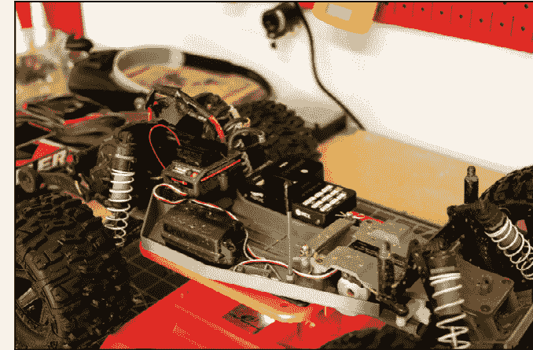

将 Pixhawk 放置在左舷侧（在本書中为车辆左侧；我们将使用左舷和右舷参考以消除混淆），它可以保持水平且无阻碍。然而，如前图所示，我们需要为底盘这个中空区域构建一个平台。让我们从另一侧看：

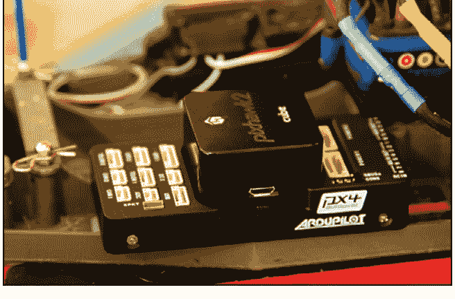

Pixhawk 前部端口角落存在明显的悬空。这意味着在碰撞或翻滚的情况下，Pixhawk 可能会遭受严重损坏（尤其是在 70+ mph 的情况下）。

因此，在我们开始连接任何东西之前，我们必须为 Pixhawk 构建一个平台，该平台放置在底盘支架内，并保护该前角以及 Pixhawk 的整个端口侧。

## 3D 建模、打印和硅胶模具

制作 Pixhawk 安装平台的最佳材料之一是 Gel-10 硅胶。它就是用来制作面具用的仿皮肤物体、电影特效中的假肢，以及其他许多仿皮肤产品的同一种材料。它具有柔韧、柔软且易于成型的特点。如果你没有这些工具，也可以用软泡沫制作平台。我们实际上并不会用硅胶来制作这个特定平台。为什么呢？因为托盘太深了。硅胶会太高，并且会像果冻一样到处弹跳。我们将使用 3D 打印件。然而，为了让你学习制模的过程，我们会用硅胶制作一个。模具仍然很有用，因为如果我们撞坏了探测车并损坏了支架，谁愿意等待 3 小时再打印一个呢？我们只需使用模具并倒入一些双组份塑料即可。让我们快速了解一下如何制作定制零件。

## 量五次，打印一次

测量准确性是关键。我使用卡尺（而不是简单的尺子）来获得最精确的测量值（如以下图像所示）。我还使用公制（因为其增量比英制更精细）：

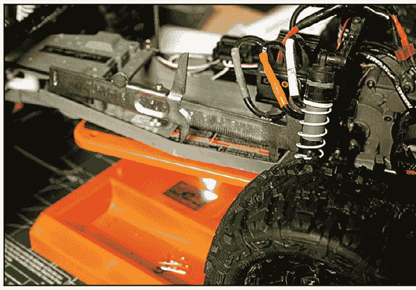

## 在 3D 中建模

我在以下图像中使用了 Lightwave 3D（一种用于视觉效果的动画和建模工具）来创建我的原型零件。然而，你可以使用 Blender（免费）、Autocad 或任何其他建模工具来创建用于打印的虚拟零件：

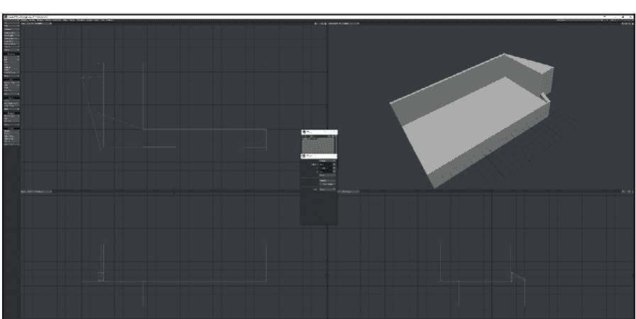

需要注意的是，制作模具母模的方法有很多。粘土建模、木雕，甚至热熔胶成型都是这些方法之一。我更喜欢 CAD 和 3D 打印，因为它更准确，外观也更精致。

完成后，它可以导出用于 3D 打印。

## 3D 打印

一旦你有了 3D 模型，你就可以根据打印软件将其导出为各种格式。3D 打印软件（也称为 *切片*）本质上是将物体切片成打印机用于在现实世界中创建 3D 物体的所有层。它还会通过在可能下垂的任何表面下方放置支撑物（如下图所示）来帮助你。打印完成后，你需要自行移除这些支撑物：

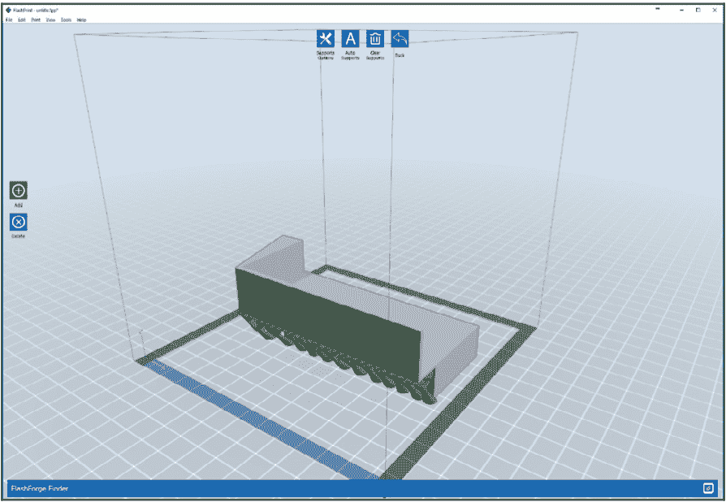

你可以在以下图像中看到完成的物体。嘿，我打印机里装载的耗材颜色碰巧是粉色的。请不要开玩笑：

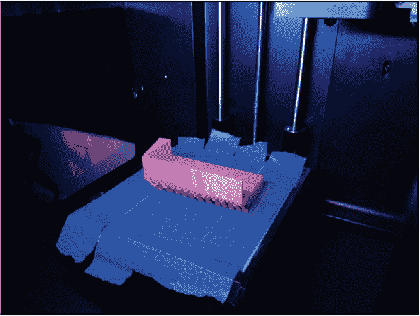

此时，你可能会想：“为什么还要制作模具？” 确实，我们可以按原样使用这种塑料 **聚乳酸（PLA）** 零件作为平台。然而，它是坚硬而脆的塑料。任何碰撞都可能导致其破碎（从而需要重新打印）。因此，制作替换零件的模具是高度推荐的。它可以在 30 分钟内从模具中轻松重新浇铸（而不是 3 小时的打印时间）。最后，它允许你尝试不同的材料，并尝试不同软硬等级的塑料或树脂，以获得所需的柔韧性和阻尼特性（如有需要）。模制（通常）比直接 3D 打印要好得多。

在制作模具之前，我们需要移除支撑结构并试装零件。可能需要进行一些 **Dremmeling**（使用旋转工具切割和重塑打印件以使其完美贴合），因此在制作模具之前，我们要确保它完全贴合。在以下图像中，你可以看到最终的试装情况（Pixhawk 放置在支架中）：

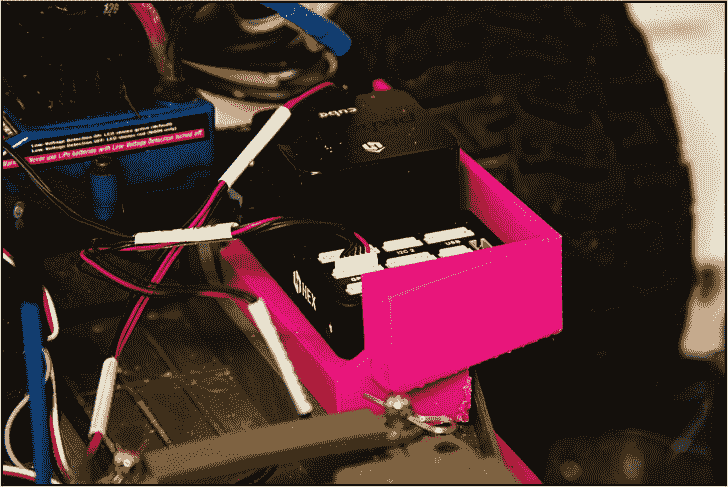

## 准备制模

由于我们不得不使用 Dremel 去除一些塑料，我们的零件上出现了一些孔洞。我们不希望这影响我们的模具，并且希望零件表面光滑。注意，3D 打印件并非实心。它们内部是中空的，内部有几何形状。最常见的是内部蜂窝状。因此，Dremeling 会暴露这些蜂窝，需要填补。填补孔洞的一种快速方法是使用热熔胶。但要注意。热熔胶会软化你的打印件甚至融化它，所以你必须快速且分小段操作。将零件埋在热熔胶中会毁掉它。你可以在以下图像中看到使用热熔胶填补物体间隙的过程：

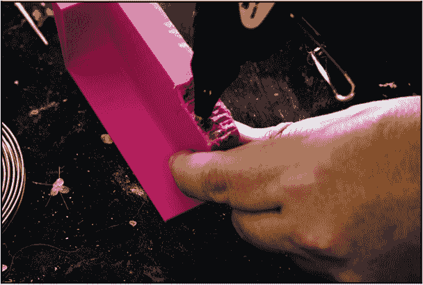

现在，我们需要制作一个模具容器。简单的泡沫芯板和一些热熔胶足以在我们的物体周围创建一个盒子，如下图所示。我们将零件用热熔胶固定在模具底部：

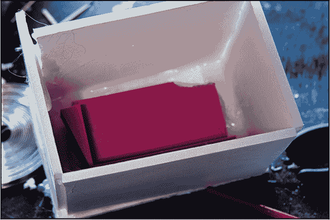

## 浇注模具

现在，我们混合硅胶。对于模具本身，我们使用一种低粘度硅胶，混合比例为 10-1。它比 Gel-10 更坚硬，具有更大的弹性。它甚至可以承受高达 500 华氏度的温度（以防我们想用金属制作一些物品）。如果你想要模具持久耐用，这正是要使用的材料。

混合硅胶后，最好将混合物放入真空室。如果你没有使用条件也没关系。但真空室有助于释放刚混合的硅胶中的空气气泡。在以下图像中，你可以看到硅胶如何起泡。一旦大部分气泡破裂，你就可以释放真空并取出硅胶。但要小心。如果你的混合容器装得太满，泡沫可能会溢出：

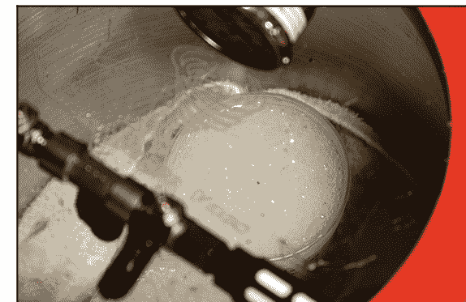

在等待气泡破裂的同时，你可以向模具盒中喷洒一些脱模喷雾，盒内有零件。要大方地喷洒。确保一切都闪闪发光。这种脱模喷雾是一种油性材料，可防止硅胶粘附在盒子和原始零件上。但不要等太久。有些硅胶固化非常快（例如 Gel-10，完全固化不到 10 分钟）。

现在，你可以将硅胶倒入模具。将盒子倾斜到不同角度，甚至轻轻敲击以松动任何空气气泡。我们需要硅胶到达零件的每个区域。倒入足够量的硅胶以完全覆盖零件，并在顶部留出足够空间以防止取件时撕裂。你可以在以下图像中看到浇注的模具。请注意，我们添加了几条橡皮筋以防止接下来的步骤中侧面分裂：

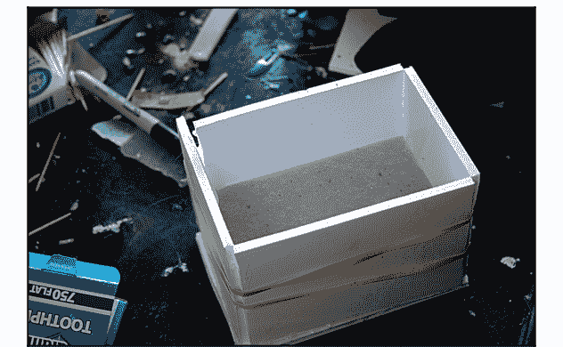

还请注意，我们在模具顶部留出了充足的空间。为什么呢？因为我们要回到真空室，以确保硅胶中零件边缘周围没有空气气泡。在以下图像中，你可以看到硅胶泡沫上升有多高。我们不想弄得一团糟：

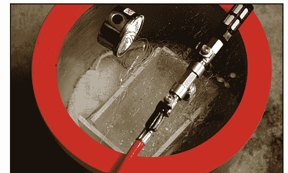

当然，由于透明盖上的残留物，很难看清。但如果你仔细观察，你会看到硅胶泡沫已经升到模具盒的顶部。气泡大部分破裂后，我们将模具转移到压力室（如以下图像所示）：

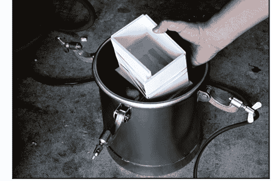

同样，这些腔室不是必需的。但它能制作出更好的模具。你可能会想：“为什么要抽真空，然后再把空气放回去？” 嗯，我们并没有向模具中注入空气。通过增加模具周围的空气压力，我们迫使硅胶中任何残留的空气气泡收缩到最小可能的尺寸。我们还迫使硅胶进入零件的每个角落和缝隙。由于这种特定硅胶在 30 分钟内固化，我们在从压力罐中取出模具前至少等待这么长时间。我们将压力提高到约 40 PSI，然后静置。

一旦硅胶固化（我们通过检查混合容器中的残留物来测试），我们将其从压力罐中取出，并开始脱模和固化过程。

## 脱模和固化

取出模具中的零件时，你必须非常坚定但极其耐心。你不想拉得太用力以至于损坏零件（或撕裂模具），也不想操作太轻而一事无成。一旦母模零件被取出，你就拥有了一个制造更多零件的小型工厂。只需混合一些塑料，喷洒一些脱模剂，并像之前一样将其放入腔室中即可。

在将模具存放之前最后一步是确保它能持久。硅胶在紫外线下会固化（至少大多数硅胶如此）。你可以随时买一些紫外灯并自制一个固化箱。我的就是一个简单的冰 chest，内衬白色，里面装了一串 LED 紫外灯。让它在箱子里放置一夜应该就足够了（如以下图片所示）：

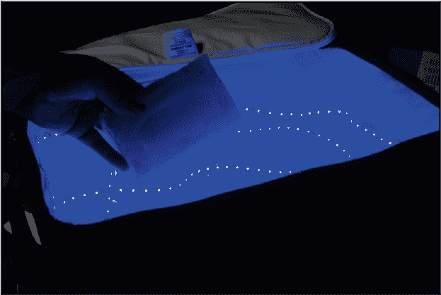

那么，为什么我们要在模具制作上花费这么多时间呢？因为能够自行制作零件对无人机设计至关重要。这些是电子和机械的怪兽。你必须能够牢固地安装传感器，甚至可能需要为其他用途制作定制零件（如我们在第 3 章 *A Drone for Hunters - Autonomous Duck Decoy* 中将会看到）。为什么不尽快把它解决掉呢？

## Hooking up your Pixhawk

现在我们有了放置 Pixhawk 的地方，我们可以了解一下如何将其安装并为基础的地面车进行编程。Pixhawk 随附几条 ¼”-厚的泡沫胶带。这种东西很棒。它可以吸收可能导致传感器读数出错的 Pixhawk 振动和冲击。在使用之前，请确保清洁零件。脱模喷雾是非常油性的东西，目的是防止东西粘在一起。普通的液体洗碗皂就能完美解决问题。我喜欢 Dawn，因为它特别去油，而且很容易冲洗干净。

我们只需用热熔胶将支架粘到地面车的框架上，然后用泡沫胶带将 Pixhawk 粘上去即可。请注意 USB 端口仍在侧护板上方，以便编程时可以访问，如以下图片所示：

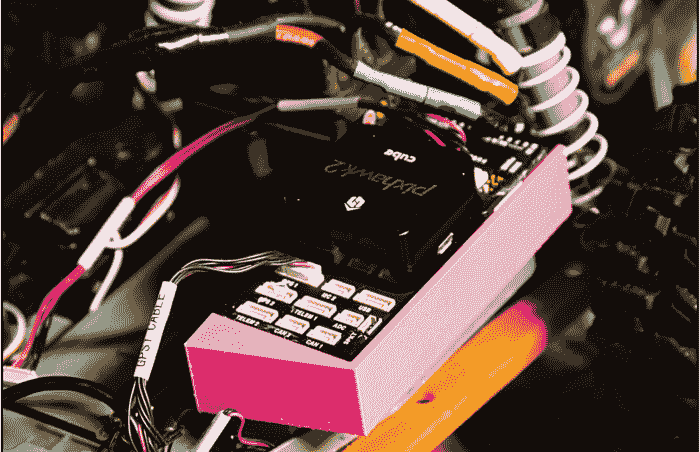

我们的 Pixhawk 已水平、牢固、受保护，并且是粉色的。我们要连接的第一个组件将是 GPS。

## Global Positioning System (GPS)

虽然我们可以连接两个 GPS 天线以提高精度，但由于过程对两者相同，我们只使用一个一个。此外，这个地面车上的空间有点紧张。

你会首先注意到的是，大多数 GPS 天线的插头都不匹配。事实上，在你为 Pixhawk 2.1 购买的大多数组件上也是如此。相关部门选择将插头配置更改为完全不同形状的东西。虽然这些插头远优于之前的版本（它们可以锁定到位，并且显然只能以一种方式插入），但这意味着需要更换插头端。

幸运的是，Pixhawk 2.1 随附了补丁式插头（两端均为公头）。一端插入新插头，另一端连接到旧版本。我们需要逐根从插头上取下每根电线（在旧版本端和我们组件的端上）并将它们焊接在一起。匹配电线的方法是将它们一端对一端放置，其中一个插头倒置，另一个插头正向放置，如以下图片所示：

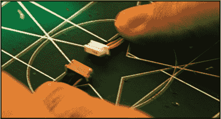

你不能依赖电线的颜色。请注意右边的电线是彩虹色的，而左边的全是黑色，只有 一根红线。你必须将其中一个插头翻转才能使它们匹配。请注意较浅的插头（右上）顶部有小银点（实际上是露出引脚的凹痕），而较暗的插头（左下）顶部完全平坦。这就是匹配它们以确保正确连接电线的方法。做错可能会损坏你的组件和/或 Pixhawk。

从插头上取下电线很简单，只需用尖锐的东西按压该凹痕（露出引脚），然后轻轻将电线从插头中拉出，如以下图片所示：

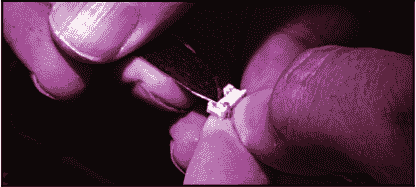

每从两侧取下一个引脚，就逐个将它们焊接在一起。一次做全部会导致混乱。

用热缩管或电工胶带包裹每个焊点，然后用更多胶带包裹整个束（如以下图片所示）：

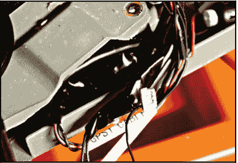

现在，GPS 应该放在哪里？与主 Pixhawk 类似，GPS 模块通常包含一个罗盘。因此，你应该寻找顶部的箭头。这个箭头应始终指向前方，无论电缆如何连接。我们决定将 GPS 放在前面（我们最初考虑放置 Pixhawk 的位置）。这样可以远离电机可能产生的电磁干扰。它应该很容易保持在车辆前鼻的此处清晰（如以下图片所示）：

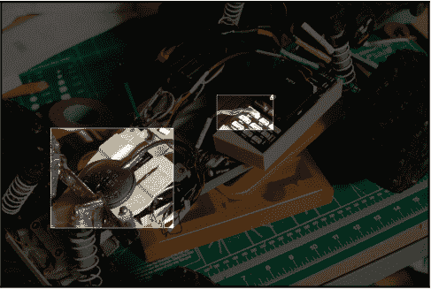

你也可以看到 GPS 天线现在已插入 GPS1 端口。使用 3M 汽车车身胶带固定组件是很好的方法。它是非常坚固的双面、柔性胶带。你可以在任何汽车配件商店买到。

随 Pixhawk 提供的 GPS 1 电缆还带有一个臂按钮。此按钮允许你在不激活任何电机或舵机的情况下启动一切。准备好出发时，只需按住此按钮几秒钟。我们稍后会讲到。

## Radio telemetry

酷词，对吧？我们听到太空机构在谈论航天器时说“遥测显示一切正常”。正常——另一个很棒的词。遥测只是数据，从远程源发送到另一点的 数据。在这种情况下，遥测将是你的地面车的所有传感器数据（例如 GPS）通过无线链路发送到你的计算机。相反，数据也可以发送回去。这就是我们控制地面车自主功能的方式。你可以把它想成基本上是一根无线 USB 电缆，其范围非常远（当然取决于地形和干扰）。我们使用的遥测模块实际上可以达到数英里的范围。

你需要使用与 GPS 相同的方法将遥测模块连接到 Telem 1 插头的电缆。关于无线电遥测模块最需要注意的是要将其远离 GPS 和控制接收器。恰好在我们制作的 Pixhawk 支架前面有一个漂亮的大平坦位置（如以下图片所示）：

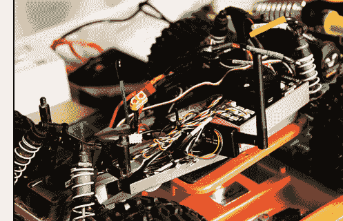

## RC receiver

虽然我们可以用计算机（使用遥测模块和操纵杆）控制整个东西，但我们更喜欢传统的触觉控制器。此外，有多种控制方法总是好主意。

Pixhawk 可与多种控制器标准配合使用（Futaba、Spektrum/JR，甚至是每个控制通道都有单独输出的简单接收器）。我们将使用 Spektrum 标准。

Pixhawk 顶部有一个专门用于 Spektrum（卫星接收器）的插头。也有 Futaba 标准的插头。它工作方式基本相同。幸运的是，Spektrum 和 Futaba 控制器有一个标准化的插头，因此无需焊接。只需将接收器插入 SPKT 端口并放置接收器。我们将其放在地面车的最前面（GPS 天线正前方）如以下图片所示：

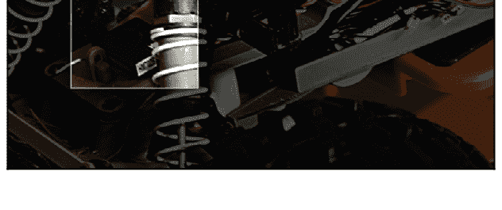

## Connecting the brain to the body

现在，我们需要将 Pixhawk 连接到电源、电机和转向。如果我们打开接收器盒，我们会看到三根舵机（白色、红色和黑色）电缆。一根连接到 ESC 以控制电机。另一根连接到转向舵机。Pixhawk 后部有大量舵机连接，如以下图片所示：

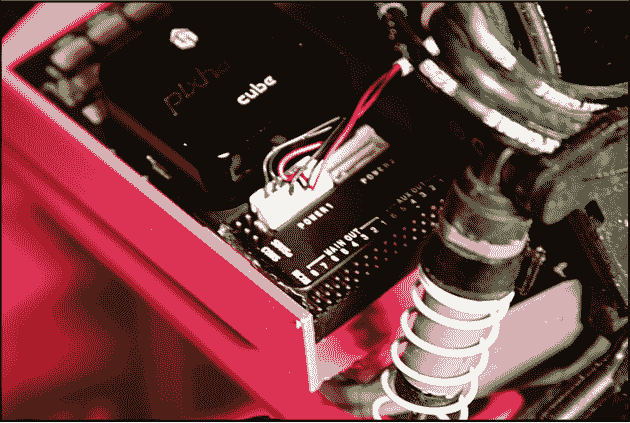

转向舵机（通往车辆前部的舵机线）连接到 **Main Out pin 1** 垂直位置，线在顶部为黑色（地线），白色线通到底部。油门舵机线以同样方式连接到 **Main Out pin 3**。

最后，将电源线连接到 power 1（如以下图片所示），并将另一端连接到电源模块（如以下图片所示）：

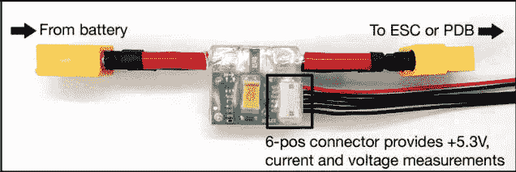

该电源模块串联在电池和速度控制器之间，为 Pixhawk 的计算机供电并提供电量读数（以便 Pixhawk 知道何时电量不足）。

该电源模块不为舵机供电。舵机板必须从电池消除电路（BEC）获得电源，BEC 是一种通过向舵机板分配电力来消除多块电池需求的设备。这辆无人车上的 ESC 已经集成了 BEC。因此，它不仅接收来自 Pixhawk 的信号，还为所有舵机供电。如果这个 ESC 没有集成 BEC，就需要一个（直接连接到主电池），并且可以插入舵机板（Pixhawk 后部）的任何端口。大多数 ESC 都集成了 BEC。但有些没有，了解 BEC 是什么非常重要。

现在所有东西都已连接好，让我们开始使用软件吧。

## 为我们的（基础）无人车编写 Pixhawk 程序

你会需要两款（免费的）软件。第一款是你的主要 Pixhawk 软件（Mission Planner）。另一款是 QGroundControl。两者都可以从多个来源获得，用简单的 Google 搜索就能找到。

虽然我们已经安装了无线电遥测单元，但在首次启动 Pixhawk 时，我们需要通过 USB 将其直接连接到计算机。还记得 Pixhawk 立方体侧面的那个插头吗？那就是我们的计算机 USB 插头。最好使用笔记本电脑（这样你可以在野外使用）。

## 向导

将 Pixhawk 连接到计算机后，启动 Mission Planner 软件。你会看到这个提示框：

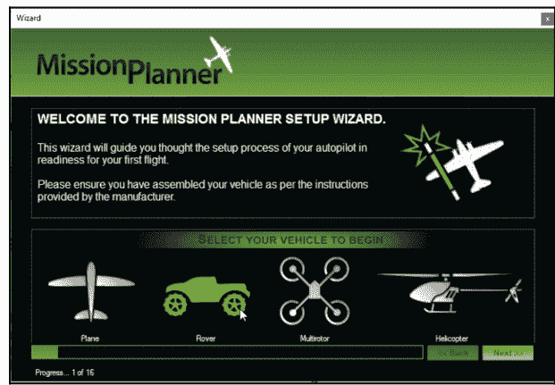

显然，你需要选择 Rover。该向导将执行 Pixhawk 的初始设置并校准以供使用。

接下来，你只需选择计算机如何连接到 Pixhawk（如下一张截图所示）：

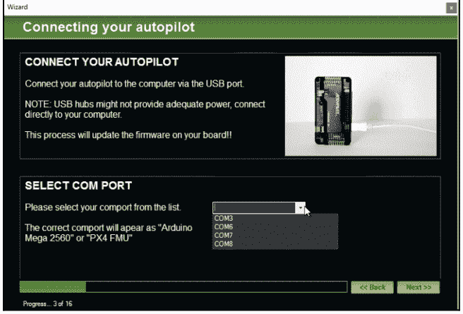

此时，你必须指定 Pixhawk 所连接的端口。Pixhawk 本质上通过 USB 模拟一个串行端口（COM 端口）。在 Windows 上，要了解哪个端口与你的 Pixhawk 关联，可以查看设备管理器（如下一张截图所示）：

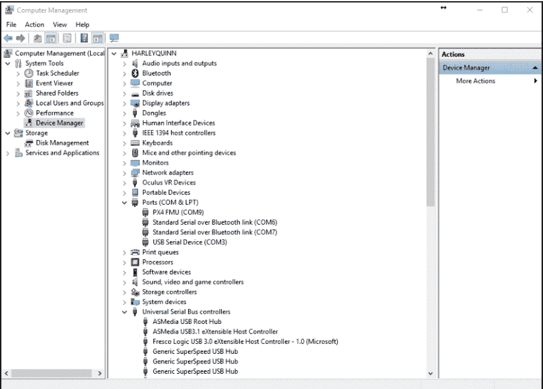

在“端口”下，只需查找 PX4 FMU。在本例中，你可以看到它是 COM9。

现在它已找到 Pixhawk，将验证其固件版本并更新固件。如果失败，只需重复上述步骤直到成功。你可能需要更换 USB 所插入的插孔。有时 USB 集线器和其他设备会干扰。再次强调，继续尝试不同的组合直到它正常工作。最终会成功的。在大多数情况下，第一次就能成功。

点击“下一步”后，向导将让你设置任何声呐设备（如下一张截图所示）：

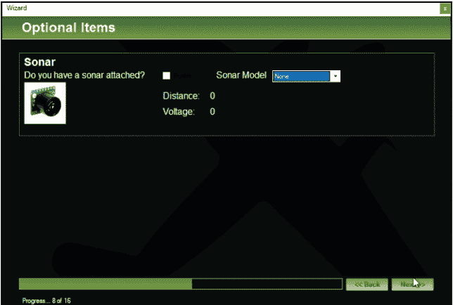

我们没有在这辆无人车上使用声呐。不过，我们可能会在很后面的章节用到它。所以我们只是将 Sonar Model 字段保留为 None。

接下来是控制配置。在这里，我们可以将接收器绑定到我们的控制发射机（本例中为 Spektrum DX8），并校准控件以使其正常工作。

以下截图显示了与此过程相关的界面：

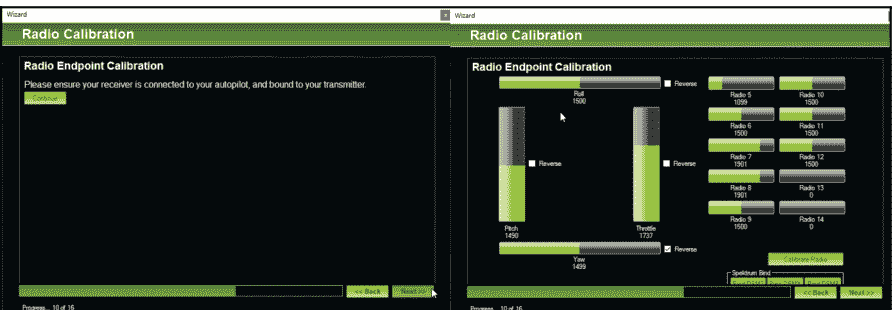

在左侧面板中，你会看到一个**继续**按钮（不是**下一步**按钮）。点击它将带你到右侧面板。在右下角，你会注意到一个名为**Spektrum 绑定**的部分。通过选择适当的**Spektrum 卫星**类型来激活相应的绑定按钮，将使接收器进入绑定模式。然后，只需按照 Spektrum 手册中的说明，绑定你正在使用的任何 Spektrum 发射机。对于 DX8，说明如下：

- 1. 选择一个新模型
- 2. 关闭发射机
- 3. 按住**绑定**按钮
- 4. 在按住**绑定**按钮的同时打开发射机
- 5. 等待发射机确认绑定完成

绑定发射机后，只需点击**校准无线电**按钮并按照说明操作。（它会让你将各个控件向不同方向移动。）

接下来是**飞行模式**设置，如下一张截图所示：

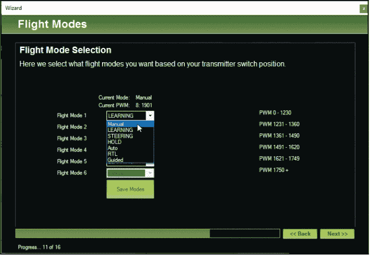

最多可以将七种飞行模式关联到遥控器上的一个开关或旋钮。如果遥控器上有一个三位置开关，模式 1、3 和 5 最可能被分配给这些位置。飞行模式如下：

- **手动**：此模式涉及对车辆的完全手动控制。Pixhawk 只是将所有命令直接转发给它控制的舵机和 ESC。
- **学习**：此模式与手动模式具有相同的控制方式，但它允许你切换控制器上的一个开关，向软件教授 GPS 航点，以便在自动模式下使用。本质上，无人车将重复你的动作。
- **转向**：此模式与学习模式相同，但会开启避障功能（如果使用声呐），并会为你操控无人车绕过障碍物。这对于调整避障功能非常有用（我们可能会在后面的章节中使用）。
- **保持**：此模式会停止无人车，所有车轮停止并保持笔直向前。
- **自动**：此模式涉及从航点到航点的完全自主驾驶。这个航点列表将循环并无限重复。如果失去信号，无人车将进入保持模式。
- **RTL**：这代表返回起飞点（Return to Launch），并将直接使无人车返回它起飞的地点。到达起飞点后，它将进入保持模式。如果配备了声呐，它将在途中避开障碍物。
- **引导**：此模式利用无线电遥测单元。你可以使用高级控制（例如，如果无人车抬起前轮，可以告诉油门减小），使用计算机上的操纵杆，或者实时指定航点。可以将此视为火星车设置。

在向导的最后一个屏幕上，你应该会看到，除了尝试解锁（arm）你的无人车外，所有内容都是绿色的（如下一张截图所示）：

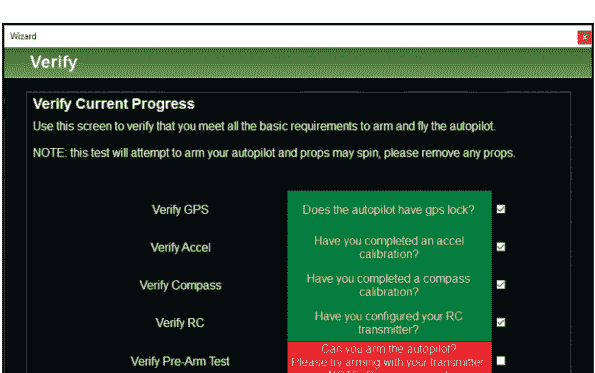

此时不要尝试解锁你的无人车。首先，执行以下步骤：

- 1. 确保四个轮子都离地。我们使用了遥控车支架（本章所有无人车图片中的橙色平台）。
- 2. 确保你的发射机已开启。
- 3. 将电源传感器模块连接到 ESC。
- 4. 将电池连接到电源传感器模块。
- 5. 按住 ARM 按钮（连接在 GPS 电缆上的当前闪烁的红色按钮）3 秒钟。

如果红色按钮的灯停止闪烁并变为常亮红色……恭喜，它已成功解锁。如果没有，或者按钮的灯从未亮起，你可能接错了 GPS 电缆上的电线。请再次检查。

红色框不会变成绿色，但你已经通过所有重要方式确认了解锁成功。

其余屏幕实际上并不允许你配置任何内容。它们只是告知你 Failsafe（失效保护）选项有哪些，并提供一些阅读材料的链接。请阅读它们。它们非常有帮助。

## 更多校准……

无论现在一切看起来多么酷，停下来！你可能会看到一张地图和一些很酷的读数。首先，我们需要校准加速度计。点击 Mission Planner 软件顶部的 INITIAL SETUP 选项卡，你将进入以下界面：

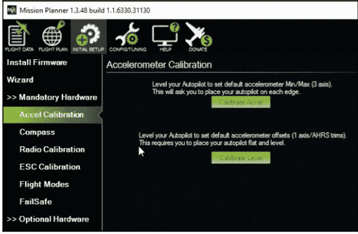

屏幕左侧是 Accel Calibration（在 Mandatory Hardware 选项卡下）。点击界面中的每个按钮（Calibrate Accel 和 Calibrate Level）并按照屏幕上的说明操作。这会校准加速度计，使 Pixhawk 确切地知道无人车的姿态。你需要将无人车置于多个位置并使其保持水平。我们建议你在 USB 供电且不连接电池的情况下进行此操作。

你可能还需要为驱动轮校准 ESC。同样，只需按照此步骤的简单屏幕说明操作即可。

## 测试和驾驶

在我们把它带到野外之前，我们需要测试连接。关闭 Mission Planner 软件，拔掉 USB 数据线，并将 USB 遥测适配器连接到你的电脑。在车轮离地的情况下，通过插入电池给发射机和遥控车供电，但不要武装遥控车。

启动 Mission Planner 软件后，系统可能会再次要求你查找遥控车的 COM 端口。在你的设备管理器中，遥测单元应该在端口标签下可见，这次显示为 Silicon Labs 设备。

成功找到遥测适配器后，你将在 Mission Planner 中看到此屏幕：

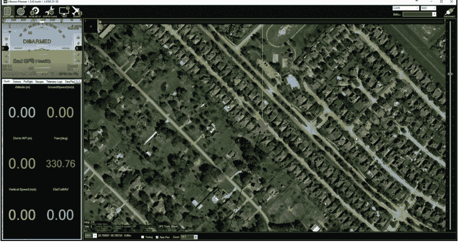

点击连接按钮（界面右上角）后，你应该能在你的位置看到你的遥控车。嗯……那就是我家。

让我们进行一些初步调校并向你展示如何操作。在真正驾驶遥控车之前，我们需要确保它不会以 70+ 英里每小时的速度冲向虚无。

此时，遥测模块与电脑通信，我们可以做 USB 能做的任何事情。如果你转到顶部的 Config Tuning 选项卡，它让我们可以设置遥控车速度的一些限制（如以下屏幕截图所示）：

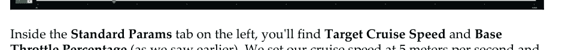

在左侧的 Standard Params 选项卡中，你会找到 Target Cruise Speed 和 Base Throttle Percentage（我们之前见过）。我们将巡航速度设置为 5 米每秒，油门百分比设置为 15%。这样，在自动驾驶时油门不会超过 15%，速度也不会超过 5 米每秒——非常缓慢。

在尝试自动驾驶之前，先大量驾驶遥控车。我们稍后会更深入地讨论调校。但对于遥控车来说，这两个速度设置是必不可少的。我们以后如果愿意可以逐渐提高它们。

### 设置航点

我们将在下一章更深入地讨论这个问题。然而，设置航点与在 Mission Planner 主屏幕的地图上点击一样简单。我们现在唯一真正想说的是，这会冒一切风险。你的无人机可能会坠毁，甚至可能伤人。我们并不打算用本章来教你如何创建航点无人机。这个无人机甚至没有防碰撞功能。然而，本章的目的是让你熟悉创建遥控车式无人机的方法，以及 Pixhawk 2.1 的基本连接和配置。

不过这架无人机是支持航点的。如果你必须尝试，请在完全空旷的区域进行，那里没有人或财产会受到伤害。

有关航点和自动驾驶的完整说明，请参阅下一章。

### 总结

在本章中，我们学习了如何制作零件并将旧外设连接到全新的 Pixhawk 2.1。我们进入了配置向导，甚至触及了遥测模块。

在下一章，我们将更深入地研究所有这些内容，并使用我们第一个专用无人机——鸭子诱饵。诱饵将自主在池塘周围游荡，吸引猎人狩猎的鸭子。我们将使用在这里学到的所有知识，并深入研究遥控车的航点和巡逻。

那么，系好安全带……开始吧！
