# 第 3 章：猎人用的无人机 – 自主鸭子诱饵

水上遥控车与设置陆地遥控车无人机并没有什么不同；只有一个严重的例外——水 + 电子 = 坏……真的很坏。因此，必须特别注意无人机的防水。在这方面，需要采用一些特殊的技巧、材料和机械来防止水进入，保持无人机直立，并在完全破坏电子设备的环境中漂浮时保持其存活。

在本章中，我们将完成一些制造技术，并更深入地了解 Pixhawk。但主要是，我们将向你展示船与遥控车有多相似。我们将涵盖：

- 为无人机想出创意
- 让你的创意具有市场性
- 更多关于制造和制作
- 设计挑战的预见
- 设计工作流程
- 防水

让我们从“为什么是鸭子诱饵？”开始。毕竟，这难道不是对 Pixhawk 的浪费吗？Pixhawk 不是用于巨大的原型医疗无人机吗？Pixhawk 不是用于制造和销售要花费数十亿美元的想法吗？

### 孕育一个可销售的交易

正如任何商科专业人士都会告诉你的那样，产品赚钱的关键是供需法则。这里的关键是需求。最好的想法——改变世界并让发明者赚取大量资本的想法——不一定是迎合拥有超高预算客户的想法。轮子、捕鼠器，甚至洗碗刷都是数百万（甚至数十亿）美元的想法，每个人都可以使用，大多数人都能负担得起，并解决基本问题。

说实话，我不打猎。我从未打过鸭猎。然而，我注意到我认识的那些（打猎的人）都有鸭子诱饵——很多。不同类型的鸭子有不同的诱饵，而且他们经常带回的诱饵比出发时少。

此外，打猎很无聊。去一个地方等待，等待，一直等待，直到最终有一些鸭子出现。如果你可以让等待过程更有趣怎么办？如果你可以驾驶一只鸭子在池塘上游荡，甚至让它自行驾驶并导航池塘怎么办？如果你可以向你的朋友展示一个他们没有的新玩具怎么办？最重要的是，如果（当你一天结束时）你可以让你的鸭子回到你身边怎么办？

它解决了某些问题，具有炫耀性，而且还迎合了一个遍布全国的行业，在那里配件是必不可少的，人们在这些配件上花费大量资金（双关语）。

最棒的是，即使你使用的是现有技术，这个想法也可能具有可专利性！有很多使用现有技术以新方式的想法获得了专利。因此，你不仅可以制造出有市场性的产品……这还是一个你可以授权的想法，然后坐下来让钱滚滚而来。这些都是制作鸭子诱饵无人机的绝佳理由。

正如我所说，我不是猎人。我喜欢飞机（尤其是 F-117 隐形战斗机）。所以，对鸭子（真的）以及狩猎一无所知，我用多面设计制作了我的鸭子诱饵，只是为了让原型制作阶段更有趣。所以认识一下隐形鸭（也称为 Black Ops McDuck），如以下图像所示：

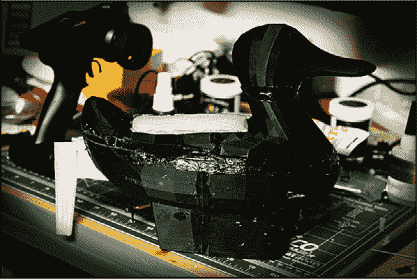

如你所见，它是 3D 打印的。但至少它不是粉红色的，对吧？

### 在设计之前概述范围

在我们真正开始动笔（或者说在这种情况下用鼠标操作 CAD）之前，我们需要概述鸭子的一些基本需求和布局。让我们从我们对设计的进行的问题和解决方案分析开始。

下表列出了我们制定的问题和解决方案，虽然原始表格是手写的，但这个更易读：

| 我们会遇到的問題 | 解决方案 |
|---|---|
| 水渗入模型接缝 | 用 CA 胶粘接缝，并用硅胶密封剂填充。 |
| 水渗入螺旋桨轴与机身相接的位置 | 轴的固定套管内填充润滑脂，并在外部用硅胶密封。 |
| 检修盖漏水 | 硅胶密封圈。 |
| 发生漏水时，防水 Pixhawk | 硅胶模制 Pixhawk 外壳？（不行）。 |
| 硅胶模制外壳的 Pixhawk 发热？ | 不能密封。必须尽可能使机身防水。在整合 Pixhawk 之前的所有阶段测试防水性。 |
| 内部天线的 GPS 接收 | PLA 塑料机身应该不是问题。 |
| 电机电磁干扰 GPS | 将电机放在前面，GPS 天线朝向后面。 |
| 密封机身内的电机发热 | 水冷电机。 |
| 密封机身内的 ESC 发热 | 水冷 ESC，或低压 ESC / 电机。 |
| 电机、传动轴和螺旋桨的费用 | 改装便宜的 RC 船。 |
| 为效率平衡电机、ESC 和螺旋桨 | 改装便宜的 RC 船。 |
| 鸭子太大，无法放入 3D 打印机 | 分段打印，用 CA 胶粘合，干燥后用硅胶密封。 |
| 将 Pixhawk 与廉价 RC 船部件接口 | 确保我们购买的船是模块化的（接收器中没有集成 ESC 或舵机），或至少尽量减少集成部件，以便我们更换尽可能少的部件。 |
| 如果我们想让头部随舵转向怎么办？ | 不要在初始原型上这样做。但将头部打印为单独的部分，以便以后如果需要可以改装。 |
| PLA 塑料打印还是 ABS？ | 机身用 PLA（更便宜）。但电机支架用 ABS（熔点更高）。 |
| 波浪或转弯时倾覆？ | 大型压舱物部分填充造型粘土。 |

我们在途中遇到了其他一些问题，这些问题是不可预见的。我们稍后会提到这些。但正如你从我们的概览图表中的细节所看到的，我们试图尽可能地将这些问题降到最低。积极思考很好。但在规划时，你必须成为自己的唱反调者，以便预测你会遇到的问题。然后，你可以积极思考来想出解决方案。

你也可以看到，我们不得不妥协，放弃了因漏水而损坏 Pixhawk 的可能性。我们想为它制作一个硅胶外壳以密封它。我们考虑过制作硅胶假插头。我们甚至考虑过密封立方体部分的边缘。最终，我们得出的结论是，在这种可能性上做这些事情，不如 Pixhawk 因过热而烧毁的确定性来得重要。立方体部分实际上是被加热的（出于设计目的），以便 Pixhawk 在寒冷天气下运行。电子设备不喜欢热量。过多的热量甚至会熔化焊接元件并导致短路。因此，我们决定将防水工作重点放在确保在集成 Pixhawk 之前绝对不会有水进入。

接下来，我们为 BlackOps McDuck 草拟了一个基本设计（如下图所示）：

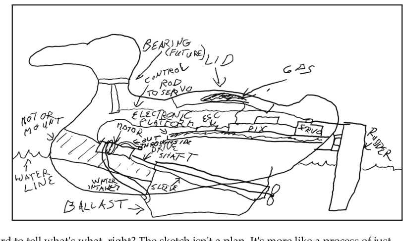

很难分辨是什么，对吧？草图不是计划。它更像是一个逐步理清事物如何进行的过程，这样你在思考时就能看到问题。草图非常快（5-15 分钟），并且能让你思考事情。在这里，你可以看到我们将电子设备移到了水线之上（以防轻微泄漏）。我们还确定了水会从哪里进入（在压舱物部分，前部），以及会从哪里排出（通过我们电机水冷的侧面）。换句话说，我们现在知道需要在粘土压舱物中开凿一个通道，以便水入口和传动轴能够很好地位于水线以下。我们还发现舵需要相当高。

为什么舵需要很高？为了适应我们的舵机位于水线之上这一事实。此外，你不希望舵只在水中。你希望它位于螺旋桨推力的路径中（这样在低速时它可以偏转被推动的水，从而实现更大的灵活性）。

此外，我们还规划了头部如何在未来版本中转动（使用套筒和轴承，轴向下延伸到控制杆）。该杆将延伸到船体的后部并连接到驱动舵的同一舵机（允许头部转动并面向鸭子转动的方向）。

草图很难读懂吗？是的，对于除绘制者本人之外的所有人来说都是如此。这很正常。这也是为什么让将制作设计的人参与草图会议（甚至亲自绘制草图）很重要。对于大型团队来说，这是一个重要的认识。永远不要在设计师不在场的情况下做草图。设计师不仅需要知道所有东西放在哪里，还需要知道为什么。这使他们能够在保持草图精神的同时，调整设计以克服他们可能发现的问题。

接下来，我们需要订购我们的拼装船。我们需要在设计鸭子之前知道硬件的基本尺寸。毕竟一切都需要装得下，对吧？

## 选择拼装船

我们主要寻找的是便宜且带水冷电机的船。如果从亚马逊订购，很少能打开内部看看东西是否模块化（不是集成**电子调速器 (ESC)** 或舵机）。我们在工作坊里有很多 ESC 和舵机，所以我们不太在意。但如果你身边没有大量备件，你可以考虑去当地的模型店，购买前先看看船的内部结构。这就是我们买到的船（如下图所示）：

以下图像显示了打开盖子的船，所有的电子设备仍安装在内：

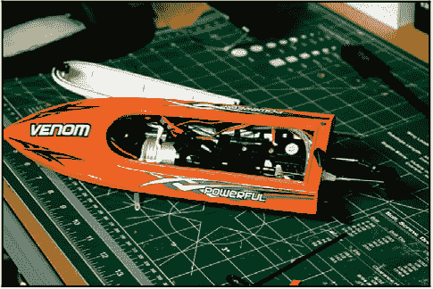

以下图像显示了从船上取下的所有零件：

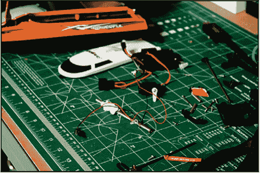

将所有零件摊开后，你可以看到传动轴穿过的套筒（前景，有一团白色硅胶），以及传动轴（图像右侧，靠近黑色螺旋桨）

现在，我们可以测量所有零件（尤其是电机），并设计鸭子身体。

## 为 3D 打印设计鸭子身体

即使你没有 3D 打印机，为其设计也很方便。此外，你也可以随时将设计发送给朋友，或拥有该设备的服务。你最终应该买一台，不过现在它们相对便宜。

计算机辅助设计（CAD）的一个美妙之处在于，你实际上不需要使用 CAD 软件就能在现实世界中创建物体。困惑吗？别担心。CAD 设计和 3D 动画软件在建模物体时使用非常相似的方法。它们甚至共享（部分）文件格式。任何（称得上）值得使用的 3D 建模软件都可以导入和导出 CAD 格式。

你不必花大价钱购买 AutoCAD 或 SolidWorks 来创建和原型化你的设计。这些程序拥有起来可能每年或每月花费数千美元。相反，你可以使用 Blender 等免费软件来建模你的物体。这些易于获取的软件包的额外好处是，互联网上有大量关于其使用的 YouTube 视频和教程。

我是受过 3D 动画教育的。我用过几乎所有创建此内容的软件包。对于建模，我喜欢 Lightwave 3D，只是因为这是我最初学习的（1995 年）。如果这是为一部电影，我可能会用其他东西。但我在这里展示的方法（无论软件包如何）在任何建模包中都是通用的（从 Blender 到 Maya，甚至 AutoCAD 到 SolidWorks）。

## 3D 建模的基础知识

在开始之前，这里是我们想要得到的鸭子外壳：

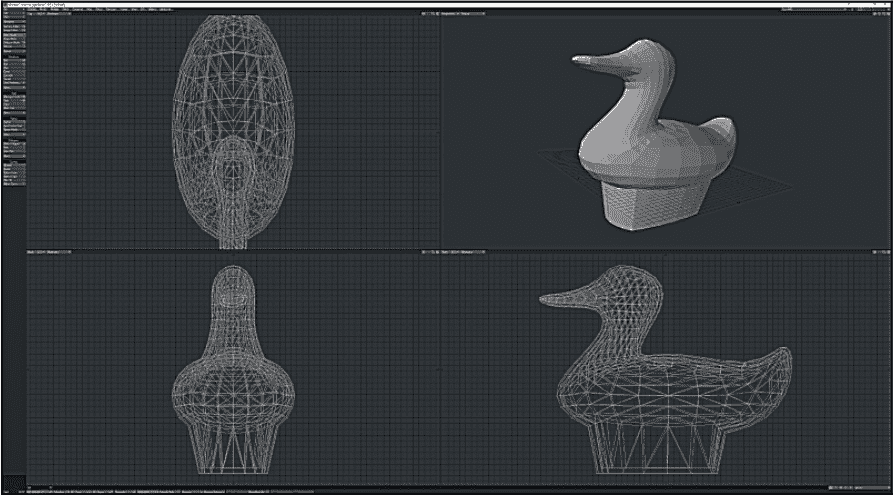

可能很难看出来，但你会注意到鸭子不是实心的。相反，它有一个内鸭和外鸭。最容易看到这一点的方法是沿着前一图中左下方的轮廓看。这意味着鸭子是空心的，你可以看到压舱物部分的底部船体比鸭子的其余部分厚。这是因为它需要承受粘土的重量，并且在鸭子搁浅时更坚固。

你还会注意到，鸭子（虽然在右上方看起来是由四边形多边形组成的），是由三角形组成的。还记得几何吗？三个点定义一个平面。所以，3D 打印机喜欢三角形多边形（而不是四边形）。

在向你展示它是如何建模之前，有件事你需要知道。基本上存在两种类型的模型——基于多边形的模型（每个点集由直线连接）和基于曲线的模型（看起来更光滑）。3D 打印机*不处理曲线*。你必须使用多边形。

## Box modeling 101

创建 3D 模型的方法有很多。但箱体建模是最简单的方法之一。其他方法可以产生更大的细节，并且更适合动画。但箱体建模可以让你快速创建物体，并且痛苦和无聊最少。那么它是什么？

这是你可以用到的最接近用粘土建模的技术。它被称为箱体建模，因为你从一个箱子开始（如下图所示）：

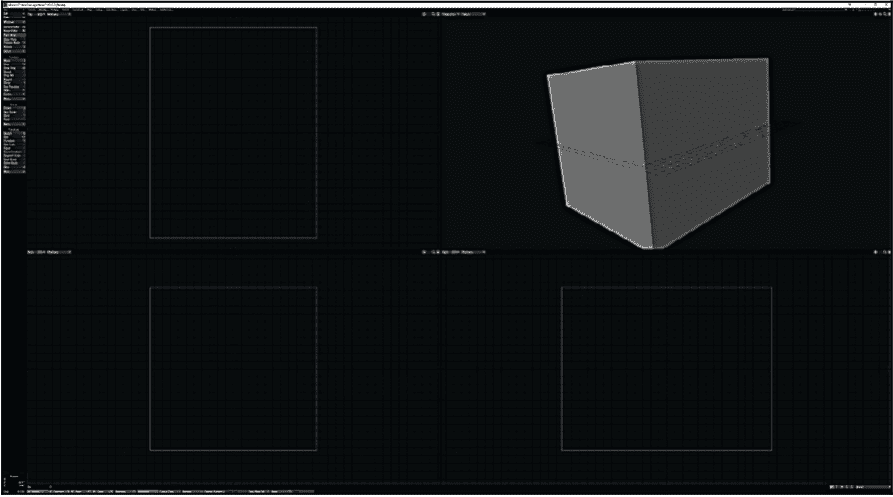

然后，我们将物体转换为细分多边形（在 Lightwave 3D 中，你只需按 Tab 键），如下图所示：

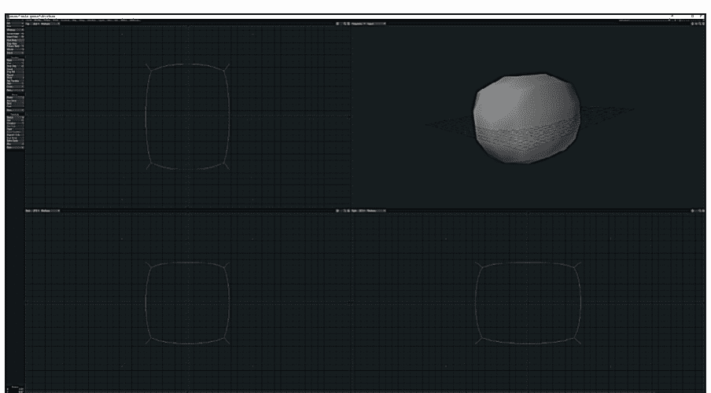

于是，它变成了更像球体的形状。就这样，你现在正在使用细分。接下来，让我们谈谈工具。

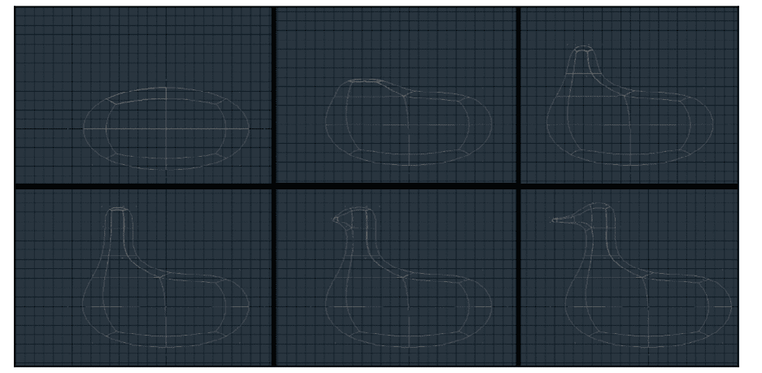

让我们更仔细地看看这是如何工作的：

- **左上：** 物体顶部前方的多边形被选中
- **中上：** 多边形被挤出、上移并调整大小以形成颈部基部
- **右上：** 重复该过程以形成头部基部
- **左下：** 该过程再次被挤出并上移以形成头部顶部
- **中下：** 头部前部被选中、挤出并调整大小以形成鸭嘴基部
- **右下：** 该过程再次被挤出以形成嘴的末端

正如你所见，这比大多数人想象的要容易得多。稍微拖动几个点，你就会得到一个看起来不错的头部。这个过程会重复用于压舱物区域，并使用刀具配合一些点拖动，以便我们形成鸭子的尾部。最终结果如下所示：

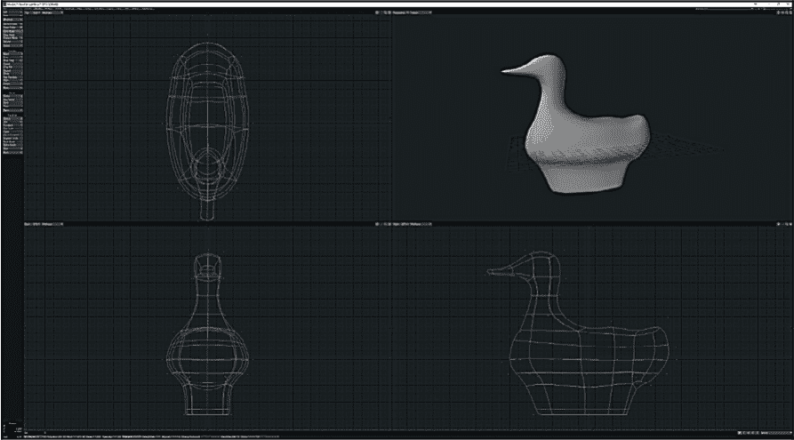

## 使鸭子中空

在将曲线转换为多边形（细分）之前，让我们先暂时切回直线多边形来使鸭子中空。你会注意到（在下面的图表中）鸭子看起来很丑。别担心，我们很快就会回到曲线：

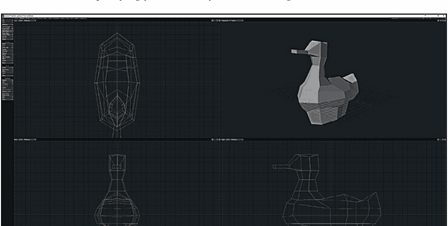

我们可以用几种方法使鸭子中空。其中一种是使用布尔运算（我们稍后会介绍）。我们只会使用一种称为加厚的方法。这会使每个多边形变厚。对于封闭物体（实体）而言，它会使物体中空。加厚让我们可以控制中空物体壁的厚度。在本例中，我们将物体加厚至 1/8 英寸（如下图所示），然后返回曲线模式：

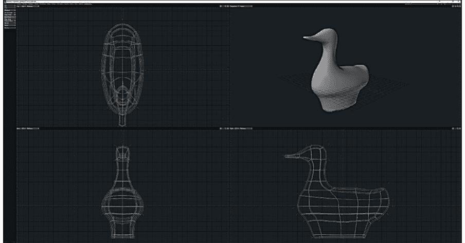

现在，我们将使物体变为多边形。

## 将曲线冻结为多边形 – 细分

从细分创建多边形非常容易。每个软件包的工作方式略有不同。在 Lightwave 中，我们只需使用冻结命令（Ctrl + D）。但正如你所见（如下图所示），我们的多边形仍然不是三角形。它们仍然是四边形：

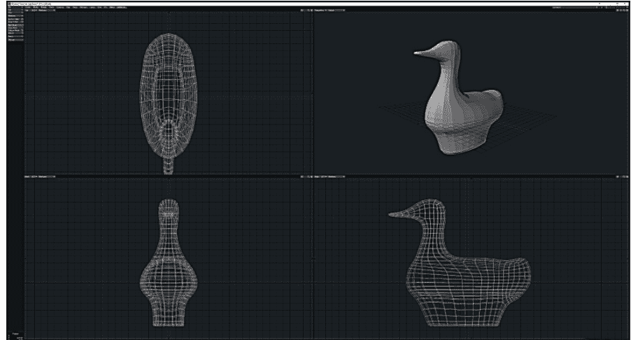

在我们开始制作三角形之前，你会注意到鸭子仍然高度分段。修复起来很容易。你只需再次将其变为曲线，然后重新冻结即可。这会极大地增加多边形的数量。每次执行此过程，你的物体就会变得越来越光滑。我们的鸭子是隐形的，所以我们就这样保留它。

同样，每个软件包都有一种将四边多边形（四边形）转换为三边多边形（三角形）的方法。在 Lightwave 中，它只是三重命令。它看起来像这样：

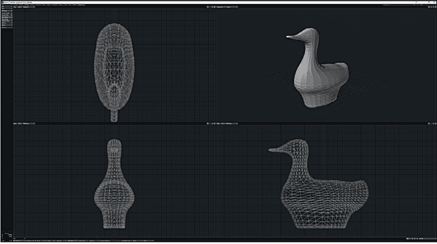

## 布尔运算

布尔运算是任何建模工具中的另一个功能。有了它，你可以连接两个几何体，甚至可以使用一个物体切割另一个物体。例如，考虑以下图表：

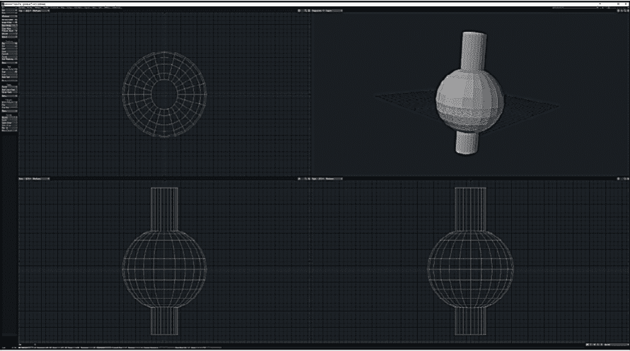

在前面的图表中，我们有一个球体和一个圆柱体，它们被合并成一个物体。请注意，球体内部没有圆柱体几何体。它是一个实心物体。而在下面的图表中，我们有同一个球体和圆柱体，但圆柱体已被用来在球体上切出一个孔。这是通过创建两个物体并使用布尔函数来完成的：

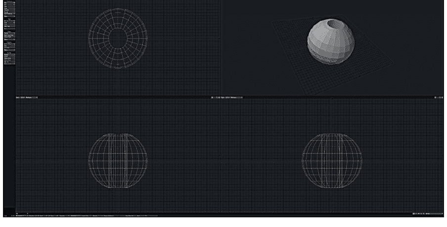

这种方法就是我们不仅创建了一个进水孔，而且还创建了鸭子盖子的方式。我们只需创建一个基本形状，并用它一次切割（布尔减法）出一个孔。然后，我们使用该形状和原始鸭子再次创建盖子（使用布尔相交）。在这里，你可以看到它们以不同颜色显示（如下图所示）：

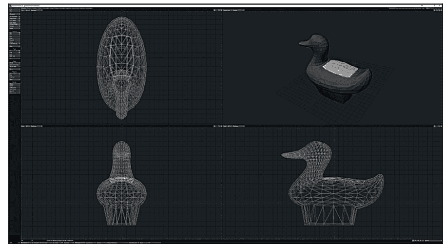

就这样——所有建模你自己的物体所需的基本工具。直接从你的想象到现实世界——说到将其带入现实世界。

## 打印大型 3D 模型

我们的鸭子长近 11 英寸。我们的 3D 打印机打印床为 5.5 x 5.5 英寸。这意味着我们必须分段打印它。使用布尔方法（我们之前使用过），我们可以将物体切割成段。但由于这个物体需要防水，我们该怎么做呢？

氰基丙烯酸酯粘合剂（CA）胶水（基本上是超强胶水）会使塑料熔合在一起。它非常棒。它更像是焊接塑料而不是粘合它。所以，第一步，我们在要粘合的两个物体之一上涂上一条漂亮的胶水，然后将其压在一起约 10 秒钟。胶水干燥得非常快。只要对自己好一点，不要触摸胶水。超强胶水以粘合皮肤而闻名（军医和一些外科医生用它来密封伤口）。

重要的是不仅要让硅胶密封剂干燥，还要在这样做之前至少让其固化 24 小时：

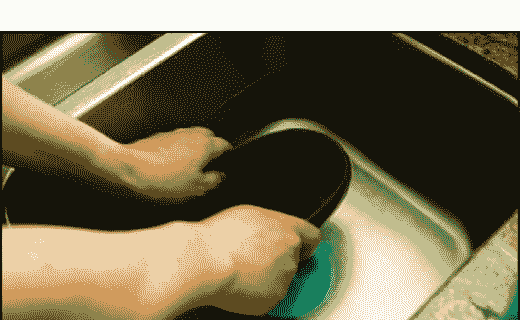

在本次测试成功后，我们用建模粘土填充压舱物部分，并再次进行，原因有两个：

- 1. 我们想确保我们没有用太大的力将其压实（破坏密封）
- 2. 我们需要确保水线上升到正确的水平

带有粘土填充的下半部分如下图所示：

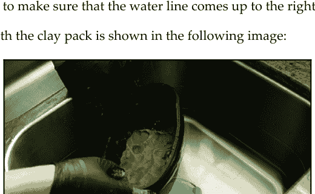

太棒了！现在我们的鸭子装满了 2 磅的粘土，我们可以肯定它绝对不会倾覆。而且，现在我们确定鸭子是防水的，让我们在上面钻一些孔吧！等等……什么？！

## 安装推进系统

我们希望在粘土变干之前执行下一步。首先，我们想在后面取出一点粘土，并以一定角度钻一个孔。在那里，我们将套管和传动轴穿过并安装螺旋桨。切勿将套管粘在原位。它需要保持灵活。相反，我们使用大量硅胶将其固定在原位，并在机身内外密封孔洞（如下图所示）：

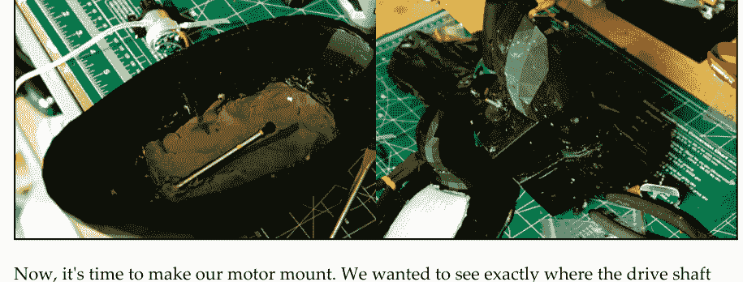

现在，是时候制作我们的电机支架了。我们想确切地知道传动轴的位置、其角度以及与电机的连接位置。我们在船头对驱动轴套管所做的就是在那里放置水冷管的长端。我们在放置电机支架之前就这样做，因为否则我们就无法触及它。这根管子将用于进水进行水冷（如下图所示）。等待硅胶干燥后，我们可以将其修剪回一点，但不要齐平：

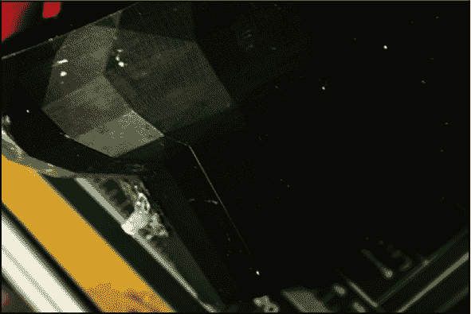

放置电机支架（使用 ABS 塑料打印）后，我们将电机粘在上面（仍使用原船的安装支架），并将水冷管的短端引出船侧（如下图所示）：

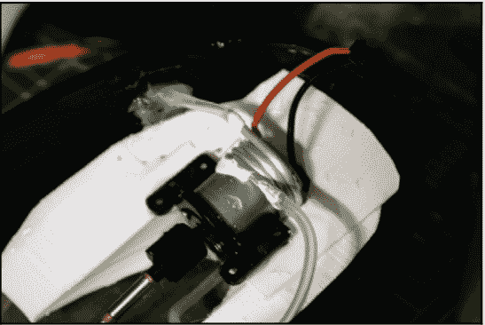

## 转向和电子设备

你可能从前面的图像中注意到电机只有两根线。这是因为它是有刷电机。在上一章中，我们讨论了有刷与无刷电机。有刷电机需要完全不同类型的 ESC。为什么这很重要？因为（不幸的是）我们原船的接收器集成了 ESC。所以，我们需要为我们的电机找一个新有刷 ESC。在实习生去做这件事的同时，让我们安装我们新打印的舵。

首先，我们制作了一个块，使其适合鸭子的后部，并在其上带有铰链的公端。然后是一个简单的舵，上面有一个控制臂（这样当舵机推动控制杆时，舵就会转动）。安装后，看起来如下图所示：

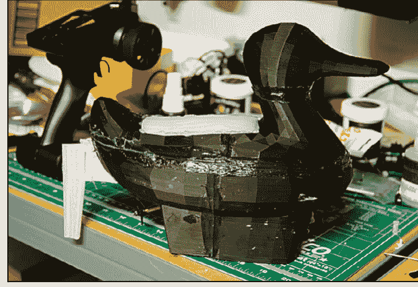

在内部，我们将电子平台粘在原位，钻了一个孔（在水线之上）用于我们的控制杆。杆不能被硅胶阻碍，所以如果水位上升到这条线，这个孔就会漏水。所以，我们希望它尽可能高。我们还安装了我们的电子平台（如下图所示）：

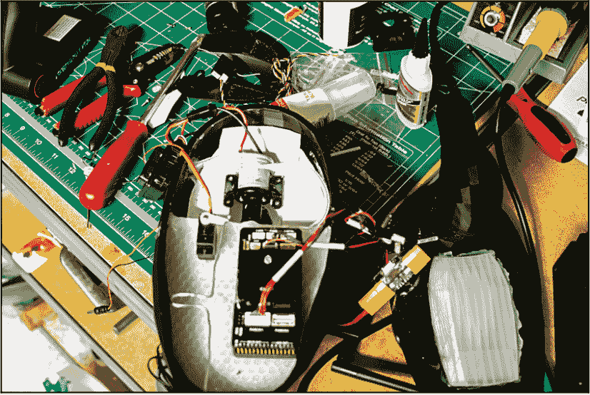

你还可以看到我们将 Pixhawk 安装在电子平台上。我们在控制杆上弯了一个折角，以便在所有设备通电后可以调整其有效长度来微调我们的控制。

## 连接一切！

好吧，在水下测试之后再这样做。电子设备进水已经够糟糕了，如果它们带电时进水就更糟了！至于插头和连接，一切都与陆地漫游车时完全相同。不是舵机连接到车轮，而是连接到舵。不是电机连接到车轮，而是连接到螺旋桨。但每个插头在水上漫游车上的连接方式都应与陆地漫游车相同。之后，盖上盖子，并以与陆地漫游车完全相同的方式对其进行编程。然后，你就可以出发与鸭子一起游泳了！

## 总结

在关于 Pixhawk 无人机的书中，你可能会问：“Pixhawk 的编程在哪里？！” 如果我们不谈论水面上的内容，那么写一本关于设计专用无人机的书就说不过去了。而且，我们想向你展示陆地和水上无人机之间的相似之处。我们真正想深入探讨的是一个想法的 *设计和原型制作*。现在我们已经介绍了你自己的设计建模和建造（我们介绍了建模、打印、防水密封、设计、草图、识别问题以及建造测试）；在下一章中，我们将更深入地研究 Pixhawk。

我们将取一辆（几乎）完全组装好的车辆（一辆电动高尔夫推车），并将其改装用于 Pixhawk。我们还将介绍如何使用移动设备（通过 Bluetooth）来控制你的无人机，以及更深入地了解 Pixhawk 的配置。

从这里开始，现在你已经是把建造设计变为现实的专家了，我们将更专注于 Pixhawk 设备本身。

那么，系好安全带吧！
