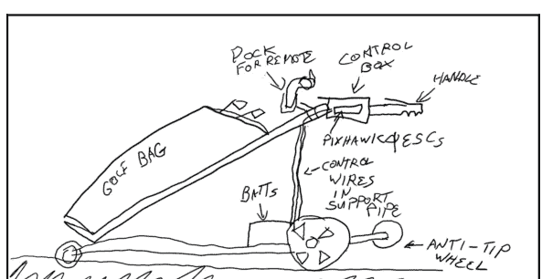
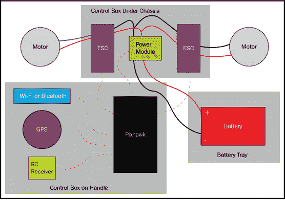
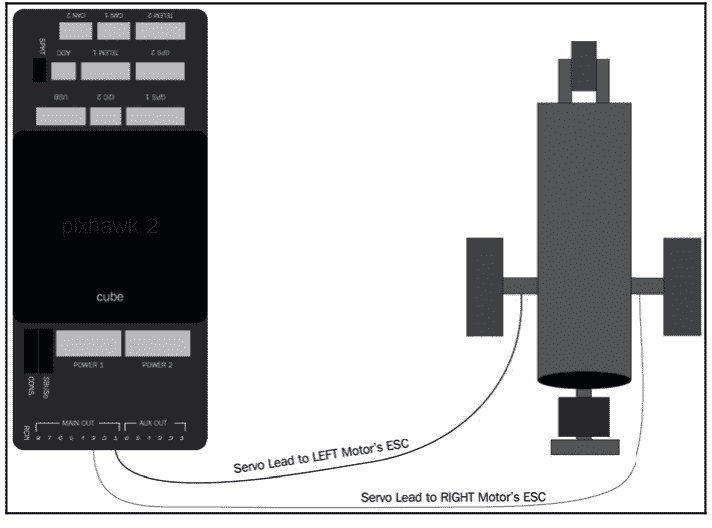
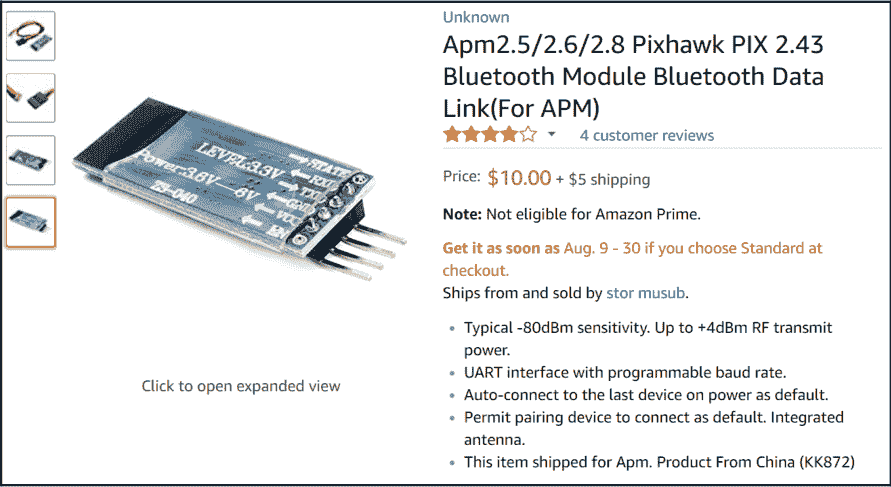
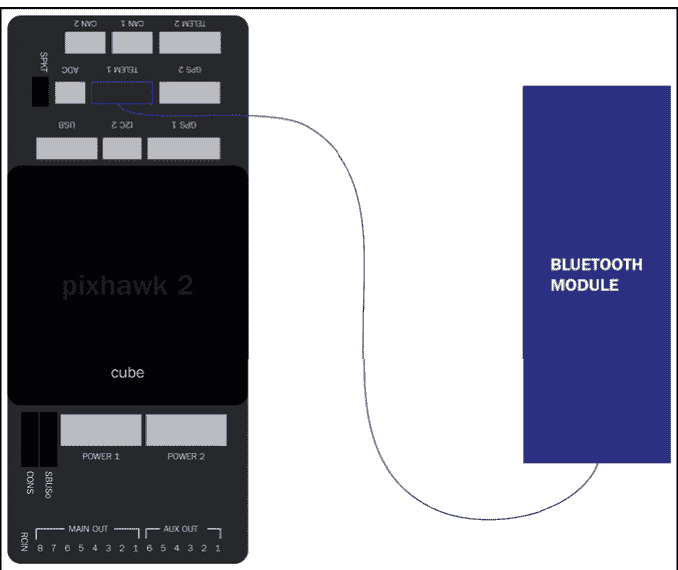
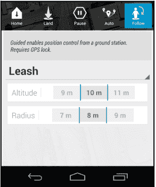
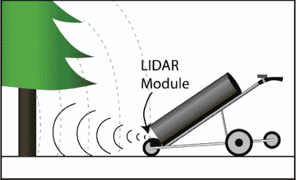
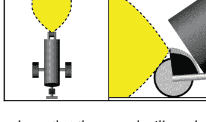
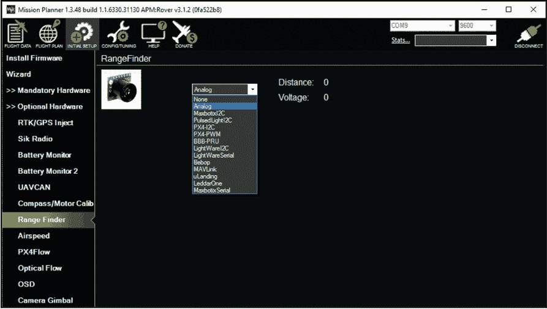
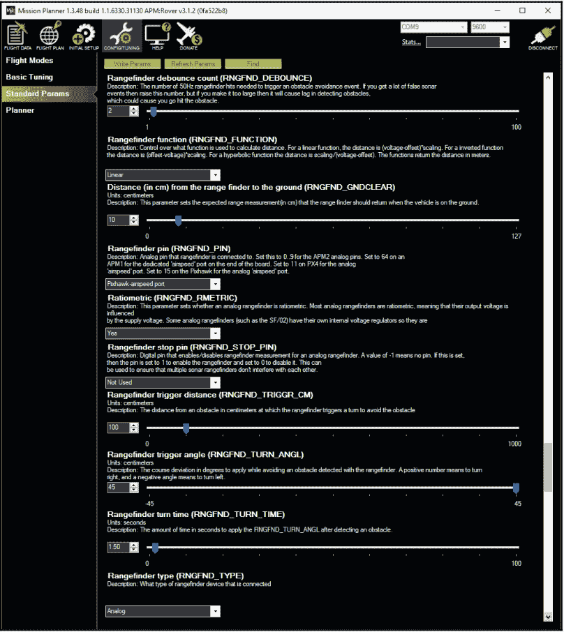

# 第 4 章：一款高尔夫球手用的无人机

# 第 4 章：一款高尔夫球手用的无人机

正如我们之前多次提到的那样，在选择为哪个行业制作无人机时，你必须在市场规模（需求）、他们能花多少钱（成本）以及你满足该需求的难易程度（供给）之间取得平衡。

高尔夫是一个极其受欢迎的行业。每年，消费者在高尔夫设备和配件上花费的钱 literally 达数十亿美元。高尔夫球手对能帮助他们提高球技的新技术趋之若鹜。听起来几乎完美，对吧？

那么，无人机能发挥什么作用呢？一架多旋翼机沿着球道飞行检查布局？也许吧，但如果高尔夫球手以前打过那条球场，为什么他们还需要它呢？他们不需要。好吧，这是一个坏主意。那用一架潜水无人机去寻找掉进水障碍区的球呢？不是一个糟糕的主意，但水障碍区底部可能躺着成千上万个球，找到你自己的球可能几乎不可能。而且，谁愿意把在池塘底部浸泡了数周而受损的高尔夫球一个个捞出来呢？不，又是一个坏主意。

每个职业高尔夫球手都拥有的，而每个业余爱好者都想要（但可能买不起）的东西是什么？一个球童（在球场上帮你拿球杆的人）！那么，如果我们把一辆电动高尔夫推车（一种运载高尔夫球杆的小车）改造成跟随手机呢？

现在，我们走在正确的轨道上了。

我们将涵盖以下主题：

- The design
- Using tank locomotion
- Using LIDAR to avoid obstacles

## The design

经过初步研究后，我们发现市场上已经有这样一种设备。它叫做 Stewart X9 Follow。然而，按标价，这件商品的价格接近 $3,000 美元！

这无疑是一款高质量的产品——设计非常时尚漂亮。毫无疑问，高端高尔夫球手会喜欢这件商品。但对于普通高尔夫球手来说，这绝对会破产。

该产品还使用自己的遥控器。遥控车跟随遥控器，或可以用它手动操控。我们将采用不同的方法。不是使用专有遥控器，我们将让它跟随智能手机（通过 Bluetooth 或 Wi-Fi）。这意味着它可以轻松配对。此外，我们还将包含一个标准化的 RC 遥控器（以防用户因忘记充电而导致手机没电）。

使用标准化的零件应该能让我们将最终成本降至约 $1,000 美元。我们的设备可能没有 Stewart 那么豪华，但它将覆盖更广泛的市场。

这是我们的原始草图：

制造一整辆高尔夫球童车可能会相当昂贵。所以，让我们从别人（已经电动化）的球童车开始。我们在亚马逊上找到了以下产品：

这辆推车的美妙之处在于它已经配备了双电机（因为它设计为通过遥控器操控）。我们真正需要做的就是在这个“哑”球童车里实现一个大脑。然后，它就能智能地跟随手机。

不过，我们必须完全重新布线才能使其工作。电机是有刷的，所以我们需要两个有刷 ESC。这些速度控制器还必须能够反转。为什么？因为为了转向推车，我们将使用 *tank* 式转向（其中一侧向前，另一侧反向）。

现在，我们需要精确规划所有东西如何连接，所以让我们看看我们的接线图：

你可能会注意到，我们没有包含 **Battery Elimination Circuit (BEC)** 来为 Pixhawk 的舵机部分供电。那是因为我们将使用内置 BEC 的 ESC。这将通过 ESC 舵机连接为舵机板提供电压。

你还会注意到，在这个阶段我们还没有决定使用 Wi-Fi 还是 Bluetooth 作为通信协议。我们取消了用于笔记本电脑的 900 Mhz 数据连接，转而使用其中一种协议。为什么？因为没有人愿意在高尔夫球场上随身携带笔记本电脑。相反，我们使用移动设备。

那么，有什么区别呢？如果我们通过 Wi-Fi 连接，Pixhawk 将成为网络接入点。这实际上可能带来一个问题，因为 GPS 需要手机的数据连接来显示地图。如果我们使用 Wi-Fi，网络将由你的移动设备与 Pixhawk 建立（而不是你的服务提供商的蜂窝数据连接）。

那么，如何让 Pixhawk 使用坦克式驱动系统来转向车辆呢？很简单。

## Adapting Pixhawk for skid-steering

第一步是把正确的 ESC 插到 Pixhawk 舵机面板上的正确端口。左轮的 ESC 插入 MAIN OUTPUT 1。右轮的 ESC 应插入 MAIN OUTPUT 3，如下图所示：

现在，我们只需在 Pixhawk 本身中启用滑移转向。它将完全自行计算该如何驱动每个车轮！

在 Mission Planner 软件中，连接 Pixhawk（当然先插入 USB 电缆）。进入 Config/Tuning 屏幕并选择 Standard Params，如以下屏幕截图所示：

## Using Bluetooth to control Pixhawk with a phone

使用 Bluetooth 控制 Pixhawk 非常简单。但就像 Pixhawk 的所有其他功能一样，需要购买一个附加模块。我们购买了如下图所示的模块：

当然，我们必须修改电缆（就像之前一样），因为该模块附带的电缆是用于旧式插头的。我们将 Bluetooth 模块连接到 Telem 1 端口，如下图所示：

现在，只需将你的 Android 设备的 Bluetooth 与 Pixhawk 的 Bluetooth 绑定。只需打开 Pixhawk 的电源，并使用与任何 Bluetooth 设备相同的方法进行绑定。用于从移动设备控制 Pixhawk 的软件称为 DroidPlanner 2。它是免费的！

我们还没有完全完成，但如果你好奇如何使用 DroidPlanner 2 让 Pixhawk 车辆跟随你，那很简单！只需点击 **Follow** 按钮，并设置你希望遥控车保持在内的半径。当然，你可以忽略 `altitude` 属性（因为这是一辆地面车辆）。你可以在下面的图片中看到 **Follow** 按钮：

当然，如果你不想让遥控车跟随你进入果岭，只需点击 **Pause**。你也可以点击地图上的点来发送遥控车！

很酷，对吧？但如果你在你和遥控车之间有一棵树怎么办？你不希望它在试图到达你时撞到树和岩石，对吧？这就是碰撞避免的用武之地！

## Using LIDAR to avoid obstacles

你想蒙着眼睛在高尔夫球场上散步吗？不想？我也不想，而且让遥控车盲目乱跑也不是个好主意。但视觉和物体识别需要比这台机器预算更多的计算能力。那么，视觉的下一个最好选择是什么？SONAR 或 LIDAR。不幸的是，SONAR（就像蝙蝠用声波计算障碍物距离来寻找昆虫一样）对于 Pixhawk 来说被认为 *passé*，因此实现起来相当 *wonky*。有一些 I2C 声纳设备，但它们与 Pixhawk 2.1 和最新的 Ardupilot 固件配合得并不好（如果能工作的话）。所以，我们将使用 LIDAR 代替。LIDAR 测距仪使用光波（而不是声音）来计算到物体的距离。

## LIDAR 101

LIDAR 简单地使用光波发出、反射到物体上，然后等待其返回。由于光速为 299,792,458 m/s，LIDAR 模块所要做的只是测量光脉冲返回到模块所需的时间。搞定！你就可以感知到是否有物体以及它有多远。下面的图示说明了这一点：

LIDAR 有多种不同的频率、强度和扩散模式。你可能会注意到，我们计划将 LIDAR 模块安装在前翼子板顶部。这是一个完美的位置，因为我们能够感知到任何对前轮来说太大而无法碾过的物体！让我们谈谈 LIDAR 的不同方面：

- **Rate：** 这是每秒产生并寻找光脉冲的次数，也称为 Hz。我们使用的单元（Teraranger One）以 1000 Hz 的速率采样（每秒 1000 次）。速率越快越好，但如果你要探测远距离接触，可能需要更长的时间（以避免信号在同一时间返回，甚至在下一个信号发出后才返回）。我们的 1000 Hz 速率就足够了，因为我们的模块探测范围为 14 米。
- **Range：** LIDAR 开始探测物体有多远。我们的传感器额定值为 14 米。考虑到我们的探测车将以步行速度移动，这已经绰绰有余。
- **Resolution：** 此参数与精度有关。我们使用的 EZ4 分辨率为 0.5 cm。这意味着它可以区分物体距离 5.105 米和 5.11 米。
- **Width：** 光束宽度也很重要。我们的 LIDAR 模块光束宽度为 3°。它应该足够有效，可以让我们的探测车避免太多麻烦。

## Making LIDAR work

不同的 LIDAR 模块具有不同的引脚排列（与 Pixhawk 插头的布线方案）。在购买 LIDAR 模块之前，你应该在 Ardupilot 网站上检查其兼容性（http://ardupilot.org/rover/docs/common-rangefinder-landingpage.html）。兼容传感器的布线引脚排列和列表可以在那里找到，以及它们应该插入的位置。

## Mounting the module

第一步是决定如何安装你的 LIDAR。它应与地面平行指向（不要向上或向下）。如果你使用单个传感器（如本示例中我们所做的），它还应直指前方。如果你使用多个传感器，你希望以覆盖探测车希望看到的整个区域的方式放置它们，但重叠并不是完全必要的。下面的图表显示了我们设计声纳安装选项的方法（我们更换了翼子板）：

你可以看到图表显示地面会与图案重叠，因此较大的岩石、树根和倒下的树枝将被探测到。如果我们想阻挡部分地面（以便调节多大障碍物会被注意到），我们只需将传感器向后滑动，使翼子板阻挡部分地面即可。我们怀疑我们不需要这样做。Pixhawk 有能力区分翼子板和更远处的物体（只需稍作调整）。

## Configuring LIDAR with Mission Planner

首先，我们需要在开始配置之前告诉 Pixhawk 有一个测距仪模块。因此，我们将 Pixhawk 通过 USB 插入电脑，并在 Mission Planner 中启动连接。

在 **Initial Setup** 部分，你会找到 **Optional Hardware**，在下面会有 **Range Finder**。在此部分，你应选择你使用的测距仪的适当型号，如下图所示：

Ardurover 固件的新版本在该下拉菜单中包含 Teraranger One。但如果你使用的是旧版本，你可能需要在 **Full Parameter List** 中设置。这是通过打开 Config/Tuning 并从屏幕左侧选择 **Full Parameter List** 来完成的。以下是参数列表以及 Teraranger One 的设置：

- **RNGFND_MAX_CM**: 1400（14 m）。这是测距仪的最大探测范围，单位为厘米。
- **RNGFND_MIN_CM**: 20（20 cm）。这是测距仪读取物体的最近距离。
- **RNGFND_TYPE**: 4。表示这是一个 I2C LIDAR 测距仪，为 Teraranger One 的数值。

现在，让我们看看我们可以用 Pixhawk 调整声纳测距仪的所有参数：

很多参数，对吧？你得爱上 Mission Planner。每个选项下方都有非常好的描述。但我们还是继续解释一下吧：

- **RNGFND_DEBOUNCE**: 这是物体需要返回多少次探测脉冲才能被 Pixhawk 注册。为什么需要这个？更宽、更远的测距仪也会产生更多噪声（或虚假脉冲）。因此，为了确保物体确实存在，你可能需要增加这个数字以减少错误读数。但有个问题——增加这个数字也意味着注册物体需要更多时间。这意味着如果你有快速移动的无人机，你可能无法及时避开障碍物。我们的 LIDAR 非常清晰，所以我们将其保持在默认的 2。这意味着物体需要返回连续两次脉冲才能被 Pixhawk 注册。
- **RNGFND_FUNCTION**: 要理解这一点，你需要知道测距仪返回的是用电压脉冲表示的物体距离，而不是数据脉冲。测距仪不会说，“嘿……它在 5 米外。” 相反，测距仪会根据接收到的脉冲强度提高或降低返回的电压。解读工作由 Pixhawk 完成。此设置决定 Pixhawk 如何解读从测距仪发送给它的电压。
- **RNGFND_GRNDCLEAR**: 此功能主要对具有向下声纳的飞机和多旋翼机有用。它表示飞机着陆时测距仪与地面的距离（模块的地面间隙）。
- **RNGFND_PIN**: 这个可能有点令人困惑。简单来说，这是指电压将返回到 Pixhawk 的位置。对于我们使用的 LIDAR，你可以保持不变。

使用 Teraranger，你实际上不需要调整这些设置中的任何一个。Teraranger 的主要卖点之一是它出厂已校准。你可能需要调整的唯一设置是 **RNGFND_DEBOUNCE** 参数。鉴于 LIDAR 模块离地面很近，而且我们的探测车将以步行速度移动，我们应该将其设置为 10。这意味着模块需要在识别到路径中有物体之前从物体接收到 10 次脉冲。这将减少树枝、草和其他物体带来的噪声。
