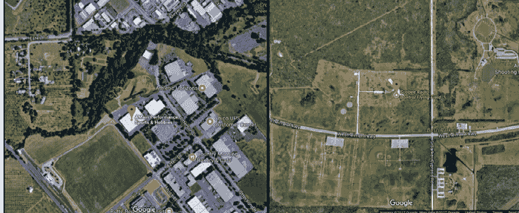
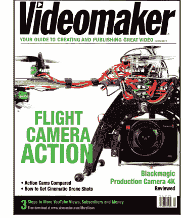
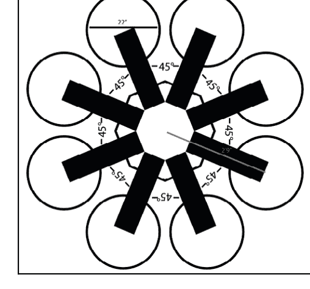
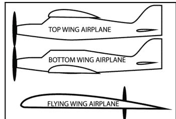
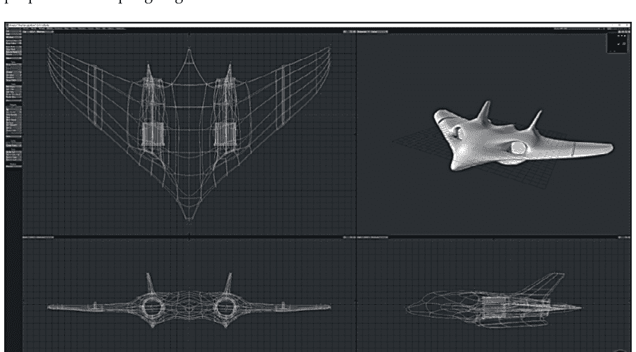

# 第 5 章：UAV 简介

# 第 5 章：UAV 简介

UAV 与探测车有很大不同。它们不受地面束缚，范围通常更大，而且操作起来危险得多。听起来很令人兴奋，对吧？在本章中，我们将介绍设计空中无人机的复杂性。我们将讨论机身、重量、飞行时间和推进。让我们先谈谈安全问题，这样事情会没那么令人兴奋，好吗？

我们将涵盖以下主题：

- Safety concerns
- Propellers - flying cuisinarts!
- Designing for air and ground
- Learning some physics
- Designing a multicopter airframe
- Designing a fixed wing-airplane)

## Safety concerns

在考虑设计空中无人机之前，你首先需要确定一个测试场地。作为示例，我会向你展示我使用的场地，但在我们深入之前，让我们先谈谈你应该寻找的要求：

1. **Authorized for RC air traffic**: **Academy of Model Aeronautics (AMA- http://www.modelaircraft.org/)** 授权的飞行场地是一个不错的起点。如果你所在地区有这样的飞行场地，你就知道该地区允许遥控飞机。如果你的地区没有，下一个要查看的地方是 FAA 图表。你可以在 SkyVector（https://skyvector.com/）找到当前的在线图表。这些图表会显示所有限制空域。任何不受限制的区域都适合飞行遥控飞机。

+   2. **远程**：仅仅因为某个区域允许遥控飞机并不意味着在那里测试新飞机（尤其是自主飞机）是安全的。你需要确保该区域没有可能在飞机坠毁或失控飞走时受损（甚至被杀死）的主要建筑物、房屋或行人。按照我们在以下章节中给你的说明，一切都应该能正常工作。但不幸的是，我们并不生活在“应该如此”的世界里。
+   3. **你被授权在那里**：不要擅自闯入别人的牧场来测试你的飞机。最好的情况是，你可能会惹上一些法律麻烦。最坏的情况是（在某些地方）你甚至可能被枪击。如果要进入私人财产，最好先征得业主的许可。

考虑到这些要求，以下 Google 地图图像显示了糟糕的飞行场地（左）与良好的飞行场地（右）的示例。左边的那个是加州奇科 A-Main Hobbies 的飞行场地——非常适合娱乐飞行；对于原型开发来说完全错误。右边的那个是休斯顿布什公园的 Dick Scobee 机场——位于一个巨大的公园中间。这并不完美（因为有一条道路穿过），但绝对可行：

右边的那个是我搬到德州后现在通常飞的地方。左边的那个是我住在加州时飞（已经过验证的飞机）的地方。为了测试，我不得不开车几个小时去一个偏远的地方。

我是在 2011 年造的这架无人机。我以为自己很聪明。起飞的最大载荷是 3.2 公斤。所以，我装满了电池，因为我想让这架无人机在空中停留更长时间。当我手动操控时，它飞得非常漂亮。我第一次在自主飞行中测试它时，机翼（字面意思）直接从飞机上吹掉了，它变成了一架非常昂贵的草地飞镖。它完全报废了。那发生了什么？

我没有考虑到 G 力。G 力是由于离心力作用在物体上的力。它以地球在静止时、海平面地面上的标准重力为倍数来衡量。例如，一个体重 100 磅的飞行员在进行 2-G 转弯时，在转弯期间体重会达到 200 磅。

当我切换开关让飞机返航时，它加速到最大油门，以 45 度倾斜，并进行一个紧密的转弯返回基地。这可能是一个大约 4-G 的转弯。所以，即使我在起飞时重量在限制范围内（只有 3.0 公斤），在那个转弯期间，飞机对机翼施加了 12.0 公斤的力。这足以粉碎机翼并开始向草地飞镖的转变。一个非常愚蠢、昂贵且容易犯的疏忽。

重量也会影响飞行时间。对于多旋翼来说这一点更为严重，因为多旋翼使用动力产生升力，但对于固定翼无人机也是如此。为什么？因为重量会影响你的滑翔比。一架飞机的滑翔比看起来像 1:100。这意味着在无动力情况下，每向前飞行 100 英尺，它会损失 1 英尺的高度。为了克服这一点，机头会稍微向上指向并施加动力。增加重量，飞机在无动力情况下在失去高度前能飞行的距离就会减少；因此，增加重量就会增加保持飞机在空中所需的动力。因此，在耗尽电源之前，你的飞行时间会更少。

多旋翼的滑翔比是 1:0。这意味着它在无动力情况下根本无法向前移动而不损失高度。基本上，它的滑翔比甚至比钢琴还要差。所以重量极大地影响多旋翼的飞行时间。我们将在第 6 章《一个简单的多旋翼无人机》中建造多旋翼时更深入地探讨这个问题。

最后，重量也会影响重心（cg）。飞行飞机有点像在铅笔尖上平衡一个球。飞机应尽可能平衡，以便控制面能够以最高效率正常工作（固定翼），或保持电机平衡，避免其中一个电机烧毁（多旋翼）。无论哪种方式，不平衡的飞机至少会操控不佳。

对于固定翼飞机，你可能会发现货物舱（放置电池、电子设备和有效载荷的地方）位于机身前部。放太多东西太靠前，你会发现重心变得头重。这意味着你可能需要在尾部添加更多重量作为压舱物（配重）。通常，固定翼飞机的 cg 位于翼型顶部。把这个想象成天平上的支点。你需要平衡这个天平。我们将在两章后建造固定翼飞机时更深入地探讨这个问题。

## 动力/升力

曾经有一段时间，让多旋翼在空中停留超过 5 分钟被认为是一项工程壮举。

我过去的一架多旋翼是为小型摄像机（仅比 GoPro 稍大）建造的。它在下图中出现，曾刊登在《Videomaker Magazine》上。一位客户要求我在这上面安装一台 Blackmagic Cinema 相机。当然，它的设计可以承载那么多重量。但能坚持多久呢？它一次只能在空中停留 2 分钟。动力和升力需要与重量和电池仔细平衡，尤其是要让多旋翼保持在空中：

## 燃料 - 电池

增加更大的电池或更多的燃料是最简单获得更长飞行时间的方法，对吧？错！如果你的无人机是燃油驱动的，你必须记住燃料每加仑重 8 磅，而电池会产生递减回报。例如，能够以 1 倍规格为电机供电的电池可能重 2 磅。但升级到 2 倍规格可能重 6 磅。所以电池的功率额定值翻倍并不意味着时间翻倍，因为电机必须付出 3 倍的努力来保持那额外的重量在空中！

## 学习一些物理

不~~~~！（你可能正在这么说）。不幸的是，根据你正在原型开发的内容，拼装可能不是一个选择。因为我们在章节中会进行拼装（因为我们可以用每种类型的飞机写另一本书），让我们给你一个航空工程的简要速成课程。

从零开始设计飞机不是胆小的人能做的。多旋翼要容易得多，所以我们先从那里开始。

## 设计多旋翼机身

什么，什么，什么，机身到底是什么？它只是飞机身体的 fancy 词。为什么你需要设计自己的？好吧，如果你要开始一家销售饱和产品（例如相机无人机）的新公司，你可能需要通过一个全新的无人机外观来区分自己。毕竟，为什么任何人要买你在（比如）大疆机身上的设计，而他们可以直接去买大疆呢？

设计多旋翼机架相当容易；你只需要考虑几个因素，我们将在即将到来的小节中介绍。

### 对称性

保持驱动螺旋桨的电机等距非常重要。记住，多旋翼可以向任何方向飞行。 为了保持多旋翼这一重要特性，你必须以这种模式设计你的多旋翼电机。

## 偶数

有一个例外，即三旋翼（三个旋翼）。虽然这些在大约 5 年前相当常见，但它们 notoriously 不稳定。为什么？因为多旋翼如何转弯。更多的桨叶不仅意味着更好的稳定性和升力，偶数使得 Pixhawk 保持它在空中的必要计算更容易。如果你记得，在第 1 章《无人机 101》中，我们介绍了多旋翼偏航的工作原理。偶数使它更稳定。

结合对称性，让我们列出不同桨叶配置的度数在下面的表格中。只要想象从前面看多旋翼并像切派一样划分区域。如果一个圆有 360 度，以下是它们如何排列：

| Number of rotors | Degrees of separation |
|---|---|
| 3 | 120 |
| 4 | 90 |
| 6 | 60 |
| 8 | 45 |

## 桨叶间隙

你设计的桁条（从飞机中心延伸到电机的棍子）需要足够长，以便桨叶能够舒适地避开天线并相互避开。因此，旋翼越多，桁条就需要越长。桁条越长，它们也需要越强（由于杠杆力）。然后，你必须明白，桁条越长越强，机身和电机布线增加的重量就越多。

考虑到以上所有因素，这里是一个 8 旋翼多旋翼（八旋翼）使用 22 英寸螺旋桨的示例：

在这里，你可以看到每个桅杆之间相隔 45°，并且每个旋翼从机身中心到旋翼中心距离为 2'9"。再加上 22"，你就得到全长 4'7" 的桨展。是的，它很大。你可能还会注意到，每个桅杆都比每个旋翼的精确中心要短一些。这是为了留出空间安装电机支架，该支架设计为使用套筒套在桅杆上。

机身的数学计算很简单。只要让桅杆足够长，使桨叶有足够的间隙（并且不会相互产生大量湍流），将电机设置在中心周围的对称点上，并使用偶数个旋翼即可。就我个人而言，我不建议使用三旋翼。它们天生不稳定，因为旋翼数量为奇数。

如果你想做得更花哨，还有很多东西可以加入（例如改变旋翼角度以辅助转向、推力等等）。但这些就是基础。

## 设计固定翼飞机

系好安全带，因为这是火箭科学。飞机需要持续向前移动才能保持在空中。我们在设计飞机时希望风阻（阻力）尽可能小。这将使其在空中停留更长时间，并减轻电机负担。

飞机有数百种设计风格，但让我们使用其中三种主要风格（如下图所示）：

如果飞行翼风格令人困惑，可以快速回顾一下 Skywalker X-8 的图片。那就是飞行翼。以下是本人正在设计的喷气式无人机示例，也是飞行翼。它使用电动涵道风扇（EDF）喷气发动机而不是螺旋桨来保持飞行：

显然，这架飞机是为高速、非常高速而设计的。但使用 EDF 喷气发动机也有代价——飞行时间非常短，电池消耗非常高。因此，我们将坚持使用螺旋桨。

即使有了这个工具，还是有点令人困惑，对吧？让我们谈谈这些参数及其含义：

- **Chord (mm)**: 简单来说，它就是你机翼型面的整个长度。从前缘尖端到后缘尖端的直线。
- **Radius (mm)**: 这是用于生成机翼型面前缘曲线（前缘）的曲线的半径。
- **Thickness (%)**: 这是机翼最厚处的垂直测量值。
- **Origin (%)**: 这对机翼型面形状没有任何影响。它只是将网格的原点从机翼鼻尖向后移动。
- **Pitch (degrees)**: 这是机翼整体设计相对于水平面向上倾斜的程度。
- **Halo (mm)**: 这对机翼型面形状没有任何影响。它只是在外线内侧或外侧绘制一条线，以帮助你在用夹具切割时使用此图像。
- **All other parameters**: 这也只是机翼型面绘制方式的设置，从网格大小到纸张大小。

看到了吗？其实也没那么糟糕。虽然比多旋翼要难得多，而且开发周期也长得多。你需要多次试飞飞机并调整设计，直到满意为止（在实现 Pixhawk 之前）。

## 总结

在本章中，你对设计飞机所涉及的一切以及飞机与地面车之间的区别有了很好的入门。我相信你现在可以看到我们为什么要从地面车开始。与飞机相比，它们简直是小菜一碟。

在下一章中，我们将向你展示如何将 Pixhawk 集成到多旋翼中。我们不会过多关注多旋翼的设计，而更注重使其正常工作。因此，我们将拼装一个 DJI Flamewheel F550 机身。祝你享受！
