## 一个简单的多旋翼无人机

多旋翼是非常复杂的生物。通过 Pixhawk 和多旋翼可以完成很多工作。通过编程接口 **Micro Air Vehicle Link (MAVLink)**，可以自动触发各种任务。从基于触发传感器的警报系统触发无人机飞往特定航点，到根据天气、光照条件或其他任何数量仅受你想象力限制的变量进行调整的任务——多旋翼是你设计和概念中最通用、也最复杂的系统。

就本书而言，我们将保持简单。一旦你准备好进入 MAVLink 接口的完整应用程序编程，就可以在 *QGroundControl* 网站上找到很棒的教程和完整的编码指南（`http://www.mavlink.org/dev/mavlink_groundcontrol_integration_tutorial`）。

我们要做的是向你展示如何设计 Pixhawk 可以控制的最复杂机器之一——多旋翼无人机。具体来说，我们将展示如何设计和原型制作一台 360 VR 视频多旋翼。

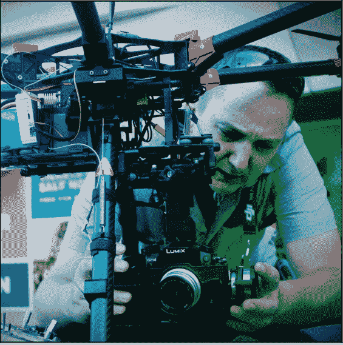

当然，我们的概念验证云台不会如此复杂，但其工作原理的原理是相同的。我们需要一些东西来减震，并抵消多旋翼持续的倾斜和滚动。

但我们有点超前了。有什么便宜、实惠的相机可以用来做概念验证的 360 VR 视频呢？

### 从有效载荷开始

无人机只是其有效载荷的运载装置，在本例中是相机。因此，在设计任何无人机时，从一开始就考虑你要携带的东西是有意义的。在任何概念验证中，想法是用尽可能少的钱来证明概念。只要假设你会遇到问题，甚至可能发生坠毁（尤其是多旋翼）。为什么要在概念验证上冒险使用价值 10,000 美元（甚至 1,000 美元）的相机？从小开始，然后再扩大规模！

所以，我们找到了完美的相机——Ricoh Theta S。Theta S 体积小、重量轻，具有集成（内置）电池和集成存储卡。我们需要担心的事情越少越好，对吧？最棒的是，它以与任何高端 360 相机相同的 360 格式拍摄，而且只需 326 美元！它简直就是 360 相机的 GoPro。Theta S 在亚马逊上的商品列表显示如下：

另外（正如你在商品列表上看到的那样），我们已经拥有一台了！概念验证时一定要尽量使用车间里已有的东西。这样可以节省大量资金！我们上个夏天购买了它，用于后期制作中 360 VR 编辑工作流程的原型制作。

我们现在会遇到的问题是（大多数）云台（尤其是便宜的）都是为 GoPro 设计的。一些更贵的云台可以为任何相机平衡……但它们是为更大更重的相机设计的。我们不想为无人机发明全新的云台。这不是我们的业务，也远远超出了本次验证的范围。那么，我们如何在一个现有的云台上管理 Theta S 以进行概念验证呢？

### 选择云台

正如我们已经说过的，云台的主要目的是保持相机稳定。它通过两种方法实现这一点：

1. 通过橡胶垫圈（主框架与云台支架之间）减震。
2. 通过每个轴上的无刷电机抵消无人机正常的倾斜、滚动和偏航运动。

减震方面，我们完全没问题。用于大型相机的橡胶垫圈与最小的相同（只是垫圈数量可能会改变）。我们困难的地方在于云台本身的平衡。我们希望使用 GoPro 云台（因为重量几乎相同——Theta S 为 125 克，GoPro 为 149 克）。虽然 Theta S 在技术上更轻，但重量分布会完全不同。它是一款细长的相机（我们很可能会把它倒挂）。但由于尺寸完全不同，我们不能忽视云台轴上的杠杆原理。记住，给我一个足够长的杠杆，我就能撬动世界？

我们需要确保我们的云台能够克服由于杠杆作用而产生的额外（有效）重量，并保持我们的 Theta S 稳定。这意味着它也需要有一定的可编程性，以保持适当的校准。

最后，我们需要确保成本低廉。于是，我们上亚马逊去选购，最终我们选定了这个：

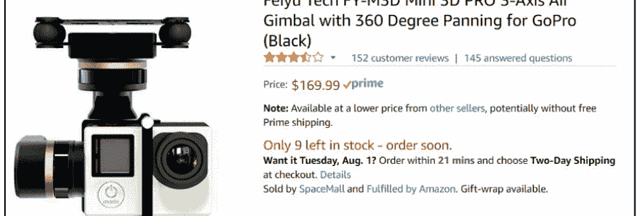

它有足够的电机功率来应对重量分布的变化，并且让我们能够通过USB对控制器进行编程！！！到目前为止，我们的总预算已达496.94美元。好吧，对于概念验证来说，我们做得还不错（到目前为止）。

现在，我们如何将Theta S安装到这个云台上呢？这时就要用到前几章提到的3D打印机了。等云台到货后，我们用卡尺测量实际的GoPro支架，以及Theta S（最宽处）的尺寸。Theta S在y轴（高度方向）上有点像橄榄球形。这正好适合我们。

如果我们设计一个适配GoPro尺寸、但中央有一个方形间隙的支架，在Theta S两侧被夹紧的地方涂上一条硅胶，就可以让连接非常牢固，并且有足够的摩擦力将Theta固定住。这是我们设计出的简单（又轻便）方案：

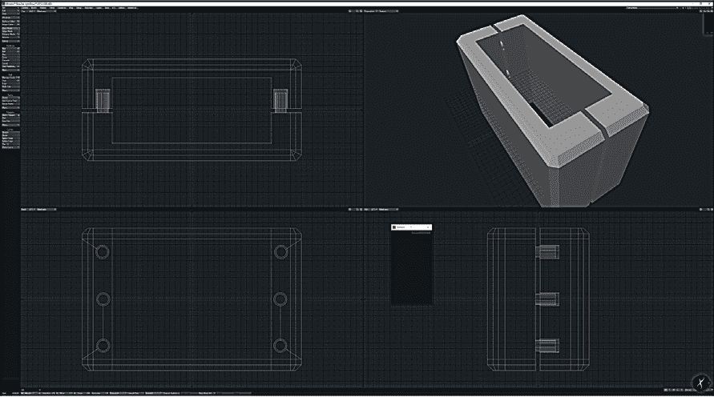

以下几个设计要点需要注意：

- 1. 边缘采用斜角设计，这样即使存在测量（或3D打印）误差，适配器也能稳固地卡入支架中。
- 2. 有销钉和孔位，使适配器能牢牢固定Theta S，避免蛤壳式结构的两半滑脱。
- 3. 用于嵌入Theta S的孔是方形的（而不是橄榄球形的）。

最终3D打印的适配器如下图所示：

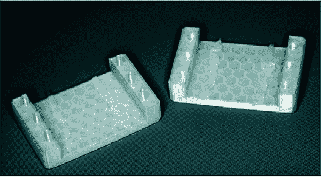

可能有点难看到（因为我们在打印机中也使用了透明耗材）蛤壳两半上用的那两道硅酮密封胶条，但这正是它效果如此好的原因。它提供了很强的抓力，而且足够柔韧，能牢牢夹紧我们的Theta S。另外请注意，这个3D打印件内部是空心的，带有蜂窝结构。这使得它既轻巧又坚固。下面是绑上Theta S后的效果：

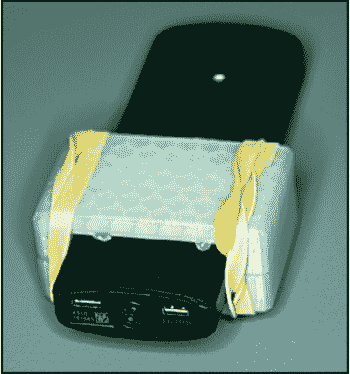

看起来非常简单，对吧？确实如此。有时候最好的方案就是那么简单。对于概念验证设计，橡皮筋和扎带有时是你最好的朋友。你可能会担心橡皮筋会干扰GoPro支架。我向你保证它们不会。事实上，它们还会派上用场。不过我们到组装阶段再说。

所以，我们最终的重量是146克，仍然比GoPro要轻。在组装多旋翼的过程中，不断称重是很重要的。对于被弄脏的秤我表示抱歉。这个秤也是我们在混合前称量硅胶原料用的秤。但请相信我，在称重前已经归零（Theta的保护套已经套在上面）；146克是准确的。

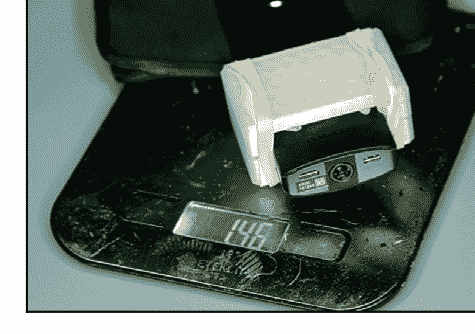

好的，到目前为止，我们的总重量是149克（云台）+ 146克（相机），总计295克。在组装空中无人机（尤其是多旋翼）时，记录重量非常重要。现在我们只需要一架能够承载该负载并安全降落的无人机。

## 起落架

嗯，我们现在遇到了麻烦。问题是我们需要可收放的起落架（如下面的截图所示）：

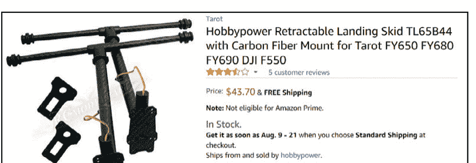

为什么？因为我们这里处理的是360度VR视频。我们想直接替换掉无人机（并加入更多天空），而不必用转描技术去除相机侧面和下方的起落架。但可收放起落架要一个月才能到货！此外，也没有真正的方法将我们的起落架和云台安装到无人机上。我们需要一个导轨系统。

于是我们选用了如下截图所示的起落架：

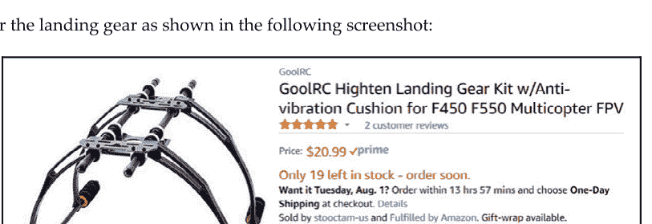

呃。好吧，它们不能收放，但它们确实有导轨，所以我们会把两种都订购。我们会把导轨安装在无人机上，进行基本的飞行测试。然后，等可收放起落架到货后，我们就可以进行一些视频测试了。这会额外花费我们20.99美元，但谁在乎呢？从大局来看，这只是沧海一粟。而且我们时间也很紧。所以，如果可收放起落架不能及时到货，我们仍然可以先跑一些测试，让这家伙飞上天！

这两种起落架最大的共同点是什么？离地间隙大。这样，相机和云台额外增加的长度仍然能避开平坦地面/起降台。这是保护相机安全的最重要部分。

到目前为止，我们的总预算已经达到了561.63美元。而且我们还没买机架、电机、螺旋桨和电调（ESC）。幸运的是，我们已经有一个Pixhawk飞控了。

但我们还没到那一步。现在，由于我们真的没有办法在这台相机上预览360度视频（除非使用Wi-Fi）……我们需要一个额外的FPV（第一人称视角）摄像头（这样我们就能在地面站看到无人机正在发生什么）。我们绝对不想在航空平台上使用Wi-Fi。干扰控制信号的可能性太大。那将是很高的风险，而你绝对不想冒这个险。

## 第一人称视角——FPV系统

在美国，在没有特别豁免的情况下，在视线范围（VLOS）之外飞行无人机是违法的。然而，当你看着笔记本电脑屏幕时，如果还能看到一些关于无人机飞行方向的信息，那才是最安全的，对吧？所以，FPV系统是一个必要的安全功能（如果使用得当的话）。另外，它还能让你的VR拍摄导演有机会（第一手）看到无人机正在从哪里拍摄，并适当地指导你。

由于这只是概念验证，我们不需要非常强大的系统。它不需要很远的传输距离，而且由于这只是一台量产无人机的小型版本，它真的需要尽可能简单和轻便。

于是我们选择了（一体式）Spektrum FPV摄像头，内置发射机：

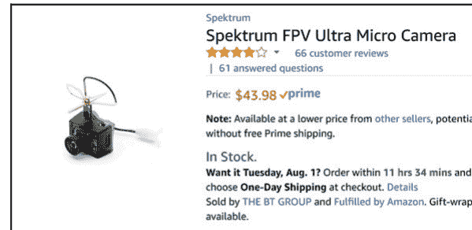

这又增加了85克，使我们的总重量（到目前为止）达到295克 + 200克（起落架 + 导轨）+ 85克（摄像头/发射机）= 580克。看到它是怎么不断增加的吧？但等等，还有更多！

这个发射机的工作电压比我们无人机所需的电压低得多。我们有两个选择：要么加装某种变压器，要么直接使用另一块电池。我们会选择第二种方案（对于我们的概念验证）。为什么？因为一块1S锂聚合物电池很可能比变压器还要轻：

我们购买的带E300动力系统的F550如下图所示：

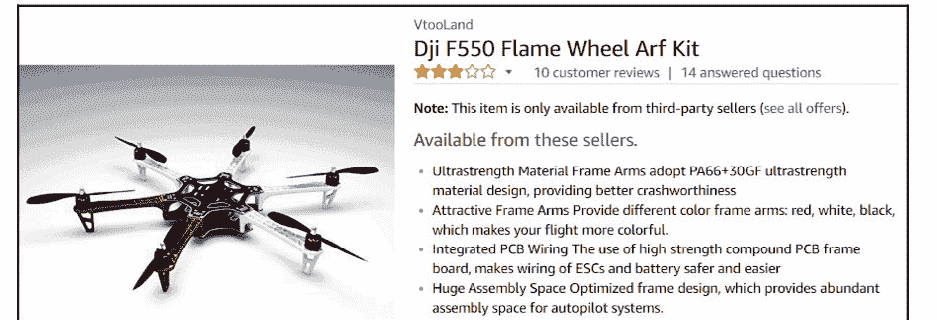

Flame Wheel机架、电机、电调和螺旋桨重约2.9磅（1,315.5克）。这使我们的总重量达到1,897.1克（远低于我们2,400克的最大起飞重量）。这意味着我们还有大约502.9克用于电池和Pixhawk。

## 电池

我们需要4S电池。我们需要足够的动力。不幸的是，这里有一个重量问题：电池重量会比3S电池增加25%。（这里的S表示电池的电芯数量。）

我们需要为Pixhawk及配件（GPS等）留出150克到200克。所以我们有300克到350克可以用于电池。不幸的是，这大大限制了我们的mAh（毫安时）额定值。基本上，这个额定值表示电池在一小时内可以消耗多少毫安。

数字越大，你的潜在飞行时间就越长。但理论上和实际上，mAh越大，电池越重，对你的整体飞行时间影响也越大。这就是收益递减定律。例如，一块6,000 mAh的电池不会带来两倍于3,000 mAh电池的飞行时间。更有可能是（只是举例，并非真实数据）增加15%（前提是你的飞机还能离地起飞）。

我们找到了这些正好处于328克最佳重量点的电池：

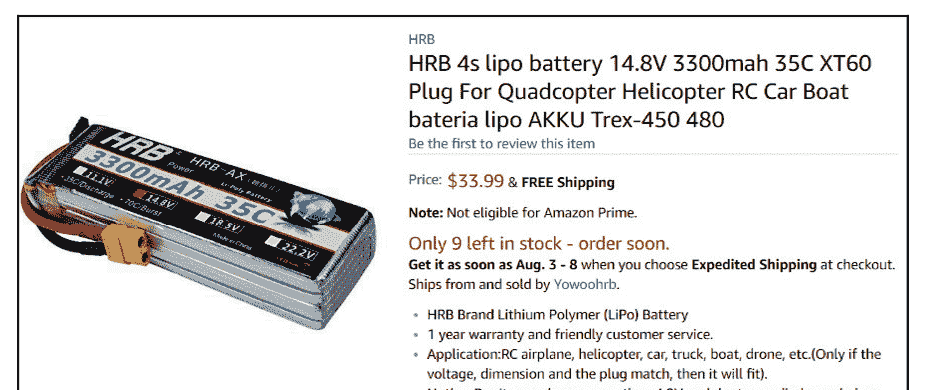

- HRB品牌锂聚合物（LiPo）电池
- 1年质保和友好的客户服务。
- 应用：遥控飞机、直升机、汽车、卡车、船、无人机等。（只要电压、尺寸和插头匹配，即可适用。）
- 注意：充电电压不要超过4.2V，放电电压不要低于3.7V。

这使得我们的资金预算达到622.60美元（到目前为止）+ 66.98美元（两块电池）+ 310美元（Flame Wheel机架），总计为1,000.58美元。说真的，对于一架概念验证无人机来说，这算是相当便宜了。

现在，我们需要进行一些计算，看看这东西到底能不能飞起来。

我知道这个字体读起来真的很小。结论是什么？我们大约有 5.5 分钟的飞行时间。如果我们要进入量产原型阶段，我们会花费大量时间（而且可能花费更多钱）来调整零件，直到达到飞行时间和载荷的完美平衡。但这绝对不是量产原型。不是我们最终想要携带的相机，也远没有我们最终想要的大小。对于一个简单的概念验证，5 分钟的飞行时间我们是可以接受的。如果我们真的想，可以用 5,000 mAh 的电池将其提升到略高于 7 分钟。但如果我们全油门飞行，这可能会过载我们的电机。别冒这个险。

再次说，这低的飞行时间可能会让你震惊，如果你习惯了 DJI Phantom、Inspire 等。但再次强调，这不是一台完整的量产无人机。这只是概念验证。不是关于平衡电池驱动到重量的验证，而是关于飞行 360 相机，并成功地用定制系统稳定它的验证。

对于这些目的来说，5 分钟并不理想，但也绝对不算差（尤其是考虑到我们的预算）。通过对硬件和预算的适当调整，我们完全可以预期超过 20 分钟的飞行时间。但我们又面临时间紧迫的问题。花费 1,000 美元（不包括 Pixhawk）打造一台完全可用的概念验证机，虽然耐力不如量产原型，但足以启动一个 Kickstarter 活动。或者至少足以向潜在投资者证明我们能够打造这样的无人机。其余的只是调校（选择合适的尺寸、硬件和电池）。

现在，让我们来建造我们的概念验证机。

## 组装无人机

正如预测的那样，我们的可伸缩起落架还没有到货。不仅如此，它们还在海关遇到问题。幸好我们提前想到了并买了临时起落架；花 20.99 美元非常值得！

所以，这里是我们的无人机组装后（带临时起落架）的样子：

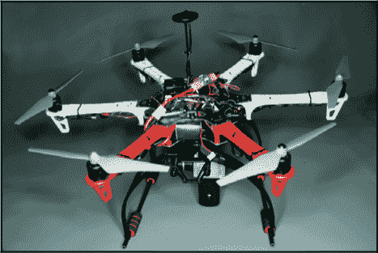

让我们快速了解一下多旋翼无人机的建造技巧。

## 太多该死的电线了！

那东西看起来像一团乱麻，对吧？其实不是。线缆管理是关键。你不想让任何电线有阻碍（甚至损坏）螺旋桨的危险。那意味着瞬间坠毁。以下图片显示了通往 ESC 和电机的电线是如何在机身下方布线并捆绑的：

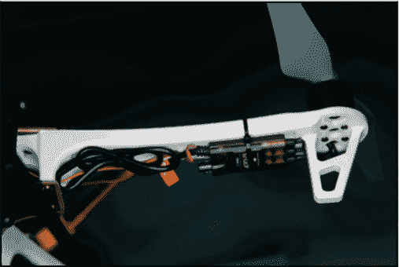

不仅如此，**电磁（EM）**干扰是空中的敌人。它完全可能破坏你的视频、遥测、GPS，甚至控制信号。所以不要把电线绕成圈。相反，注意它们是绕成八字形的（尤其是电源线）。

既然说到这个角度——不要漏掉任何螺丝！很多老派的无人机飞行员来自固定翼世界。在这些圈子里，常见的做法是用两颗螺丝固定电机。不要那样做。如果一颗螺丝松动，你失去一个电机，你的多旋翼可能会很快变成从天而降的石头。

处理多旋翼时，你必须记住，即使是一架钢琴，其滑翔性能也比多旋翼好。

套件制造商随附几颗额外螺丝的情况并不罕见。如果你装完后发现有多余的螺丝，请仔细检查每颗螺丝，确保你都装上了。如果它们看起来多余，那它们不是。

## GPS 装在杆子上

你可能还会注意到 GPS 天线安装在一个支架上（如以下图片所示）：

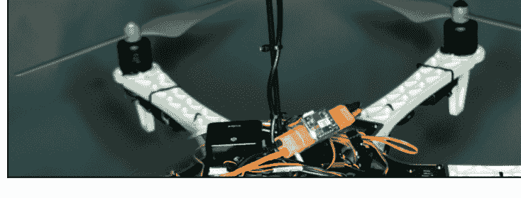

你希望 GPS 远离电机所在的平面。记住，电动机是通过磁场工作的。电磁的定义就是这样，对吧？所以把它抬高并远离这些电机。电机运行所在的平面不一定会破坏你的 GPS。但它可能会。为什么要冒这个险呢？它可能看起来很奇怪。但坠毁的无人机看起来更糟。

## 导轨很棒

导轨在电视和电影行业已经使用了很长时间。简单来说，它们是一种用于安装附件的标准化系统。事实上，导轨（以多种不同形式）被用于从枪械（皮卡汀尼导轨用于瞄准镜、手电筒、激光和其他附件）到电影摄像机（用于遮光斗、跟焦器、监视器、外置硬盘等等）的一切东西。无人机的导轨是无人机的中心。所有主要硬件都连接到导轨上。主机身、起落架、云台，甚至在大多数情况下，电池都安装在导轨上。你可以在以下图片中看到我们无人机的导轨：

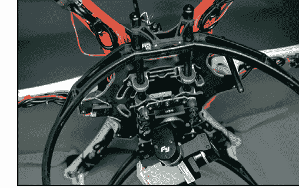

在这里，你可以看到两根碳纤维管（导轨），机身附着其上（使用橡胶垫圈穿过铝制 D 形环），我们的云台附着其上，起落架支架附着其上，甚至还有一个空白导轨安装座（顶部），以防我们将来决定安装另一个附件。

你可以了解到导轨有多么有用。这其实是一个相当简单的概念。大多数附件只需卡入导轨系统即可。导轨非常方便而且很棒。

## 有什么松动的？收好并绑紧

在以下图片中，你可以看到并非每个舵机连接都被插上。因为我们在飞行期间不需要倾斜或平移云台（记住，它是一台 360 相机），所以我们没有费心连接云台的那些控制。但我们不想让松散的电线乱晃并可能击中我们的旋翼。所以它们被塞进机架中，只露出末端，以防我们日后改变主意。此外，在可能的情况下，我们把电线塞得更深进机架，在不可能的情况下，我们用扎带把它们绑在一起。以下图片中至少有五条扎带。你能全部找到吗？

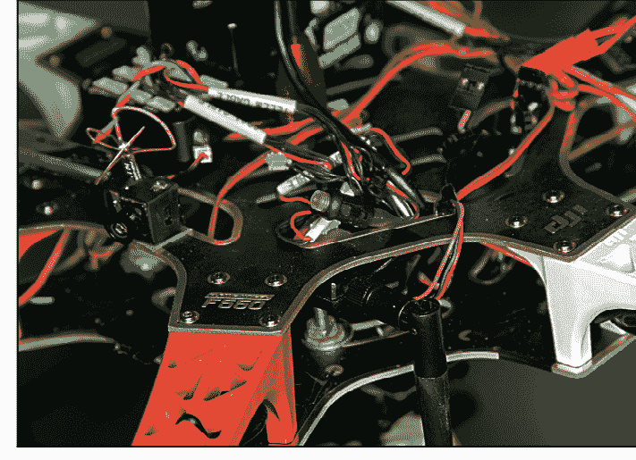

沿着同样的思路，确保你不要对组件掉以轻心。仅仅把电池绑好是不够的。用魔术贴固定以确保它们不会滑脱；3M 汽车胶带也非常适合更永久地固定东西。以下图片显示了 FPV 相机的电池，以及相机本身。请注意，相机是用一块灰色的 3M 汽车胶带固定的，而电池是用魔术贴固定的（目前放在侧面以展示魔术贴）。

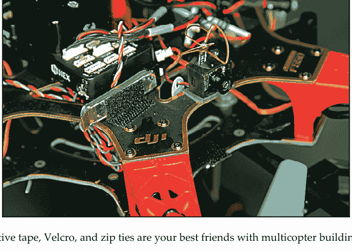

汽车胶带、魔术贴和扎带是多旋翼建造时最好的朋友。

## 将 ESC 连接到 Pixhawk

Pixhawk 可以处理各种多旋翼。以下图表说明了多旋翼的类型以及它们的电机数量：

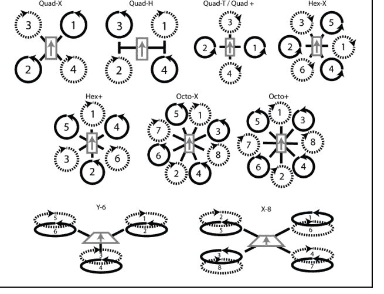

正如你所见，有很多种多旋翼，所以不要让自己陷入我个人的痛点——有人把它们全部叫做四轴。它们绝对不是全部都是四轴。图形中圆圈的方向说明了电机/螺旋桨必须旋转的方向，以便多旋翼能够与 Pixhawk 正常飞行。数字对应于 Pixhawk 舵机板上的 Main Out 编号。

- 3. 设置一套摇杆，以便我们可以用传统的直升机式（真实世界）控制来飞行多旋翼。

所以，不再耽搁，让我们开始吧！

## Pixhawk 的初始配置

显然，通过 USB 将你的 Pixhawk 插入电脑，在 Mission Planner 中连接它，然后启动向导。首先，让我们运行多旋翼版本的设置向导，然后再进行调整：

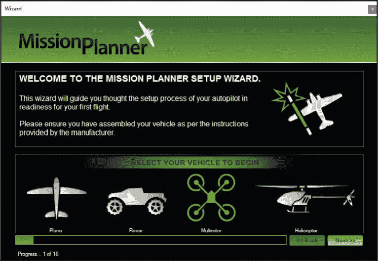

我们将逐屏进行讲解。到现在为止，其中很多内容对你来说可能已经是老生常谈了。但还是那句话，信息宁可多说无用，也不要需要时没说。

这确实（承认）令人困惑。但实际上，软件试图确定的是你的六轴飞行器是 Hex-X 还是 Hex+ 类型的机架。我（个人）从未见过 Hex-H 机架，也未见过前方展开的 Hex 机架。但也许它们在某些地方存在。因此，即使它只显示四个旋翼，我们也选择 x-frame。在之前的屏幕中，我们选择了六轴飞行器，然后选择了 x-frame 变体。这使其成为 Hex-X。

在下一个部分，我们将校准加速度计，以便 Pixhawk 知道飞机何时处于水平状态以及何时倾斜：

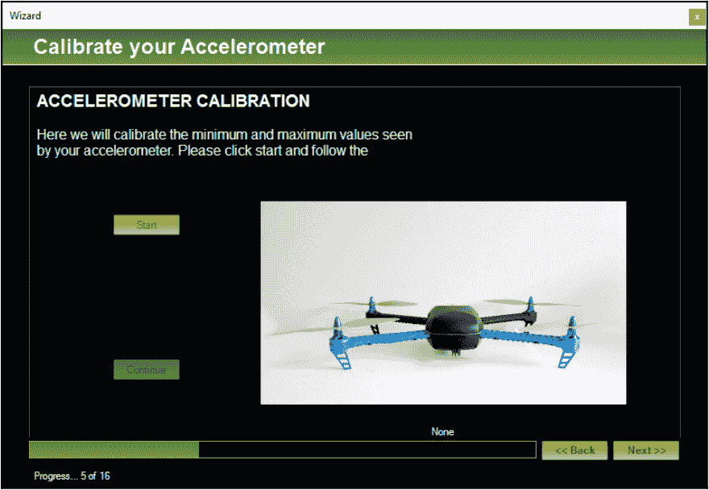

这次不要只点击 **Next**，你需要点击 **Start**。开始校准后，软件会要求你将飞机放置水平，然后向左倾斜 90°，向右倾斜 90°，在机头、机尾，然后倒置。

下一步是罗盘校准。对于这一步，你需要非常注意 USB 线缆。

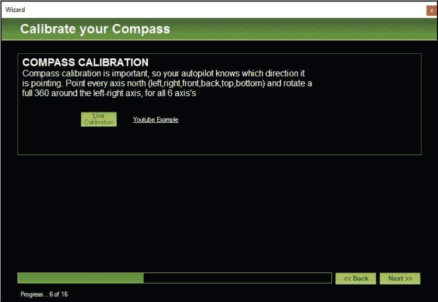

一旦你点击 **Live Calibration**，你将被要求将无人机绕每个轴旋转完整的 360°。你将看到另一个显示旋转数据点的界面。一旦你覆盖了每个白色点，界面将自动关闭。不要点击 **Done** 按钮。这将被注册为未校准的罗盘。只要继续在所有方向上旋转你的无人机，直到界面自行关闭即可。

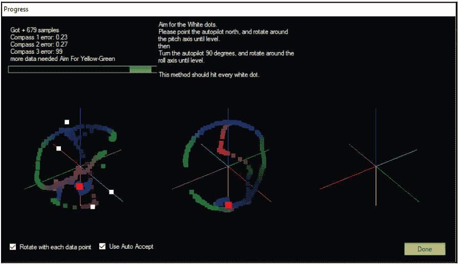

让我们跳过绑定遥控器和选择电源模块。我们在其他章节中已经相当详细地介绍了这一部分。如果你需要任何帮助，只需参考这些章节即可。现在，让我们设置我们的飞行模式：

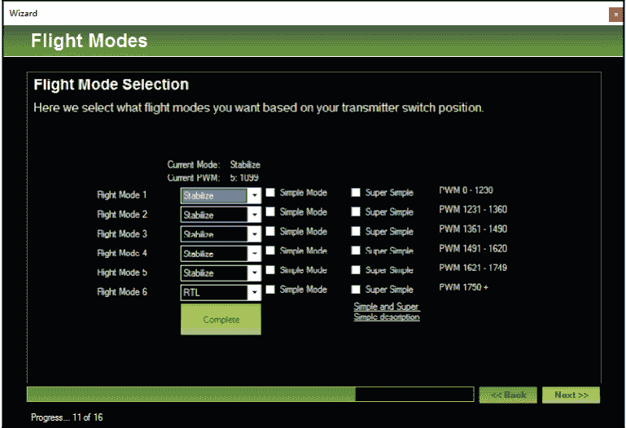

由于这是我们的第一架空中无人机，让我们快速回顾一下飞行模式：

- **Stabilize**：标准飞行模式，使用所有可用传感器以尽可能稳定的方式飞行。可以将此模式视为与 DJI 的 ATTI 模式类似。
- **Altitude Hold (Alt Hold)**：当此模式启用时，无人机将保持当前高度，而你可以专注于飞机的位置和方向。如果使用标准 Pixhawk 硬件，则使用气压计来维持高度；这意味着它相对于 **海平面高度 (ASL)**。如果气压发生变化，这会影响保持的实际高度。然而，如果使用向下[content]

这确实（承认）令人困惑。但实际上，软件试图确定的是你的六轴飞行器是 Hex-X 还是 Hex+ 类型的机架。我（个人）从未见过 Hex-H 机架，也未见过前方展开的 Hex 机架。但也许它们在某些地方存在。因此，即使它只显示四个旋翼，我们也选择 x-frame。在之前的屏幕中，我们选择了六轴飞行器，然后选择了 x-frame 变体。这使其成为 Hex-X。

在下一个部分，我们将校准加速度计，以便 Pixhawk 知道飞机何时处于水平状态以及何时倾斜：

这次不要只点击 **Next**，你需要点击 **Start**。开始校准后，软件会要求你将飞机放置水平，然后向左倾斜 90°，向右倾斜 90°，在机头、机尾，然后倒置。

下一步是罗盘校准。对于这一步，你需要非常注意 USB 线缆。

一旦你点击 **Live Calibration**，你将被要求将无人机绕每个轴旋转完整的 360°。你将看到另一个显示旋转数据点的界面。一旦你覆盖了每个白色点，界面将自动关闭。不要点击 **Done** 按钮。这将被注册为未校准的罗盘。只要继续在所有方向上旋转你的无人机，直到界面自行关闭即可。

让我们跳过绑定遥控器和选择电源模块。我们在其他章节中已经相当详细地介绍了这一部分。如果你需要任何帮助，只需参考这些章节即可。现在，让我们设置我们的飞行模式：

由于这是我们的第一架空中无人机，让我们快速回顾一下飞行模式：

- **Stabilize**：标准飞行模式，使用所有可用传感器以尽可能稳定的方式飞行。可以将此模式视为与 DJI 的 ATTI 模式类似。
- **Altitude Hold (Alt Hold)**：当此模式启用时，无人机将保持当前高度，而你可以专注于飞机的位置和方向。如果使用标准 Pixhawk 硬件，则使用气压计来维持高度；这意味着它相对于 **海平面高度 (ASL)**。如果气压发生变化，这会影响保持的实际高度。然而，如果使用向下[content]

这确实（承认）令人困惑。但实际上，软件试图确定的是你的六轴飞行器是 Hex-X 还是 Hex+ 类型的机架。我（个人）从未见过 Hex-H 机架，也未见过前方展开的 Hex 机架。但也许它们在某些地方存在。因此，即使它只显示四个旋翼，我们也选择 x-frame。在之前的屏幕中，我们选择了六轴飞行器，然后选择了 x-frame 变体。这使其成为 Hex-X。

在下一个部分，我们将校准加速度计，以便 Pixhawk 知道飞机何时处于水平状态以及何时倾斜：

这次不要只点击 **Next**，你需要点击 **Start**。开始校准后，软件会要求你将飞机放置水平，然后向左倾斜 90°，向右倾斜 90°，在机头、机尾，然后倒置。

下一步是罗盘校准。对于这一步，你需要非常注意 USB 线缆。

一旦你点击 **Live Calibration**，你将被要求将无人机绕每个轴旋转完整的 360°。你将看到另一个显示旋转数据点的界面。一旦你覆盖了每个白色点，界面将自动关闭。不要点击 **Done** 按钮。这将被注册为未校准的罗盘。只要继续在所有方向上旋转你的无人机，直到界面自行关闭即可。

让我们跳过绑定遥控器和选择电源模块。我们在其他章节中已经相当详细地介绍了这一部分。如果你需要任何帮助，只需参考这些章节即可。现在，让我们设置我们的飞行模式：

由于这是我们的第一架空中无人机，让我们快速回顾一下飞行模式：

- **Stabilize**：标准飞行模式，使用所有可用传感器以尽可能稳定的方式飞行。可以将此模式视为与 DJI 的 ATTI 模式类似。
- **Altitude Hold (Alt Hold)**：当此模式启用时，无人机将保持当前高度，而你可以专注于飞机的位置和方向。如果使用标准 Pixhawk 硬件，则使用气压计来维持高度；这意味着它相对于 **海平面高度 (ASL)**。如果气压发生变化，这会影响保持的实际高度。然而，如果使用向下

两位开关将是PWM < 1230（关闭）和PWM > 1750（开启）。如果开关有更多档位，数值将介于两者之间。如果遥控器已配对并在您处于此屏幕时通电，当您拨动开关的各个档位时，下拉菜单将高亮显示为绿色。只需为每个档位设置所需的模式。确保在点击“下一步”之前点击“完成”。

我们之前已经经历过校准。我们此时仅显示此屏幕是为了强调您不应忘记在遥控器上反转任何方向错误的通道：

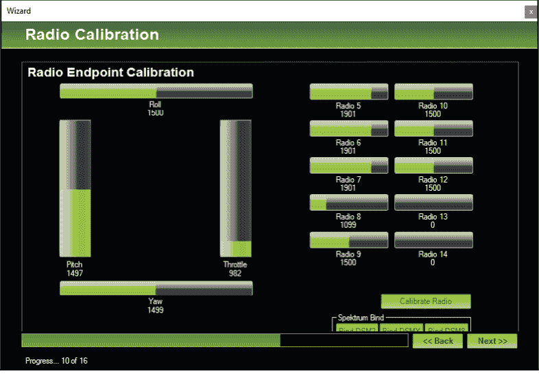

接下来，我们需要告诉Pixhawk如何处理紧急情况。

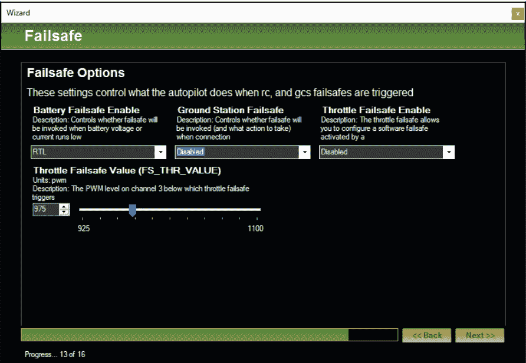

失效保护在（大多数人所谓的）紧急情况下启用。它们可以从启用不同的自主飞行模式到防止用户错误。让我们来看看这些：

- **电池失效保护启用：** 此项设置在电池电量降至安全水平以下时要启用的飞行模式。
- **地面站失效保护：** 此项设置在与地面站失去连接时的飞行模式。由于我们（大量）使用地面站，且不打算进行远程自主飞行，我们将此模式设置为RTL。
- **油门失效保护启用：** 此项设置飞行员在飞行过程中是否可以将油门降至指定（使用滑块设置）水平以下。我们既不想关闭电机导致失控翻滚，也不想在下降时飞过自己的螺旋桨洗流（可能导致坠机）。

地理围栏是您可以在设置向导中启用的另一个功能：

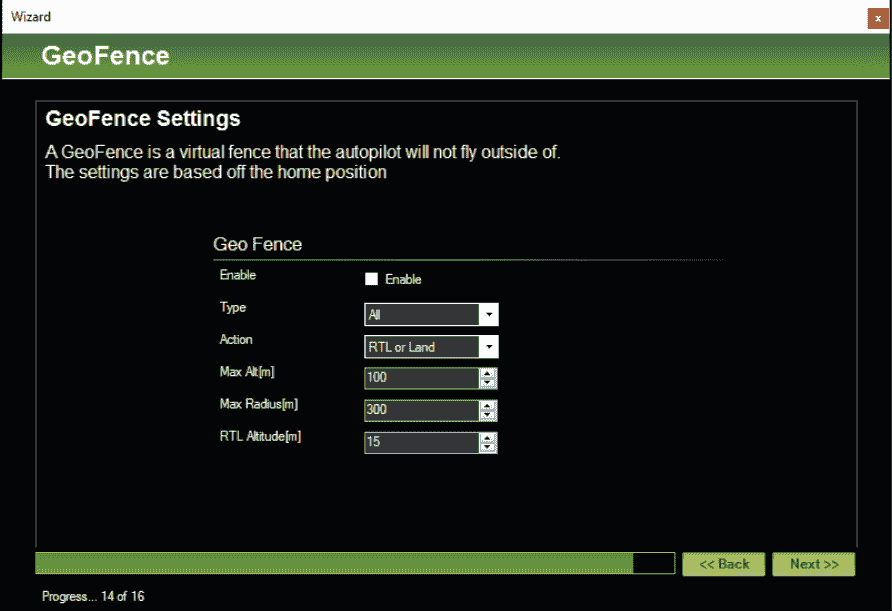

地理围栏允许您限制无人机的范围和高度。实际限制值不言自明，所以我们继续往下看。

## 配置地面站

这里是我们配置地面站以接收视频、使用操纵杆并变得全能出色的地方！让我们从操纵杆开始。

如您所见，有很多按钮。甚至还有一个ThinkPad风格的指针鼠标，您可能可以用它来控制云台（如果我们有兴趣这样做的话）。

在Mission Planner中，我们将进入**配置/调参**部分，并从左侧选择**Planner**按钮。我们将看到以下屏幕：

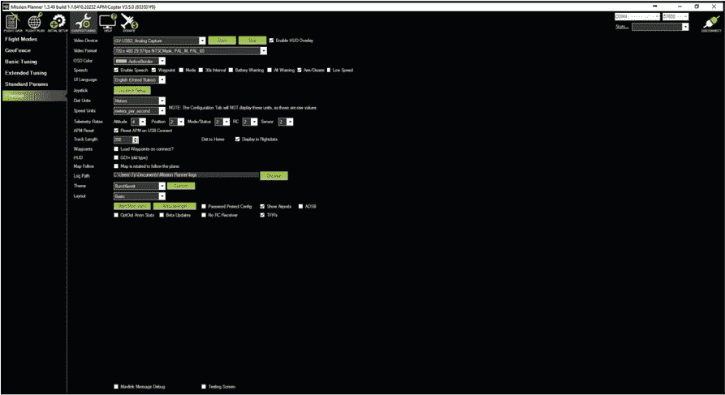

在这里，我们可以设置物理操纵杆上的每个按钮、摇杆、旋钮和滑块将控制什么。

一旦我们的主要控制**横滚、俯仰、油门**和**方向舵**上的每个轴都设置完毕，您需要确保它们以正确的方向控制绿色条。如果方向不对，只需勾选**反向**列中的复选框即可。

设置轴或按钮相对简单。只需点击**自动检测**按钮，一个提示将会弹出告诉您点击**确定**。在点击之前不要移动操纵杆。一旦您点击**确定**，软件将开始监听游戏控制器上的动作。当您移动一个轴或按下按钮时，它就会将该动作注册为所需的控制。

您可能会注意到几个按钮在其**控制轴**下拉菜单中选择了-1。这是一个指定值，表示该按钮未分配。与轴一样，**自动检测**按钮可以自动将物理操纵杆按钮分配给该控制。

下一个下拉菜单是该按钮分配的控制类型。您可能会注意到几个设置为**更改模式**。这是因为它们将无人机设置为各种飞行模式。您可以使用下拉菜单旁边的**设置**按钮来设置飞行模式。它将打开另一个窗口，里面还有另一个下拉菜单。

同样，您会发现`Do_Set_Servo`类型非常有用。它可以做各种事情，从设置舵机插头控制的云台模式，到通过舵机插头控制相机功能，再到收起和放下可伸缩起落架。基本上，它可以为几乎所有通过舵机插头控制的设备设置舵机值。您只需打开**设置**对话框，选择Pixhawk上的输出端口，然后告诉它您希望该控制的PWM值是多少（还记得我们在控制器上设置飞行模式时讨论的PWM值吗）。您只是在模拟您想要的数值，就像在标准RC遥控器上拨动开关一样。在我们的两个`Do_Set_Servo`功能中，我们使用操纵杆上的一个拨动开关。一个方向将PWM设置为0（放下起落架），另一个方向将PWM设置为1,800（收起起落架）。

完成操纵杆配置后，您真正需要做的就是点击界面顶部的**保存**，然后在关闭窗口之前点击**启用**。

如果一切正常，您将在地图窗口的左上方看到以下内容：

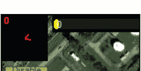

## 设置视频

要在笔记本电脑屏幕上显示视频，基本上有两个组成部分：

1. 接收传输信号。
2. 将其数字化到笔记本电脑中。

我们选择了Spektrum FPV相机和发射器，因为它价格便宜且重量轻。但我们选择它也是因为它使用FPV中最常见的频率集：Fatshark。因此，为我们的地面站找到Fatshark接收器既容易又便宜。这是我们选定的：

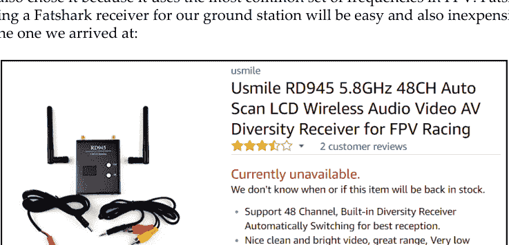

它的作用是将飞行界面左上角的人工地平线替换为FPV视图，并叠加**屏幕显示（OSD）**遥测数据，如下面的截图所示：

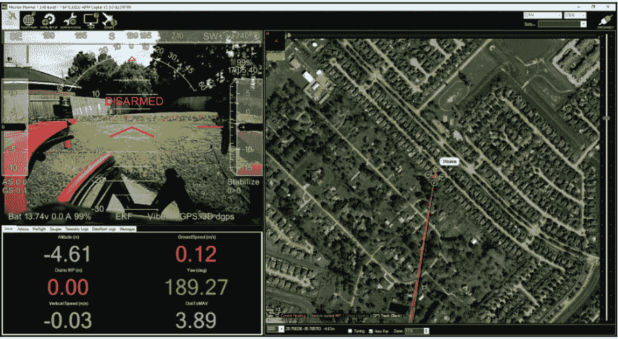

就这样搞定了！我们准备进行试飞了，对吧？不对。如果您还记得，在组装阶段，我们需要推迟其中一部分工作，直到我们能转动电机。我们现在就处于这个阶段。如果您从FPV相机中注意到，无人机上没有螺旋桨。除非您先卸下螺旋桨，否则永远不要考虑尝试下一阶段。

## 试飞前的最终配置

在尝试飞行之前，我们需要确保每个电机都连接到正确的位置并朝正确的方向旋转。还记得我们之前的图表吗？这里只是其中的Hex-X，以及标注了六个电机舵机端口的Pixhawk：

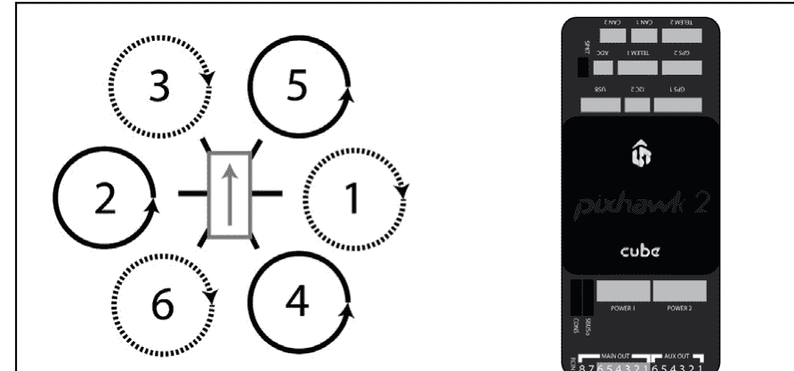

## 总结

在本章中，我们学习了更多关于原型制作、套件改装以及为我们目的而修改预制部件的理念。我们还学习了如何为多旋翼配置Pixhawk，如何将视频信号接入笔记本电脑显示屏，以及如何使用操纵杆控制无人机。如果这还不够，我们还学习了如何平衡多旋翼的功率与重量。现在，您可以看到它们是多么复杂的机器。

在下一章中，我们将挑战无人机领域的圣杯：固定翼无人机。在很多方面，它们比多旋翼简单。但实际上并非如此。
