# 第 7 章：圣杯——固定翼无人机

哇，作为圣杯，她可真是一头丑陋的猪，对吧？嗯，原型通常都不好看。那么，为什么固定翼无人机（如下图中所示的飞机）被认为是圣杯呢？

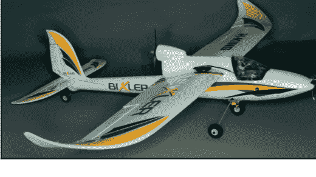

答案其实很简单。飞机需要不断移动才能保持在空中。飞得太慢，你就会失速（一个花哨的词，意思是从天空坠落，直到你重新获得速度，只不过通常坠落是垂直速度，而垂直速度是向下的）。

对于多旋翼，调参相当容易：起飞，悬停在**地面效应之外（OGE）**，让它稍微*抖动*一下。如果太疯狂，只需降落、重置设置并重复。由于飞机在不停地移动，调参对飞行器来说可能危险得多。

在调试固定翼飞机时，我曾让它们变成草坪飞镖，像海豚一样跃出海洋般鲸鱼式起伏，（正如前一章所述）甚至把机翼直接吹飞了。因此，在原型开发阶段，选用相对便宜且稳定的机身非常重要。选择时也应考虑对 Pixhawk 提供一定的保护，以防出现问题。这使得泡沫飞机成为完美的选择。泡沫飞机非常便宜，本质上就是会飞的包装材料。这当然不能保证 Pixhawk 在坠毁时能幸存。但它确实提高了存活几率。

本章将涵盖以下主题：

- 为什么选择这款特定的飞机套件？
- 组装
- 使用 Mission Planner 调整固定翼飞机
- 调整设置
- 调整过程
- 自动调谐飞行

## 为什么选择这款特定的飞机套件？

我们使用的飞机（如下图所示）是 Hobby King 的 Bixler。它实际上是以热门 YouTube 频道 *Flite Test:* 的两位 Josh 之一（Josh Bixler）命名的：

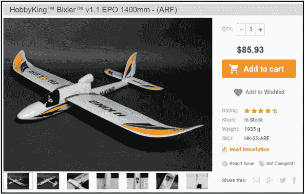

正如你所见，它非常便宜。不到 100 美元，而且自带电机和飞行所需的所有舵机。机翼上的上反角使其在滑翔时具有独特的稳定性。它还附带分离成两半的主机身（使布线和部件放置变得非常容易）。最后，它是一款动力滑翔机。这意味着它非常高效，并且在极低功率下具有飞行很远的潜力。这正是我们想要的！

## 组装

在进入零件和具体放置位置之前，让我们先快速看一下这架无人机的草图：

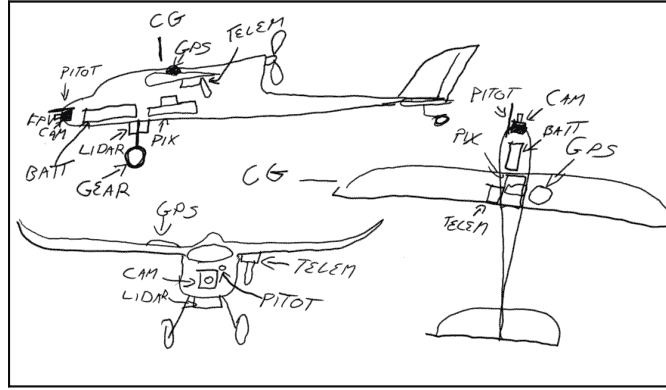

我知道，但我能说什么呢？我喜欢在喝一瓶葡萄酒的同时勾勒出我的想法。

我们使用的外设与我们所有其他无人机相同，只是额外增加了一个皮托管。我们之前谈过皮托管，但简单回顾一下，皮托管只是一个测量飞机空速的装置。想想看——速度是相对的。信不信由你，即使你站在原地不动，你也在以 113,000 英里/小时的速度旅行。是的，就是这样……为什么？因为地球自转速度为 1,000 英里/小时 + 地球绕太阳公转速度为 67,000 英里/小时，再加上太阳系穿过宇宙的速度为 45,000 英里/小时。但在地球上，你的速度是 0 英里/小时，因为你的速度是相对于地面（地球）测量的。

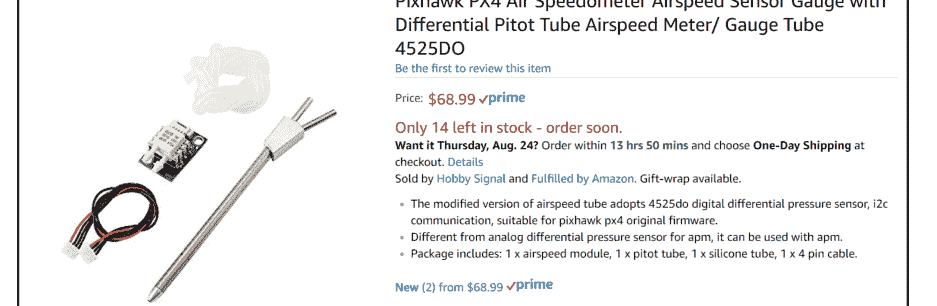

你可能会说的第一件事是，“等等……只有一个 I2C 端口，但你现在又在使用 LIDAR（I2C），和皮托管（也是 I2C）哇啊啊？” 再次说明，I2C、USB、CAN 等都是用于多外设信息传输的数字协议，都可以使用集线器。我们倾向于在 Pixhawk 2.1 上使用 I2C 的原因之一（众多原因之一）是它自带 I2C 集线器。就像你电脑上的 USB 集线器一样；只需将 I2C 集线器插入 Pixhawk 的 I2C 端口，然后将所有其他 I2C 外设插入集线器即可。

组装飞机是一个相当直接的过程。而且飞机本身（无论你选择什么机身）都会附带说明书。所以，我们不会用这些东西来[content]

在调试固定翼飞机时，我曾让它们变成草坪飞镖，像海豚一样跃出海洋般鲸鱼式起伏，（正如前一章所述）甚至把机翼直接吹飞了。因此，在原型开发阶段，选用相对便宜且稳定的机身非常重要。选择时也应考虑对 Pixhawk 提供一定的保护，以防出现问题。这使得泡沫飞机成为完美的选择。泡沫飞机非常便宜，本质上就是会飞的包装材料。这当然不能保证 Pixhawk 在坠毁时能幸存。但它确实提高了存活几率。

本章将涵盖以下主题：

- 为什么选择这款特定的飞机套件？
- 组装
- 使用 Mission Planner 调整固定翼飞机
- 调整设置
- 调整过程
- 自动调谐飞行

## 为什么选择这款特定的飞机套件？

我们使用的飞机（如下图所示）是 Hobby King 的 Bixler。它实际上是以热门 YouTube 频道 *Flite Test:* 的两位 Josh 之一（Josh Bixler）命名的：

正如你所见，它非常便宜。不到 100 美元，而且自带电机和飞行所需的所有舵机。机翼上的上反角使其在滑翔时具有独特的稳定性。它还附带分离成两半的主机身（使布线和部件放置变得非常容易）。最后，它是一款动力滑翔机。这意味着它非常高效，并且在极低功率下具有飞行很远的潜力。这正是我们想要的！

## 组装

在进入零件和具体放置位置之前，让我们先快速看一下这架无人机的草图：

我知道，但我能说什么呢？我喜欢在喝一瓶葡萄酒的同时勾勒出我的想法。

我们使用的外设与我们所有其他无人机相同，只是额外增加了一个皮托管。我们之前谈过皮托管，但简单回顾一下，皮托管只是一个测量飞机空速的装置。想想看——速度是相对的。信不信由你，即使你站在原地不动，你也在以 113,000 英里/小时的速度旅行。是的，就是这样……为什么？因为地球自转速度为 1,000 英里/小时 + 地球绕太阳公转速度为 67,000 英里/小时，再加上太阳系穿过宇宙的速度为 45,000 英里/小时。但在地球上，你的速度是 0 英里/小时，因为你的速度是相对于地面（地球）测量的。

你可能会说的第一件事是，“等等……只有一个 I2C 端口，但你现在又在使用 LIDAR（I2C），和皮托管（也是 I2C）哇啊啊？” 再次说明，I2C、USB、CAN 等都是用于多外设信息传输的数字协议，都可以使用集线器。我们倾向于在 Pixhawk 2.1 上使用 I2C 的原因之一（众多原因之一）是它自带 I2C 集线器。就像你电脑上的 USB 集线器一样；只需将 I2C 集线器插入 Pixhawk 的 I2C 端口，然后将所有其他 I2C 外设插入集线器即可。

组装飞机是一个相当直接的过程。而且飞机本身（无论你选择什么机身）都会附带说明书。所以，我们不会用这些东西来

因此，在固定翼飞机上不安装空速管不仅不可取，而且不安全，甚至极其愚蠢。

正如你所看到的，空速管的安装和启用非常简单。

要测试它，请前往 Mission Planner 中的 Flight Data 屏幕，只需对着空速管吹气。你应该会看到空速上升，如下面的截图所示：

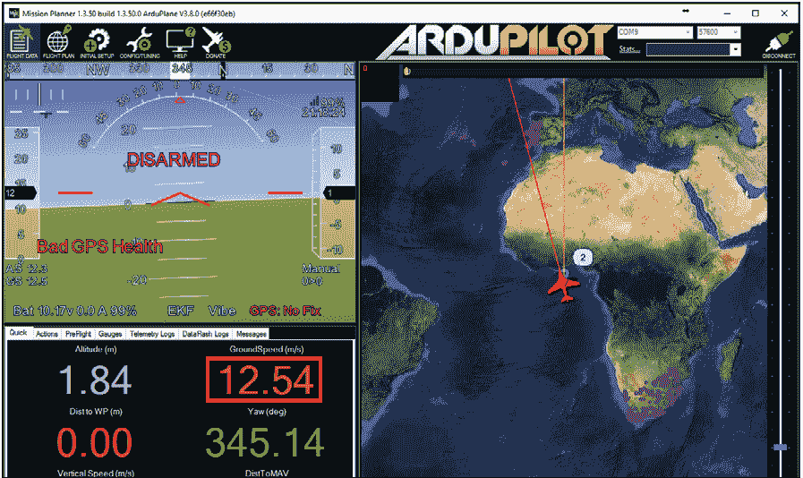

当然，它确实会在“地速”区域显示读数（Mission Planner 团队从未创建过独立的地速和空速读数）。但实际上，这显示的是空速。

- **巡航（CRUISE）：** 从控制角度来看，该模式与 FBWB 颇为相似。然而，当松开摇杆时，Pixhawk 会计算当前轨迹并设定一个 1 公里外的航点。它会保持高度并朝该航点飞行。要激活此模式，你必须获得 GPS 定位。你还可以配置此模式以跟随地形（自动调整高度以适应山脉/丘陵）。
- **自动（AUTO）：** 激活后，此模式开始执行你在 Mission Planner 中预先规划的航点。这是完全自主飞行。不过，你可以通过摇杆输入来覆盖自主飞行（这模拟了 FBWA 模式）。
- **返航（RTL）：** 这也是非常适合失效保护操作的模式。激活后，此模式会自主将飞机返回出发点（飞机起飞的位置）。然后它会按照 `ALT_HOLD_RTL` 参数设定的高度盘旋，等待进一步指令。要激活此模式，你必须获得 GPS 定位。
- **盘旋（LOITER）：** 在此模式下，飞机会自动围绕你激活盘旋模式的位置进行圆周飞行。圆的半径由 `WP_LOITER_RAD` 控制，但不会超过 `NAV_ROLL_CD` 的限制。此外，它还受到 `NAVL1_PERIOD` 参数的限制。此模式也仅在获得 GPS 定位时可用。
- **绕圈（CIRCLE）：** 绕圈与盘旋类似，但不依赖 GPS 定位。因此，它不一定会保持在同一个区域上空绕圈。如果受风影响，圆圈可能会缓慢顺风移动。它通常用作失效保护（先绕圈一段时间，然后 RTL）。由于倾斜角为 `LIM_ROLL_CD` 参数的三分之一，圆圈也相当大，以确保飞机在没有 GPS 定位时能够保持稳定。
- **引导（GUIDED）：** 这是你在笔记本电脑上用作“点击飞行”模式的模式。它允许你在 Mission Planner 中无需预先定义任务，直接在地图上点击一个点。飞机会飞到你在地图上点击的位置，并在那里盘旋等待进一步指令。此外，如果启用了地理围栏且该围栏被突破，飞机会自动进入此模式并返回预定义的返航点。
- **起飞（TAKEOFF）：** 这仅供高级用户使用。不要在首架飞机上尝试自动起飞，也不要在任何飞机充分调校之前尝试。自动起飞只能通过任务脚本设置。飞机会将油门增加到 `THR_MAX` 参数值，并上升到任务参数设定的目标高度。飞机会在跑道上前进时保持启动此模式之前所朝向的航向，直到达到高度。如果是手抛（或弹射）发射的飞机，`TKOFF_THR_MINACC` 和 `TKOFF_THR_MINSPD` 参数用于根据速度确定何时加大油门。
- **降落（LAND）：** 与 **TAKEOFF** 模式一样，此模式不适合胆小的人，并且只能通过任务脚本设置。当接近任务指定的着陆点时，飞机会自主减速并下降。一旦达到拉平高度（由 `LAND_FLARE_ALT` 设定）或到达目标剩余时间（以秒计，由 `LAND_FLARE_SEC` 设定），飞机会将俯仰角拉平至 `LAND_PITCH_CD`（以百分度为单位）设定的角度，并保持航向直到触地。要将此模式调整到恰到好处是一个非常棘手的过程。

如你所见，有大量飞行模式可供选择，几乎可以满足你的任何需求。但在你能使用其中大部分模式之前，你需要进行调校。

## 设置飞行模式

在你最初的几次飞行中，你真正只需要关注三种飞行模式——**手动**、**FBWA** 和 **AUTOTUNE**。因此，我们已在三档选择开关上将这三种模式设置为模式 1、2 和 3，如下面的截图所示：

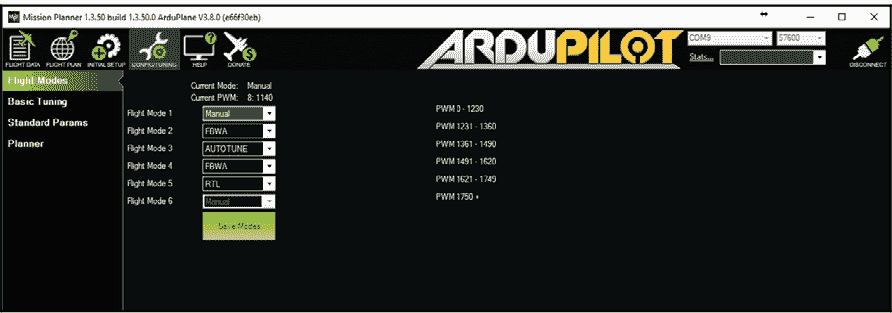

通过切换遥控器上的另一个开关，我们可以使用模式 4、5 和 6。但在最初的几次飞行中，我们甚至不用考虑这些。现在我们只需要 **手动**、**FBWA** 和 **AUTOTUNE**。

## 自动调校等级

自动调校等级（AUTOTUNE_LEVEL）决定了飞机最终操纵特性的激进程度。数值越高，飞机的响应越灵敏。数值越低，飞机响应越迟钝、越缓慢。6 以上的数值只应由经验非常丰富的飞行员尝试，因为它们容错性不高，驾驶飞机时需要极高的技巧。默认设置为 6（如下面的截图所示）：

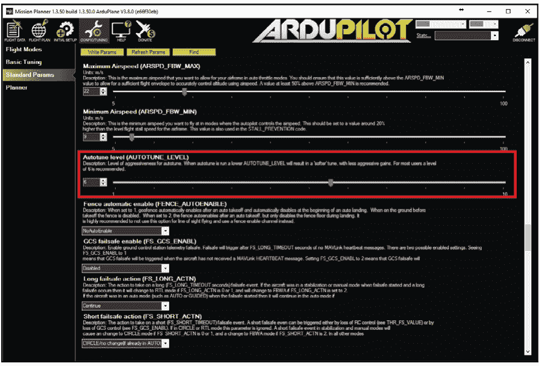

## 调校过程

每架机身都不同。有时即使是同一型号的机身，不同飞机之间的设置也可能不同。因此，重要的是要知道，你看到的任何 PID 设置都不应该直接用于你的飞机。相反，本节介绍的是如何得出这些 PID 设置的过程。第一步是确保你的飞机在完全没有 Pixhawk 输入的情况下正常飞行。

## 首次飞行

首次飞行一架飞机只是意味着让它第一次飞上天空。Pixhawk 飞机首次飞行与任何其他遥控飞机之间的最大区别是，你绝不应使用遥控器上的微调控制。

遥控器上的微调控制是摇杆附近的小按钮或滑块，用户可以通过偏移摇杆的值（PWMs）来实时调整控制面，以实现直线飞行。问题在于，通过使用微调控制偏移摇杆的值，Pixhawk 将无法知道摇杆何时处于居中位置。因此，多个飞行模式将无法正常工作。

那么，在遥控器上没有微调控制的情况下，我们如何让飞机直线飞行呢？这是一项艰巨的机械微调任务，需要改变连接舵机与控制面的推杆长度。下图展示了两种类型的推杆及其调节方式：

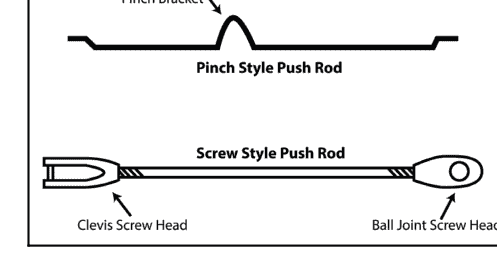

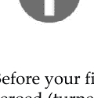

如你所见，推杆基本上有两种类型。夹紧式推杆使用压接支架来改变推杆长度。将压接支架捏得更紧会缩短推杆，而将其撑开则会加长推杆。螺纹式推杆刚性强得多，通常带有 U 形夹头或球关节承窝头，用于连接控制点或舵机。

在首次飞行之前，应调整所有这些推杆，以便当舵机归零（摇杆居中时通电）时，所有控制面都应机翼、垂直尾翼或水平尾翼的外形齐平。

在飞行过程中，如果飞机发生漂移（偏航、俯仰或横滚），你应该降落，然后调整推杆并再次尝试。这是一项乏味且非常耗时的工作。当你把所有控制面都微调好后，你应该能够将摇杆居中，而飞机应该保持直线水平飞行（除非存在风或湍流等外部力量）。

总而言之，完成控制面的微调可能需要几个小时。一旦你的飞机微调完成，你就可以进入下一步了。

## AUTOTUNE 飞行

这是你第一次允许 Pixhawk 控制你的飞机。要明白，当你处于除手动之外的任何模式时，你都不再是真正在驾驶飞机。Pixhawk 正在主动控制你的飞机，并宽容地允许你的一部分指令转发到舵机上。真正重新夺回飞机控制权的唯一方法是使用手动模式。这是你的终极失效保护。因此，请随时准备切换到手动模式（尤其是在调校过程中）。

## 起飞并准备调校

AUTOTUNE 模式与 FBWA 模式非常相似（在飞机的操纵特性方面）。因此，在手动模式下起飞后，确保飞机直线水平飞行。然后，切换到 FBWA 模式（并准备好切回手动）。如果飞机突然俯冲、爬升或横滚，请切回手动并降落。这意味着你的 Pixhawk 没有正确调平。你需要重新在 Pixhawk 的 Mission Planner 中设置水平。

## 进入 AUTOTUNE

当你在 FBWA 模式下感觉已经比较熟练时，你就可以切换到 AUTOTUNE 了。确保你在进行自动调参时使用满电电池。它需要大量的飞行时间来确保尽可能准确。以下是切换到 AUTOTUNE 时会发生的主要情况：

- 激活后，Pixhawk 会为你的 PID 设置默认值（可在任务规划器的调参页面找到）。这些值取决于你的 AUTOTUNE_LEVEL。
- Pixhawk 会不断监控你的俯仰和滚转速率，以查看它们是否超过了你在任务规划器中设定的最大速率的 80%。你将使用摇杆来帮助 Pixhawk 学习你的飞机行为。
- 每 10 秒，Pixhawk 会根据对飞机的监控保存新的速率。换句话说，如果飞机变得不稳定，你有 10 秒时间切换到手动模式并取消当前速率。这有点像撤销功能。
- 从默认值开始，Pixhawk 的速率会让飞机感觉迟钝。但随着你在 AUTOTUNE 模式下的进展，你会注意到操控性越来越好。请确保有足够的空间，因为一开始这意味着会做非常宽且缓慢的转弯。

## 如何在 AUTOTUNE 中飞行

AUTOTUNE 并不是一个细微的过程。任何观看飞机的人都会认为你可能是在受影响的情况下飞行。它依赖于对摇杆的极端操作，以便 Pixhawk 知道如何应对极端情况。

首先，你需要调校副翼，然后是升降舵（先滚转，再俯仰）。要做到这一点，只需快速将副翼控制杆完全向左移动。这会使副翼移动到最大偏转位置。保持该位置至少 2 秒钟。别担心，飞机不会滚翻。它会在我们之前设定的最大倾斜角处停止倾斜。然后，快速将摇杆移向右侧并保持至少另外 2 秒。左右移动后，你就完成了一个循环。

每个循环的调校大约会改善 5%。Pixhawk 手册指出你应该做 20 个完整循环。然而，做更多循环会进一步改善调校。因此，我建议至少进行 30 个循环（而我每次进行 AUTOTUNE 时通常会做 40-50 个）。

## 自动驾驶仪调校

自动驾驶仪的多种用途都依赖于飞机能够直线飞行并尽可能紧密地执行转弯。例如，使用固定翼飞机进行测绘需要飞机沿着彼此相当接近的直线飞行。如果转弯过大，或飞机无法直线飞行，地图上可能会出现空隙，这意味着地图质量非常差。转弯过紧也可能导致类似问题，甚至因拉力过大而把机翼从飞机上扯掉。

因此，飞行调校的最后阶段是确保飞机能够直线飞行并执行（合理）紧密的转弯。

## 设置任务

在通过遥测连接到飞机之前，你应该设置一个矩形任务（如以下屏幕截图所示）。拥有长直路段很重要，这样你才能看到飞机保持直线的能力：

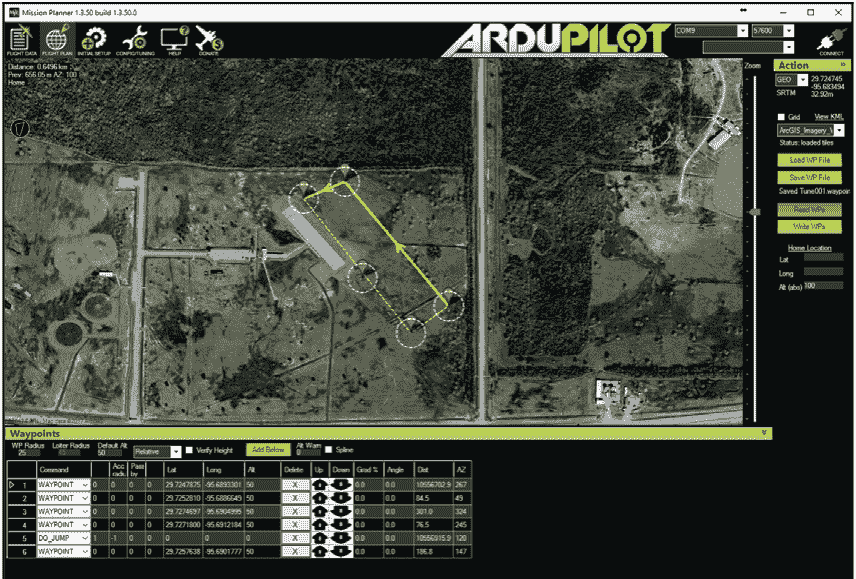

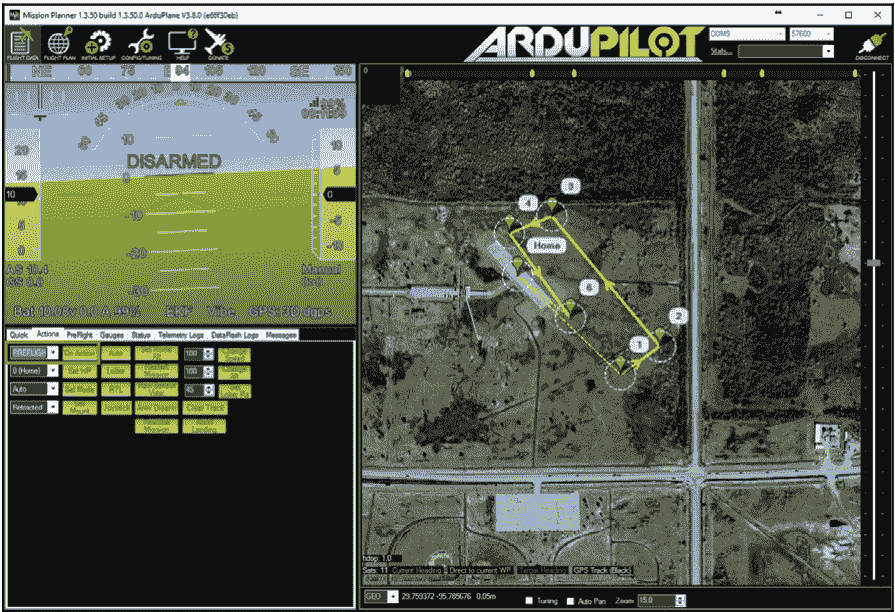

好吧，开始吧。再次发射飞机（在 **MANUAL** 模式下）。一旦飞机上升到大致与第一个航点相同的高度，将模式切换到 **FBWB**。在这个最接近全自动驾驶的飞行员控制模式下，飞行一段时间。这是你最后一次检查其他调参参数是否就绪。如果飞机稳定，将模式切换到 Auto。这将启动自动驾驶仪，飞机将等待片刻，然后向第一个航点做出第一次转弯。

当它沿着路径移动时，你会看到飞行路径（紫色）看起来像以下图像：

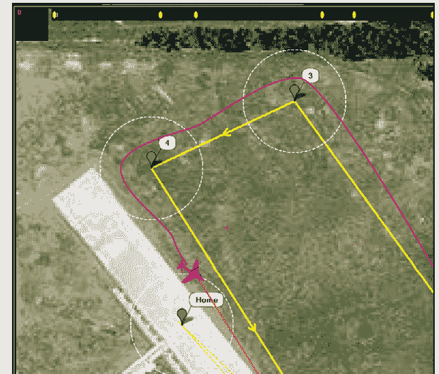

正如你所见，飞机在航点之间的连线上略有偏离。对于固定翼飞机来说，由于其特性，这总是会发生。然而，我们希望它尽可能接近那条线。做到这一点的方法是使转弯半径尽可能紧，同时不使飞机不稳定。不稳定的第一个迹象是飞机偏航振荡（鱼尾摆动）。

你实际上可以在飞机飞行时进行此调整。将飞行控制交给另一位值得信赖的飞行员（以防出现问题，你希望他们能够切换到手动并降落飞机），并切换到以下屏幕截图中显示的基础调校屏幕：

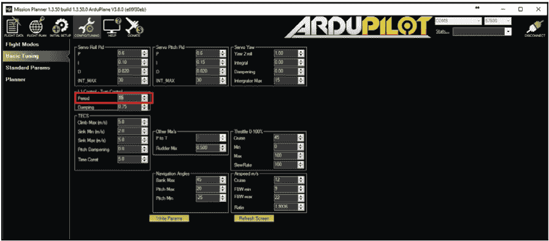

如果飞机飞行过于松散（超出路径太多），将 L1 控制区域的 Period 参数减少 1。这可能很繁琐，但你必须在此过程中进行小幅增量，否则你可能会坠毁飞机。如果过于紧（鱼尾摆动），将数值增加 1。继续此过程，直到飞行路径尽可能紧而不出现鱼尾摆动。不要忘记，每次更改值后都要在界面中点击写入参数按钮。

完成此校准后，继续在 MANUAL 模式下降落飞机。就这样！你的基础调校完成了。现在，让我们看一些更高级的内容。

## 自动降落调校

在尝试自动降落之前，先用飞机进行几次自动驾驶飞行。确保你对它的飞行方式完全满意。降落是飞行中最困难的部分。调校不良的飞机在尝试自动降落时会让你处于极大劣势，并且几乎保证会坠毁。

在正常自动驾驶期间，你可以不用调校总能量控制系统（TECS）。如果听起来很复杂，那确实如此。基本上，该系统管理油门以爬升/下降比率，以使飞机在爬升、上升和水平飞行期间能够保持相当恒定的空速。该系统对自动降落至关重要，因此在尝试之前应 definitely 进行调校。让我们在下一节中仔细看看它。

## TECS 调校

首先，在进行 TECS 调校之前，你应该按照前面概述的方式为飞机进行稳定的调校。这是一个需要两个人进行的过程：一名飞行员和另一名人员监控飞机遥测数据（大部分时间是空速）。所有这些设置都需要更改参数列表中。

以下是初始步骤（对此使用 FBWA 模式）：

- 1. 设置最大油门百分比（`THR_MAX`）。这是以你设定的巡航速度（`TRIM_ARSPD_CM`）在最大俯仰角（默认 20 度）下仍能爬升所需的油门。默认的 75% 对大多数飞机有效。但低速飞机可能需要更多，而弹道式飞机（可以直上）可能需要更少。以最大俯仰角飞行并找到一个舒适的位置。让你的地面站监控人员报出你的空速，并使用 `THR_MAX` 设置将其更改为该数值。
- 2. 使用 `TRIM_THROTTLE` 参数设置水平飞行时的巡航油门（`TRIM_ARSPD_CM`）。这可以通过在 FBWA 模式下飞行并测试不同设置来完成。
- 3. 设置最小和最大空速限制。最大（`ARSPD_FBW_MAX`）应设置为在水平飞行时达到 `THR_MAX` 时的空速。最小（`ARSPD_FBW_MIN`）应设置为你可以在不失速或失去稳定性的情况下飞行的最慢速度。
- 4. 设置最大俯仰角（`LIM_PITCH_MAX`）。现在你已设置 `THR_MAX`，在 FBWA 模式下测试它。加满油门并尽可能猛烈地爬升。如果爬升过程中空速超过 `TRIM_ARSPD`，则增加 `LIM_PITCH_MAX` 或减少 `THR_MAX`。如果爬升过程中空速低于 `ARSPD_FBW_MIN`，则减少 `LIM_PITCH_MAX`，或增加 `THR_MAX`。理想情况下，你希望达到平衡，即在 FBWA 下以最大油门和最大爬升率时，保持 `TRIM_ARSPD` 的空速目标。
- 5. 设置最小俯仰角（`LIM_PITCH_MIN`）。这设置为在 `THR_MIN` 时可以将机头向下俯仰多少而不会使飞机超速。
- 6. 设置最大爬升率（`TECS_CLMB_MAX`）。不要将其与空速或俯仰混淆。这严格来说是飞机获得高度的速度。将其设置为在 `THR_MAX` 和空速等于 `TRIM_ARSPD_CM` 时你能达到的最快爬升率。

- 7. 设置最小下沉率（`TECS_SINK_MIN`）。将其设置为油门设为 `THR_MIN` 时的下降率，以及当你向下俯仰机头并能保持等于 `TRIM_ARSPD_CM` 的空速时的下沉率。
- 8. 设置最大下沉率（`TECS_SINK_MAX`）。这是通过在不超出下限俯仰限制且从不超出 `ARSPD_FBW_MAX` 的情况下下降飞机来计算的。

## 测试和微调 TECS

在继续设置自主降落之前，你需要测试你的调参并将其调好。以下是测试步骤：

- 1. 使用 RTL 将飞机设置为在你的家点附近盘旋。确保它能够在高度变化不超过 10 m 的情况下保持高度。如果它开始高度振荡，请增加 `TECS_TIME_CONST`。每次只增加 1。如果发现自己整体更改了 10 或更多，则需要全部退回并检查原始 PID 调参。
- 2. 检查 `THR_MAX`、`TECS_CLIMB_MAX` 和 `LIM_PITCH_MAX` 之间的平衡是否正确。只需在 RTL 盘旋中发送命令让飞机增加约 60 m 的高度。油门应达到 `THR_MAX` 的约 80%，俯仰应约为 `LIM_PITCH_MAX` 的 5° 以下。以下是如何排查任何问题的说明：
  - 1. 如果速度开始下降到你舒适的范围以下或油门卡在 `THR_MAX`；要么增加 `THR_MAX`，要么降低 `TECS_CLIMB_MAX`。
  - 2. 俯仰角 constantly 卡在最大值；要么增加 `LIM_PITCH_MAX` 要么降低 `TECS_CLIMB_MAX`。
- 3. 检查 `LIM_PITCH_MIN` 和 `TECS_CLIMB_MIN` 之间的平衡。在 RTL 盘旋中发送命令让飞机下降约 60 m。理想情况下，油门会降低并保持在 `THR_MIN`，空速保持在 `ARSPD_FBW_MAX` 以下，同时 `LIM_PITCH_MIN` 保持在其设置值上方约 5°。如果未满足这些要求，以下是如何排查：
  - 1. 如果俯仰卡在 `LIM_PITCH_MIN`，要么降低 `TECS_SINK_MAX`，要么降低 `LIM_PITCH_MIN` 数值。
  - 2. 如果速度过快，则降低 `TECS_SINK_MAX`

仍有其他参数可用于微调 TECS。一般来说，除非在特殊情况下，否则你不需要这些参数。完整的参数列表，请访问此页面：http://ardupilot.org/plane/docs/tecs-total-energy-control-system-for-speed-height-tuning-guide.html#complete-parameter-list。

现在 TECS 已调好，我们可以开始设置自主降落参数。

## 自主降落设置和参数

幸运的是，自主降落本身的参数并不多。 不幸的是，将这些参数调好可能是一个令人沮丧的过程。让我们逐一查看它们：

- **LAND_FLARE_SEC** 和 **LAND_FLARE_ALT**：我们会同时介绍这两个参数，因为它们非常密切相关。LAND_FLARE_SEC 优先于两者，这只是飞机应在撞地前多少秒开始拉平。拉平是切断动力并抬起机头以减速飞机并开始最后下降到着陆区。LAND_FLARE_ALT 是飞机应在距地面多少米处执行相同任务。 如果你仅依赖 Pixhawk 的气压计进行高度测量，这组数值应设置得相当高（例如 10 秒和 6 米）。由于我们使用的是相当精确的测距仪，我们将其设置为 4 秒和 2 米。
- **TECS_LAND_SPDWGT**：这是一个用于控制着陆空速（我们稍后会介绍）和最后航点与着陆目标之间下滑坡度之间平衡的参数。下滑坡度绝不应超过 10%（例如，从 300 m 外下降 30 m），理想情况下应远低于此。 但如果你的着陆速度接近失速，你会希望给予空速比下滑坡度更高的优先级。范围为 0-2。1 为相等平衡（默认值）。0 完全优先于下滑坡度，2 完全优先于速度。你可以使用小数（浮点数）作为这些值。值为 -1 会动态缩放此值，不断调整优先级直到触地时为 0。它往往能产生更准确的着陆。
- **TECS_LAND_ARSPD**：这是你希望着陆的速度。理想情况下，这是不会失速但会下降高度的速度。
- **LAND_PF_ALT** 和 **LAND_PF_SEC**：这些设置与拉平类似。 然而，这些是预拉平。通过预拉平，飞机可以将速度降至 TECS_LAND_ARSPD 以下并实际加速到着陆速度。这可以为 Pixhawk 在着陆期间提供更大的控制。这些值应大于拉平设置的值（例如，如果 LAND_FLARE_ALT 为 4，LAND_PF_ALT 应为 6 甚至 8）。
- `LAND_PF_ARSPD`：这是你的预拉平空速目标速度。它应低于 `TECS_LAND_ARSPD` 设置，但高于失速速度。一些飞机着陆速度很快（例如 EDF 喷气机），在这种情况下，设置为 1 只会指示飞机在到达拉平区之前尽可能多地减速。
- `TECS_LAND_SINK`：这是触地时的下降速度。默认情况下，它设置为 0.25 米每秒，这适用于许多机型。 然而，如果你的飞机弹跳，你会希望进一步降低此值。
- `LAND_PITCH_CD`：这是拉平的最小目标俯仰角。具有三轮起落架（前面一个，后面两个）的飞机希望此值约为 300（3°，因为参数中的 CD 表示百分度）。
- `TECS_LAND_DAMP`：这是拉平期间俯仰变化速率的阻尼器。接近失速速度时的突然极端动作很危险，因此此设置可能很有用。数值越大，阻尼越大。
- `LEVEL_ROLL_LIMIT`：用于控制拉平后最大滚转角（默认 5°）。这是为了防止着陆时机翼撞击地面。 因此，在极端侧风的情况下，飞机可能无法在期望的目标着陆。
- `TECS_LAND_SRC`：此参数用于在飞行中调整你的 `TECS_LAND_SINK`，以确保飞机降落在着陆目标上。如果发现自己超调，可以将数值减小到负值以强制失速，或用正数值强制机头向下。
- `LAND_DISARMDELAY`：飞机停止移动后（GPS，而非空速），这是 Pixhawk 在解除武装前的延迟秒数。默认值为 20 秒。
- `RNGFND_LANDING`：此设置让 Pixhawk 知道是否使用测距仪在着陆期间计算到跑道的距离。如果使用测距仪，将此设置为 1。

好吧，也许设置相当多。但你用于调参的主要是影响拉平的那些。

## 测试

设置一个任务，使最终航点足够低，以便着陆不会产生大于 8% 且小于 5% 的下滑坡度，并在你的着陆区设置一个 `DO_LAND_START` 标记。记得在着陆区前后为自己留出一些安全空间（以防欠射或过射）。

然后，将模式切换到自动模式，同时手指悬停在切换回手动的开关上并密切观察飞机。准备好切换到手动并全功率上升回天空。

如果你不喜欢着陆方式，使用前面提到的设置来调整你的拉平和速度和角度以抵消你不喜欢的部分。当然，在进行调整之前先以 **MANUAL** 模式着陆，然后再试一次。

在你对着陆感到满意之前需要多次迭代。一旦你满意，就在任务开头添加一个 `TAKEOFF` 命令，看看你是否能从起飞到着陆运行一次完全自主飞行。如果成功，你会非常高兴。

## 总结

哇！那很多，对吧？现在你可以看到为什么固定翼飞机真的是无人机设计师的圣杯。在本章中，我们了解了将 Pixhawk 集成到固定翼无人机所需的额外组件。我们了解了放置和设计思考。最后，我们经历了调校固定翼无人机的非常复杂和冗长的过程。

在下一章中，我们实际上不会建造一架无人机。相反，我们将带你了解创建 VTOL 飞机的一些概念... 有趣！

