# 第 8 章：基于 Pixhawk 的垂直起降原理

## 第 8 章：基于 Pixhawk 的垂直起降原理

设计和调优一架**垂直起降（VTOL）**飞行器可能需要很长时间。设计并让你的 VTOL 飞行器实现稳定飞行，甚至可能需要数年时间。最初，本章打算基于一个有趣的东西——*Battlebot* 设计。但是，当本书宣布时，有一点非常明确。你（读者们）想了解更多关于 VTOL 的内容。因此，由于既没有时间也没有预算去制造一架 VTOL 原型机（等我们成功让它正常工作时，很可能新版本的 Pixhawk 已经发布了）；我们将致力于研究如何创建一个 Pixhawk VTOL 的原理和理论，而不是某个人是如何完成 Pixhawk VTOL 的。

在本章中，我们将涵盖以下主题：

-   VTOL 飞行器的类型
-   VTOL 的限制与考量
-   融合多旋翼与固定翼设计
-   调优 VTOL 飞行器

## VTOL 的类型

VTOL 基本上有两种类型：混合型和推力矢量型。所有其他 VTOL 都是这两种类型的变体。其中一种更容易制造，而另一种飞行性能更好（且效率更高）。不幸的是，这些优点并不集中在同一种 VTOL 类型上。

## 混合型 VTOL

这种类型当然容易设计和制造。只需拿一架非常好的固定翼飞机，然后将多旋翼框架附加到它上面（以飞机的重心为中心）。这有点过于简化了，但很准确。不幸的是，在这种设计中，多旋翼的螺旋桨在向前飞行时可能会因风力而开始旋转。即使不旋转，它们本质上也是控制面，会在机翼周围引起奇怪的湍流和涡流，从而改变飞机的飞行方式。此外，围绕移动空气设计的控制面在向前飞行时不发挥作用，这会降低你的效率。并且（一般来说）制造固定翼无人机的目的是为了获得更长的飞行时间（可能还有速度）。因此，制造风阻是适得其反的。下图展示了一架混合型 VTOL 飞行器：

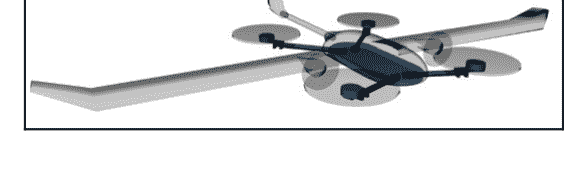

## 推力矢量 VTOL

推力矢量只是一个花哨的词，指的是改变推力系统所推动空气的方向。无论是通过旋转螺旋桨（如鱼鹰军用飞机）、旋转喷气口（如鹞式战斗机），还是改变飞行器的整体方向（如 X-Plane 无人机，它像四轴飞行器一样用尾部起降，然后旋转机身前向飞行），识别推力矢量 VTOL 的方法是它使用同一套推力系统来完成垂直起降和在飞行中向前推进。

在设计阶段要正确实现这一点要困难得多，从重心变化到考虑在空中推拉飞机对飞机模式飞行的不同影响。这无疑是一个设计挑战，而且你需要有预算。在这种类型的飞行器上，过渡到前向飞行阶段预计会经历几次坠毁，直到你把它调好。

推力矢量 VTOL 的所有努力带来的回报是，在所有的飞行模式下，每一克重量都被充分利用。在飞机模式飞行时，不会有任何*无功能*的部件挂在外面。这也意味着没有能量浪费。无论是推动在前向飞行中不使用的部件穿过气流，还是使用控制面来抵消它们对飞行的影响。每次你（或你的飞行控制器）使用控制面，都意味着风的阻力，当然，这也就意味着飞行时间减少。

下图是一架鹞式战斗机。美国（和英国）海军大量使用这种飞机，因为它能够在小得多的航空母舰上起降，这些航母的建造成本远低于那些搭载需要弹射器起飞和拦阻索降落飞机的大型航母。鹞式战斗机使用一台大型涡扇发动机，并将发动机排气引导至机翼下方（主船体两侧）的可旋转喷嘴，这些喷嘴还配有百叶窗，甚至可以将推力推向侧面。这是推力矢量 VTOL 飞行器的一个非常典型的例子，也是最早的之一：

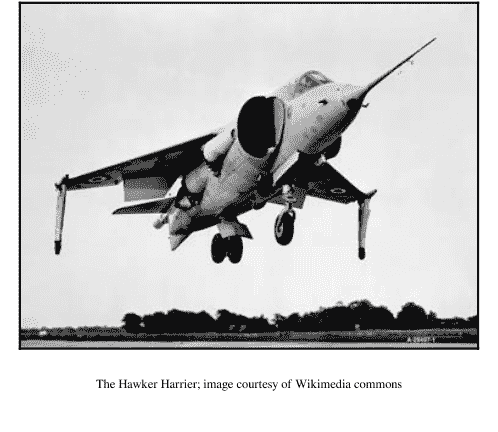

霍克鹞式战斗机；图片由维基共享资源提供

## 挑战

幸运的是，我们已经知道飞机含电池（湿重）的重量。这个重量是 34.79 盎司（986.28 克）。我们需要做的是找到多旋翼电机、电调、翼梁和线路，使得飞机加上附加部件的总湿重低于多旋翼的飞行重量限制，并且电池中还有足够的电量来维持合理时间的前向飞行，然后再垂直降落。我们还需要保持在 Bixler 的最大重量以下。

我们的第一个问题出现了。我们（严格来说）已经超过了 Bixler 的最大重量。公布的最大飞行重量是 650 克（22.92 盎司）。然而，这似乎是干重。即便如此，我们也几乎达到了 Bixler 的最大飞行重量。所以，这行不通。我们需要一架机翼更大、更强、坚固得多的飞机，而且既然我们要这么做，我们需要能携带（并运行）6S 电池的飞机：10,000 mAh 6S 电池。这是中等至重型举升多旋翼非常常见的电池，应该足以满足我们的 VTOL 需求。

## 简单的事情变复杂了

好吧，我们的 Bixler 显然不行。它并不是为承载那么多重量或有效载荷而设计的。仅一块 10,000 mAh 电池就重约 1,400 克（49.39 盎司）。这比我们 Bixler 的整个飞行重量还重。我们选择这种电池是因为 6S（22.2V）电池能提供足够的电力来在多旋翼中提升重物。而 10,000 mAh 也应该能为我们的固定翼飞机提供充足的飞行时间。

那么，我们知道什么不行。什么可以呢？来看看 Skywalker EVE-2000。对于最终量产型号，我们当然会设计更专门的东西。但这是一个测试混合设计的绝佳机身。它有巨大的机翼（2,400 毫米翼展），最大湿重为 4,600 克（162.26 盎司）。

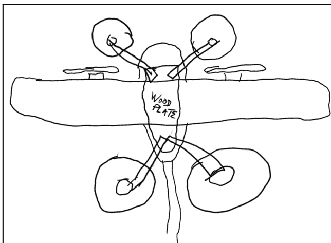

所以，我们的想法是穿过机身，将翼梁直接连接到木板（替换为碳纤维板）上。我们需要一些硬件：

## 制定我们的购物清单

在原型制作中，计算预算是必不可少的。你可能在为客户、投资者做预算，或者我们确信你的另一半会想知道这要花多少钱。因此，在真正制作最终设计之前，弄清楚你最可能需要哪些部件至关重要。

首先，通过 fpvmodel.com 购买一架 Skywalker EVE-2000 需要 285 美元（USD）。它是 PNP（即插即用）版本（因此附带所有舵机、电机和螺旋桨），所以你只需要插入你的 Pixhawk 和外设，然后就可以飞了。

那么，一块 Pixhawk 2.1（215 美元）、皮托管（70 美元）和用于着陆的激光测距仪（159 美元）使我们的累计总额达到 729 美元。我们将在 GPS 方面走不同的路线。

因为（通常来说）我们希望测绘数据非常准确，我们将使用一种由**载波相位差分技术**（**RTK**）增强的 GPS 系统。RTK 在地面上使用一个固定的 GPS 基站，并利用与空中系统传输的相对数据，使空中系统能够更准确地估算其实际坐标。GPS 的精度大约在直径 6 英尺（2 米）的范围内，而 RTK 可以达到厘米级精度。这真是惊人的精确。为了控制预算和重量，我们会使用下面这款：

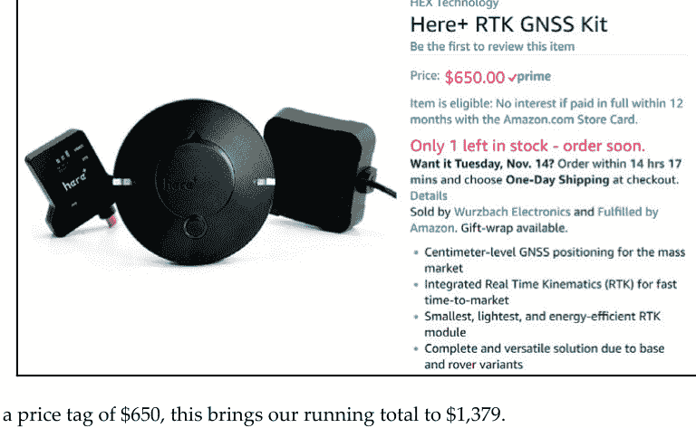

它的价格是 650 美元，这样我们的累计总额就达到了 1,379 美元。

考虑到多旋翼的所有变量，我们会在这里停下来，完成组装、飞行测试和调优，然后开始实现多旋翼部分。但我们稍后会进入测试过程。

让我们从电机到机身的顺序来检查多旋翼系统，确保它能举起所有东西。

许多电机安装座有些凹陷（这意味着翼梁管与电机平面相交）。我们希望安装座是齐平的，这样如果在测试过程中需要添加更大的电机，就不必重新设计多旋翼机身。于是，我们找到了这些：

其中四个（约 $63）使我们的总金额达到 $1,442。它们适配 25 mm 的碳纤维管。但我们还得等一等再做决定，因为我们需要知道多旋翼上的螺旋桨会有多大。我们需要确保它们不会碰到固定翼飞机的螺旋桨。

在决定螺旋桨之前，我们需要先确定电机。不是每个电机都能驱动每个螺旋桨。在 6S 电流等级下，480kv（每伏特 480 转）是一个相当安全的选择。螺旋桨越大，KV 值越低。而我们选择的电机（如下图所示），配备 13 英寸直径、6.5 英寸螺距（通常称为 13 x 6.5）的螺旋桨时，每个可产生 2,000 克推力：

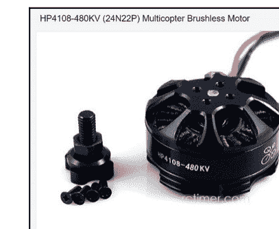

大约 $120（4 x $30），我们的累计总额达到 $1,562。现在我们来看螺旋桨。我们不希望在混合飞行器上使用折叠螺旋桨。它们在飞行中可能以错误的方式折起来，并且在切换到多旋翼模式时无法正确展开。所以，固定式碳纤维螺旋桨才是我们想要的：

再加 $28，我们就达到 $1,590。总推力为 8,000 克，足以让我们的飞机垂直离地。

在这些旋翼带动下，电机负载时电流约为 25 A，但这是持续电流。峰值可能高达 35 A。我们需要能够承受更高电流的 ESC。如果我们选用 40 A 的 ESC，预计每个约 $25（但某些品牌会贵得多）。考虑到这一点，四个共 $100，我们现在的总额达到 $1,690。

好，现在我们知道了我们使用的是 13.5 英寸（直径）的螺旋桨，也就知道了这些螺旋桨的旋转半径为 6.75 英寸。我们希望留出一些余量，所以我们将以 9 英寸的间隙来计算这个半径。
接下来是高中几何，还有那句人人痛恨的“勾股定理”。看到了吧？你的老师说得没错！它在现实世界中确实有用！

我们假设机身宽度约为 9 英寸，这意味着从中心线到 x 轴（沿机翼方向）需要额外的 4.5 英寸。我们还假设螺旋桨和电机外壳在三角形 y 轴（向前方向）上从机翼边缘向外延伸 2 英寸。如果我们想要 9 英寸的间隙，那么 (9+4.5)²+(9+2)² = (长度)²。我们的碳纤维翼梁至少需要 17.42 英寸长，约合 442.5 毫米。我们取整到 500 毫米（因为我们可以随时截短，但不能加长）。我们认为这些 20 毫米（内径）x 25 毫米（外径）x 500 毫米（长度）的碳纤维杆正合适：

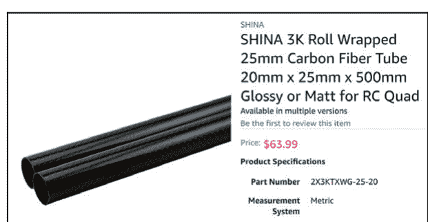

其中两个（每笔订单附带两根翼梁）使我们的累计总额达到 $1,718。

最后，我们购买一块 1/8 英寸厚、24 x 24 英寸的碳纤维板，价格为 $203（来自 DragonPlate.com），以及一些安装环（四包），约 $20（如下图所示）。至此，我们的总费用达到 $1,941。好的，这就是我们的制造成本。但这是否就是实际花费呢？不是。我们还得计入杂项费用（如胶水等），以及调试（摔机）的成本。因此，我们估计这架不带相机的飞机的最终成本为 $2,500（这是制造成本，毕竟不是我们要向客户收取的费用，更不用说你的劳动力了）。

好的……既然我们已经知道要用哪些部件，那我们计划如何实施呢？

## 最终方案

对于这样复杂的构建，仅仅画一个布局草图是远远不够的。投入了太多资金，不能只依靠草图。下图展示了我们最终方案的四分之三视图：

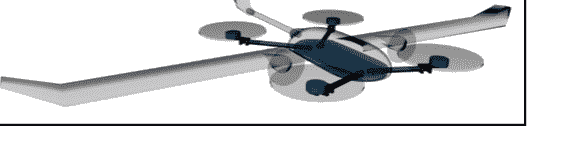

## 配置 Pixhawk

在之前几代这种类型的混合飞行器中，你需要使用 PX4 固件（而不是 Ardupilot 或 APM）并进行大量定制。幸运的是，较新的 Ardupilot 固件版本正好支持这种类型的垂直起降（VTOL），他们称之为 Quadplane。显然，通道会有些不同。

下图展示了所有电机/舵机的连接方式：

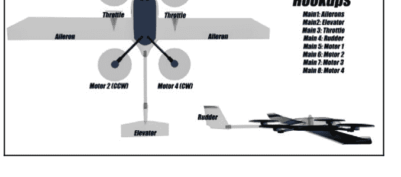

|  |  |
|---|---|
| ARMING_RUDDER | 如果将此值设置为 2，你可以通过向左打满舵并收油门来让电机上锁。但是请注意，不要用收油门到零和猛向左打舵的方式飞行，否则你会让飞行器上锁。 |
| Q_THR_MID | 这是一个 0-1,000 之间的值；500 表示 50% 油门（也是默认值）。这是多旋翼电机维持悬停所需的油门量。在调试过程中，如果切换到固定翼模式时注意到高度突然上升，请降低该值；如果看到高度下降，则增加该值。 |
| Q_TRANSITION_MS | 这是 Pixhawk 缓慢关闭四轴电机所需的时间（在达到产生升力的最低空速后，电机需要多长时间才关闭），反之亦然（切换回多旋翼模式时重新启动电机的时间）。默认值为 5000（5 秒）。 |
| ARSPD_FBW_MIN | 这是机翼产生升力所需的最低空速。（在转换过程中达到该速度时会触发 Q_TRANSITION_MS。） |
| Q_VFWD_GAIN | 默认设置为 0。如果设置为大于 0，则表示牵引（固定翼推力）电机在迎风时用于帮助保持多旋翼水平的力度。仅在你熟悉高级操作时才使用。 |
| Q_ASSIST_SPEED | 该参数用于在飞行器速度低于设定速度阈值时提供额外升力。这不是切换到四轴飞行模式，而是在固定翼飞行中由四轴螺旋桨辅助，防止飞机失速。 |
| Q_ASSIST_ANGLE | 与 Q_ASSIST_SPEED 配合使用时，这个参数会非常有用。在实际失速之前，飞机在低速时会开始掉高度。该参数是平飞中四轴电机介入并产生额外升力的下降角度。在 AUTO、LOITER、RTL 或 GUIDED 模式下，四轴电机将辅助爬升率，使飞行器达到下一个航点（或导航控制器要求的）高度。在 FBWB 模式下，四轴电机将辅助所需的爬升率。在 FBWA 模式下，四轴电机将根据飞行员的上升或下降速率提供成比例的升力。此辅助功能仅推荐用于机翼升力不足、无法单独依靠固定翼模式保持高度的 Quadplane。使用此参数时，你会发现效率和电池寿命会显著下降。 |
| RTL_RADIUS | 这是飞行器从起飞点开始，从固定翼 RTL 模式切换到 VTOL QRTL 模式（从固定翼过渡到多旋翼）的距离。 |
| Q_RTL_ALT | QRTL 模式期间瞄准的目标高度。 |
| Q_RTL_MODE | 将其设置为 1 以在 RTL 期间启用自动转换（使用 RTL_RADIUS 和 Q_RTL_ALT）。 |
| Q_WVANE_GAIN | 在多旋翼模式下，飞行器主动迎风转向的程度。由于 VTOL 飞机的特性，电机可能需要非常努力地工作才能防止机尾在顺风时甩来甩去。该增益允许飞机向风“妥协”。 |

Quadplane 需要 GPS 才能正常飞行。在尝试任何飞行之前，务必等待收到 3D GPS 定位成功的信号。

## Quadplane 飞行模式

Quadplane 特有的飞行模式是多旋翼模式下的飞行模式。具体如下：

- **QSTABILIZE**：与普通多旋翼的自稳模式一样。横滚和俯仰控制倾斜角，但松开摇杆后，多旋翼会恢复水平（但可能会漂移）。与大疆的 **ATTI**（姿态）模式类似。
- **QHOVER**：与普通多旋翼的定高模式一样。该模式保持高度，你可以通过横滚、俯仰和偏航控制来定位多旋翼。松开摇杆后，多旋翼会停下并保持在悬停位置。
- **QLOITER**：与普通多旋翼的悬停模式一样。它也很像 **QHOVER**，但你确实能够控制飞行器的高度。就像大疆的 **GPS** 模式。
- **QLAND**：与普通多旋翼的降落模式一样。该模式会使飞行器下降并着陆，无论其物理位置如何。遗憾的是，这个模式没有多旋翼降落那么复杂。如果在地面发生 GPS 漂移，飞行器可能会为了回到之前的位置而翻倒。因此，一旦着陆，你应该切换到 **QSTABILIZE** 模式，因为它不受 GPS 漂移的影响。

## 推荐的 VTOL RTL 程序

对于这种混合机型，处理 **RTL** 有几种方法，但我推荐以下做法：

- 1. 使用飞机 **RTL** 模式返航（RTL）。这样可以快速到达附近区域。
- 2. 靠近家点时切换到 **QRTL**。如果 `Q_RTL_ALT`、`RTL_RADIUS` 和 `Q_RTL_MODE` 已设置，则会自动发生。
- 3. 切换到 **QLAND**，同样，如果 `Q_RTL_ALT`、`RTL_RADIUS` 和 `Q_RTL_MODE` 已设置，这将自动发生。

我发现这是最高效的程序。不浪费电量在盘旋或其他机动上。直接飞入，切换模式，然后降落。

## 尝试任何转换前的注意事项

我知道，经过所有这些努力，你会迫不及待地想看到它转换。 在甚至考虑转换之前，先调好多旋翼模式是一条漫长而痛苦的道路。

确保在进行任何混合飞行之前，先调整所有 Q 调参参数，使多旋翼模式尽可能稳定地飞行。你将为自己节省大量费用和麻烦。

尝试转换时，确保你在 **高于地面水平（AGL）** 最低 20 m 的高度以上。 在你设置好所有 Q 转换参数之前，你很可能会在第一次测试中损失高度，甚至失去稳定性。 即使如此，也要保持在 20 m AGL 以上。

## 飞行数据界面

下图显示了 Mission Planner 的飞行数据界面：

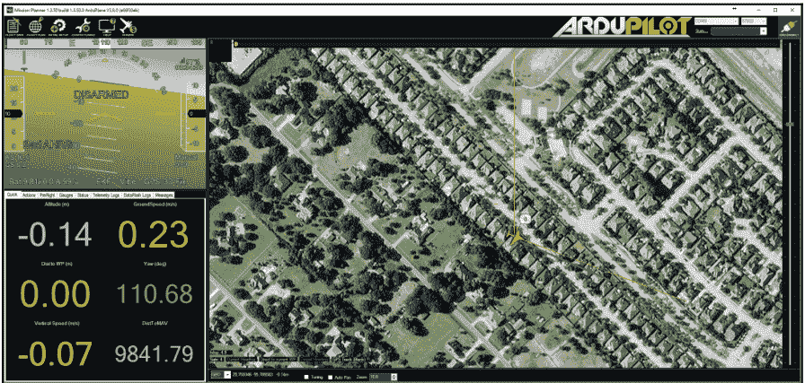

左上角的窗口代表抬头显示器（HUD）——你可以在此立即了解飞机的朝向、高度和状态。 警告信息以红色文字显示（例如图像中我们看到的 DISARMED 和 Bad AHRS 警告）。

大窗口是显示飞机/多旋翼/地面车位置的投影卫星地图（在本例中为固定翼飞机）。 从飞机上伸出一条紫色线，表示飞机指向的方向。

左下角的窗口显示当前数据，并有多个选项卡以不同格式查看数据，甚至向 Pixhawk 传输信号。 选项卡如下：

- **Quick：** 这些是来自飞行器的基本遥测数据的数值。
- **Actions：** 这允许用户向 Pixhawk 发送命令，例如悬停、武装等。
- **PreFlight：** 这显示了在启动 Pixhawk 飞行器之前的前飞行检查清单和状态。 绿色表示已准备好的项目，红色表示可能需要关注的项目。
- **Gauges**：这显示了与快速屏幕类似信息的模拟视图。 该模拟视图使用图形表示形式，即虚拟仪表，而不是简单的数字。
- **Status**：这提供了飞行器所经历的每个遥测参数的详细读数。
- **Telemetry Logs**：这允许用户将 Pixhawk 的飞行日志加载到计算机中并重放任务以便事后评估任务。
- **DataFlash Logs**：这用于排查 Pixhawk 的问题。 如果你在调参或任务中遇到问题，这些日志对于发现错误非常有用。 此外，当你向社区寻求帮助时，他们首先会问你提供这些日志以供分析。
- **Messages**：这提供了日志条目的实时视图，因为它们发生。

## 飞行计划屏幕

下图显示了飞行计划屏幕（未加载固定翼调参任务）：

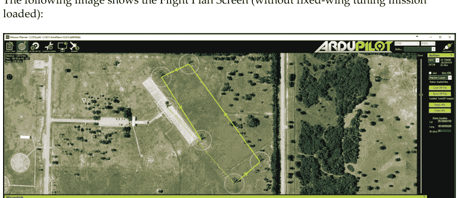

主窗口显示任务区域的卫星地图。 黄色线条代表飞行器的期望路径，而白色圆圈代表转弯弧的区域（转弯半径）。 绿色标记代表任务的实际航点目标。

底部窗口是代表任务所有参数的图表。 在此窗口中，你可以添加事件（例如 Do Jump，它将飞行器发送回特定航点）。 如果你的相机连接到 Pixhawk，你可以指示相机拍摄图像/开始录制。 飞行模式也可以设置为更改（例如“Land”）。 任何 Pixhawk 能够执行的命令都可以通过此界面触发。

最右侧的窗口允许你保存任务以供以后使用（到你的计算机），加载以前的任务，更改卫星地图的类型。 不同的地图可能证明更/少详细，并且也可能证明更/少及时。 最后，在此窗口底部，有一个区域允许你读取当前加载到 Pixhawk 中的航点，或写入你刚刚创建的航点。 你必须写入航点才能让 Pixhawk 执行任务。 家点也显示在这里。

## 初始设置屏幕

下面的屏幕截图显示了初始设置屏幕的 Install Firmware 选项卡。 此屏幕允许你将 Pixhawk 模块重新用于其他应用（例如 Rover）：

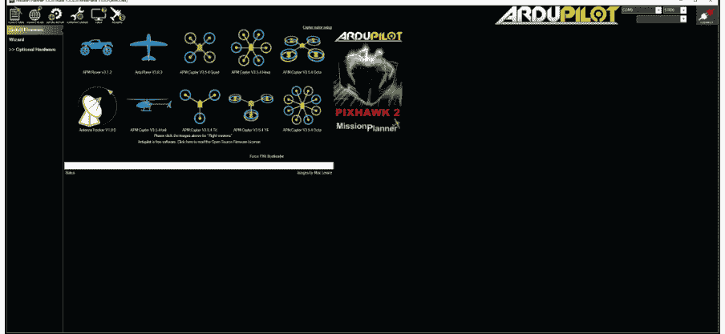

## Wizard

下面的屏幕截图显示了点击 Wizard 选项卡时弹出的界面。 这是一个分步配置向导，可帮助完成 Pixhawk 的基本设置：

## 必需硬件

本节允许你校准/设置使 Pixhawk 能够正确驱动你的飞行器的所有外围设备。 让我们逐一查看：

- **Accel Calibration**：这允许校准加速度计。 如果你在飞行数据屏幕中收到 Bad AHRS 错误，你需要执行此操作。 只需进入此菜单并点击 Calibrate Accelerometer 以打开校准向导。 Calibrate Level 按钮可让你校准 Pixhawk 的正确水平位置。 这对于飞机至关重要，否则它们在 Pixhawk 认为其飞行水平时可能会俯仰/滚转。 在多旋翼中，如果未正确校准，这会导致尝试悬停时移动。 在固定翼中，如果未正确校准，这会导致俯仰/滚转轴振荡。 如果你更改飞机上 Pixhawk 的位置，这也是一个必不可少的流程。
- **Bluetooth Setup**：用于设置蓝牙模块的区域（例如我们在高尔夫球车设置中使用的那种）。 由于其范围有限，蓝牙不应用于飞机或快速移动的车辆。 请记住，蓝牙的范围约为 30 米。
- **Parachute**：这需要一个区域来设置降落伞部署系统。 这些系统并不广泛使用，但在飞机发生故障（尤其是在人员上方）时可能证明有用，甚至可以代替车辆着陆。 需要注意的是（尤其是在多旋翼上），飞机可能会缠绕在降落伞线上，降落伞应被视为最后的机会，而不是可靠的手段。
- **ESP8266**：这是设置 ESP8266 Wi-Fi 模块的区域。 正如我们在手推车章节中所讨论的，这是控制/获取无人机遥测的另一种方式。 Wi-Fi 也有有限的范围（约 100 m），但可能证明有用（尤其是在禁止蓝牙的 Apple iOS 设备上）。
- **Antenna Tracker**：需要特殊 **超视距（BLOS）** 许可的美国远程无人机，从使用定向天线中获益匪浅，该天线不断指向目标。 这对于高质量视频系统的实时覆盖而不受干扰尤其有用。 这是设置和调整天线跟踪器的区域。

## Config/Tuning 屏幕

顾名思义，此区域是 Pixhawk 管理员配置和调参飞机的地方。 由于其中一些菜单仅在高级布局中可用，首先我们将介绍 Planner 部分（它将为你提供访问所有高级功能）。

## Planner

下面的屏幕截图显示了 **Planner** 选项卡的选项。 这是我们配置 Mission Planner 软件本身的区域：

- **测试屏幕：** 这是一个非常有用的用于排查 Pixhawk 故障的界面。在这里，你可以导出数据，并一目了然地查看哪些功能已启用/禁用。以下图片显示了测试屏幕：

  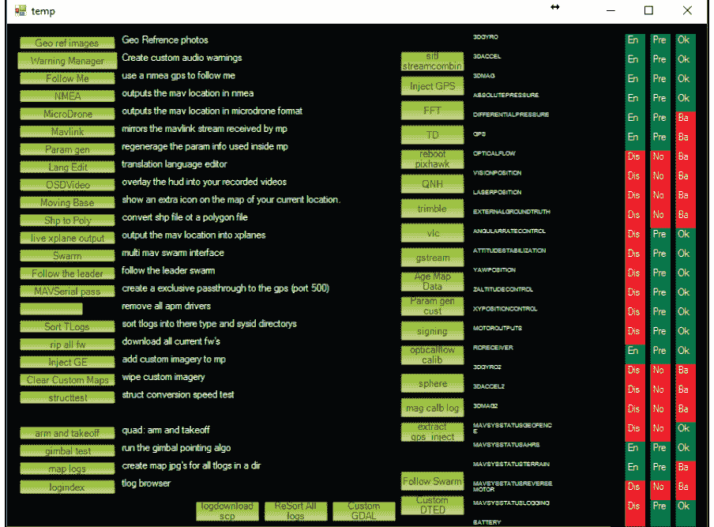

## 飞行模式

此选项卡的功能与初始设置屏幕中的飞行模式选项卡相同。它允许你设置在遥控器的飞行模式开关翻转时激活哪些飞行模式。

## 基础调参

**基础调参** 选项卡是你可以在需要稳定化的模式中手动调整 Pixhawk 飞行特性的地方。每个轴（**俯仰**、**滚转** 和 **偏航**）都使用以下参数单独设置：

- **比例增益 (P)**：此值表示 Pixhawk 试图纠正以使飞行器达到其应有的姿态的程度。例如，施加多少升降舵使飞机俯仰到应有的位置。数值越高，飞行器反应越灵敏或 *越敏感*。数值越低，过渡越平滑。
- **积分增益 (I)**：你可以将其视为自动配平调整。它根据期望姿态与实际姿态之间的过去偏差，修正控制以进行补偿。数值越高，自动配平越多；数值越低，自动配平越少。
- **微分增益 (D)**：它用于减缓 PI 调整的反应性。数值过高可能会损坏舵机和电机，因为它们可能会开始 *颤动*。
- **INT_MAX**：这是 **积分增益 (I)** 可使用的最大值。

此屏幕的其他部分需要对其使用进行非常深入的解释。我认为基础调参应更名为调参。对于此解释，请参阅第 7 章，*圣杯 – 固定翼无人机（飞机）*，其中我们详细解释了此屏幕上的调参参数。

## 标准参数

**标准参数** 屏幕是 Pixhawk 中所有可更改的基础参数的长列表。其中许多参数都可以使用 Mission Planner 中其他屏幕上的 **图形用户界面 (GUI)** 或使用向导来更改。但需要注意的是要进入并手动更改参数的位置。以下是所有 **标准参数** 及其功能：

- **ACRO_LOCKING**：将其视为在 **ACRO** 模式下操作特技飞机时的 **恐慌** 模式。如果你松开摇杆，飞行器将水平并保持高度，通过启用 **ALT HOLD** 模式。
- **ACRO_PITCH_RATE**：这设置 **ACRO** 模式下的最大俯仰速率。
- **ACRO_ROLL_RATE**：这设置 **ACRO** 模式下的最大滚转速率。
- **CAM_FEEDBACK_PIN**：这便于使用来自摄像机（通过热靴连接）的反馈，该反馈将进入 Pixhawk 日志，表明照片已成功拍摄。这对于使用 Pixhawk 的 GPS 信息在拍摄后手动为照片地理标记非常有用。此参数是用于此反馈的引脚号。
- **CAM_FEEDBACK_POL**：摄像机反馈的极性。TriggerHigh 用于在电压升高时拍照，TriggerLow 用于在电压下降时拍照。
- **CAM_RELAY_ON**：这与 **CAM_FEEDBACK_POL** 类似，它设置摄像机继电器在高电压或低电压下被激活的时间。
- **CAM_TRIGG_TYPE**：这指定 Pixhawk 将如何向摄像机发送快门触发信号。
- **CAN_P1_DRIVER**：这激活 Pixhawk 上的 CAN 总线使用。
- **CAN_P2_DRIVER**：这激活第二条 CAN 总线。
- **CHUTE_ENABLED**：这用于检查飞行器上是否安装了降落伞释放系统。
- **COMPASS_DEC**：这显示真北与磁北之间的差异。这是通过自动校准罗盘来设置的。
- **FBWB_CLIMB_RATE**：这设置飞行器在 **FBWB** 和 **CRUISE** 模式下升降舵满偏时爬升的速度。
- **FBWB_ELEV_REV**：这用于检查升降舵在 **FBWB** 模式下是否反向（向前推升降舵控制使飞机上升还是下降）。
- **FENCE_ACTION**：这指定在越过地理围栏时采取的动作。
- **FENCE_AUTOENABLE**：这设置地理围栏是否在自动起飞期间自动放置，并在自动着陆期间移除。
- **FENCE_MAXALT**：这指定在启用地理围栏时飞机可以飞行的最大高度（以米为单位）。
- **FENCE_MINALT**：这指定在启用地理围栏时飞机可以飞行的最低高度（以米为单位）。
- **FENCE_RET_RALLY**：这设置 Pixhawk 对越过地理围栏的反应（是返回集结点、返航，还是仅返回越界发生的位置）。
- **FENCE_RET_ALT**：这指定飞机在越过地理围栏时返回的高度。设置为 0 时保持当前高度。
- **FLOW_ENABLE**：这用于检查是否使用光学流传感器。
- **FLOW_FXSCALER**：这用于考虑光学流传感器的镜头长度。增加数值实际上会降低 x 轴上的比例因子。
- **FLOW_FYSCALER**：这用于考虑光学流传感器的镜头长度。增加数值实际上会降低 y 轴上的比例因子。
- **FLOW_ORIENT_YAW**：这设置飞机与光学流传感器的偏航之间的厘度偏差。
- **FLTMODE(1-6)**：这设置控制器上飞行模式开关不同位置的飞行模式。
- **FS_GCS_ENABL**：这用于检查在与 **地面控制站 (GCS)** 信号丢失时是否激活失效保护状态。
- **FS_LONG_ACTN**：这设置在长时间失效保护事件中采取的动作（参见 **FS_LONG_TIMEOUT**）。
- **FS_LONG_TIMEOUT**：这是在激活 **FS_LONG_ACTN** 之前失效保护状态存在的秒数。
- **FS_SHORT_ACTN**：这设置在等待 **FS_LONG_TIMEOUT** 期间采取的动作。
- **FS_SHORT_TIMEOUT**：这是在失效保护事件发生时激活 **FS_SHORT_ACTN** 之前的秒数。这有助于防止在少量信号干扰等情况下发生模式切换。
- **GROUND_STEER_ALT**：这是方向舵控制也将控制轮舵机以实现地面转向的高度（以米为单位）。设置为 0 时允许在所有高度进行轮控制。
- **INVERTEDFLT_CH**：这指定将启用倒飞能力的控制器通道。
- **LAND_TYPE**：这指定在自动着陆期间执行的着陆类型。（标准与深尾）。
- **LIM_PITCH_MAX**：这是稳定飞行模式下的最大俯仰角。
- **LIM_PITCH_MIN**：这限制了稳定飞行模式下机头向下指向的角度。
- **LIM_ROLL_CD**：这是任一方向滚转的最大滚转角（以厘度为单位）。
- **LOG_BACKEND_TYPE**：这指定日志的存储方式（文件、MAVLink 或两者）。
- **LOG_DISARMED**：这指定在解除武装状态下是否创建日志（以及武装状态）。
- **LOG_FILE_DSRMOT**：这决定在飞行器解除武装时是否关闭当前日志文件。
- **MNT_STAB_TILT**：这用于检查是否稳定云台的俯仰轴。
- **MNT_TYPE**：这设置云台安装的类型（无、舵机和 MAVLink）。
- **NAV_CONTROLLER**：这是启用实验性导航控制器的设置。这里默认为 L1。
- **NAVL1_PERIOD**：这设置自主飞行期间的转弯半径（以米为单位）。
- **Q_ENABLE**：这启用 Pixhawk 的四旋翼飞机（混合）功能。
- **RALLY_INCL_HOME**：这检查返航时家点是否为安全着陆地点。
- **RELAY_DEFAULT**：这设置 Pixhawk 启动时摄像机继电器的状态。
- **RELAY_PIN(1,2,3,4)**：这设置摄像机继电器控制的引脚号。
- **RNGFND_ADDR**：这特定于 LightWare I2C 激光测距仪。它允许在不同地址上使用多个测距仪。
- **RNGFND_FUNCTION**：这设置如何解释测距仪的反馈（线性、反向和双曲线）。
- **RNGFND_GNDCLEAR**：这用于确定飞机着陆时向下测距仪与地面之间的距离。
- **RNGFND_LANDING**：这用于检查是否使用测距仪来辅助着陆。
- **RNGFND_PIN**：这是用于模拟（非 I2C）测距仪的引脚。
- **RNGFND_RMETRIC**：这用于设置模拟测距仪是否为比率型（大多数是）。
- **RNGFND_STOP_PIN**：这设置用于模拟测距仪测量的引脚。
- **RNGFND_TYPE**：这设置实现的测距仪类型。
- **RPM_PIN**：这是用于电机转速传感器引脚。
- **RPM_TYPE**：这是实现的转速传感器类型。
- **RPM2_PIN**：这允许使用第二个转速传感器并指定其使用的引脚。
- **RSSI_ANA_PIN**：这指定模拟 RSSI（接收信号强度指示）模块的引脚号。
- **RSSI_PIN_HIGH**：这设置 RSSI 模块输出在信号强度高时的最大电压。
- **RSSI_PIN_LOW**：这设置 RSSI 模块信号强度低时的最小电压。
- **RSSI_TYPE**：这是 RSSI 模块的类型。

- **RTL_AUTOLAND**：用于设置执行RTL时是否自动降落。
- **RTL_RADIUS**：执行RTL时，围绕返航点盘旋的半径。
- **RUDD_DT_GAIN**：方向舵与差动推力的比值。差动推力用于多发动机飞机（例如，执行左转时，左电机会略微降速，右电机升速以帮助飞机偏航）。
- **SERIAL(0-5)_BAUD**：指定串行总线上的数据传输速率。
- **SERIAL(0-5)_PROTOCOL**：用于确定指定串行总线上使用的协议（如MAVLink等）。
- **SERVO(1-16)_FUNCTION**：指定此舵机端口将控制的功能。
- **SERVO(1-16)_MAX**：此通道上舵机可接收的最大值（PWM）。
- **SERVO(1-16)_MIN**：此通道上舵机可接收的最小值（PWM）。
- **SERVO(1-16)_REVERSED**：用于设置此通道上的舵机值是否反转。
- **SERVO(1-16)_TRIM**：用于设置此通道上舵机的微调值。请使用此设置代替遥控器上的微调功能。
- **STALL_PREVENTION**：用于启用或禁用失速保护。此功能需要空速传感器（皮托管）。
- **TECS_CLIMB_MAX**：飞机在THR_MAX下（同时保持空速）可达到的最大爬升率（米/秒）。
- **TECS_SINK_MIN**：当油门设置为THR_MIN且飞机不超过CLIMB_MAX速度时，飞机的最大下降率。
- **TELEM_DELAY**：Pixhawk启动后等待开始发送遥测数据的秒数。
- **TERRAIN_FOLLOW**：启用Pixhawk在自主飞行模式下跟随下方地形高度的能力。应连接地面控制站以启用此功能。它使用地形数据计算高度，而不仅仅是相对于返航点的高度。
- **THR_FAILSAFE**：启用/禁用即使油门降至特定值以下也触发失效保护的功能。这是测试无线电发射机接收信号的好方法。例如，如果发射机的最小油门PWM为980，断开连接后油门可能降至0。因此，设置950的值会比较好。
- **THR_MAX**：Pixhawk可施加给电机的最大油门（百分比）。
- **THR_MIN**：Pixhawk施加给电机的最小油门。对于自动降落，您需要将其设置为0。对于允许反向推力的ESC，您可以将其设置为负值以作为刹车。
- **THR_SLEWRATE**：每秒的最大变化量。这会使油门过渡更平滑。但要小心，将该值设置得太低可能导致失速。
- **THROTTLE_NUDGE**：允许飞行员在自动油门飞行模式下微调油门上下。
- **TRIM_AUTO**：启用Pixhawk在非手动模式下自动调整控制面的微调值。
- **TRIM_THROTTLE**：正常飞行期间施加的油门（百分比）。
- **TUNE_CHAN**：允许使用发射机上的旋钮或滑块调整PID（值指定通道）。
- **TUNE_MODE_REVERT**：启用或禁用Pixhawk在模式更改时恢复到先前保存的调谐设置。调谐期间，更改每10秒保存一次。因此，您有10秒时间通过更改模式来恢复。
- **TUNE_PARAM**：设置使用**TUNE_CHAN**功能调整哪个参数。
- **TUNE_SELECTOR**：遥控器上的开关通道，用于启用**TUNE_CHAN**功能。
- **WP_LOITER_RADIUS**：设置LOITER期间围绕航点盘旋的半径（米）。如果设置为负数，则环绕方向为逆时针。
- **WP_MAX_RADIUS**：使用新值覆盖飞行计划屏幕中设置的航点半径，该值表示航点被视为完成所需的半径。值为0表示完全不覆盖，保持任务航点半径不变。
- **WP_RADIUS**：与**WP_MAX_RADIUS**类似，但不进行覆盖。这是为了避免无限环绕飞机无法满足的小半径航点。

## 总结

在本章中，我们回顾了Mission Planner的许多界面组件。我们还介绍了一些之前未提及的功能。需要说明的是，本章主要作为您未来使用Pixhawk开发原型时的参考。

我们真诚希望您了解了Pixhawk、围绕它进行的原型设计，以及原型的制作并将想法变为现实。我们希望您喜欢这本书，就像我们喜欢编写它一样。感谢您的阅读，您应该为自己感到自豪。这是一份相当大量的信息！
