## 致谢

**作者**
Jaroslaw Krochmal ski

**校对编辑**
Laxmi Subramanium
Sneha Singh

**审阅者**
Jeeva S. Chelladhurai

**项目协调员**
Kinjal Bari

**约稿编辑**
Kartikey Pandey

**校对**
Safis Editing

**采购编辑**
Narsimha Pai
Rahul Nair

**索引**
Pratik Shirodhkar

**内容开发编辑**
Trusha Shiryan

**美术**
Kirk D'Penha

**技术编辑**
Naveenkumar Jain

**制作协调员**
Shantanu N. Zagade

## 关于作者

**Jaroslaw Krochmal ski** 是一位专注于金融业务领域的热情软件设计师和开发者。他在软件开发方面拥有超过 12 年的经验。他是整洁代码和软件工艺的爱好者。他是认证的 Scrum 大师，也是敏捷的粉丝。他的专业兴趣包括 Web 应用开发的新技术、设计模式、企业架构和集成模式。

他自 2000 年起就开始专业设计和开发软件，并自 2002 年起将 Java 作为其主要编程语言。过去，他曾为 Kredyt Bank（KBC）和 Bank BPS 等公司在国际汇款、快速支付和催收系统等多个大型项目上工作。他目前在丹麦公司 7N 担任顾问，为 Nykredit 银行担任基础设施架构师。您可以通过 Twitter @jkroch 或电子邮件 jarek@finsys.pl 联系他。

我想向我在 7N 和 Nykredit 的朋友们问好——继续保持出色的工作！

## 关于审阅者

**Jeeva S. Chelladhurai** 在过去 8 年里一直担任 IBM 全球云卓越中心 CoE 的 DevOps 专家。他是 PacktPub、UK 出版的 *Learning Docker* 的合著者。他拥有超过 20 年的 IT 行业经验。他在全球范围内技术管理并指导过多元化团队，致力于构想和构建开创性的电信产品。他专注于 DevOps 和云解决方案交付，重点关注数据中心优化、软件定义环境 SDEs，以及使用最新的 Docker 技术进行分布式应用的开发、部署和交付。Jeeva 也是敏捷方法论、DevOps 和 IT 自动化 的坚定倡导者。他拥有 Manonmaniam Sundaranar 大学的计算机科学硕士学位，以及美国波士顿大学的项目管理毕业证书。除了正式职责外，他还撰写书籍章节并撰写研究论文。他在为 IBM 解决方案架构师和顾问打造可重用的技术资产方面发挥了重要作用。目前，他正在为 Docker 书籍的第二版做出贡献。他在技术论坛上就 DevOps 技术和工具发表演讲。他的 LinkedIn 个人资料可在 https://www.linkedin.com/in/JeevaChelladhurai 找到。

## www.PacktPub.com

有关您书籍的相关支持文件和下载，请访问 www.PacktPub.com。

您知道 Packt 提供每本出版书籍的电子书版本，支持 PDF 和 ePub 文件吗？您可以在 www.PacktPub.com 升级到电子书版本，作为印刷书籍客户，您有权享受电子书的折扣。欲了解更多详情，请联系 service@packtpub.com。

在 www.PacktPub.com，您还可以阅读大量免费技术文章，订阅各类免费通讯，并获得 Packt 书籍和电子书的独家折扣和优惠。

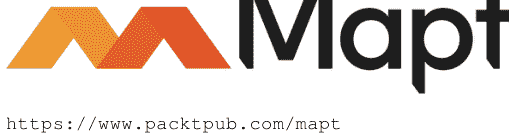

https://www.packtpub.com/mapt

使用 Mapt 获取最受欢迎的软件技能。Mapt 可让您完全访问所有 Packt 书籍和视频课程，以及业界领先的工具，帮助您规划个人发展并推进职业生涯。

## 为什么订阅？

- 在 Packt 发行的每本书中都可完全搜索
- 复制、粘贴、打印和书签内容
- 按需访问，可通过网络浏览器访问

## 前言

Docker 在过去几年里获得了大量关注。今天它拥有数千名社区贡献者、无数容器下载量，并且有越来越多的第三方项目在使用它。看起来在未来几年里它的声誉还会进一步增长。在本书中，我们将尝试解释这种非凡的流行度，并展示你如何从更快、更简单的应用程序开发、测试和部署中受益。我们将主要从开发者的角度学习 Docker，并专注于创建、运行和发布 Docker 镜像，而不是管理和集群它们。我们将从 Docker 为开发者工具集带来的基本思想和优势开始。

## 本书涵盖内容

第 1 章，Docker 简介，简要描述了 Docker 是什么以及它如何在现代软件开发和部署中发挥作用。我们将指出该工具带来的优势以及它为何有帮助。本章还将演示包含代码、运行时、系统工具和库的容器如何加快开发和部署，同时使其成为更愉快的体验。

第 2 章，安装 Docker，包含了可用工具的简要描述，例如 Docker CLI 或 Kitematic（Docker GUI）。接下来，我们将直接进入行动——安装工具。本章将给出在 Mac、Linux 和 Windows 上安装 Docker Toolbox 的精确且实用的说明。本章还将描述在云中安装 Docker 的过程，例如 Amazon AWS。

第 3 章，理解镜像和容器，讲述了 Docker 的架构。我们将解释与之相关的术语。阅读完本章后，你将理解 Docker 背后的概念和架构；在阅读后续章节时这是必不可少的。

第 4 章，网络和持久化存储，描述了 Docker 的网络和存储概念。本章将向读者介绍容器网络并介绍不同类型的容器（开放、封闭、桥接和连接）。读者还将熟悉卷及其类型的概念。此外，读者将学习如何管理、挂载和共享 Docker 卷。

第 5 章，查找镜像，描述了使用 Docker Hub 识别软件、查找和安装它以及替代来源的过程。阅读完本章后，读者能够在 Docker 仓库中找到指定的镜像然后安装它。

第 6 章，创建镜像，告诉读者如何编写 Dockerfile，如何从中构建镜像并熟悉镜像构建过程。本章将包含编写 Dockerfiles 的最佳实践以及处理镜像的有用技巧。

第 7 章，运行容器，告诉我们如何在容器内运行程序。本章将描述启动、停止、重启、列出和查看容器输出的概念。读者将在容器中运行多个程序并熟悉向容器注入配置。我们还将描述容器生命周期和清理过程。

第 8 章，发布镜像，使我们熟悉软件分发打包的过程。阅读完本章后，读者将能够创建 Docker Hub 账户和仓库。然后，他将把镜像推送到上面，以便其他拥有 Docker Engine 的人可以运行它。本章还将描述私有软件分发过程。在本章结束时，读者将从仓库中拉取自己的镜像以测试该过程。

第 9 章，在开发中使用 Docker，讨论如何将构建 Docker 镜像纳入 Maven 构建过程。为此，我们将利用 docker-maven 插件。我们还将打包运行在 Spring Boot 嵌入式服务器上的 Java Web 应用。为了演示将静态 Web 应用打包到 Docker 容器中的过程，我们还将从 Docker 容器内部运行带有 node.js 后端的 angular.js 应用。

附录 A，更多资源，将你引导至一些用于进一步阅读的有用资源，例如与 Docker 相关的论坛、博客和网站。本章还将提及一些与 Docker 相关的有用第三方工具，并展示它们在处理 Docker 时如何有用。

## 阅读本书所需

你需要一台运行 OS X、MS Windows 或 Linux 的 Mac 或 PC 才能设置和运行 Docker。你可以免费下载 Docker。你可以在第 2 章，安装 Docker 中阅读如何获取和安装它。

## 本书适合谁阅读

本书旨在成为快速实用的指南，帮助你快速上手 Docker。它面向开发者、IT 专业人员、DevOps 或任何希望快速大规模地将软件部署到生产环境的人。如果你对 Docker、DevOps 或容器总体感兴趣，不要再犹豫了。

你将从安装 Docker 开始并开始使用镜像和容器。我们将介绍不同类型的容器、其应用并展示如何查找和构建镜像。这将使你熟悉镜像构建过程，你将能够在容器内成功运行程序。完成本书后，你将能够很好地使用 Docker 部署应用程序，并对概念、技术和将应用程序在生产系统上运行的实用方法有清晰的理解。

## 约定

在本書中，你会找到多种文本样式来区分不同类型的信息。以下是这些样式的一些示例及其含义的解释。

文本中的代码词、数据库表名、文件夹名、文件名、文件扩展名、路径名、虚拟 URL、用户输入和 Twitter 账号显示如下：“将下载的 WebStorm-10*.dmg 磁盘映像文件挂载为系统中的另一个磁盘。”

代码块设置如下：

```
html, body, #map {
  height: 100%;
  margin: 0;
  padding: 0
}
```

任何命令行输入或输出都写成如下形式：

```
$ mkdir css
$ cd css
```

**新术语**和**重要词汇**以粗体显示。你在屏幕上看到的文字，例如菜单或对话框中的文字，在文本中如下所示：“本书中的快捷键基于 `Mac OS X 10.5+` 方案。”


警告或重要说明以如下框显示。


技巧和窍门如下所示。

## 读者反馈

我们始终欢迎读者的反馈。请告诉我们你对本书的看法——你喜欢或不喜欢的地方。读者反馈对我们很重要，因为它帮助我们开发出你真正能从中获益的书目。如需发送一般反馈，只需发送电子邮件至 `feedback@packtpub.com`，并在邮件主题中提及书名。如果你有专业领域且有兴趣撰写或为书籍做出贡献，请参阅我们的作者指南 `www.packtpub.com/authors`。

## 客户支持

现在你已成为 Packt 书籍的自豪拥有者，我们有一系列帮助你充分利用购买的资源。

## 勘误

尽管我们已尽一切努力确保内容的准确性，但错误仍会发生。如果你发现我们书籍中的错误——可能是文本或代码中的错误——我们将不胜感激你向我们报告。通过这样做，你可以为其他读者节省挫折并帮助我们改进后续版本。如果你发现任何勘误，请访问 `http://www.packtpub.com/submit-errata`，选择你的书籍，点击 **勘误提交表单** 链接并输入你的勘误详情。一旦你的勘误得到验证，你的提交将被接受，勘误将被上传到我们的网站或添加到该标题勘误部分的现有勘误列表中。


查看之前提交的勘误，请访问 https://www.packtpub.com/books/content/support 并在搜索字段中输入书籍名称。所需信息将显示在 **Errata** 部分下。

## 盗版

版权材料的互联网盗版是所有媒体中持续存在的问题。在 Packt，我们非常重视对版权和许可的保护。如果您在互联网上发现我们作品的任何形式的非法复制品，请立即提供位置地址或网站名称，以便我们采取补救措施。

请通过 copyright@packtpub.com 联系我们，并附上疑似盗版材料的链接。

我们感谢您帮助保护我们的作者以及我们为您提供有价值内容的能力。

## 问题

如果您对本书的任何方面有问题，可以通过 questions@packtpub.com 联系我们，我们会尽力解决问题。

# 1

## 1 Introduction to Docker

最初，Docker 由一家名为 **dotCloud** 的平台即服务公司作为内部工具创建。后来在 2013 年 3 月，它作为开源软件发布。除了主要赞助商 Docker Inc. 团队之外，还有其他一些知名公司为该工具做出贡献——例如 Red Hat、IBM、Microsoft、Google 和 Cisco Systems。今天的软件开发需要敏捷并快速响应变化。我们使用 Scrum 等方法论，按故事点估算工作，并参加每日站会。但软件的出货准备和部署怎么办？让我们看看 Docker 如何融入这一场景并帮助我们实现敏捷。

本章将涵盖以下主题：

- Docker 背后的基本思想
- 虚拟化与容器化的区别
- 使用 Docker 的好处
- 可安装的组件

我们将从这个精彩工具背后的基本思想开始。

## The basic idea

Docker 背后的基本思想是将应用程序及其所有依赖项（无论是二进制文件、库、配置文件、脚本、jar 等）打包成一个用于软件开发和部署的单一标准化单元。Docker 容器将软件封装在一个完整的文件系统中，其中包含运行所需的一切：代码、运行时、系统工具和系统库——服务器上可以安装的任何东西。这保证了无论部署在什么环境中，它始终以相同的方式运行。
使用 Docker，您可以构建 Node.js 或 Java 项目（当然您并不局限于这两个）而无需在主机上安装 Node.js 或 Java。完成后，您只需销毁 Docker 镜像，就好像什么都没发生过一样。它不是编程语言或框架；更确切地说，它是一个帮助解决安装、发布和管理软件等常见问题的工具。它允许程序员和 DevOps 在任何地方构建、发布和运行代码。

您可能认为 Docker 是一个虚拟化引擎，但事实远非如此，我们稍后会解释。

## Containerization versus virtualization

为了充分理解 Docker 到底是什么，我们首先需要了解传统虚拟化与容器化之间的区别。现在让我们比较这两种技术。

## Traditional virtualization

传统虚拟机代表硬件级虚拟化，本质上是在主机操作系统之上运行的完整操作系统。虚拟化 hypervisor 有两种类型：Type 1 和 Type 2。Type 1 hypervisor 在裸金属硬件上提供服务器虚拟化——没有传统的终端用户操作系统。另一方面，Type 2 hypervisor 通常用作桌面虚拟化——您在自己的操作系统之上运行虚拟化引擎。利用虚拟化有很多用例——最大的优势是您可以在单个主机上运行具有完全不同操作系统的许多虚拟机。

虚拟机完全隔离，因此非常安全。但没有免费的午餐。它们有很多缺点——它们包含操作系统所需的所有功能：设备驱动程序、核心系统库等等。它们重量大，通常资源消耗高，而且设置起来并不容易——虚拟机需要完整安装。它们执行需要更多的计算资源。要在虚拟机上成功运行应用程序，hypervisor 需要先导入虚拟机然后再启动，这需要时间。此外，它们的性能会大幅下降。因此，单个机器上只能配置并提供少量虚拟机使用。

## Containerization

Docker 软件在名为 **Docker container** 的隔离环境中运行。Docker 容器在流行意义上并不是虚拟机。它代表操作系统虚拟化。虽然每个虚拟机镜像都在独立的客户操作系统上运行，但 Docker 镜像在同一操作系统内核内运行。容器拥有自己的文件系统和环境变量。它是自给自足的。由于容器在同一内核内运行，它们使用的系统资源更少。基础容器可以而且通常是轻量级的。值得注意的是，Docker 容器不仅与底层操作系统隔离，而且彼此之间也是隔离的。与经典虚拟化 hypervisor 和客户操作系统相关的开销为零。这使得能够实现接近裸金属、接近原生的性能。**dockerized** 应用程序的启动时间通常非常快，因为容器的开销很低。还可以加快数百个应用程序容器的推出速度，并在数秒内完成，并减少配置软件所需的时间。

传统虚拟化引擎。请注意，容器不能替代所有用例中的虚拟机。仍需要仔细评估以确定什么最适合您的应用程序。两种解决方案各有优势。一方面我们有完全隔离、安全但性能一般的虚拟机，另一方面我们有容器，它们缺少一些关键功能（如完全隔离），但配备了高性能并且可以快速配置。让我们看看使用 Docker 容器化还能获得哪些其他好处。

正如您所见，Docker 与传统虚拟化引擎大不相同。请注意，容器并不是所有用例中虚拟机的替代品。仍需要仔细评估以确定什么最适合您的应用程序。两种解决方案各有优势。一方面我们有完全隔离、安全但性能一般的虚拟机，另一方面我们有容器，它们缺少一些关键功能（如完全隔离），但配备了高性能并且可以快速配置。

让我们看看使用 Docker 容器化还能获得哪些其他好处。

## Benefits of using Docker

将 Docker 容器与传统虚拟机进行比较时，我们已经提到了其一些优势。现在让我们更详细地总结它们并补充一些。

## Speed and size

正如我们之前所说，使用 Docker 的第一个明显好处将是性能非常令人满意以及配置时间很短。您可以快速轻松地创建或销毁容器。Docker 仅共享内核，不多也不少。然而，它会重用特定镜像所构建的基础镜像层。因此，在容器中运行的应用程序的多个版本将非常轻量。结果是部署更快、迁移更容易、启动时间更灵活。

## Reproducible and portable builds

使用 Docker 您可以部署即用型软件，该软件具有可移植性且极易分发（我们将在第 6 章《Building Images》中介绍创建镜像的过程）。您的容器化应用程序只需在其容器内运行：无需传统安装。Docker 镜像的关键优势在于它捆绑了容器化应用程序运行所需的所有依赖项。无需安装依赖项具有巨大优势。这消除了诸如软件和库冲突甚至驱动程序兼容性问题等麻烦。由于 Docker 的可重复构建环境，它特别适合测试，尤其是在您的持续集成流程中。您可以快速启动相同的环境来运行测试。而且由于容器镜像每次都相同，您可以分发工作负载并并行运行测试而不会有问题。开发人员可以在其机器上运行稍后将在生产环境中运行的相同镜像，这在测试中再次具有巨大优势。Docker 容器的使用加快了持续集成。不再有无休止的构建-测试-部署循环。Docker 容器确保应用程序在开发、测试和生产环境中以相同的方式运行。


Docker 最大的特性之一是可移植性。Docker 容器具有可移植性——它们可以在任何地方运行：本地机器、附近或远程服务器，以及私有或公有云。提到云时，所有主要云计算提供商，例如亚马逊网络服务和 Google 计算引擎都认识到 Docker 的可用性并现在支持它。只要主机操作系统支持 Docker，Docker 容器就可以在 Amazon EC2 实例或 Google 计算引擎实例内部运行。运行在 Amazon EC2 实例上的容器可以轻松转移到其他环境，实现相同的一致性和功能。Docker 与各种其他 **IaaS（基础设施即服务）** 提供商（如 Microsoft 的 Azure、IBM SoftLayer 或 OpenStack）配合得非常好。从基础设施层提供的这种额外抽象层是不可或缺的功能。你只需开发软件，而无需担心它以后将在哪个平台上运行。它确实是一个 *一次编写，到处运行* 的解决方案。

## Immutable and agile infrastructure

维护一个真正幂等的配置管理代码库可能很棘手且耗时。代码会随着时间的推移而增长，变得越来越麻烦。这就是为什么不可变基础设施的理念如今变得越来越流行。容器化来拯救局面。在应用程序的开发和部署过程中使用容器，可以简化流程。拥有一个几乎不需要配置管理的轻量级 Docker 服务器，你只需通过向服务器部署和重新部署容器来管理应用程序。而且，由于容器非常轻量，只需花费你几秒钟的时间。

作为起点，你可以从 Docker Hub 下载预构建的 Docker 镜像，它就像一个即用型镜像的存储库。有许多选择，包括 Web 服务器、运行时平台、数据库、消息服务器等等。它就像一个真正的软件金矿，你可以免费使用它为自己的项目建立基础。我们将在第 5 章 *查找镜像* 中介绍 Docker Hub 和查找镜像。

Docker 镜像不可变性的效果源于它们创建的方式。Docker 使用一个名为 Dockerfile 的特殊文件。该文件包含创建镜像所需的所有设置说明，例如必备组件、库、暴露的共享目录、网络配置等等。镜像可以非常基础，只包含操作系统基础，或者——更常见的情况——包含一个完整的预构建技术栈，可随时启动。你可以手工创建镜像，但也可以是自动化过程。

Docker 以分层方式创建镜像：你包含的每个功能都会作为另一层添加到基础镜像中。与传统的虚拟化技术相比，这又是另一个显著的速度提升。

我们将在第 6 章《创建镜像》中稍后详细介绍创建镜像的细节。

## Tools and APIs

当然，Docker 不仅仅是一个 Dockerfile 处理器和运行时引擎。它是一个完整的软件包，包含大量工具和 API，对开发人员和 DevOps 的日常工作很有帮助。首先，有 Docker Toolbox，它是一个安装程序，可快速轻松地在自己的机器上安装和设置 Docker 环境。Kitematic 是在 Windows 和 Mac OS X 上使用 Docker 的桌面开发环境。Docker 发行版还包含大量命令行工具，我们将在整本书中使用它们。现在让我们来看一下它们。

## Tools overview

在 Windows 上，根据你使用的 Windows 版本，有两种选择。如果你在 Windows 10 或更高版本，可以是 Docker for Windows；如果是所有更早版本的 Windows，则是 Docker Toolbox。MacOS 也是如此。最新提供的是 Docker for Mac，它作为原生 Mac 应用程序运行，并使用 xhyve 来虚拟化 Docker Engine 环境和 Linux 内核。对于不符合 Docker for Mac 要求的更早版本的 Mac（我们将在第 2 章《安装 Docker》中列出它们），你应该选择 Docker Toolbox for Mac。Docker Toolbox 和 Docker 原生应用程序背后的理念相同——在你的操作系统之上虚拟化 Linux 内核和 Docker Engine。为了本书的目的，我们将使用 Docker Toolbox，因为它具有通用性；它可在所有 Windows 和 MacOS 版本上运行。Windows 和 Mac OS 的安装包被打包在一个名为 Docker Toolbox 的可执行文件中。该软件包包含开始使用 Docker 所需的所有工具。当然，还有大量与 Docker 兼容的第三方实用工具，其中一些非常有用。我们将在第 9 章《在开发中使用 Docker》中简要介绍其中一些。但现在，让我们专注于默认工具集。在开始安装之前，让我们先看看安装程序包包含哪些工具，以便更好地了解会对系统做出哪些更改。

## Docker Engine and Docker Engine client

Docker 是一个客户端-服务器应用程序。它由守护进程组成，执行重要任务：构建和下载镜像、启动和停止容器等等。它公开了一个 REST API，指定了与守护进程交互的接口，并用于远程管理。Docker Engine 接受来自命令行的 Docker 命令，例如 `docker` 运行镜像，`docker ps` 列出正在运行的容器，`docker images` 列出镜像，等等。

Docker 客户端是一个命令行程序，用于管理运行 Linux 容器的 Docker 主机。它使用 REST API 包装器与 Docker 服务器通信。你将通过使用客户端向服务器发送命令与 Docker 交互。

Docker Engine 仅在 Linux 上工作。如果你想在 Windows 或 Mac OS 上运行 Docker，或想在网络或云上配置多个 Docker 主机，你将需要 Docker Machine。

## Docker Machine

Docker Machine 是 Docker 团队创建的一个相对较新的命令行工具，用于管理可以部署容器的 Docker 服务器。它弃用了使用 **Boot2Docker** 实用工具安装 Docker 的旧方法。Docker Machine 消除了手动创建虚拟机并在上面安装 Docker 才能启动 Docker 容器的需求。它在幕后为你处理配置和安装过程。换句话说，它是一种快速获取新虚拟机并准备好运行 Docker 容器的途径。在开发 **PaaS（平台即服务）** 架构时，这是一个不可或缺的工具。Docker Machine 不仅创建安装了 Docker Engine 的新 VM，还设置用于身份验证的证书文件，然后配置 Docker 客户端以与其通信。出于灵活性目的，Docker Machine 引入了驱动程序的概念。使用驱动程序，Docker 能够与各种虚拟化软件和云提供商通信。事实上，当你安装 Docker for Windows 或 Mac OS 时，默认会使用 VirtualBox 驱动程序。以下命令将在幕后执行：

```
docker-machine create --driver=virtualbox default
```

另一个可用的驱动程序是用于亚马逊网络服务的 amazonec2。它可用于在 Amazon 云上安装 Docker——我们将在本章后面进行。有很多驱动程序可供使用，而且不断增加。现有官方驱动程序及其文档的列表始终可在 **Docker 驱动程序** 网站上获取：https://docs.docker.com/machine/drivers。

目前列表包含以下驱动程序：

- 亚马逊网络服务
- Microsoft Azure
- DigitalOcean
- Exoscale
- Google 计算引擎
- 通用
- Microsoft Hyper-V
- OpenStack
- Rackspace
- IBM SoftLayer
- Oracle VirtualBox
- VMware vCloud Air
- VMware Fusion
- VMware vSphere

除了这些之外，还有大量第三方驱动程序插件可在 GitHub 等互联网网站上免费获取。你可以找到适用于不同云提供商和虚拟化平台的额外驱动程序，例如 OVH Cloud 或适用于 Mac OS 的 Parallels，例如，你并不局限于 Amazon 的 AWS 或 Oracle 的 VirtualBox。正如你所见，选择非常广泛。


如果你找不到特定云提供商的驱动程序，请尝试在 GitHub 上查找。

在 Windows 或 Mac OS 上安装 Docker Toolbox 时，Docker Machine 将默认被选中。它是强制性的，目前是这些操作系统上运行 Docker 的唯一方式。对于 Linux 而言，安装 Docker Machine 并不是强制性的——在那里无需虚拟化 Linux 内核。然而，如果你想处理云提供商，或只是想在 Mac OS、Windows 和 Linux 之间拥有可移植的通用运行时环境，你也可以为 Linux 安装 Docker Machine。我们将在本章后面描述该过程。Docker Machine 也将在幕后使用图形工具 Kitematic 时使用，我们稍后会介绍它。

安装过程完成后，Docker Machine 将作为命令行工具可用：docker-machine。


## Kitematic

Kitematic 是一个可用于通过简洁而稳健的图形用户界面（GUI）运行容器的软件工具。2015 年，Docker 收购了 Kitematic 团队，希望吸引更多开发者，并希望将容器化解决方案推广给更多开发者以及更广泛的普通公众。

安装 Docker Toolbox 时，Kitematic 现在默认包含在 Mac OS 和 MS Windows 上。你可以使用它从 Docker Hub 舒适地搜索并获取所需的镜像。该工具也可以用于运行你自己的应用容器。使用 GUI，你可以编辑环境变量、映射端口、配置卷、查看日志，并对容器进行命令行访问。值得一提的是，你可以在 Kitematic GUI 和命令行界面之间无缝切换以运行和管理应用容器。Kitematic 非常方便，然而，如果你希望在处理容器时拥有更多控制权或只是想使用脚本——命令行将是更好的解决方案。事实上，Kitematic 允许你在 Docker CLI 和 GUI 之间来回切换。你在命令行界面所做的任何更改都将直接反映在 Kitematic 中。该工具使用简单，正如你在本章末尾将看到的那样，我们将在 Mac 或 Windows PC 上测试我们的设置。在本书的剩余部分，我们将使用命令行界面来操作 Docker。

## Docker Compose

Compose 是一个工具，可从命令行作为 `docker-compose` 执行。它取代了旧的 *fig* 工具。它用于定义和运行多容器 Docker 应用。虽然很容易想象一个多容器应用（例如一个容器中的 Web 服务器和另一个容器中的数据库），但这不是强制性的。因此，如果你决定你的应用可以适配于单个 Docker 容器，`docker-compose` 就没有用途了。在现实生活中，你的应用很可能会跨多个容器。使用 `docker-compose`，你可以使用 compose 文件配置应用的服务，使它们能够在隔离环境中一起运行。然后，使用单个命令，你可以创建并启动配置中的所有服务。对于多容器应用而言，`docker-compose` 对于开发和测试以及持续集成工作流非常有用。

我们将在本书稍后的第 6 章 *创建镜像* 中使用 `docker-compose` 创建 `multicontainer` 应用。

## Oracle VirtualBox

Oracle VM VirtualBox 是 Oracle 提供的用于 x86 计算机的免费开源虚拟化程序。安装 Docker Toolbox 时它将默认安装。它支持创建和管理运行 Windows、Linux、BSD、OS/2、Solaris 等的虚拟机。在我们的案例中，使用 VirtualBox 驱动的 Docker Machine 将使用 VirtualBox 创建并启动一个能够运行 `docker-engine` 的精简 Linux 发行版。值得一提的是，你也可以直接从 VirtualBox 本身运行这个极其精简的虚拟化 Linux。

使用 `docker-machine` 或 `Kitematic` 创建的每个 Docker Machine 在直接运行时都将在 VirtualBox 中可见并可启动，如下图所示：

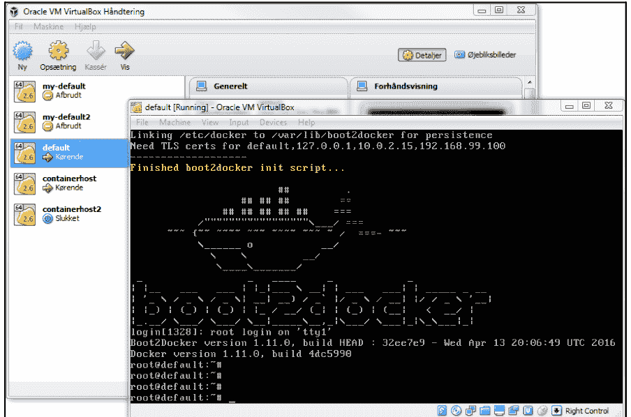

你可以像其他虚拟化操作系统一样启动、停止、重置、更改设置并读取日志。


你可以在 Windows 或 Mac 上将 VirtualBox 用于 Docker 以外的其他用途。

## Git

Git 是一个分布式版本控制系统，广泛用于软件开发和其他版本控制任务。它强调速度、数据完整性以及对分布式、非线性工作流的支持。Docker Machine 和 Docker 客户端遵循 Git 的 pull/push 模型来从网络获取所需的依赖项。例如，如果你决定运行本地机器上不存在的 Docker 镜像，Docker 将从 Docker Hub 获取该镜像。Docker 在内部不使用 Git 进行任何资源版本控制。然而，它确实依赖哈希来唯一标识文件系统层，这与 Git 所做的事情非常相似。Docker 也从提交、推送和拉取的概念中汲取了最初的灵感。Git 也包含在 Docker Toolbox 安装包中。

从开发者的角度来看，有一些工具对程序员的日常工作特别有用，无论是面向 Java 爱好者的 IntelliJ IDEA Docker Integration Plugin，还是面向偏好 C# 的开发者的 Visual Studio 2015 Tools for Docker。它们让你可以直接从你喜欢的 IDE 下载和构建 Docker 镜像、创建和启动容器，并执行其他相关任务。我们将在下一章中更详细地介绍它们。

除了 Docker 发行包中包含的工具（对于较旧版本的 Windows 为 Docker Toolbox，或为 Docker for Windows 和 Docker for Mac）之外，还有数百种第三方工具，例如 Kubernetes 和 Helios（用于 Docker 编排）、Prometheus（用于统计监控），或用于管理集群的 Swarm 和 Shipyard。随着 Docker 受到更多关注，几乎每周都会出现越来越多的 Docker 相关工具。我们将尝试在第 9 章 Using Docker in Development 以及更多资源中简要介绍其中最有趣的工具。

但这些并不是你可用的唯一工具。此外，Docker 还提供了一套非常实用的 API。其中之一是用于管理镜像和容器的 Remote API。使用此 API，你将能够将镜像分发到运行时的 Docker 引擎。容器可以转移到另一台运行 Docker 的机器上，并在那里执行而无需担心兼容性问题。在创建 PaaS（平台即服务）架构时，这可能特别有用。还有 Stats API，它将公开容器的实时资源使用信息（如 CPU、内存、网络 I/O 和块 I/O）。此 API 端点可用于创建显示容器行为的工具，例如在生产系统上。

## Summary

到目前为止，我们已经理解了虚拟化与容器化之间的区别，而且我希望我们也能看到使用后者的优势。我们也知道有哪些组件可供我们安装和使用。让我们开始进入容器世界之旅，并通过安装软件直接付诸行动。

# 2

## 2 Installing Docker

在本章中，我们将了解如何在 Windows、Mac OS 和 Linux 操作系统上安装 Docker。还将提供逐步说明，介绍如何在云中设置 Docker，并以 Amazon EC2 为例。接下来，我们将运行示例 `hello-world` 镜像以验证设置并检查安装过程后一切是否正常工作。本章将涵盖以下主题：

- 运行 Docker 的硬件要求
- 在 Windows 上安装
- 在 Mac OS 上安装
- 在 Linux 上安装
- 在 Amazon AWS 云上安装

Docker 安装相当直接，但有一些事项你需要关注以使其运行。我们会指出它们以使安装过程轻松无痛。


> 值得一提的是，Linux 是 Docker 的自然环境。Docker 引擎构建在 Linux 内核之上。要使其在 Windows 或 Mac OS 上运行，Linux 内核需要被虚拟化。

Docker Engine 可以通过使用专门用于运行 Docker 容器的轻量级 Linux 发行版在 Mac 和 MS Windows 操作系统上运行。它完全从 RAM 运行，仅重几十兆字节，并在几秒钟内启动。在安装主要 Docker 包——Docker Toolbox 期间，虚拟化引擎 VirtualBox 也将默认安装。因此，你的机器有一些特殊硬件要求。


## 硬件要求

使用 Docker，您需要一台相对较新的机器，支持硬件级虚拟化：基于 Intel 的 PC 需要 VT-x，AMD 处理器需要 AMD-V。

大多数 Mac 机器开箱即支持，但对于 PC，您需要确保其已启用，并可能在 BIOS 设置中开启。

不同 BIOS 的设置方式不同，只需查找 VT-x / AMD-V 开关即可。

在 Windows 8 中，您可以在任务管理器的性能选项卡中检查虚拟化支持：

|  |  |
|---|---|
| 虚拟化: | 已启用 |
| L1 缓存: | 256 KB |
| L2 缓存: | 2.0 MB |

如果您想在 Windows 7 中检查 PC 是否支持硬件级虚拟化，请查找 Microsoft 硬件辅助虚拟化检测工具。

这是一款免费的小型实用工具，用于检查系统是否支持虚拟化。

下载并运行它以查看报告：

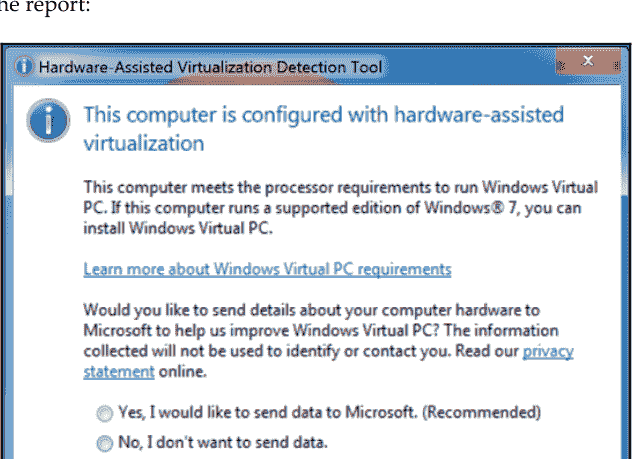

如果您的报告显示硬件辅助虚拟化未启用，您需要检查机器的 BIOS 设置，也许硬件辅助虚拟化支持只是被关闭了。

在这种情况下，请将其打开并重新运行该工具。

如果您的 PC 不支持硬件辅助虚拟化，而您仍决定安装 Docker，则在启动虚拟化 Linux 发行版期间会出现错误。

此外，在 Windows PC 上安装时，您需要确保 Windows 操作系统为 64 位（x64）。

Docker 默认不会在 32 位系统上运行。

我们已从 `Chapter 1, Introduction to Docker` 了解到，默认安装包中可安装哪些 Docker 组件。

了解硬件要求后，让我们下载并安装软件。

## 在 Windows 上安装

Docker 的最新安装指南始终可在 `https://www.docker.com/` 网站上获取。

前往 *开始使用 Docker* 部分，并根据您的操作系统选择安装指南：Windows、Mac OS 或 Linux。

正如前一章所述，您在 Windows 上安装 Docker 有两种选择：可在几乎所有 Windows 版本上运行的 Docker Toolbox，或仅在 Windows 10 或更高版本上运行的 Docker for Windows。

此外，即使您运行的是 Windows 10，也有一些额外要求：必须是 64 位 Windows 10 专业版、企业版和教育版（1511 十一月更新，Build 10586 或更高版本）。

对于 Docker 的原生安装包（Docker for Windows 或 Docker for Mac），您可以选择经过充分测试且可靠的稳定通道，或包含 Docker 团队正在开发的一些实验性功能但可能不稳定且有漏洞的测试版通道。

我建议选择稳定通道。

安装包只是一个单一的 `installDocker.msi` 包。

直接运行它——这是一种无需提问的安装类型。

但是请注意，您需要在 Windows 机器上拥有管理员权限。

安装结束后，您会收到完成通知并被提示运行 Docker，如以下屏幕截图所示：

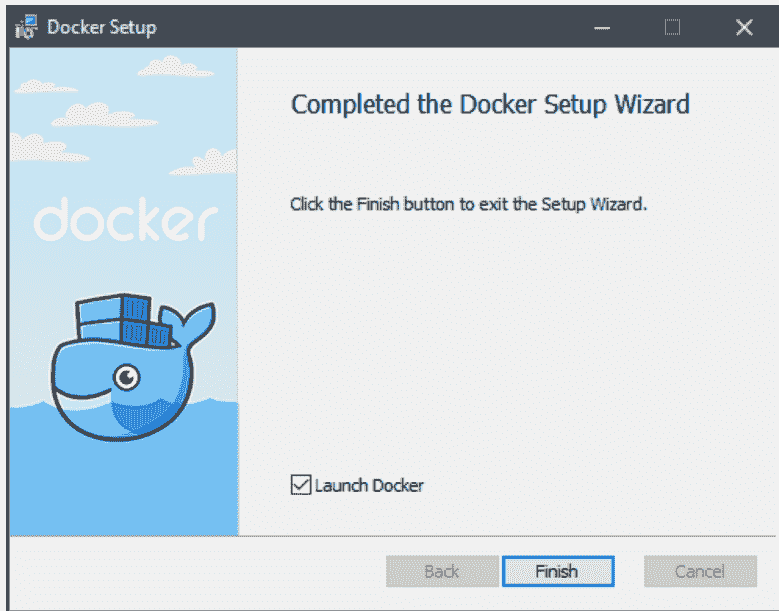

您现在或稍后可以从 Windows 菜单运行 Docker。

如果您运行它，片刻后您应该会在托盘中看到正在动画的 Docker 图标，表示 Docker 正在启动。

如果是这样，您应该会看到一个弹出消息，提示它已准备好使用：

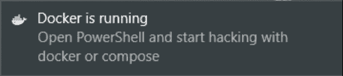

从现在开始，您可以使用托盘区域中的鲸鱼图标与 Docker Engine 交互。

您需要注意，我们在 *第 1 章，Docker 简介* 中描述的 Kitematic 工具不再是 Docker for Windows 安装包的一部分（Docker Toolbox 中是如此）。

然而，Kitematic 与 Docker for Windows 兼容，也可以继续使用。

您可以单独下载并解压到 `C:\Program Files\Docker\Kitematic`。

Docker Toolbox 的设置略有不同。

Windows 和 Mac OS 的 Toolbox 包可在 `https://www.docker.com/products/docker-toolbox` 获取。

下载 **Docker Toolbox** 包后，运行它。

第一个屏幕会询问您是否允许提供匿名使用统计信息以帮助 Docker 开发者改进软件。

是否允许取决于您的隐私顾虑。

下一个屏幕显示可供安装的组件：

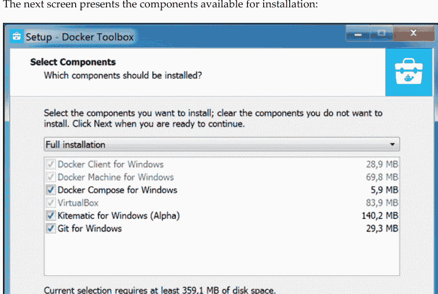

Docker Client for Windows 和 Docker Machine for Windows 是强制性的——没有它们您将无法做任何事情。

对于初始设置，最好保留所有选项的勾选状态。

在撰写本文时，Kitematic 工具处于 alpha 版本，但不用担心，它运行良好。

最后一个安装屏幕会询问您是否希望将 Docker 的二进制文件添加到路径或创建桌面快捷方式，如以下屏幕截图所示：

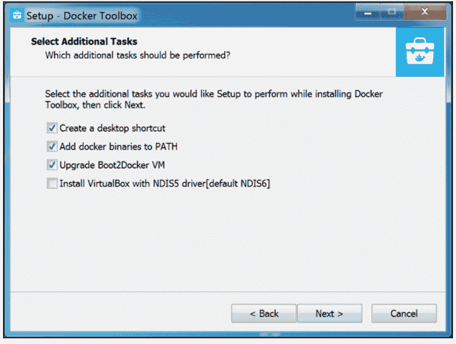

将 Docker 命令行工具放在路径中将来会非常方便，因此最好勾选此选项。

值得一提的是，您可以选择安装旧的 NDIS5 主机网络过滤驱动程序，而不是默认的 NDIS6。

如果您使用的是 Windows Vista 之前的旧版本 Windows，这可能有助于解决诸如减速或网络问题等一些问题。

如果您选择了 NDIS6 并随后发现问题，只需再次执行安装程序，然后改选 NDIS5 即可。

安装后，运行我们之前描述的 Kitematic 工具。

它将在启动 Docker Linux 虚拟机时显示进度窗口。

成功启动后，Kitematic 会要求您提供 Docker Hub 凭据。

您现在可以登录 **Docker Hub**，创建 Docker Hub 账户，或暂时跳过此过程。

这对于搜索和运行镜像不是强制性的。

我们将用它来创建账户，并在第 5 章 *查找镜像* 中大量使用 Docker Hub。

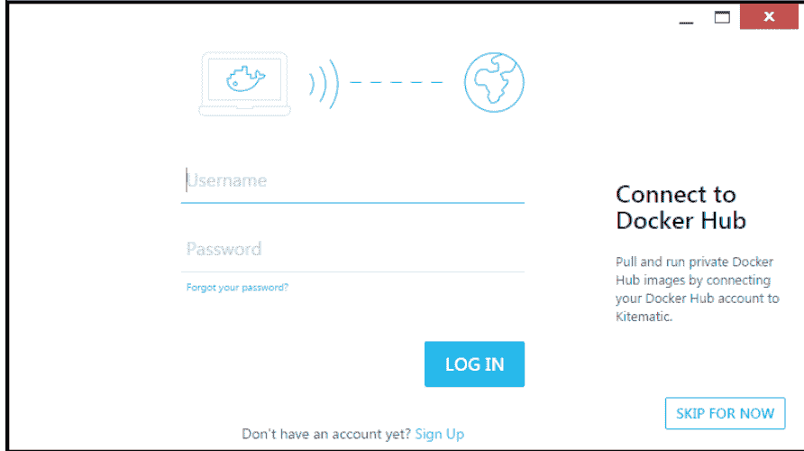

无论您决定执行还是跳过登录过程，您都将看到 Kitematic 的主窗口。

让我们简要讨论一下。

在左侧，有一个可运行的容器列表——如果您首次运行 Kitematic，则为空。

让我们找一个简单的镜像来运行。

只需在搜索框中开始输入 hello-world，即可列出名称中包含该短语的 Docker Hub 镜像。

尝试不同的搜索以查看 Hub 中有哪些内容。

您可以下载并运行诸如 MySQL 或 Mongo 之类的数据库、诸如 nginx 之类的 Web 服务器，以及更多、更多的内容，只需几次鼠标点击！

最好的是，您的机器上无需安装任何依赖项。

例如，您甚至不需要在机器上安装 Java 即可运行 Jboss 或 Tomcat。

这就是容器化的魔力，这只是开始。

来自官方仓库的镜像之一是著名的 **hello-world** 镜像。

点击它旁边的 **创建**：

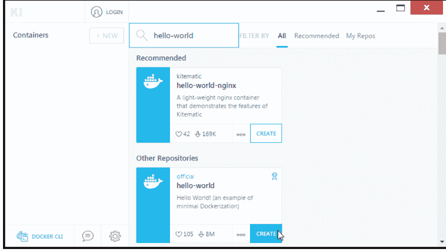

现在魔术开始了。

Docker 将从 Hub 获取所选镜像并执行它。

从现在开始，您可以使用 Kitematic 启动、停止、重启和配置您的容器：

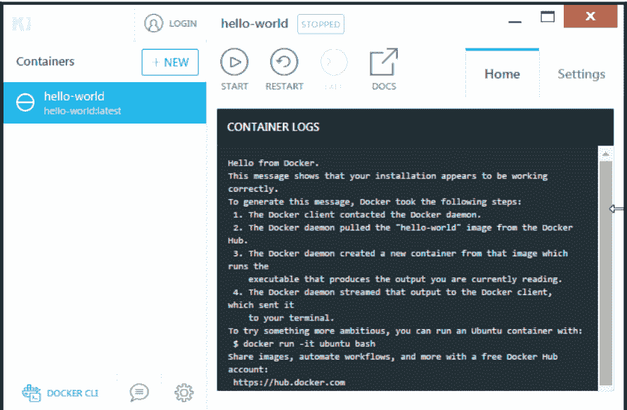

正如您在 **容器** 日志部分所看到的，后台发生了很多事情，只为打印 `Hello` from Docker 消息。

但当然，这不是通常的消息。

它来自容器化软件，与标准的 `hello world` 程序相比有很大不同。

首先，它检查 Docker daemon 是否在您的系统上运行，如果是则连接到它。

接下来，它会检查 hello-world 镜像是否在您的本地系统上。

如果没有——在您首次运行时就会如此——它会从 Docker Hub 获取镜像。

Docker 运行镜像并将输出流回给您查看。

让我们从 Docker CLI 做同样的事情。

点击 Kitematic 中的 **Docker CLI** 图标以执行 Windows PowerShell 命令提示符。

您现在不必担心命令行语法——我们将在下一章中解释它。

此外，我们将在整本书中使用命令行工具，因此您将很容易熟悉语法。


首先，让我们验证虚拟化的 Linux 机器是否正常工作，通过执行以下命令：

```
docker-machine ls
```

ls 代表 list 命令，并列出你在 Windows 上配置的虚拟机。当前正在运行的机器将在 ACTIVE 列中有一个星号，并在 STATUS 列中显示状态为 Running：

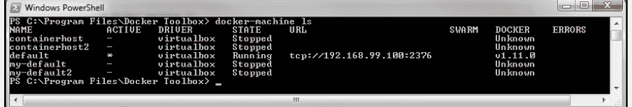

接下来，执行以下命令来运行镜像：

```
docker run hello-world
```

这将给出与 Kitematic 中相同的输出：

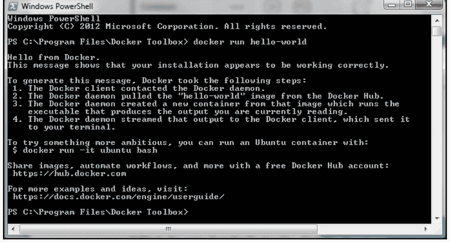

正如我们之前所说，Docker CLI 和 Kitematic 无缝连接，你在命令行中所做的一切都会反映在 Kitematic 中。你会注意到你刚刚运行的镜像会显示在 Kitematic 的 GUI 中。值得注意的是，当你创建一个新的 Docker 容器并且没有为其指定自定义名称（通过使用 Docker CLI 传递 `--name` 选项）时，Docker 会为你生成一个名称：

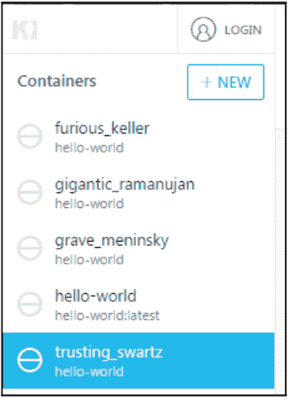

这些自动生成的名称可能很有趣，但以后在需要按名称区分容器时也会非常有用。记住 `furious_keller` 比记住 `3955c5396595` 更容易，不是吗？


如果忘记指定，Docker 会自动为容器生成名称。

现在我们已经在 Windows 上成功运行了 Docker，让我们来解释在 Mac 机器上的安装过程。

## 在 Mac OS 上安装

在 Mac OS 上安装 Docker 与在 Windows PC 上的安装非常相似。这里你也有两个选项。如果你的 Mac 是 2010 年或更新的机型，并且运行的是 Yosemite 或更新的 Mac OS，你可以选择 Docker for Mac 安装。与原生 Docker for Windows 相同，你可以选择稳定版或 beta 版。除非你想体验 Beta 版中提供的新功能和 bug 的刺激，否则应选择 Stable 版本。Docker for Mac 是一个原生应用程序，你只需将其复制到你的 `/Applications` 文件夹，就像任何其他 Mac 应用程序一样，如下图所示：

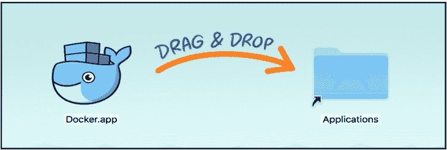

如果你运行已安装的 `Docker.app`，你会在 Mac OS 的菜单工具栏中看到一个鲸鱼图标：

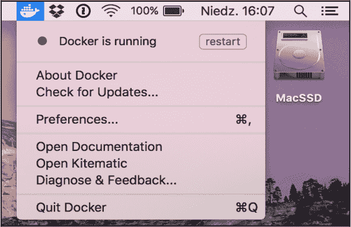

与原生 Docker for Windows 相同的说明也适用于 Docker for Mac：Kitematic 不再是安装包的一部分。然而，它仍然与 Docker for Mac 兼容——你只需单独下载并放入 `/Applications` 文件夹即可。

如果你使用的是较旧的 Mac 或较旧的 Mac OS，你将需要 Docker Toolbox。然而，你至少需要 Mac OS 10.8 *Mountain Lion* 才能安装 Docker Toolbox。Docker Toolbox 包与 Windows 中一样，包含开始所需的所有工具。它包含 Docker Client、Machine、Compose、Kitematic 和 VirtualBox。直接前往 Docker Toolbox 网站 https://www.docker.com/products/docker-toolbox 并下载 Mac OS 版本。Docker Toolbox for Mac 被打包成 pkg 包，因此你需要运行它，而不是简单地移动到 `/Applications` 文件夹。与 Windows 版本类似，你可能希望给予它权限以报告使用统计数据来改进未来的版本。安装后，**Quick Start** 页面会让你选择快速执行 Terminal 或 Kitematic 工具：

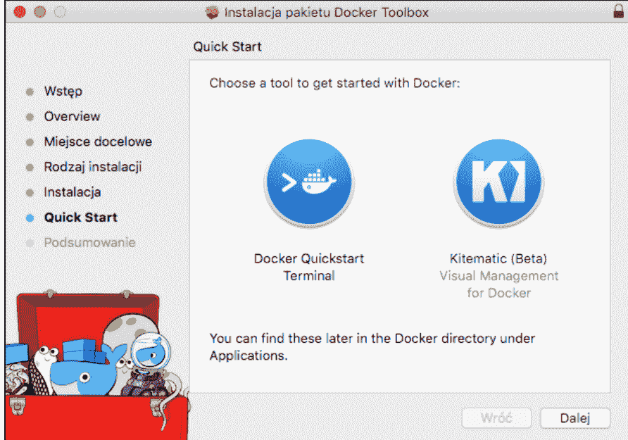

稍后你还可以在 `Applications` 文件夹和 **Launchpad** 菜单中找到 Docker 工具和 VirtualBox：

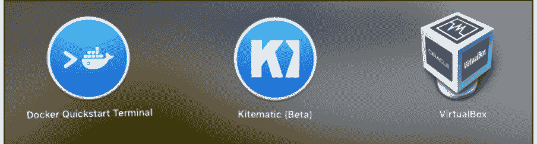

要验证设置，请执行 **Kitematic**，跳过 **Docker Hub login** 并在搜索字段中输入 `hello-world`：

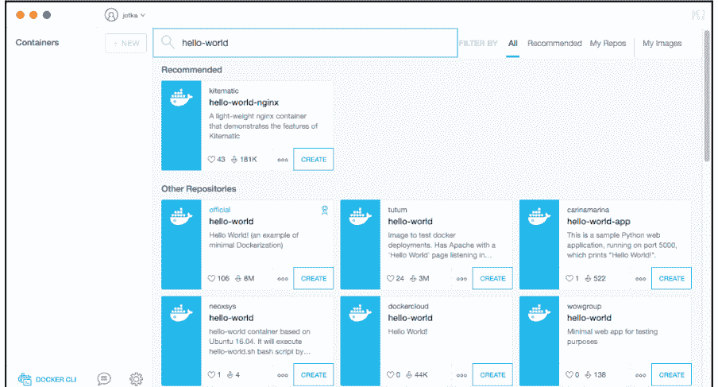

接下来，单击 hello-world 镜像旁边的 CREATE 按钮。Kitematic（准确地说是 docker-machine）将从 Docker Hub 下载镜像并向你展示输出：

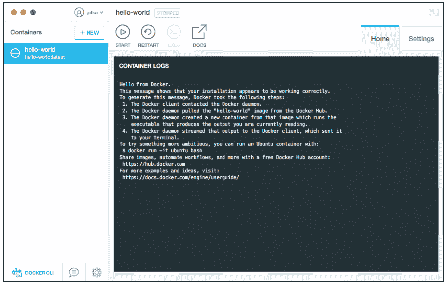

从现在开始，Docker 的命令行工具也供你使用。从 Kitematic 打开 Terminal 会自动设置所有必需的环境变量并连接到默认机器。但如果你想从自己的 Terminal 会话中工作，你可能会收到 Docker 客户端无法连接到 Docker daemon 的消息。原因是客户端不知道它应该控制哪台机器。要将客户端附加到特定机器，请在你的 Terminal 会话中输入以下命令：

```
eval "$(docker-machine env default)"
```

eval 命令设置环境变量，以指示 docker 对特定机器运行命令，在我们的示例中是默认机器。

要查看 Docker 相关环境变量的列表，请使用 env 命令：

```
env | grep DOCKER
```

输出将包含 Docker 变量，例如机器名称、主机和证书路径：

```
DOCKER_TLS_VERIFY=1
DOCKER_HOST=tcp://192.168.99.100:2376
DOCKER_CERT_PATH=/Users/jarek/.docker/machine/machines/default
DOCKER_MACHINE_NAME=default
```

在出现 Docker daemon 连接问题时，始终检查环境变量。

另一种测试设置的方法是 docker info 命令。从命令行 shell 执行以下操作：

```
docker info
```

输出将包含大量有用的信息，关于服务器的内核版本、可用内存、正在运行的容器数量、机器名称等等。

现在让我们在 Terminal 中直接运行 hello-world 镜像，输入以下命令：

```
docker run hello-world
```

如果你能看到镜像的输出，那么一切就绪，你的 Mac 上已成功设置了可用的 Docker：

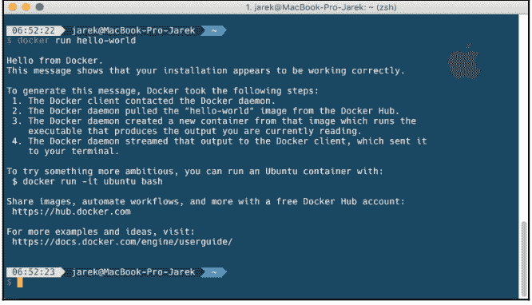

## 在 Linux 上安装

正如我们之前所说，Linux 是 Docker 的自然栖息地。因此，没有必要虚拟化 Linux 内核。你可以在处理器中没有 VT-x 或类似技术的情况下运行 Docker，因为 Docker 只需要内核中可用 cgroups 即可使其大部分功能正常工作。Cgroups（控制组）是 Linux 内核的一项功能，可限制、核算并隔离一组进程的资源使用（CPU、内存、磁盘 I/O、网络等）。Docker 只会简单地使用你自己的操作系统的内核。这也使安装包更小——不需要虚拟化引擎和另一个虚拟化操作系统。这就是安装过程与 Mac OS 或 Windows 略有不同的原因。首先，安装中不包含 Docker Machine——对于 Linux 来说它并非强制。其次，没有花哨的 GUI 安装程序。你需要从命令行执行大部分任务，但这对 Linux 用户来说应该不是问题。最后但同样重要的是，Linux 上没有 Kitematic 工具可用。

在 Docker 网站上，你可以找到特定 Linux 发行版的安装步骤（例如 Red Hat 使用 yum 包管理器，Ubuntu 使用 apt-get）。如果你不愿意直接使用包管理器，可以使用 Docker 团队提供的安装脚本。事实上，该脚本将执行适用于你的 Linux 操作系统的包管理器，然后使用包安装软件。要获取 Linux 的最新 Docker 版本，请在 shell 中输入以下内容：

```bash
$ curl -fsSL https://get.docker.com/ | sh
```

或者，你也可以使用 wget 命令安装 Docker，执行以下命令：

```bash
$ wget -qO- https://get.docker.com/ | sh
```

下载所需包的过程将开始，你会看到密钥、包及其依赖项被下载。在输出末尾，安装程序将打印已安装的 Docker 客户端和服务器的版本：

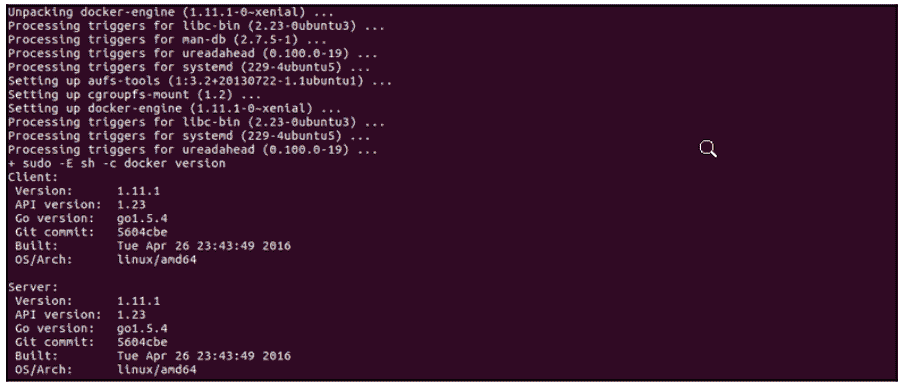

以这种方式安装将使 Docker 服务可供 root 运行。并非总是明智的做法以 root 身份运行软件，因此你可能希望也让你的用户可以运行它。首先，你需要创建 docker 组：

```
$ sudo groupadd docker
```

然后将当前用户添加到该组（假设 yourUsername 是你的用户登录名：

```
$ sudo usermod -aG docker yourUsername
```

如果你打算使用 Linux 进行云设置，你也希望安装 Docker Machine。要做到这一点，请执行此脚本：

```
$ curl -L https://github.com/docker/machine/releases/download/v0.7.0/docker-machine-`uname -s`-`uname -m` > /usr/local/bin/docker-machine
$ chmod +x /usr/local/bin/docker-machine
```


你也可以直接前往 Linux 发行版页面并在 https://github.com/docker/machine/releases/ 选择所需的版本。

为了测试安装，让我们通过执行脚本来打印 Docker 服务状态（这是针对最新 Ubuntu Linux 的示例，我将在本书其余部分使用它）：

```
$ sudo service docker status
```

如果服务响应正常，它将显示运行状态以及一些统计信息，例如服务可用的内存和一些最近的日志行：

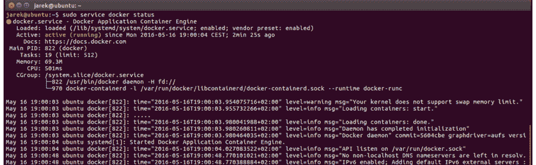

服务似乎运行正常，所以接下来我们要做的是运行简单的 hello-world 镜像。这里乐趣开始了——如果 Docker 无法在你的本地机器上找到镜像，它将从 Docker Hub 获取它然后运行它。我们将在第 5 章《Finding Images》中更详细地讨论查找镜像和 Docker Hub。注销并重新登录后，在你的 shell 中输入以下命令来执行示例 hello-world 镜像：

```
docker run hello-world
```

执行命令后，正确的结果将只是 Hello from Docker 消息以及一些更有趣的事实：

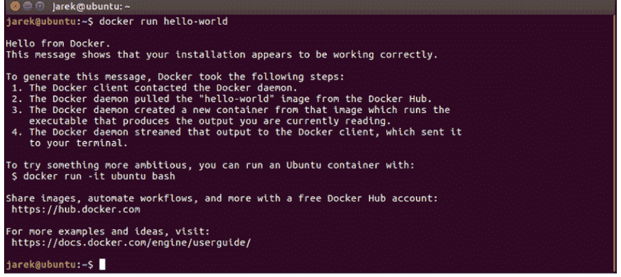

使用 Kitematic 在 Windows 或 Mac OS 上运行镜像时，你会得到相同的输出。Docker 会打印出运行镜像所需执行的步骤。再次强调，仅为打印这条简单消息，后台发生了很多事情，但运行示例镜像是测试设置的好方法。

## 在云上安装 — AWS

在接下来的章节中，我们将展示如何使用 Docker Machine 远程创建 Docker 实例。这次我们将手动在 Amazon EC2 云上安装 Docker 并运行示例镜像。如果你已在 EC2 云上运行 Linux，Docker 安装过程几乎与任何 Linux 系统相同。让我们从创建第一个 Linux 实例开始。

要使用 EC2 云，你需要创建一个账户。基本用途是免费的，所以前往 http://aws.amazon.com 并填写注册表。此外，基本的 `t2.micro` 实例可供你免费使用，足以测试 Docker 安装。创建账户后，登录 **AWS Console** 并从可用服务列表中选择 **EC2**：

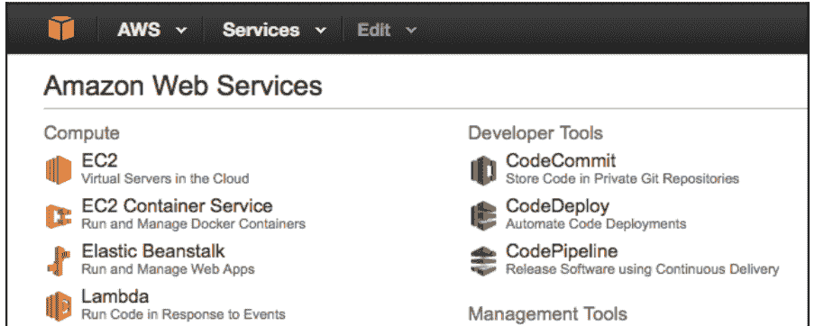

接下来，使用 **Launch Instance** 按钮启动实例：

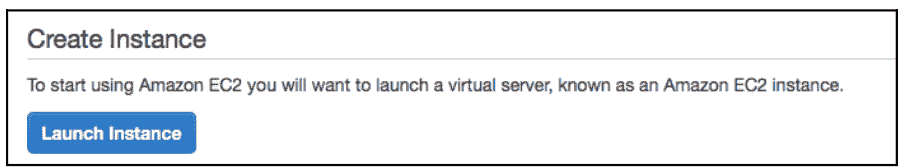

下一页询问你的新 EC2 实例应提供什么操作系统。对于我们的目的，**Amazon Linux** 就足够了。它在列表中排第一，选择它：

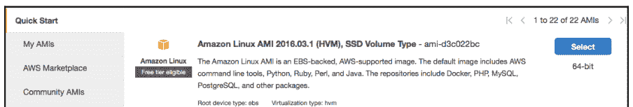

接下来，你需要选择 **Instance Type**，它决定了你的服务器将拥有的 CPU、内存、存储和网络容量类型。坚持使用默认选项 `t2.micro`（免费）并点击 Next。接下来，点击 **Configure Instance Details** 按钮。

然后 Amazon EC2 助手将显示实例配置页面，其中 `SSH` 端口（22）默认打开。根据你的需求，你可以添加或打开更多端口，例如如果你计划运行可通过 Web 浏览器访问的 Web 应用程序，则为 `HTTP`（80）：

| 类型 | 协议 | 端口范围 | 来源 |
|------|----------|------------|--------|
| SSH | TCP | 22 | 任何地方 0.0.0.0/0 |
| HTTP | TCP | 80 | 任何地方 0.0.0.0/0 |
| 添加规则 |  |  |  |

现在到了重要部分。为了能够远程登录到你的实例，你需要一个密钥对。它由公钥和私钥文件组成，你必须使用它们通过 SSH 连接到你的 EC2 实例。从下拉列表中选择 **Create a new key pair**，为其指定一个名称，例如 `MY_EC2`，然后点击 **Download Key Pair** 按钮：

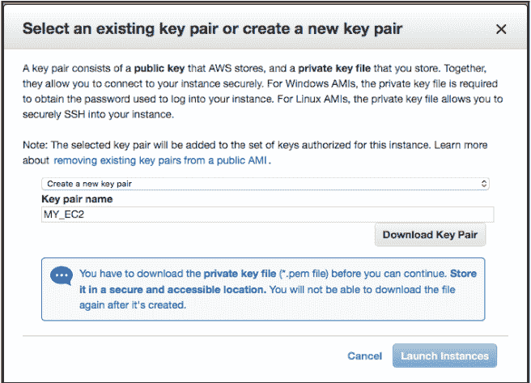

如果你点击 **Launch Instances** 按钮，启动过程将开始并显示状态：

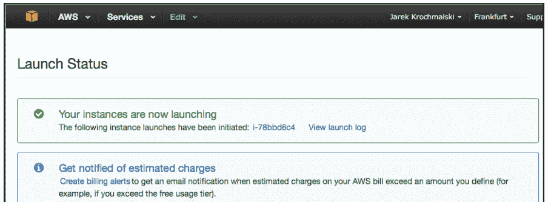

你也可以通过从 **Management Console** 菜单中选择 **Instances** 来检查你的 AWS 实例状态。这是一个方便的页面，可用于管理所有实例。状态页面将列出所有云机器、其状态（如运行或已停止），以及可用于登录实例的公共 IP：

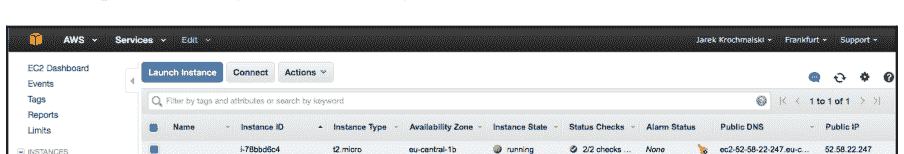

我们新创建的实例似乎运行正常，所以让我们尝试登录其 shell。前往你之前保存 Amazon 生成的密钥的目录，并执行以下命令：

```
chmod 400 MY_EC2.pem.txt
ssh -i MY_EC2.pem.txt ec2-user@52.58.22.247
```

这里，`MY_EC2.pem.txt` 是生成的密钥的文件名，而 `52.58.22.247` 是你的远程实例的公共 IP 地址——当然，这两者对你来说会不同。运行 SSH 登录后，你将看到 Amazon Linux 的欢迎界面：

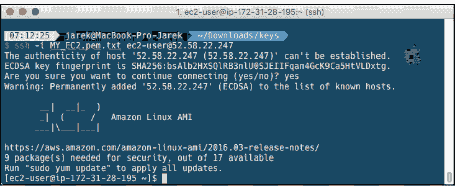

从现在开始，Docker 安装过程与任何 Linux 设置差别不大。首先，最好升级操作系统软件以确保错误修复到位。在 Amazon Linux 上执行此操作，请执行以下命令：

```
sudo yum update -y
```

接下来，使用 `yum` 包管理器安装 Docker 并将你的用户添加到 `docker` 组：

```
sudo yum install -y docker
sudo usermod -a -G docker ec2-user
```


将你的用户添加到 `docker` Linux 组后，你需要注销并重新登录，以便能够以普通非 root 用户身份运行 Docker。

安装 Docker 后，让我们直接检查它是否正在运行。我们将通过启动 `hello-world` 镜像来完成此操作。执行以下命令：

```
docker run hello-world
```

Docker 将从 Docker Hub 获取镜像然后运行它：

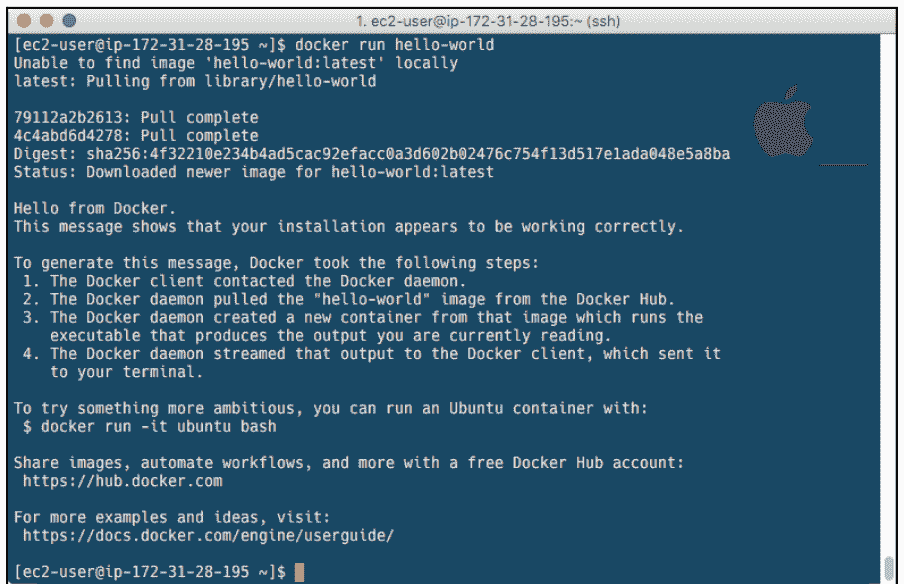

著名的 `Hello from Docker` 消息简单地说明你现在已成功在 AWS 云中运行 Docker 容器！

现在我们已完成安装过程，希望你能够在你选择的 operating system 上运行示例 `hello-world` 镜像。让我们在下一章中更深入地探索容器化世界，了解更多关于容器和镜像的知识。

## 摘要

在本章中，我们介绍了在各种操作系统和 Amazon 云上安装 Docker 的过程。到目前为止，你应该已验证 Docker 安装并使其运行。我们还了解了可供我们使用的工具及其用途。现在先放下它，学习一些理论。

在下一章中，我们将深入探讨 Docker 的镜像和容器架构。在运行 Docker 容器或创建自己的镜像之前，了解一些概念是必不可少的。

# 3

## 3 理解镜像和容器

在上一章中，我们学习了如何在 Windows、Mac OS、Linux 和 Amazon EC2 云上安装 Docker。到目前为止，你应该已在机器上运行 Docker 并能够在容器中运行 hello-world 镜像。在本章中，我们将更深入地探索镜像和容器的世界。稍后，我们还将介绍与镜像分发相关的术语，例如 Docker repository、registry 和 index。本章将涵盖以下主题：

- 镜像
- 层
- 容器
- 保存容器更改
- Docker registry、repository 和 index

请注意，我们主要使用 shell（或 Windows 中的命令提示符）来执行 Docker 命令。你可以随时执行 docker help 来获取可用命令的描述。例如，执行 docker help 后跟特定命令的名称 docker help pull，将显示有关该命令的信息以及可用选项的简要描述：

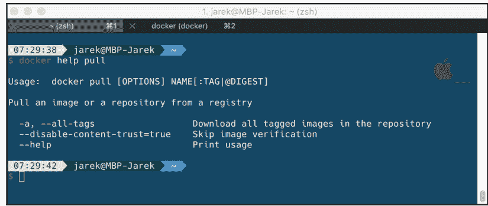

让我们开始详细解释镜像、层和容器是什么。

### 镜像

你可以将镜像视为只读模板，它是运行容器的基础。它就像一个模板，包含应用程序运行所需的一切。它可以是安装了 Web 服务器和你的 Web 应用程序的 Ubuntu Linux。每个镜像都从一个基础镜像开始，例如 Ubuntu，一个基础 Linux 镜像。你可以自己创建镜像——镜像是使用一系列命令（称为指令）创建的，这些指令在 Dockerfile 中描述。它是有序的层集合——根文件系统更改堆叠在一起。这些更改可以是运行命令、添加文件或目录、创建环境变量等等。Docker 使用一种名为 AUFS 的文件系统，全称为 Augmented File System。Dockerfile 的几乎每一行（有一些例外，我们稍后会解释）都会创建一个新镜像，当你将它们全部堆叠或增强在一起时，你将得到最终的 Docker 镜像。这本质上是一种缓存方式。例如，如果你只更改 Dockerfile 的一行，Docker 不会重建整个镜像集。Dockerfile 在开始构建镜像的过程时会按顺序处理。Docker 将逐一执行指令并返回最终镜像。每个指令在镜像中创建一个新层。我们将在第 6 章《Creating Images》中介绍该过程。


Docker 镜像在不同主机之间具有高度可移植性 —— 镜像可以在任何运行 Docker 的主机上的 Docker 容器中运行。需要注意的是，Docker 使用镜像来运行你的代码，而不是 Dockerfile。Dockerfile 用于在运行 `build` 命令时创建镜像 —— 我们将在 `Chapter 6`、*Creating Images* 中再次讨论它。此外，如果你将镜像发布到 Docker Hub，你发布的是生成的镜像，而不是源 Dockerfile。我们将在本书后面、`Chapter 8`、*Publishing Images* 中描述该过程。

本地机器上拥有的镜像可以通过运行 `docker images` 命令列出：

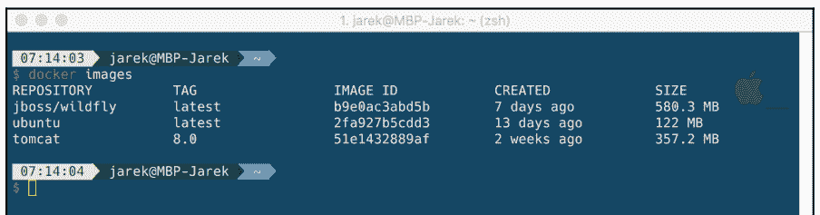

images 命令将显示一个包含以下列的表格：

- `REPOSITORY` : 这是仓库的名称。我们将在本章末尾详细解释它。
- `TAG` : 它类似于 Git 或其他版本控制系统的标签。它代表仓库提交历史中的一个特定点。在构建镜像时你可以拥有多个标签。甚至还有一个名为 latest 的特殊标签，表示最新版本。标签的完整形式为 `[REGISTRYHOST/][USERNAME/]NAME[:TAG]`，但 TAG 列只是完整标签中的 `[:TAG]` 部分。我们将在 `Chapter 6`、*Creating Images* 中详细讲解标签。
- `IMAGE ID` : 这是镜像的标识符（实际上它是镜像真实标识符的前 12 个字符）。你可以在执行镜像命令时使用它来引用特定镜像，但也可以使用镜像的名称。
- `CREATED` : 日期表示仓库创建的时间。你可以用它来验证镜像构建的新鲜程度。
- `SIZE` : 这是镜像的大小。

要删除系统上所有的镜像，请执行以下命令：

```
docker rmi $(docker images -q)
```

每当你将一个已被使用的标签分配给新镜像时（例如，通过构建镜像 myImage，对其 Dockerfile 进行更改，然后再次构建 myImage），旧镜像将失去该标签，但仍会保留，即使其所有标签都被删除。这些旧版本的镜像是 Docker images 输出中的未标记条目，你可以使用以下命令安全地删除它们：

```
$ docker rmi <IMAGE HASH>
```

要删除所有未标记的 docker 镜像，请使用镜像列表和过滤器：

```
$ docker rmi $(docker images -q -f dangling=true)
```

作为从头创建镜像的替代方案，你可以从互联网上数百个可用的镜像中挑选已准备好的镜像。此外，你可以在自己的私有镜像仓库中发布镜像，以便组织中的其他人可以拉取并复用。我们将在第 5 章、查找镜像 中介绍查找镜像的过程。下载的镜像可以自由更新和扩展，因此下载基础镜像是在自己开发时获得显著提速的好方法。下载即用型镜像，例如 Web 服务器或数据库，然后在其基础上构建的做法非常常见。例如，你可以有一个基础的 Apache 镜像。你可以将它用作所有 Web 应用镜像的基础。这得益于镜像的内部特性 —— 层，Docker 镜像就是由这些层组成。我们之前说过，Dockerfile 中的每一条指令都会创建一个新的层。现在让我们解释一下它们是什么。

## Layers

每个镜像都由一系列层叠加而成。通过使用联合文件系统，Docker 将这些层组合成一个单一的镜像实体。联合文件系统允许对不同文件系统的文件和目录进行透明叠加，从而得到一个单一、一致的文件系统，如下图所示：

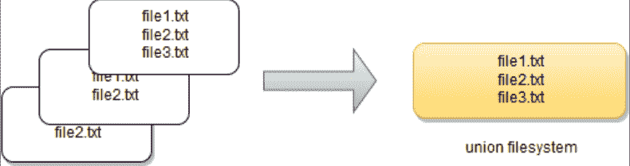

在这些独立文件系统中具有相同路径的目录的内容和结构，将在新的类虚拟文件系统中作为一个合并目录一起显示。换句话说，上层的文件系统结构会与下层结构合并。具有与上一层相同路径的文件和目录会覆盖其下方的对象。移除上层后，又会重新显示并暴露之前的目录内容。如前所述，层是堆叠放置的。为了保持层的顺序，Docker 利用了层 ID 和指针的概念。每个层都包含 ID 和指向其父层的指针。没有指向父层的指针的层是堆栈中的第一层，即基础层。你可以在下图中看到这种关系：

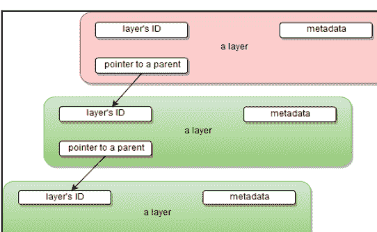

当你从 Docker Hub 拉取镜像时，你实际上可以看到每个依赖层的下载进度。以下是最新版 Ubuntu Linux 的示例：

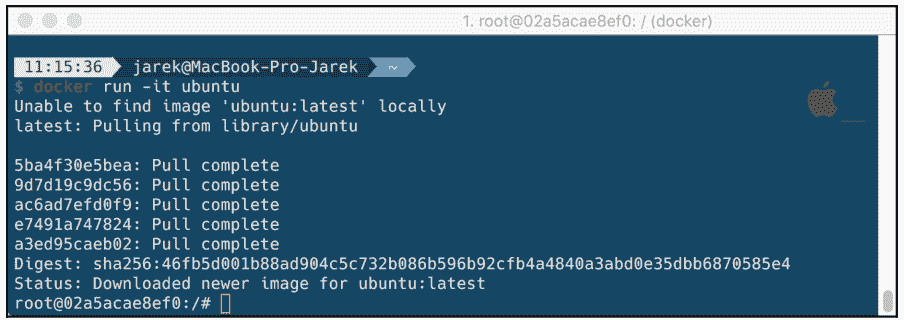

使用层带来的另一个优势是历史的持久性。层可以提供特定镜像是如何构建的历史记录。一旦所有层下载完成，你可以使用 history 命令列出特定镜像中的层：

```
$ docker history ubuntu
```

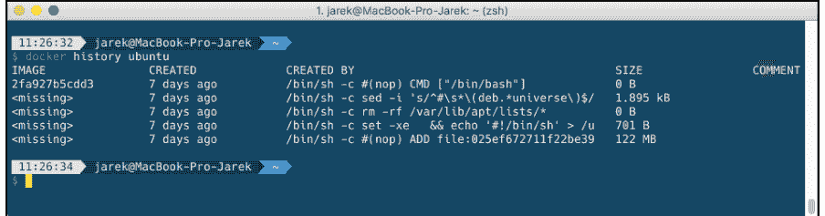

history 命令输出中的每一行都对应一次对文件系统的提交。SIZE 列中的值加起来等于 docker images 中镜像对应的 SIZE 列。

你也可以使用可在 https://imagelayers.iron.io 获取的 ImageLayers Web 应用查看镜像的图形化表示：

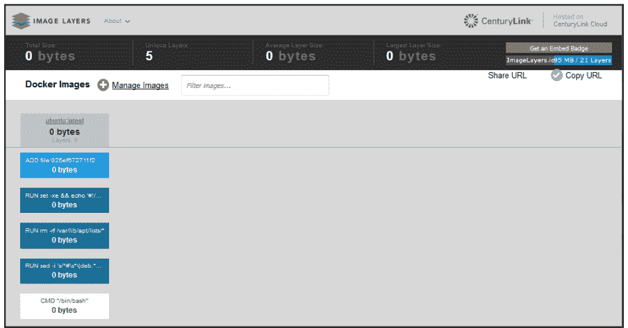

层有一些有趣的特性。首先，它们是可复用的。如果两个不同的镜像有共同部分，例如 Linux shell，Docker 会跟踪所有已拉取的层，并在两个镜像中复用 shell 层。这是一个安全操作；正如你记得的，层是只读的。在下载第二个镜像时，该层会被复用，只有差异部分会从 Docker Hub 拉取。这当然节省了时间和带宽、磁盘空间，但它还有另一个巨大的优势。如果你修改 Docker 镜像，例如提升应用版本，只有单个层会被修改。无需分发整个镜像，只推送更新即可，使过程更简单、更快。这在你使用 Docker 进行持续部署流程时尤其有用：推送一个 Git 分支会触发镜像构建，然后为用户发布应用。由于层的复用特性，整个过程快得多。因为有了层，Docker 相比于不共享任何内容的完整虚拟机来说更轻量。因为 Docker 使用的层缓存，当你拉取一个镜像（https://docs.docker.com/reference/commandline/pull/）时，最终不必下载其整个文件系统。如果你已有另一个镜像包含你要拉取的镜像的部分层，只有缺失的层才会被实际下载。不过，这里有一个警告，与层的另一个特性有关：除了可复用之外，层也是累加的。


层是累加的 —— 因此镜像可能会变得相当大。

例如，如果你在容器中创建一个大文件，进行一次提交（我们稍后会讲到），然后删除该文件并再次提交，该文件仍会存在于层历史中。想象一下这个场景：你拉取基础 Ubuntu 镜像并安装 Wildfly 应用服务器。然后你改变主意，卸载 Wildfly 并改装 Tomcat。Wildfly 安装中删除的那些文件仍会存在于镜像中 —— 尽管它们已被删除。镜像大小会在短时间内增长。

理解 Docker 的分层文件系统可以对镜像大小产生巨大影响。不断增长的大小在你将镜像发布到镜像仓库时会成为问题 —— 需要更多请求且传输时间更长。当需要在集群中部署数千个容器时，大镜像就会成为问题，例如。

要扁平化镜像，你可以使用 export 命令将其导出为 TAR 文件：

```
$ docker export <CONTAINER ID> > /home/docker/myImage.tar
```


将镜像导出为 TAR 不会保留其历史记录。

导出的文件随后可以使用 import 命令重新导入：

```
$ cat /home/docker/myImage.tar | docker import - some-name:latest
```

如果可用磁盘空间真的成为问题，你可以将 export 的输出流管道到 import 的输入流：

```
$ docker export <CONTAINER ID> | docker import - exampleimagelocal:new
```

另外，你也可以使用可在 GitHub https://github.com/jwilder/docker-squash 获取的 docker-squash 工具使镜像变小。它会将多个 Docker 层压缩成一层，以创建层更少、更小的镜像。压缩后的镜像与原始构建方式工作相同，因为该工具保留了 Dockerfile 命令，例如 PORT 或 ENV。此外，后续层中已删除的文件在压缩时实际上会从镜像中移除。


如果需要，你也可以使用 cp（copy 的缩写）命令从已完成的容器中提取数据文件：

```
$ docker cp <CONTAINER ID>:/path/to/find/files /path/to/put/copy
```

层和镜像彼此密切相关。Docker 使用一些命令来处理镜像及其层，我们已经使用过其中大部分。现在让我们总结一下：

| 镜像相关命令 | 描述 |
|---|---|
| images | 这列出镜像 |
| Build | 这从 Dockerfile 构建镜像 |
| history | 这显示镜像的历史记录 |
| import | 这从 TAR 归档的内容创建新的文件系统镜像 |
| load | 这从 TAR 归档加载镜像 |
| rmi | 这删除一个或多个镜像 |
| Save | 这将镜像的内容保存到 TAR 归档 |
| inspect | 这返回有关镜像的低级信息 |

层是容器世界中的一个很棒的功能。合理使用时，在创建镜像时可以提供很大帮助。但它们也有局限性。目前，AUFS 的层数限制为 42 层 https://github.com/dotcloud/docker/issues/1171。这意味着你应该在可能的情况下将相似的命令分组，这样只会产生一个单一的层。

正如我们之前所说，Docker 镜像以一系列只读层存储。这意味着一旦容器镜像创建完成，它就不会改变。但让整个文件系统都只读并没有多大意义。修改镜像怎么办？向基础 Web 服务器镜像添加你的软件？好吧，当我们启动一个容器时，Docker 实际上会取出只读镜像（及其所有只读层），并在层栈顶部添加一个读写层。现在让我们关注容器。

## 容器

镜像的运行实例称为容器。Docker 使用 Docker 镜像作为只读模板来启动它们。用编程的比喻来说，如果镜像是一个类，那么容器就是该类的一个实例——一个运行时对象。容器是运行应用程序的环境的轻量级且可移植的封装。要将镜像转换为容器，Docker 引擎会取出镜像，在其顶部添加一个读写文件系统，并初始化各种设置，包括网络端口、容器名称、ID 和资源限制（我们将在第 7 章《运行容器》中讨论向容器应用资源限制）。要运行容器，请使用我们在上一章测试安装时使用的相同命令 docker run：

```
$ docker run [OPTIONS] IMAGE [COMMAND]
[ARG...]
```


你可以同时运行同一镜像的多个容器。

run 命令有很多可用的选项。其中一些包括网络配置，例如（我们将在下一章解释 Docker 的网络）； -it（交互式）选项告诉 Docker 使容器交互式并将其输出和输入附加到终端。我们将在第 7 章《运行容器》中详细介绍所有选项。现在，让我们只关注容器的概念，以便更好地理解整体情况。让我们尝试一个简单的命令，使用最新版本的 Ubuntu 启动一个新容器。交互式运行的结果是，一旦此容器启动，你将获得一个 bash 提示符 shell，可以在其中执行 Ubuntu 命令，就像在普通 shell 中一样：

```
$ docker run -it ubuntu:latest
/bin/bash
```

当我们运行此命令时，幕后发生了什么？

镜像——在我们的例子中是 ubuntu:latest——将从 ubuntu 仓库拉取下来，除非它已在你的本地机器上可用。

Docker 引擎取出镜像并在层栈顶部添加一个读写层，然后初始化镜像名称、ID 和资源限制（如 CPU 和内存）。在此阶段，Docker 还会通过从池中查找并附加一个可用 IP 地址来设置 IP 地址。执行的最后一步将是实际命令——作为最后一个参数传递：在我们的例子中为 /bin/bash——它启动一个可以登录的 shell。Docker 将捕获并提供容器输出；它将显示在控制台中。现在你可以做在为应用程序准备操作系统时通常会做的事。这可以是安装软件包（例如通过 apt-get）、使用 Git 拉取源代码、使用 npm 下载 Node.js 库等等。所有这些都将修改顶部可写层的文件系统。如果随后执行 commit 命令，将创建一个包含你所有更改的新镜像，可稍后运行。

有时我们可以告诉 Docker，在容器停止后我们不再需要它。为此，run 命令提供了 -rm 选项：

```
$ docker run -i -t -rm ubuntu:latest
/bin/bash
```

这将拉取（当然，如果它尚未在你的机器上）并启动最新的 Ubuntu 容器，并为我们提供一个交互式 bash shell。一旦我们完成工作并停止容器，它将被从文件系统中删除，从而释放驱动器上的一些空间。

要停止容器，请使用 docker stop 命令。Docker stop 的语法如下：

```
$ docker stop [OPTIONS] <container ID/name> [<container ID/name...>]
```

stop 命令没有太多选项；你可以提供 -t 选项来指定 Docker 在停止容器前等待的秒数，默认值为 10 秒。例如，要停止 ID 为 fa19b25b311e 的容器，只需执行以下命令：

```
$ docker stop fa19b25b311e
```

容器在停止时将保留所有设置和文件系统更改（在顶部的读写层中），但所有进程将被停止，你将丢失内存中的任何内容。这就是停止的容器与 Docker 镜像的区别。有时你需要停止所有正在运行的容器，因此此命令可能会派上用场：

```
docker stop $(docker ps -q)
```

要列出系统上所有的容器——无论是正在运行还是已停止——请执行 ps 命令：

```
$ docker ps -a
```

结果，Docker 客户端将列出一个包含容器 ID（可在其他命令中用来引用容器的唯一标识符）、创建时间、启动容器时使用的命令、状态、暴露端口以及名称（由你指定或 Docker 为你挑选的有趣名称）的表格：

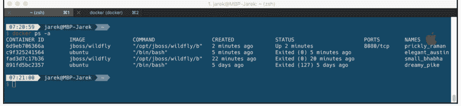

如你所见，输出将包含有关容器状态和运行时间的详细信息以及用于在容器中启动的命令。

要删除容器，只需使用 rm 命令。如果你想一次删除所有已停止的容器，可以使用 ps 命令提供的容器列表并使用过滤器：

```
$ docker rm -v $(docker ps -q -f status=exited)
```

## 将容器更改保存

尽管镜像始终是只读且不可变的，但我们实际上可以对正在运行的容器进行更改——容器栈的顶层始终是读写（可写）层。这可以是添加或修改文件，例如安装软件包、配置操作系统等等。

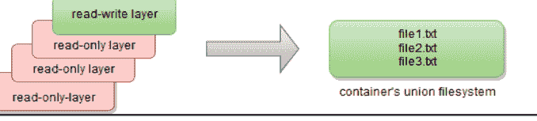

如果你在正在运行的容器中修改文件，该文件将被复制出底层只读层并进入顶部的读写层。你的更改仅应用于顶层，而联合文件系统将隐藏底层文件。原始文件不会被销毁——它仍然存在于底层的只读层中。如果你删除容器并再次重新启动同一镜像，Docker 将启动一个全新的容器，不包含之前运行容器中所做的任何更改。

换句话说，你对文件系统的更改不会影响基础镜像。然而，你可以使用 commit 命令从正在运行的容器（及其所有更改）创建新镜像：

```
$ docker commit <container-id> <image-name>
```

要保存你对容器所做的更改，必须提交它们。


在运行时，如果容器中的进程对其文件系统进行更改，那么当前容器文件系统与容器创建时所基于的镜像文件系统之间当然会存在差异。如果你运行 docker commit 命令，此差异将成为一个新只读镜像，你可以从中创建新容器。否则，如果你删除容器，此差异将消失。你可以对容器进行更新，但一系列更新会产生一系列新的容器镜像，因此系统回滚很容易。看看执行 commit 后会发生什么：

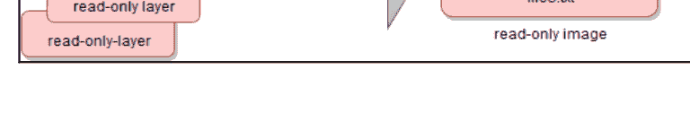

让我们看一个例子。首先，我们拉取一个名为 busybox 的基础镜像。Busybox 将许多常见 UNIX 工具的微小版本组合成一个单一的小型可执行文件。它为你在 GNU 中通常找到的大多数工具提供了替代品，例如文件实用程序、shell 工具等等：

```
$ docker pull busybox
```


现在，我们对该镜像的容器进行更改；在本例中，我们新建一个文件夹：

```
$ docker run busybox mkdir /home/test
```

目前，我们可以使用以下命令获取 busybox 容器 ID：

```
$ docker ps -a
```

让我们提交这个已更改的容器——这将创建一个名为 busybox_modified 的新镜像：

```
$ docker commit <CONTAINER ID> busybox_modified
```

提交成功后，Docker 只会输出新生成镜像的完整 ID。

为避免数据损坏或不一致，Docker 会暂停你正在提交更改的容器。虽然不推荐这样做，但你可以选择禁用此行为，将 --pause 选项设置为 false。

如果我们列出现在拥有的镜像，busybox 和 busybox_modified 都应出现在列表中。要查看它们，请执行 images 命令：

```
$ docker images -a
```

如你所见，新的 busybox_modified 已出现在本地可用镜像列表中：

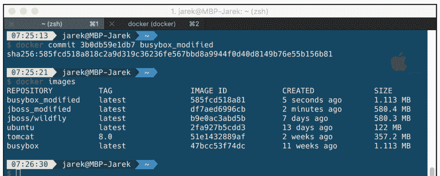

要查看两个镜像之间的差异，我们可以使用以下文件夹检查：

```
$ docker run busybox [ -d /home/test ] && echo 'Directory found' || echo 'Directory not found'
$ docker run busybox_modified [ -d /home/test ] && echo 'Directory found' || echo 'Directory not found'
```

现在我们有两个不同的镜像（busybox 和 busybox_modified），并且我们有一个基于 busybox 创建的容器，其中也包含该更改（新文件夹 /home/test）。commit 命令会将容器的顶层读写层转换为只读层。实际上，容器（无论是运行中还是已停止）都会变成新的、只读的、不可变的镜像。

当容器被删除时，可写层也会被删除。

通过修改容器中的顶层可写层来创建镜像在调试和实验时很有用，但通常最好使用 Dockerfile 以文档化且可维护的方式管理镜像。我们将在第 6 章《创建镜像》中进行此操作。


容器是镜像的有状态实例化。

我们在本节中使用了一些容器相关命令，让我们将其总结在表格中：

| 容器相关命令 | 描述 |
|---|---|
| attach | 这用于附加到正在运行的容器 |
| commit | 这用于从 Dockerfile 构建镜像 |
| cp | 这显示镜像的历史记录 |
| create | 这从 TAR 归档的内容创建新的文件系统镜像 |
| diff | 这从 TAR 归档加载镜像 |
| exec | 这删除一个或多个镜像 |
| inspect | 这将镜像的内容保存到 TAR 归档 |
| kill | 这返回有关镜像的低级信息 |
| start / stop / restart / pause / unpause | 这管理容器的运行状态 |
| logs | 这获取容器的日志 |
| port | 这列出容器的端口映射或特定映射 |
| rename | 这用于重命名容器 |
| run | 这用于在新容器中运行命令 |
| stats | 这用于显示容器资源使用统计的实时流 |
| top | 这用于显示容器的运行进程 |
| Update | 这用于更新一个或多个容器的配置 |
| Wait | 这用于阻塞直到容器停止，然后打印其退出代码 |

我们现在已经了解了容器化世界中的构建（镜像）和运行（容器）部分。我们仍然缺少最后一个元素——分发组件。Docker 的分发组件由 Docker registry、index 和 repository 组成。让我们现在关注它们，以获得完整的图景。

## Docker registry、repository 和 index

Docker 使用分层系统来存储镜像，如下图所示：


该系统中的第一个组件是 registry。你构建的镜像将被存储在远程 registry 中供他人使用。Docker registry 是一个服务（实际上是一个应用程序），用于存储你的 Docker 镜像。Docker Hub 是公开可用 registry 的一个示例——它是免费的，并提供庞大且不断增长的现有镜像集合。我们将在第 5 章《查找镜像》中详细介绍 Docker Hub。当然，互联网上还有其他 registry，例如 Artifactory (https://www.jfrog.com/artifactory)、Google Container Registry (https://cloud.google.com/container-registry) 和 Quay (https://quay.io)。

**repository** 另一方面，是相关镜像的集合（命名空间），通常提供同一应用程序或服务的不同版本。换句话说，它是具有相同名称但不同标签的不同 docker 镜像的集合。如果你的应用名为“hello-world”，并且你在 Registry 中的用户名（或命名空间）是 `developingWithDocker`，那么你的镜像将被放置在 `developingWithDocker/hello-world` 仓库中。你可以为镜像打标签，并在单个命名仓库中存储该镜像的不同 ID 的多个版本，使用特殊语法访问镜像的不同标签版本，例如 `username/image_name:tag`。Docker 仓库由 URI 标识，可以是公共的也可以是私有的。URI 的格式如下：

```
{registryAddress}/{namespace}/{repositoryName}:{tag}
```

Docker Hub 是默认的 registry，如果你未指定 registry 地址，Docker 将从 Docker Hub 拉取镜像。

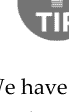

对于托管在 Docker Hub 上的仓库，可以省略 registry 地址。

我们在本章前面提到过标签——我们将在第 6 章《创建镜像》中详细介绍它们。一个 registry 通常托管多个 Docker 仓库。

Registry 和 repository 之间的区别在开始时可能会令人困惑，因此让我们描述一下如果你执行以下命令会发生什么：

```
$ docker pull ubuntu:14.04
```

该命令从 Docker Hub registry 下载 ubuntu 仓库中标记为 14.04 的镜像。Ubuntu 仓库不使用用户名，因此在此示例中省略了命名空间部分。

让我们在表格中总结仓库相关命令：

| 仓库相关命令 | 描述 |
|---|---|
| login | 这用于登录 Docker registry |
| logout | 这用于从 Docker registry 注销 |
| pull | 这用于从 registry 拉取镜像或仓库 |
| push | 这用于向 registry 推送镜像或仓库 |
| search | 这用于在 Docker Hub 搜索镜像 |

尽管 Docker Hub 是公开的，但使用你的 Docker Hub 用户账户可以免费获得一个私有仓库，但它不能用于你所属的组织。如果你需要更多账户，可以升级你的 Docker Hub 计划，这将不是免费的。有一些付费计划基于你需要的私有仓库数量。我们将在第 5 章《查找镜像》和第 8 章《发布镜像》中详细介绍 Docker Hub。

另一方面，私有 registry 可以为你或组织中的其他用户在公司自己的网络中设置。

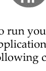

你可以在公司防火墙后面创建私有 registry。

要运行你完全私有的 registry，你可以使用 Docker Hub 本身。它是一个开源应用程序，也可作为 Docker 镜像使用。最简单的情况就是运行以下命令：

```
$ docker run -d -p 5000:5000 --name registry registry:2
```

结果，你将在自己的机器上启动一个私有 registry。

你应该了解的最后一个组件是 Index。Index 管理搜索和标签，同时也管理用户账户和权限。事实上，registry 将身份验证委托给 index。当执行 push 或 pull 等远程命令时，index 首先会查看镜像的名称，然后检查它是否有对应的仓库。如果有，index 会验证你是否有权访问或修改该镜像。如果有权限，操作将被批准，registry 会接收或发送镜像。

## 总结

让我们总结一下我们迄今为止学到的内容。我们已经知道 Dockerfile 是 Image 的源代码。它包含按顺序排列的构建镜像的指令。镜像是文件系统的一种特定状态：一个只读的、冻结的、不可变的实时容器快照。它由代表不同时间点文件系统更改的层组成；层有点像 Git 仓库的提交历史。另一方面，容器是镜像的运行时实例。它们可以有状态（例如运行或停止）。你可以在容器上对文件系统进行更改并提交以使其持久化，但只有文件系统更改可以被提交——内存更改将会丢失。Commit 总是创建一个新镜像。我们还提到了 registry 的概念，它保存了命名仓库的集合，而这些仓库本身是按 ID 跟踪的镜像集合。registry 就像 Git 仓库：你可以推送和拉取容器。我们将在第 5 章《查找镜像》中详细介绍仓库。

阅读完本章后，你应该对具有层和容器的镜像的本质有所了解。但 Docker 提供了另一种将容器扩展并开放给外部世界的方式：网络和持久存储。我们将在下一章介绍这个主题。


