# 4 网络和持久化存储

在上一章中，我们学习了镜像和容器以及修改它们的方法。就实际用途而言，容器内部运行的服务需要暴露给外部世界。Docker 工具链提供了一个非常强大的网络接口，使您能够根据需要暴露并控制网络连接。在本章中，我们将深入探讨 Docker 网络方法。持久化存储对于存储数据很有用，因为正如你在前几章中记得的，Docker 文件系统是临时的，换句话说。如果停止正在运行的容器，你的所有更改都将丢失：任何被删除的文件都会恢复，而你对现有文件所做的任何更改都不会存在。在本章中，我们将涵盖以下主题：

- Docker 网络，包括网络类型如 host、bridge 或 overlay
- 暴露和映射端口
- 链接容器
- 创建 Docker 卷

让我们从网络概述开始。

## Docker 网络

Docker 使用 **容器网络模型 (CNM)** 的概念。本质上，CNM 允许你为一组容器创建小型、分割的网络以便它们进行通信。让我们使用下面的图表来解释该模型：

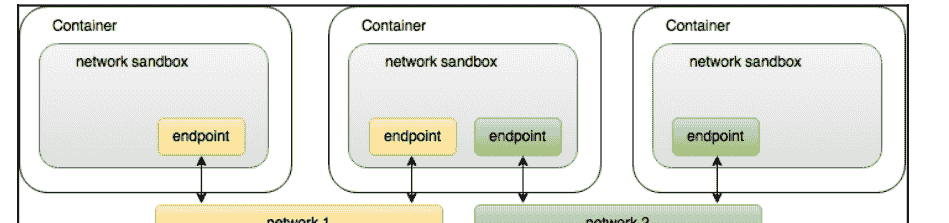

CNM 中存在三个实体：

- **sandbox:** 这是一个隔离的环境，保存容器的网络配置。
- **endpoint:** 这是一个可用于在特定网络上通信的网络接口。端点加入到恰好一个网络。一个网络沙箱内可以存在多个端点。
- **network:** 它是一组能够相互通信的端点。例如，你可以创建两个独立的网络，它们将完全隔离。网络可以通过其名称（如 **backend** 和 **frontend**）或 ID（由 Docker 在网络创建期间自动生成）来标识。

Docker 网络模型还引入了网络驱动的概念。默认情况下，Docker 提供了两个网络驱动：`bridge` 和 `overlay` 驱动。我们稍后会回到这个问题。

同一网络上的所有容器都可以自由地相互通信。端点为沙箱提供网络连接——如果需要将容器加入多个网络，则每个容器应有多个端点。该网络模型高度可配置（并且允许相当复杂的网络配置），但使用默认设置也很容易设置。事实上，Docker 开箱即为我们创建了一些默认网络。

我们在本章中用于处理网络的 `docker` 命令是 `network` 命令。正如你在上一章中记得的，简洁的帮助始终可从 shell（或命令行）获得——让我们查看 `docker network help` 命令的输出：

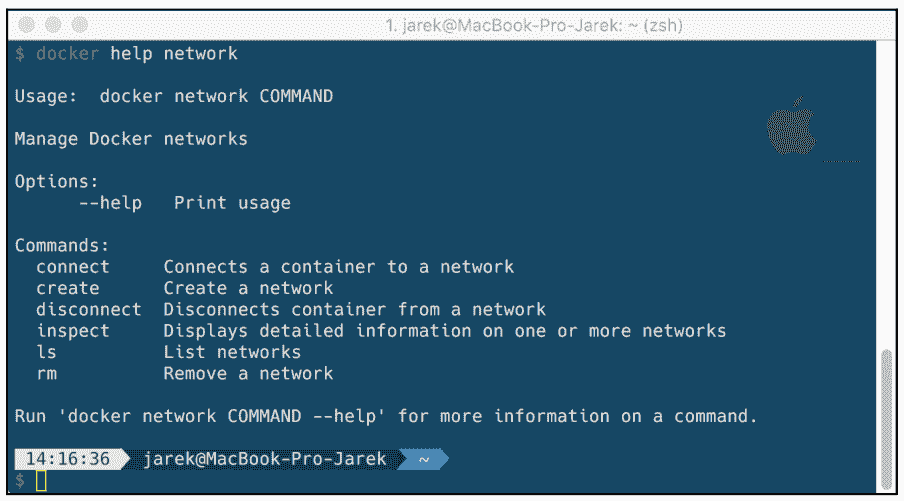

与网络相关的命令并不多，但它们非常有用。让我们开始解释默认网络。

## 默认网络

当你安装 Docker 时，会自动创建三个默认网络——你可以使用 `network ls` 命令列出它们，如下所示：

```
$ docker network ls
```

Docker 将输出可用网络的列表，包括其 ID、网络名称、驱动（我们稍后会介绍驱动）和作用域，如以下屏幕截图所示：

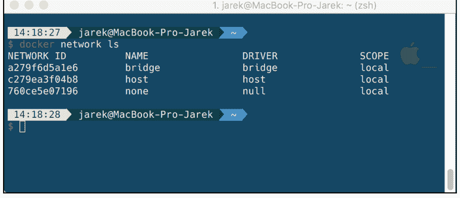

我们默认安装了三个网络：host、none 和 bridge。让我们更详细地讨论它们，从最简单的 none 开始。

### 无网络

简而言之，none 模式根本不配置网络。之前列出的 DRIVER 列包含 null，这意味着该网络没有使用任何驱动。当你不需要容器具有网络访问权限时，这很有用。

让我们通过在没有网络的情况下运行 busybox 镜像来运行简单示例：

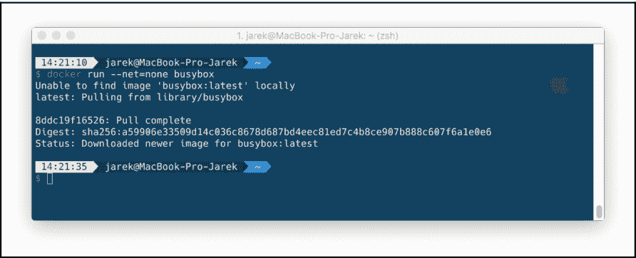

例如，容器的网络详细信息，如 IP 地址，可以使用 docker inspect 命令，然后使用 grep 过滤输出。要执行此操作，请执行以下操作：

```
$ docker inspect <container ID or name> | grep IPAddress
```

如果我们现在检查使用 --net=none 选项启动的容器，我们会看到新容器未被分配 IP 地址：

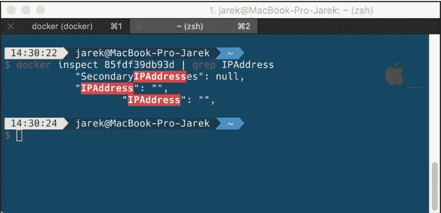

### 主机网络

如果你使用 `--net=host` 选项启动容器，则容器将使用主机网络。这是一个默认创建的网络，它使用 `host` 驱动。它与普通网络一样快：没有桥接，没有转换，什么都没有。这就是为什么当你需要获得最佳网络性能时它会很有用。在此模式下，容器共享主机的网络命名空间（例如你的本地机器），直接将其暴露给外部世界。在 `--net=host` 的情况下，可以通过主机的 IP 地址访问容器。这也意味着你不需要使用端口映射来访问容器内的服务。然而，你需要意识到这可能很危险。如果有以 root 运行且存在漏洞的应用程序，就存在安全漏洞的风险——有人可以通过 Docker 容器远程控制主机网络。

### 桥接网络

我们将更关注 `bridge` 网络，因为它可能是使用最频繁的网络。`bridge` 网络有点特殊——它存在于所有 Docker 主机上。你可以将其视为主机网络栈的一部分。例如，你可以使用 Mac 或 Linux 机器上的 `ifconfig` 命令查看它：

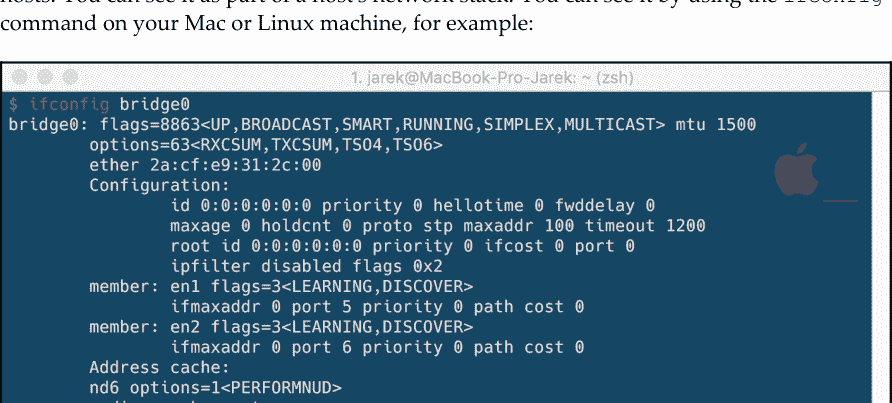

它也是 Docker 中的默认网络。当 Docker 服务守护进程启动时，它会配置一个名为 docker0 的虚拟桥接。除非你使用 docker run --net=<NETWORK> 选项指定网络，否则 Docker 守护进程默认会将容器连接到桥接网络。此外，如果你创建新容器，它将被连接到桥接网络。Docker 将从桥接上可用的范围内找到一个空闲 IP 地址，并用该 IP 地址配置容器的 eth0 接口。从现在开始，如果新容器想要例如连接到互联网，它将使用桥接——主机自己的 IP 地址将被用作网关。该桥接将自动在连接到它的任何其他网络接口之间转发数据包，并允许容器与主机机器以及同一主机上的其他容器通信。


默认情况下，Docker 容器可以连接到外部世界，它们通过 docker0 接口连接，但外部世界无法连接到容器。

我们之前看到的 docker network inspect 命令显示了给定网络上所有已连接的容器及其网络资源。此默认网络中的容器能够使用 IP 地址相互通信。

有时，Docker 创建的默认网络是不够的。幸运的是，Docker 允许我们创建自己的自定义网络。让我们创建一个自定义网络。

## 创建网络

正如你从 network help 命令中看到的，有一个 create 命令。从 shell 或命令行运行：

```
$ docker network create backend
```

这是命令的最简单形式，然而它可能最常被使用。它采用默认驱动（我们没有使用任何选项来指定驱动——我们稍后会介绍网络类型和驱动）。作为输出，Docker 将打印出网络 ID。你可以在以后连接容器到该网络或检查网络属性时使用此 ID 来引用该网络。

命令的最后一个参数是网络的名称——这比 ID 更方便、更容易记住。


在我们的例子中，网络名称是 backend。network create 命令接受更多参数，如下表所示：

| 选项 | 描述 |
|---|---|
| `-d, --driver="bridge"` | 这是用于管理网络的驱动程序 |
| `--aux-address=map[]` | 网络驱动程序使用的辅助 IPv4 或 IPv6 地址 |
| `--gateway=[]` | 用于主子网的 IPv4 或 IPv6 网关 |
| `--ip-range=[]` | 用于从子范围分配容器 IP |
| `--ipam-driver=default` | 这是 IP 地址管理驱动程序 |
| `-o, --opt=map[]` | 设置驱动程序的特定选项 |
| `--subnet=[]` | 这是以 CIDR 格式表示网络段的子网 |

最重要的参数之一是 driver，其值为 bridge driver，可让你指定网络类型。Docker 默认提供一些驱动程序。我们将在不久后详细介绍它们，但首先，让我们将容器连接到网络。

## 在网络中运行容器

创建网络后，你可以使用 docker run --net=<NETWORK> 选项在上面启动容器，其中 <NETWORK> 是默认网络之一的名称或你自己创建的网络的名称，例如：

```
docker run -it --net=bridge ubuntu
```

如果你不想明确指定容器应以哪个网络启动，但只是想告知 Docker 你希望容器连接到其他容器使用的同一网络，请使用带有 container: 前缀的 --net 选项执行 run 命令，指定其他容器的 ID 或名称。例如，执行以下命令：

```
docker run -it --name=myUbuntu --net=bridge ubuntu
docker run -it --net=container:myUbuntu busybox
```

这将使你的 busybox 容器在与 Ubuntu 容器相同的网络上运行，无论该网络是什么。启动到同一网络的容器必须在同一 Docker 主机上运行。网络中的每个容器都可以立即与其他容器通信。

然而，网络本身会将容器与外部网络隔离，如下图所示：

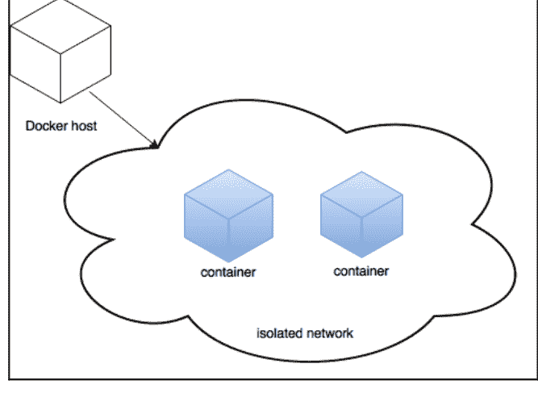

让我们在网络上运行容器：

- 1. 让我们连接两个容器到网络以查看是否有效。首先，我们将创建一个网络：
- 2. 接下来，让我们创建第一个容器，它将是 busybox，并将其连接到 testNetwork：

```
docker network create testNetwork
```

```
docker run -it --name=container1 --net=testNetwork busybox
```

- 3. 现在，如果我们运行第二个 busybox 容器并将其连接到 testNetwork，使用相同的 --net=testNetwork，我们可以看到两个容器可以相互看到；它们运行在同一网络上，并且 ping 命令确实有响应：

```
docker run -it --name=container2 --net=testNetwork busybox
```

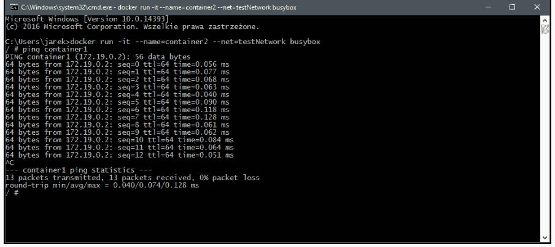

- 4. 因此，我们已成功将第二个容器附加到 testNetwork（使用默认的 bridge 驱动程序）。
- 5. 现在让我们查看网络的详细信息。为此，我们将使用 network inspect 命令：

```
docker network inspect testNetwork
```

Docker 将输出关于网络的综合报告：

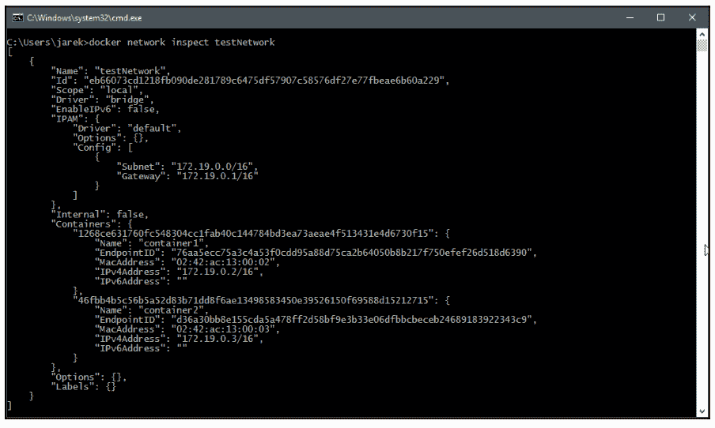

正如你所见，该报告包含许多有趣的细节，例如使用的驱动程序以及当前连接到此网络的容器列表。

正如容器可以连接到网络一样，它也可以断开连接，并且相应的网络接口将被移除。network disconnect 命令的语法如下：

```
docker network disconnect <network ID or name> <container Id or name>
```

例如，要将我们的 container1 从 testNetwork 断开，我们需要执行以下命令：

```
docker network disconnect testNetwork container1
```

创建单独网络的可能性旨在隔离服务，以便网络上只有需要相互通信的东西。在实践中，你很可能拥有许多网络，每个网络连接的容器数量很少。网络彼此完全隔离。


如果两个容器不在同一网络上，它们无法直接通信。

一个典型的例子是负载均衡器、Web 应用程序前端、Web 应用程序后端，最后是数据库。

你可能希望有一天在不同 Docker 主机上运行的容器通过网络通信。在这种情况下，Docker 的多主机网络功能非常有用。

## 创建多主机网络

到目前为止，我们一直在学习 bridge 网络驱动程序，它具有本地范围，这意味着 bridge 网络是 Docker 主机本地的。除了基本网络驱动程序（null、bridge 和 host）之外，Docker 还提供 overlay 网络驱动程序。它具有全局范围，这意味着 overlay 网络可以在多个 Docker 主机上存在。你可以使用 overlay 网络连接到多个主机。这些 Docker 主机可以存在于不同的数据中心，甚至不同的云提供商中。在 Docker 中创建多主机网络时，你有两个选择。第一个是让 Docker Engine 以 swarm 模式运行。Swarm 模式已在 Docker 版本 1.12 中引入——如果你使用的是 Docker for Mac 或 Docker for Windows（而不是 Docker Toolbox），你可以启用 swarm 模式。在其他情况下，当你运行较旧版本的 Docker 时，你也可以创建多主机网络，但你需要配置一个键值存储。让我们先从 swarm 模式开始，然后再介绍键值存储的设置。

### Swarm 模式

要解释 swarm 模式是什么，首先我们需要了解此功能背后的一些术语。Swarm 本身是一个运行中的 Docker Engines 集群。节点是属于集群的单个 Docker Engine 实例。然而，有一个要求，即所有将参与 swarm 的 Docker 主机都需要打开以下端口：

- TCP 端口 2377（用于 swarm 管理相关的通信）
- TCP 和 UDP 端口 7946（用于节点通信）
- TCP 和 UDP 端口 4789（用于我们现在创建的 overlay 网络流量）

打开这些端口后，我们可以初始化 Docker swarm。Swarm 模式默认处于禁用状态；你可以使用 `docker swarm init` 命令启用它，如下图所示：

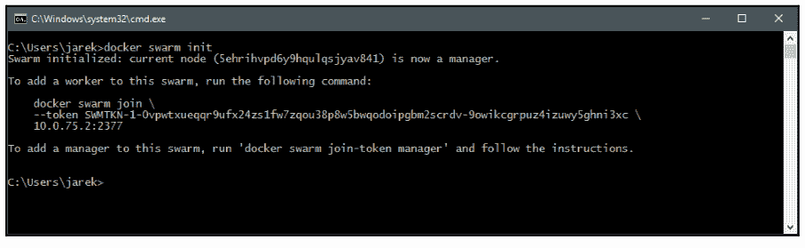

你在其上执行此命令的第一个 Docker Engine 成为 swarm 管理器——它将协调集群中参与的其他节点。

正如前面的屏幕截图所示，第一次运行 `docker swarm init` 会给出一个特殊输出：要在新创建的 swarm 中参与的其他 Docker 主机上运行的命令。在我们的例子中，它是：

```
docker swarm join
--token SWMTKN-1-0vpwtxueqgr9ufx24zs1fw7zqou38p8w5bwqodoipgbm2scrdv-9owikcgrpuz4izuwy5ghni3xc \
10.0.75.2:2377
```

当然，你希望确保其他机器可以访问管理器的 IP 地址。如果你将前面的命令在其他机器上运行，它们将加入集群。如果你现在运行 `docker info` 命令，你可以看到 swarm 的当前状态。你将获得有关 swarm 状态的信息（它是 `active`），当前主机的节点标识符，以及参与 swarm 的节点数量。要查看 swarm 中节点的详细列表，你可以执行以下命令：

```
docker node ls
```

输出将包含节点列表，其中包含其主机名、可用性状态和管理器状态。我们的 swarm 运行后，我们可以创建一个 overlay 网络以使参与 swarm 的主机相互通信。这将是我们已经知道的相同的 `network create` 命令；不过这次，我们将使用 overlay 驱动程序：

```
docker network create --driver overlay mynet
```

如果你现在列出网络，你将看到 `mynet` 作为具有 swarm 范围的 overlay 网络，如下图所示：

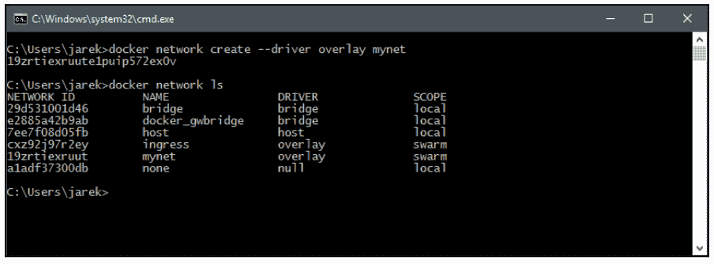

如果你无法在最新版本（支持 swarm 模式）的 Docker 上运行，你也可以创建多主机网络。为此，你需要一个键值存储。让我们现在设置它。

### 键值存储 overlay 网络

有一个要求。要创建 overlay 网络，你需要配置一个键值存储：

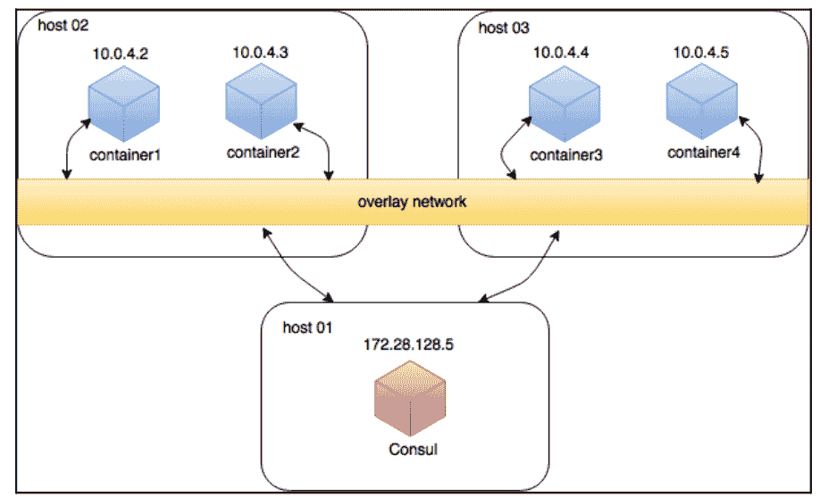

Docker（通过 `libkv` —— 一个分布式键值存储抽象库）支持不同的键值存储。对于覆盖网络，你可以使用诸如 Consul、Etcd、Zookeeper（分布式存储）和 BoltDB（本地存储）等存储。我们将在示例中使用 Consul（https://www.consul.io）。

Docker 覆盖网络起初看起来有点复杂，但在实际示例中却很容易理解。让我们创建一个覆盖网络。我们需要几个独立的 Docker 主机来测试它。我们这次将在 Windows 机器上进行，但该过程在 Mac 和 Linux 上相同。正如你在第 2 章 *安装 Docker* 中可能记得的，如果需要在 Linux 操作系统上创建额外的主机，你需要先安装 `docker-machine` —— 它默认不包含。

模拟独立主机，我们将使用 `docker-machine create` 命令开始创建一个新主机：

```
docker-machine create -driver=virtualbox host01
```

执行命令时，我们得到以下结果：

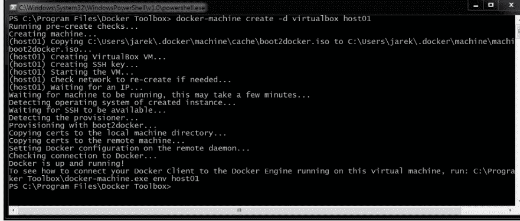

现在 Docker 主机已运行，让我们在主机上安装 Consul。它将充当我们的服务发现服务器，并使我们的主机能够共享网络和通信。请注意，我们将以守护进程方式运行它并映射 Consul 上的端口号 `8500`（我们稍后在本章中会回到暴露和发布端口的话题）。另外，如你所见，我们需要将命令加上 `config host01` 前缀，因为现在我们有四个（包括默认）Docker 主机在运行，我们需要指示 Docker 的 Engine 我们将在其上运行容器：

```
docker $(docker-machine config host01) run -d -p "8500:8500" -h "consul" progrium/consul -server -bootstrap
```

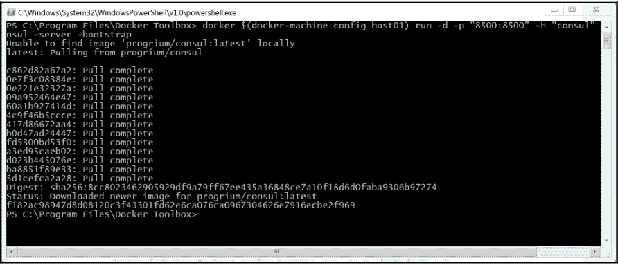

Consul 运行后，让我们再创建两个额外的 Docker 主机，我们实际上将把它们连接到同一个多主机覆盖网络。请注意，这次我们给 Docker 的 Engine 提供了特殊指令，说明我们希望它们使用 Consul 协议的集群存储，使用我们之前映射的端口 8500：

```
docker-machine create -d virtualbox --engine-opt="cluster-store=consul://$(docker-machine ip host01):8500" --engine-opt="cluster-advertise=eth1:0" host02
```

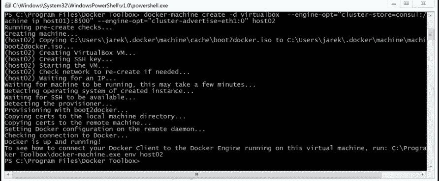

接下来是第三个也是最后一个主机。再次为引擎提供了相同的指令。使用端口号 8500 通过 Consul 协议使用集群存储：

```
docker-machine create -d virtualbox --engine-opt="cluster-store=consul://$(docker-machine ip host01):8500" --engine-opt="cluster-advertise=eth1:0" host03
```

现在总结一下：我们在本地机器上运行了三个不同的 Docker 主机。第一个运行着 Consul 容器，而后面的主机知道 Consul 主机正在 8500 端口监听。让我们然后使用 machine 的 ls 命令列出这些主机：

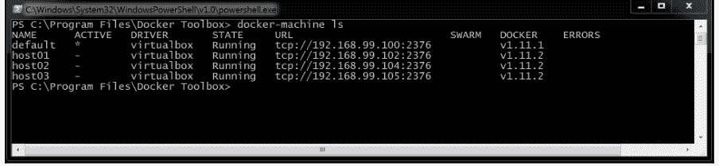

到目前为止一切顺利。我们有四个主机已准备就绪，每个主机都有不同的 IP 地址。现在让我们回到正题，在我们的第二个主机（host02）上创建一个覆盖网络。我们使用 network create 命令来执行此操作，这次使用 overlay 驱动程序。我们的网络名称将是 myOverlayNetwork：

```
docker $(docker-machine config host02) network create -d overlay myOverlayNetwork
```

如果我们现在列出第二个主机上可用的网络，我们会看到名为 myOverlayNetwork 的覆盖网络出现在列表中。我们可以使用 network ls 命令列出网络，再次将命令加上 config host02 前缀，以指示 Docker 我们想要从 host02 主机获取网络列表：

```
docker $(docker-machine config host02) network ls
```

如果你执行相同的命令，但使用第三个主机（host03），令人惊讶的是，myOverlayNetwork 也会可用，即使我们没有明确为 host03 创建它。这就是 Consul 发挥作用的地方。正如你记得的，在创建主机期间，我们指示 Docker Engine 使用在 8500 端口监听的 Consul。因此，我们的 host02 和 host03 共享同一个覆盖网络。

在 host03 上列出网络，以发现 `myOverlayNetwork` 也在第三个主机上处于活动状态：

```
docker $(docker-machine config host03) network ls
```

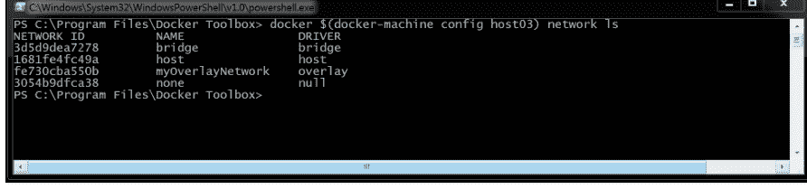

现在，让我们看看它是否真的有效。这将是一个相当简单的测试 —— 我们将在 host02 中运行一个 nginx Web 服务器容器，并尝试查看它是否可以从 host03 看到。为此，在 host02 上执行命令。请注意，我们使用 `--net=myOverlayNetwork` 来指示 Docker 我们希望将 nginx 连接到我们刚刚创建的覆盖网络：

```
docker $(docker-machine config host02) run -itd --name=nginx
--net=myOverlayNetwork nginx
```

为了测试多主机网络，我们将从 `host03` 获取默认的 nginx 索引页。让我们安装 busybox，它包含 `wget` 命令（用于从 Web 获取资源的命令）。同样，我们将 `busybox` 容器连接到同一个覆盖网络：

```
docker $(docker-machine config host03) run -it --net=myOverlayNetwork busybox
```

然后运行 wget 命令从运行在不同主机的 nginx 服务器获取网页：

```
wget -O- http://nginx
```

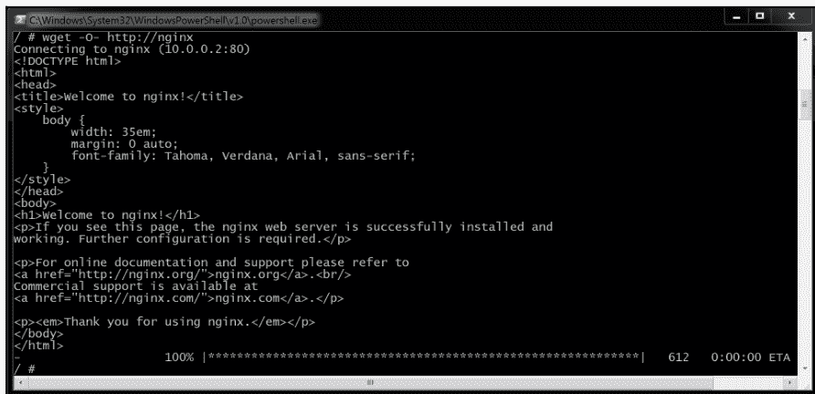

wget 命令将把下载的 nginx 索引页输出到控制台：就这样 —— 我们使用三台独立机器创建了一个多主机容器网络。第一台运行着 Consul 服务器并使剩下的两个主机能够找到彼此并通信。就像桥接网络一样，你应该将这些覆盖网络用于实际需要相互通信的小组容器。

创建多主机网络时，我们在 Consul 服务器上打开了一个端口。暴露和发布网络端口是使容器能够与其他容器和外部世界通信的好方法。让我们更详细地了解暴露和映射端口。

## 暴露和映射端口

常见的情况是，你希望你的容器化应用程序接受传入连接，无论来自其他容器还是 Docker 外部。它可以是监听 80 端口的应用服务器，也可以是接受传入请求的数据库。你可以通过两种方式暴露端口，要么在 Dockerfile 中使用 `EXPOSE` 指令（我们将在后面关于创建镜像的章节中进行），要么在 run 命令中使用 `--expose` 选项。这两个命令是等效的，不过 `--expose` 会接受端口范围作为参数（例如，`--expose=1000-2000`）。

你还可以使用 `-p` 标志将容器中的端口（或一组端口）显式绑定到主机。此配置取决于主机，因此 Dockerfile 中不允许有等效指令。Dockerfile 需要与主机无关且可移植。


你只能在运行时使用 `-p` 绑定端口。

那么，`--expose` 和 `-p` 有什么区别呢？嗯，`--expose` 会在运行时暴露端口，但不会创建到主机的映射。

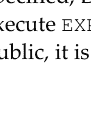

如果你 `EXPOSE` 一个端口，容器中的服务无法从 Docker 外部访问，但可以从其他 Docker 容器内部访问。所以这对于容器间通信是很好的。

`EXPOSE` 指令暴露端口以供链接中使用，我们稍后会解释。

另一方面，`-p` 选项就像发布 —— 它会创建端口映射规则，将容器上的端口映射到主机系统上的端口。如果未指定主机上的端口，Docker 将自动分配一个。请注意，如果你执行 `-p`，但未执行 `EXPOSE`，Docker 会隐式执行 `EXPOSE`。这是因为如果一个端口对公众开放，它也会自动对其他 Docker 容器开放。


看起来应该还有另一个选项，允许在容器启动期间自动映射镜像中（即在 Dockerfile 中）暴露的端口。就是它：-P 选项（这次是大写 P）会将一个动态分配的主机端口映射到所有由 Dockerfile 中的 EXPOSE 指令暴露的容器端口。让我们在表格中简要总结一下这些选项：

| 指令 | 含义 |
|---|---|
| EXPOSE | 这表示在指定的端口上有服务可用。这在 Dockerfile 中使用，使暴露的端口对其他容器开放。 |
| --expose | 这与 EXPOSE 类似，但用于运行时。 |
| -p | 这指定了一个端口映射规则，将容器上的端口与主机机器上的端口映射。这使得端口从 Docker 外部开放。 |
| -P | 这将主机机器上的动态分配端口映射到使用 EXPOSE 或 --expose 暴露的所有端口。 |

请注意，我们将以守护进程方式启动 nginx，Docker 会返回容器 ID 以供将来参考，这样你就可以使用 kill 停止容器或使用 inspect 命令查看其详细信息。如果我们现在执行 ps 命令来列出活动和正在运行的容器，在 PORTS 列中我们会看到发生的端口映射。在我们的例子中，Docker 将 nginx 暴露的端口号 80 映射到主机机器上的端口号 32773，并将暴露的端口号 443 映射到主机机器上的端口号 32772：

```
docker run --name nginx -d -P nginx
```

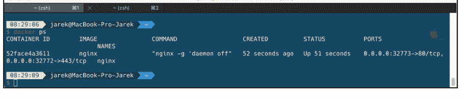


确定当前端口映射的最快方法就是使用 ps 命令（正如你从前几章记得的，它用于查看正在运行的容器的列表）。

-p 选项另一方面给了我们更多控制。在这种情况下，Docker 不会自动选择任何端口——由你决定主机上的哪些端口应映射到容器的端口。-p 选项的语法相当直接：你只需输入容器暴露的端口号、冒号，然后是希望在主机机器上映射的端口：

```
docker run -p <containerPort>:<hostPort> <image ID or name>
```

如果需要，你也可以使用 Dockerfile 中的 EXPOSE 指令（例如 EXPOSE 7000-8000）或 run 命令将一整段端口暴露给其他容器：

```
docker run --expose=7000-8000 <container ID or name>
```

当然你随后可以通过 Docker 的 run (https://docs.docker.com/engine/reference/commandline/cli/) 命令将一段端口发布到主机机器：

```
docker run -p 7000-8000:7000-8000 <container ID or name>
```

好吧，让我们使用 stop 命令停止 nginx 并启动另一个容器，这次将容器端口 80（在 Dockerfile 中暴露）映射到我们主机机器的端口号 8080：

```
docker run --name nginx -d -p 8080:80 nginx
```

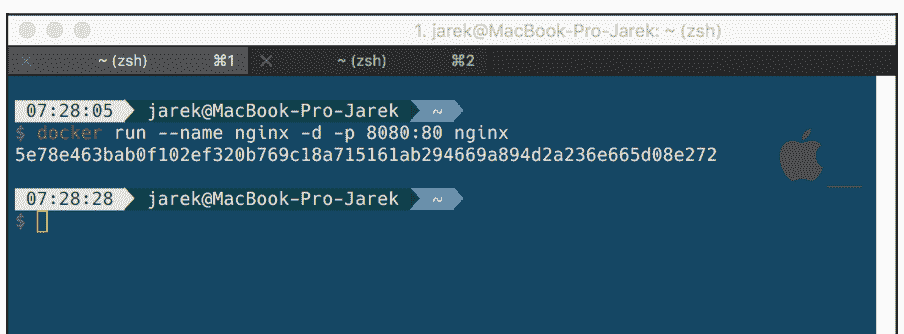

启动后，你可以通过链接 http://localhost:8080 在主机机器的本地地址和映射的端口 8080 访问默认的 nginx 欢迎页面。

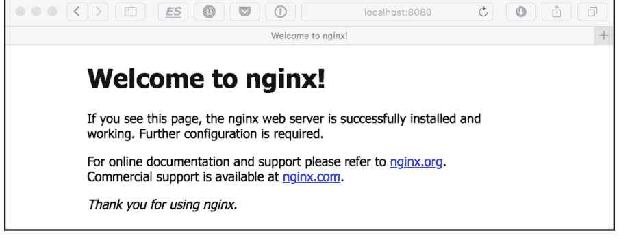

作为 ps 命令的替代方案，你可以执行 port 命令，使用容器 ID 作为参数（容器启动期间 Docker 返回的 ID）来确定已映射的端口。以下是我在我的情况下的命令：

```
docker port e1926dc061c5125b5aa3fd2685bcda4cf26ee99def4b2a1ae5e53721b88231c1
```

结果，Docker 将输出映射，说明容器中的端口号 80 已映射到主机机器上的端口号 8080：

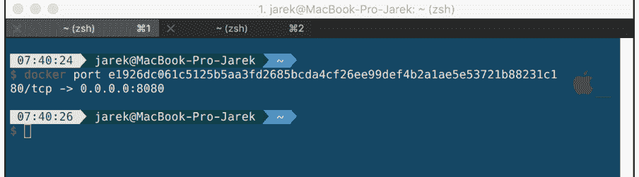

你也可以使用 inspect 命令查看有关暴露的（以及已映射的，如果有的话）端口的信息：

```
docker inspect e1926dc061c5125b5aa3fd2685bcda4cf26ee99def4b2a1ae5e53721b88231c1
```

如果你滚动到 Ports 部分，你会找到镜像暴露的端口列表（在 nginx 的情况下将是 TCP 443 和 TCP 80）以及在主机机器上对应的映射端口，如果你决定使用 -p 或 -P 选项运行容器：

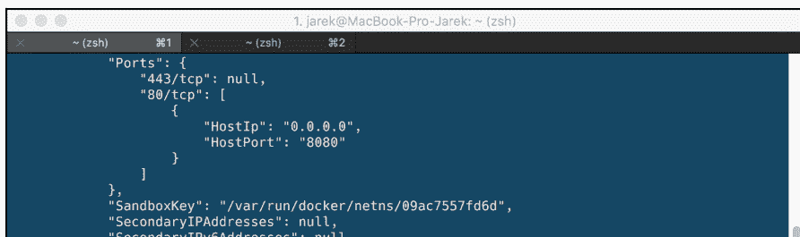

请注意，nginx 镜像暴露了两个端口，但我们只映射了其中一个，端口号 80。你可以使用 -P 选项运行容器以自动映射所有暴露的端口（到 Docker 主机端口范围内的一个随机高端口），或者你可以有多个 -p 选项分别映射它们中的每一个。如果需要，你甚至可以像这样将多个主机机器端口映射到容器中的单个暴露端口：

```
docker run --name nginx -d -p 8080:80 -p 8081:80 nginx
```


-p 标志可以多次使用来配置多个端口。

端口映射是一个很棒的功能。它为你提供了灵活的配置可能性，让你的容器对外部世界开放。事实上，如果你希望你的容器化 Web 服务器、数据库或消息服务器能够与其他服务器通信，这是不可或缺的。

Docker 网络是一个相当新的功能。然而 Docker 还有另一个可能派上用场的特性：容器之间的链接。让我们来了解一下它们。

## 链接容器

Docker 包含一种机制，允许将多个容器链接在一起。已链接的容器会将连接信息从一个容器发送到另一个容器。在创建链接时，源容器的信息会被发送到目标容器。这种用例的一个很好的例子是将 Web 应用程序容器链接到数据库容器。链接后，数据库容器会向 Web 应用程序容器暴露一些信息（如数据库名称、连接 URL、用户名和密码）。要将容器链接在一起，我们在 run 命令中使用 --link 选项。如果我们将一个容器链接到另一个容器，幕后会发生两件事。首先，Docker 会自动更新已链接容器的 /etc/hosts 文件，以便引用我们链接到的容器。

让我们以示例来尝试。首先，让我们在桥接网络上运行 MySQL 容器：

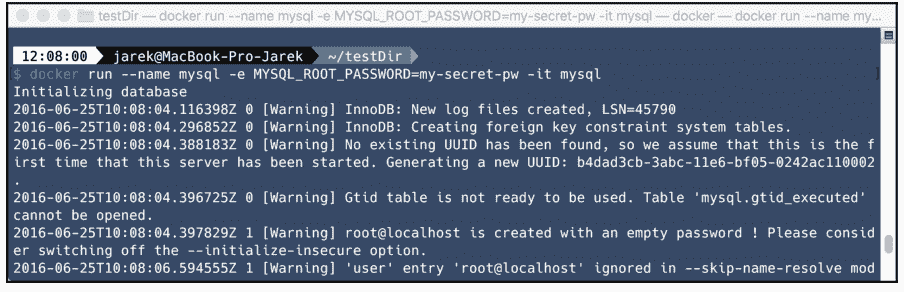

接下来，让我们运行第二个容器，同样是最新版的 Ubuntu，但这次将其与 MySQL 容器链接：

```
docker run -it --name=ubuntu --link mysql:mysql ubuntu
```

请注意 MySQL 容器必须正在运行。


你只能链接到正在运行的容器。

你可以看到 Docker 自动调整了 Ubuntu 容器的 /etc/hosts 文件，为 MySQL 实例插入了一个条目：

```bash
$ docker run -it --name=ubuntu --link mysql:mysql ubuntu
root@60886fca65fb:# more /etc/hosts
127.0.0.1       localhost
::1     localhost ip6-localhost ip6-loopback
fe00::0 ip6-localnet
ff00::0 ip6-mcastprefix
ff02::1 ip6-allnodes
ff02::2 ip6-allrouters
172.17.0.2      mysql 5d22b0ea87d4
172.17.0.3      60886fca65fb
root@60886fca65fb:#
```

/etc/hosts 链接是持久的——如果重启源容器并分配新的 IP 地址，已链接容器的 /etc/hosts 文件将自动使用源容器新的 IP 地址进行更新。

创建链接时发生的第二个重要事情，是从我们链接到的容器传输一些暴露的环境变量。看看我们的已链接 Ubuntu 容器吧；它神奇地知道有关已链接 MySQL 数据库的位置和设置的大量信息，这都要归功于 --link 选项（当然，也要归功于正确定义的 MySQL 镜像，暴露了这些信息）：

```bash
root@60886fca65fb:# env | grep MYSQL
MYSQL_ENV_MYSQL_ROOT_PASSWORD=my-secret-pw
MYSQL_ENV_GOSU_VERSION=1.7
MYSQL_ENV_MYSQL_VERSION=5.7.13-1debian8
MYSQL_ENV_no_proxy=*.local, 169.254/16
MYSQL_NAME=/ubuntu/mysql
MYSQL_PORT_3306_TCP_PROTO=tcp
MYSQL_PORT_3306_TCP_ADDR=172.17.0.2
MYSQL_ENV_MYSQL_MAJOR=5.7
MYSQL_PORT=tcp://172.17.0.2:3306
root@60886fca65fb:#
```


每个变量都以大写别名作为前缀，该别名取自 `--link` 命令，在我们的例子中是 `MYSQL`。暴露的环境变量可以来自以下几个地方：

-   启动源容器时 `docker run` 命令上的 `--env`（简写为 `-e`）和 `--env-file` 选项。
-   Dockerfile 中的 `ENV` 命令——我们将在后续章节学习如何操作。
-   源容器暴露的每个端口。Docker 会为源容器中每个开放端口生成三个环境变量：一个用于地址，一个用于端口号，一个用于协议。
-   与主机条目不同，如果源容器重启，作为环境变量存储的 IP 地址不会自动更新。


你可以将多个容器链接到单个源。例如，你可以让多个 Web 容器连接到你的单个数据库容器。

在用户定义的 `bridge` 网络中，不支持链接。它仅在默认创建的 bridge 网络上工作。如果需要在你创建的 `bridge` 网络上让容器通信，可以在该网络的容器上暴露并发布容器端口。这在你希望将 `bridge` 网络的一部分暴露给外部网络时很有用。

Docker 的链接功能是源容器向接收容器提供自身信息的好方法。事实上，这在 Docker 内部完成，不需要暴露任何网络端口。这就是链接的一大好处：我们不需要将源容器暴露给网络。

在 Docker 中，即使是复杂网络配置的可能性也很广。容器可以属于你需要的任意多个网络。它们可以同时属于本地 `bridge` 网络和 overlay 网络。如果这还不够，你可以使用外部插件提供其他网络选项。下面简要介绍一下。

## 网络插件

Docker Engine 网络插件扩展了 Docker 以支持各种网络技术，例如 VXLAN、IPVLAN、MACVLAN 或完全不同的技术。网络驱动插件通过 LibNetwork 项目获得支持。一些现有的网络插件包括，例如 Weave Network Plugin——一个网络插件，可创建虚拟网络连接你的 Docker 容器——跨多个主机或云，并实现应用程序的自动发现。Weave 网络具有弹性、分区容错、安全，并且可在部分连接的网络和其他恶劣环境中工作——全部以令人愉悦的简单性进行配置。

Docker 中的网络可能性几乎无穷无尽。很难想象一个在 Docker 中无法搭建的场景——无论使用 bridge 还是 overlay 网络。如果默认的驱动集不够——你总可以尝试在互联网上寻找特定驱动——或自行开发。现在让我们关注 Docker 容器可扩展性的另一个非常重要的方面——卷。

## Docker 卷

正如你在上一章记得的，Docker 文件系统默认是临时的。如果你启动一个 Docker 镜像（即运行容器），你会在层栈顶部得到一个读写层。你可以随意创建、修改和删除文件，但如果停止容器并再次启动，所有更改都会丢失：之前删除的任何文件现在都会回来，而你所做的任何新文件或编辑都不会存在。当然，你可以将更改提交回镜像以使其持久化。如果想在镜像中创建应用程序的完整设置，连同所有环境变量，这是一个很棒的功能。但在存储和检索数据方面，这并不方便。最好我们应该将容器生命周期与数据分离。理想情况下，你可能希望将它们分开，以便应用程序生成（或使用）的数据不会被销毁或绑定到容器生命周期，从而可以重复使用。完美的例子是 Web 服务器：Docker 镜像包含已配置并准备使用的 Web 服务器软件。但服务器将使用的数据（你的网页）应与镜像分离，这样你就可以随时更改，而无需修改镜像。反之亦然——你可以说，升级 Web 服务器软件到新版本或调整其配置，而无需修改它将提供的数据。这是通过卷完成的，我们将在本章的这一部分重点关注。卷不是联合文件系统的一部分，因此写操作是即时的并且尽可能快，因此无需提交任何更改。


卷存在于联合文件系统之外，并在主机文件系统上作为普通目录和文件存在。

让我们开始创建卷。

### 创建卷

在 Docker 中，你基本上创建卷有三种选项：

-   通过简单地将卷映射到主机目录创建无名卷（使用 `docker run` 命令的 `-v` 参数）
-   创建仅用于数据的 Docker 容器镜像（然后对 `docker run` 命令使用 `--volumes-from`）
-   显式创建 Docker 命名卷（使用 `docker volume create` 命令）

让我们逐一讨论它们，从 `docker run` 命令的 `-v` 选项开始。我们将通过运行最新的 Ubuntu 并为我们的数据创建卷来开始：

```
docker run -it -v /Users/jarek/testDir/:/data ubuntu
```

`-v` 选项中的参数是主机（你自己的操作系统）上的目录——在我示例中是 `/Users/jarek/testDir`——冒号，以及它对容器可用的路径：在我的例子中是 `/data`。正如你所见，这是一个无名的卷——只是映射。这样，在容器启动期间，Docker 创建了一个卷，这是一种映射的目录。它对容器可用，也可从主机操作系统访问。映射目录中已存在的任何文件（在我们的例子中为 `/Users/jarek/testDir`）将在容器内部可用——映射期间不会被删除。因为你没有为卷指定名称，Docker 会为你创建一个名称。它不会像我们之前看到的容器名称那样有趣，但足以唯一地识别卷。让我们使用 `volume ls` 命令检查卷是否在此：

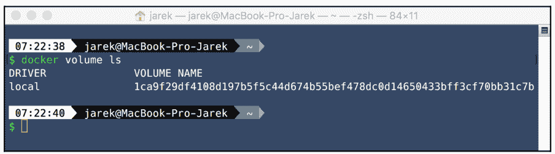

`volume ls` 命令可以接受一些过滤参数，这可能非常有用。例如，你可以列出未被任何容器使用的卷：

```
docker volume ls -f dangling=true
```

或者，列出使用特定驱动创建的卷（我们很快就会介绍驱动）：

```
docker volume ls -f driver=local
```

名称过滤器匹配卷名称的全部或部分，例如以下命令：

```
docker volume ls -f name=da
```

这将给出名称中包含 da 的所有卷的列表：

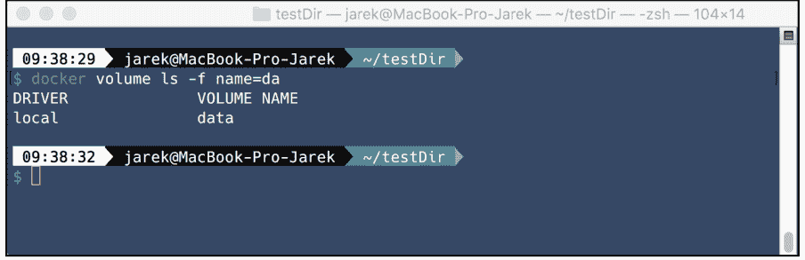

除了将卷映射到已知的主机目录外，你还可以创建一个不会显式映射到主机路径的卷——只需输入它对容器可用的路径，不带冒号。如果容器的基础镜像在指定的挂载点包含数据，该数据将在卷初始化时复制到新卷中。（当显式指定主机目录时不适用，https://docs.docker.com/engine/tutorials/dockervolumes/。）其背后的想法是你不应该关心卷在主机系统上的位置，这样可以使镜像在不同主机之间可移植。

以下命令作为示例：

```
docker run -it -v /data2 ubuntu
```

这次，Docker 将创建一个卷并将其映射到主机机器上 Docker 设置的内部路径（在 Macintosh 上它将是 /var/lib/docker/volumes）。

如果你想知道那个主机路径是什么，可以使用 volume inspect 命令检查卷。首先，你需要找出与容器关联的是哪个卷。你可以通过在容器上执行 docker inspect 命令来做到这一点。卷 ID 将列在 inspect 命令输出中。

有了卷名称，你只需运行 docker volume inspect <volumeName>，在我这里将是以下内容：

```
docker volume inspect
3840cf476f0db530a9e62d5251975156eb5418bd9ba75e7435eb427ece46fc22
```

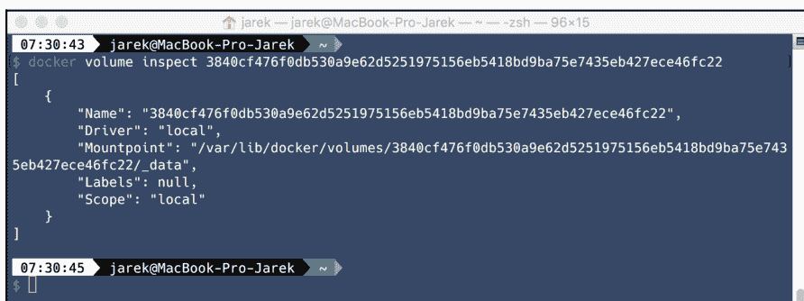


The output of the command briefly shows the details of the volume – its name, the driver being used (we will get to it shortly), a mount point in the host system, assigned labels, and a scope. As you can see, in my case, Docker assigned a mount point for this volume somewhere in /var/lib/docker/volumes. You are not limited to just one volume per container. That would be a serious limitation.


You can use the -v multiple times to mount multiple data volumes.

The -v option can be used not only for directories, but for single files as well. This can be very useful if you want to have configuration files available in your container. The best example for it is the example from the official Docker documentation:

```
docker run -it -v ~/.bash_history:/root/.bash_history ubuntu
```

Executing the preceding command will make you have the same bash history between your local machine and a started Ubuntu container. And best of all, if you exit the container, the bash history on your own local machine will contain the bash commands you have been executing inside the container.

Mapping a single file from a host allows exposing a configuration for your containers.

The trick for sharing the data between containers is to use the --volumes-from option when executing the docker run command. This way if one of your containers has volumes mounted already, you can instruct Docker to use the same volumes when starting another container. Consider the following example:

```
docker run -it --name myUbuntu -v /data ubuntu
```

This will start Ubuntu with volume mounted as /data. Start another container using the following command:

```
docker run -it --name myBusyBox --volumes-from myUbuntu busybox
```

Here, your Ubuntu and busybox containers will share the same volume and thus, the same data. You can use multiple --volumes-from options to combine data volumes from several containers. Also, chaining is possible – you can mount chained --volumes-from in a group of containers.

The common practice when working with Docker is to create data-only containers. The only purpose of data-only containers is to carry on the volume. For any other containers that you then want to connect to this data volume container, use the Docker's --volumes-from option to grab the volume from this container and apply them to the current container. Let's consider the following example:

```
$ docker create -v ~/docker-nginx/html:/usr/share/nginx/html --name myWebSiteData nginx
```

By executing the preceding command, we are creating a container with the name myWebSiteData. Its only purpose will be to have a /usr/share/nginx/html volume attached and mapped to ~/docker-nginx/html in your home directory. You may ask what image should you pick as a base for the data-only container. Well, it doesn't matter that much – we are not going to run this container anyway, so it will not be wasting resources such as CPU or RAM. You may use the same image for the data container as for the container with the application you are going to run. You don't leave data containers running, so it won't consume resources. Using the same image can be important for several reasons:

- It will take up less space as you already have the image layer cached (as you remember from Chapter 3, Understanding Images and Containers, Docker caches and shares the same layers between images)
- The image could be used to fill the volume with some initial data, such as default configuration files, for example
- The permissions and ownership will be correct

With our data-only container ready, we can use it to provide a volume for another container (with our application, for example), using the --volumes-from option for the docker run command, just like we did previously, when dealing with nameless volumes.

Let's say we want to run nginx with the volume referenced in our data-only myWebsiteData container:

```
$ docker run --name docker-nginx -p 80:80 -d --volumes-from myWebSiteData nginx
```

Of course, the data-only container can be shared among other containers – in our case, you can run as many nginx containers as you like – as long as you enter the same --volumes-from option, they will share the same data.

Apart from creating a volume when starting a container or using data-only containers, there is a command that allows creating the volume before starting any containers. It's the last option on our list: the possibility to create Docker volumes explicitly, using the docker volume create command.

We will use it now, and this time, we will also provide a more friendly name for our volume. To create a volume, execute the volume create command:

```
docker volume create --name data
```

Again, the new data volume will be available when you list volumes using the volume ls command. To mount a volume in a container during its startup, use the same -v option when starting a container:

```
docker run -it -v data:/data ubuntu
```

The data volume will then be available for your container in /data. It's also possible to run another container with the same volume mounted.

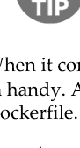

Volumes can be shared between containers – just run them with mapping the same volume.

When it comes to creating your own images using Dockerfile, the VOLUME instruction comes in handy. Actually, we will be using it later in the book, when creating images from a Dockerfile.

It creates a mount point with the specified name and marks it as holding externally mounted volumes from native host or other containers. Creating volumes using the VOLUME instruction has one important difference to using the -v option during the container startup: you cannot specify a host directory when using the VOLUME instruction. Dockerfiles are meant to be portable and shared. The host directory volume is 100% host dependent and will break on any other machine, which is a little bit off the Docker idea. Because of this, it is only possible to use portable instructions within a Dockerfile. A benefit of using shared volumes is that they are host-independent. This means that a volume can be made available on any host that a container is started on as long as it has access to the shared storage and has the plugin (driver) installed.


If you need to specify a host directory when creating a volume, you need to specify it at runtime.

## Removing a volume

The same as with creating volumes, there are two ways of removing a volume from Docker. One way is to remove a volume by referencing a container's name and executing the rm -v command:

```
docker rm -v <containerName>
```

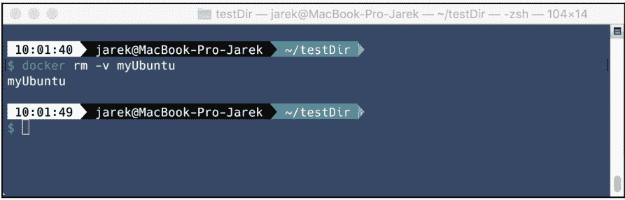

Docker will not warn you when removing a container without providing the -v option to delete its volumes. As a result, you will have dangling volumes – volumes that are no longer referenced by a container.

You can also remove the volume using the volume rm command:

```
docker volume rm <volumeName>
```

If the volume happens to be used by the container, Docker Engine will not allow deleting it and will give you a warning message:

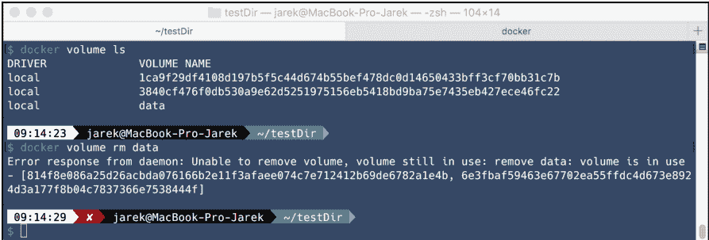

The handy shortcut to remove all volumes not being referenced by any container is using a `dangling=true` filter from the `volume ls` command:

```
docker volume rm $(docker volume ls -qf dangling=true)
```

As you can see, creating, sharing, and removing volumes in Docker is not that tricky. It's very flexible and allows creating a setup you will need for your applications. But there's more to this flexibility. When creating a volume, you can specify a `--driver` option (or `-d` for short), which may be useful if you need to map some external, not-so-standard storage. The volumes we have created so far were using the `local` filesystem driver (the files were being stored on the local drive of the host system) – you can see the driver name when inspecting a volume using the `volume inspect` command. There are other options though, let's look at them now.

## Volume drivers

The same as with network driver plugins, the volume plugins extend the capabilities of the Docker Engine and enable integration with other types of storage. There are tons of ready-to-use plugins available for free on the Internet; you can find a list on Docker's GitHub page. Some of them include the following:

- **Docker Volume Driver for Azure File Storage**: This is a Docker Volume Driver that uses Azure File Storage to mount file shares on the cloud to Docker containers as volumes. It uses network file sharing by utilizing the SMB (Server Message Block) and CIFS (Common Internet File System) protocols capabilities of Azure File Storage. You can create Docker containers that can migrate from one host to another seamlessly or share volumes among multiple containers running on different hosts.
- **IPFS**: The abbreviation stands for **InterPlanetary File System**. It's an open source volume plugin that allows using an IPFS filesystem as a volume. IPFS is a very interesting and promising storage system – it makes it possible to distribute high volumes of data with high efficiency. It provides deduplication, high performance, and clustered persistence, provides secure P2P content delivery, fast performance, and decentralized archiving. IPFS provides resilient access to data, independent of low latency or connectivity to the backbone.


-   **Keywhiz:** 该驱动程序可用于使容器与远程 Keywhiz 服务器通信。Keywhiz 是一种用于管理和分发机密数据的系统，例如 TLS 证书/密钥、GPG 密钥、API 令牌和数据库凭据。不是将此数据放在配置文件中或复制文件（这可能会泄露或难以追踪），Keywhiz 使其管理更轻松、更安全：集群中的 Keywhiz 服务器将机密集中存储在加密的数据库中。客户端使用相互认证的 TLS（mTLS）检索其有权访问的机密。

正如前面的示例所示，它们相当有趣，有时甚至很奇特。由于 Docker 及其插件架构的可扩展性，您可以创建非常灵活的设置。但第三方驱动程序并不总是引入完全新的存储类型，有时它们只是扩展现有驱动程序。一个例子是 `Local Persist Plugin`，这是一个卷插件，它通过允许您在主机上任意位置指定挂载点来扩展默认本地驱动程序的功能，从而使文件始终保持持久，即使通过 Docker 的 `volume rm` 命令删除卷也是如此。

如果您需要尚未可用的卷插件，您可以自行编写——该流程在 Docker 的 GitHub 页面上记录得非常详细，并附带可扩展的示例。

## Summary

我们现在已经介绍了如何将容器开放给外部世界——我们可以使用网络和挂载的卷在容器之间以及容器与其他主机之间共享数据。让我们总结一下本章迄今为止学到的内容。我们知道，来自同一 Docker 主机的容器在默认的 `bridge` 网络上会自动相互看到，前提是容器绑定到默认桥接。我们可以使在不同主机上运行的容器相互通信。为此，我们需要多主机 `overlay` 网络。您需要运行在 swarm 模式下的 Docker 1.12 或更高版本，或者 alternatively 运行一个键值存储。如果 Docker 提供的驱动程序不足，我们可以使用网络插件进一步扩展网络数据交换。我们已经介绍了卷创建过程，并且知道卷即使在容器重启后也能持久保存数据；我们还知道对卷上文件的更改是直接进行的，但在更新镜像时不会包含这些更改。

卷允许在主机文件系统与 Docker 容器之间，或在 Docker 容器之间共享数据，并且即使容器本身被删除，它们也会持久存在。我们可以使用卷驱动程序进一步扩展文件交换的可能性。

在下一章中，我们将重点关注 Docker Hub。我们将学习如何查找镜像，这些镜像将成为下一章的基础，在下一章中我们将使用 Dockerfile 实际创建镜像。

# 5

## 5 Finding Images

在之前的章节中，我们学习了如何安装 Docker，并熟悉了 Docker 架构、网络和持久存储功能。我们在 `Chapter 3`、*Understanding Images and Containers* 中稍微提到了使用 Docker Hub 和远程仓库的工作，但这次我们将深入详细了解。

本章将涵盖以下主题：
-   The Docker Hub
-   Image tags
-   Searching for images using the web interface and a command line
-   Docker Hub REST API

在下一章实际构建自己的镜像之前，我们将首先专注于使用 Docker Hub——创建账户、身份验证、查找镜像并拉取它们。我们将更详细地介绍版本和标签，解释最容易被误解的 Docker 标签之一 `latest`。本章还将介绍 Docker Hub 的 REST API，如果您计划以编程方式使用 Docker Hub——来自您自己的应用程序或集成流程，这可能会派上用场。

这次我们还将在 Docker Hub 上创建账户——当我们将镜像发布到世界时，这是强制性的。

## The Docker Hub

Docker 镜像仓库的主要功能是根据描述查找特定镜像。仓库在仓库中处理 Docker 镜像。了解 registry 和 repository 之间的区别很重要。Docker registry 是一个存储 Docker 镜像的服务，而 repository 是具有相同名称的不同 docker 镜像的集合，它们具有不同的标签（我们稍后会回到标签）。与 git 相当，Docker 仓库由 URI 标识，可以是公共的也可以是私有的。

最知名的托管 Docker registry 版本是 Docker Hub。它提供了一个美观且易用的 UI。Docker Hub 是一个用于共享和管理 Docker 镜像的软件即服务（SaaS）平台。换句话说，它是一种能够托管和分发镜像的基于云的 registry 服务。镜像保存在公共或私有仓库中。目前，Hub 提供数十万个公共仓库，并且数量每天都在增长。其中近三分之一的公共仓库使用自动构建，这意味着镜像是由 Hub 本身使用已发布的 Dockerfile 构建的。其余仓库包含通过 `docker push` 命令手动上传的镜像。Docker Hub 可在 https://hub.docker.com/ 获取。


Docker Hub 是默认的 registry。如果您在使用 `login`、`pull` 或 `push` 等 registry 相关命令时未提供 registry 主机名，Docker 将使用 Docker Hub。

Registry 提供诸如推送（将镜像上传到仓库）和拉取（从仓库下载镜像）等操作。Docker registry 还有另一个重要角色，即索引。索引维护有关用户账户、镜像校验和以及公共命名空间的信息。事实上，Docker Hub 是公共仓库的集中式索引。

Docker Hub 是一个公共服务，如果您注册账户，您可以免费获得一个私有仓库。如果您需要更多私有仓库，您可以升级 Docker Hub 计划，这将不是免费的。

Docker Hub 不仅仅是一个 registry 和索引——一个搜索、存储或获取镜像的地方——它更像是一个伞形项目；它允许链接到代码仓库（如 GitHub 或 BitBucket），创建镜像的自动构建并对其进行测试。Docker Hub 还允许链接到 Docker Cloud，以便您可以将镜像部署到自己的主机上。所有这些方面在开发管道中创建镜像工作流自动化时都很有用。我们将在 `Chapter 8, Publishing Images` 中详细介绍这些与开发相关的功能，例如发布和创建自动构建。

除了管理单个用户账户和身份验证之外，Docker Hub 还管理组织。通过创建组织，您可以轻松地让同事访问共享镜像仓库，并让 Docker Hub 管理团队协作和变更管理。

让我们总结 Docker Hub 的功能：
-   **Accounts**: 这有助于用户管理和身份验证。
-   **Organizations**: 这用于创建工作组以管理对镜像仓库的访问。
-   **Image repositories**: 这用于从社区、官方或私有镜像仓库中搜索、`pull`、`push` 和 `manage` 镜像。
-   **Automated builds and web hooks**: 这用于在源代码发生变化时自动触发镜像构建过程。Web Hook 是自动构建的一部分，允许您在将镜像推送到仓库后执行不同的操作。
-   **Integration source code repositories**: 这用于将您的 GitHub 和/或 Bitbucket 源代码仓库链接起来以创建开发工作流。
-   **REST API**: 通过 Docker Hub Web 界面提供的几乎所有功能也都作为一个记录良好的 REST 端点提供，您可以使用它以编程方式处理 Docker Hub。

Docker Hub 账户（称为 Docker ID）对于搜索和拉取镜像不是强制性的。事实上，正如您所记得的，我们在之前的章节中拉取了大量 `hello-world`、`nginx` 和 `ubuntu` 镜像来演示 Docker 的架构，而没有注册适当的 Docker ID。


Docker Hub 账户对于从 Docker Hub 搜索和拉取镜像不是强制性的——您可以在不登录甚至没有账户的情况下下载镜像。

然而，为了发布镜像、发布评论或为仓库加星，您需要一个 Docker ID。通过留下评论，您可以与其他 Docker 社区成员以及特定镜像的维护者互动。


像任何成熟的社区一样，您的评论应精确且有意义。如果您发现任何不合适的评论，您可以将其标记以供审查。


为仓库加星与 GitHub 上的星标作用相同——它是一种表示你喜欢某个仓库的方式。星标功能也提供了一种便捷的方式来收藏你喜欢的仓库。在本书撰写时，ubuntu 仓库是最受关注的仓库。让我们从账号创建开始。

## Docker Hub account

为了获取你的 Docker ID，请前往 http://hub.docker.com 并滚动到 Sign Up 部分。你需要提供用户名（它将成为你发布镜像的命名空间）、密码和有效的电子邮件地址，如下图所示：

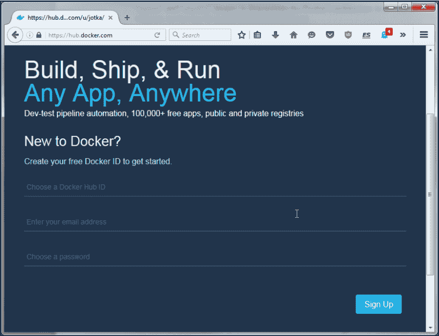

注册需要有效的电子邮件地址，因为激活邮件将发送到该地址。


如果找不到验证邮件，请检查垃圾邮件文件夹并将 docker.com 从不良发件人中排除。如果仍然找不到，请前往 https://hub.docker.com/login/ 并执行与密码重置相同的操作，激活链接将被重新发送。

从那里，你可以使用你的 Docker ID 登录。当你首次登录新账号时，你将进入 Docker Dashboard，这是一个带标签页界面的页面，如下图所示：

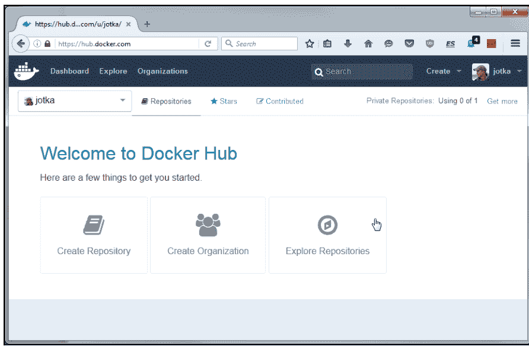

第一个标签页包含你的仓库列表；对于新账号它将为空，并提供创建仓库、组织或浏览仓库的快捷方式。注意，你也可以使用网站页眉中的搜索字段搜索镜像，它随时可用。第二个标签页用作你的书签查看器——它列出你已加星的仓库。

Dashboard 还提供了一个链接到账号设置页面，在那里你可以设置默认的仓库可见性（默认为 `public`，你可以将其更改为 `private`）。在此处，你还可以设置个人详细信息，如姓名、位置、网页地址，或添加与你的 Docker ID 关联的额外电子邮件地址（只有一个可以为主）。这些电子邮件地址将用于 Docker 的所有公告和通信。**Settings** 页面还允许将你的个人（User）账号转换为 Organization 账号。让我们澄清一下 Organization 账号是什么。

## Organization account and teams

组织和群组允许你在组织或团队之间协作。你可以在账号的 `Settings` 标签页中添加新组织并查看你所属的组织。你也可以在仓库页面和账号资料中用户名下方看到它们。

如果将你的 Dashboard 切换到你所属的组织，它与个人用户仪表板会略有不同，如下图所示：

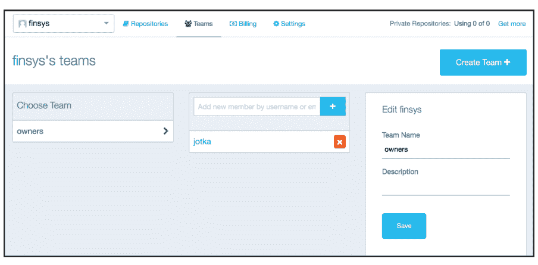

主要区别在于 Teams 标签页的存在，你可以在其中定义组织内的团队。Docker Hub 会自动创建 Owners 团队。Owners 团队比较特殊——你需要是组织 Owners 团队的成员才能创建新仓库、新自动化构建以及该组织内的新团队。如果你属于 Owner 团队，你可以在仓库视图的 Collaborators 部分分配访问权限。这可以是读权限（允许你以与公共仓库相同的方式查看、搜索和拉取私有仓库）、写权限（允许你推送镜像）或管理员权限（允许你修改仓库属性，如描述、协作者权限、公开或私有可见性，或删除仓库）。你可以通过选择团队并输入用户名（针对现有 Docker Hub 用户）或电子邮件地址（如果尚未注册）来向组织的任何团队添加或邀请用户：

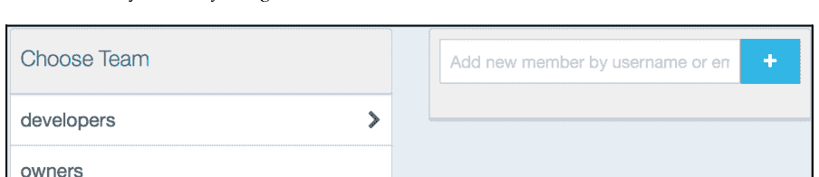

因此，被邀请的用户将收到一封加入团队的邀请邮件。

## Collaborators

Docker Hub 引入了协作者的概念。协作者只是另一个 Docker Hub 用户，你可以授予其访问你的仓库（公开或私有）的权限。你可以在仓库的 Settings 页面中的 Collaborators 标签页中进行操作，如下图所示：

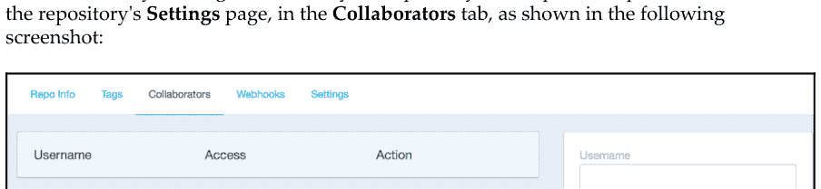

协作者不允许执行任何管理任务，例如删除仓库或将其状态从私有更改为公开。然而，他们可以通过执行 `docker push` 和 `docker pull` 命令来使用你的仓库。如果你需要对仓库进行更具体、更详细的访问权限设置，请考虑使用 Docker Hub 提供的组织和团队。


值得注意的是，协作者不能添加其他协作者。只有你作为仓库的所有者才拥有管理权限。

## Private Repositories

如果你想存储希望保持私有的镜像，你需要将它们存储在私有仓库中。它仅对你的账号或组织/群组可见。一旦仓库被标记为私有，你就可以使用 Docker 向其推送和拉取镜像，与公共仓库的操作相同。唯一的区别是你需要登录并拥有访问权限才能操作私有仓库。私有仓库的行为与公共仓库一样；不过，它们不会列在公共注册表中。

在仓库的 `Settings` 页面中，你可以切换其可见性，使其为 `public` 或 `private`，如下图所示：

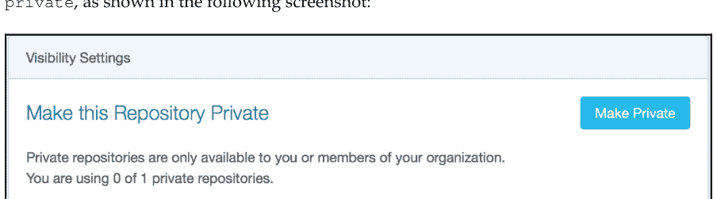

如果你将仓库设为私有，它将对组织的成员可用，你也可以将访问权限授予你选择的协作者。正如你所记得的，免费的 Docker Hub 账号只允许你拥有一个私有仓库，如果你想要更多，就需要升级你的计划。

## Logging into Docker Hub

你当然可以使用 Docker Hub 页面登录账号，但更常见的做法是通过 shell 或命令行登录。让我们使用我们的账号登录 Docker Hub 注册表：

```
docker login --username myUser --password 123
```

默认情况下，Docker 假定你要登录的注册表是 Docker Hub。要登录不同的注册表，请将注册表的 hostname 作为登录命令的最后一个参数提供：

```
docker login --username myUser --password 123 localhost:8080
```

这次让我们在 Mac 上登录 Docker Hub：

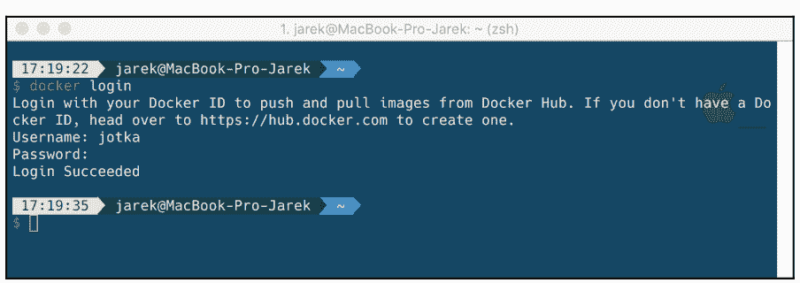

如果身份验证正确，Docker 会简短地响应，表示我们已准备好从注册表拉取镜像：

```
Login Succeeded
```

登录后，幕后会发生一件有趣的事情。由于在使用 Docker 时，与注册表通信以拉取、推送和查找镜像是非常常见的操作，你的凭据将被存储以供将来使用。这样你就可以自动化操作。Docker 将从本地存储中获取凭据，并在你请求拉取或推送镜像等操作时代表你使用它们。默认情况下，Docker 将使用一个名为 .docker/config.json 的纯文本文件，该文件写入你的主目录（或 MS Windows 上的配置文件夹）：

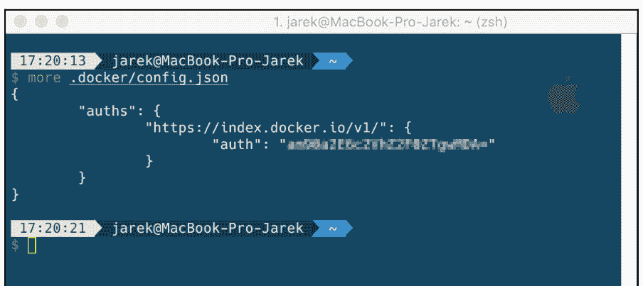

该文件的结构支持同时使用多个注册表。在我们的例子中，我们只有一个条目对应默认的官方 Docker 索引（index.docker.io），但如果需要也可以有更多。从现在开始，当注册表需要身份验证时（例如执行 push 命令时），Docker 将从 config.json 文件中获取你的凭据。当然，你将要工作的注册表必须与配置文件条目中的索引 URL 匹配。请注意，文件中没有日期或时间——凭据将被永久缓存，直到我们使用 logout 命令告诉 Docker 删除它们为止。


存储在本地文件中的凭据未加密——它只是使用 Base64 编码的 username:password 字符串。请勿与任何人共享此文件。

如果你不再希望在本地存储中缓存凭据，请执行 logout 命令：

```
docker logout
```


Docker 会回复，表示 config.json 文件中的条目已被移除，因此你已从注册表中注销：

```
Remove login credentials for https://index.docker.io/v1/
```

本地凭据文件在你正在试验 Docker Hub 且安全性并非你特别关心的事情时可能会有用。在其他情况下，例如使用私有注册表或进行一些严肃的工作，将凭据存储在其他存储中可能是一种更合适、更安全的做法。使用外部存储比将凭据存储在 Docker 配置文件中更安全。幸运的是，Docker Engine 可以使用外部凭据存储，例如操作系统的原生钥匙串。例如，Apple OS X 钥匙串或 Microsoft Windows 凭据管理器。


使用外部存储需要系统 $PATH 上可用的额外助手。助手程序与特定的钥匙串或外部存储交互。你可以从 GitHub https://github.com/docker/docker-credential-helpers/releases 下载助手。目前可用的凭据助手列表包括：D-Bus Secret Service、Apple OS X 钥匙串和 Microsoft Windows 凭据管理器。

如果你想为凭据使用外部存储，你需要在系统 $PATH 上提供助手，并通过修改 .docker/config.json 指示 Docker 使用此外部存储：

```
{
  "credsStore": "osxkeychain"
}
```

如果你将来需要将凭据存储在 Docker 未官方支持的存储中，互联网上有一些第三方存储助手可供使用。例如，在 GitHub 上有 Amazon ECR Credentials helper 可用（https://github.com/aws-labs/amazon-ecr-credential-helper）。它使用与 AWS 命令行工具和 AWS SDK 相同的凭据。如果找不到所需的凭据助手，Docker 允许使用你自己开发的凭据助手。基本上，助手可以是任何可以从标准输入读取值的程序。它仅公开三个操作：store（用于保存凭据，其中输入是包含服务器 URL、名称和密码的 JSON）、get 和 erase，分别用于获取和从存储中删除凭据。Get 和 erase 仅将服务器 URL 作为输入参数。

实现自己的凭据存储最简单的方法是浏览 GitHub https://github.com/docker/docker-credential-helpers 上的现有助手的源代码。

现在我们了解了登录注册表时会发生什么，是时候利用它并搜索镜像了。

## Searching for images

要有效地搜索特定镜像，首先我们需要了解 Docker 镜像命名模式和标签的概念。我们之前已经提到过它；让我们现在详细了解一下。

## Image naming and tags

完整的镜像名称具有以下语法：

```
{registry_host}/(_|/{user_or_org_namespace})/{repository}:{tag}
```

让我们详细探索一下。镜像名称以命名空间和斜杠开头。例如，由用户 `tutum` 创建并上传的名为 `hello-world` 的镜像（顺便说一下，这是一个在端口 `80` 上响应 `hello-world` 消息的 Apache 镜像）将以此部分开头：`tutum/hello-world`。

也可以没有命名空间前缀的镜像——这些将是所谓的 **官方仓库** 的镜像。官方仓库是来自 Docker 供应商和贡献者（如 Red Hat、Oracle 和 Canonical）的认证仓库。当然，你也可以使用它们来构建自己的应用程序和服务。官方镜像的示例可以是最受欢迎的 `ubuntu`、`nginx`，或我们之前章节中使用的 `hello-world` 的官方版本。官方镜像通常由将应用程序容器化到 Docker 中的人员支持，例如，来自官方仓库的 `nginx` 镜像由 Nginx 团队支持。


如果你决定使用官方仓库中的镜像作为自己工作的基础，你可以相当确定自己使用的是维护良好、优化且最新的镜像。

每个仓库可以包含多个镜像。例如，`nginx` 仓库将包含不同版本的 Web 服务器镜像，例如 `1.10.1-alpine`、`stable`、`latest` 等。每个镜像都由标签标识。正如我们之前提到的，标签通常代表同一应用程序或服务的不同版本，并用于区分镜像。标签只是附加到镜像的字母数字标识符，例如可以是 `1.0` 或 `latest`，但提供构建哈希以明确无误地标识镜像被认为是一种良好做法。标签名称可能不会以句点或破折号开头，并且最多可包含 128 个字符。我们稍后将介绍的 Docker 自动化构建允许你将镜像标签链接到 git 历史记录中的分支或标签。

`latest` 标签有点特殊。此外，它可能不会按你期望的方式工作。好吧，简单来说，除非镜像创建者（例如 `ubuntu` 或 `nginx`）有特定的 `build`、`tag` 和 `push` 模式，否则它没有任何特别的含义。分配给镜像的 `latest` 标签仅仅意味着它是最后构建并在未提供特定标签的情况下执行的镜像。可以理解这可能会令人困惑——拉取标记为 `latest` 的镜像不会获取软件的最新版本。


Docker 不会在拉取标记为 `latest` 的镜像时检查你是否获得软件的最新版本。

如果你在不指定标签的情况下拉取镜像，Docker 将下载标记为 `latest` 的镜像。但这不一定是你想要运行的软件的最新最佳版本。相反，你应该始终查看仓库中存在的其他标签，以选择所需的软件版本。

此外，如果我们在本书后面构建自己的镜像，相同的 `latest` 标签行为也适用。如果你未在仓库名称后指定标签，它将在仓库中自动分配 `latest` 标签。

最后但同样重要的是，镜像名称可以加上 Docker 注册表的 hostname 或 IP 前缀。例如，镜像名称 `localhost:5000/hello-world` 将引用你本地注册表中的 `hello-world` 仓库。但如果需要从 Docker Hub 以外的注册表拉取官方镜像呢？遵循镜像名称模式，只需使用单个下划线字符代替用户或组织名称即可。例如，考虑以下命令：

```
docker pull someRegistry.com/_/someOfficialImage:1.0
```

这将从位于 someRegistry.com 上的 someOfficialImage 官方仓库中拉取标记为 1.0 的镜像。你也可以通过完全省略用户或组织名称来缩短命令。我们的命令将如下所示：

```
docker pull someRegistry.com/someOfficialImage:1.0
```

正如你记得的，如果你不提供注册表 hostname，Docker 将默认为其自己的官方注册表 Docker Hub。

现在我们应该完全了解镜像名称的构成。定位要拉取的镜像应该更容易了。你可以通过两种方式找到 Docker Hub 上的公共仓库和镜像。你可以使用 Docker Hub 网站或使用 Docker 命令行工具运行 docker search 命令。让我们现在搜索一个镜像。

## Searching through the web interface

使用 Docker Hub 的 Web 界面查找镜像与使用右上角的搜索字段一样简单：


作为响应，Docker Hub 将列出名称或作者与你的搜索词匹配的镜像。请注意，结果列表中只会显示公共仓库。

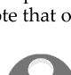

私有仓库不会出现在仓库搜索结果中。

在搜索结果中，你可以注意到星级和下载次数。这可以让你了解仓库的受欢迎程度。此外，你可以看到仓库是官方还是公开，以及是否使用自动化构建构建：

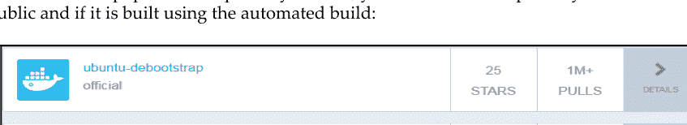


使用网页界面搜索在您想要获取有关仓库的更详细信息时可能会很有用。如果您点击 `repository` 名称，您将被带到仓库详情页面，其中通常包含大量有用信息。详情页面的第二个标签页包含标签列表，因此您可以快速浏览并选择所需的版本。此视图还会显示关联镜像的大小。镜像大小是镜像及其所有父镜像占用的累计空间——这也是执行 `docker save` 命令导出镜像时形成的 tar 文件内容所使用的磁盘空间。如果搜索结果页面上列出的镜像是自动构建的，Docker Hub 将提供两个额外的标签页：**Dockerfile** 和 **Build Details**。**Dockerfile** 标签页将包含构建期间使用的 Dockerfile（在学习如何创建自己的 Dockerfile 时非常有用）以及一个链接的源代码仓库（正如您所记得的，这可能是 GitHub 或 BitBucket）：

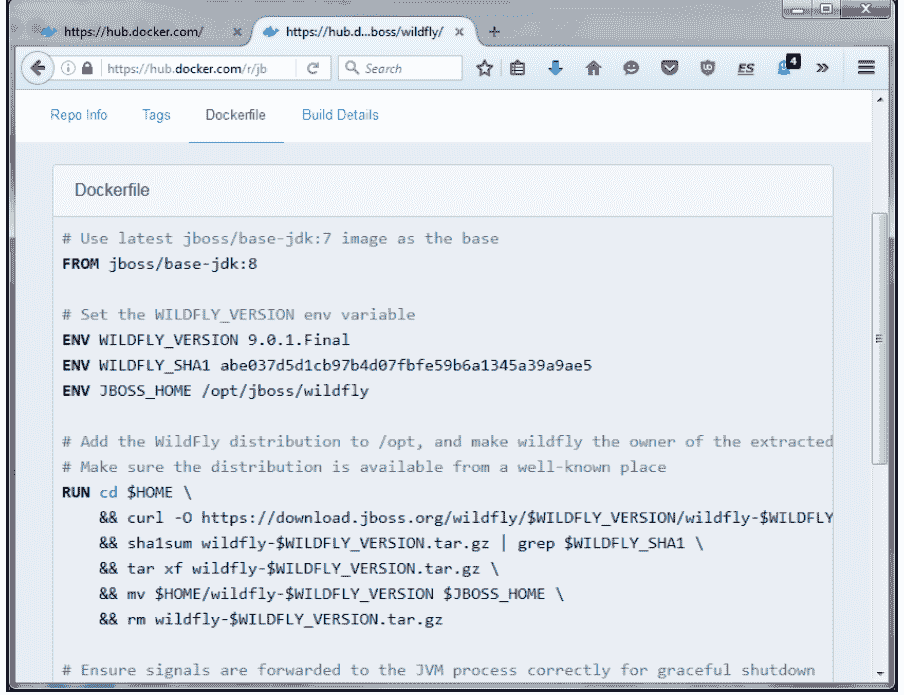

**Build Details** 列出了自动构建作业的状态（如成功或失败）以及构建日期等信息：

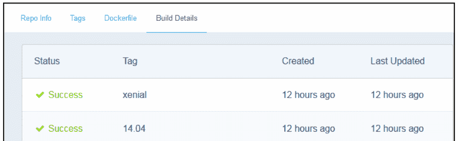

如您所见，Docker Hub 的网页界面可以为您提供有关所需镜像的许多详细信息，但并不太方便。更快的解决方案是使用命令行搜索镜像。

## 使用命令行搜索

Docker 为您提供了一个用于搜索镜像的命令：`docker search`。

例如，如果您正在寻找 `ubuntu` 镜像，您可能会运行以下命令行搜索：`docker search Ubuntu`。

`search` 命令的语法相当简单，您可以通过执行 `docker help search` 命令查看。默认情况下，它只接受一个参数——要查找的内容。搜索可以通过镜像名称、用户名或描述找到镜像。这将显示 Docker Hub 上当前可用的与所提供关键字匹配的仓库列表。以下是搜索 Ubuntu 镜像的示例输出：

### 查找镜像

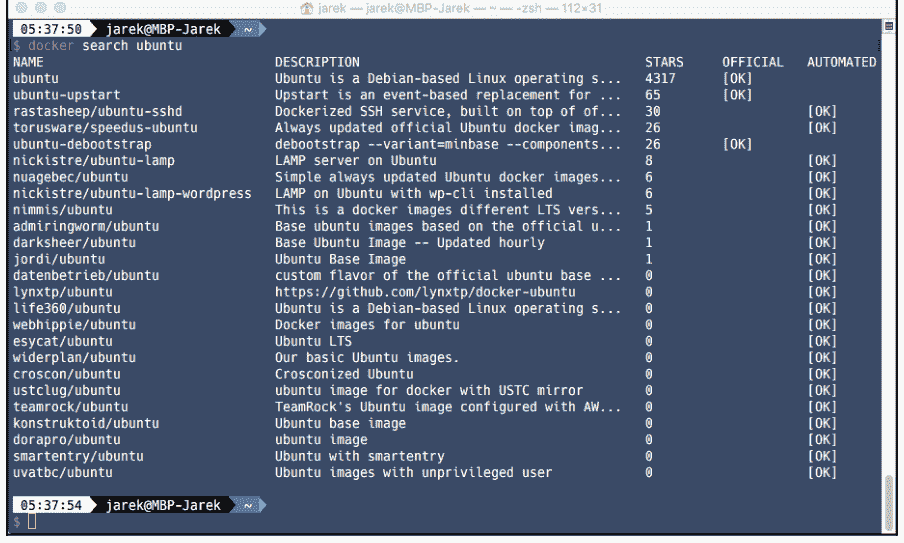

一目了然的信息很多。请注意，命令输出列出了镜像名称、简短描述、星级数量、是否为官方仓库的标记以及最近一次自动构建的状态。

如果仓库是私有的，除非您是镜像创建者、组织的成员或协作者，否则它不会列在仓库搜索结果中。


私有仓库不会出现在仓库搜索结果中。要查看您可以访问的所有仓库及其状态，请在 Docker Hub 上查看 Dashboard。

原因在于 Docker 首先会询问索引您是否有足够的权限列出和拉取镜像（如果您是创建者、组织的成员或协作者）。实际上，后台正在进行许多操作：
- 您向索引发出列出或下载镜像的请求。
- 作为响应，索引返回信息：
  - 镜像所在的注册表
  - 镜像的校验和，包括其所有层
  - 用于授权目的的令牌（*对于公共仓库不是必需的*）：
    - 您使用索引响应中返回的令牌联系注册表。
    - 作为回报，注册表会询问索引该令牌是否已授权且有效。
    - 最后，索引现在向注册表发送 true/false 消息，允许或禁止您列出或拉取所需的镜像。

使用 shell（或命令行）命令查找镜像是最快的方式。一旦找到您想要的镜像——接下来就是您已经知道的部分——只需使用 docker pull 命令下载镜像即可。但您处理镜像的方式并不仅限于 docker search/pull 命令和 Docker Hub 网页界面。Docker 提供了一套全面的远程 API，其中之一就是 Docker Hub 和 Docker Registry REST API。

## Docker Hub 和 Docker Registry REST API

让我们讨论 Docker Registry API 和 Docker Hub API，并列出与搜索和下载镜像相关的 API 端点。我们将使用命令行工具 curl，但您可以使用任何您选择的 REST 客户端，甚至是您的网页浏览器。

首先，让我们通过执行 HTTP GET 调用 /_ping 端点来检查远程注册表的状态：

```bash
curl -k https://registry.hub.docker.com/v1/_ping
```

注册表将回复一个简单的 true 值，表示它正在运行。

首先，我们需要登录或验证是否已登录。授权通过 SSL 上的 Basic Auth 进行。为了处理用户账户，API 公开了 /users 端点。现在，对以下 URL 发出 GET 请求：

```
https://registry.hub.docker.com/v1/users
```

如果您已登录，这将回复 OK 响应；如果未登录，则返回 HTTP 401 Unauthorized 状态：

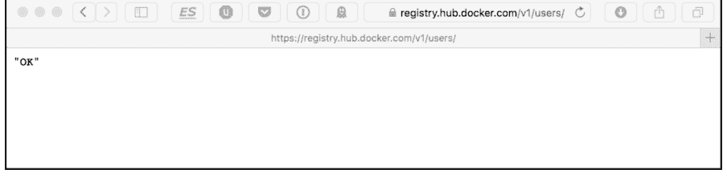

Docker Hub API 不仅是只读的，它还接受 POST 请求。例如，您可以通过向 /users 端点发出 POST 请求来注册新账户。POST 请求负载需要包含注册数据，例如电子邮件、用户名和密码，例如：

```
{
  "email": "someUser@someHost.com",
  "username": "myNewAccount",
  "password": "mySecret"
}
```

要执行此类 API 调用，您可以使用 curl 命令或任何其他用于执行 HTTP 请求的工具或命令。示例 curl 命令如下所示：

```
$ curl -H "Content-Type: application/json" -X POST -d '{"email":"someUser@someHost.com","username":"myNewAccount","password":"mySecret"}' https://registry.hub.docker.com/v1/users
```

此调用的响应将只是一个字符串 User Created，并带有 HTTP 201 User Created 返回代码。如果出现任何错误，响应将具有 HTTP 400 错误代码。

要更新用户账户，例如更改特定用户的密码或电子邮件地址，您需要向同一个 /users 端点发送类似的 JSON 负载，但使用 PUT 请求。如果您传入电子邮件，它将添加到您的账户中，不会删除旧的。密码将被更新。

要查找特定仓库中的镜像，我们将使用 /images 端点。列出镜像的 URL 为：

```
/v1/repositories/(namespace)/(repo_name)/images
```

因此，例如要列出官方 ubuntu 仓库中的镜像，我们需要对以下地址执行 HTTP GET 操作：

```
https://registry.hub.docker.com/v1/repositories/ubuntu/images
```

让我们执行该调用（这次在网页浏览器中——输出会很多）。只需在网页浏览器中输入 URL 并执行 GET 请求。Hub 将回复包含镜像 ID 的 JSON：

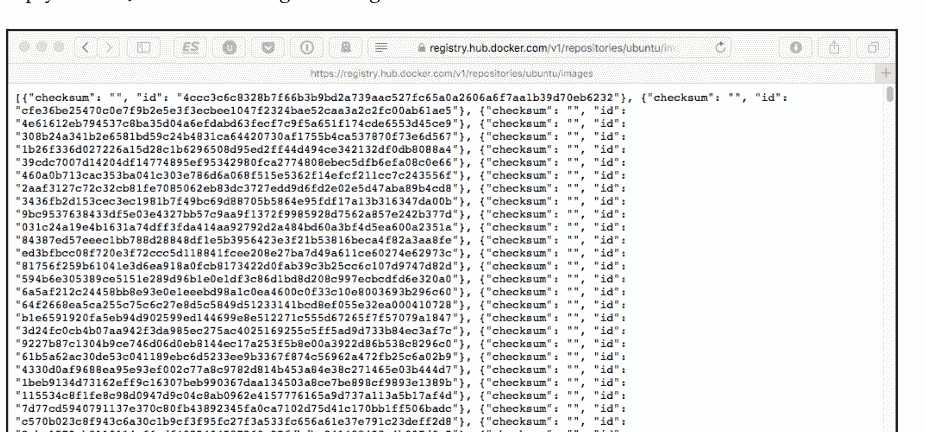

不太可读，但还有另一个用于列出仓库的标签的端点。要获取仓库的所有标签或特定标签，请在 /tags 端点上执行 GET。此 URL 类似：

```
/v1/repositories/(namespace)/(repository)/tags
```

让我们尝试查找 ubuntu 仓库中的标签，通过在 `https://registry.hub.docker.com/v1/repositories/ubuntu/tags` 上执行 `GET` 请求：

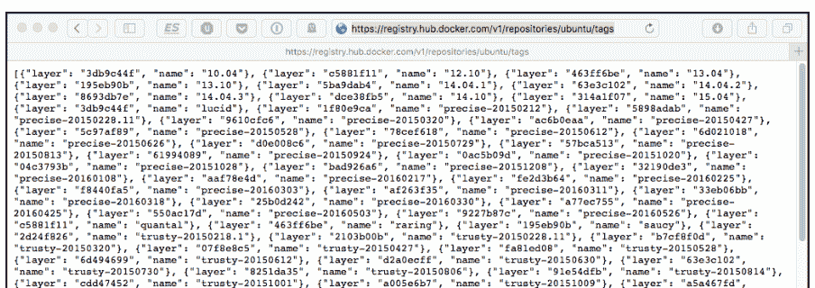

现在，在响应中我们有更多信息，如层 ID 和标签名称，通常包括 `latest` 标签。

除了用于列出用户登录和验证、列出镜像和标签的端点之外，Registry Hub API 还包含更多内容。让我们在下表中总结它们：

| 目的 | Request type and endpoint |
|---|---|
| 注册表状态检查 | `GET /v1/_ping` |
| 创建新用户账户 | `POST /v1/users` |
| 更新用户详情 | `PUT /v1/users/(username)/` |
| 为库授权令牌 | `PUT /v1/repositories/(repo_name)/auth` |


| 为用户仓库授权令牌 | PUT /v1/repositories/(namespace)/(repo_name)/auth |
| 验证用户登录 | GET /v1/users |
| 创建新的库仓库 | PUT /v1/repositories/(repo_name)/ |
| 创建新的用户仓库 | PUT /v1/repositories/(namespace)/(repo_name)/ |
| 更新用户仓库镜像 | PUT /v1/repositories/(namespace)/(repo_name)/images |
| 更新库仓库镜像 | PUT /v1/repositories/(repo_name)/images |
| 删除现有的库仓库 | DELETE /v1/repositories/(repo_name)/ |
| 删除用户仓库 | DELETE /v1/repositories/(namespace)/(repo_name)/ |
| 列出库仓库中的镜像 | GET /v1/repositories/(repo_name)/images |
| 列出用户仓库中的镜像 | GET /v1/repositories/(namespace)/(repo_name)/images |
| 检索镜像 | GET /v1/images/(image_id)/json |
| 获取仓库的所有标签或特定标签 | GET /v1/repositories/(namespace)/(repository)/tags |
| 删除标签 | DELETE /v1/repositories/(namespace)/(repository)/tags/(tag*) |
| 提取镜像层 | GET /v1/images/(image_id)/layer |
| 插入镜像层 | PUT /v1/images/(image_id)/layer |
| 检索镜像的根 | GET /v1/images/(image_id)/ancestry |

所有 API 命令在 Docker 文档网站上都有相当完善的文档，网址为 https://docs.docker.com。在那里你可以找到 API 调用所需提供的示例 JSON 负载，以及示例响应和 HTTP 返回状态码。暴露的 REST API 是一种很好的方式，如果你想开发自己的应用程序或处理 Registry 的自动化脚本。这再次证明了 Docker 为管理员或开发者提供的可扩展性和灵活性。

阅读本章后，你现在应该熟悉查找镜像的方式，无论是使用 Web 界面、命令行工具还是远程 API。你应该能够轻松找到一个将成为你自己镜像基础的镜像，而我们实际上将在下一章中创建这些镜像。

## Summary

阅读本章后，你应该对 Docker 的远程存储概念——Docker Registries 有所理解。我们也知道如何在最流行的 Docker 镜像仓库 Docker Hub 上创建和管理用户账户。我们能够找到一个可用于作为我们自己镜像基础的有用且合适的镜像。事实上，在第 6 章《创建镜像》中，我们将把所有这些付诸实践——我们将基于在 Docker Hub 上找到的镜像创建一个镜像。

# 6

## 6 创建镜像

在阅读了前几章后，你应该熟悉如何找到适合作为自己软件基础的镜像。你可以从远程仓库拉取它们，在运行时运行并对其进行更改，然后导出为新镜像。我们在第 3 章《理解镜像和容器》中曾通过运行容器、在其中安装软件并执行提交来创建镜像的方式看到了构建自己的镜像。这并不太实用，有时非常繁琐。幸运的是，有解决方案。Docker 有一个脚本引擎，我们可以用它来使用预定义的指令和属性列表创建新镜像。我们称这些脚本为 Dockerfiles。这次，我们将基于 Dockerfile 创建一个镜像。本章将涵盖以下主题：

- Dockerfile 简介
- 创建和编辑 Dockerfile
- Dockerfile 指令
- 构建镜像

首先让我们了解 Dockerfile 是什么。它只是一个包含构建镜像指令的纯文本文件。Docker 将处理此文件并逐步（或更确切地说是逐层）自动构建镜像，以源（基础）镜像作为基础。例如，我们可以使用基础 Ubuntu 镜像，安装诸如 Wildfly 之类的应用服务器，配置自己的应用程序或服务，并将 resulting 镜像作为一个整体发布——一个完整的应用程序，供其他人使用。使用 Dockerfile 有很多好处——你编辑和操作的是文本文件，而不是直接进行所有更改并将镜像保存回磁盘。你将 Dockerfile 视为应用程序源代码的一部分——你应该将其放入像 GIT 这样的版本控制系统中，以便跟踪更改并与团队成员共享。事实上，编写 Dockerfile 是构建自己的镜像更一致且可重复的方式。此外，使用 Dockerfile 是在动态构建镜像时的推荐方式，例如在持续部署设置中。

本章将涵盖以下主题：

- 创建和编辑 Dockerfile
- Dockerfile 指令
- 构建镜像

让我们开始创建 Dockerfile。我们将使用 Dockerfile 以更程序化的方式创建镜像。编辑 Dockerfile 时，你可以使用任何你选择的文本编辑器，但使用支持 Dockerfile 语法高亮的 IDE 会更方便。例如，IntelliJ IDEA 有一个 Docker 集成插件，我强烈推荐。顺便说一下，我们将在下一章大量使用此插件——有一个新的 IDEA Run/Debug 配置用于 Docker 部署，它将允许你指定云部署目标、适当的 Dockerfile，并为你的容器命名。此插件可让你下载和构建镜像、创建和启动容器，并执行其他与 Docker 相关的任务。除此之外，在编辑 Dockerfile 时你将获得编辑器补全和语法高亮，如以下屏幕截图所示：

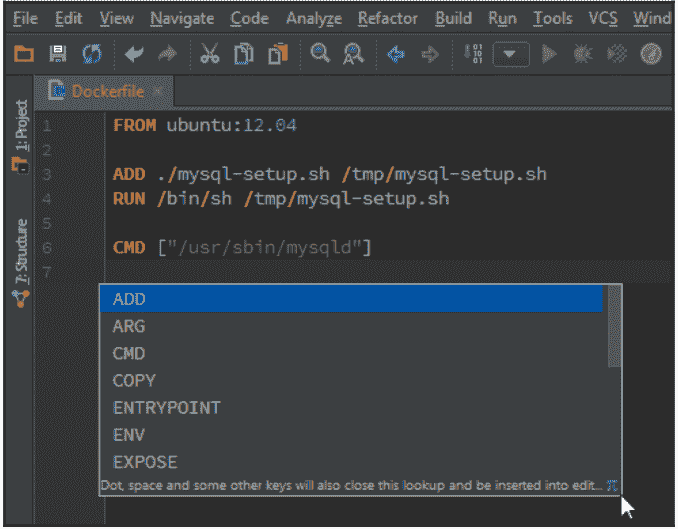

Docker 中的镜像创建流程相当直接，主要包括两个步骤：

- 首先，你准备 `Dockerfile`，它只是一个包含构建镜像一系列指令的文本文件。它支持一组不算很大的命令，你可以在 Dockerfile 中使用它们来指示 Docker 如何创建镜像。
- 接下来，你将使用 docker build 命令基于刚刚创建的 Dockerfile 创建 Docker 镜像。

Dockerfile 的标准名称就是 `Dockerfile`，它只是一个纯文本文件。
Dockerfile 使用简单、清晰的语法，这使得它们非常容易创建和使用。它们旨在自解释，特别是因为它们允许像良好且正确编写的应用程序源代码一样进行注释。

此文件中的指令不区分大小写，然而，好的做法是坚持一种约定并以大写形式编写——这将使 Dockerfile 更具可读性。你可以使用井号符号 # 在 Dockerfile 中编写注释。Docker 将跳过注释行，除非它包含解析指令，我们稍后会介绍。虽然某些命令，例如 `MAINTAINER`，可以放在 Dockerfile 的任何位置，但大多数命令，例如 `ADD` 必须按照你希望在构建镜像时执行的顺序放置。`CMD` 和 `ENTRYPOINT` 是例外——Dockerfile 中只有最后一个 `CMD` 或 `ENTRYPOINT` 指令会生效。


Dockerfile 中指令的顺序很重要——它们将按照 Dockerfile 中的相同顺序执行。

让我们逐一开始描述可能的 Dockerfile 指令。

## Dockerfile 指令

在本节中，我们将逐一介绍 Dockerfile 指令。让我们从应该在我们要创建的 Dockerfile 中排在第一位的指令开始，即 `FROM` 指令。

### FROM

FROM 指令的语法非常简单。它有三种形式。可以像这样简单：

```
FROM <image>
```

默认情况下，Docker 将使用标记为 latest 的镜像。如果你需要基于不同的标签构建，你需要在镜像名称后添加标签名称。然后 FROM 指令将采用以下形式：

```
FROM <image>:<tag>
```

最后但并非最不重要的一点是，你甚至可以使用其摘要更精确地选择镜像。正如你从前几章中记得的，如果作者决定这样做，具有相同标签的镜像可能会随时间变化。如果你想将基础镜像锁定到固定版本，可以将摘要指定为镜像名称。这样，你自己的镜像将始终使用基础镜像的特定版本进行构建，而与标签无关。要使用摘要指定基础镜像，请使用 FROM 指令的以下语法：

```
FROM <image>@<digest>
```

FROM 指令告诉 Docker 正在创建的镜像的基础是什么。在这里，你可以使用在第 5 章《查找镜像》中学到的在 Docker Hub 上查找镜像的技能。现在这很重要——因为它将是起点——请明智选择。当然你可以选择任何你想要作为自己镜像基础的东西，由你决定——但我的建议是始终优先选择官方仓库。通过选择官方镜像，你可以相当确定它质量高、经过测试、受支持且维护。


你可以在 FROM 指令中使用自己的镜像。

如果在你的 Docker 主机上（例如你的本地机器）找不到 FROM 镜像，Docker 将尝试从 Docker 镜像索引中找到并下载它。同样，Docker Hub 将默认被选中。


Dockerfile 中的所有后续指令都将使用 FROM 指定的镜像作为基础起点。这就是为什么它是强制性的——一个有效的 Dockerfile 必须将其放在顶部。虽然你可以在镜像中使用多个 FROM 指令，但这可能不是一个好且推荐的做法——虽然有趣，但并未完全支持。特别是，使用多个 FROM 产生的非最终镜像如果不解析构建输出，很难找到。实际上，Docker 的 GitHub 上正在进行一项关于从 Dockerfile 规范中移除对多个 FROM 指令支持的讨论。

FROM 指令接受标签或摘要作为参数。如果你决定跳过它们，Docker 将假设你想从 latest 标签构建镜像。正如你在第 5 章《查找镜像》中记得的那样，它并不总是你想要构建的基础镜像的最新版本。如果 Docker 找不到你提供的标签或摘要，构建过程中会抛出错误。

## MAINTAINER

通过使用 MAINTAINER 指令，你可以设置生成镜像的 Author 字段。这可以是你的姓名、用户名，或你希望用来作为使用此 Dockerfile 创建的镜像作者的任何引用。此命令可以放在 Dockerfile 的任何位置，但良好的做法是将其放在文件顶部，紧跟在 FROM 指令之后。这是所谓的非执行命令，这意味着它不会对生成的镜像做任何更改。语法，再次说明，非常简单：

```
MAINTAINER authors_name
```

## ADD

ADD 基本上会将主机上的源文件复制到 Docker 镜像自身的 文件系统中的期望目标位置。它接受两个参数；源（<source path or URL>）和目标（<destination path>）：

```
ADD <source path or URL> <destination path >
```

源路径可以是相对于构建过程将要启动的目录（构建上下文）的文件或目录。这意味着你不能例如将 `../../config.json` 放在 `ADD` 指令的源路径参数中。构建上下文可以使用 `docker build` 命令中的 `PATH` 选项更改，且源路径相对于构建上下文。

源可以包含通配符。这些与常规文件系统相同：* 代表任意文本字符串，或 ? 代表任意单个字符。

请考虑以下示例：

- `ADD myFiles* /myDirectory/`: 这将添加所有以 myFiles 开头的文件
- `ADD file?.txt /myDirectory/`: 这将用任意单个字符替换，以便匹配 `file1.txt`、`fileB.txt`，和 so on。


另一方面，目标路径不能包含通配符。

你可以指定多个源路径，用逗号分隔。它们都必须相对于构建上下文，就像只有一个源路径一样。如果你的源或目标路径包含空格，你需要使用特殊语法，在周围加上方括号：

```
ADD ["<source path or URL>" "<destination path>"]
```

在向镜像添加文件或目录时，尾部斜杠 / 非常重要。如果源路径不以尾部斜杠结尾，它将被视为单个文件并直接复制到目标位置。如果源路径以尾部斜杠结尾，它将被视为目录；其所有内容将被复制到目标路径，但目录本身不会在目标路径创建。

如果源路径指向 `zip`、`tar` 等常见格式的压缩归档，它将被解压到目标路径。Docker 并不是通过文件名识别归档，而是检查文件内容。


如果归档已损坏或以其他方式无法被 Docker 读取，它将不会被提取，并且你不会收到错误消息——文件将只是被复制到目标路径。

相同的尾部斜杠规则适用于目标路径：如果它以尾部斜杠结尾，则表示它是一个目录。否则，它将被视为单个文件。这在构建镜像的文件系统内容时提供了很大的灵活性——你可以将文件添加到目录中，也可以添加整个目录。


请注意，使用 ADD 且源文件多于一个时，目标必须是目录并以斜杠 / 结尾。

ADD 命令不仅仅是复制本地文件系统中的文件——你也可以用它从网络获取文件。如果源是 URL，则 URL 的内容将被自动下载并放置在目标位置。请注意，从网络下载的文件归档不会被解压。再次强调，尾部斜杠在下载文件时很重要——如果目标路径以斜杠结尾，文件将被下载到目录中。否则，下载的文件将仅以你提供的目标路径名称保存。

<destination directory> 要么是绝对路径，要么是相对于 WORKDIR 指令指定的目录的路径（我们稍后会介绍）。源（或多个源）将被直接复制到指定的目标位置。请考虑以下示例：

- `ADD config.json projectRoot/` 将把 `config.json` 文件添加到 `<WORKDIR>/projectRoot/`
- `ADD config.json /absoluteDirectory/` 将把 `config.json` 文件添加到 `/absoluteDirectory/`

就镜像中创建的文件所有权而言，它们始终将以用户 ID (UID) 0 和组 ID (GID) 0 创建。权限将与源文件相同，除非它是从远程 URL 下载的文件。在这种情况下，它将获得权限值 600（只有所有者可以读写文件）。如果你需要更改这些值（所有权或权限），你需要在 Dockerfile 中在 ADD 指令之后提供更多指令。


如果需要添加到镜像中的文件放置在需要身份验证的 URL 上，ADD 指令将无法工作——你需要使用 shell 命令下载文件，例如 wget 或 curl。

## COPY

COPY 指令会将新的文件或目录从 <source path> 复制并添加到容器文件系统中的 <destination path> 路径。

它与 ADD 指令非常相似，甚至语法也完全相同：

```
COPY <source path or URL> <destination path >
```

ADD 的相同规则适用于 COPY——所有源路径必须相对于构建的上下文。再次强调，源路径和目标路径末尾是否存在尾部斜杠很重要。如果存在，路径将被视为目录，否则将被视为文件。

当然，如同 ADD 一样，你可以有多个源路径。如果源或目标路径包含空格，你需要将它们用方括号括起来：

```
COPY ["<source path or URL>" "<destination path>"]
```

<destination path> 是绝对路径（以斜杠开头），或相对于 WORKDIR 指令指定的路径的路径。

正如你所见，COPY 的功能几乎与 ADD 指令相同，只有一个区别。COPY 仅支持将本地文件复制到容器的基本操作。另一方面，ADD 具有更多功能，例如归档提取、通过 URL 下载文件等。Docker 的最佳实践指出，如果你不需要 ADD 的这些额外功能，应该优先使用 COPY。得益于 COPY 命令的透明性，Dockerfile 将更简洁、更容易理解。

对于 ADD 和 COPY 指令来说，有一个共同且重要的方面，那就是缓存。基本上，Docker 在构建过程中缓存进入镜像的文件。镜像中文件或文件的内容将被检查，并为每个文件计算校验和。在缓存查找期间，校验和与现有镜像中的校验和进行比较。如果文件（例如内容和元数据）有任何更改，则缓存将被失效。否则，如果源文件未更改，则会重用现有的镜像层。


如果你的 Dockerfile 中有多个步骤使用了来自构建上下文的不同文件，请分别单独复制它们，而不是一次性全部复制。这样可以确保只有在特定所需的文件发生变化时，才会使每个步骤的构建缓存失效（从而强制重新运行该步骤）。

如你所见，`COPY` 指令与 `ADD` 指令的语法和行为几乎相同，但其功能集有所不同。对于不需要 `ADD` 指令的归档解包或从 URL 获取等功能的文 件和目录，你应始终使用 `COPY`。

## CMD

`CMD` 指令的目的是为正在运行的容器提供默认值。你可以将 `CMD` 指令视为镜像的 *起点*，当容器稍后运行时。这可以是一个可执行文件，或者如果你指定了 `ENTRYPOINT` 指令（我们将在本章稍后解释），你可以省略可执行文件，只提供默认参数。

`CMD` 指令的语法如下：

```
CMD ["parameter1","parameter2"]
```

- `CMD ["executable", "parameter1", "parameter2"]`：这是所谓的 exec 形式。它也是首选且推荐的形式。参数被包含在方括号中——它是一个 JSON 数组。这也意味着你必须使用双引号 (`) 将单词括起来，而不是单引号 (')。需要注意的重要一点是，exec 形式在容器运行时不会调用命令 shell。它只是运行作为第一个参数提供的可执行文件。这也意味着正常的 shell 处理不会发生，例如，以下环境变量替换将不起作用：
  
  ```
  CMD ["parameter1","parameter2"]
  ```
  
  此形式的 `CMD` 指令仅为 `ENTRYPOINT` 指令提供一组默认参数。
- `CMD command parameter1 parameter2`：这是该指令的 shell 形式。这时，shell（如果镜像中存在）将处理该命令。指定的二进制文件将使用 `/bin/sh -c` 调用 shell 来执行。这意味着如果你想显示容器的主机名，例如使用 `CMD echo $HOSTNAME`，你应该使用 shell 形式。

我们之前说过，CMD 指令的推荐形式是 exec 形式。原因在于通过 shell 启动的一切都将作为 /bin/sh -c 的子命令启动，而它不会传递信号。这意味着可执行文件将不是容器的 PID 1——也不会接收 Unix 信号——因此你的可执行文件将不会收到来自 docker stop <container> 的 SIGTERM。还有另一个缺点——你需要在容器中拥有一个 shell。如果你在构建最小化镜像，它不需要包含 shell 二进制文件。使用 shell 形式的 CMD 指令将简单地失败。


当 Docker 执行命令时，它不会检查容器内部是否存在 shell；如果镜像中没有 /bin/sh，容器将无法启动。

exec 形式和 shell 形式之间的区别可以通过运行示例轻松展示。考虑以下使用 shell 形式的 Dockerfile：

```
FROM ubuntu
CMD echo $HOSTNAME
```

输出将只是 Docker 在容器运行时生成的唯一主机名：

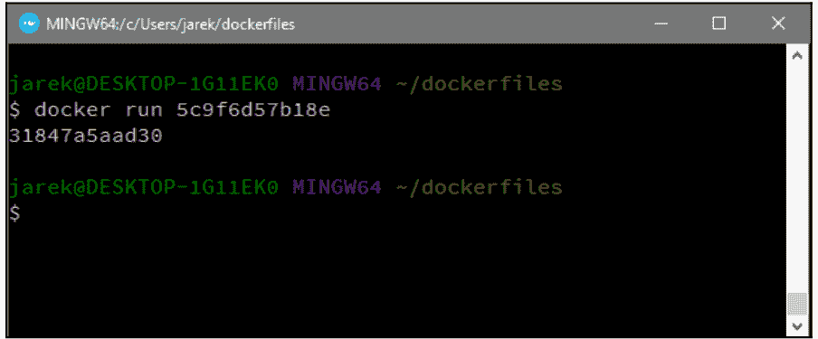

另一方面，如果我们将 CMD 改为 exec 形式，Docker 将会寻找名为 echo 的可执行文件，这当然会失败，因为 echo 是一个 shell 命令。

由于 CMD 在 Docker Engine 运行容器时就像一个起点，因此 Dockerfile 中只能有一个 CMD 指令。


如果 Dockerfile 中有多个 CMD 指令，只有最后一个会生效。

`CMD` 命令的参数可以在启动镜像时被覆盖——如果你向 docker run 指定参数。在启动容器时，你可以通过在命令行提供参数来覆盖默认的 CMD 参数，如下图所示。在此示例中，我们要求再次启动 /bin/sh -c shell，因为我们使用的是 CMD 的 shell 形式，这次覆盖了 Dockerfile 中的默认 CMD 指令：

```
docker run 00bd948ecdff "echo" "Hello world!"
```

请注意，这次它不会打印出主机名，而是打印 Hello world，取自我们覆盖的 CMD 参数：

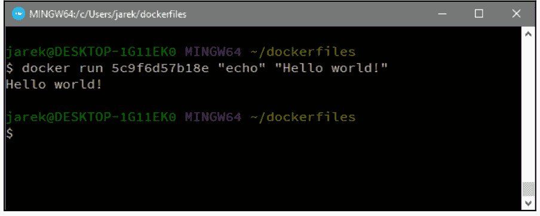

我们将在第 7 章《运行容器》中详细讨论这一点。

## ENTRYPOINT

官方 Docker 文档说，ENTRYPOINT 指令允许你配置一个作为可执行文件运行的容器。至少第一次看时，这并不太清楚。ENTRYPOINT 指令与 CMD 指令相关。事实上，开始时可能会令人困惑。原因很简单；CMD 最先开发，然后 ENTRYPOINT 为更灵活的定制而开发，这两个指令之间存在一些功能重叠。让我们稍微解释一下。ENTRYPOINT 指令指定了容器启动时始终会执行的命令。另一方面，CMD 指令指定将提供给 ENTRYPOINT 指令的参数。考虑这个例子。假设我们要运行的镜像（ubuntu）有一个 ENTRYPOINT 为 /bin/sh -c，但没有默认 CMD，并且我们执行以下命令：

```
docker run ubuntu "echo" "hello world"
```

在这种情况下，镜像将是最新版 ubuntu，ENTRYPOINT 指令将是 /bin/sh -c，而传递给 ENTRYPOINT 指令的命令将是 echo "hello world"。

ENTRYPOINT 指令的语法可以有两种形式，与 CMD 类似：

- ENTRYPOINT ["executable", "parameter1", "parameter2"]：这是 exec 形式，首选且推荐。与 CMD 指令的 exec 形式完全相同，这不会调用命令 shell。这意味着正常的 shell 处理不会发生。例如，ENTRYPOINT [ "echo", "$HOSTNAME" ] 不会对 $HOSTNAME 变量进行变量替换。如果你想要 shell 处理，那么你需要使用 shell 形式或直接执行 shell，例如：
  
  ENTRYPOINT [ "sh", "-c", "echo $HOSTNAME" ]
  
  使用 Dockerfile 中的 ENV 定义的变量（我们稍后会介绍）将由 Dockerfile 解析器进行替换。
- ENTRYPOINT command parameter1 parameter2：这是 shell 形式。正常的 shell 处理将会发生。此形式还将忽略任何 CMD 或 docker run 命令行参数。此外，你的命令将不是 PID 1，因为它将由 shell 执行。因此，如果你随后运行 docker stop <container>，容器将不会干净地退出——stop 命令将被迫在超时后发送 SIGKILL 命令。

```
ENTRYPOINT [ "sh", "-c", "echo $HOSTNAME" ]
```

你需要知道，与 CMD 指令完全相同，只有 Dockerfile 中最后一个 ENTRYPOINT 指令会生效。覆盖 Dockerfile 中的 ENTRYPOINT 允许你在容器运行时使用不同的命令处理你的参数。如果你需要更改镜像中的默认 shell，你可以通过更改 ENTRYPOINT 来实现：

```
FROM ubuntu
ENTRYPOINT ["/bin/bash"]
```

从现在开始，所有来自 CMD 或使用 docker run 启动容器时提供的参数都将由 Bash shell 处理，而不是默认的 /bin/sh -c。

考虑另一个示例 Dockerfile：

```
FROM busybox
ENTRYPOINT ["/bin/ping"]
CMD ["localhost"]
```

如果你现在运行从此 Dockerfile 构建的容器，则 ping 命令作为镜像的 ENTRYPOINT 将处理来自提供的 CMD 参数的参数：在我们的例子中是 localhost。因此，你将得到一个 /bin/ping localhost 命令行响应：


正如你从 CMD 指令的描述中记得的，它设置默认的命令和/或参数，可以在 Docker 容器运行时从命令行覆盖。ENTRYPOINT 命令和参数不会从命令行被覆盖。相反，所有命令行参数都会添加到 ENTRYPOINT 参数之后。

与 CMD 参数不同，当 Docker 容器使用命令行参数运行时，ENTRYPOINT 命令和参数不会被忽略。

因此我们可以运行我们的 ping 镜像，并向 ENTRYPOINT 指令传递不同的参数：


你可以使用 ENTRYPOINT 的 exec 形式来设置相当稳定的默认命令和参数，然后使用 CMD 的任一形式来设置更可能被更改的附加默认值。

拥有 ENTRYPOINT 指令给了我们很大的灵活性。最后但同样重要的是，ENTRYPOINT 在启动容器时也可以使用 docker run 命令的 --entrypoint 参数进行覆盖。请注意，你可以使用 --entrypoint 覆盖 ENTRYPOINT 设置，但这只能设置要执行的二进制文件（不会使用 sh -c）。我们将在第 7 章《运行容器》中详细讨论这一点。

如你所见，`CMD` 和 `ENTRYPOINT` 指令都定义了运行容器时执行什么命令。让我们总结一下我们所学到的关于它们差异和协作的内容：

- Dockerfile 应至少指定 `CMD` 或 `ENTRYPOINT` 指令之一
- Dockerfile 中只有最后一个 `CMD` 和 `ENTRYPOINT` 会被使用
- 使用容器作为可执行文件时应定义 `ENTRYPOINT`
- 你应使用 `CMD` 指令作为为 `ENTRYPOINT` 定义的命令定义默认参数的方式，或在容器中执行临时命令
- 使用替代参数运行容器时，`CMD` 会被覆盖
- `ENTRYPOINT` 参数设置每次使用镜像创建容器时使用的具体默认应用程序
- 如果将 `ENTRYPOINT` 与 `CMD` 结合使用，可以从 `CMD` 中移除可执行文件，只保留其参数，这些参数将被传递给 `ENTRYPOINT` 指令
- `ENTRYPOINT` 指令的最佳用途是设置镜像的主要命令，使该镜像可以像该命令一样运行（然后使用 `CMD` 作为默认标志）。

## LABEL

要向我们的镜像添加元数据，我们使用 `LABEL` 指令。单个标签是一个键值对。如果标签值中需要包含空格，则需要将其用一对引号括起来。标签是累加的。它们包括从作为你自己镜像的基础的镜像（来自 `FROM` 指令的那个）中获取的所有标签。如果 Docker 遇到已存在的标签，它将使用新值覆盖具有相同键的标签。


定义标签时必须遵守一些规则：键只能由小写字母数字字符、点和连字符组成，并且必须以字母数字字符开头和结尾。

为防止命名冲突，Docker 建议使用反向域名表示法对键使用命名空间进行标记。另一方面，没有命名空间（点）的键保留用于命令行使用。

LABEL 指令的语法很简单：

```
LABEL "key"="value"
```

要实现多行值，请用反斜杠分隔各行，例如：

```
LABEL description="This is my \ multiline description of the software."
```

单个镜像中可以有多个标签。用空格或反斜杠分隔它们，例如：

```
LABEL key1="value1" key2="value2" key3="value3"
LABEL key1="value1" \
key2="value2" \
key3="value3"
```

实际上，如果你需要在镜像中拥有多个标签，建议使用 LABEL 指令的多标签形式，因为它只会在镜像中产生一个额外的层。


每个 LABEL 指令都会创建一个新层。如果你的镜像有许多标签，请使用单个 LABEL 指令的多个形式。

如果你想检查镜像有哪些标签，请使用你已从前几章了解的 docker inspect 命令：


ENV Dockerfile 指令将环境变量 <key> 设置为值 <value>。它有两种形式：

- 第一种形式，ENV <key> <value> 将单个变量设置为一个值。第一个空格之后的所有字符串都将被视为 <value>。这将包括任何字符，也包括空格和引号。考虑以下示例：ENV JAVA_HOME /var/lib/java8
- 第二种形式是 ENV <key>=<value> ...，允许一次设置多个环境变量。区别在于等号。如果你需要在值中提供空格，则需要使用引号。如果需要在值中使用引号，请使用反斜杠：ENV CONFIG_TYPE=file CONFIG_LOCATION="home/Jarek/my \ app/config"

请注意，你可以使用 ENV 更新 PATH 环境变量，然后 CMD 参数将意识到该设置。这将在 Dockerfile 中产生更简洁的 CMD 参数形式。考虑以下示例：

```
ENV PATH /var/lib/tomcat8/bin:$PATH
```

设置此项将确保 CMD ["startup.sh"] 正常工作，因为它将在系统 PATH 中找到 startup.sh 文件。你也可以使用 ENV 设置经常修改的版本号，以便升级更容易处理，如以下示例所示：

```
ENV TOMCAT_VERSION_MAJOR 8
ENV TOMCAT_VERSION 8.5.4
RUN curl -SL
http://apache.uib.no/tomcat/tomcat-$TOMCAT_VERSION_MAJOR/v$TOMCAT_VERSION/bin/apache-tomcat-$TOMCAT_VERSION.tar.gz | tar zxvf apache-tomcat-$TOMCAT_VERSION.tar.gz -c /usr/Jarek/apache-tomcat-$TOMCAT_VERSION
ENV PATH /usr/Jarek/apache-tomcat-$TOMCAT_VERSION/bin:$PATH
```

在前面的示例中，Docker 将下载 ENV 变量中指定的 Tomcat 版本，将其提取到以该版本命名的新目录中，并设置系统 PATH 使其可用于运行。

使用 ENV 设置的环境变量在从生成的镜像运行容器时将保持不变。与使用 LABEL 创建的标签一样，你可以使用 docker inspect 命令查看 ENV 值。ENV 值也可以在使用 docker run --env <key>=<value> 启动容器之前被覆盖。

## EXPOSE

EXPOSE 指令通知 Docker 容器在运行时监听指定的网络端口。我们已在第 4 章《网络和持久存储》中提到过 EXPOSE 指令。正如你记得的，Dockerfile 中的 EXPOSE 等同于 --expose 命令行选项。Docker 使用 EXPOSE 命令后跟端口号来允许流量进入容器。我们已经知道 EXPOSE 不会自动使容器的端口对主机可访问。为此，你必须使用 -p 标志发布一系列端口，或使用 -P 标志一次发布所有暴露的端口。

让我们以 Nginx Web 服务器 Dockerfile 为例。正如一直以来那样，查看现有源代码是创建自己的最佳方式。对于 Dockerfile 来说也一样。Nginx Dockerfile 很不错而且很小，它在 GitHub 上可用 (https://github.com/dockerfile/nginx/blob/master/Dockerfile)：

```
# Pull base image.
FROM ubuntu:14.04
# Install Nginx.
RUN \
    add-apt-repository -y ppa:nginx/stable && \
    apt-get update && apt-get install -y nginx && \
    rm -rf /var/lib/apt/lists/* && \
    echo "\ndaemon off;" >> /etc/nginx/nginx.conf && \
    chown -R www-data:www-data /var/lib/nginx

# Define mountable directories.
VOLUME ["/etc/nginx/sites-enabled", "/etc/nginx/certs",
"/etc/nginx/conf.d", "/var/log/nginx", "/var/www/html"]

# Define working directory.
WORKDIR /etc/nginx

# Define default command.
CMD ["nginx"]

# Expose ports.
EXPOSE 80
EXPOSE 443
```


如你在前面的 Dockerfile 中所见，它使用 EXPOSE 暴露了两个端口：标准 HTTP（80）和 SSL（443）。这些端口将可供此主机上的其他容器使用，并且——如果你在运行时暴露它们——也对外部世界可用。你可以显式地使用指定端口运行镜像：

```
docker run nginx -p 80
```

另选地，你可以告诉 Docker 我们希望所有暴露的端口一次性发布：

```
docker run nginx -P
```

良好做法是为你的应用程序使用通用、已知的端口号。例如，如果你的应用程序运行在 nginx Web 服务器上，你应该使用端口号 80 进行 EXPOSE，这样应用程序的用户就不会对一些奇特的端口号感到惊讶。当然，如果有暴露非标准端口号的特定需求，你可以自由选择，这只是良好实践。

## RUN

RUN 指令是 Dockerfile 的核心执行指令。本质上，RUN 指令会在当前镜像之上新建一层执行任意命令，然后提交结果。提交后的镜像将用作 Dockerfile 中下一条指令的基础。正如你在第 3 章 *理解镜像和容器* 中记得的那样，分层是 Docker 的核心概念。RUN 将命令作为参数并运行它以形成镜像。RUN 指令可以运行任何命令（或应用程序），这与我们之前了解的 CMD 指令类似。有一个关键的重要区别——执行时间。通过 RUN 指令提供的命令在构建时执行，而通过 CMD 指令指定的命令在通过在新创建的镜像上执行 docker run 启动容器时执行。与 CMD 不同，RUN 指令实际上用于构建镜像，通过在之前的基础上创建新层并提交。


CMD 是运行时指令，而 RUN 是构建时指令。

这也意味着 CMD 和 ENTRYPOINT 设置的参数可以在运行时被覆盖，因此如果你不做任何更改，启动容器后结果始终相同。而 RUN 则在构建时执行，无论你在运行时做什么，其效果都会在这里体现。

RUN 与 CMD 和 ENTRYPOINT 类似，可以有两种形式：

- `RUN <command>`: 这是 shell 形式。提供的命令及其参数将在 shell 中执行，在 Linux 上为 `/bin/sh -c`，在 Windows 上为 `cmd /S /C`。RUN 指令的默认 shell 可以使用 SHELL 命令更改。
- `RUN ["executable", "parameter1", "parameter2"]`: 这是 exec 形式。与 CMD 中的规则相同。使用此形式，你可以在不包含指定 shell 可执行文件的 base 镜像上执行命令。此形式的 RUN 不会调用命令 shell。同样，与 CMD 或 ENTRYPOINT 一样，正常的 shell 处理，例如变量替换，不会发生。


为了使 Dockerfile 更易读且更易维护，你可以将长或复杂的 RUN 语句拆分为多行，用反斜杠分隔。

Dockerfile 中的 RUN 命令将按其出现的顺序执行。每个 RUN 指令都会在镜像中创建一个新层。层，如你已从第 3 章 *理解镜像和容器* 中所知，被 Docker 缓存并重用。RUN 指令的缓存不会在下一次构建期间自动失效。例如，像 RUN apt-get upgrade -y 这样的指令的缓存将在下一次构建期间被重用。缓存的重要性是什么？在大多数情况下，缓存非常有帮助，可以在构建镜像时为你节省大量时间。如果 Docker 即将产生的对象在构建之间未受影响，重用主机上之前构建的缓存是极大的节省时间。它使构建新容器变得非常、非常快。这些文件结构不必再次创建并写入磁盘——对它们的引用足以定位并重用之前构建的结构。然而，有时缓存可能是危险的并提供意外的结果。缓存在构建过程中被大量使用，这可能会导致问题，当你希望 RUN 命令的更新输出进入新容器时。

如果 RUN 命令在两次构建之间没有变化，Docker 的缓存将不会失效。实际上，Docker 将重用缓存中的先前结果。当例如 RUN 命令是源代码检出，例如项目的构建第一步的 Git clone 时，这显然是有害的。


请注意缓存有时需要失效，否则你将用镜像构建得到意外的结果。

这就是为什么了解如何选择性地使缓存失效是好的。在 Docker 世界中，这被称为缓存破坏。

考虑以下示例。RUN 最常见的用例可能是 apt-get 的应用，它是 Ubuntu 上用于下载软件包的包管理器命令。假设我们有以下 Dockerfile，在镜像中安装 MongoDB：

```
FROM ubuntu
RUN apt-get update
RUN apt-get install -y mongodb-server
```

如果我们从此 Dockerfile 构建镜像，两个 RUN 指令的所有层都将放入层缓存中。但，过了一段时间你决定在镜像中想要 node.js 软件包，于是 Dockerfile 现在看起来像这样：

```
FROM ubuntu
RUN apt-get update
RUN apt-get install -y mongodb-server
RUN apt-get install -y nodejs
```

在第二次构建时，Docker 将通过从层缓存中获取来重用层。结果 apt-get update 将不会执行，因为将使用缓存版本。实际上，你新创建的镜像可能具有过时的 MongoDb 和 node-js 软件包版本。你在创建 RUN 指令时应始终牢记缓存概念。在我们的示例中，我们应始终将 RUN apt-get update 与 apt-get install 结合在同一个 RUN 语句中，这将只创建一个层。考虑以下示例：

```
RUN apt-get update \
&& apt-get install -y mongodb-server \
&& apt-get install -y nodejs
```

比这更好的是，你还可以使用一种称为 **版本锁定** 的技术来避免缓存问题。它无非就是为你想要安装的软件包提供特定、具体的版本：

```
RUN apt-get update \
&& apt-get install -y mongodb-server \
&& apt-get install -y nodejs=0.6.12~DFSG1-1UBUNTU1
```


由于缓存问题，单独在 RUN 语句中使用 `apt-get update` 不被推荐。

RUN 指令的缓存可以通过 ADD 指令或使用 `--no-cache` 标志来使失效，例如：

```
docker build --no-cache
```

## USER

USER 指令非常简单。它设置运行镜像时使用的用户名或 UID。它还影响 Dockerfile 中其后出现的任何 RUN、CMD 和 ENTRYPOINT 指令的用户。

指令的语法只是 USER <user name or UID>，例如：

```
USER tomcat
```

如果你可以在没有特权的情况下运行可执行文件，可以使用 USER 命令。Dockerfile 可以包含如下的用户和组创建指令：

```
RUN groupadd -r tomcat && useradd -r -g tomcat tomcat
```


频繁地在 USER 之间切换会增加结果镜像中的层数，并使 Dockerfile 变得更复杂。

## VOLUME

正如你从第 3 章 *理解镜像和容器* 中记得的那样，Docker 文件系统默认是临时性的。如果你启动一个 Docker 镜像（即运行容器），你将在层堆栈顶部得到一个读写层。你可以随意创建、修改和删除文件，然后提交层以保留更改。此外，使用 Dockerfile 将创建只读镜像。在第 4 章 *网络和持久化存储* 中我们学习了如何创建卷——从 Docker 容器存储和检索数据的好方法。我们可以在 Dockerfile 中使用 VOLUME 指令做同样的事情。

语法 couldn't be simpler，它只是 `VOLUME [ "/volumeName" ]`。

VOLUME 的参数可以是 JSON 数组，也可以是包含一个或多个参数的纯字符串，例如：

```
VOLUME ["/var/lib/tomcat8/webapps/"]
VOLUME /var/log/mongodb /var/log/tomcat
```

VOLUME 指令创建具有指定名称的挂载点，并将其标记为保存来自原生主机或其他容器的外部挂载卷。

VOLUME 命令将在容器内挂载一个目录，并将该目录内创建或编辑的任何文件存储在主机磁盘上容器文件结构之外。使用 Dockerfile 中的 VOLUME 让 Docker 知道某个目录包含永久数据。Docker 将为该数据创建卷，并且即使你删除使用它的所有容器也不会删除它。它还绕过联合文件系统，因此卷实际上是一个实际目录，在所有共享它的容器中以正确的位置挂载，要么是读写，要么是只读（如果它们是用 `--volumes-from` 选项启动的，例如）。为了理解 VOLUME，让我们看一下简单的 Dockerfile：

```
FROM ubuntu
VOLUME /var/myVolume
```

如果你现在运行容器并在 `/var/myVolume` 中保存一些文件，它们将可供其他容器共享。

基本上，VOLUME 和 `-v` 选项几乎相等。VOLUME 和 `-v` 选项之间的区别是，你可以使用 `-v` 选项动态地在启动容器时通过执行 `docker run` 将主机目录挂载到容器上。这是因为 Dockerfile 旨在可移植和共享。主机目录卷是 100% 主机依赖的，并且会在任何其他机器上中断，这有点偏离 Docker 的理念。因为这个原因，只能在 Dockerfile 中使用可移植的指令。


VOLUME 与 -v 之间的根本区别在于：-v 会将操作系统中已有的文件挂载到 Docker 容器内部，而 VOLUME 会在主机上创建一个新的、空的卷并将其挂载到容器内部。

## WORKDIR

WORKDIR 指令为 Dockerfile 中后续的 CMD、RUN、ENTRYPOINT、COPY 或 ADD 指令添加一个工作目录。该指令的语法为 WORKDIR /PATH。你可以在一个 Dockerfile 中使用多个 WORKDIR 指令，如果提供了相对路径，则它将相对于上一个 WORKDIR 指令的路径。

## ARG

如果需要在 docker build 命令期间在构建时向 Docker 传递一个参数，你可以在 Dockerfile 中使用 ARG 指令。ARG 变量的定义从其在 Dockerfile 中定义的这一行开始生效。稍后，在构建过程中，可以使用 --build-arg 开关向 docker build 命令传递任何值：

```
--build-arg <variable name>=<value>
```

来自 --build-arg 开关的值将被传递给正在构建镜像的守护进程。如果指定了使用 ARG 指令未定义的构建时参数，构建将以错误失败。你可以使用多个 ARG 指令指定多个参数，例如：

```
FROM ubuntu
ARG user
ARG version
```

也可以在 Dockerfile 中为参数指定默认值——如果在构建时未指定，则将使用默认值：

```
FROM ubuntu
ARG user=jarek
```

可以通过调用以下命令将参数传递给构建器：

```
docker build --build-arg user=somebodyElse .
```


不建议使用 ARG 传递诸如 GitHub 密钥、用户凭据、密码等秘密信息，因为任何镜像使用者都可以通过 docker history 命令看到它。

## ONBUILD

ONBUILD 指令指定了额外的指令，当使用此镜像作为其基础镜像构建其他镜像时，这些指令将被触发。换句话说，ONBUILD 指令是父 Dockerfile 给子 Dockerfile（下游构建）的指令。任何构建指令都可以注册为触发器，并且这些指令将在 Dockerfile 中的 FROM 指令之后立即触发。

ONBUILD 指令的语法如下：

```
ONBUILD <INSTRUCTION>
```

其中，<INSTRUCTION> 是另一个 Dockerfile 构建指令，当子镜像即将构建时它将被触发。存在一些限制：ONBUILD 指令不允许链式使用另一个 ONBUILD 指令，并且不允许将 FROM 和 MAINTAINER 指令用作 ONBUILD 触发器。

如果你正在构建一个将用作构建其他镜像的基础的镜像，例如应用程序构建环境或守护进程，这些可能使用用户特定的配置进行自定义，那么这很有用。ONBUILD 指令对于自动化你选择的软件栈的构建非常有用。考虑以下使用 Maven 构建 Java 应用程序的示例。（是的，Maven 也可作为 Docker 容器使用）。基本上，你项目的 Dockerfile 需要做的就是引用包含 ONBUILD 指令的基础容器：

```
FROM maven:3.3-jdk-8-onbuild
CMD ["java","-jar","/usr/src/app/target/app-1.0-SNAPSHOT-jar-with-dependencies.jar"]
```

没有什么魔法，如果你查看父 Dockerfile，一切就会变得清晰；在我们的例子中，它将是 GitHub 上可用的 docker-maven Dockerfile：

```
FROM maven:3-jdk-8 RUN mkdir -p /usr/src/app WORKDIR /usr/src/app
ONBUILD ADD . /usr/src/app ONBUILD RUN mvn install
```

有一个基础镜像同时安装了 Java 和 Maven，并且有一系列用于复制文件和运行 Maven 的指令。

ONBUILD 指令向镜像添加一个触发指令，以便在稍后执行——当镜像用作另一个构建的基础时。触发器将在子构建的上下文中执行，就好像它已立即插入子 Dockerfile 中的 FROM 指令之后一样。

当 Docker 在构建过程中遇到 ONBUILD 指令时，构建器会向正在构建的镜像的元数据中添加一种触发器。但这就是该镜像被影响的唯一方式。在构建结束时，所有触发器的列表存储在镜像清单中，键为 OnBuild。你可以使用我们已经了解的 docker inspect 命令查看它们。

稍后，该镜像可能使用 FROM 指令用作新构建的基础。作为处理 FROM 指令的一部分，Docker 构建器会查找 ONBUILD 触发器，并按它们注册的相同顺序执行它们。如果任何触发器失败，FROM 指令将被中止，这将导致构建失败。如果所有触发器都成功，FROM 指令完成，构建继续。


ONBUILD 触发器在执行后会从最终镜像中移除。它们不会被进一步继承。

## STOPSIGNAL

要指定应发送到容器以使其退出的系统调用信号，请使用 STOPSIGNAL 指令。该信号可以是与内核 syscall 表中位置匹配的有效无符号数字，例如 9，或格式为 SIGNAME 的信号名称，例如 SIGKILL。

## HEALTHCHECK

这是一个相对较新的功能，于 Docker 1.12 中引入。你可以使用 HEALTHCHECK 指令告诉 Docker 如何测试容器以检查它是否仍在工作。这可以是检查数据库是否响应远程调用，或 Web 应用程序是否仍在指定的端口上监听。

如果你指定 HEALTHCHECK 指令，运行中的容器除了其正常状态外还将具有额外的状态。我们在第 3 章《理解容器和镜像》中讨论过容器状态。正如你所记得的，容器可以有多个状态，可以使用 docker ps 命令列出。这些状态可以是 created、restarting、removing、running、paused 或 exited。但有时这还不够——从 Docker 的角度来看，容器可能仍然“存活”，但应用程序可能会挂起或以其他方式失败——对应用程序状态进行额外检查会很有用，而 HEALTHCHECK 指令正派上用场。

HEALTHCHECK 状态最初为 starting。每当健康检查通过时，它就会变为 healthy（无论之前处于什么状态）。在连续失败一定次数后，它会变为 unhealthy。

HEALTHCHECK 指令的语法如下：

```
HEALTHCHECK --interval=<interval> --timeout=<timeout> CMD
<command>
```

<interval>（默认值是 30 秒）和 <timeout>（同样，默认值是 30 秒）是时间值，具体为检查间隔和超时时间。<command> 是实际用于检查应用程序是否仍在运行的命令。Docker 使用 <command> 的退出代码来确定健康检查是否失败或成功。值可以是 0，表示容器健康且可使用；也可以是 1，表示出现问题，容器未正常工作。

考虑以下示例：

```
HEALTHCHECK --interval=5m --timeout=2s --retries=3 CMD curl -f
http://localhost/ || exit 1
```

在前面的示例中，`curl -f http://localhost` 命令将每五分钟执行一次，最大超时时间为 2 秒。如果一次检查的运行时间超过 2 秒，则该检查被视为失败。如果连续三次重试失败，容器将获得 `unhealthy` 状态。


Dockerfile 中只能有一个 HEALTHCHECK 指令。如果列出多个，则只有最后一个 HEALTHCHECK 会生效。

HEALTHCHECK 指令使你能够精细调整容器监控，从而确保你的容器正常工作。这比仅靠 `running` `exited` 或 `dead` 这类标准 Docker 状态要好。

## SHELL

正如我们之前所见，一些指令如 RUN 和 CMD 可以使用 shell 形式的执行。Linux 上的默认 shell 是 ["/bin/sh", "-c"]，Windows 上是 ["cmd", "/S", "/C"]。如果需要，你可以使用 SHELL 指令覆盖 shell 形式命令使用的默认 shell。它可以是 Linux 上的 zsh、csh 或 tcsh，或 Windows 上的 PowerShell 等。该指令的语法是：

```
SHELL ["executable", "parameters"]
```

请注意，SHELL 只能接受 JSON 数组作为参数。SHELL 指令也可以用于修改 shell 的工作方式。例如，在 Windows 上使用 SHELL cmd /S /C /V:ON，可以修改默认 cmd shell 的行为（在这种情况下将是延迟环境变量扩展）。

SHELL 指令可以出现多次。每个 SHELL 指令都会覆盖之前的所有声明，但请注意，Dockerfile 中的每一行 SHELL 都会在生成的镜像中产生一个新的层。

现在我们已经介绍了所有 Dockerfile 指令以及在创建镜像中的作用。让我们现在关注镜像构建的过程。


## 使用 Dockerfile

现在我们已经了解了 Dockerfile 中除其他以外的每条指令的作用，可以准备我们的第一个 Dockerfile。如前所述，它只是一个纯文本文件。创建 Dockerfile 并添加所有指令后，您可以使用 docker build 命令来构建镜像。该命令的格式为：

```
docker build [OPTIONS] <PATH or URL> | -
```

docker build 命令接受一些参数和选项，您可以使用 -help 开关显示其简短说明，就像其他任何 Docker 命令一样：

```
docker build -help
```

例如，您可以通过指定 CPU 和内存设置或关闭缓存来调整构建过程。您还可以使用 -t 选项在构建后为新仓库打标签，例如：

```
docker build -t jarek/myapp .
```

要同时将镜像标记到多个仓库，您还可以添加多个 -t 参数：

```
docker build -t jarek/myapp:1.0.0 -t jarek/myapp:latest .
```

与 CPU 和内存调整相关的默认参数集应该是一个足够好的起点，因此您可以在开始时省略它们。

docker build 命令从 Dockerfile 和上下文构建镜像。构建的上下文是 PATH 或 URL 下指定位置的文件。PATH 是本地文件系统上的目录，而 URL 是 Git 仓库的位置。它是递归工作的，因此 PATH 包含任何子目录，而 URL 包含仓库及其子模块。如果您从实际 Dockerfile 所在的目录运行构建命令，请将 PATH 参数仅用作点。然后 docker build 的最简单形式，以当前目录作为构建上下文为：

```
docker build
```

构建由 Docker 守护进程运行。首先，整个上下文将作为一个整体包发送到守护进程。这就是为什么在指定构建上下文时应谨慎的原因。您可以在启动构建后立即观察推送到守护进程的上下文大小：


最佳实践是以仅包含 Dockerfile 的目录作为上下文开始，并仅添加构建 Dockerfile 所需的文件。

无论如何，您可以将 Dockerfile 放在系统中的任何位置。要使用当前目录之外的文件构建镜像，您可以使用 -f 开关来执行 docker build 命令，例如：

```
docker build -f /usr/Jarek/myDockerfiles/Dockerfile .
```

在前面的示例中，Docker 将使用指定路径的 Dockerfile，但构建上下文将是当前目录，如点所指定。

正如本章前面提到的，Dockerfile 中的指令，例如 COPY，如果源路径未以斜杠开头，将在构建上下文中查找文件。在现实生活中，docker build 上下文将包含许多其他工作文件和目录，这些文件和目录永远不应包含在镜像中，例如临时文件、日志等。尽管如此，Docker 构建系统仍会将这些文件发送到守护进程。

为了提高构建性能并使镜像尽可能干净，您可以通过在上下文目录中添加 `.dockerignore` 文件来排除文件和目录。它类似于 `.gitignore` 文件——`.dockerignore` 文件中包含的所有路径都将被简单忽略。指定要忽略的路径时，您可以使用标准通配符。考虑 `.dockerignore` 文件的以下示例：

```
*/tmp*
*/*/tmp*
**/*.log
tmp?
```

在前面的示例中，根目录的任何直接子目录中文件名和目录名以 `tmp` 开头。另外，根目录下两级子目录中以 `tmpf` 开头的文件和目录，以及根目录中名称为 `tmp` 的一字符扩展名（如 `tmp1` 或 `tmp2`）的文件和目录也将被忽略。也可以使用 `**/*` 形式的特殊映射——它匹配任意数量的目录（包括零）。例如，`**/*.log` 将排除所有目录中找到的日志文件。您可以排除某些文件，使其不被匹配为忽略。考虑以下示例：

```
*.log
!important.log
```

前面的示例将匹配所有日志文件，除了 `important.log` 文件。进行排除时，请注意 `.dockerignore` 文件中行的顺序很重要。如果您排除一个文件，然后在该排除之后声明类似的匹配，则它将不会被排除。

使用 `.dockerignore` 可以得到更干净的镜像。自定义构建过程还有另一种方法。正如我们之前提到的，使用 `ENV` 指令声明的环境变量可以在 Dockerfile 指令中使用，例如 `ADD`、`COPY`、`ENV`、`EXPOSE`、`LABEL`、`USER`、`WORKDIR`、`VOLUME`、`STOPSIGNAL` 或 `ONBUILD`。

如果构建命令被成功解析和处理，将生成一个新镜像，您可以使用 `docker run` 启动它，就像从 Docker Hub 获取的任何其他镜像一样。执行 `docker build` 命令后的输出将是新 Docker 镜像的 ID。如果您使用已知的命令 `docker images` 列出镜像，它也将存在，如以下屏幕截图所示：


### 摘要

Docker 提供了用于使用 Dockerfile 创建镜像的一套小巧但非常灵活的指令。我们说明了所有命令、其语法和用法技巧，以便有效地创建 Docker 镜像。指令具有相当简单的语法，并在官方 Docker 文档中有非常详细的记录。创建自己的镜像不会很棘手。然而，您需要遵循 Docker 推荐的一些最佳实践和指南。首先，您应该记住由您的镜像创建的容器应该是短暂的，即它们应该能够以绝对最小的配置停止、销毁和重新创建。镜像应尽可能干净，因此从空构建上下文开始，仅添加必要的内容并使用 .dockerignore 是一种可行的方法。此外，来自干净代码开发实践的 YAGNI（You ain't gonna need it，你不会需要它）原则在创建 Dockerfile 时具有非常重要的意义。

保持在绝对最小，不要因为在容器中拥有它很不错就安装某些东西。始终牢记 Docker 使用的缓存机制，并尝试通过将相似命令合并为一条指令来最小化层数。目标应该是尽可能少、尽可能快地工作并且尽可能轻量。此外，如果可能，请考虑每个容器只运行一个进程——它更容易扩展并允许容器重用。如果一个服务依赖于另一个服务，它们应该在不同的但链接的容器中运行。

使用 Dockerfile 需要一些实践和实验，但以后会得到回报——当您能够快速创建和调整镜像时。在下一章中，我们将更专注于运行镜像。
