# 7

## 7 运行容器

在前几章中，我们学习了 Docker 架构、网络、持久存储和 Dockerfile 的结构。到目前为止，您应该能够创建自己的 Docker 镜像并开始使用它。实际上，我们已经多次运行容器，但没有深入细节；我们将在本章中这样做。本章我们将更专注于运行容器化软件。这将包括以下概念：

- 容器运行模式
- 覆盖 `CMD` 和 `ENTRYPOINT`
- 监控容器
- 退出代码和重启策略
- 资源运行时限制
- Docker Swarm 模式

您将学习如何通过指定重启策略和运行时限制来设置容器在运行时表现良好。在 `Chapter 6, Creating Images` 中，我们已经讨论了 Dockerfile 的 `CMD` 和 `ENTRYPOINT` 命令。本章我们将重点介绍如何在容器启动期间覆盖它们，这次会详细说明。我们将学习如何读取容器日志，并将其输出不仅到文本文件，还输出到一些专门的日志工具，如 Splunk 或 Fluentd，以便进一步分析和处理。在本章结束时，我们将学习 Docker 的新功能——Swarm 模式，它允许您管理 Docker 容器的集群。


让我们回顾一下我们迄今为止学到的关于 Docker 的知识。Docker 在隔离的容器中运行进程。容器是在主机上运行的进程；不过，主机可能是本地的也可能是远程的。当你执行 `docker run` 命令时，运行的容器进程是隔离的，并且拥有自己独立的文件系统、网络栈以及与主机分离的隔离进程树。你使用 `docker run` 命令来运行镜像。请记住，每次 `docker run` 都会使用指定的镜像创建一个新容器，并在其中启动一个命令（Dockerfile 中指定的 `CMD` 或 `ENTRYPOINT`）。默认情况下，容器的文件系统是持久化的，即使容器关闭后也依然存在。如果反复运行短期前台进程，这些文件系统会迅速增大。解决方案是不要手动清理，而是告诉 Docker 在容器退出时自动清理容器并删除文件系统。你可以通过添加 `--rm` 标志来实现，这样进程结束后容器数据会自动删除。


`--rm` 标志会使 Docker 在容器关闭后删除容器。

例如，使用 run 命令，如以下示例所示：

```
docker run --rm -it Ubuntu /bin/bash
```

上述命令告诉 Docker 如果容器关闭则删除容器。

Docker 非常灵活，因此 `docker run` 命令有大量参数也就不足为奇了。它们很重要，我们将在后续章节中详细讲解。

回顾一下基本的 `docker run` 语法：

```
docker run [OPTIONS] IMAGE[:TAG|@DIGEST] [COMMAND] [ARG...]
```

`docker run` 命令接受你想要运行的镜像；它附带许多可能有用的选项，例如运行时模式，即 detached 或 foreground，以及网络设置或对处理器和内存的运行时限制。当然，你可以在几乎不带任何参数的情况下执行 run 命令，只提供镜像名称。它会运行并采用镜像中的默认选项。Docker 允许你覆盖镜像作者指定的选项。

启动 Docker 容器时，你可以决定是否以默认模式、在前台运行容器，或在所谓的 **分离** 模式下在后台运行。
让我们解释一下它们的区别。

## 运行时模式 – 分离与前台

运行容器时，你可以选择在前台或 detached 模式下运行。
我们先从分离模式开始。

### 分离

你可以使用 -d 选项以分离模式启动 Docker 容器。容器启动并在后台运行。容器启动后，你可以使用控制台执行其他命令。Dockerfile 一次只能启动一个进程。请注意，以分离模式启动的容器会在用于运行容器的根进程退出时退出。即使有从 Dockerfile 指令启动的后台进程在运行，理解这一点也很重要。Docker 将在启动容器的命令结束时停止容器。换句话说，Docker 要求你的命令在前台持续运行；否则，它会认为你的应用程序停止并关闭容器。例如，如果容器中的默认命令是 `bash`，当你使用 `-d` 命令行选项在后台运行镜像时，shell 会立即退出，Docker 将停止容器。


除非命令在前台运行，否则你的容器会立即停止。

但对此有一个解决方案。你可以通过永远执行一个前台命令来“欺骗” Docker。使容器持续运行的技巧是保持主进程运行。请考虑以下示例：

```
docker run -d myImage tail -f /dev/null
```

在 `/dev/null` 上执行 `tail` 命令会让主 bash shell 保持忙碌，从而不允许 Docker 关闭容器。

在分离模式下，你可以使用 `docker logs` 命令显示 Docker 容器的标准输出。你可以访问日志文件，因为容器内 `pid 1` 进程写入 `stdout` 的所有内容都会被捕获到 Docker 主机上的一个特殊历史文件中。要查看日志条目，请执行以下命令：

```
docker logs -f <container name>
```

我们稍后会介绍 Docker 日志。要保留对分离容器的控制，请使用 `docker attach` 命令。`docker attach` 的语法是：

```
docker attach [OPTIONS] <container ID or name>
```

如果想实时查看写入 `stdout` 流的内容，`docker attach` 命令会很有用。它基本上会将你的控制台重新连接到容器中运行的进程。换句话说，它会将 `stdout` 流式传输到你的屏幕，并将 `stdin` 映射到你的键盘，从而允许你输入命令并查看输出。要从进程分离，请使用默认的 Ctrl + P、Ctrl + Q 键盘序列。

### 前台

前台模式是默认模式。它与分离模式相反，当你不指定 `-d` 选项时使用。在前台模式下，你用来执行 `docker run` 的控制台将附加到标准输入、输出和错误流。实际上，默认情况下，Docker 会将所有标准流附加到你的控制台；这些流为 `STDIN`、`STDOUT` 和 `STDERR`。你可以更改此默认行为，并在 `docker run` 命令中使用 `-a` 开关。作为 `-a` 开关的参数，你使用想要附加到控制台的流的名称。例如：

```
docker run -a stdin -a stdout -i -t centos /bin/bash
```

上述命令将同时把 `stdin` 和 `stdout` 流附加到你的控制台。

有 `-i` 或 `--interactive`（即使未附加也保持 STDIN 流打开）和 `-t` 或 `--tty`（用于附加伪 tty）开关，通常一起使用为 `-it`，你需要为容器中运行的进程分配一个伪 tty 控制台。它用于在容器启动后将命令行附加到容器。正如你可能从前几章中记得的，我们已经这样做过，当时我们在运行交互式 Ubuntu bash shell：

```
docker run -it ubuntu
```

当你运行容器并希望稍后与之交互，例如更新限制时，你必须告诉 Docker 你要为其执行命令的镜像。镜像在 Docker 世界中可以通过几种方式标识。到目前为止，我们一直使用长或短 UUID 标识符来执行镜像。这里让我们看一些选项。

## 标识镜像和容器

正如你从前几章中记得的，你想要运行的镜像可以简单地通过其名称标识，例如 Ubuntu。在这种情况下，Docker 默认会选择标记为 latest 的镜像。你也可以使用标签语法或摘要语法：

```
Image[:tag]
Image[@digest]
```

例如，如果你想运行标记为 14.04 版本的 Ubuntu，只需执行以下命令：

```
docker run ubuntu:14.04
```

镜像可以包含一个称为摘要的标识符。摘要计算为镜像清单的 sha256 校验和，不包括签名部分。清单包括镜像的名称、其标签（latest）、架构、fsLayers（镜像各层列表，通过其摘要引用）、历史记录、模式版本和签名。你可以通过在 `docker images` 命令中指定 –digests 选项来列出摘要。摘要可与 `docker create`、`docker pull` 和 `docker rmi` 命令以及 Dockerfile 中的 `FROM` 指令一起使用。此外，它还可用于 `docker run` 命令，以精确运行指定的镜像。摘要值可预测且可引用，允许你非常精确地选择镜像。

以下示例将运行使用摘要选择的 Ubuntu 镜像：

```
docker run -it ubuntu@sha256:1ffcb21397aa4012a9d88cff8582224ff06aa13ba2de2e9f96c9814bfda95e0 /bin/bash
```


容器可以通过三种方式识别：使用其名称或短 ID 或 UUID 标识符。标识符由 Docker daemon 生成。可能，最方便的选项是通过名称识别容器。记住一个友好的名称总比记住一个长字母数字标识符更容易。为容器定义名称会增加其含义，因此你一眼就能知道容器负责什么。假设名称为 `myWildfly` —— 你就会知道该容器是你的应用服务器。将 `abbb3434aa43` 作为容器标识符并不会让人清楚。要为 `docker run` 命令提供名称，请使用 `--name` 开关。如果你没有使用 `--name` 选项为容器提供名称，那么 Docker 会为你创建一个名称。我建议你始终为容器创建有意义的名称，因为这样会更容易记住它们。如果你指定了名称，你可以在 Docker 网络中引用容器时使用它。这适用于后台和前台 Docker 容器。


当容器在默认 bridge 网络上运行时，它们必须通过名称链接才能通信。

Docker 使用 PID 命名空间，从而为你提供监控容器内运行进程以及限制其数量的选项。

## PID settings

要设置 PID 命名空间模式，你有三种设置容器 PID 命名空间模式的选项：

- `--pid=""`: 这将为容器设置 PID（进程）命名空间模式
- `--pid=container`: 此 `<name | id>` 加入另一个容器的 PID 命名空间
- `--pid=host`: 这将在容器内部使用主机 PID 命名空间

默认情况下，所有容器都启用了 PID 命名空间。PID 命名空间对于进程分离很有用。默认情况下，容器 PID 与主机隔离，但你可以通过使用 `--pid host` 选项运行容器来更改此行为，容器 PID 将从主机可见。此外，你的容器将共享主机的进程命名空间。这意味着容器内的进程将看到主机上的所有进程。你可以使用 `--pid=container:id` 将要启动的容器加入另一个容器的 PID 命名空间。这可能有助于从另一个容器调试该容器；例如，你还可以轻松限制容器内运行的活动进程数量以防止 fork 炸弹。

fork 炸弹（也称为 rabbit 病毒或 wabbit）是一种拒绝服务攻击，其中一个进程不断复制自身以耗尽可用系统资源，导致系统因资源使用而变慢或崩溃。要限制容器内的活动进程数量，请使用设置了 --pids-limit 值的 docker run 命令执行：

```
docker run --pids-limit=64
```

使用 docker inspect 命令获取容器的当前 PID 很简单：

```
docker inspect --format '{{.State.Pid}}' <containerID or name>
```

另一方面，通过 PID 获取容器名称更棘手，但可行。为此，你需要使用一些 grep 操作，如以下示例所示：

```
docker ps -q | xargs docker inspect --format '{{.State.Pid}}, {{.ID}}' |
grep "^${PID},"
```

类似于某些程序将进程 ID 写入文件（你见过它们作为 PID 文件），Docker 可以将容器 ID 写入你选择的文件。要将进程 ID 写入文件，请使用 --cidfile 开关：

```
--cidfile=""
```

除了 PID 命名空间之外，你还可以为容器设置 UTS 命名空间。

## UTS settings

正如你记得的，Docker 试图将容器与主机系统隔离。UTS 命名空间用于设置主机名和域，即在该命名空间中运行进程时可见的。UTS 是 UNIX Timesharing System 的缩写。默认情况下，所有容器都启用了 UTS 命名空间。这意味着进程拥有主机名和（现在大多未使用）NIS 域名名的单独副本，因此可以将其设置为其他值而不影响系统的其余部分。

主机名通过 sethostname 设置，是 uname 返回的结构中的 nodename 成员。NIS 域名由 setdomainname 设置，是 uname 返回的结构中的 domainname 成员。

在 Docker 中设置 UTS 命名空间的语法与 --pid 语法非常相似，你只需使用 --uts 而不是 --pid。要为容器设置 UTS 命名空间，请使用 --uts="value" 开关。你也可以使用 --uts=host 在容器内绑定主机的 UTS 命名空间。

现在我们知道了如何识别容器，我们想要运行并设置它们的命名空间。让我们学习如何覆盖镜像 Dockerfile 中提供的默认命令。我们在前几章中已经做过，但没有深入细节。现在让我们再做一次。

## Overriding default commands from Dockerfile

正如你从第 6 章《创建镜像》中可以回忆起来的，当我们创建 Docker 镜像时，我们使用 CMD 指令或使用 ENTRYPOINT 指令提供运行时执行的默认命令或选项。但如果没有通过提供不同于镜像作者提供的命令或参数来影响容器启动过程的可能性，在许多情况下就无法使用 Docker。镜像会相当静态，有时甚至毫无用处。幸运的是，Docker 支持覆盖这些默认值，这一功能使其成为非常灵活的工具。正如你从上一章记得的，ENTRYPOINT 和 CMD 指令之间存在重要区别：ENTRYPOINT 定义了在容器中作为 PID 1 运行的进程，而 CMD 为其提供选项。如果在 Dockerfile 中未指定 ENTRYPOINT，但指定了 CMD，则 shell /bin/sh -c 将是镜像的入口点。CMD 指令与 ENTRYPOINT 相同，可以在执行 docker run 命令时在命令行中指定，这使其成为修改容器行为的强大工具。因此，在本节中我们关注覆盖启动命令及其参数；让我们从 CMD 开始。

## Overriding the CMD

正如你从本章开头记得的，docker run 命令的语法包括 COMMAND 参数：

```
docker run [OPTIONS] IMAGE[:TAG|@DIGEST] [COMMAND] [ARG...]
```

COMMAND 参数不是必需的，因为镜像作者可能已在镜像的 Dockerfile 中使用 CMD 指令提供了默认 COMMAND。这通常经常是这种情况。

CMD 指令应在 Dockerfile 中仅使用一次来运行镜像中包含的软件。它通常是 Dockerfile 中的最后一个命令，但当从此类镜像启动容器时，我们只需将自己的命令或参数作为 docker run 的 COMMAND 参数提供，即可覆盖 CMD 指令。docker run 命令中出现在镜像名称之后的所有内容都会传递给容器并被视为 CMD 参数。结果是，如果镜像还指定了 ENTRYPOINT，则 CMD 或 COMMAND 会作为参数附加到 ENTRYPOINT。但猜猜看，我们也可以覆盖 ENTRYPOINT。

## Overriding the ENTRYPOINT

每个 Docker 镜像都有一个入口点。它可以是默认的，也可以是由 ENTRYPOINT 指令指定的，它是运行时要执行的默认命令；它指定容器启动时运行什么可执行文件，但更难覆盖。ENTRYPOINT 使运行中的容器更像是一个要执行的完整命令，它从 COMMAND 值获取参数。但有时在运行容器时，你可能想运行其他东西，因此你可以在运行时使用字符串覆盖默认 ENTRYPOINT 来指定新的 ENTRYPOINT。覆盖入口点的语法如下：

```
docker run -it --entrypoint /bin/bash Ubuntu
```

让我们看看 MongoDB Dockerfile，它定义了 ENTRYPOINT：

```
FROM dockerfile/ubuntu
RUN mkdir -p /data/db /data/configdb \
&&chown -R mongodb:mongodb /data/db /data/configdb
VOLUME /data/db /data/configdb
COPY docker-entrypoint.sh /entrypoint.sh
ENTRYPOINT ["/entrypoint.sh"]
EXPOSE 27017
CMD ["mongod"]
```

如你所见，定义了一个自定义入口点；它将是一个 entrypoint.sh shell 脚本。如果你现在运行此容器，容器的主进程将来自此脚本。我们可以使用以下命令覆盖此入口点：

```
docker run -it --entrypoint /bin/bash mongo
```


执行前面的命令后，Dockerfile 中的 ENTRYPOINT 将被你在 docker run 命令期间提供的那个覆盖。当然，在这种情况下 MongoDB 不会启动进程（你会看到 bash 提示符），但这可以让你了解如何影响默认的容器行为，有时执行与镜像作者意图完全不同的操作。

除在容器启动期间覆盖 Dockerfile 中的 CMD 或 ENTRYPOINT 外，还有另一种值得提及的执行命令方式。那就是 docker exec 命令。

## 执行 exec 中的任意命令

它可能是使用 Docker 镜像时最强大的全能工具。exec 命令允许你在运行中的容器内执行任意命令。

与覆盖 CMD 或 ENTRYPOINT 相比，使用 docker exec 启动的命令只会在容器的主进程（PID 1）运行期间执行。

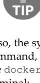

如果容器处于暂停状态，则 docker exec 命令将报错失败。

此外，exec 命令的语法不同。它不是 docker run 命令的一部分，而是一个新的独立命令，在你使用 docker run 运行容器后执行。请考虑以下示例，并在一个 shell 终端中运行以下命令：

```
docker run -it ubuntu bash --name myUbuntuBash
```

然后在第二个 shell 终端窗口中运行下一个命令：

```
docker exec -d myUbuntuBash touch /tmp/myFile
```

在前面的示例中，第一个命令将从 Ubuntu 容器启动交互式 bash shell，这没什么新意；然而，第二个命令 docker exec 将实际在运行中的容器内执行 touch shell 命令。

`docker exec` 与我们在学习分离容器时已经提到过的 `docker attach` 命令可能会有点混淆。值得注意的是，`docker attach` 并不是用于在容器中运行额外内容，它用于附加到正在运行的进程。此外，如果主进程是 shell，那么我们可以使用 attach 运行新进程。另一方面，`docker exec` 专为在已启动的容器中运行新内容而设计。当然，它也可以是 shell 或其他进程，如以下截图所示：

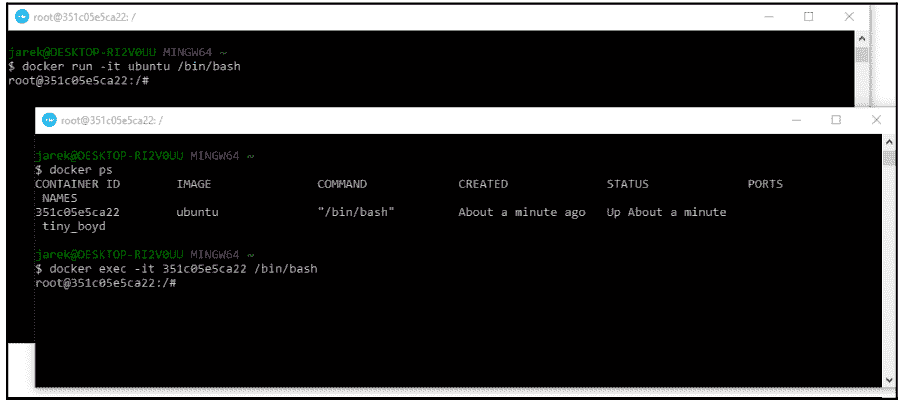

我们现在知道如何以前台或后台方式运行容器；我们知道如何覆盖默认启动进程或如何在运行中的容器中执行自定义命令。现在是时候查看运行中的容器并监控它们的表现如何；或者说表现有多差。

## 监控容器

有几种监控运行中的 Docker 容器的方法。它们包括查看日志文件、查看容器事件和统计信息，以及检查容器属性。让我们从日志开始。Docker 具有强大的日志功能。访问日志条目至关重要，特别是当你的容器以分离运行时模式运行时。让我们看看 Docker 在日志机制方面能提供什么。

### 查看日志

大多数应用程序将其日志条目输出到标准 stdout 流（通常你在运行应用程序时只是在控制台中看到它）。然而，在 Docker 的分离模式下运行，我们在控制台看不到任何内容，因为容器在后台运行。要查看容器中的日志条目，请执行以下命令：

```
docker logs -f <container name>
```

-f 标志的作用与 Linux tail 命令中的相同标志一样；它会持续在控制台上显示新的日志条目。完成后，按 ctrl-c 停止在控制台上显示日志文件。

即使容器停止后，只要其文件系统仍存在于磁盘上（当然直到使用 docker rm 命令将其删除），日志文件仍然可用。数据存储在位于 /var/lib/docker 目录的 JSON 文件中。你可以使用 docker inspect 命令并使用模板提取 LogPath 来查看日志文件的完整路径（我们稍后会介绍 inspect 和模板）：

```
docker inspect -f {{.LogPath}} 351c05e5ca22
```

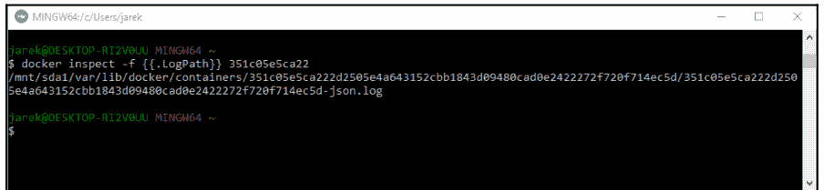

Docker 利用日志驱动的概念来存储容器日志条目。默认驱动是 json-file 驱动，它只是将 JSON 条目写入文件。它可以接受一些调整参数，例如：

```
--log-opt max-size=[0-9+][k|m|g]
--log-opt max-file=[0-9+]
```

`max-size` 指定可以创建的最大文件大小。Docker 在达到指定大小时会创建新文件。你可以使用大小后缀 k、m 或 g，其中 k 表示千字节，m 表示兆字节，g 表示千兆字节。如果未提供 `max-size`，Docker 会将所有日志输出写入单个文件，如果你需要下载、上传或搜索日志文件等，这就不是很方便。`max-file` 选项指定在丢弃之前日志轮转的最大文件数。请注意，如果未设置 `max-size`，`max-file` 选项将被忽略。


`docker logs` 命令仅显示来自最新日志文件的日志条目。

然而，`json-file` 驱动并不是唯一可用的日志驱动实现。实际上，有几种实现可供选择：

- `none`: 它将完全关闭日志记录
- `syslog`: 它是 Docker 的 `syslog` 日志驱动，将日志消息写入系统 `syslog`。
- `journald`: 它会将消息记录到 `journald`。`systemd-journald` 是一个负责事件日志记录的守护进程，其日志文件为仅追加的二进制文件。

除此之外，还有一些更专业的驱动可供选择：

- `splunk`: 这提供了使用 **Event Http Collector** 将日志消息写入 Splunk。Splunk 可用作 `enterprise-grade` 日志分析器。你可以在 https://www.splunk.com 了解更多信息。
- `gelf`: 这会将日志条目写入类似 Graylog 或 Logstash 的 GELF 端点。Graylog 可在 https://www.graylog.org 获取，是一款开源日志管理，支持在所有日志文件中进行搜索、分析和告警。Logstash 可在 https://www.elastic.co/products/logstash 找到，是处理任何数据源的管道。
- `fluentd`: 这会将日志消息写入 fluentd。Fluentd 是一个用于统一日志层的开源数据收集器。Fluentd 的主要特性是它通过提供中间的统一日志层来分离数据源和后端系统。它小巧、快速，并且有数百个插件，使其成为非常灵活的解决方案。你可以在其网站 https://www.fluentd.org 上阅读更多信息。

- `gcplogs`: 这会将日志条目发送到 Google Cloud Logging
- `awslogs`: 此驱动会将日志消息写入 Amazon CloudWatch Logs。

正如你所见，Docker 的可插拔架构再次为你运行容器提供了几乎无限的灵活性。要切换到其他日志驱动，请为 `docker run` 命令使用 `--log-driver` 开关，例如：

```
docker run --log-driver=syslog ubuntu
```


`docker logs` 命令仅适用于 `json-file` 和 `journal` 日志驱动。要访问写入其他日志引擎的日志，你需要使用日志解决方案提供商提供的工具，例如 Splunk。

除了使用 `docker logs` 命令外，查看控制台输出的另一种方法是使用本章前面学到的 attach 命令；将其附加到运行中的容器，以查看其控制台输出。

### 容器事件

要获取服务器的实时事件，我们使用 `docker events` 命令。当容器运行时发生某些变化时，例如 `stop`、`pause` 或 `kill`，容器会存储并发布该情况的事件。如果想知道容器运行时发生了什么，这非常有用；这是一个强大的监控功能。Docker 容器报告了大量事件，你可以使用 `docker events` 命令列出它们：

```
attach, commit, copy, create, destroy, detach, die, exec_create,
exec_detach, exec_start, export, health_status, kill, oom, pause, rename,
resize, restart, start, stop, top, unpause, update
```

`docker events` 命令可以接受 `-f` 开关，如果你正在寻找特定内容，它将过滤输出（默认情况下过滤器为空，因此它将返回所有事件）。目前，可能的过滤器列表包括：

- `container` (`container=<name or id>`)


- 事件 (event=<event action>)
- 镜像 (image=<tag or id>)
- 插件（实验性） (plugin=<name or id>)
- 标签 (label=<key> or label=<key>=<value>)
- 类型 (type=<container or image or volume or network or daemon>)
- 卷 (volume=<name or id>)
- 网络 (network=<name or id>)
- 守护进程 (daemon=<name or id>)

docker events 命令可以接受 --since 和 --until 开关，用于指定要获取事件的时间范围。Docker 支持常见的 RFC3339 日期和时间格式，例如
2016-09-10T05:10:00, 2016-09-10T05:05:00.99999999, 2016-09-10Z07:00, and
2016-09-10.

默认情况下，docker events 会将事件流式传输到控制台，类似于 tail -f 命令。正如以下截图所示，示例输出将包含事件的时间戳、容器 ID，以及当然是发生的事件本身：

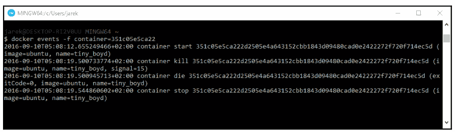

## 检查容器

我们现在一直大量使用 docker ps 命令。它可以提供有关正在运行容器的许多有用信息，例如其 ID、状态、执行的命令、暴露的端口等等。还有另一个命令 docker inspect，也可以提供有关容器的一些有用信息。docker inspect 命令的语法如下：

```
docker inspect [OPTIONS] CONTAINER|IMAGE|TASK [CONTAINER|IMAGE|TASK...]
```

默认情况下，inspect 命令会以 JSON 数组格式输出有关容器或镜像的信息。你可以使用 --format 或简写 -f 作为命令的开关来提供用于处理输出的模板。docker inspect 命令接受 Go 模板。inspect 命令最简单的用例只是提供简短的模板来提取所需的信息，例如：

```
docker inspect -f '{{.State.ExitCode}}' jboss/wildfly
```

由于 inspect 命令接受提供的 Go 模板来形成容器或镜像元数据的输出，此功能为您提供了几乎无限的处理和转换结果的可能性。Go 模板引擎功能强大，因此与其将输出通过 grep 管道传输（快速但混乱），你可以使用模板引擎进一步处理结果。

--format 的参数只是一个我们想要应用于容器元数据的模板。在此模板中，我们可以使用条件语句、循环和其他 Go 语言特性。例如，要查找所有退出代码不为零的容器的名称：

```
docker inspect -f '{{if ne 0.0 .State.ExitCode }}{{.Name}} {{.State.ExitCode}}{{ end }}' $(docker ps -aq)
```

请注意，我们提供 $(docker ps -aq) 而不是容器 ID 或名称。结果，所有正在运行的容器 ID 将被管道传输到 docker inspect 命令，这可以是一个非常方便的快捷方式。大括号 {{ }} 表示 Go 模板指令，括号外的任何内容都将原样打印出来。Go 模板中的点 (.) 表示上下文。大多数情况下，当前上下文将是元数据的完整数据结构，但在需要时可以重新绑定，包括使用 with 操作。例如，以下两个 inspect 命令将打印出完全相同的结果：

```
docker inspect -f '{{.State.ExitCode}}' wildfly
docker inspect -f '{{with .State}} {{.ExitCode}} {{end}}' wildfly
```

如果你在绑定的上下文中，美元符号 ($) 总是可以带你回到根上下文。执行以下命令：

```
docker inspect -f '{{with .State}} {{$.Name}} exited with {{.ExitCode}} exit code \ {{end}}' wildfly
```

这将输出:

/wildfly exited with 0 exit code.

模板引擎支持逻辑函数，例如 and、or 和 not ——它们将返回布尔结果。还支持比较函数，例如 eq（等于）、ne（不等于）、lt（小于）、le（小于或等于）、gt（大于）、ge（大于或等于）。比较函数可以比较字符串、浮点数或整数。所有这些与条件函数（如 if）结合使用时，在创建 inspect 命令的更复杂的输出时非常有用：

```
docker inspect -f '{{if eq .State.ExitCode 0.0}} \
Normal Exit \
{{else if eq .State.ExitCode 1.0}} \
Not a Normal Exit \
{{else}} \
Still Not a Normal Exit \
{{end}}' wildfly
```

有时 docker inspect 命令的巨大输出可能会令人困惑。由于输出采用 JSON 格式，可以使用 jq-tool 来概览输出并挑选有趣的部分。

jq-tools 可在 https://stedolan.github.io/jq/ 免费获取。它是一个轻量级且灵活的命令行 JSON 处理器，类似于 JSON 数据的 sed 命令。例如，让我们从元数据中提取容器 IP 地址：

```
docker inspect <containerID> | jq -r '.[0].NetworkSettings.IPAddress'
```

正如你所见，docker inspect 命令提供了有关 Docker 容器的有用信息。结合 Go 模板功能，以及可选的 jq 工具，它为你提供了获取容器信息的强大工具，并且可以在脚本中进一步使用。但除了元数据之外，还有另一个有价值的信息来源。它是运行时统计信息，我们现在将重点关注它。

## 统计信息

要查看正在运行容器的运行时统计信息，请使用 docker stats 命令。测量的统计信息包括 CPU、内存和网络 I/O 使用情况。

docker stats 命令的语法如下：

```
docker stats [OPTIONS] [CONTAINER...]
```

选项可以包括 `--no-stream`，它将禁用流式统计信息并仅提取第一个结果，以及 `--all`（或简写 `-a`），它将显示所有容器，默认情况下命令仅显示正在运行容器的统计信息。

命令的最简单形式就是 `docker stats`。它将列出所有正在运行容器的所有统计信息。你可以通过指定容器 ID 或名称的列表，用空格分隔，来将返回的数据限制为一个或多个特定容器：

```
docker stats b4fd15acfcb1 d15acb4ffcbb
```

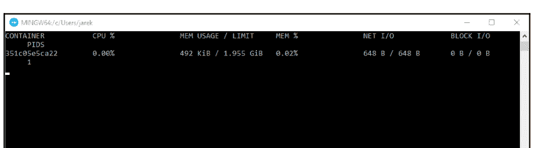

查看日志、容器事件和运行时统计信息在监控正在运行的容器时为你提供了几乎无限的可能性。但是我们如何确保容器能够持续运行，比如在生产服务器上？Docker 容器退出代码和重启策略来救援。

## 容器退出代码和重启策略

你可以使用 `docker run` 命令中的 `--restart` 开关指定所谓的 **重启策略**。重启策略告诉 Docker 在容器关闭时如何行为。它可以被重启以最小化停机时间，例如在生产服务器上运行。然而，在解释 Docker 重启策略之前，让我们先关注退出代码。退出代码是关键信息，它说明容器为何运行失败或为何退出。有时它与你作为参数传递给 `docker run` 的包含命令有关。

当 `docker run` 命令以非零代码结束时，退出代码遵循 `chroot` 标准，如以下示例所示：

- 退出代码 125：`docker run` 命令本身失败
- 退出代码 126：提供的命令无法调用
- 退出代码 127：提供的命令无法找到
- 其他、非零、应用程序相关的退出代码。

正如你所回忆的，在之前的章节中我们一直使用 `docker ps` 命令来列出正在运行的容器。要同时列出未运行的容器，我们可以为 `docker ps` 命令添加 `-a` 开关。当容器完成时，退出代码可以在 `docker ps -a` 命令的输出中的状态列中找到，如此截图所示：

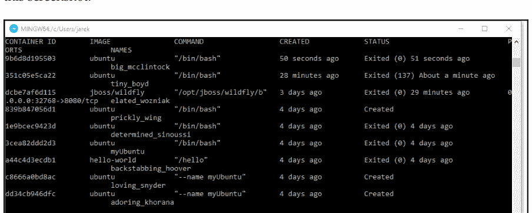

通过在启动容器时指定重启策略，可以自动重启崩溃的容器。指定期望的重启策略是通过 `docker run` 命令的 restart 开关完成的，如示例所示：

```
docker run --restart=always mongo
```

目前 Docker 有四种重启策略。让我们现在一个一个地了解它们，从最简单的开始：无。


## no

**无** 策略是默认的重启策略，并且在任何情况下都不会重启容器。实际上你不需要指定此策略，因为这是默认行为。除非你有一些可配置的设置来运行 Docker 容器，那么 *无* 策略可以用作 *关闭* 开关。

## always

如果我们希望容器无论命令的退出代码为何都将被重启，我们可以使用 always 重启策略。基本上，它名副其实——Docker 将在每种情况下都重启容器。重启策略将始终重启容器。即使容器在重启前已被停止也是如此。每当 Docker 服务重启时，使用 always 策略的容器也将被重启，无论它们是否正在执行。


使用重启策略，Docker 守护进程将始终尝试无限期地重启容器。

## on-failure

这是一个特殊的重启策略，可能也是使用最频繁的一个。使用 `on-failure` 重启策略，你可以指示 Docker 在容器以非零退出状态退出时重启它，而在其他情况下不重启。这就是我们开始用退出代码来解释重启策略的原因。你可以可选地提供 Docker 尝试重启容器的次数。此重启策略的语法也有点不同，因为使用此策略时，你还可以指定 Docker 自动重启容器的最大尝试次数。

请考虑以下示例：

```
docker run --restart=on-failure:5 mongo
```

前面的命令将运行 MongoDB 镜像，并在失败时尝试重启五次然后放弃。使用 on-failure 重启策略的主要好处是，当应用程序以成功的退出代码退出（这意味着应用程序中没有错误，它只是执行完毕）时，容器不会被重启。容器的重启尝试次数可以通过 docker inspect 命令获得。例如，要获取具有特定 ID 或名称的容器的重启次数：

```
docker inspect -f "{{ .RestartCount }}" <ContainerID>
```

你也可以获取容器最近一次重新启动的时间：

```
docker inspect -f "{{ .State.StartedAt }}" <ContainerID>
```

你应该知道 Docker 在重启容器之间使用延迟，以防止类似洪水的保护。这是一个递增的延迟，它从 100 毫秒开始，然后 Docker 会将之前的延迟加倍。实际上，守护进程将等待 100 ms，然后 200 ms，400ms，800ms，依此类推，直到达到 on-failure 限制或你使用 docker stop 停止容器或通过执行 docker rm -f 命令强制删除容器。


如果容器成功重启，延迟将重置为默认值 100 毫秒。

## unless-stopped

同样，如果我们希望容器无论退出代码如何都被重启，可以使用 unless-stopped。unless-stopped 重启策略与 always 作用相同，只有一个例外，它将无论退出状态如何都重启容器，但在守护进程启动时，如果容器之前已被置于停止状态，则不会启动它。这意味着使用 unless-stopped 重启策略，如果容器在重启前正在运行，系统重启后容器将被重启。当 Docker 容器内的应用程序退出时，该容器将被停止。如果容器内运行的应用程序崩溃，容器会停止，并且该容器将保持停止状态，直到有人或某物重启它。

在将重启策略应用于容器之前，考虑容器将用于执行何种工作是很有益的。这也取决于将在容器上运行的软件类型。例如，数据库可能应应用 always 或 unless-stopped 策略。如果你的容器应用了某种重启策略，使用 docker ps 命令列出容器时，它将显示为 Restarting 或 Up 状态。

## Updating a restart policy on a running container

有时在容器已经启动后，需要更新 Docker 运行时参数，例如即时更新。一个示例情况是，如果你想防止容器在 Docker 主机上消耗过多资源。要在运行时设置策略，我们可以使用 docker update 命令。除了其他运行时参数（例如内存或 CPU 限制，关于这些我们将在本章稍后讲述）之外，docker update 命令使你能够在运行中的容器上更新重启策略。语法很简单，你只需要提供你希望容器拥有的新重启策略以及容器的 ID 或名称：

```
docker update --restart=always <CONTAINER_ID or NAME>
```

在容器上运行 docker update 命令后，新重启策略会立即生效。另一方面，如果你在已停止的容器上执行 update 命令，该策略将在稍后启动容器时使用。可能的选项与启动容器时可以指定的选项完全相同：

- no（默认）
- always
- on-failure
- unless-stopped


如果 Docker 主机上运行了多个容器，并且你想同时为它们全部指定新的重启策略，只需提供它们的所有 ID 或名称，用空格分隔即可。

你也可以使用上一节中已知的 docker events 命令查看应用了什么重启策略。可以用于观察容器报告的运行时事件历史记录的 docker events 也会报告 docker update 事件，提供有关更改的详细信息。

## Running Containers

如果容器已应用重启策略，该事件将出现在历史记录中，如以下截图所示：

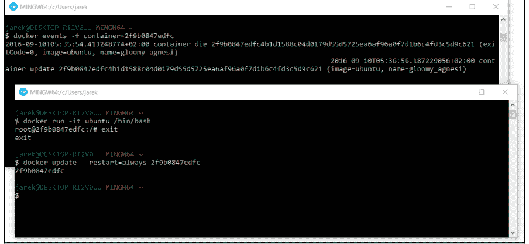

如果你想检查运行中容器的重启策略，请使用 docker inspect 并提供容器 ID 或名称，并将 --format 参数设置为值的路径：

```
docker inspect --format '{{ .HostConfig.RestartPolicy.Name }}' <ContainerID>
```

前面的命令将简单地显示当前应用的重启策略，如截图所示：

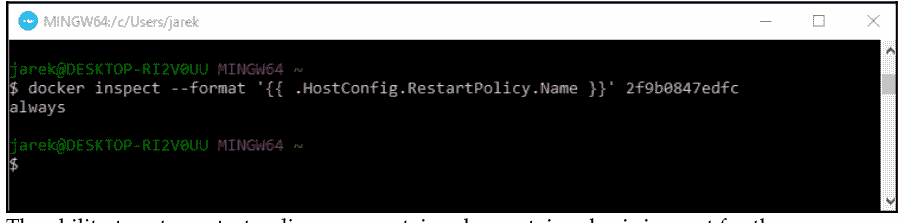

按容器设置重启策略的能力对于镜像自包含且不需要执行更复杂编排任务的情况非常有用。重启策略不是可以在运行容器上更改的唯一参数。为了确保容器在 Docker 主机上运行时表现良好，你可以对其施加限制。我们现在将介绍它们。

## Runtime constraints on resources

在运行时限制 Docker 容器对资源的占用可能是有用的。Docker 为你提供了许多设置内存、CPU 使用量或磁盘访问使用量限制的可能性。让我们从设置内存限制开始。

### Memory

值得知道的是，默认情况下，即如果你使用没有任何限制的默认设置，运行中的容器可以使用主机上的所有内存。要更改此行为，我们可以使用 docker run 命令的 --memory（或简写 -m）开关。它接受通常的后缀 k、m 或 g，分别表示千字节、兆字节和千兆字节。

设置内存限制的 docker run 命令的语法如下：

```
docker run -it -m 512m ubuntu
```

前面的命令将以容器最多可使用半千兆字节的内存执行 Ubuntu 镜像。

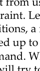

如果你不设置容器可分配内存的限制，可能会导致随机问题，其中单个容器很容易使整个主机系统不稳定和/或无法使用。因此，在容器上始终使用内存限制是一个明智的决定。

除了用户内存限制之外，还有内存保留和内核内存限制。让我们解释一下内存保留限制是什么。在正常工作条件下，运行中的容器可以使用并可能将使用所需内存，直到你使用 docker run 命令的 --memory (-m) 开关设置的限制。当应用内存保留时，Docker 将检测到内存不足的情况，并尝试强制容器将其消耗限制在保留限制内。如果你未设置内存保留限制，它将与使用 -m 开关设置的硬内存限制相同。

内存保留不是硬限制功能。没有保证限制不会被超过。内存保留功能将尝试确保内存将根据保留设置进行分配。

请考虑以下示例：

```
docker run -it -m 1G --memory-reservation 500M ubuntu /bin/bash
```


前面的命令将硬内存限制设置为 1GB，然后将内存预留设置为 0.5GB。在设置了这些限制后，当容器消耗的内存超过 500M 且小于 1G 时，Docker 会尝试将容器内存缩小到 500M 以下。

在下一个示例中，我们将设置内存预留，而不设置硬内存限制：

```
docker run -it --memory-reservation 1G ubuntu /bin/bash
```

在前面的示例中，容器启动时可以使用进程所需的任意多内存。--memory-reservation 开关的设置会防止容器长时间消耗过多内存，因为每次内存回收都会将容器的内存使用量缩小到预留中指定的大小。

内核内存与用户内存完全不同——主要区别在于内核内存不能交换到磁盘。它包括栈页、slab 页、套接字内存压力和 TCP 内存压力。你使用 --kernel-memory 开关来设置内核内存限制以约束这类内存。与设置用户内存限制相同，只需提供带后缀的数字，如 k、m、g 分别表示千字节、兆字节或千兆字节——尽管以千字节设置可能非常罕见。

例如，每个进程都会占用一些栈页。通过限制内核内存，可以在内核内存使用过高时阻止新进程启动，并且由于主机无法将内核内存交换到磁盘，容器通过消耗过多内核内存可能会阻塞整个主机服务。

设置内核内存限制很简单。我们可以单独设置 --kernel-memory，而不使用 -m 限制总内存，如以下示例所示：

```
docker run -it --kernel-memory 100M ubuntu /bin/bash
```

在前面的示例中，容器中的进程可以根据需要获取内存，但只能消耗 100M 内核内存。我们也可以设置硬内存限制，如以下命令所示：

```
docker run -it -m 1G --kernel-memory 100M ubuntu /bin/bash
```

在前面的示例中，我们同时设置了内存和内核内存，因此容器中的进程总共可以使用 1G 内存，而这 1G 中包含 100M 的内核内存。

与内存相关的另一个在运行容器时可能有用的限制是 swappiness 限制。我们通过在 `docker run` 命令中使用 `--memory-swappiness` 开关来应用该限制。当你想避免与内存交换相关的性能下降时，这会很有帮助。`--memory-swappiness` 开关的参数是可以交换出去的匿名内存页的百分比，因此取值范围为 0 到 100。值为 0 会完全关闭匿名页交换。相反，值为 100 会将所有匿名页设为交换候选。例如：

```
docker run -it --memory-swappiness=0 ubuntu /bin/bash
```

在前面的命令中，我们为 `ubuntu` 容器完全关闭了交换。

除了设置内存使用限制之外，你还可以指示 Docker 如何将处理器资源分配给它将要运行的容器。

## 处理器

使用 `-c`（或等效的 `--cpu-shares`）作为 `docker run` 命令开关，可以指定容器可以分配的 CPU 份额值。默认情况下，每个新容器都有 1024 份 CPU 份额，所有容器获得相同的 CPU 周期部分。通过相对于所有其他运行中容器的权重调整容器的 CPU 份额权重，可以改变此百分比。但请注意，你无法设置容器可以使用的精确处理器速度。这是一个相对权重，与实际处理器速度无关。事实上，没有办法精确地说容器应该只有使用主机处理器 2GHz 的权利。


> CPU 份额只是一个数字——与 CPU 速度完全无关。

如果我们启动两个容器并且两者都使用 100% CPU，处理器时间将在两个容器之间平均分配。原因在于两个容器具有相同数量的处理器份额。但如果你将一个容器的处理器份额限制为 512，它将只获得一半的 CPU 时间。这并不意味着它只能使用一半的 CPU——该比例仅在运行 CPU 密集型进程时适用。如果另一个容器（具有 1024 份额）处于空闲状态——我们的容器将被允许使用 100% 的处理器时间。实际的 CPU 时间量将取决于系统上运行的容器数量。通过具体示例更容易理解。

考虑三个容器，其中一个（我们称之为 Container1）将 --cpu-shares 设置为 1024，另外两个（Container2 和 Container3）将 --cpu-shares 设置为 512。当三个容器中的进程都尝试使用全部 CPU 功率时，Container1 将获得 50% 的总 CPU 时间，因为与运行中的其他容器（Container2 和 Container3）的总和相比，它允许的 CPU 使用量为一半。如果我们再添加一个 --cpu-shares 为 1024 的第四个容器（Container4），我们的第一个 Container1 将只获得 33% 的 CPU，因为它现在相对而言拥有三分之一的总 CPU 功率分配。Container2 将获得 16.5%，Container3 也为 16.5%，最后一个 Container4 再次将被允许使用 33% 的 CPU。

虽然 `docker run` 命令的 -c 或 --cpu-shares 标志会相对于所有其他运行中容器的权重修改容器的 CPU 份额权重，但它不会限制容器从主机使用 CPU。但还有另一个标志可以限制容器的 CPU 使用：--cpu-quota。其默认值是 100000，这意味着允许使用 100% 的 CPU。我们可以使用 --cpu-quota 来限制 CPU 使用，例如：

```
docker run -it --cpu-quota=50000 ubuntu /bin/bash
```

在前面的命令中，容器的限制将为 50% 的 CPU 资源。--cpu-quota 通常与 `docker run` 的 --cpu-period 标志一起使用。这是 CPU CFS（完全公平调度程序）周期的设置。默认周期值为 100000，即 100 毫秒。看一下示例：

```
docker run -it --cpu-quota=25000 --cpu-period=50000 ubuntu /bin/bash
```

这意味着容器每 50ms 可以获得 50% 的 CPU 使用率。

限制 CPU 份额和使用率并不是我们可以在容器上设置的唯一与处理器相关的限制。我们还可以将容器的进程分配到特定的处理器或处理器核心。`docker run` 命令的 --cpuset 开关在我们想要执行此操作时非常有用。考虑以下示例：

```
docker run -it --cpuset 4 ubuntu
```

前面的命令将运行 ubuntu 镜像并允许容器使用全部四个处理器核心。要启动容器并仅允许在一个处理器核心上使用，可以将 --cpuset 值更改为 1：

```
docker run -it --cpuset 1 ubuntu
```


你当然可以混合使用 --cpuset 选项和 --cpu-shares 来微调容器的 CPU 限制。

## 运行中容器的约束更新

与重启策略一样，约束也可以在容器已经运行时进行更新。这可能会有所帮助，如果你观察到你的容器消耗了太多 Docker 主机系统资源并且想要限制这种使用。同样，我们使用 docker update 命令来执行此操作。

与重启策略相同，docker update 命令的语法与启动容器时相同——你将期望的约束指定为 docker update 命令的参数，然后给出容器 ID（例如取自 docker ps 命令输出）或其名称。同样，如果你想同时更改多个容器的约束，只需提供用空格分隔的它们的 ID 或名称。让我们看一些在运行时更新约束的示例：

```
docker update --cpu-shares 512 abbdef1231677
```

前面的命令将把 CPU 份额限制为 512。当然，你可以同时对多个容器应用 CPU 和内存限制：

```
docker update --cpu-shares 512 -m 500M abbdef1231677 dabdff1231678
```

上文将更新由 `abbdef1231677` 和 `dabdff1231678` 标识的两个容器的 CPU 份额和内存限制。

当然，在更新运行时限制时，你也可以在一个命令中同时应用所需的重启策略，如以下示例所示：

```
docker update --restart=always -m 300M aabef1234716
```

正如你所见，设置限制的能力在运行 Docker 容器时为你提供了很大的灵活性。但值得注意的是，并非总能应用限制。其原因在于限制设置功能高度依赖于 Docker 主机的内部实现，尤其是其内核。例如，有时无法设置内核内存限制或内存交换倾向，例如——有时你收到的只是 **你的内核不支持内核内存限制或你的内核不支持内存交换倾向功能** 消息。有时这些限制是可以配置的，有时则不行。例如，如果在 Ubuntu 上收到 **警告：你的内核不支持 cgroup 交换限制**，你可以借助 `cgroup_enable=memory swapaccount=1` 设置调整你的 Grub 启动加载器。务必阅读 Docker 输出的日志，以确保你的限制已生效。

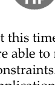

在容器启动期间或在动态更新限制后，务必注意 Docker 输出的警告——你的限制可能不会生效！

到目前为止，我们了解了容器的运行时模式（前台和分离）。我们能够监控正在运行的容器并更新其重启策略和运行时限制。但在运行容器和扩展应用程序方面还有更多内容——Docker Swarm 模式。在关于运行容器的章节中不可能忽略它，所以现在让我们来介绍它。

## Docker Swarm 模式

我们在第 4 章《网络和持久化存储》中简要提到了 Swarm 模式，当时我们学习多主机网络。这次，我们将更深入地了解 Docker 的容器集群功能。Swarm 模式是 Docker 中的一个相当新的功能——它在 Docker 1.12 及更高版本中可用。这意味着你只能在 Linux 上使用它，这很明显，但如果你在 Windows 或 Mac 上运行 Docker，可以使用原生的 Docker for Windows 或 Docker for Mac 应用程序。然而，Swarm 是什么？让我们解释一下为什么在最新版本的 Docker 中包含 Swarm。

## 目的

在 Docker 容器中运行单个应用程序很容易。我们已经做过多次。但扩展和故障转移怎么办？想象一下，你有一个应用程序或服务，即使在高负载下也需要快速响应。如果单个容器无法处理负载，那么你可能希望运行多个容器。使用 Docker Swarm，你可以建立和管理一个 Docker 主机集群作为单一虚拟系统。通过启用集群，你基本上创建了一个协作的 Docker 主机组。如果其中一个失败并宕机，其他主机仍可以向用户提供应用程序。运行 Docker Swarm 集群时，你还可以根据负载变化随时添加或减少容器实例。最好的部分来了：我们不必决定在哪个主机上启动每个容器。这将由 Swarm 自动完成——在后台，以 swarm 模式运行的 Docker 会决定在哪些节点上启动它们。这看起来可能很复杂，但在实际操作中运行 Docker Swarm 与运行单个 Docker 容器一样简单。如果你熟悉 Docker 命令，你也会熟悉 Docker Swarm 命令。让我们开始解释一些 Swarm 模式术语。

## 术语

Docker Swarm 中有一些关键名称。我们需要理解它们的含义，以便轻松理解本章的其余部分以及外部资源。让我们逐一列出它们：

- **Swarm：** 这只是一个运行中的 Docker 容器集群。它是一个 Docker 主机池，行为有点像单个大型 Docker 主机。
- **Swarm 管理器：** 这是在其上初始化了 Swarm 的 Docker 主机。管理器节点具有特殊用途：它维护集群状态、调度服务并提供 swarm 模式 HTTP API 端点。
- **Node：** 在 swarm 中运行的所有容器都称为 `nodes`——它们运行在所谓的 **swarm 模式** 中。要使容器以此模式运行，你需要初始化 swarm（这将创建一个新的 swarm）或将容器加入现有 Swarm。在 Docker 的 swarm 模式中，你可以在运行时部署管理器节点和工作节点。节点也可以通过使用 `docker node promote` 命令提升为 Manager。
- **Scheduling：** 这只是启动 Swarm 集群中容器的名称。目前，Docker Swarm 实现了三种算法来帮助它决定在集群中的哪个节点上运行容器：spread、BinPack 和 random。spread 设置是默认值。Docker 会根据每个节点可用的 CPU 和 RAM 资源来平衡容器。BinPack 调度器则完全相反——它会先将给定节点利用到最大容量，然后再在下一个节点上运行容器。Random，正如其名，就是随机调度。
- **Service：** 它是要在集群上运行的容器以及将在容器上执行的命令。

Docker Engine 提供了一些用于处理 swarm 的命令。其中大多数与我们已知的命令非常相似——用于操作容器的命令。让我们连同其描述一起列出它们。

## Swarm 模式命令

- `swarm init`：初始化 Swarm 并将当前 Docker 主机设为 Swarm 管理器。
- `swarm join`：将节点加入 Swarm。
- `service create`：将服务（容器）调度到 Swarm。
- `service inspect`：显示作为 Swarm 服务运行的容器的详细信息。
- `service ls`：列出正在运行的服务。命令输出还将包含此特定服务正在运行的节点数量。
- `service rm`：删除服务。
- `service scale`：添加给定服务的副本。你也可以同时扩展多个服务。
- `service ps`：将列出服务的任务（即与容器一起运行的命令）。
- `service update`：允许你更新服务——你可以设置服务命令行参数、运行时限制，如 CPU 或内存、添加或修改环境变量等等。

要初始化 Swarm（这也会使你当前所在的主机成为 Swarm 管理器），你需要执行 swarm init 命令：

```
docker swarm init --advertise-addr <IP>
```

作为输出，Docker 会给你一个令牌，如果你想将另一个 Docker 主机连接到你的 Swarm，就需要使用它。你可以在以下截图中看到它：

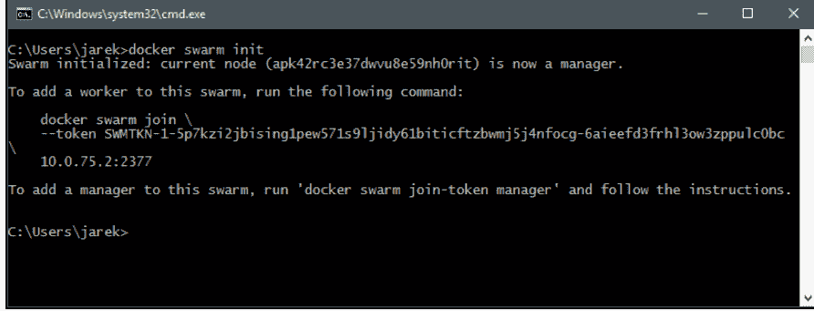

要将节点连接到 Swarm，请执行 docker swarm join 命令，其中包括从 docker swarm init 命令获得的令牌，例如：

```
docker swarm join \
  --token SWMTKN-1-5p7kzi2jbising1pew571s91jidy61biticftzbwmj5j4nfocg-6aieefd3frhl3ow3zppulc0bc
```

现在我们有一个简单的（两个节点）Docker Swarm。是时候安装（调度）一个服务了。将服务调度到 Docker Swarm 上运行与运行独立容器非常相似。你可以使用 docker service create 命令调度服务：

```
docker service create --replicas 1 -p80:80 --name nginx nginx
```

## 运行容器

在前面的例子中，我们将 nginx Web 服务器作为 Docker Swarm 服务运行。我们用于处理容器的许多命令，例如 ps、ls、inspect——它们也适用于 docker service 命令，如以下截图所示：

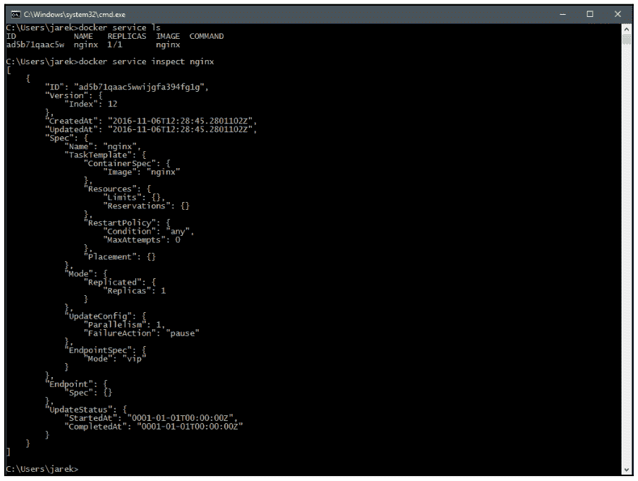

服务相关命令模仿容器相关命令的方式使服务相关命令更容易记住。要扩展服务，即增加服务实例的数量，请执行 docker service scale 命令，例如：

```
docker service scale nginx=3
```


正如你所见，拥有 Docker Swarm 并没有看起来那么棘手。Docker 集群实现的精妙之处在于其简单性。使用 swarm 模式，你可以使用 `init` 命令创建 swarm，并使用 `join` 命令将工作节点添加到集群中。就这样。创建和加入 swarm 的命令 literally 只需一两秒钟即可完成。

## Summary

你可能会有这样的印象，运行 Docker 容器时具有巨大的灵活性。而你是对的，确实我们可以做很多事情。我们可以覆盖镜像的 `RUN`、`CMD`、`ENTRYPOINT` 指令来更改容器运行行为，有时甚至可以根据需要完全更改容器的用途。Docker 提供了大量强大的命令来检查容器运行时状态，查看日志、事件和统计信息。它们无疑使 DevOps 的日常工作变得轻松得多。此外，设置容器的重启策略以及对 CPU 或内存的运行时限制，可以实现使用 Docker 容器的运行即忘方式。如果你需要应用程序能够轻松扩展，启动 Docker Swarm 就没有比这更简单的了。设置 Docker Swarm 既简单又直接且灵活。当然，集群的详细设置可能需要一些时间，但几秒钟内运行一个基本的 Docker 容器集群是可能的。

现在我们已经知道如何创建镜像，如何在运行时运行和测试它们——是时候迈出下一步——向世界展示我们的工作了。在下一个 `Chapter 8`，*Publishing Images*，我们将把镜像发布到 Docker Hub 并做一些更有趣的事情，比如为我们的镜像创建自动构建。
