# 8

## 8 Publishing Images

到目前为止，你已经学会了如何使用命令行在本地机器上运行 Docker，如何从现有镜像拉取镜像以构建容器，以及如何创建自己的镜像。在本章中，我们将学习如何在 Docker Hub 仓库中发布我们的镜像。我们还将介绍使用 Webhooks 进行镜像自动构建的过程。我们已经在第 5 章《Finding Images》中讨论了从仓库拉取镜像的过程。现在，相反，我们将发布我们的工作。正如你可能记得的，要做到这一点，你需要拥有一个 Docker Hub 账户。你可以参考第 5 章《Finding Images》中的说明，了解如何创建账户，如果你还没有创建的话。Docker Hub 服务对公共 Docker 镜像是免费的。一旦你创建了账户，你就可以推送之前创建的镜像，使其可供他人使用。在本章中，我们将涵盖以下主题：

- 管理镜像标签并推送到远程仓库
- 集成 GitHub 和 Bitbucket
- Webhooks 和自动构建

让我们开始将我们的镜像发布到仓库。

### Publishing images

在处理远程仓库上的镜像时，标签的概念非常重要。我们能够使用标签找到镜像并识别它们。如果你要发布自己的镜像，这也至关重要；你需要先为其打标签。让我们现在就做。

### Tagging

我们使用 `docker tag` 命令为镜像打标签。你可以通过使用其 ID 或其名称来标识要标记的镜像。此外，你还可以使用其他标签来选择要标记的镜像。`docker tag` 命令的语法如下：

```
docker tag IMAGE[:TAG] IMAGE[:TAG]
```

例如，你需要执行以下命令将名为 `myHelloWorld` 且标签为 `test` 的本地镜像标记到 `myRepo` 仓库中，标签为 `version1.0.test`：

```
docker tag myHelloWorld:test myRepo/myHelloWorld:version1.0.test
```

如果你现在运行 `docker images` 命令，你将看到你新标记的镜像。

你的新标记镜像现在已准备好推送到远程仓库。标签的概念被 Docker Hub 的自动构建大量使用。标签让你可以将 `version` 标签链接到 `git` 历史记录中的分支或标签。在这种情况下，分支将指代不同的 Git 分支或不同的子目录。我们将在讨论自动构建功能时稍后再回来。

### Untagging the image

有时删除镜像的标签可能很有用。没有 `docker untag` 命令，但如果你小心，可以使用 `docker rmi` 命令取消镜像的标签。通常，我们使用 `docker rmi` 命令删除镜像；然而，如果你的镜像有多个标签，则 `docker rmi` 命令将删除标签但不会删除镜像。


要谨慎，因为如果镜像不再有标签，`docker rmi` 命令将删除该镜像。

例如，如果你需要从镜像中删除 `version1.0.test` 标签，请执行以下命令：

```
docker rmi <image ID or name>:version1.0.test
```

### Pushing the image

一旦镜像正确标记，你就可以使用 docker `login` 命令登录 Docker Hub，就像我们在第 5 章 *Finding Images* 中所做的那样。要登录远程仓库，请执行 docker `login` 命令：

```
docker login --username=yourUsername --email=yourEmail@address.com
```

成功验证后，你只需使用 docker `push` 命令推送镜像：

```
docker push yourUsername/myRepo
```

当然，推送镜像可能需要一些时间，这取决于镜像大小和你互联网连接的速度。完成后，镜像即可拉取。如果你需要检查镜像是否已在远程仓库上可用并就绪，你可以将其拉取。

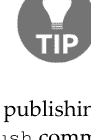

如果你想从 Docker Hub 拉取自己的镜像，请先从本地机器删除原始镜像。Docker 会比较你本地拥有的镜像和远程仓库上的镜像，如果本地和远程镜像相同，则不会拉取。

如果发布到 Docker Hub 上的公共仓库，登录并执行 docker `push` 命令将使新镜像对全世界可用。然而，你当然并不局限于公共仓库，你也可以将镜像推送到自己的私有仓库。如果你想使用私有仓库，你需要将私有仓库的 URL 设置为用户名。首先，你需要正确标记它，然后再推送它。如果你的仓库在 localhost 端口 5000 上监听，你可以执行以下命令：

```
docker tag yourUser/myRegistry localhost:5000/myRegistry
docker push localhost:5000/myRegistry
```

你可以通过使用在 GitHub 上免费提供的 Docker Distribution 工具集来创建自己的私有仓库：https://github.com/docker/distribution。你可以在此 GitHub 仓库中找到的主要实用程序是用于存储和分发 Docker 镜像的 Docker registry 2.0 实现。它用新的 API 设计取代了旧的 docker-registry 项目，专注于安全性和性能。此新仓库实现相比旧版本提供了以下优势：更快的推送和拉取、简化的部署、可插拔的存储后端和 Webhooks 通知。它支持多种存储后端，你可以选择例如本地文件系统或类似 Amazon S3 的云。

无论是公共还是私有，将镜像标记并推送到远程仓库都相当直接，并不是一个复杂的过程。但 Docker Hub 提供的还有更多内容，以及自动构建。让我们在后面的章节中解释它们。

### Webhooks and automated builds

正如你可能从第 5 章《Finding Images》中回忆的那样，自动构建是 Docker Hub 的最酷功能之一。自动构建会在镜像的源代码（即 Dockerfile）发生变化时由 Webhooks 触发。Webhooks 让你在将镜像推送到仓库后执行不同的操作。自动构建仓库可直接在 Docker Hub 上从最流行的 git 仓库，即 GitHub 或 Bitbucket，自动化构建和更新镜像。自动构建仓库可以为私有或公共仓库创建。它通过向你选择的 GitHub 或 Bitbucket 仓库添加提交钩子来实现；因此，当你推送提交时触发构建和更新。自动构建仓库有几个优点，以这种方式构建的镜像完全按指定构建，Dockerfile 对具有 Docker Hub 仓库访问权限的任何人都可用，并且你的 Docker 仓库会自动始终与源代码更改保持最新。

### Setting up the automated build

在第 6 章《Creating Images》中，我们讨论了 Docker 使用所谓的构建上下文来构建镜像。构建上下文是一个 Dockerfile 以及 Dockerfile 中引用的特定位置的任何文件。对于自动构建，构建上下文将是一个包含 Dockerfile 的源代码仓库。这意味着源代码仓库必须包含你通常在本地构建镜像所需的所有文件，且必须首先包含 Dockerfile。


对于自动构建，源代码仓库是构建上下文。


要设置自动构建，您首先需要登录 Docker Hub。之后，打开创建下拉菜单并选择 **创建自动构建**，如下图所示：

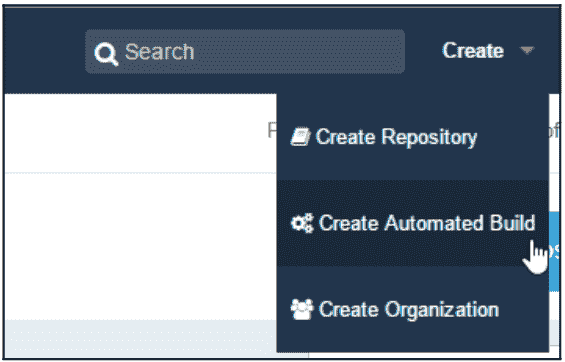

Docker Hub 使用 GitHub 或 Bitbucket 作为源代码仓库，因此如果您尚未执行此操作，则需要将您的 GitHub 或 Bitbucket 账户链接到您的 Docker Hub 账户。步骤包括使用 GitHub 或 Bitbucket 进行身份验证，并授予 Docker Hub 对您仓库账户的有限或完全访问权限。此访问权限对于 Docker Hub 查找您的仓库并为您注册适当的 Webhook 是必需的。为此，请单击 **链接账户** 按钮并选择 GitHub 或 Bitbucket，如下所示：

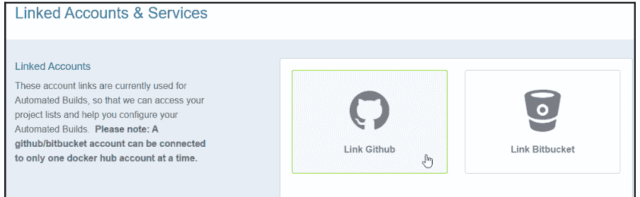

如果您选择链接 GitHub，您需要再做一个选择。您可以授予 Docker Hub 对您仓库的公共和私有访问权限，或仅限于公共仓库的只读访问权限，如以下屏幕截图所示：

### 公共和私有（推荐）
- 对公共和私有仓库具有读写权限。（我们仅使用写权限来添加服务钩子和部署密钥）
- 如果您想从私有 GitHub 仓库设置自动构建，则需要此权限。
- 如果您想使用私有 GitHub 组织，则需要此权限。
- 我们将为您自动配置服务钩子和部署密钥。

### 受限访问
- 公共只读访问。
- 仅适用于公共仓库和组织。
- 您需要手动更改仓库才能使用自动构建。

两者之间存在很大差异。第一个选项授予对公共和私有仓库的读写访问权限，这意味着 Docker Hub 将能够自动向您的仓库添加服务钩子和部署密钥。此外，如果您想从私有 GitHub 仓库设置自动构建，则此读写访问是强制性的。受限的只读访问意味着您只能使用公共仓库创建自动构建仓库。此外，为了使用自动构建功能，您需要自行对仓库进行更改。

授予 Docker Hub 访问您的私有仓库的权限更为方便且推荐，但如果您有安全方面的顾虑，请考虑仅使用受限访问。

一旦您授予对仓库的访问权限，您将被带到 OAuth 摘要屏幕，在那里 GitHub 将在授予对您账户的访问权限之前要求您确认：

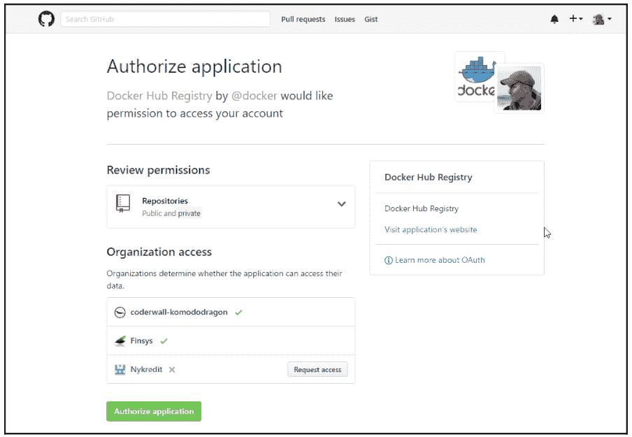

在授权对您 GitHub 账户的访问后，如果您从创建下拉菜单中选择创建自动构建选项，将显示您在 GitHub 上的仓库列表。


您想要创建自动构建的仓库中需要包含您想要构建的 Dockerfile。

为本示例的目的，我已 fork 了在 GitHub 上可用的 hello-world Docker 镜像仓库，地址为 https://github.com/docker-library/hello-world。

现在您需要做的就是从列表中选择仓库。您将看到 `Automated Build` 配置屏幕。在这里，您可以设置生成的镜像的可见性（公开或私有）。默认情况下，Docker Hub 将使用您 Git 仓库中的分支名称为生成的镜像打标签。对 `master` 分支的 Git `push` 命令将触发构建并为镜像打上 `latest` 标签。对除 `master` 之外的分支的 git `push` 将触发从该 Git 分支构建镜像。结果将然后使用该分支名称进行标签。

TIP: 您可以为每个仓库创建多个自动构建，并将它们配置为指向特定的 Dockerfile 或 Git 分支。

这通常已足够并且是一个非常有效的设置，但如果需要，您可以自定义行为。只需单击 Click here to customize 链接以打开规则编辑器：

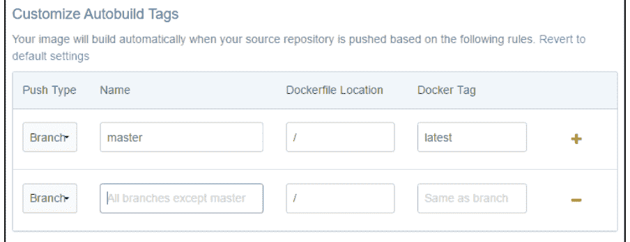

在 **Autobuild Tags** 编辑器中，您可以指定特定类型的 git push（分支或标签）将具有的标签。如您所见，`master` git 分支构建的结果默认会被标记为 `latest`。这里的灵活性很大，您可以根据需要添加或删除规则。例如，推送到特定分支的构建结果将始终与其它分支不同。

TIP: 您可以在 `Build Settings` 页面中创建 `Automated Build` 后，随时更改标签配置。

## 发布镜像

单击 **创建** 按钮后，您的自动构建将被创建。Docker Hub 将其与您的其它仓库一起列出；请注意，您刚刚创建的仓库是自动构建的结果：

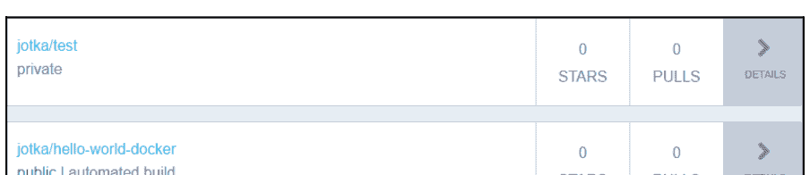

创建 `Automated Build` 仓库后，您以后可以停用或删除它。Docker 将您的自动构建列为普通仓库，但有两个区别。第一个区别是您无法向 `Automated Build` 仓库推送镜像。


您无法使用 `docker push` 命令推送到自动构建。您只能通过将源代码提交并推送到 GitHub 或 Bitbucket 仓库来管理它。

第二个区别是，如果您进入仓库详情，将会出现两个额外的标签页：**构建详情** 和 **构建设置**。`Build Details` 屏幕，如以下示例所示，将展示最新构建的历史记录及其状态，例如 `Queued`、`Success` 或 `Failure`。

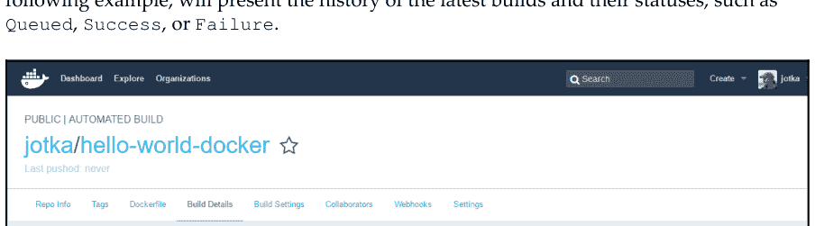

您可以看到的状态包括：
- `Queued`：您的镜像等待在队列中构建。稍等片刻即可准备就绪。
- `Building`：镜像正在构建中。
- `Success`：构建过程中没有问题，镜像现已可供拉取。
- `Error`：构建过程中出现一些问题（如 Dockerfile 中的错误或上下文中缺少文件）。如果您单击状态行，您将被带到构建详情屏幕，在那里您可以查看构建日志以快速找到构建失败的原因。

**构建设置** 页面包含您可以为该特定自动构建更改的详细设置列表。您可以在此处找到 **Autobuild Tags** 编辑器，即您在创建自动构建仓库时最初看到的那个。您随时可以在此处调整标签方案。

尽管启动镜像构建的主要触发器是 git push 命令，您也可以通过向特定端点发出 `HTTP POST` 命令来触发构建。此功能称为构建触发器。

## 构建触发器

构建触发器只是一个 HTTP 端点，如果使用 HTTP post 命令调用它，将触发您选择的镜像的构建。您可以使用设置中的 **构建触发器** 部分设置触发器 URL。

当您向下滚动页面直到看到 *构建触发器* 部分时即可使用它，如以下屏幕截图所示：

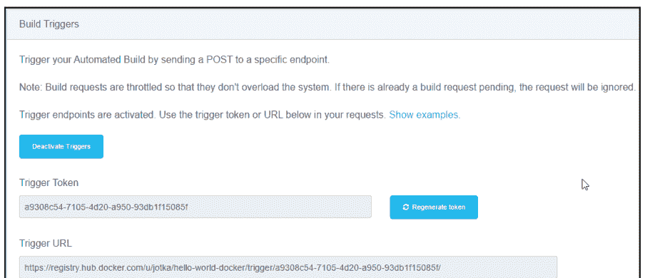

Docker 最初会生成一个特殊的唯一触发器，您也可以重新生成它。令牌用作触发器 URL 的一部分。设置好后，您现在可以从自己的流程中触发构建，例如您的持续集成或交付流程。示例用例可以是如果您的镜像使用某些外部依赖项。您可以在按需重建镜像，而不仅仅是在将新代码推送到源代码仓库时。

要测试构建触发器，您可以使用您选择的 HTTP 客户端执行 POST，例如 Chrome 的 Postman 或 Mac 的 PAW。最简单最快的工具可能是 curl 命令。它是一个命令行 HTTP 客户端，默认在 Linux 中可用，但您可以从其主页 https://curl.haxx.se/download.html 下载适用于几乎所有平台的版本。对构建触发器的 POST 调用会携带 JSON 有效负载，其中包含指示 Docker Hub 执行什么操作以及如何操作的指令。请考虑以下触发构建的示例。如果您想触发所有标签/分支，请执行：

```
curl -H "Content-Type: application/json" --data '{"build": true}' -X POST
https://registry.hub.docker.com/u/jotka/hello-world-docker/trigger/a9308c54-7105-4d20-a950-93db1f15085f/
```


要使用 Docker 标签名称触发构建，您需要在 POST 命令的 JSON 负载中提供标签名称：

```
curl -H "Content-Type: application/json" --data '{"docker_tag": "master"}' -X POST
https://registry.hub.docker.com/u/jotka/hello-world-docker/trigger/a9308c54-7105-4d20-a950-93db1f15085f/
```

要通过源分支触发构建，例如 feature/NIS-234，JSON 负载需要携带分支名称，如下所示：

```
curl -H "Content-Type: application/json" --data '{"source_type": "Branch", "source_name": "feature/NIS-234"}' -X POST
https://registry.hub.docker.com/u/jotka/hello-world-docker/trigger/a9308c54-7105-4d20-a950-93db1f15085f/
```

最后，您还可以使用源标签触发构建，例如 1.1：

```
curl -H "Content-Type: application/json" --data '{"source_type": "Tag", "source_name": "v1.1"}' -X POST
https://registry.hub.docker.com/u/jotka/hello-world-docker/trigger/a9308c54-7105-4d20-a950-93db1f15085f/
```

Docker Hub 及其 Automated Build 功能是保持源代码和已发布镜像同步的绝佳工具。但还有另一个很棒的功能，允许在仓库中发生事件时在另一个应用程序中执行操作——这些就是 Webhooks。让我们现在来看看它们。

## Webhooks 与持续部署

当镜像构建完成或向您的 Automated Build 仓库添加新标签时，Docker Hub 会触发 Webhooks。

## 发布镜像

在定义 Webhook 时，您会指定其名称和在构建完成或出现新标签时调用的目标 URL。这可以在 `Automated Build` 仓库详情中的 `Webhooks` 选项卡中完成，如以下截图所示：

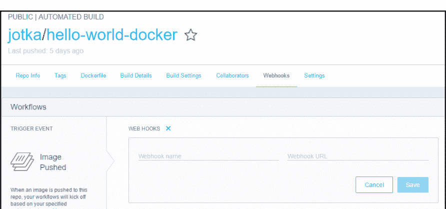

Webhook 调用将是一个 HTTP `POST` 请求。此请求的 JSON 负载将包含刚刚发生的事件的所有详细信息。查看该负载内容并测试 Webhook 的最简单方法是 在 `http://requestb.in` 注册一个临时的 REST 端点，并将其输入并用作 Webhook URL。

requestb.in 是一个免费的 Web 应用程序，允许您创建一个 URL（端点），该端点会监听发往它的请求并以可读的形式让您检查它们。只需点击 Create Request Bin 按钮即可创建自己的 URL，如以下截图所示：

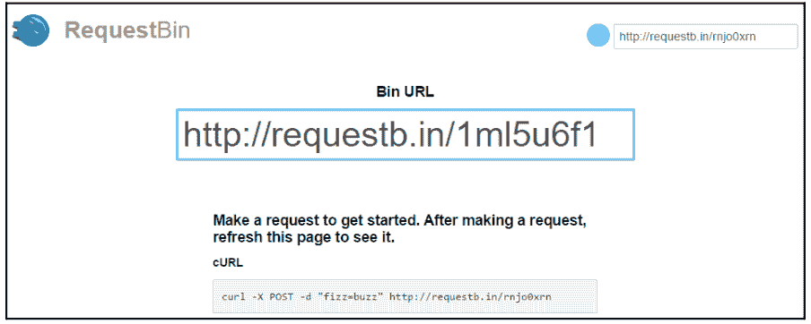

结果页面将显示 URL 值以及如何调用新创建的 URL 的一些示例。这些示例目前对我们来说不重要；是 Docker Hub 将调用该 URL。Bin URL 是您希望在 Docker Hub 中 Webhook 设置中输入的 URL，如以下截图所示：

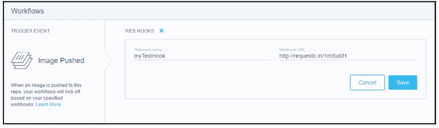

在 http://requestb.in 中创建的 URL 将监听传入连接，并在 webhook 被调用后显示传入的 POST 数据。如果您在 Docker Hub 上触发构建，无论是通过向 GIT 仓库推送提交、使用构建触发器还是从 Docker Hub Web 界面手动执行构建。Docker Hub 将使用定义的 Webhook 调用监听端点，您将在那里实际看到传入的数据。您可以在以下截图中看到结果：

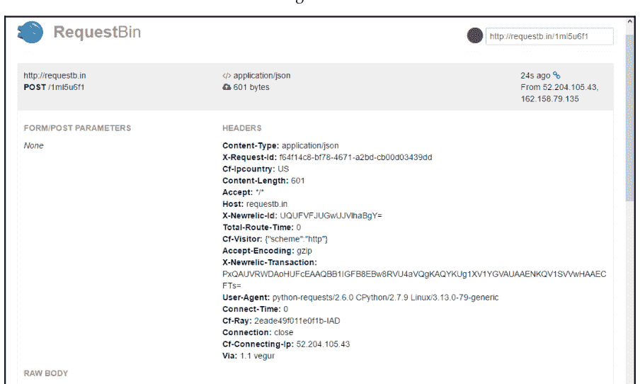

如 RAW BODY 部分所示，Docker Hub 发布了一个包含事件所有详细信息的 JSON 负载：

```
{
  "push_data":{
    "pushed_at":1475303709,
    "images":[],
    "tag":"latest",
    "pusher":"jotka"
  },
  "callback_url":"https://registry.hub.docker.com/u/jotka/hello-world-docker2/hook/2ec10hea0aade410aeih2c1gjd i2b3e50/",
  "repository":{
    "status":"Active",
    "description":"desc",
    "is_trusted":true,
    "full_description":null,
    "repo_url":"https://hub.docker.com/r/jotka/hello-world-docker2",
    "owner":"jotka",
    "is_official":false,
    "is_private":false,
    "name":"hello-world-docker2",
    "namespace":"jotka",
    "star_count":0,
    "comment_count":0,
    "date_created":1475303673,
    "repo_name":"jotka/hello-world-docker2"
  }
}
```

在负载中，我们拥有导致 Webhook 被调用的事件相关的所有详细信息，例如 repo_name、date_created、tag 等。当然，这些可以在 Webhook 实现中使用，例如拉取生成的镜像并部署到某处。

Webhooks 可用于进一步自动化一些事情并创建持续部署设置。您需要做的就是定义 POST 端点并拥有一个应用程序（实际上是一个 Web 服务器），该应用程序会在指定的端点监听请求，Docker 将使用所有详细信息执行 POST。Webhooks 最佳用途可能是持续部署设置。例如，有一个名为 Shipyard 的 Docker 管理工具，可在 https://shipyard-project.com 获取。如果 Docker Hub 构建了新的 Docker 镜像（无论是由源代码仓库的推送触发还是使用 Build Trigger），它将使用 HTTP POST 请求向 Shipyard 发送 Webhook 通知。Shipyard 将检查 Webhook 密钥以进行授权，然后从 Docker Hub 拉取最新镜像。因此，Shipyard 将停止并删除您当前的容器并部署一个新容器。另一个有用的应用程序，可让您设置持续部署管道的是 Swarm Inception。它是一个简单的应用程序，可在 GitHub https://github.com/giantswarm/swarm-inception 获取。这实际上是一个小型服务器，可监听 POST 请求。使用 Swarm Inception，您可以使用 Docker Hub 的镜像构建器和 Giant Swarm 进行持续容器交付。同样，当构建完成后，Docker Hub 将调用此服务的 Webhook 处理程序，进而触发部署或更新 Docker Hub 构建的镜像到 Giant Swarm 的公共云。Giant Swarm 是一个云应用程序，您可以在其中在几秒钟内将 Docker 容器部署到完全托管的 Kubernetes 集群上。

虽然 Swarm Inception 可以开箱即用地实现持续部署，但它也是实现自己的 Webhook 处理程序并使用 Docker Hub 的构建服务进行持续部署的非常好的参考文档。虽然 Swarm Inception 使用 Giant Swarm 的 API 来处理容器，但您可以轻松地 fork 或复制存储库并使用其他服务实现自己的持续交付。

还有一些其他很棒的起点来实现自己的 Webhook 监听服务器。第一个是名为 `dockerhook-webhook-listener` 的项目，可在 GitHub `https://github.com/cpuguy83/dockerhub-webhook-listener` 获取。它只是一个用 Go 编写的简单而纯粹的 Web 服务器（顺便说一下，Docker 本身也是用这种语言开发的）。另一个很棒的是 `Captain Hook`，同样可在 GitHub 上获取：`https://github.com/bketelsen/captainhook`。它是一个通用的 Webhook 端点，可根据调用的 URL 运行脚本。您在 Captain Hook 的 `configdir` 中创建的每个脚本将在对应的端点被调用时执行。


Captain Hook 本身作为 Docker 镜像提供，因此您可以立即拉取并使用它。

您可以通过执行众所周知的 `docker pull` 命令从 Docker Hub 拉取 Captain Hook：

```
docker pull ablas/docker-captainhook
```

接下来，您使用 `docker run` 命令运行 Captain Hook，公开 `8080` 端口，并将 Webhooks 处理程序的脚本路径作为 `HOOKS_PATH` 环境变量提供：

```
docker run -d -p 8080:8080 -v `${HOOKS_PATH}`:/webhooks ablas/docker-captainhook
```

您可以将 Webhook 处理程序放在任何文件夹中，只需注意您需要将其映射到 `/webhooks` 目录。每个脚本对应一个监听端点。例如，如果您放置一个名为 `deployMyContainer.json` 的脚本，当 Docker Hub 向以下 URL 创建 `POST` 请求时，它将被执行：

```
http://your.captainhook.url/deployMyContainer
```


The handler script can contain a reference to the shell script. After the specific POST endpoint has been hit, the shell script will take over and, for example, deploy a fresh image. Take a look at this Captain Hook script:

```
{
  "scripts": [
    {
      "command": "/usr/jarek/webhook.sh",
      "args": [
        "3"
      ]
    }
  ]
}
```

In the referenced shell script, we need to do something useful, actually. All we have to do is to parse the incoming JSON payload. We can do it using the JSON parsing jq tool, about which we know from the previous Chapter 7, Running Containers. It's available at https://stedolan.github.io/jq/. We have been using jq to parse the docker inspect command output. At this time we can use the jq tool to parse the incoming data and to pull the image from the Docker Hub and run it.

After reading this chapter, you should be aware that Webhooks are powerful feature. The listening endpoint can be written in any language of your choice, let it be Java, Scala, or C#. There is a lot of ready-to-use API for dealing with Docker containers available for free. You can, of course, use them in your Webhook handler implementation to pull and deploy images. We are going to cover some of them in the next chapter. To give you some inspirations, here are some you can pick from:

- **Java Docker API 客户端**: Available on GitHub https://github.com/docker-java/docker-java. It's based on Jersey REST library.
- **Docker.DotNet**: It's a C# client available on GitHub https://github.com/ahmetalpbalkan/Docker.DotNet.
- **docker-client**: It's for Groovy https://github.com/gesellix/docker-client
- **tugboat**: It's available at https://github.com/softprops/tugboat, is a Scala library for dealing with the Docker containers.


An always up-to-date API list is available at Docker website at the https://docs.docker.com/engine/reference/api/remote_api_client_libraries/address.

There's so many of them that there's a huge chance you will find something for the programming language of your choice. Knowing the incoming payload structure and having a Docker API library it's easy to implement your own listening Webhook handlers. If you have Webhooks defined in your automated builds, Webhook handlers running and listening for calls, your deployments can be launched seamlessly from GIT push command. It will work smoothly without needing any manual intervention from anyone. It's true continuous deployment. Docker can be useful also in your existing development or continuous delivery flow, using Jenkins, or Maven for example. This is what we are going to cover in the next chapter.

## Summary

In this chapter, we have learned how to tag and push our images to the remote registry making it available for others to use. We also know how to setup the automated build feature using the integrated GitHub or BitBucket account. Automatic Build repository is a great feature; it allows you to keep the source of your images (including of course, Dockerfiles) and the images on the DockerHub in sync. We also know how to use Webhooks feature to do some more automation, for example continuous deployment. In the next chapter, we will go a little bit more into using Docker, we will be utilizing Docker to package our Java and JavaScript application into the container.
