# 9

## 9 Using Docker in Development

After reading the past chapters, you should be able to pull a image and use it as the base for your own image. We already know how to create an image, attach volumes, expose ports, and run it in a container. We can also publish it into the Docker Hub for others to use. This is the last chapter in which we are going to cover some practical examples of how you can put Docker to use in your daily life as a developer. First of all, you will learn how to make Docker work with the most popular Java build system: Maven. Then we can put our applications into containers in practice; we will run Spring Boot Java application from inside a Docker container. Next, we will pack the Angular.js frontend application, which runs on Node.js in a Docker container. These examples should give you an idea and some inspiration on how you can create Docker containers with your own applications. In particular, we are going to cover the following topics in this chapter:

- Using Docker with Maven
- Packaging Java Spring Boot application into the container
- Packaging node.js Angular application into the container

Let's begin with explaining how to incorporate Docker in our Java Maven build.

## Using Docker with Maven

If you develop in Java, you probably know Maven. It's used widely to build Java applications or libraries. The Maven's build process uses the concept of an artifact. An artifact is a file, usually a JAR (containing Java libraries or application) or WAR/EAR, which is a Java web application. The artifacts are deployed to a Maven repository. A Maven build produces one or more artifacts and each artifact has a group ID (usually a reversed domain name, such as com.example.foo), an artifact ID (just a name), and a version string. The three together uniquely identify the artifact. Your application dependencies are also specified as artifacts. You already know Docker pretty well, so you could probably imagine what a useful Maven plug in for Docker should do. It should allow to:

- Pull images from the registry
- Build container images
- Start containers
- Optionally link containers
- Expose the needed ports (useful for integration tests)
- Push images to the registry

Including Docker in your Maven build setup can be especially useful in your development flow. Imagine that after Maven build, the resulting image containing your application could be automatically pushed to the registry, thus making it ready for your colleagues, testers, or clients. Your high-level build process could include the following steps:

- 1. Build from sources
- 2. Execute unit tests
- 3. Create Docker image (the dockerbuild command needs to be executed here)
- 4. Run integration tests on the container (Docker commands, such as run, start, expose, link, and stop will be probably executed here)
- 5. Publish the image (the last step is usually the docker publish command)

There are a lot of Docker plugins for Maven; we will focus on probably the two most interesting ones. The first one is Spotify's Maven Docker Plugin.

## Spotify's Maven Docker plugin

It's available as open source and you can get the sources and documentation from GitHub: https://github.com/spotify/docker-maven-plugin. You can use this plugin to create a Docker image with artifacts built from your Maven project. For example, the build process for a Java service can output a Docker image that runs the service.

The usage of the Spotify's docker-maven-plugin is pretty straightforward. You will just have to include it as a plugin in your build and provide a `dockerDirectory` value in the configuration. The plugin will expect the Dockerfile in this directory, so if you specify that directory, it must contain valid Dockerfile. You can also build the image without Dockerfile. In this case, you will need to provide additional plugin configuration, such as `baseImage` (it will be used in the `FROM` instruction-the starting point in every Dockerfile, as you remember from Chapter 6, *Creating Images*), `maintainer`, `cmd` and `entrypoint`.

The contents of the directory specified as the `dockerDirectory` value will be copied into `${project.build.directory}/docker`. This will be the build context when the `docker build` command starts. Using the `resource` element, you can include additional artifacts to the Docker's build context. Take a look at the following example fragment of the `pom.xml` build file:

```xml
<build>
    <plugins>
        <plugin>
            <groupId>com.spotify</groupId>
            <artifactId>docker-maven-plugin</artifactId>
            <version>0.4.13</version>
            <configuration>
                <imageName>myImage</imageName>
                <dockerDirectory>docker</dockerDirectory>
                <resources>
                    <resource>
                        <targetPath/>
                        <directory>${project.build.directory}</directory>
                        <include>${project.build.finalName}.jar</include>
                    </resource>
                </resources>
            </configuration>
        </plugin>
    </plugins>
</build>
```


在前面的示例中，我们已将插件包含在 pom.xml 文件的 plugins 部分。来自 ${project.build.directory} 的一个 jar 文件（默认情况下为 /target 目录）将被包含在构建上下文中。这次它将是一个以你的应用程序名称命名的 jar 文件，其中包含你构建的应用程序。

有了这种设置，再加上一个正确引用 /target 目录中应用程序 jar 的 Dockerfile，就足以从 Maven 的 pom.xml 创建 Docker 镜像。你只需执行以下 Maven 目标：

```
mvn clean package docker:build
```

如果你决定将生成的镜像推送到注册表，则需要额外的 -DpushImage 参数：

```
mvn clean package docker:build -DpushImage
```

如果你需要在仅运行 mvn deploy 时构建、标记并推送镜像，你需要将 Docker 命令绑定到 Maven 阶段，就像你通常对其他构建插件所做的那样。Spotify 的插件很不错、快速且简单。如果你只需要构建镜像，它可以作为一个起点。但它有一个限制：它不允许运行容器。由于该插件只能用于构建镜像，因此相当受限。让我们来看另一个：fabric8io Docker 插件。

## fabric8io Maven Docker 插件

它的配置不同。fabric8 插件使用一个配置部分来维护所有镜像。它为每个部分都有配置项，这些配置项分为 build 和 run 部分，分别用于构建指令和运行时配置。部分功能包括拉取镜像时的进度条、动态灵活的端口映射和变量分配，以及通过插件配置或 Dockerfile 构建镜像（与 Spotify 插件相同）。它还在集成测试期间记录容器的标准输出，并在容器启动后完全支持等待时间、特定 URL 或日志输出。

就配置而言，Fabric8.io Docker Maven 插件非常强大且灵活。要设置镜像配置，你需要在 <configuration><images> 元素中创建 <image> 元素，如以下示例所示：

```xml
<configuration>
  <images>
    <image>
      <alias>myApplication</alias>
      <name>me/my-application:${project.version}</name>
      <build>
<from>java:8</from>
<assembly>
    <descriptor>artifact</descriptor>
</assembly>
<cmd>
    <shell>java -jar maven/myApplication.jar</shell>
</cmd>
</build>
<run>
    <ports>
        <port>8080:8080</port>
    </ports>
</run>
</image>
</images>
</configuration>
```


你可以为每个要创建或使用的镜像拥有多个 <image> 元素。

镜像构建过程在 <build> 元素内配置。Fabric8.io 插件对构建配置采用两种方法；你可以使用现有的 Dockerfile，也可以使用内联配置（如前例所示）。如果你想使用现有的 Dockerfile，你需要提供额外的 dockerFileDir 和 dockerFile 元素。前者将指定包含 Dockerfile 的目录，后者将指向该目录中的特定 Dockerfile。作为 dockerFileDir 元素指定的目录中的所有文件也将被包含在镜像构建上下文中。

另一方面，内联配置将描述 pom.xml 本身中的镜像构建过程。你需要提供诸如 <from> 之类的元素，其中将包含基础镜像（相当于 Dockerfile 中的 FROM 指令）。assembly 描述符包含将进入镜像的所有文件，而 <cmd> 包含在创建容器时运行的命令。正如我们在第 6 章《Creating Images》中讨论的那样，此设置类似于标准的 Dockerfile，当然你完全支持所有 Dockerfile 标准功能。你可以暴露端口（与我们在第 6 章《Creating Images》中使用 EXPOSE Dockerfile 指令所做的方式相同）。

要暴露端口，你需要在 <ports> 元素中定义 <port> 子元素。在以下示例中，我们暴露端口号 8080，以便在运行容器时稍后将其映射到主机的端口：

```xml
<ports>
  <port>8080</port>
</ports>
```

要定义卷，需要类似的构造，并且 <volumes> 元素内部包含的每个 <volume> 元素将代表一个卷。与 VOLUME 指令完全相同，它会创建具有指定名称的挂载点，并将其标记为保存来自本地主机或其他容器的外部挂载卷。

```xml
<volumes>
  <volume>/path/to/volume</volume>
</volumes>
```

要定义镜像的入口点，你需要（正如你可能已经猜到的）一个 <entrypoint> 元素，如以下示例所示：

```xml
<entryPoint>
  <exec>
    <arg>java</arg>
    <arg>-jar</arg>
    <arg>/maven/myApplication.jar</arg>
  </exec>
</entryPoint>
```

<entrypoint> 指定了一个命令，该命令在容器启动时始终会被执行，与普通和传统的 Dockerfile 中的 ENTRYPOINT 指令方式相同。

构建配置中的 <assembly> 元素指定构建产物以及应用程序可能需要的其他文件将如何放入生成的 Docker 镜像中。有几个预定义的 assembly 描述符，例如 artifact-with-dependencies（将项目的构件及其所有依赖项附加到镜像中）、artifact（仅将项目的构件放入镜像中）、project（将整个 Maven 项目附加到镜像中）以及 rootWar（将构件作为 ROOT.war 复制到暴露的目录中）。


来自 assembly 描述符的所有文件都会自动进入镜像。你可以通过查看 target/docker/yourProject/build/maven 目录的内容来了解镜像中包含的内容。

正如你所见，<build> 元素中的配置几乎完全匹配 Dockerfile 的结构和内容。当你使用 Maven 执行 docker:build 命令时，它将被考虑在内：

```
mvn -PmyProfile docker:build
```

<image> 的 <run> 元素包含运行时设置；当你使用以下命令通过 Maven 创建和运行 Docker 容器时，它将被使用：

```
mvn -PmyProfile docker:build docker:start
```

在运行时配置中，你可以按以下示例定义端口映射：

```
<ports>
  <port>8080</port>
</ports>
```

在前一种情况下，容器端口 8080 将映射到 Docker 主机端口 8080。这与我们在第 4 章《Networking and Persistent Storage》中所做的相同，我们使用 docker run 命令的 -p 或 -P 选项映射了暴露的端口：

```
docker run --name nginx -d -P nginx
```

除了映射端口之外，你还可以映射卷。这再次类似于我们之前使用 docker run 命令的 -v 选项所做的映射：

```
docker run -it -v data:/data ubuntu
```

正如我们在第 4 章《Networking and Persistent Storage》中看到的那样，容器在启动时可以从各种来源挂载卷。它可以是主机系统的目录，也可以是导出一个或多个目录的另一个容器。挂载配置在 <run> 配置的 <volumes> 部分中指定。

```
<volumes>
  <bind>
    <volume>/logs</volume>
    <volume>/opt/hostDirectory:/opt/containerDirectory</volume>
  </bind>
</volumes>
```

要从另一个镜像导入卷（如我们之前使用 --volumes-from 所做的那样），你可以在卷配置中使用 <from> 和 <image> 元素。要提供镜像名称或别名，请在 <image> 元素中指定你想要使用的卷，如以下示例所示：

```
<volumes>
  <from>
    <image>test/myApplication2</image>
  </from>
</volumes>
```

fabric8.io Maven 插件是一个完整的解决方案，包含所有 Docker 相关的构建和运行时配置。你可以链接镜像、提供运行时网络设置并定义运行时重启策略（我们在第 7 章《Running Containers》中详细讨论了重启策略）。它还有一套完整的 Maven 相关目标，例如用于构建镜像的 docker:build、用于管理容器生命周期的 docker:start 或 docker:run 和 docker:stop、用于将容器上传到注册表的 docker:push，以及用于输出容器日志的 docker:logs。你甚至可以使用 maven:source 目标将生成的 Docker 镜像包含到 Maven 构件中以供进一步处理。

要执行整个操作链，即创建镜像、启动容器、执行单元测试、停止容器并进行清理，请执行 install 命令：

```
mvn -PmyProfile install
```

在使用 Maven 和 Docker 时，fabric8.io 插件提供了很多功能。你始终可以参考插件网站 https://dmp.fabric8.io/ 上的最新文档。如果需要从 Maven 构建中构建或运行 Docker 容器，它是首选。

现在我们知道如何从自己的构建过程中创建和运行 Docker 容器。现在让我们专注于将实际应用程序打包到容器中。我们将介绍示例设置，例如 Java 应用程序和 Angular.js 前端应用程序。让我们从 Java 开始；我们将对 Spring Boot 应用程序进行容器化。我们将使用我们已经了解的 fabric8 Docker Maven 插件。


## 在 Docker 容器中运行 Spring Boot 应用

为本示例的目的，我们将从一个简单的 hello-world 类型的 Spring Boot 应用开始。我们将在官方 Java 镜像 openjdk 之上运行它。如果你更喜欢在 Oracle Java 镜像上运行，可以在 DockerHub 仓库中搜索它。有很多可直接使用的镜像，其中一些基于官方镜像，例如 Ubuntu。

正如我们在第 6 章《创建镜像》中看到的，选择官方镜像作为基础镜像总是明智的。官方镜像经过测试、有支持，并且通常质量非常高。在容器中创建 Java 应用的基本步骤如下：

-   从 Docker Hub 拉取基础镜像
-   安装应用程序本身，在我们的例子中它将是一个可执行的 jar 文件
-   暴露端口，如果你的应用程序需要通过网络与外部世界通信
-   运行容器

当然，如果你想在容器中放置其他类型的应用程序，以上步骤是不够的；你需要在基础镜像之上安装 Web 服务器，例如 Tomcat 或 Wildfly。此外，应用程序本身可能打包为 WAR 或 EAR 文件。

我们将放入容器的应用程序只是一个非常简单的 Spring Boot hello world 示例应用。我们不会详细介绍 Spring Boot，我们只需要有一个可以从 Docker 容器打包和运行的东西。

让我们开始创建我们的 Maven pom.xml 构建文件，如以下示例所示：

```xml
<?xml version="1.0" encoding="UTF-8"?>
<project>
    <modelVersion>4.0.0</modelVersion>
    <groupId>pl.finsys</groupId>
    <artifactId>hello-docker</artifactId>
    <version>0.0.1-SNAPSHOT</version>
    <parent>
        <groupId>org.springframework.boot</groupId>
        <artifactId>spring-boot-starter-parent</artifactId>
        <version>1.4.1.RELEASE</version>
    </parent>
    <dependencies>
        <dependency>
            <groupId>org.springframework.boot</groupId>
            <artifactId>spring-boot-starter-web</artifactId>
        </dependency>
    </dependencies>
<properties>
    <java.version>1.8</java.version>
</properties>
<build>
    <plugins>
        <plugin>
            <groupId>org.springframework.boot</groupId>
            <artifactId>spring-boot-maven-plugin</artifactId>
        </plugin>
    </plugins>
</build>
</project>
```

如你所见，我们使用 `spring-boot-starter-parent` 作为父 `pom.xml`。它为我们节省了大量工作，并且非常适合本示例中拥有一个正在运行的 Spring Boot 应用的目的。我们的应用程序由 Maven 构建，因此文件夹结构需要类似于标准的 Maven 应用结构。它将包含 `pom.xml` 文件，然后是 `src/main/java` 文件夹。`java` 文件夹将包含我们的 Java 包。完整的文件夹结构将类似于以下截图：

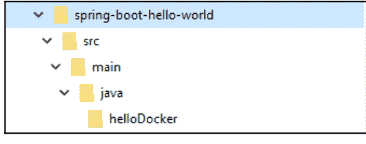

我们的第一个也是唯一一个 REST 控制器将是 `Hello.java`，让我们把它放在 `java/helloDocker` 文件夹中：

```java
package helloDocker;
import org.springframework.web.bind.annotation.RestController;
import org.springframework.web.bind.annotation.RequestMapping;
@RestController
public class HelloController {
    @RequestMapping("/")
    public String hello() {
        return "Greetings from Spring Boot in Docker!";
    }
}
```

将此控制器保存在 src/main/java/helloDocker 目录下的 HelloController.java 文件中后，我们所需要的就是实际应用程序的启动点。在 helloDocker 包中创建一个新的 Java 类：

```java
package helloDocker;
import org.springframework.boot.SpringApplication;
import org.springframework.boot.autoconfigure.SpringBootApplication;
import org.springframework.context.ApplicationContext;
@SpringBootApplication
public class Application {
    public static void main(String[] args) {
        ApplicationContext ctx =
            SpringApplication.run(Application.class, args);
    }
}
```

就是这样；我们有一个完整的 Spring Boot 应用，具有一个功能，它将响应 HTTP GET 调用并返回消息 Hello from Spring Boot in Docker！让我们先使用 Maven 构建它，通过执行 mvn package 命令：

```
mvn package
```

为此，你需要安装 Maven 并使其在系统路径中可用。这需要一些时间，所有 Maven 依赖项都需要先下载，并且需要编译应用程序的源代码。你应该能看到以下表示构建成功的消息：

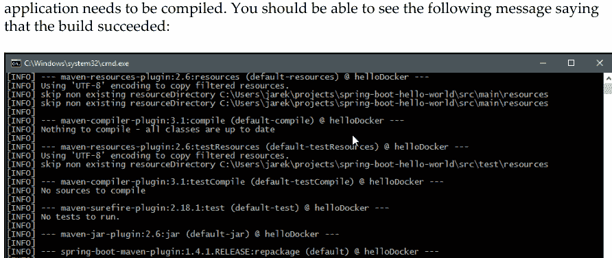

我们的应用程序现在已打包为项目 target 目录中的 `helloDocker-0.1.0.jar` 文件。让我们进行试运行并执行以下命令：

```
java -jar target/helloDocker-0.1.0.jar
```

Spring 应用将启动并在控制台上输出一些日志：

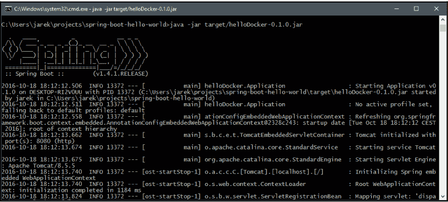

默认情况下，Spring Boot 应用监听 8080 端口的 HTTP 请求；我们稍后会将此端口暴露给 Docker 镜像。同时，在你的 Web 浏览器中输入 http://localhost:8080，以验证我们的应用程序是否正常工作并响应 HTTP 请求。你应该会看到我们希望看到的消息：

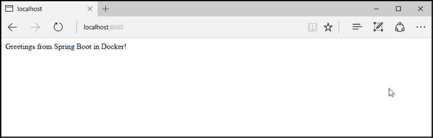

如果你使用 Linux 或 Mac，或者在 Windows PC 上也安装了 `curl` 命令，你也可以执行它来查看以下消息：

```
curl http://localhost:8080
Greetings from Spring Boot in Docker!
```

就是这样；我们的应用程序运行良好，是时候把它放入容器中了。我们将使用 fabric8.io 的 Maven Docker 插件，我们在本书章节开始时已经了解过它。我们将使用现有的 Dockerfile 方法，因此让我们在项目的 `src/main` 目录中创建一个 `docker` 目录并将 `Dockerfile` 放入其中。`openjdk` 官方仓库包含很多标签，每个标签都打包了不同的 Java 版本供你选择。例如：

-   8u102-jdk, 8u102, 8-jdk, 8, jdk, latest
-   8u92-jdk-alpine, 8u92-alpine, 8-jdk-alpine, 8-alpine, jdk-alpine, alpine
-   8u102-jre, 8-jre, jre
-   8u92-jre-alpine, 8-jre-alpine, jre-alpine
-   9-b139-jdk, 9-b139, 9-jdk, 9
-   9-b139-jre, 9-jre

我们将选择最新的一个，即 Java `8u102-jdk`。我们将采用内联配置方法来构建镜像，因此 `pom.xml` 中的插件部分将包含构建包含我们应用程序的镜像的说明。你需要在 `pom.xml` 文件的 `<build><plugins>` 部分添加以下插件定义：

```xml
<plugin>
    <groupId>io.fabric8</groupId>
    <artifactId>docker-maven-plugin</artifactId>
    <version>0.16.8</version>
    <configuration>
        <dockerHost>http://127.0.0.1:2375</dockerHost>
        <verbose>true</verbose>
        <images>
            <image>
                <name>hello-docker</name>
                <build>
                    <from>openjdk:8u102-jdk</from>
                    <ports>
                        <port>8080</port>
                    </ports>
                    <entryPoint>
                        <exec>
                            <args>java</args>
<args>--jar</args>
<args>/maven/hello-docker-${project.version}.jar</args>
</exec>
</entryPoint>
<assembly>
<descriptorRef>artifact</descriptorRef>
</assembly>
</build>
</image>
</images>
</configuration>
</plugin>
```

现在，为了编译、打包并构建你的 Docker 镜像，执行以下 Maven 命令：

```
mvn clean package docker:build
```

在输出中，maven-docker 插件将输出一些详细信息，例如构建镜像过程中的具体步骤。你会找到所有的 EXPOSE、COPY、VOLUME、ENTRYPOINT 指令。所有这些都是你在外部 Dockerfile 中配置的，或者使用 pom.xml 文件本身中的内联配置。你可以在以下截图中看到示例输出：

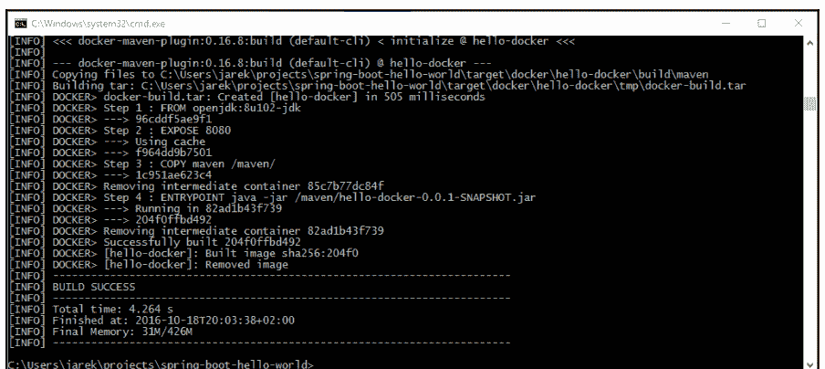


最后，Docker 会输出刚刚创建的镜像 ID。让我们检查我们的镜像是否在镜像列表中，执行众所周知的 docker images 命令：

```
docker images
```

如果一切顺利，你将在镜像列表中看到你刚刚创建的镜像，如下图所示：

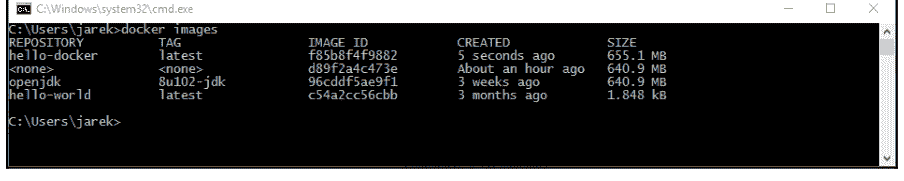

镜像已在列表中，让我们通过执行以下命令来运行它：

```
docker run -it -p8080:8080 hello-docker
```

请注意，我们包含了 -p 选项以自动将暴露的端口映射到主机的端口。正如你可能记得的，我们在 pom.xml 配置中暴露了端口号 8080。执行命令后，你将看到与之前在本地运行 java -jar 命令时相同的输出。

然而，现在它来自 Docker 容器中包含的应用，如下图所示：

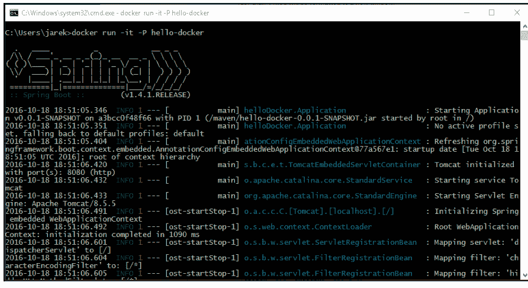

为了验证 Docker 容器中的应用程序确实能工作，再次将你的网页浏览器指向 http://localhost:8080 地址：

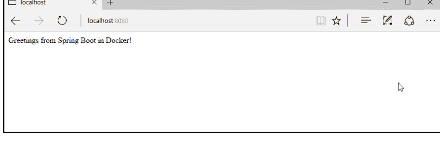

另外，如果要手动运行 docker run，我们可以将 runtime 部分包含到项目的 pom.xml 文件中。整个 <image> 元素将类似于这样：

```
<image>
  <name>hello-docker</name>
  <build>
    <from>openjdk:8u102-jdk</from>
    <ports>
      <port>8080</port>
    </ports>
    <entryPoint>
      <exec>
        <args>java</args>
        <args>--jar</args>
        <args>/maven/hello-docker-${project.version}.jar</args>
      </exec>
    </entryPoint>
    <assembly>
      <descriptorRef>artifact</descriptorRef>
    </assembly>
  </build>
  <run>
    <ports>
      <port>8080:8080</port>
    </ports>
  </run>
</image>
```

现在你可以在一步中编译、打包、构建并运行镜像：

```
mvn clean package docker:build docker:run
```

现在我们有一个完全可用的 Spring Boot 应用被打包为 Docker 容器。它已准备好推送到 Docker Hub 或你自己的私有仓库。只要 Docker 可以运行，此应用程序将以相同的方式工作。想象一下，你为应用程序的用户节省了多少麻烦，操作系统配置、Java 设置和配置、依赖管理等等。这只是一个相当简单的示例，但它应该能让你了解 fabric8.io Docker 插件有多灵活和有用。

现在我们知道了如何打包 Java 应用程序，让我们做更多的事情。我们将打包一个示例前端应用程序。这将是一个在 node.js 上运行的 Angular.js 前端。

## 打包 Angular.js 应用程序

在本示例中，我们将创建一个在 node.js 运行时上运行的简单 Angular.js 应用程序。为了示例的清晰性，我们不会引入任何测试。正如 Spring Boot 应用程序的情况一样，我们的 Angular.js 应用程序将尽可能简单和精简。我们将了解如何将其容器化，而不是深入 Angular.js 开发。当然，如果你还没有了解 Angular.js，欢迎你去了解它；它是一项很棒的技术。在开始之前，你需要安装 node.js。你可以从 node.js 网站 https://nodejs.org/en/ 获取安装程序。

首先，让我们将应用程序的结构分为两部分。第一部分是前端，包含所有静态资源，如 JavaScript 和 HTML 文件。第二部分是 node.js 后端，实际提供前端文件并响应 HTTP 请求。以 angular-docker-example 为父目录的文件夹结构最初将类似于以下截图：

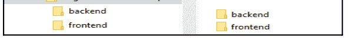

我们将使用 Bower 来管理第三方 JavaScript 库。Bower 使用 bower.json 文件，在其中定义需要运行的所有应用程序。目前，我们只需要一个 angular.js 依赖项。以下是我们这个小应用程序的最小 bower.json 文件：

```json
{
  "name": "hello-docker-angular ",
  "ignore": [
    "**/*",
    "node_modules",
    "bower_components"
  ],
  "dependencies": {
    "angular": "~1.5"
  }
}
```

我们希望所有依赖项都下载到我们的前端应用程序文件夹中。因此，在执行 bower install 之前，我们需要告诉 Bower 我们希望这些文件去哪里。为此，我们需要创建一个 .bowerrc 文件并将其放在项目的根目录中。该文件的 JSON 内容将包含所有将被下载的依赖项的目的地：

```
{
  "directory": "frontend/bower_components"
}
```

接下来，你首先想要安装 bower 本身，你可以在系统中全局安装它，通过执行 npm install 命令：

```
npm install -g bower
```

安装了 Bower 并放置了 .bowerrc 后，我们现在可以下载所有所需的前端依赖项。在项目的根文件夹中执行以下操作以开始下载过程：

```
bower install
```

过了一会儿，Bower 完成下载所有依赖项（在我们的例子中只是 Angular.js）。它们将存在于 frontend/bower_components 目录中。由于只有一个依赖项，bower_components 目录中只会创建一个名为 angular 的目录，如下图所示：

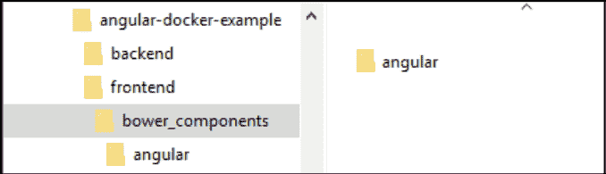

我们的 index.html 将作为应用程序前端部分的入口点，需要放在前端模块的根目录中，在我的例子中是 angular-docker-example\frontend。它将类似于以下代码：

```html
<script src="bower_components/angular/angular.min.js"></script>
<script src="hello_world_docker.controller.js"></script>
<div ng-app="HelloWorldApp">
    <div ng-controller="HelloWorldDockerController">
        Your name: <input ng-model="name" ng-keyup="sayHello()">
        <h1>{{greeting}}</h1>
    </div>
</div>
```

我们还需要向应用程序添加控制器（它将是 hello_world_docker.controller.js 文件），它将对按键抬起事件做出反应。如果你将你的名字写在文本字段中，Angular 将用你的名字向你问好：

```javascript
angular.module('HelloWorldDockerApp', [])
    .controller('HelloWorldDockerController', function($scope) {
        $scope.sayHello = function () {
            $scope.greeting = "Hello from Docker-Angular, " +
                $scope.name;
        };
    });
```

现在是测试我们应用程序的时候了，只需在你选择的网页浏览器中打开 index.html 文件并在文本字段中输入你的名字：

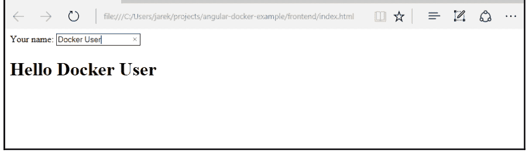

好的，它按预期工作。让我们继续进行服务器部分——Web 应用程序需要被提供服务。当然，我们的简单应用程序通过直接在网页浏览器中运行 HTML 文件来工作。如果你以后决定包含更多 Angular 功能，例如路由，直接打开将不起作用。此外，服务器通常通过响应 HTTP 请求（例如 REST 调用）来完成应用程序。从这些调用中获取的响应然后可以在静态 Angular 页面上使用。我们可以使用任何我们喜欢的编程语言，例如 Java 和 Spring Boot 以及我们之前示例中使用的 docker-maven 插件。这次，为了展示将应用程序手动打包到 Docker 容器的过程，我们将使用 node.js 运行时作为我们应用程序的后端。为了获取所需的 node.js 依赖项，我们需要创建一个包含所有所需依赖项的 package.json 文件：

```
{
  "name": "hello-world-docker",
  "main": "index.js",
  "dependencies": {
    "express": "^4.12.3",
    "bower": "1.7.9"
  }
}
```

package.json 文件与 bower.json 相同，需要放在项目的根目录中。如果文件准备好了，我们可以运行 npm install 命令来下载所需的依赖项，在我们的例子中是 Express 和 Bower。执行以下命令：

```
npm install
```

过了一会儿，node_modules 文件夹将被创建。它将包含 package.json 文件中提到的依赖项，我们的应用程序将使用它们。我们 node.js 应用程序的入口点将是一个简单的基础 HTTP Web 服务器，从 frontend 目录提供静态内容。让我们将其命名为 app.js 并用以下内容填充它：

```
'use strict';
process.env.NODE_ENV = process.env.NODE_ENV || 'development';
var express = require('express');
var http = require('http');
var path = require('path');
var app = express();
var config = {
  port: 8080,
  root: path.normalize(path.join(__dirname, '../frontend'))
}
app.use(express.static(config.root));
```

```
app.route('/*')
  .get(function (req, res) {
    res.sendFile(path.join(config.root, 'index.html'));
  });
http.createServer(app).listen(config.port, function () {
  console.log('hello-docker server listening on %d, in %s mode',
    config.port, app.get('env'));
});
exports = module.exports = app;
```

如前一节所示，我们引入了 node.js Express 库来提供静态内容，配置端口号、根路径和 Express 路由。唯一特定的配置路由是 "/*"，这意味着前端目录中的 index.html 将作为对发往 http://localhost:8080/ 地址的每个 HTTP GET 请求的响应发送。

我们 index.html 中包含的其他每个 URL，例如 http://localhost:8080/hello_world_docker.controller.js 或 http://localhost:8080/bower_components/angular/angular.js 都会作为静态内容提供。然后我们只需启动服务器监听进程。这是我们 node.js Angular 应用中的最后一个文件。文件和文件夹的完整结构应与以下截图类似：

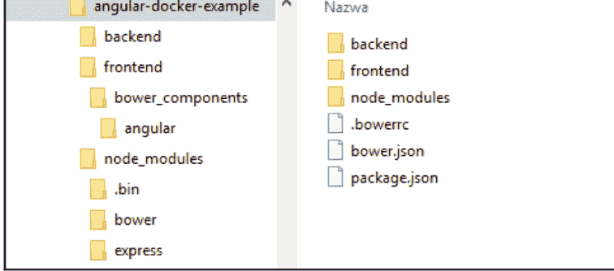

再次强调，它只需要最少的实现；足以确保它正在运行并提供我们的静态内容。在常规应用中，你可能会引入更复杂的路由设置，将应用程序划分为模块等等。

让我们通过在项目根目录执行 node 命令来运行我们的 node.js 服务器：

```
node backend\app.js
```

然后再次启动你的网页浏览器并输入以下地址：http://localhost:8080。你应该能看到我们的应用程序。这次它将由 node.js HTTP 服务器提供服务：

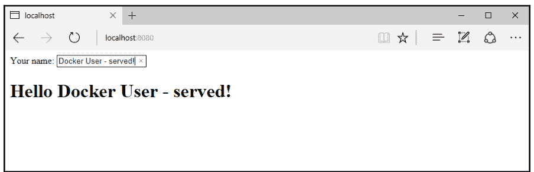

如你所见，我们的应用程序运行正常，是时候将其放入 Docker 容器中了。我们需要决定用作基础镜像的镜像。如同往常一样，强烈建议使用官方 Docker 镜像。Docker Hub 托管着官方的 node.js 仓库。我们将使用可用的 node 的长期支持（LTS）版本 argon。node:argon 镜像已附带安装、配置好并可直接使用的所有 node 和 npm 工具。选择特定基础镜像的决定为我们的 Dockerfile 奠定了基础。让我们在项目根目录创建 Dockerfile 并包含 FROM 指令：

```
FROM node:argon
```

由于基础镜像已包含我们所需的所有工具，我们需要做的就是复制应用程序文件并触发依赖下载。我们项目的当前根目录将作为 Docker 的构建上下文，因此让我们使用以下指令创建工作目录：

```
WORKDIR /usr/hello-docker
```

现在，让我们先复制应用程序。我们将使用 COPY，但这里也可以使用 ADD。正如你在第 6 章《创建镜像》中记得的，ADD 比 COPY 能做更多的事情：它允许 <src> 为 URL，并且如果 ADD 的 <src> 参数是一个被识别的压缩格式的归档文件，它将被解压到镜像内部。话虽如此，在我们的情况下 COPY 已足够：

```
COPY backend /usr/hello-docker/backend
COPY frontend /usr/hello-docker/frontend
COPY .bowerrc bower.json package.json /usr/hello-docker
```

请注意，Docker 会通过 COPY 指令自动创建目录，因此不需要 mkdir 命令。正如你从第 3 章《理解镜像和容器》和第 6 章《创建镜像》中记得的，每个单独的文件系统命令都会在镜像中创建另一层。创建额外的、不必要的层不是良好的实践。跳过 mkdir 命令我们可以避免一个额外的层。

现在，是时候运行 npm install 和 bower install 命令了：

```
RUN npm install
```

要做的最后一件事是暴露正确的端口。我们的应用程序监听 8080 端口，因此我们在 Dockerfile 中添加以下行：

```
EXPOSE 8080
```

最后一步将通过添加 CMD 指令实际运行我们的 node.js 服务器：

```
CMD ["node", "backend/app.js"]
```

Dockerfile 的最终版本如下：

```
FROM node:argon
WORKDIR /usr/hello-docker
COPY backend /usr/hello-docker/backend
COPY frontend /usr/hello-docker/frontend
COPY .bowerrc bower.json package.json /usr/hello-docker
RUN npm install
EXPOSE 8080
CMD ["node", "/usr/hello-docker/backend/app.js"]
```

就这样，我们完整的 Dockerfile 与我们的 node.js 应用程序一样小巧简单，但这应该足够了。让我们尝试构建镜像，执行 docker build 命令，将当前目录作为构建上下文：

```
docker build .
```

在长长的日志输出列表、下载 node.js 依赖项、添加与 Dockerfile 中指令相关的所有层之后，我们将获得刚刚构建的镜像的 ID：

```
Successfully built fa19b25b311e
```

让我们运行新镜像，将 node.js 服务器监听连接的端口映射到我们机器的 8080 端口号：

```
docker run -p 8080:8080 fa19b25b311e
```

如果你现在再次打开网页浏览器，指向 http://localhost:8080，你将看到我们的问候应用程序，如以下截图所示：

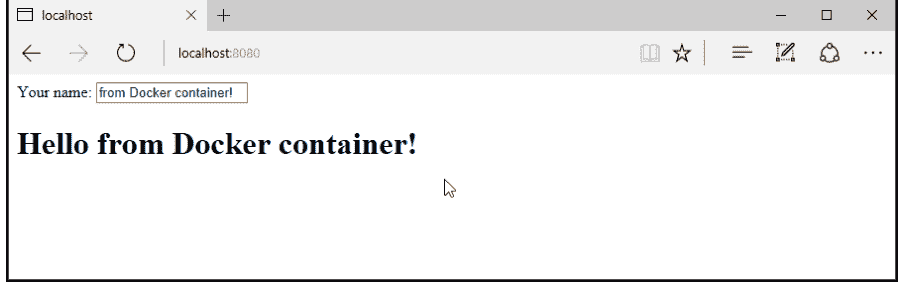

不过这次，它是从 Docker 容器内部提供的。再次想象，你刚刚为未来的客户节省了多少麻烦。操作系统：已检查。Node.js 设置：已检查。所需的前端和后端依赖项：也已检查。一切都已准备好，可以在任何可以运行 Docker 引擎的地方运行。

这些 Java 和 node.js 示例应该能让你大致了解如何将自己的应用程序打包到 Docker 容器中。你可以使用 Maven 并自动化大部分工作，或者手动创建 Dockerfile。生成的镜像将准备好分发到远程注册表，并且它也是可移植的。在下一章我们将做某种总结。你将获得一些有用且高质量的额外资源，可以用来扩展你对 Docker 的知识。

## 总结

在本章中，我们在使用 Maven 构建 Java 应用程序的过程中使用了 Docker。我们知道 Maven 有几个 Docker 插件，并且我们了解它们的功能和局限性。为了让你了解如何将自己的应用程序打包到容器中，我们使用 Docker 运行了 Java 和 JavaScript 应用程序。当然，这只是冰山一角，但我希望你获得了将自己的应用程序打包的灵感，无论你使用什么语言或框架。有了迄今为止获得的 Docker 知识，你将能够将你编写的任何应用程序打包到容器中并发布到 Docker Hub。今天 Docker 的世界是巨大的，有很多东西可以探索。在本书的后面，我会指出我认为非常有用的其他资源；你可以用它们来进一步扩展你的 Docker 知识库。

## 更多资源

到目前为止，你已经掌握了大量的 Docker 知识。在阅读了前面的章节后，你现在可以搜索并拉取所需的镜像，并在其基础上构建自己的镜像。我们也知道如何打包现有的应用程序，无论是 Java Web 应用程序还是在 Node.js 上运行的前端 Angular.js 应用程序。我们可以通过手工完成或使用 Maven 来自动化。互联网上有许多地方可以让你进一步扩展知识。我将介绍我认为最有用的那些。

## 官方文档

很难不推荐官方的 Docker 文档，其质量非常高。你可以在 https://docs.docker.com 找到它。这里有很多信息，从在各种平台上安装 Docker 开始，到拉取镜像、创建 Dockerfile、构建镜像以及将它们发布到远程注册表。这是一个刷新你已有的 Docker 知识的绝佳资源，但你也会在这里找到本书中未提及的大量信息。这包括，例如：

- Compose 是一个用于定义和运行多容器 Docker 应用程序的工具。通过此工具，你可以使用单个 Compose 文件来配置应用程序的服务。然后，使用单个命令，你可以从配置中创建并启动所有服务。
- Universal Control Plane 是 Docker 提供的企业级（你可以在自己的防火墙后面安装）集群管理解决方案。它帮助你从单个界面管理整个集群。
- Docker Trusted Registry 是 Docker 提供的企业级镜像存储解决方案——一个安全地存储和管理你使用的 Docker 镜像的地方。
- Docker Store，是找到作为 Docker 镜像分发的最佳受信任的商业和免费软件的地方。


## 精彩的 Docker

除官方非常全面的文档外，GitHub 上还有一个精彩的（它甚至就叫这个名字——Awesome Docker）Docker 资源列表 https://github.com/veggiemonk/awesome-docker。

资源列表结构良好，从基础开始，例如解释 Docker 实际是什么以及如何在各种平台上安装它的教程。列表分为主要区域，其中包括：

- **有用文章**：这包含与各种主题相关的文章列表。Docker networking 将列出与 Docker 的网络内部相关的文章。Image optimizations 部分将告诉你如何创建尽可能小的镜像以及如何在考虑镜像大小的情况下创建 Dockerfile。安全部分列出了与安全最佳实践、审计、改进容器安全等相关的资源。性能相关文章将帮助你提高容器的性能。我发现的 Good Tips 部分最有用。它包含来自实际使用者的一系列技巧和窍门——这些非常宝贵。
- **工具**：这包含大量与 Docker 相关的开发人员和 DevOps 工具的参考。它将包括用于持续集成或持续交付、监控和日志记录的工具；列表无穷无尽，你肯定能找到有用的东西。
- **幻灯片/视频**：这里收录了作为演示幻灯片提供的额外资源列表，以及视频、网络研讨会等列表。
- **人物、Twitter 账号和社区**：最后但同样重要的是，Docker 世界中重要人物的目录。你可以找到值得关注的博客和 Twitter 账号列表，以及可以加入的 Docker 相关社区列表。

Awesome Docker 列表经常更新，贡献者众多。你总能在这里找到大量有趣的材料。例如，你会找到最新的 Docker Tips 文章和博客链接、实用的 Docker 第三方开发工具列表以及与众多持续集成/持续交付提供商集成的配方。如果你需要托管 Docker 容器，你可以获取几乎所有可用 Docker 托管提供商的信息。很难想象如果与 Docker 相关，你找不到想要的东西。甚至还有在 Raspberry Pi 上运行 Docker 的链接。我的建议是克隆仓库，以便将来更新以找到更多有趣的链接。


你可以克隆 Awesome-Docker 列表，并在执行 Git pull 时找到最新更改。

如果你发现一些有趣的内容想与他人分享，欢迎为 Awesome-Docker-list 做出贡献；作者感谢任何想为列表添加内容的人。


要为 Awesome-Docker 列表做出贡献，请向仓库创建 pull request。

我还想提到的另一个资源是 Andrew Odewahn 的 Docker Jumpstart。它也在 GitHub 上以标记文档的形式提供。你可以在 https://github.com/odewahn/docker-jumpstart/ 地址获取它。它非常简洁完整，适合复习 Docker 核心技能。

## 培训

如果你喜欢观看视频和网络研讨会，http://training.docker.com/ 网站包含大量课程，可帮助你提升并获取 Docker 知识。其中一些是自定进度培训视频（可在 http://training.docker.com/self-paced-training 获取）。它们免费观看，我强烈推荐观看。每个系列都是一个一小时的视频网络研讨会。主题包括：

- Docker 简介
- Docker 基础
- Docker 运维

如果免费资源不够，你还可以随时报名参加 Docker 团队的讲师指导培训。他们在 http://training.docker.com/instructor-led-training 提供大量课程（当然是付费的）。这些包括以下具体主题：

- Docker 管理和运维
- Docker 数据中心培训系列
- 部署 Docker 数据中心
- 使用通用控制平面管理容器服务

还有很多其他内容。付费课程涵盖更高级和专业的主题。它们包含你可能在其他地方找不到的技巧，但它们并不是每天成功使用 Docker 的必备条件。

互联网上有大量与 Docker 相关的资源；不可能全部列在这里。其中大多数可免费访问，因此你可以进一步扩展 Docker 知识。但最好的学习方式是实践——开始尝试你的 Docker 镜像：拉取、创建、构建和发布。如果你将 Docker 引入日常工作，你很快就会想知道过去没有 Docker 是怎么工作的。我希望使用 Docker 对你来说和对我一样愉快。
