在 Azure Databricks 中进行分布式深度学习

技术要求 358

深度学习的分布式训练 358

环形 allreduce 技术 360

在 Azure Databricks 中使用 Horovod 分布式学习库 361

安装 horovod 库 365

使用 horovod 库 365

在单节点上训练模型 366

使用 HorovodRunner 分布式训练 369

使用 Horovod 和 Hyperopt 分布式超参数调优 373

使用 Spark TensorFlow Distributor 包 376

总结 381

您可能喜欢的其他书籍

索引

## 前言

Microsoft Azure Databricks 帮助您利用分布式计算的强大功能，并将其应用于创建稳健的数据管道，以及训练和部署 **机器学习 (ML)** 和 **深度学习 (DL)** 模型。Databricks 的高级功能使开发人员能够处理、转换和探索数据。借助 Azure Databricks 的分布式数据系统，您可以将对 Databricks 的知识付诸实践，以创建大数据管道。

本书提供了一种实践方法来实现 Azure Databricks 及其相关方法论，让您在短时间内变得高效。书中包含对基本概念的详细解释、实用示例和自我评估问题，您将从 Databricks 核心功能的快速介绍开始，然后使用 TensorFlow 和 Spark MLlib 进行分布式模型训练和推理。随着学习的深入，您将探索 Azure Databricks 上的 MLflow 模型服务以及使用 Databricks 中的 HorovodRunner 进行分布式训练管道。最后，您将了解如何转换、使用并从海量数据中获得洞察，以训练预测模型并创建完整且可工作的整个数据管道。

在阅读完这本 MS Azure 书籍后，您将对如何使用 Databricks 创建和管理整个大数据管道有扎实的理解。

## 本书适合谁阅读

本书适合软件工程师、ML 工程师、数据科学家和数据工程师，他们是 Azure Databricks 的新手，并且希望在无需担心基础设施的情况下构建高质量的数据管道。需要了解 Azure Databricks 的基础知识才能更有效地学习本书涵盖的概念。还建议具备 ML 概念的基础理解和初级 Python 编程知识。

## 本书涵盖内容

*第 1 章，Azure Databricks 简介*，带您了解 Databricks 的核心功能，包括我们如何与工作区环境交互、对主要应用程序的快速了解，以及我们将如何使用该工具供 Python 用户使用。这涵盖了工作区、界面、计算管理以及 Databricks 笔记本等主题。

*第 2 章，创建 Azure Databricks 工作区*，教您如何使用 Azure 提供的不同工具应用所有先前概念以与工作区交互。这包括使用 PowerShell 和 Azure CLI 管理所有 Databricks 资源。

*第 3 章，使用 Azure Databricks 创建 ETL 操作*，向您展示如何管理不同的数据源、转换它们并创建整个事件驱动的 ETL。

*第 4 章，Azure Databricks 中的 Delta Lake*，探索 Delta Lake 以及如何将其用于各种操作。

*第 5 章，介绍 Delta Engine*，探索 Delta Engine，并展示如何将其与 Delta Lake 一起使用并在 Databricks 中创建高效的 ETL。

*第 6 章，介绍结构化流*，提供有关笔记本的解释，详细介绍如何使用特定类型的流源和接收器，如何将流投入生产，以及演示示例用例的笔记本。

*第 7 章，在 Azure Databricks 中使用 Python 库*，探索使用 Python 的所有细微差别，并介绍稍后将更详细研究的模型和数据相关的核心概念。

*第 8 章，用于机器学习的 Databricks Runtime*，作为我们深入开发经典 ML 算法以基于表格数据训练和部署模型，同时探索库和算法的深入研究。示例将侧重于使用 Databricks 进行 ML 的特殊性和优势。

*第 9 章，用于深度学习的 Databricks Runtime*，作为我们深入开发经典 DL 算法以基于非结构化数据训练和部署模型，同时探索库和算法的深入研究。示例将侧重于使用 Databricks 进行 DL 的特殊性和优势。

*第 10 章，在 Azure Databricks 中进行模型跟踪和调优*，重点关注使用 Databricks 的功能（如 AutoML 和 Delta Lake）进行模型调优、部署和控制，同时结合 TensorFlow 等流行库一起使用。

第 11 章，使用 MLflow 和 MLEap 管理和部署模型，更详细地探索 MLflow 库，这是一个用于管理端到端 ML 生命周期的开源平台。该库允许用户跟踪实验、记录和比较参数、集中模型存储等。您将学习如何将其与之前章节中学到的内容结合使用。

第 12 章，在 Azure Databricks 中进行分布式深度学习，演示如何使用 Horovod 使分布式 DL 更快，通过将单 GPU 训练脚本扩展到并行在许多 GPU 上训练。

## 如何充分利用本书

您需要一台功能正常的 PC、互联网连接以及 Azure Services 订阅。

## 下载示例代码文件

您可以从 GitHub 下载本书的示例代码文件：https://github.com/PacktPublishing/Distributed-Data-Systems-with-Azure-Databricks。如果代码有更新，将在现有 GitHub 仓库中更新。

我们还有来自我们丰富的图书和视频目录的其他代码包，可在 https://github.com/PacktPublishing/ 获取。快来看看吧！

## 下载彩色图片

我们还提供了一份 PDF 文件，其中包含本书中使用的屏幕截图/图表的彩色图片。您可以在此处下载：http://www.packtpub.com/sites/default/files/downloads/9781838647216_ColorImages.pdf。

## 使用的约定

本书中使用了多种文本约定。

文本中的代码：表示文本中的代码词、数据库表名、文件夹名、文件名、文件扩展名、路径名、虚拟 URL、用户输入和 Twitter 句柄。示例：“使用 Azure Databricks Runtime ML 时，我们可以选择使用 dbfs:/ml 文件夹。”


代码块设置如下：

```
diamonds = spark.read.format('csv').options(header='true', inferSchema='true').load('/databricks-datasets/Rdatasets/data-001/csv/ggplot2/diamonds.csv')
```

提示或重要说明
以此形式出现。

## 联系我们

我们始终欢迎读者的反馈。

**总体反馈：** 如果您对本书的任何方面有疑问，请在邮件主题中提及书名并发送邮件至 customercare@packtpub.com。

**勘误：** 尽管我们已尽一切努力确保内容的准确性，但难免会出现错误。如果您在本書中发现错误，我们将不胜感激您向我们报告。请访问 www.packtpub.com/support/errata，选择您的图书，点击勘误提交表单链接并输入详细信息。

**盗版：** 如果您在互联网上发现我们作品的任何形式的非法拷贝，我们将不胜感激您提供位置地址或网站名称。请通过邮件联系我们至 copyright@packt.com 并附上材料链接。

**如果您有兴趣成为作者：** 如果您在某个领域有专业知识，并且有兴趣撰写或为图书做出贡献，请访问 authors.packtpub.com。

## 评论

请留下评论。阅读并使用本书后，不妨在您购买的网站上留下评论。潜在读者可以借此看到并使用您的公正意见来做出购买决定，我们 Packt 可以了解您对我们产品的看法，而我们的作者也可以看到您对他们图书的反馈。感谢您！

有关 Packt 的更多信息，请访问 packt.com。

## 第 1 部分：
介绍
Databricks

本部分为新用户介绍 Databricks，并讨论其功能以及我们在处理海量数据时所拥有的优势。

本部分包含以下章节：

- 第 1 章，Azure Databricks 简介
- 第 2 章，创建 Azure Databricks 工作区

### 1
Azure Databricks 简介

现代信息系统处理海量数据，数据流不断增加，每天呈指数级增长。该数据流来自不同的来源，包括销售信息、交易数据、社交媒体等。组织必须在包括转换和聚合在内的流程中处理这些信息，以开发旨在从数据中提取价值的应用。

Apache Spark 就是为处理这种海量数据而开发的。Azure Databricks 建立在 Apache Spark 之上，抽象了实现的大部分复杂性，并带来了与其它 Azure 服务集成带来的所有好处。本书旨在介绍 Azure Databricks 并探索其在现代数据管道中的应用，以在分布式计算环境中转换、可视化并从大量数据中提取洞察。

在本入门章节中，我们将探讨以下主题：

- 介绍 Apache Spark
- 介绍 Azure Databricks
- 发现核心概念和术语
- 与 Azure Databricks 工作区交互
- 使用 Azure Databricks 笔记本

- 探索数据管理
- 探索计算管理
- 探索身份验证和授权

这些概念将帮助我们日后理解在 Azure Databricks 中执行作业的所有方面，并在其所有资源之间轻松切换。

## 技术要求

要理解本书中介绍的主题，您必须熟悉数据科学和数据工程术语，并对 Python 有良好的理解，Python 是本书中使用的主要编程语言，尽管我们也将使用 SQL 来对视图和表进行查询。

就所需资源而言，要执行本节以及本书中介绍的步骤，您需要一个 Azure 账户以及一个活跃的订阅。请记住，这是一项付费服务，因此您需要提供信用卡详细信息来创建账户。创建新账户时，您会获得一定金额的免费额度，但某些选项仅限高级用户使用。请务必在不使用时停止所有服务。

## 介绍 Apache Spark

为了处理现代消费者可用的海量信息，Apache Spark 应运而生。它是一个分布式、基于集群的计算系统，是一个非常流行的用于大数据的大框架，具有提供速度和易用性的能力，并包含支持以下用例的 API：

- 轻松的集群管理
- 数据集成和 ETL 流程
- 交互式高级分析
- 机器学习和深度学习
- 实时数据处理

得益于其内存中处理设计，它可以在大型数据集上非常快速地运行，允许它使用很少的读写磁盘操作。它具有类 SQL 接口，其面向对象的设计使其非常易于理解和编写代码；它还拥有庞大的支持社区。

尽管有诸多好处，Apache Spark 也有其局限性。这些局限性包括以下内容：

- 用户需要提供数据库基础设施来存储要处理的信息。
- 内存中处理功能使其运行速度快，但也意味着它对内存要求很高。
- 它不适合实时分析。
- 它具有固有的复杂性，学习曲线陡峭。
- 由于其开源性质，它缺乏专门的培训和客户支持。

让我们看看这些问题的解决方案：Azure Databricks。

## 介绍 Azure Databricks

考虑到这些及其他局限性，**Databricks** 应运而生。它是一个基于云的平台，使用 Apache Spark 作为后端并在其之上构建，以添加包括以下在内的功能：

- 高可靠性的数据管道
- 大规模数据科学
- 简单的数据湖集成
- 内置安全
- 自动集群管理

由微软和 Apache Spark 的创始团队共同打造，Azure Databricks 还允许与其它 Azure 产品轻松集成，例如 **Blob Storage** 和 **SQL 数据库**，以及 **AWS 服务**，包括 **S3 存储桶**。它拥有专门的支持团队来协助平台的客户。

Databricks 简化和简化了集群的设置和维护，同时支持不同的语言，例如 Scala 和 **Python**，使开发人员能够轻松创建 ETL 管道。它还允许数据团队通过其类似笔记本的集成工作区实现实时、跨职能协作，同时保持大量后端服务由 Azure Databricks 管理。笔记本可用于创建稍后可以调度的作业，这意味着本地开发的笔记本可以轻松部署到生产环境。使 Azure Databricks 成为任何数据团队的优秀工具的其他功能包括以下内容：

- 与所有 Azure 资源（如存储账户）的高速连接。
- 集群根据使用情况自动扩展和终止。
- SQL 的优化。
- 与 BI 工具（如 Power BI 和 Tableau）的集成。

让我们接下来检查 Databricks 的架构。

## 检查 Databricks 的架构

每个 Databricks 集群都是一个 Databricks 应用，由一组预配置的作为 Azure 资源运行的虚拟机组成，并作为一个单一组进行管理。您可以指定它将使用的虚拟机的数量和类型，而 Databricks 在后端管理其他参数。托管资源组部署并填充了一个名为 **VNet** 的虚拟网络、一个管理资源权限的安全组，以及一个将用作 Databricks 文件系统等的存储账户。一旦一切部署完成，用户可以通过 Azure Databricks UI 管理这些集群。所有使用的元数据都存储在地理复制且容错的 Azure 数据库中。这都可以在图 1.1 中看到：


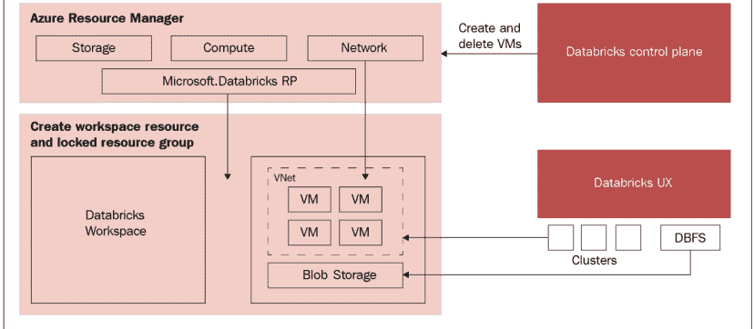

Figure 1.1 – Databricks architecture

这种架构给用户带来的直接好处是与 Azure 实现了无缝连接，使用户能够轻松地将 Azure Databricks 连接到同一 Azure 账户内的任何资源，并通过 Azure 控制中心集中管理 Databricks，无需额外设置。

如前所述，Azure Databricks 是部署在 Azure 云上的托管应用程序，由控制平面和数据平面组成。控制平面位于 Azure 云上，托管诸如集群管理和作业服务等服务。数据平面是一个组件，包含前面提到的 VNet、NSG 以及被称为 DBFS 的存储账户。

您也可以将数据平面部署在客户管理的 VNet 中，以便数据工程团队根据组织策略构建和保护网络架构。这称为 VNet 注入。

现在我们已经了解了底层的一切布局，让我们讨论一下 Databricks 背后的一些核心概念。

## Discovering core concepts and terminology

在深入了解如何创建集群并开始使用 Databricks 之前，我们必须先熟悉一些概念。它们共同定义了 Databricks 为用户提供的<|message|> 工具，并在 Web 应用程序 UI 以及 REST API 中均可用：

- **Workspaces:** Azure Databricks 工作区是一个环境，用户可以在其中访问其所有资产：作业、笔记本、集群、库、数据和模型。所有内容都组织在文件夹中，这允许用户保存笔记本和库并与他人共享以进行协作。工作区用于存储笔记本和库，但不用于连接或存储数据。
- **Data:** 数据可以从各种来源导入到挂载的 Azure Databricks 分布式文件系统中。可以将数据作为表直接上传到工作区，或从 Azure Blob Storage 或 AWS S3 导入。
- **Notebooks:** Databricks 笔记本与 Python 中的 Jupyter 笔记本非常相似。它们是 Web 界面应用程序，设计用于通过可运行的单元格运行代码，这些单元格对文件和表进行操作，并提供可视化以及包含叙述性文本。最终结果是一份包含代码、可视化和清晰文本文档的文档，可以轻松共享。笔记本是我们在 Azure Databricks 中运行代码的两种方式之一。另一种方式是通过作业。笔记本有一组单元格，允许用户执行命令，并且可以包含 Scala、Python、R、SQL 或 Markdown 等语言的代码。为了能够执行命令，它们必须连接到集群，但这种连接不一定是永久性的。这提供了一种轻松的方式通过 Web 或本地机器共享这些笔记本。笔记本可以被安排和触发为作业，以创建数据管道、运行 ML 模型或更新仪表板：

### BroadcastHashJoin

- 配置 BroadcastHashJoin 是一种优化 Spark SQL 中大表和小表连接的方法。
- 本笔记本将介绍如何配置 BroadcastHashJoin 以及为何选择它而不是 ShuffledHashJoin。

### Setup: Create a large table that will be joined with a smaller table.

```
from pyspark.sql import Row

array = []
for i in range(0, 1000000):
    array.append(Row(num=1, bit = i % 2))

dataFrame = sqlContext.createDataFrame(sc.parallelize(array))
dataFrame.repartition(100).registerTempTable("my_large_table")
```

Command took 7.72s

```
display(array)
```

Figure 1.2 – Azure Databricks notebook. Source: https://databricks.com/wp-content/uploads/2015/10/notebook-example.png

- **Clusters:** 集群是一组相互连接的服务器，它们协同工作，就像一台单一的、更强大的计算机。在此环境中，您可以执行任务并从笔记本中执行代码，使用存储在特定存储设施中的数据或作为表上传的数据。这些集群具有管理和控制谁可以访问每个集群的手段。集群用于提高性能和可用性，相较于单台服务器，通常更具成本效益，而单台服务器的性能或可用性相当。数据科学作业、ETL 管道、分析和更多操作都在集群中运行。

全用途集群和作业集群之间存在区别。**全用途集群**是我们协作和交互式使用笔记本工作的地方，而**作业集群**则是我们执行自动且更具体的作业的地方。创建这些集群的方式取决于它是全用途集群还是作业集群。前者可通过 UI、CLI 或 REST API 创建，而后者则通过作业调度程序创建以运行特定作业，并在作业完成后终止。

- **Jobs**: Jobs 是我们在特定集群中执行笔记本、JAR 或 Python 文件时运行的任务。执行可以手动创建和安排，或通过 REST API。
- **Apps**: 第三方应用如 Table 可以在 Azure Databricks 中使用。这些集成称为 apps。
- **Apache SparkContext/environments**: Apache SparkContext 是 Apache Spark 中的主要应用程序，运行内部服务并连接到 Spark 执行环境。历史上，Apache Spark 为用户提供了两个核心上下文 SparkContext 和 SQLContext，但在 2.X 版本中，只剩下一个——**SparkSession**。
- **Dashboards**: 仪表板是一种在不显示生成它们所需代码的情况下展示笔记本单元格输出的方式。它们可以从笔记本创建：

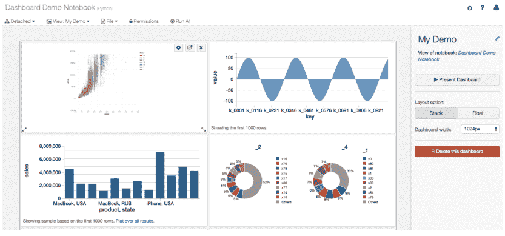

Figure 1.3 – Azure Databricks notebook. Source: https://databricks.com/wp-content/uploads/2016/02/Databricks-dashboards-screenshot.png

- **Libraries**: 库是添加功能的模块，用 Scala 或 Python 编写，可以从存储库中拉取或通过 PyPI 或 Maven 等包管理系统工具安装。
- **Tables**: 表是可用于分析或构建模型的结构化数据，可以存储在 Amazon S3 或 Azure Blob Storage 中，或缓存在当前使用的集群内存中。这些表可以是全局的或局部的，前者可在所有集群中使用。本地表无法从其他集群访问。
- **Experiments**: 每次运行 MLflow 时都属于某个实验。实验是组织和控制所有 MLflow 运行的核心方式。在每个实验中，用户可以搜索、比较和可视化结果，以及下载工件或元数据以进行进一步分析。
- **Models**: 在使用 ML 或深度学习时，我们训练并用于推理的模型会注册在 Azure Databricks MLflow Model Registry 中。MLflow 是一个开源平台，旨在管理 ML 生命周期，其中包括跟踪实验和运行，而 MLflow Model Registry 是一个集中式模型存储，允许用户完全控制 MLflow 模型的生命周期。它具有管理版本、在不同阶段之间转换、具有时间顺序的模型继承，以及控制模型版本注释和描述的功能。
- **Azure Databricks workspace filesystem**: Azure Databricks 部署了分布式文件系统。该系统挂载在工作区中，允许用户挂载存储对象并使用文件系统路径与之交互。它允许我们持久化文件，以便在集群终止时数据不会丢失。

本节重点介绍了 Azure Databricks 的核心组件。在下一节中，您将学习如何通过工作区与 Azure Databricks 交互，工作区是我们与资产交互的地方。


# 与 Azure Databricks 工作区交互

Azure Databricks 工作区是您可以管理诸如笔记本、库和实验等对象的地方。它组织成文件夹结构，同时还提供对数据、集群和作业的访问：

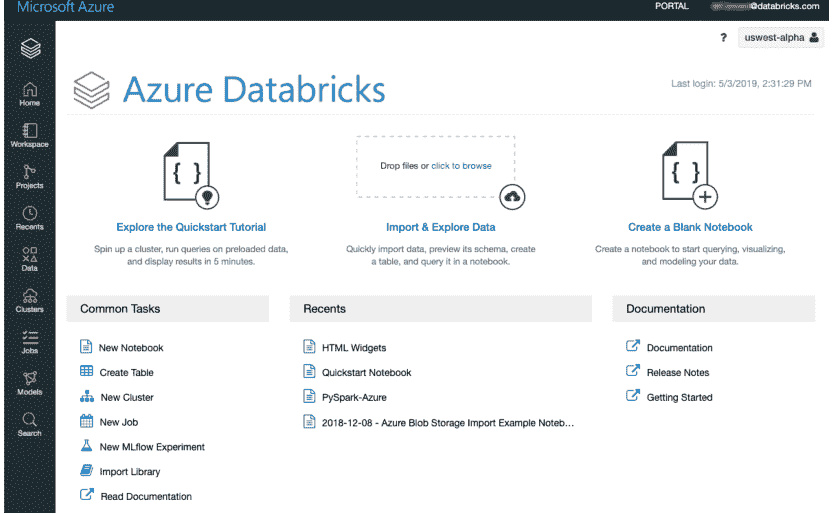

图 1.4 – Databricks 工作区。来源：https://docs.microsoft.com/en-us/azure/databricks/workspace/

可以通过 UI、CLI 或 API 对工作区及其资产进行访问和控制。我们将重点关注使用 UI。

## 工作区资产

在 Azure Databricks 工作区中，您可以管理不同的资产，其中大多数我们在术语中已经讨论过。这些资产如下：

- Clusters
- Notebooks
- Jobs
- Libraries
- Assets folders
- Models
- Experiments

在以下各节中，我们将深入探讨如何处理文件夹和其他工作区对象。管理这些对象是运行 Azure Databricks 任务的核心。

## 文件夹

我们工作区内的所有静态资产都存储在工作区内的文件夹中。存储的资产可以是笔记本、库、实验和其他文件夹。不同的图标用于表示文件夹、笔记本、目录或实验。单击目录以展开项目下拉列表：

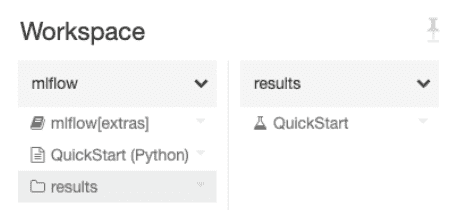

图 1.5 – 工作区文件夹

单击右上角的下拉箭头将展开菜单项，允许用户对该特定文件夹执行操作：

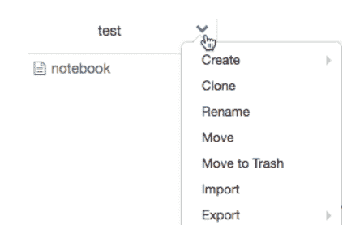

图 1.6 – 工作区文件夹下拉菜单

## 特殊文件夹

Azure Databricks 工作区有三个特殊文件夹，您无法重命名或将其移动到特殊文件夹。这些特殊文件夹如下：

- Workspace
- Shared
- Users

## 工作区根文件夹

**Workspace** 根文件夹是一个包含您所有静态资产的文件夹。要导航到此文件夹，请单击工作区或主页图标，然后单击返回图标：

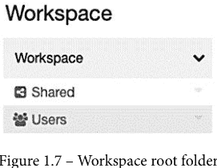

在 **Workspace** 根文件夹中，您可以選擇 **Shared** 或 **Users**。前者用于与组织中的其他用户共享对象，后者包含特定用户的[content]

# 与 Azure Databricks 工作区交互

Azure Databricks 工作区是您可以管理诸如笔记本、库和实验等对象的地方。它组织成文件夹，同时还提供对数据、集群和作业的访问：


图 1.4 – Databricks 工作区。来源：https://docs.microsoft.com/en-us/azure/databricks/workspace/

可以通过 UI、CLI 或 API 对工作区及其资产进行访问和控制。我们将重点关注使用 UI。

## 工作区资产

在 Azure Databricks 工作区中，您可以管理不同的资产，其中大多数我们在术语中已经讨论过。这些资产如下：

- Clusters
- Notebooks
- Jobs
- Libraries
- Assets folders
- Models
- Experiments

在以下各节中，我们将深入探讨如何处理文件夹和其他工作区对象。管理这些对象是运行 Azure Databricks 任务的核心。

## 文件夹

我们工作区内的所有静态资产都存储在工作区内的文件夹中。存储的资产可以是笔记本、库、实验和其他文件夹。不同的图标用于表示文件夹、笔记本、目录或实验。单击目录以展开项目下拉列表：


图 1.5 – 工作区文件夹

单击右上角的下拉箭头将展开菜单项，允许用户对该特定文件夹执行操作：


图 1.6 – 工作区文件夹下拉菜单

## 特殊文件夹

Azure Databricks 工作区有三个特殊文件夹，您无法重命名或将其移动到特殊文件夹。这些特殊文件夹如下：

- Workspace
- Shared
- Users

## 工作区根文件夹

**Workspace** 根文件夹是一个包含您所有静态资产的文件夹。要导航到此文件夹，请单击工作区或主页图标，然后单击返回图标：


在 **Workspace** 根文件夹中，您可以選擇 **Shared** 或 **Users**。前者用于与组织中的其他用户共享对象，后者包含特定用户的


我们也可以通过以下命令查看当前的 Databricks 运行时版本：

```
spark.conf.get("spark.databricks.clusterUsageTags.sparkVersion")
```

这些属性是集群和作业 API 之间通信所必需的。

在集群详细信息页面中，**Notebooks** 选项卡会显示附加到该集群的所有笔记本，以及状态和最后使用时间：

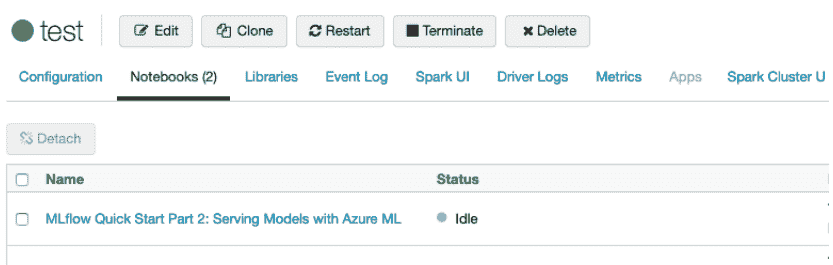

图 1.14 – 附加到集群的笔记本

将笔记本附加到集群是使其正常工作的必要条件；否则，我们将无法在其中执行代码。

通过点击当前附加的集群并选择 **Detach** 来将笔记本从集群中分离：

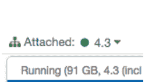

图 1.15 – 从集群分离笔记本

这会导致集群丢失该笔记本中存储为变量的所有值。完成工作后，始终将笔记本从集群中分离是一个良好的做法。这可以防止运行中的集群因笔记本中正在运行的进程而自动停止，从而可能导致不必要的费用。

## Scheduling a notebook

如前所述，笔记本可以被安排定期执行。要安排笔记本作业定期运行，请点击笔记本工具栏右上角的 **Schedule** 按钮。

## A notebook's core functionalities

现在，我们将了解如何使用笔记本。

## Notebook toolbar

笔记本有一个工具栏，其中包含有关其所附加集群的信息，并执行诸如导出笔记本或更改预定义语言等操作（取决于 Databricks 运行时版本）：


此工具栏帮助我们导航笔记本中的常规选项，并使管理与计算集群的交互变得更容易。

## Cells

单元格包含可执行的代码：


在单元格左上角的单元格操作中，您有以下选项：**Run this cell**、**Dashboard**、**Edit**、**Hide** 和 **Delete**：

- 您可以使用 **Undo** 键盘快捷键通过从 **Edit** 中选择 **Undo Delete Cell** 来恢复已删除的单元格。
- 单元格可以通过单元格操作或 **Cut** 键盘快捷键进行剪切。
- 通过点击每个单元格底部的 **Plus** 图标，或从笔记本工具栏的单元格菜单中选择 **Add Cell Above** 或 **Add Cell Below** 来添加单元格。

## Running cells

可以从单元格操作工具栏运行特定单元格。要运行多个单元格，我们可以在 **Run all, all above** 或 **all below** 之间进行选择。我们也可以从笔记本工具栏的 **Run** 选项中选择 **Run All, Run All Above** 或 **Run All Below**。请注意，**Run All Below** 包括您当前所在的单元格。

## Default language

每个笔记本的默认语言显示在笔记本名称旁边的括号中，在以下示例中为 SQL：


图 1.18 – 单元格默认语言

如果您点击括号中的语言名称，将会弹出一个对话框，您可以在其中更改笔记本的默认语言：

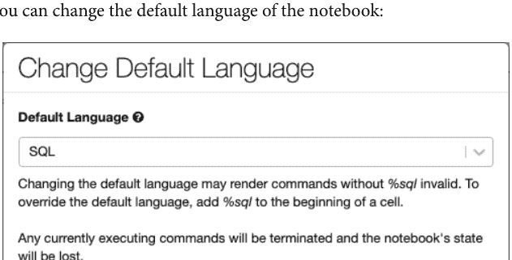

图 1.19 – 更改单元格的默认语言

更改默认语言后，会向未使用新默认语言的单元格添加魔术命令，以保持其正常工作。

语言也可以通过使用魔术命令在每个单元格中指定。支持四种用于语言指定的魔术命令：`%python`、`%r`、`%scala` 和 `%sql`。

还有其他魔术命令，例如 %sh，允许您运行 shell 代码；%fs 用于使用 dbutils 文件系统命令；以及 %md 用于指定 Markdown，以便包含注释和文档。我们稍后会更详细地介绍这一点。

## Including documentation

Markdown 是一种轻量级标记语言，具有纯文本格式语法，通常用于格式化 readme 文件，允许使用纯文本创建富文本。

如前所述，Azure Databricks 允许通过使用 %md 魔术命令使用 Markdown 进行文档编写。然后将标记渲染为 HTML，具有所需的格式。例如，下面的代码用于将文本格式化为标题：

```
%md # Hello This is a Title
```

它被渲染为 HTML 标题：


图 1.20 – Markdown 标题

文档块是 Azure Databricks 笔记本最重要的功能之一。它们允许我们说明代码的目的以及我们如何解释结果。

## Command comments

用户可以通过突出显示代码的特定部分并点击单元格右下角的评论按钮来添加注释：

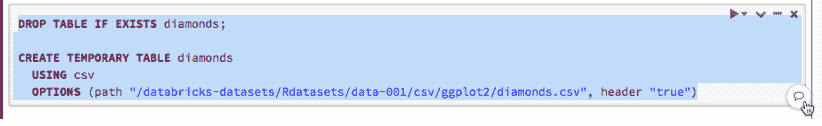

图 1.21 – 选择代码的一部分

这将提示一个文本框，我们可以在其中放置供其他用户查看的注释。之后，被注释的文本将被突出显示：

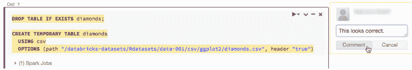

图 1.22 – 对所选内容进行评论

注释允许我们在不干预内容的情况下，对笔记本的特定部分提出更改或要求信息。

## Downloading a cell result

您可以通过点击单元格底部的下载按钮将单元格的表格结果下载到本地机器：

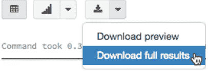

图 1.23 – 从单元格下载完整结果

默认情况下，Azure Databricks 限制您查看 DataFrame 的 1,000 行，但如果存在更多数据，我们可以点击下拉图标并选择 Download full results 以查看更多。

## Formatting SQL

格式化 SQL 代码可能需要花费大量时间，并且在笔记本之间强制执行标准可能很困难。

Azure Databricks 具有在笔记本单元格中格式化 SQL 代码的功能，以便减少用于格式化代码的时间，并有助于在所有笔记本中应用相同的编码标准。要对单元格应用自动 SQL 格式化，可以从单元格上下文菜单中选择它。这仅适用于 SQL 代码单元格：

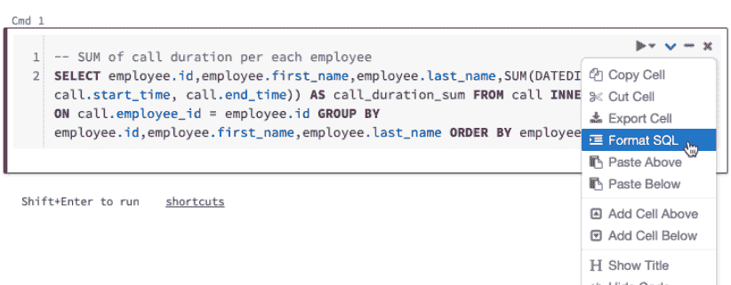

图 1.24 – SQL 代码的自动格式化

应用 SQL 代码的自动格式化是一项可以提高代码可读性并减少因格式不良而导致的可能错误的特性。

## Exploring data management

在本节中，我们将深入了解如何在 Azure Databricks 中管理数据，以便执行分析、创建 ETL 管道、训练 ML 算法等。首先，我们将简要描述 Azure Databricks 中的数据类型。

## Databases and tables

在 Azure Databricks 中，数据库由表组成；结构化数据的表集合。用户可以使用 Apache Spark DataFrames 支持的所有操作与这些表一起工作，并使用 Spark API 和 Spark SQL 查询表。

这些表可以是全局的或局部的，可供所有集群访问。全局表存储在 Hive 元存储中，而本地表则不存储。

表可以使用 DBFS 中的文件或来自所有受支持的数据源的数据进行填充。

## Viewing databases and tables

与您当前使用的集群相关的表可以通过点击侧边栏中的数据图标按钮来查看。**Databases** 文件夹将显示所选数据库中每个表的列表：

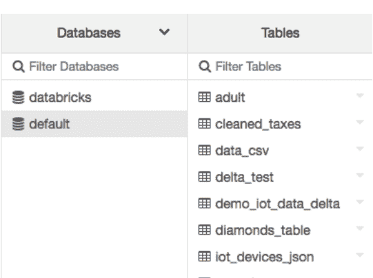

图 1.25 – 默认表

用户可以通过点击 **Databases** 文件夹顶部的下拉图标并选择集群来选择不同的集群：

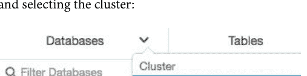

图 1.26 – 在不同集群中选择数据库

我们可以在一个集群上进行多个查询，每个查询都有自己的文件系统。当我们在笔记本中引用数据时，这一点非常重要。


## 导入数据

本地文件可通过 UI 上传到 Azure Databricks 文件系统。

数据可通过 UI 导入到 Azure Databricks DBFS 以存储在 FileStore 中。为此，您可以前往上传数据 UI 并选择要上传的文件以及 DBFS 目标目录：

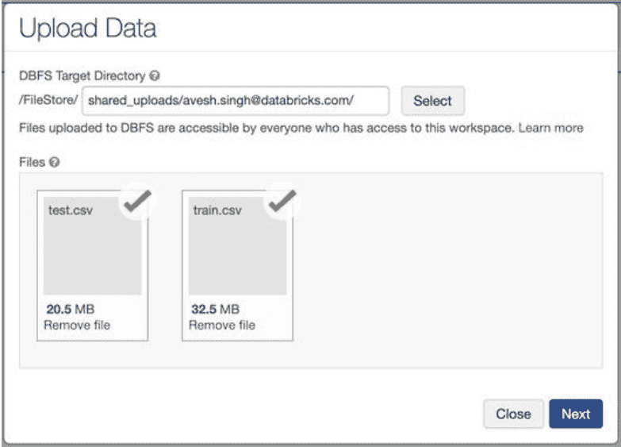

图 1.27 – 上传数据 UI

另一种可用于将数据上传到表的选项是使用创建表 UI，可在工作区中的导入和探索数据框中访问：

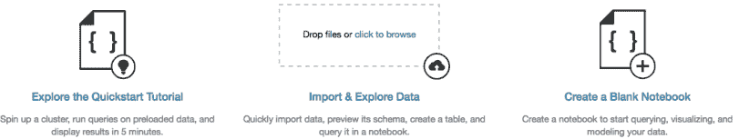

图 1.28 – 导入和探索数据中的创建表 UI

对于生产环境，建议使用 DBFS CLI、DBFS API 或 Databricks 文件系统实用程序（`dbutils.fs`）。

## 创建表

用户可以通过 SQL 以编程方式创建表，或通过 UI 创建全局表。单击侧边栏中的数据图标按钮，您可以在 **数据库** 和 **表** 显示的右上角选择 **添加数据**：

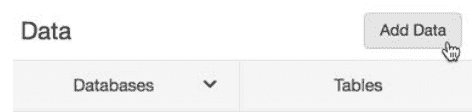

图 1.29 – 添加数据以创建新表

之后，您将被提示一个对话框，您可以在其中上传文件以创建新表，选择数据源和集群、将上传到 DBFS 的路径，并预览表：

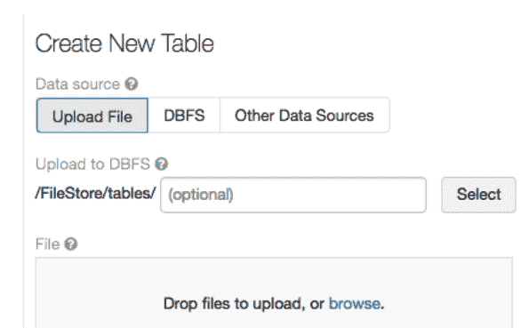

图 1.30 – 创建新表 UI

通过 UI 或 **添加数据** 选项创建表是我们将数据摄取到 Azure Databricks 的众多选项中的两个。

## 表详情

用户可以通过单击表文件夹中表的名称来预览表的内容。这将显示表的视图，我们可以在其中看到表架构和其中包含的数据样本：

表：wikipedia

架构：

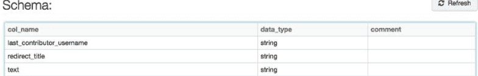

示例数据：

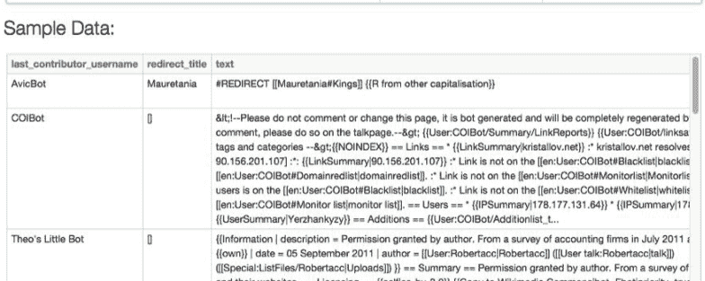

图 1.31 – 表详情

这些表详情使我们能够提前规划转换以使数据符合我们的需求。

## 探索计算管理

在本节中，我们将简要描述如何管理 Azure Databricks 集群，我们所有操作计算的支柱。我们将描述如何显示集群信息，以及如何编辑、启动、终止、删除和监控日志。

## 显示集群

要显示工作区中的集群，请单击侧边栏中的集群图标。您将看到集群页面，该页面在两个选项卡中显示集群：通用集群和作业集群：

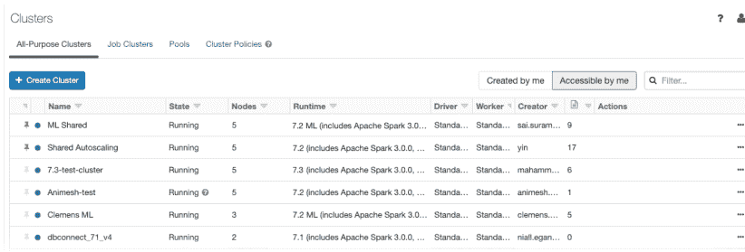

图 1.32 – 集群详情

除了常见的集群信息外，通用集群还显示附加到它们的笔记本数量。

诸如终止、重启、克隆、权限和删除等操作可通过通用集群的最右侧访问：

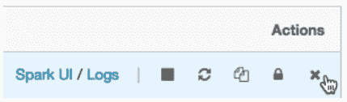

图 1.33 – 集群操作

集群操作允许我们直接从笔记本快速在集群中操作。

## 启动集群

除了创建新集群外，您还可以启动之前已终止的集群。这使您可以使用原始配置重新创建之前已终止的集群。集群可以从集群列表启动，也可以在笔记本中的集群图标附加下拉菜单的集群详情页面启动：

## 快速入门笔记本（SQL）

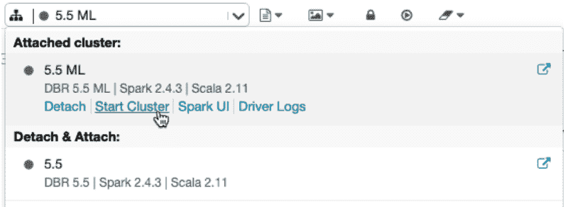

图 1.34 – 从笔记本工具栏启动集群

您也可以选择使用 API 以编程方式启动集群。

每个集群都有唯一标识，并且当您启动已终止的集群时，Azure Databricks 会自动安装库并将其重新附加到笔记本。

## 终止集群

为节省资源，您可以终止集群。已终止集群的配置会被保存以便以后重用。

集群可以手动终止，也可以根据指定的非活动期自动终止：

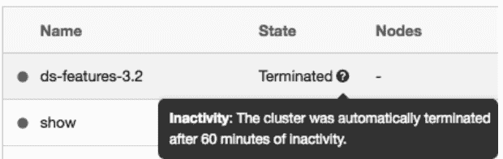

图 1.35 – 已终止的集群

需要注意的是，非活动集群将被自动终止。

## 删除集群

删除集群会终止集群并删除其配置。请谨慎使用，因为此操作无法撤消。

要删除集群，请在作业集群或通用集群选项卡的集群操作中单击删除图标：

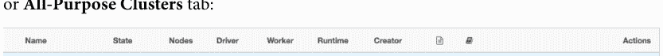

图 1.36 – 从作业集群选项卡删除集群

您也可以调用永久删除 API 端点以编程方式删除集群。

## 集群信息

有关 Spark 作业的详细信息显示在 Spark UI 中，可从集群列表或集群详情页面访问。Spark UI 显示活动和已终止集群的集群历史记录：

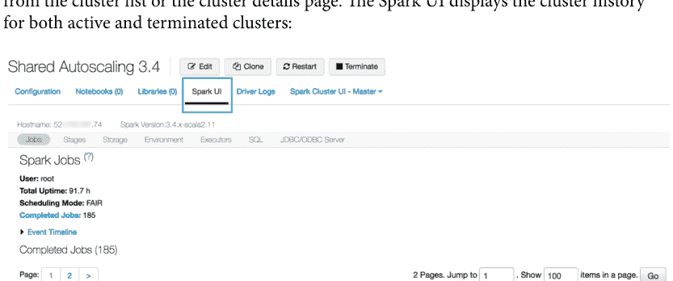

图 1.37 – 集群信息

集群信息使我们能够深入了解流程的进展情况，并识别可能指向优化机会的瓶颈。

## 集群日志

Azure Databricks 提供三种类型的集群相关活动日志：

- 用于生命周期事件的集群事件日志，例如创建、终止或配置编辑
- Apache Spark 驱动程序和工作器日志，通常用于调试
- 集群初始化脚本日志，对调试初始化脚本很有价值

Azure Databricks 提供有关手动或自动触发的生命周期事件的集群事件日志，例如创建和配置编辑。还有 Apache Spark 驱动程序和工作器的日志，以及集群初始化脚本日志。

事件存储 60 天，这与其他 Azure Databricks 中的数据保留时间相当。

要查看集群事件日志，请单击侧边栏中的集群按钮，单击集群名称，然后最后单击事件日志选项卡：

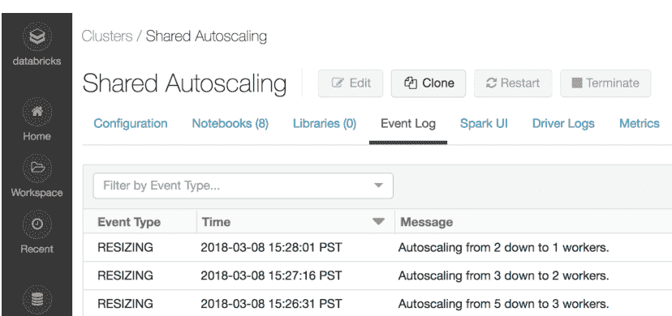

集群事件为我们在执行作业期间对集群采取的操作提供了具体信息。

## 探索身份验证和授权

Azure Databricks 允许用户执行访问控制以管理对工作区对象、集群、池和数据表的访问。管理员用户管理访问控制列表以及具有委托权限的用户。

## 集群访问控制

默认情况下，在 Azure Databricks 中，所有用户都可以创建或修改集群。在使用集群访问控制之前，管理员用户必须启用它。之后，有两种类型的集群权限，分别如下：

- **允许创建集群** 权限允许创建集群。
- **集群级权限** 允许您管理集群。

启用集群访问控制后，只有管理员和具有 **可以管理** 权限的用户才能配置、创建、终止或删除集群。

## 配置集群权限

可以通过单击侧边栏中的 **集群** 按钮并在 **操作** 选项中选择 **权限** 按钮来配置集群访问控制。这将提示权限对话框，用户可以在其中执行以下操作：

- 使用 **添加用户** 和 **组** 选项对用户和组应用细粒度访问控制。
- 管理用户和组的授予访问权限。

这些选项在图 1.39 中可见：

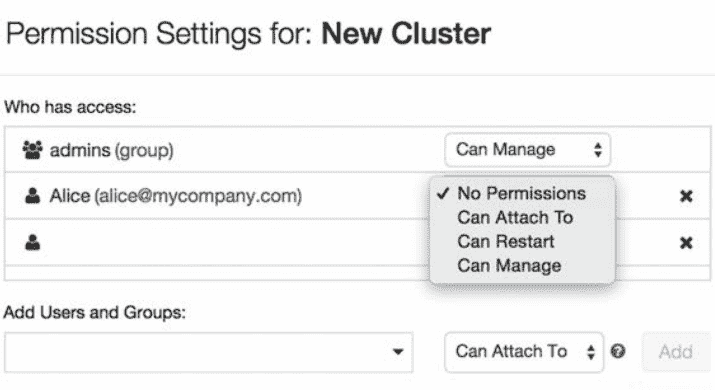

图 1.39 – 管理集群权限

集群权限允许我们对项目中使用的计算资源实施细粒度控制。

## 文件夹权限

文件夹有五个权限级别：无权限、读取、运行、编辑和管理。任何笔记本或实验都将继承包含它们的的权限。

## 默认文件夹权限

除了当前访问控制外，还维护以下权限：

- 共享文件夹中的对象可由任何人管理。
- 用户可以管理自己创建的对象。

当没有工作区访问控制时，用户只能编辑其工作区文件夹中的项目。


启用工作区访问控制后，存在以下权限：

- 只有管理员可以在 **Workspace** 文件夹中创建项目，但用户可以管理现有项目。
- 应用于文件夹的权限将应用于其包含的项目。
- 用户对其主目录仍保留 **Manage** 权限。

了解这些权限有助于我们提前了解这些策略的可能变更如何影响用户与组织数据的交互方式。

## Notebook 权限

Notebook 具有与文件夹相同的五个权限级别：**No Permissions**、**Read**、**Run**、**Edit** 和 **Manage**。

## 配置 notebook 和文件夹权限

用户可以通过点击 notebook 上下文栏中的 **Permissions** 按钮来配置 notebook 权限。选择文件夹，然后从下拉菜单中点击 **Permissions**：

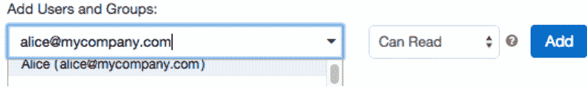

从那里，您可以授予用户或组的权限以及编辑现有权限：

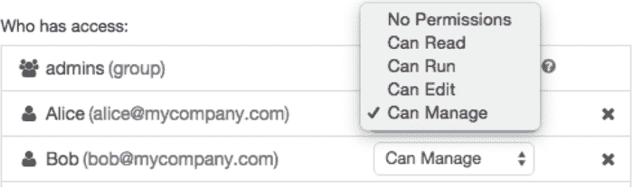

通过从下拉菜单中选择其中一个选项，可以轻松地以这种方式对 notebook 应用访问控制。

## MLflow Model 权限

您可以为在 **MLflow Model Registry** 中注册的 **MLflow Models** 分配六个权限级别：**No Permissions**、**Read**、**Edit**、**Manage Staging Versions**、**Manage Production Versions** 和 **Manage**。

## 默认 MLflow Model 权限

除了当前的工作区访问控制外，还维护以下权限：

- 注册表中的模型可以由任何人创建。
- 管理员可以管理注册表中的任何模型。

当没有工作区访问控制时，用户可以管理注册表中的任何模型。

启用工作区访问控制后，存在以下权限：

- 用户只能管理他们创建的模型。
- 只有管理员才能管理由其他用户创建的模型。

这些选项适用于在 Azure Databricks 中创建的 MLflow Models。

## 配置 MLflow Model 权限

需要注意的一点是，只有管理员属于具有 **Manage** 权限的 admins 组，而其余用户属于 **all users** 组。

可以通过点击侧边栏中模型的图标、选择模型名称、点击模型名称右侧的下拉图标，最后选择 **Permissions** 来修改 MLflow Model 权限。这将显示一个对话框，我们可以从中选择特定用户或组并添加特定权限：


图 1.42 – MLflow 权限

您可以通过从 **Permission** 下拉菜单中选择新权限来更新用户或组的权限：

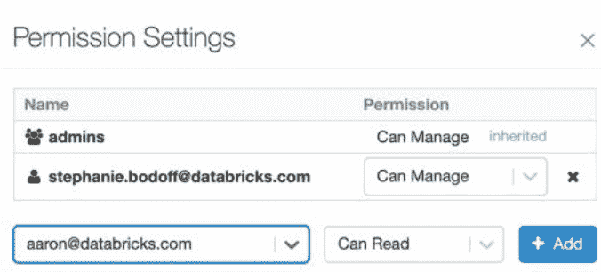

图 1.43 – MLflow 访问管理

通过选择其中一个选项，我们可以控制 MLflow 实验如何与我们的数据交互，以及哪些用户可以创建与其一起工作的模型。

## 总结

在本章中，我们尝试涵盖了 Azure Databricks 的所有主要方面。我们发现的一些内容包括如何创建 notebook 来执行代码，如何导入数据以使用，如何创建和管理集群等等。这很重要，因为在组织内部在 Azure Databricks 中创建 ETL 和 ML 实验时，除了如何在 notebook 中编写 ETL 代码外，我们还需要知道如何管理所需的数据和计算资源，如何共享资产，以及如何管理其中每一个的权限。

在下一章中，我们将应用这些知识，更详细地探讨如何在 Azure Databricks 中创建和管理处理数据所需的资源，并了解有关自定义 VNet 的更多信息以及我们通过 Azure Databricks UI 或 CLI 工具与之交互的不同替代方案。

### 2
创建 Azure Databricks 工作区

在本章中，我们将应用我们在 *Chapter 1, Introduction to Azure Databricks* 中探索的所有概念。我们将使用 UI 创建第一个 Azure Databricks 工作区，然后通过 Azure CLI 探索不同的资源管理可能性，如何使用 ARM 模板部署这些资源，以及我们如何使用 VNet 注入将 Azure Databricks 集成到我们的虚拟网络中。

在本章中，我们将讨论以下主题：

- 使用 Azure 门户 UI
- 检查 Azure Databricks 身份验证
- 在 Azure Databricks 中使用 VNets
- Azure Resource Manager 模板
- 设置 Azure Databricks CLI

我们将首先从 Azure 门户 UI 创建工作区。

## 技术要求

本章最重要的先决条件是已经拥有资金和权限的 Azure 订阅。请记住，这是一项按使用付费的服务，但无论如何，您可以创建一个免费试用订阅；有关此选项的更多信息，请查看 Azure 门户（https://azure.microsoft.com/en-us/free/）。

## 使用 Azure 门户 UI

让我们开始通过 Azure 门户 UI 设置新的 Databricks 工作区：

- 1. 登录您的订阅的 Azure 门户并导航到 Azure 服务功能区。
- 2. 点击 Azure Databricks：
- 3. 这将带您进入 Azure Databricks 默认文件夹，您将在其中看到列出所有资源。点击 Create new resource 以创建 Azure Databricks 工作区环境：

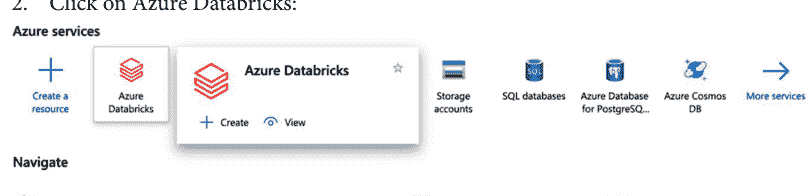

图 2.1 – 创建 Azure Databricks 服务

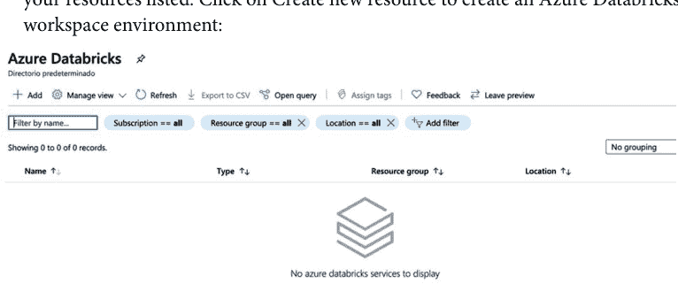

图 2.2 – 您的 Azure Databricks 部署资源

4. 一旦您点击 Create azure databricks service，您将需要填写一些关于您正在创建的工作区的详细信息。设置看起来会像这样：

- Workspace name
- Subscription
- Resource group
- Location
- Pricing Tier
- Deploy Azure Databricks workspace in your Virtual Network (Preview)

工作区的名称可以随意选择，但最好选择一个简单且能体现其用途的名称。例如，这些环境可以是验收或生产环境，每一个都是其自己的订阅类型。资源组可以在当时创建，并且必须逻辑上涵盖具有相同目的的所有资源。

部署资源的地理位置也很重要，因为它必须靠近服务点或必须与其一起工作的其他部署资源。

> **Note**
> 关于定价层：有三个选项，分别是 Standard、Premium 和 Trial。其中一个最大的区别是 Premium 允许您应用访问控制。这使其成为企业环境中的常见选择。

其中一个选项是您可以选择在自己的专用虚拟网络中部署。在此步骤中，我们将选择 No，但我们将在本章后面讨论 VNet 以及如何将其作为一种良好的安全实践，将所有 Azure 资源置于相同的网络安全策略下。

5. 最后，您可以创建资源，工作区将被自动配置和部署：

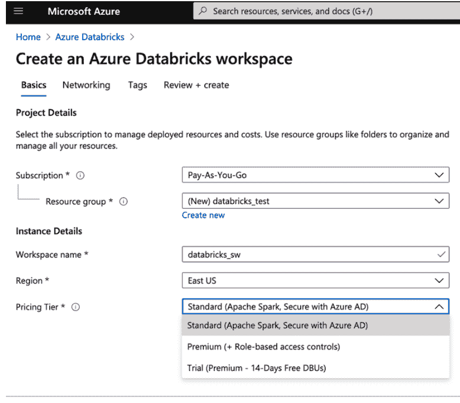

图 2.3 – 创建 Azure Databricks 工作区

现在我们已成功创建工作区，我们可以通过 Azure CLI 的 Workspace UI 访问它。

## 访问 Workspace UI

一旦您的 Azure Databricks 资源成功部署，您就可以访问工作区。您可以通过在 Azure 门户中点击资源中央的 Launch Workspace 按钮直接访问它，或者您可以通过使用资源中心左侧显示的 URL 访问它。此 URL 将带您进入您将使用 Azure AD 登录访问的工作区：

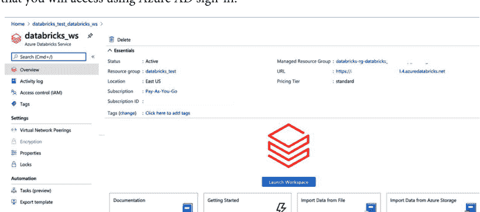

图 2.4 – Azure Databricks 服务主面板

一旦您能够访问工作区，您将看到不同的选项来访问您的资产。您可以使用左侧选项功能区，或中心选项来打开 notebook、创建新集群、新作业等等。主左侧功能区中可访问的整个选项列表如下：

- Azure Databricks
- Home
- Workspace
- Recent assets
- Data
- Clusters


- Jobs
- Search:

We can see the UI here:

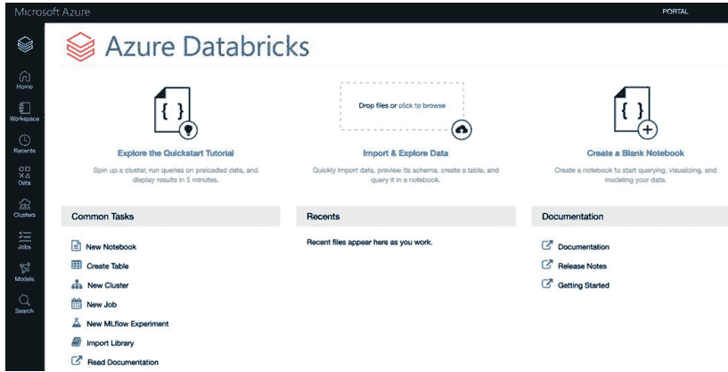

Figure 2.5 – The Azure Databricks workspace

Once we have created our workspace environment, before we can focus on creating our first notebook, first you need to create a cluster. The cluster is necessary because it's there that the code in our notebooks will run. After creating a cluster, the next step will be to create a new notebook, which is the collaborative script on which Azure Databricks is based.

## Configuring an Azure Databricks cluster

As we have mentioned before, a cluster is where the code in our notebooks is run. It can be thought of as a set of VMs running in the background and balancing the load from our computations. This resource is billable when it's on, so remember to terminate it when not in use.

Let's click on the Clusters icon on the left ribbon. This will open a window with the options to create a new cluster. The only necessary field is the name of the cluster, the rest of the fields have default values that we could leave as they are, but it's good that we look at them more closely. The options that we have are as follows:

- Cluster Mode: We can choose from a Standard to a High Concurrency cluster.
- Pool: This is the number of standby compute machines ready and waiting to be used if the computing needs increase during the process. It reduces spin-up time for the cluster.
- Databricks Runtime Version: The version of Scala or Spark running in the cluster. Most available options now just allow Python 3.
- Autopilot Options: Enables autoscaling of the resource up and down and terminates following a predefined number of minutes of inaction.

The final configuration is the type of driver and worker we will use. The driver is responsible for coordinating and distributing the job to the workers. More workers, or better workers or drivers, will increase the computing performance of the cluster, but will impact the cost of these resources, so be sure to check the pricing first:

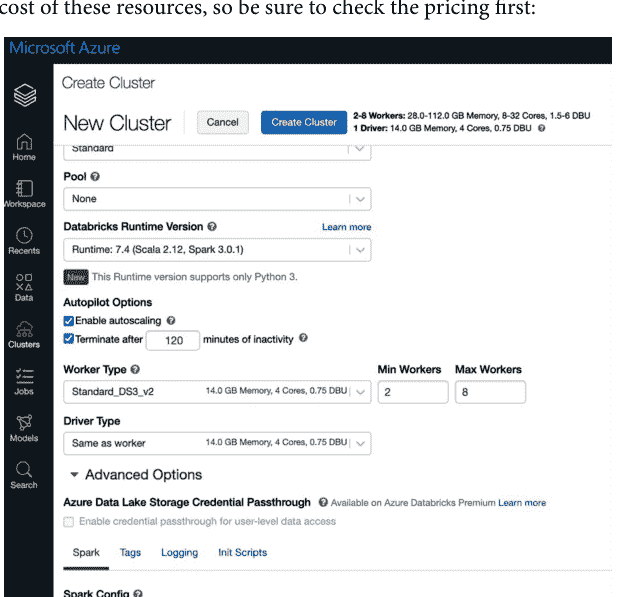

Figure 2.6 – Creating a cluster

After the cluster has been created successfully, we can create a new notebook and attach it to the new cluster and start running code on it.

## Creating a new notebook

Let's go back to the workspace and from there, we have two options to create a new notebook:

- 1. The first option is to create it directly from the home workspace by clicking on the New Notebook link under Common Tasks. This will open a dialog box from where we can select the default language of the notebook and the cluster to which it will be attached:

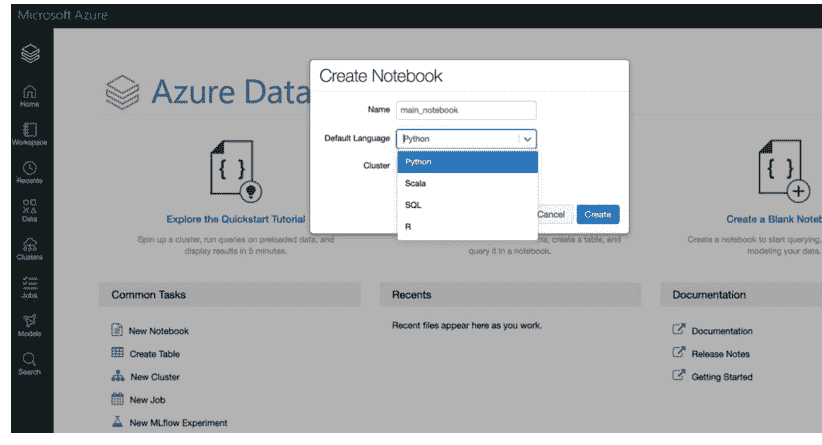

Figure 2.7 – Creating a notebook

The other option that we have is to create the notebook directly in a specific directory:

Figure 2.8 – Creating a notebook in a specific location

2. Once the notebook has been created, we attach it to a cluster, and we can start creating cells and running code in them:

Figure 2.9 – Notebook attached to a cluster

You can use Python because it's the default language of the notebook we just created, but if you want to use a different language, for example, Scala, remember you can use the magic %scala command. To execute the code in a cell, you can use the shortcuts Ctrl + Enter or Shift + Enter. If the cluster that the notebook is attached to is not running, you will be prompted to confirm that you want it running again.

We are now almost ready to handle data, but to do this, we have a couple of things that we have to bear in mind.

There are three different ways in which we handle data from Azure Storage from PySpark:

- Using a WASB file path, which is a way to specify the path to a file in the Windows Azure storage blob.
- Using a mount point on worker nodes with the FS protocol. We can use the magic %fs command to specify commands such as ls, and we can use the files stored there, using file paths such as dbfs:/mnt//<containername>/<partialPath>.
- Using a mount point and requesting files using a regular file path: /dbfs/mnt/<containername>/<partialPath>.

We can also upload data directly by creating a table with the Create Table UI:

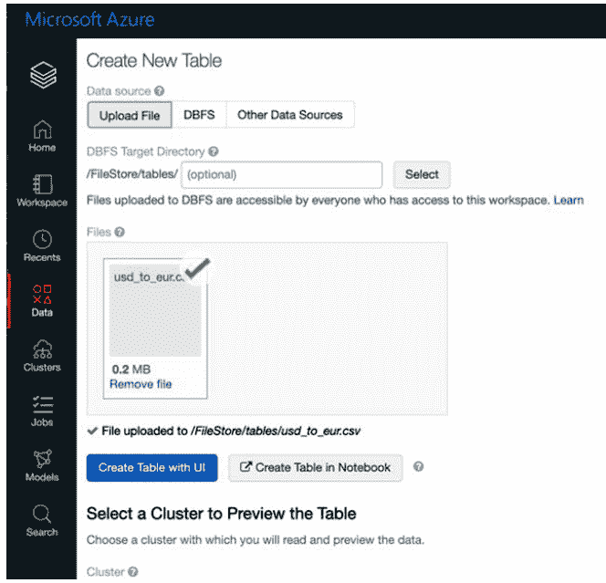

Figure 2.10 – Creating a new Table UI

Now, we also have the option to upload files into the notebooks directly:

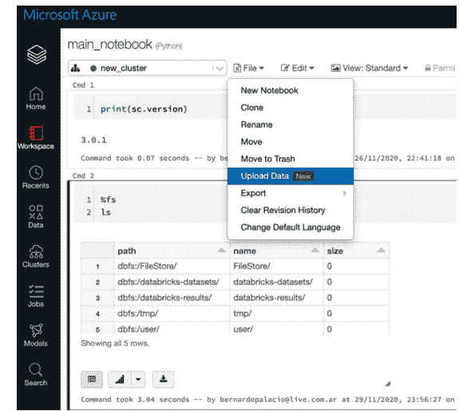

Figure 2.11 – Uploading data to the notebook

3. The other nice option we have is that Databricks already has some datasets to start with! We can use fs utils to explore this; by way of an example, we can use one of the coronavirus datasets:

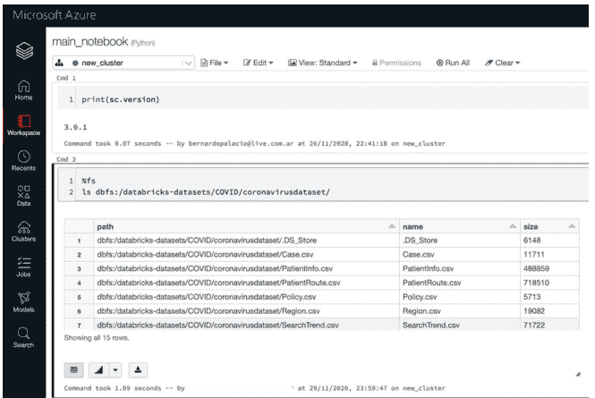

Figure 2.12 – Azure Databricks datasets

4. After that, we are ready to use the data. We will load it as a Spark DataFrame. The code to do this is as follows:

```
file_path = "dbfs:/databricks-datasets/COVID/coronavirusdataset/PatientInfo.csv"
df = spark.read.format("csv").load(file_path,header = "true",inferSchema = "true")
display(df)
```

The result is visible in the following screenshot:

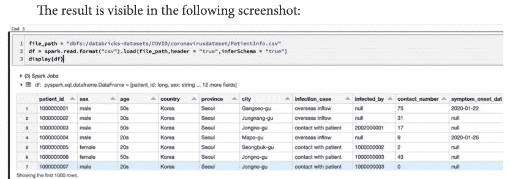

Figure 2.13 – Coronavirus dataset

5. After that we can run some statistics on the data frame:

```
df.printSchema()
df.describe().show()
df.head(5)
```

You can see the result in the following screenshot:

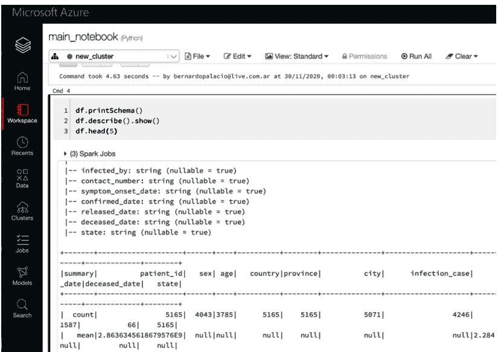

Figure 2.14 – Spark data frame information

So far, we have seen how to create an Azure workspace and create a notebook in which we can run code and work with data. In the following parts of the chapter, we will dive deeper into how we can control these resources through the Azure CLI, deploying with ARM templates, and VNet injection.

Now we will see how we can share these notebooks through Azure Databricks authentication.

## Examining Azure Databricks authentication

In Azure Databricks, authentication is effected through our Azure AD account, which, in some cases, can be linked to our Microsoft account. Subscriptions such as Premium allow us to manage access to our assets through access control in a more detailed manner.

## Access control

If we share the URL of our workspace with a user to collaborate, first we must grant access to that user. To do this, we could either grant them Owner or Contributor roles of the asset we want to share or do this in Admin Console:

- 1. You can access Admin Console by clicking on the resource name icon in the top-right corner:

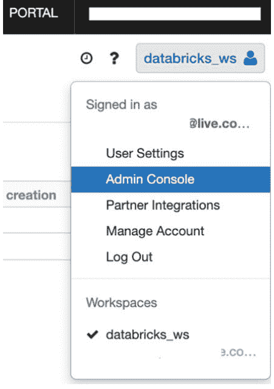

Figure 2.15 – Admin Console

- 2. After that, users can be added by clicking on the Add User button and then selecting the role you would like that user to have. You can create internal groups and apply a more detailed control over folder and workspace assets:

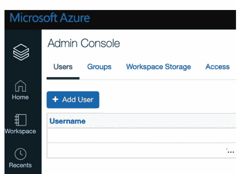

Figure 2.16 – Adding a user

Users can be added to our workspace to work collaboratively with our notebooks and data.

## Working with VNets in Azure Databricks

Azure Databricks can be deployed within a custom virtual network. This is called VNet injection and is very important from a security perspective. When we deploy with default settings, inbound traffic is closed, but outbound traffic is open without restrictions. When we use VNet injection and we deploy directly to a custom virtual network, we can apply the same security policies around all our Azure Services, to meet compliance and security requirements.

In case you are working in data science or exploratory environments, it's good to leave the outbound traffic open to be able to download packages and libraries for Python, R, and Maven, and Ubuntu packages also.

As we have mentioned before, Azure Databricks works on two planes of service. The first is the control page, which we use through the Databricks API to work with workspace assets. The second is the data plane where the clusters are deployed. It is this second plane that is deployed to your customized virtual network. The benefits of this are as follows:

- A secure connection to other Azure services, such as Azure Storage, through service endpoints
- A connection to on-premises data sources to be used in Azure Databricks
- Connecting Azure Databricks to a network virtual appliance to monitor and control outbound traffic


- 配置 Azure Databricks 使用自定义 DNS
- 配置网络安全组 (NSG) 规则
- 在现有的虚拟网络中部署 Azure Databricks 集群

这之所以成为可能，是因为 Azure Databricks 委托，它允许对子网进行联合控制。网络所有者允许在特定子网中部署资源，并通过指定此委托发生的条件以及添加或修改安全策略来行使控制。

## 虚拟网络要求

你打算部署 Azure Databricks 工作区的 VNet 应满足以下条件才能正常工作：

- 它应与我们正在创建的 Azure Databricks 资源具有相同的区域。
- VNet 必须属于与 Azure Databricks 资源相同的订阅。
- VNet 应为 Azure Databricks 提供专用私有和公共子网，以允许与控制平面通信。
- 地址空间：虚拟网络的 CIDR 块为 /16 – /24 之间，私有和公共子网的 CIDR 块最高为 /26。

虚拟网络允许我们在所有 Azure 资源中强制执行相同的策略。

## 部署到你自己的 VNet

我们将展示如何将集群部署到特定虚拟网络的基本方法。Azure Databricks 将在此网络内创建两个子网以及使用你提供的 CIDR 范围创建网络安全组，对入站和出站流量进行白名单，并在虚拟网络更新后进行部署。

## 部署要求

要部署 Azure Databricks，你首先必须按以下方式配置你的虚拟网络：

- 虚拟网络可以是现有的，也可以是新创建的，但正如前面提到的，区域和订阅必须与你计划创建的 Azure Databricks 工作区相同。
- 虚拟网络需要 /16 – /24 之间的 CIDR 范围。

## 配置虚拟网络

在我们*创建 Azure Databricks 资源*时，我们被提示了一个名为 Networking 的选项卡。在此选项卡中，如果我们选择部署到我们自己的虚拟网络，我们将看到部署到我们自己的虚拟网络的选项：

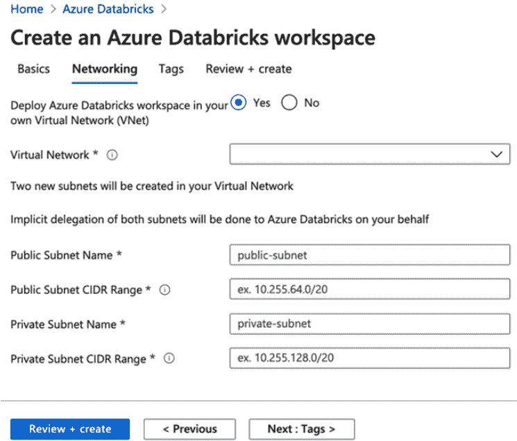

图 2.17 – Azure Databricks 在自定义虚拟网络中

从这里，我们可以选择要使用的网络、对互联网公开的子网、私有子网以及 CIDR 范围。设置完成后，你可以点击 Review + create 并等待你的 Azure Databricks 在你的网络中部署。

我们可以使用 Azure 资源管理器 (ARM) 更详细地指定虚拟网络的配置。这些是我们可用于将服务部署到 Azure 的模板。有了这些模板，我们可以指定是否要使用现有子网、使用现有安全组等。在下一节中，我们将更深入地研究 Azure Databricks 的 ARM 模板。

## Azure 资源管理器模板

ARM 模板是基础设施即代码，允许我们以敏捷的方式自动部署资源。这些模板是 JSON 文件，以声明方式定义基础设施和配置，指定资源和属性。我们可以作为单个资源部署多个资源，并修改现有配置。就像代码一样，它可以存储在存储库中并进行版本控制，任何人都可以运行代码来部署类似的环境。

ARM 模板随后传递给 ARM API，后者部署指定的资源。这些可以包括虚拟网络、VM 或 Azure Databricks 工作区。

这些模板有两种操作模式，即 Complete 或 Incremental 模式。当我们在 Complete 模式下部署时，这会删除模板中未指定的任何对象以及正在部署到的资源组。增量部署会向现有资源添加额外资源。

这些模板的局限性在于它们不会连同资源一起部署代码。

还重要的是要提到，如果我们使用 ARM 模板部署资源，最好先在 Azure 的另一个测试订阅中对其进行测试。这可以帮助我们验证模板是否可以通过 Azure CLI 部署，并避免例如在 Complete 模式下部署然后因 Azure 订阅配额限制而无法创建新资源的情况。我们将在下一节中看到如何做到这一点。

## 使用 ARM 模板创建 Azure Databricks 工作区

我们将了解如何使用 ARM 模板创建 Azure Databricks 工作区，然后验证其是否已正确部署。为此，我们将以 Azure Quickstart Templates 中的 ARM 模板为例。

与往常一样，要创建 Azure Databricks 工作区，我们需要一个 Azure 订阅：

1. 转到 Azure 门户，并在搜索选项卡中查找 Deployment of Custom Template。从这里，我们可以选择构建自己的模板或使用 GitHub Quickstart Template 中的模板。我们将选择此选项并查找 101-databricks-workspace，但也有使用 VNet 注入和托管密钥的选项：

## 自定义部署

部署自定义模板

选择模板   基础   Review + create

使用 Azure 资源管理器模板以单一协调操作自动化部署资源。创建或选择下方模板开始。了解有关模板部署的更多信息

在编辑器中构建自己的模板

# 常用模板

- 创建 Linux 虚拟机
- 创建 Windows 虚拟机
- 创建 Web 应用
- 创建 SQL 数据库

# 加载 GitHub 快速入门模板

快速入门模板（免责声明）  101-databricks-workspace

部署 Azure Databricks 工作区。

作者：jeffpang
最后更新：2020-09-21
了解更多

选择模板   编辑模板

图 2.18 – 自定义部署

2. 选择模板后，你需要提供所需的值，然后选择 Review + create，最后选择 Create：

Home >

# 部署 Azure Databricks 工作区

Azure 快速入门模板

选择模板   基础   Review + create

模板
101-databricks-workspace
1 个资源
编辑模板   编辑参数

# 部署范围

选择用于管理部署资源和成本的订阅。使用资源组像文件夹一样组织和管理所有资源。

订阅 *   Pay-As-You-Go
资源组 *   创建新

# 参数

区域 *   East US
工作区名称 *
定价层   premium
位置   [resourceGroup().location]

Review + create   < 上一步   下一步：Review + create >

图 2.19 – 从 ARM 模板创建 Azure Databricks

正如我们之前可能经历过的那样，工作区的创建需要一些时间。如果部署失败，工作区将处于失败状态，我们需要删除它并创建一个新的。当此工作区被删除时，托管资源组和任何其他已部署资源也将被删除。

## 查看已部署资源

你可以在 Azure 门户中检查 Azure Databricks 工作区是否已成功部署，或使用以下 Azure CLI 脚本来列出资源：

```
echo "Enter your Azure Databricks workspace name:" &&
read databricksWorkspaceName &&
echo "Enter the resource group where the Azure Databricks workspace exists:" &&
read resourcegroupName &&
az databricks workspace show -g $resourcegroupName -n $databricksWorkspaceName
```

## 清理资源

如果你正在按照本教程进行操作并且不打算使用之前创建的资源，可以使用下一个 Azure CLI 脚本来删除它们：

```
echo "Enter the Resource Group name:" &&
read resourceGroupName &&
az group delete --name $resourceGroupName &&
echo "Press [ENTER] to continue ..."
```

让我们谈谈 Azure CLI。它是我们可用于与 Azure Databricks 中的资源交互的工具。在下一节中，我们将更详细地描述如何使用它来管理我们的工作区资产。

## 设置 Azure Databricks CLI

Azure Databricks 附带一个 CLI 工具，允许我们管理资源。它建立在 Azure Databricks API 之上，允许你访问工作区、作业、集群、库等。这是一个托管在 GitHub 上的开源项目。


Azure Databricks CLI 基于 Python 3，并通过以下 pip 命令进行安装：

```
pip3 install databricks-cli
```

你可以通过检查版本来确认安装是否成功。如果安装成功，你将看到 Azure Databricks CLI 的当前版本作为结果：

```
databricks --version
```

值得注意的是，使用 Databricks CLI 与启用防火墙的存储容器是不可能的，在这种情况下，建议使用 Databricks Connect 或 AZ storage。

要能够安装 Azure CLI，你需要在将要工作的环境中已安装 Python 3 并将其添加到路径中。

## 通过访问令牌进行身份验证

让我们设置 CLI：

- 1. 为了能够使用 CLI 命令，我们必须通过设置 Azure Databricks 个人访问令牌来对自己进行身份验证。该令牌在你的 Azure Databricks 配置文件中生成，在访问令牌部分：

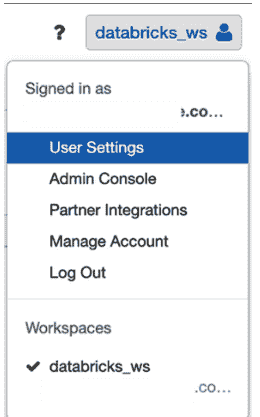

2. 之后，我们点击左上角的 Generate New Token 按钮。这将要求我们完成对此访问令牌用途的评论并为我们的令牌建立一个生命周期：

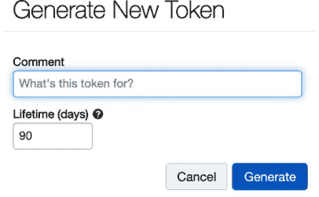

图 2.21 – Generate New Token

3. 接下来，你将看到生成的令牌。复制并将其安全存储，因为这将是你唯一一次看到该令牌的时候。一旦创建，令牌将列在你的账户用户设置选项卡中的访问令牌列表中。

4. 现在我们有了令牌，我们就可以用它在 Azure CLI 中对自己进行身份验证。为此，在我们的终端中，我们可以编写以下命令：

```
databricks configure --token
```

我们需要提供主机和令牌。主机是我们尝试访问的 Azure Databricks 资源的 URL。

## 使用 Azure AD 令牌进行身份验证

我们配置 CLI 的另一个选项是使用 Azure AD 令牌：

- 1. 你可以在 Azure 门户中生成此访问令牌，一旦完成，我们可以将其存储为名为 DATABRICKS_AAD_TOKEN 的环境变量：

```
export DATABRICKS_AAD_TOKEN=<azure-ad-token>
```

- 2. 在设置环境变量后，我们可以运行下一个命令，使用 AD 令牌配置 Databricks CLI。此命令将要求你提供我们尝试访问的 Azure Databricks 资源的 URL，其格式为 adb-<workspace-id>.<random-number>.azuredatabricks.net：

```
databricks configure --aad-token.
```

3. 在完成提示的所有必填字段后，你的访问凭据将存储在一个文件 ~/.databrickscfg 中。该文件应包含如下条目：

```
host = https://<databricks-instance>
```

```
token = <azure-ad-token>
```

在 CLI 0.8.1 及更高版本中，此文件的路径可以通过将环境变量 DATABRICKS_CONFIG_FILE 设置为我们想要的路径来更改。

## 验证安装

一旦我们提供了这些参数，我们将能够使用 Azure Databricks CLI 与我们的资源进行交互：

1. 我们可以通过运行下一个命令来测试这一点，该命令将向我们展示工作区中用户文件夹中的资产：

```
databricks workspace ls /Users/<your_username>
```

作为结果，你将获得用户文件夹中所有资产的列表。

2. 我们始终可以通过运行以下命令来获取有关可用命令的帮助文档：

```
databricks <resource> -h
```

例如，此资源可以是 DBFS，对于它，我们需要用 fs 填充括号中的资源，使命令如下：

```
databricks fs -h
```

## Workspace CLI

正如我们之前所见，工作区是我们 Azure Databricks 环境的根文件夹，也是笔记本和文件夹所在的位置。我们可以通过 Databricks CLI 管理这些资产。例如，我们可以使用 CLI 工具将 Python 脚本复制到工作区中的特定文件夹：

1. 执行此操作的命令如下：

```
databricks workspace import <source_path>/script.py <target_path> -l PYTHON
```

这里，-l 选项用于指示我们上传的文件的语言。

2. 之后，我们可以通过运行以下命令来验证文件是否已正确导入：

```
databricks workspace list /<target_path>
```

正如我们之前所见，这将向我们展示目标路径中的所有文件和文件夹。

除此之外，我们还有命令允许我们删除、导出和创建文件夹等。其中一些在下面提到，但你可以使用 -h 命令在 CLI 工具中查看所有命令。

## 使用 CLI 探索工作区

以下是一些使用 Azure CLI 获取有关工作区信息的方法：

- *列出工作区文件：*

```
databricks workspace ls /Users/example@databricks.com
```
- *导入本地笔记本目录：* databricks workspace import_dir 命令允许我们将本地文件系统中的所有文件和目录导入工作区。值得一提的是，只有扩展名为 .scala、.py、.sql、.r 和 .R 的目录和文件才会被导入，并且在这样做时，这些扩展名会被从笔记本名称中删除。

我们可以通过添加 -o 标志来选择删除目标路径中所有现有的笔记本：

```
databricks workspace import_dir . /Users/example@databricks.com/example
```
- *将工作区文件夹导出到本地文件系统：* 你可以将工作区中的笔记本文件夹导出到本地目录。执行此操作的命令如下：

```
databricks workspace export_dir /Users/example@databricks.com/example .
```

## Clusters CLI

集群可以列出和创建，并且可以从 Clusters CLI 中检索有关它们的信息。如果你想创建一个集群，你将必须为该集群提供一个 JSON 配置文件。你可以在 Azure Databricks 文档中阅读有关此文件的更多信息：

- 要列出可用于处理集群的所有命令，在终端中运行以下命令：
`databricks clusters -h`
- 我们还可以列出集群的所有运行时版本：
`databricks clusters spark-versions`
- 我们还可以列出资源中存在的所有节点类型：
`databricks clusters list-node-types`

```
databricks clusters -h
```

```
databricks clusters spark-versions
```

```
databricks clusters list-node-types
```

## Jobs CLI

Jobs CLI 允许在 Azure Databricks 中创建、编辑和运行作业。作业比 Databricks 可用的其他 API 更复杂，因为许多命令需要传递 JSON 配置文件，正如我们在集群创建时所见的。正如我们所习惯的，完整命令列表可以通过在 Jobs CLI 中使用 -h 选项访问：

```
databricks jobs -h
```

## 列出和查找作业

databricks jobs list 命令有两个输出格式，JSON 和 TABLE。TABLE 格式默认输出并返回一个两列表（作业 ID、作业名称）。Jobs CLI 允许我们使用正则表达式查找特定作业。

要按名称查找作业，运行以下命令：

```
databricks jobs list | grep "JOB_NAME"
```

## Groups API

Groups API 允许管理用户组，其成员可以被添加和移除。组可以被创建、删除和列出。以下命令将列出 admins 组中的所有成员：

```
databricks groups list-members --group-name admins
```

Databricks 有五个权限级别，按层次顺序排列：无权限、只读、运行、编辑和管理。只读允许查看单元格并在笔记本上发表评论。运行在此基础上增加了将笔记本附加和分离到集群并运行笔记本的可能性。编辑在此基础上增加了编辑单元格的可能性。管理可以执行所有操作并更改他人的权限。

## 来自 Azure Cloud Shell 的 Databricks CLI

我们在 Azure 中的一个好处是我们可以直接从 Azure 门户使用 Databricks CLI：

- 1. 搜索栏旁边的按钮是 Cloud Shell 图标：


图 2.22 – Azure Cloud Shell

- 2. 如果我们点击它，我们将被提示选择 Bash 或 PowerShell 的选项。要使用 CLI，我们必须选择 Bash：

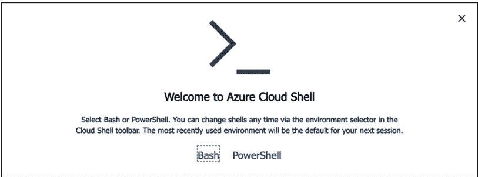

图 2.23 – Azure Cloud Shell Bash


3. 如果你尚未创建存储，将会收到一条提示信息，说明我们需要存储来持久化文件，并且可以在此处直接创建。
4. 一旦存储创建完成，我们就可以访问 Azure Cloud Shell，在其中可以创建虚拟环境并以与在本地终端中相同的方式安装 Databricks CLI。

完成这些步骤后，你就可以开始从 Azure Cloud Shell 使用 Databricks CLI 了。

## Summary

在本章中，我们探讨了通过 UI 或 ARM 模板创建 Azure Databricks 服务的可能性，并探讨了在资源上强制执行访问控制的选项。我们还回顾了不同的身份验证方法、使用 VNet 在处理 Azure 资源中的访问策略时保持一致的方法，以及如何使用 Databricks CLI 创建和管理集群、作业和其他资产。这些知识将使我们能够高效地部署所需资源，以便在 Azure Databricks 中处理数据，同时保持对这些资产如何访问和转换数据的控制。

在下一章中，我们将应用本章和前一章的概念来运行更高级的笔记本、创建 ETL、数据科学实验等。我们将从第 3 章《使用 Azure Databricks 创建 ETL 操作》开始的 ETL 管道开始。

## Section 2:
Data Pipelines
with Databricks

本节将帮助你处理数据并学习如何管理不同的数据源、对其进行转换，并在 Azure 提供的不同选项的交互中使用它，以创建完整的 ETL 管道。

本节包含以下章节：

- Chapter 3, Creating ETL Operations with Azure Databricks
- Chapter 4, Delta Lake with Azure Databricks
- Chapter 5, Introducing Delta Engine
- Chapter 6, Introducing Structured Streaming

### 3

## Creating ETL Operations with Azure Databricks

在本章中，我们将学习如何设置不同的连接以使用外部数据源，例如 **Simple Storage Service (S3)**，设置我们的 Azure Storage 账户，并使用 Azure Databricks 笔记本创建 **extract, transform, and load (ETL)** 操作来清洗和转换数据。我们将利用 **Azure Data Factory (ADF)**，最后，我们将查看一个设计事件驱动 ETL 操作的示例。通过探索本章各节，你将能够从高层次了解数据如何从外部源加载，然后转换到数据管道中，并使用 Azure Databricks 进行构建和编排。让我们先简要概述一下 **Azure Data Lake Storage Gen2 (ADLS Gen2)** 以及如何在 Azure Databricks 中使用它。

在本章中，我们将研究以下主题：

- Using ADLS Gen2
- Using S3 with Azure Databricks
- Using Azure Blob storage with Azure Databricks
- Transforming and cleaning data
- Orchestrating jobs with Azure Databricks
- Scheduling jobs with Azure Databricks

### Technical requirements

要跟随本章提供的示例，你需要以下内容：

- An Azure subscription
- An Azure Databricks notebook attached to a running container
- An Amazon Web Services (AWS) S3 bucket with the files that we want to access, along with access credentials with the proper permissions to read files in the bucket

### Using ADLS Gen2

要在 Azure Databricks 中持久化数据，我们需要一个数据湖。我们将使用 ADLS Gen2，因此我们的第一步是设置一个账户。这将使我们能够存储永久数据并使用它来运行 ETL 管道、获取分析结果或用于构建机器学习 (ML) 模型。

### Setting up a basic ADLS Gen2 data lake

要设置 ADLS Gen2 订阅，我们首先需要在 Azure 门户中创建一个新资源。为此，请按照以下步骤操作：

1. Search for Storage accounts and select Create a new Storage account.
2. Attach it to a resource group, set up a name, set the Account kind field to StorageV2 (general-purpose v2) and, finally, set Replication to Locally-redundant storage (LRS), as illustrated in the following screenshot:

### Create storage account

Home > Storage accounts >

Basics Networking Data protection Advanced Tags Review + create

Azure Storage is a Microsoft-managed service providing cloud storage that is highly available, secure, durable, scalable, and redundant. Azure Storage includes Azure Blobs (objects), Azure Data Lake Storage Gen2, Azure Files, Azure Queues, and Azure Tables. The cost of your storage account depends on the usage and the options you choose below. Learn more about Azure storage accounts

# Project details

Select the subscription to manage deployed resources and costs. Use resource groups like folders to organize and manage all your resources.

Subscription *
Pay-As-You-Go

Resource group *
Create new

# Instance details

The default deployment model is Resource Manager, which supports the latest Azure features. You may choose to deploy using the classic deployment model instead. Choose classic deployment model

Storage account name *
databricksstorage

Location *
(US) East US

Performance
Standard Premium

Account kind
StorageV2 (general purpose v2)

Replication
Locally-redundant storage (LRS)

Review + create
< Previous
Next : Networking >

Figure 3.1 – Creating an ADLS Gen2 subscription

3. Before finalizing, in the Advanced tab, set the Hierarchical namespace option to Enabled so that we can use ADLS Gen2 from our notebooks. The following screenshot illustrates this:


Figure 3.2 – Enabling the Hierarchical namespace option

4. After this, you can click on the Review + create button. Your resource will be validated and you can then start the deployment, which usually takes a couple of minutes. Finally, we will have our ADLS Gen2 storage account set up. Now, we can upload files to it, for which we will use Storage Explorer.

Next, we'll add in the data.

### Uploading data to ADLS Gen2

要上传我们在演示中使用的文件，请在 Azure 门户中搜索 **Storage Explorer**，然后按照以下步骤操作：

1. Select a subscription from the left tab—this will show all the containers related to that subscription. Right-click on the container in the ADLS Gen2 storage account and create a new filesystem that will contain our data. The process is illustrated in the following screenshot:


Figure 3.3 – Creating a filesystem

2. After the filesystem has been created, select the **Upload** button from the options bar at the top of the main panel, as illustrated in the following screenshot. This will prompt us with a message to download **Storage Explorer**, which is a program that allows us to upload files stored locally and manage our storage account:


Figure 3.4 – Selecting the Upload button to download Storage Explorer

3. Follow the steps to install **Storage Explorer** on your local machine.

4. Once it is installed, log in to your Azure account and navigate to the left tab until you find the subscription in which we have created our ADLS Gen2 account. There, we will see the filesystem that we have created, and from there, we can upload local files using the **Upload** button in the top-left bar, as illustrated in the following screenshot:

# Figure 3.5 – Azure Storage Explorer

我们将使用的数据是 2020 年美国大选投票率数据，其中包含 2020 年唐纳德·特朗普与乔·拜登之间的美国大选中投票合格人口的投票率。投票率是指在选举中投票的合格选民的百分比，美国政府自美国独立初期选举开始以来一直发布此数据。

数据来自人口普查局的 Current Population Survey (CPS)；11 月 Voting and Registration Supplement 可从以下链接下载：https://data.world/government/vep-turnout。

现在我们已经设置了存储账户并上传了文件，我们需要从 Azure Databricks 笔记本中访问它们。让我们看看如何做到这一点。


## 从 Azure Databricks 访问 ADLS Gen2

根据文档，我们有三种从 Azure Databricks 访问 ADLS Gen2 的方法，概述如下：

- 在 notebook 中使用 ADLS Gen2 访问密钥
- 在集群级别将 ADLS Gen2 文件系统挂载到 Databricks 文件系统
- 使用服务主体在不挂载的情况下访问数据

我们将使用第一种选项，这是最直接的，因此我们需要想要访问的存储帐户的访问密钥。

值得一提的是，在生产环境中，最佳做法是将这些密钥保存在 Azure Key Vault 中，然后使用 Azure Databricks 将其链接，并将这些密钥作为环境变量在我们的 notebook 中使用。步骤如下：

1. 要获取访问我们的 ADLS Gen2 的密钥，请在 Azure 门户的资源面板中选择存储帐户选项，然后转到左侧选项卡中的访问密钥。复制 key1，这是我们将用于从 notebook 访问数据的密钥。该过程在以下屏幕截图中进行了说明：


图 3.6 – ADLS Gen2 访问密钥

2. 在我们的 notebook 中，我们可以设置与 ADLS Gen2 帐户的连接。将连接字符串中的存储帐户名称替换为您的存储帐户名称，并将 key1 从帐户粘贴到以下命令中以设置连接：

```
spark.conf.set(
  "fs.azure.account.key.<storage-account-name>.dfs.core.windows.net",
  <key-1>
)
```

以这种方式，凭据将存储在会话配置中，除非集群重新启动，否则我们无需重新输入它们。

3. 成功运行后，我们可以使用 dbutils 列出存储我们数据的目录。将以下命令的连接字符串中的文件系统名称和存储帐户名称替换为实际名称，以列出存储数据目录中的所有文件：

```
dbutils.fs.ls("abfss://<file-system-name>@<storage-account-name>.dfs.core.windows.net/<directory-name>")
```

我们将看到该目录中的文件列表作为结果。我们可以保存它，以便将其加载到我们的 notebook 中。

## 从 ADLS Gen2 加载数据

现在我们已将密钥存储在 Azure Key Vault 中，我们可以按如下方式将该数据从 ADLS Gen2 加载到 ADLS 中：

1. 在列出目录中的所有文件后，复制并保存我们上传的文件的路径到一个变量。我们将此变量命名为 file_location，如以下代码片段所示：

```
file_location = "<your-file-path>"
```

2. 之后，我们可以读取它并将其加载到 Spark dataframe 中并显示它，运行以下代码：

```
df = spark.read.format("csv").option("inferSchema", "true").option("header", "true").option("delimiter",",").load(file_location)
display(df)
```

3. 使用以下命令，我们可以看到推断出的数据类型模式，如果不正确，我们可以进行必要的更正：

```
df.printSchema()
```

现在，我们可以直接从 Azure Databricks notebook 使用存储在 ADLS Gen2 中的数据，这将允许我们在构建数据管道时将其用作数据接收器或数据湖。

## 使用 S3 与 Azure Databricks

要使用 S3，我们假设您已经在 AWS S3 中有一个包含我们想要访问的对象存储桶，并且您已经设置了访问密钥 ID 和访问密钥。 我们将把这些访问密钥存储在 notebook 中作为变量，并使用它们直接使用 Spark dataframe 访问 S3 中的文件。

### 连接到 S3

要连接到 S3，请将 AWS 凭据存储在两个名为 aws_access_key_id 和 aws_secret_access_key 的变量中，并将其放入 Hadoop 配置环境中。 使用以下命令，假设您已将凭据保存为变量：

```
sc._jsc.hadoopConfiguration().set("fs.s3n.awsAccessKeyId", aws_access_key_id)
```

```
sc._jsc.hadoopConfiguration().set("fs.s3n.awsSecretAccessKey", aws_secret_access_key)
```

设置后，我们可以直接通过读取文件的位置来访问我们的存储桶。

### 将数据加载到 Spark DataFrame

在将凭据保存到 Hadoop 环境后，我们可以使用 Spark dataframe 直接从 S3 提取数据并开始执行转换和可视化。

在以下代码行中，我们将读取存储在 S3 存储桶中的文件并将其加载到 Spark dataframe 中，最后显示它。 PySpark 将使用我们之前存储在 Hadoop 配置中的凭据：

```
my_bucket = "<your-bucket-name>"
my_file = "<your-file>"
df = spark.read.csv(f"s3://{my_bucket}/{my_file}",
```

```
header=True, inferSchema=True)
display(df)
```

这会产生以下输出：


图 3.7 – 从 S3 获取的数据

我们已格式化要读取的文件的字符串连接到存储桶中，并成功将其加载到 Spark dataframe 中。 我们现在将看到连接到 Azure Blob 存储的方式非常相似。

## 使用 Azure Blob 存储与 Azure Databricks

与我们能够访问存储在 AWS S3 中的对象一样，我们也可以访问 Azure Blob 存储中的对象。 这两个选项都允许我们拥有可以从任何地方访问的冗余数据存储。 它们的区别在于它们将使用的工具以及某些特性可能使它们更适合在特定项目中使用。 Azure Blob 存储更具成本效益且具有高冗余性，而 S3 被多个组织广泛使用且学习曲线较小。 我们将了解如何设置 Azure Blob 存储帐户，上传我们正在使用的文件，并从我们的 notebook 中读取它。

### 设置 Azure Blob 存储

第一步是创建 Azure Blob 存储帐户，如下所示：

1. 在 Azure 门户中搜索 **Storage account** 并选择 **Create a new storage account**。

2. 在 **Create storage account** 选项中，填写详细信息并将 **Replication** 选项设置为 **Locally-redundant storage (LRS)**，对于 **Account kind** 选项选择 **Blob storage**，如下图所示：


图 3.8 – 创建 Azure Blob 存储帐户

3. 之后，选择 Review + create 按钮，等待验证成功，然后部署存储帐户。

### 上传文件和访问密钥

接下来，我们将上传文件和访问密钥。为此，请按照以下步骤操作：

1. 我们的存储帐户部署后，导航到该资源并在左侧选项卡中选择 Containers 并创建一个新的容器，如下图所示：


图 3.9 – 在 Azure Blob 存储中创建容器

2. 在我们选择名称后，我们可以创建一个新容器。

3. 创建后，我们可以通过单击顶部栏中的 Upload 按钮上传文件，这将部署一个右侧选项卡，我们可以在其中选择要上传的文件，如下图所示：


图 3.10 – 上传文件到 Azure Blob 存储

4. 文件上传后，转到左侧面板中的 Access keys 并复制 key1，我们将使用它从 Azure Databricks notebook 读取文件。该过程在以下屏幕截图中进行了说明：


图 3.11 – Azure Blob 存储访问密钥

一旦我们设置了 Azure Blob 存储帐户，将文件上传到其中并复制访问密钥，我们就可以从 Azure Databricks notebook 设置连接。

### 设置与 Azure Blob 存储的连接

在将文件上传到 Blob 存储并获得访问密钥后，我们可以连接我们的 Azure Databricks notebook。为此，我们将使用以下命令：

```
spark.conf.set(
  "fs.azure.account.key.<your-storage-account-name>.blob.core.windows.net",
  "<your-storage-account-access-key>")
```

因此，遵循前面的示例，配置命令将如下所示：

```
spark.conf.set("fs.azure.account.key.yourdtblobstorage.blob.core.windows.net","<key-1>")
```

此命令设置与 Azure Blob 存储的连接。请记住使用您的存储帐户名称更改连接字符串，并使用存储访问密钥（请记住这是 Azure 门户中资源中的 key1）。

设置后，我们可以使用 dbutils 工具使用以下命令列出 Blob 存储中的容器：

```
dbutils.fs.ls("wasbs://<your-container-name>@<your-storage-account-name>.blob.core.windows.net/<your-directory-name>")
```

在下一节中，我们将了解如何转换和清理我们想要使用的数据。

## 转换和清理数据

在将数据加载到 Spark dataframe 后，我们可以以不同的方式操作它。我们可以直接操作我们的 Spark dataframe 或将数据保存到表中，并使用结构化查询语言（SQL）语句执行查询、数据定义语言（DDL）、数据操作语言（DML）等。

您需要将 Voting_Turnout_US_2020 数据集加载到 Spark dataframe 中。

### Spark data frames

Spark data frame 是按行组织的具有命名列的表格数据集合，每列都有自己的数据类型。所有这些信息都存储为元数据，我们可以使用 displaySchema 访问它以显示每列的数据类型或显示实际数据，或使用 describe 查看数据的统计摘要。其特点之一是由于其分布式特性，能够处理大量数据。


我们可以通过 PySpark 应用程序编程接口（API）执行诸如选择行和列、按名称或按数字访问单元格中存储的值、过滤等转换。

我们将把这些转换与 SQL 语句结合使用，以转换并持久化我们文件中的数据。

## 使用 SQL 查询

我们将使用之前使用过的投票 turnout 选举数据集。我们将创建数据的视图并使用 SQL 对其进行查询。

## 创建视图

我们可以使用 Spark Dataframe 中的数据创建视图，以便使用 SQL 对其进行查询，如下所示：

- 1. 要创建一个名为 voter_turnout 的视图，我们可以使用以下命令：

```
df.createOrReplaceTempView("voter_turnout")
```

- 2. 之后，我们可以使用 SELECT 命令获取我们刚刚创建的视图中的每条记录，如下所示：


图 3.12 – 从 Spark dataframe 创建临时视图

现在我们已经创建了数据的视图，我们可以使用 SQL 命令对其进行查询。

- 3. 我们将选择所有内容，然后使用 WHERE 子句进行过滤，以获取亚利桑那州的所有结果，如以下屏幕截图所示：


图 3.13 – 使用 SQL 语句查询数据

创建数据的临时视图在我们想要运行实验或测试时很有帮助，但在集群重新启动后，我们将丢失该视图。为了持久化此数据，我们可以创建一个永久表。

## 在数据湖中创建表

永久表允许我们拥有可被多个用户查询的持久数据，并在数据需要频繁访问时帮助我们。当我们创建表时，我们所做的是在 Hive metastore 中声明元数据，这是我们所有数据存储的地方。我们将用于创建表的投票 turnout 文件存储在 ADLS Gen2 中，这是一种 blob 存储类型，但它也可能位于 Azure DBFS 中，即我们在设置工作区时创建的存储。步骤如下：

- 1. 在创建表之前，我们将创建一个包含它的数据库。我们将调用 voting_data 数据库，可以使用以下命令创建：
```
%sql
CREATE DATABASE voting_data
```
如果一切顺利，我们应该在运行命令的单元格中看到 OK 作为输出。

- 2. 在数据库创建后，我们可以定义一个名为 voting_turnout_2020 的表，该表将使用我们已上传到 ADLS Gen2 的逗号分隔值（CSV）文件构建。请记住，我们将使用的文件路径是我们之前使用 dbutils 运行 list directory 命令时获得的路径。也就是说，我们可以使用以下命令创建一个永久表：
```
%sql
CREATE TABLE IF NOT EXISTS voting_data.voting_
```
```
turnout_2020
USING CSV
LOCATION 'abfss://<your-filesystem>@<you-storage-account>.dfs.core.windows.net/Voting_Turnout_US_2020/2020 November General Election - Turnout Rates.csv'
```

这给出了以下输出：


图 3.14 – 从 CSV 文件创建数据库和表

- 3. 之后，我们可以通过单击 Azure Databricks 工作区左侧功能区中的 Data 按钮来 double-check 一切是否顺利。我们将看到最近创建的数据库及其包含的表，如以下屏幕截图所示：


图 3.15 – Azure DBFS 中创建的表

这将允许我们再次对表运行 SQL 查询，但不同之处在于表现在是永久的。表显示在以下屏幕截图中：


图 3.16 – 从永久表查询数据

- 4. 我们在这里可以看到的一个问题是，从 CSV 文件创建表时未能识别前几行为标题。解决方案很简单，因为我们在 SQL 中有一个选项可以声明我们的数据具有标题。为了解决这个问题，我们首先需要使用以下命令删除表：

```
%sql
DROP TABLE voting_data.voting_turnout_2020
```

- 5. 然后，我们需要重新运行 CREATE TABLE 命令，但在末尾添加一个选项以明确我们的文件具有标题，如以下代码片段所示：

```
%sql
CREATE TABLE IF NOT EXISTS voting_data.voting_turnout_2020
USING CSV
LOCATION 'abfss://adgentestfilesystem@dtbricksstorage.dfs.core.windows.net/Voting_Turnout_US_2020/2020 November General Election - Turnout Rates.csv'
OPTIONS (header "true", inferSchema "true")
```

- 6. 之后，从表中选择所有记录将向我们显示我们已成功，并且我们的数据现在具有标题，如以下屏幕截图所示：


图 3.17 – 修复表中的标题

- 7. 如果我们想检查 Spark 是否能够正确推断我们文件的 information schema，我们可以对表运行 DESCRIBE 命令。在我们的例子中，这将是以下命令：

```
%sql
DESCRIBE voting_data.voting_turnout_2020
```

此输出将是我们表各列的数据类型，如以下屏幕截图所示：

```
%sql
DESCRIBE voting_data.voting_turnout_2020
```

|  | col_name | data_type | comment |
|---|---|---|---|
| 1 | State | string | null |
| 2 | Source | string | null |
| 3 | Official/Unofficial | string | null |
| 4 | Total Ballots Counted (Estimate) | string | null |
| 5 | Vote for Highest Office (President) | string | null |
| 6 | VEP Turnout Rate | string | null |
| 7 | Voting-Eligible Population (VEP) | string | null |

图 3.18 – 描述表的 schema

这涵盖了 SQL 查询，但我们尚未完成转换和清理部分。

## 将表数据写回 Azure Data Lake

在对数据执行必要的转换后，我们可能希望将其写回 ADLS Gen2。为此，我们可以采取以下步骤：

- 1. 假设我们已将结果过滤为仅包含结果仍为 Unofficial 的条目。我们将执行以下命令，该命令将表复制到 Spark dataframe 中：
- 2. 之后，我们可以应用过滤，这可以使用 PySpark col 函数完成，最后显示结果，如下所示：

```
from pyspark.sql.functions import col
df_filtered = spark.table('voting_data.voting_turnout_2020')
```

```
# Filter all records that are not "Unofficial"
df_filtered = df_filtered.filter(col("Official/Unofficial") == "Unofficial")
display(df_filtered)
```

这给出了以下输出：


图 3.19 – 在 Spark dataframe 中过滤行

- 3. 需要注意的一点是，如果我们尝试直接将此 dataframe 导出到 ADLS Gen2，我们将遇到错误，因为列名上具有无效字符。我们将使用正则表达式快速重命名具有这些字符被替换的名称的列。执行此操作的的代码显示在以下片段中：

```
import re
oldColumns = df_filtered.schema.names
newColumns = [re.sub(r'\W', '', i) for i in oldColumns]
df_filtered = df_filtered.toDF(*newColumns)
display(df_filtered)
```

在以下屏幕截图中，我们可以看到列名已更改，现在它们仅包含字母：


图 3.20 – 重命名 Spark dataframe 列

- 4. 之后，为了提高存储效率，我们可以将数据帧转换为 Parquet 格式并将其存储在 ADLS Gen2 中我们指定的位置。这可以按以下方式完成：

```
#declare data lake path where we want to write the data
target_folder_path = 'abfss://adgentestfilesystem@dtbricksstorage.dfs.core.windows.net/Voting_Turnout_Filtered/'
#write as parquet data
df_filtered.write.format("parquet").save(target_folder_path)
```

一旦我们在单元格上执行此操作，我们可以在 Azure Storage Explorer 中确认已在我们指定的新文件夹中创建了新的 Parquet 文件，如以下屏幕截图所示：


图 3.21 – Storage Explorer 中显示的创建数据

现在我们的数据已上传，我们可以在使用 ADF 调度和编排的作业中使用它。

## 使用 Azure Databricks 编排作业

到目前为止，我们一直能够使用存储在 S3 存储桶或 Azure Blob 存储中的数据，使用 PySpark 或 SQL 转换它，然后将转换后的数据持久化到表中。现在，问题是：我们有哪些方法可以将此集成到完整的 ETL 中？我们拥有的选项之一是使用 ADF 将我们的 Azure Databricks 笔记本集成到我们的数据架构中的一个步骤。

在下一个示例中，我们将使用 ADF 直接传递包含我们想要处理的数据的文件名来触发我们的笔记本，并使用此方法更新我们的投票 turnout 表。为此，你需要以下内容：

- 一个 Azure 订阅
- 一个附加到正在运行的容器的 Azure Databricks 笔记本
- Voting_Turnout_US_2020 数据集加载到 Spark dataframe 中


## ADF

ADF 是 Azure 云平台中用于无服务器数据转换和聚合过程集成的平台。它可以集成许多服务并提供无代码的 **用户界面 (UI)** 以便创建我们的 ETL。

## 创建 ADF 资源

第一步是创建 ADF 资源。为此，请按照以下步骤操作：

- 1. 在 Azure 门户中，搜索 **Azure Data Factory** 并选择 **Create Resource**。
- 2. 为我们的 ADF 资源选择一个名称，并将其附加到您正在使用 Azure Databricks 的资源组中，如以下屏幕截图所示：


图 3.22 – 创建 ADF 资源

3. 在创建资源之前，进入 **Git configuration** 选项卡并选择 **Configure Git later**，如以下屏幕截图所示：


图 3.23 – Configure Git later 选项

4. 设置完成后，我们可以点击 **Review + create** 按钮，等待其验证，然后部署它。

## 在 ADF 中创建 ETL

步骤如下：

- 1. 部署完成后，进入 ADF 资源并在主面板中点击 **Author & Monitor**，如以下屏幕截图所示：


图 3.24 – 在 ADF 中进入 Author & Monitor

- 2. 这将带我们进入 **Author & Monitor** 面板，在此我们可以创建和监控 ETL 管道。在左侧选项卡中，选择 **Author** 按钮以创建我们的 ETL 管道，如以下屏幕截图所示：


图 3.25 – 在左侧选项卡中进入 Author 按钮

- 3. 这将带我们进入画布 UI，在此我们可以创建我们的管道。从窗口左侧的面板中选择 Pipelines 并设置名称和描述。

- 4. 然后，点击画布左侧的搜索 Databricks 面板，这将在画布中显示我们的笔记本，如以下屏幕截图所示：


图 3.26 – 创建管道并添加 Databricks 服务

5. 在画布中选择 Azure Databricks 笔记本，并从画布底部的选项中，点击 Databricks 链接服务的 + New 按钮以将我们的 Azure Databricks 工作区链接到 ADF。为此，我们需要一个身份验证令牌，如以下屏幕截图所示：

# New linked service (Azure Databricks)

图 3.27 – 使用访问令牌链接 Azure Databricks 服务

6. 要生成令牌，请进入 Azure Databricks 工作区并在您的个人资料中点击 User Settings 选项，将您带到以下屏幕截图所示的屏幕。在那里，生成一个新令牌并将其粘贴到 ADF Link new service 对话框中，最后点击 Create 按钮：


图 3.28 – 创建 Azure Databricks 访问令牌

7. 现在，我们可以从 Linked services 列表中选择我们的 Azure Databricks 工作区并测试连接。如果一切顺利，连接将成功，如以下屏幕截图所示：


图 3.29 – 测试 Azure Databricks 服务连接

8. 一旦我们的 Azure Databricks 笔记本已在管道中正确设置，我们必须在它与 ADF 之间建立连接。我们将使用一个变量，该变量将在 ETL 被触发时使用，并且它是我们想要处理并持久化到表中的文件。

如果我们在画布的空白处点击，在底部我们会看到 **Parameters** 选项。我们将创建一个新的参数，它是一个名为 `input_file` 的字符串，其默认值是我们想要处理的文件的位置，如以下屏幕截图所示：


图 3.30 – 为 ETL 管道创建参数

9. 之后，点击画布上的 Azure Databricks 笔记本并进入 **Settings** 选项卡。在那里，我们将浏览并设置我们将使用的笔记本，并添加一个基本参数，该参数将指向我们已设置好的变量，如以下屏幕截图所示：


图 3.31 – 在 Azure Databricks 作业中使用参数作为变量

10. 直到此时，我们尚未讨论此变量将在笔记本中如何被使用。为此，我们将在笔记本中添加一段代码。我们将指定此变量是我们需要处理的文件名，并使用它来格式化要读取的文件的完整路径。我们将使用的代码如下所示：

```
# Creating widgets for leveraging parameters
dbutils.widgets.text("input", "", "")
input_file = dbutils.widgets.get("input_file")
print ("Param -'input':")
print (input_file)
```

这样，我们使用 dbutils 创建一个小部件，该小部件将查找名为 input_file 的变量，即我们在 ADF 中指定的变量。

11. 我们将使用此变量来格式化将在笔记本中读取和处理的文件的路径。我们在笔记本中这样做的方式如下所示的代码片段：

```
#set the data lake file location:
file_location = f'abfss://<file-system-name>@<storage-account-name>.dfs.core.windows.net/{input_file}'

#read in the data to dataframe df
df = spark.read.format("csv").option("inferSchema", "true").option("header", "true").option("delimiter",",").load(file_location)
```

12. 在此步骤之后，我们将应用我们认为必要的转换，最后删除现有表并将我们转换后的 dataframe 保存为永久表。表的删除可以在 SQL 中完成，使用以下代码：

```
%sql
DROP TABLE voting_data.voting_turnout_2020
And then we can save our spark dataframe as a table.
df.write.format("parquet").saveAsTable("voting_data.voting_turnout_2020")
```

13. 在我们的笔记本和 ADF ETL 准备就绪后，我们可以通过点击 Add Trigger 按钮，然后点击 Trigger Now 来触发它。ADF 将提示一个对话框，在其中我们可以指定文件和目录作为我们之前已建立为参数的变量。设置完成后，我们可以点击 Run 并且我们的管道将被触发，如以下屏幕截图所示：

# Pipeline run


图 3.32 – 运行管道

14. 我们可以通过点击 ADF 中的 **Monitor** 选项卡来检查我们管道的状态，这将向我们显示管道的状态，如以下屏幕截图所示：


图 3.33 – 在 Monitor 选项卡中查看管道日志

15. 如我们所见，我们的管道已成功执行，这意味着我们指定的文件已被读取、处理并用于更新我们的表。

接下来，我们将了解如何使用 Databricks 来安排作业。

## 使用 Azure Databricks 安排作业

如果我们已经知道我们想要处理的文件将被交付到 blob 存储，我们可以直接安排笔记本定期运行。为此，我们可以使用 Azure Databricks jobs，这是一种轻松安排笔记本运行的方式。我们现在假设我们将消费的文件路径是固定的。

## 将笔记本安排为作业

步骤如下：

- 1. 要安排新作业，请在工作区左侧功能区中点击 **Jobs** 选项卡，然后点击 **Create Job**，如以下屏幕截图所示：


图 3.34 – 创建 Azure Databricks 作业

- 2. 之后，其余部分相当直接。我们需要指定将使用哪个笔记本、设置执行计划，并指定将用于执行作业的计算资源。在这种情况下，我们选择在现有集群中运行作业，但我们可以为特定执行创建专用集群。我们选择将执行作业的笔记本，如以下屏幕截图所示：


图 3.35 – 选择笔记本

3. 接下来，我们按以下截图所示，为作业安排在特定时间、指定开始日期和频率运行：


图 3.36 – 安排作业

一切设置完毕后，我们可以运行作业并等待执行完成以检查状态。

## 作业日志

如果一切顺利，我们将看到状态标记为 **Succeeded**，如下图所示。否则，它将被标记为 **Failed**，我们需要检查该次运行的日志以找出出了什么问题：


图 3.37 – 作业的正在进行和已完成的运行

幸运的是，我们的作业成功了，这意味着我们的文件将被处理，我们的表每小时都会更新。

## 总结

在本章中，我们应用了之前学到的概念来创建并连接到 Azure Databricks 资源以存储我们的数据，例如 ADLS Gen2、AWS S3 和 Azure Blob 存储。我们还学习了如何将数据从存储区摄取到 Spark dataframe，使用 Spark 方法或 SQL 脚本对其进行转换，然后将数据持久化到表中。最后，我们看到了如何使用 Azure Databricks 作业安排作业，以及如何在 ADF 中创建管道并使用定义变量触发它。

在下一章中，我们将学习 Azure Delta Lake 以及如何使用它通过 Azure Databricks 创建可靠的 ETL 管道。

### 4
使用 Azure Databricks 的 Delta Lake

在本章中，我们将通过展示使用 Delta 表有多么容易，以及如何在 Azure Databricks 中处理数据并集成不同的解决方案，来学习如何利用 Azure Databricks。我们将首先介绍 Delta Lake 以及如何使用合作伙伴集成、COPY INTO 命令和 Azure Databricks Auto Loader 来摄取数据。然后，我们将向您展示数据加载后如何处理数据，以及我们如何使用高级功能来处理和优化依赖于数据流的 ETL。

我们将通过以下主题学习如何使用 Delta 高效地存储和处理数据：

- 介绍 Delta Lake
- 使用 Delta Lake 摄取数据
- 在查询中批量读取和写入表
- 查询表的过去状态
- 流式读取和写入表

## 技术要求

要在本章中使用 Delta Engine，您需要一个 Azure Databricks 订阅，以及一个运行中的集群并附加了笔记本。

## 介绍 Delta Lake

使用数据湖已成为许多数据工程任务的事实标准解决方案。此存储层由文件组成，可以按历史方式排列，而不是数据仓库中的表。这具有将存储与计算解耦的好处，这是数据湖的巨大优势。它们比数据库便宜得多。存储在数据湖中的数据没有主键和外键，使得提取存储在其上的信息变得困难。因此，数据湖被视为一种仅追加新数据的解决方案。当尝试查询或删除记录时，我们需要遍历数据湖中的所有文件，这可能是一项非常资源密集且缓慢的任务。

这导致数据湖难以更新，并且在我们尝试在需要频繁查询数据的情况下使用它们时可能会出现问题。这包括客户或交易数据、需要稳健数据处理的金融应用，或当我们希望数据仓库中的更改反映在记录上时。

数据湖被视为架构范式的变化，而不是新技术，我们需要处理由多个输入源将文件丢入数据湖而产生的海量原始数据，然后需要对其进行摄取。这些文件可能包含结构化、半结构化或非结构化数据，而这些数据又会由不同的作业并行处理，这些作业由于 Azure Databricks 的并行特性而并发运行。这可能使文件保持其完整性变得困难。

为了解决这些限制，Azure Databricks 引入了 Delta Lake，它是 Delta 表和 Delta Engine 的组合。Delta Engine 可用于暂存和处理层，其中它支持数据流，为大型查询提供批处理读写，并提供分析仪表板。

Delta Lake 是一个存储层，位于数据湖之上，例如 Azure Data Lake Storage (ADLS) Gen2，旨在克服数据湖的常见限制，例如无法对数据执行 SQL 查询或管理传入文件的摄取。它具有多个优势，其中包括自动摄取数据流、数据模式处理、由于时间旅行而实现的数据版本控制，以及比传统关系型数据仓库更快的处理速度，同时还能查询数据。Delta Lake 旨在通过确保使用原子性、一致性、隔离性和持久性 (ACID) 事务的数据完整性，为大数据湖提供可靠性，允许您读取和写入同一文件或表。Delta Lake 的工作方式非常简单——您只需更改文件存储方式并指定 Delta 作为表的格式即可，Delta 是一种仅在云上工作的 Spark 专有文件类型。

我们将在接下来的部分深入探讨这些方法的具体细节。

需要注意的一点是，Delta Lake 只能从 Azure Databricks 运行时访问，因此我们不应将其视为数据仓库的替代品。

Delta Lake 提供了与我们在湖中存储的数据交互相关的多个优势。使其成为绝佳选择的最突出功能如下：

- **ACID 事务**：正如我们之前提到的，源自 ACID 事务的隔离级别允许不同用户并发地处理相同数据，而不会看到不一致。这得益于事务日志的使用，其中包括检查点支持。
- Delta Lake 凭借 Azure Databricks 的分布式计算特性，为元数据提供了可扩展的处理能力。
- **流式和批处理统一**：Delta Lake 中的表既是批处理表，也是流式源和接收器，使其成为 Lambda 架构的解决方案。然而，它更进一步，因为批处理和实时数据都进入同一个接收器。流式数据摄取、批处理历史回填和交互式查询开箱即用。
- **自动强制模式**：自动处理模式变化，以防止在摄取期间插入不良记录。
- **时间旅行**：Delta Lake 最重要的功能之一是能够访问数据的快照，无论是表的版本还是特定时间戳。这使我们能够修复可能由错误数据操作引起的任何错误，更轻松地处理审计，并提供对数据所做更改的清晰视图。
- **Upserts 和删除**：它支持诸如合并、删除和更新等 DDL 操作，得益于 Spark API 的使用，使您能够处理诸如流式数据或 SCD 操作等情况。
- 性能通过自动数据优化而得到提升，例如数据跳过以仅读取相关数据部分、文件压缩、缓存频繁访问的数据和 Z-Ordering。

在本节中，我们介绍了 Delta Lake 并简要提及了导致其开发的原因，以及我们可以用来充分利用其主要功能的工具。在下一节中，我们将深入探讨如何开始使用 Delta Lake，通过介绍从多个来源将数据加载到其中的方法。

## 使用 Delta Lake 摄取数据

数据可以通过多种方式摄取到 Delta Lake 中。Azure Databricks 提供了与合作伙伴的多种集成，这些集成提供作为 Delta 表加载的数据源。我们可以直接将文件复制到表中，使用 AutoLoader，或创建新的流式表。让我们更深入地了解一下。

## 合作伙伴集成

Azure Databricks 允许我们连接到提供数据源的不同合作伙伴。这些集成易于实现并提供可扩展的摄取。

当在 UI 中创建新表时，我们可以查看用于从 **Partner Integrations** 摄取数据的选项，如下图所示：


图 4.1 – 从 Partner Integrations 摄取数据

其中一些集成，例如 Qlink，允许您从多个数据源获取数据，例如 Oracle、Microsoft SQL Server 和 SAP 并将其加载到 Delta Lake。当然，这些集成要求您订阅这些服务，并且在大多数情况下，文档将由供应商提供。


## COPY INTO SQL 命令

如果我们想将数据从文件复制到 Delta 表中，可以使用 COPY INTO 命令，这是一个可用于将文件加载到目录中的选项。每次运行该命令时，它都会跳过已加载的文件。让我们来看一下：

- 作为示例，如果我们想将数据加载到已创建的表中，可以执行以下操作：

```
COPY INTO target_table
FROM 'source_path'
```

- 否则，我们可以通过将前缀 delta 传递给目标路径来引用表的路径：

```
COPY INTO delta.`target_path`
FROM 'source_path'
```

COPY INTO 命令还有几个选项，我们可以在其中指定从文件位置的特定列、格式选项和复制选项。

要加载的源文件的格式应为 CSV、JSON、AVRO、ORC 或 PARQUET。FILES 指要加载的文件名列表，其长度可达 1000。它不能与 PATTERN 一起指定，PATTERN 是一个正则表达式模式，用于标识要从源目录加载的文件。

FORMAT_OPTIONS 和 COPY_OPTIONS 是可以传递给 Apache Spark 的选项，对于后者只有 'force'，如果启用，则无论文件是否已加载之前，它们都会加载手头的文件：

- 我们可以在以下命令中看到此选项的使用。在这里，我们将数据插入表中，从源路径中选择 key、index、textData 和 constant_value 列，指定 CSV 作为格式，指定所需文件的模式，并添加格式选项以便我们可以添加标题：

```
COPY INTO delta.`target_table_path`
FROM (SELECT key, index, textData, 'constant_value'
FROM 'source_path')
FILEFORMAT = CSV
PATTERN = 'data_folder/file_[a-g].csv'
FORMAT_OPTIONS('header' = 'true')
```

COPY INTO 命令在 SQL 中常用使用，也是将数据摄取到 Delta Lake 表中的受支持方式。

在下一节中，我们将讨论如何使用 Auto Loader 自动摄取数据，Auto Loader 是 Delta Lake 的一项功能，可自动将数据摄取到 Delta 表中。

## Auto Loader

在处理数据湖时，如何摄取数据的问题会非常频繁地出现。如果文件来自不同的来源，例如数据流或物联网设备，如何读取文件就会成为一个问题，这可能导致我们需要实现另一个服务，例如 Event Hub，然后从那里将其存储在数据湖中。另一种变通方法是从数据湖以批处理或按时间分区的方式读取文件，这会增加复杂性并损害性能。

Auto Loader 是 Azure Databricks 的一项功能，通过以增量的方式加载文件来帮助解决这些问题，只要文件到达存储中即可。它使用名为 cloudFiles 的结构化源来实现这一点。在指定要工作的路径时，可以将其设置为处理该目录中已存在的文件。它也可以通过目录列表或文件通知来检测到达的文件。

Auto Loader 是 Azure Databricks 的一项功能，允许我们在文件到达存储时处理文件。这是通过名为 cloudFiles 的流式源完成的，该源读取到达目录中的文件。我们也可以处理该目录中已存在的文件。我们有两种方法来检测文件到达存储目录：列出目录中的文件和使用文件通知系统。在这两种模式下，Auto Loader 都会跟踪已处理的文件。

文件通知选项基于来自 Azure Event Grid 订阅的通知来检测到达的文件，这些通知针对存储账户中的文件事件。请注意，当您选择此选项时，所有必需的服务，例如所选的存储账户和 Azure Event Grid，都会自动创建，并且需要稍后手动清理。

在这两种模式下，文件都只会被处理一次，即使文件被追加或覆盖也是如此。如果文件被追加或覆盖，就不明确正在处理的是哪个版本的 file。因此，最好仅使用 Auto Loader 来摄取不可变文件。让我们来看一下：

- 在以下 Python 命令中，我们正在读取一个流并使用 useNotifications 选项，同时设置为 true 以激活文件通知：

```
df = spark.readStream.format("cloudFiles") \
.option("cloudFiles.useNotifications","true") \
.schema(<schema>) \
.load(<input-path>)
```

- 更一般地说，我们可以使用以下 Python 命令将流读入 DataFrame：
- 然后，一旦我们读取了流，我们就可以通过指定检查点位置将其写入 delta 表：

```
df = spark.readStream.format("cloudFiles").
option(<cloudFiles-option>, <option-value>) \
.schema(<file_schema>) .load(<input-path>)
```

```
df.writeStream.format("delta").
option("checkpointLocation", <checkpoint-path>).
start(<output-path>)
```

创建新流时，会在该目录中创建检查点。如果在服务重新启动时更改了检查点，将假定创建了新流。文件通知过程更适合处理大量数据时使用。这是因为文件在到达时只处理一次，无需列出整个目录，而且多个流查询可以同时在同一个输入目录中运行。

文件通知的一个缺点是需要启动更多资源来检测存储中到达的文件。它更适合管理大量文件时使用，也是一种更可扩展的解决方案。

目录列表是 Auto Loader 的默认模式。此模式按其名称所述，列出目录以识别到达其中的文件。它不需要配置新的权限，适用于少量文件定期到达存储的情况。然而，如果文件数量迅速增加，列出整个目录很快就会变得困难。

如果需要更改为文件通知模式，您将需要重新启动流处理过程。

在下一节中，我们将学习如何通过批处理表操作来优化我们刚刚获取的数据上执行的 DDL 操作。

## 批处理表读写

在对存储在并发较高的数据库中的多个大型表执行诸如 merge 和 update 等 DDL 操作时，事务日志可能会被阻塞并导致数据仓库出现实际中断。所有 SQL 语句都是原子的，这意味着耗时较长的修改会使数据在进程执行期间一直被锁定，这对于实时数据库来说可能是一个问题。为了减少这些操作的计算负担，我们可以优化其中一些操作，使其可以在更小、更易于处理的批处理上运行，这些批处理仅在短时间内锁定资源。

让我们看看如何借助 Apache Spark API 提供的选项在 Delta Lake 中实现批处理读写。

### 创建表

我们可以通过使用 Apache Spark DataFrameWriter 或使用 CREATE TABLE 等 DDL 命令来创建 Delta Lake 表。让我们来看一下：

- Delta Lake 表是在 metastore 中创建的，表的路径也保存在那里，尽管这不是表的真实来源，表的真实来源仍然在 Delta Lake 中：

```
CREATE TABLE data (
    input_date DATE,
    record_id STRING,
    record_type STRING,
    record_data STRING)
USING DELTA
```

- 我们也可以使用 Python 执行此操作。以下命令在 metastore 中创建一个名为 "data" 的表：

```
df.write.format("delta").saveAsTable("data")
```

- 我们也可以通过识别其路径来创建此表：

```
df.write.format("delta").save("/mnt/delta/data")
```

在这里，我们可以看到 Delta 表可以通过常见的 SQL 命令创建，也可以通过简单地使用 PySpark API 创建，这对于减少代码所需的变化以便适应使用 Delta 表非常方便。

下一节将展示在表创建后读取表的多种方式。

### 读取 Delta 表

Delta 表可以通过两种不同的方式加载：

- 首先，我们可以像在任何 SQL 环境中一样指定 metastore 中的表；即使用 SELECT：

`SELECT * FROM data`

这里，data 是我们想要读取的表。

```
SELECT * FROM data
```

这里，data 是我们想要读取的表。

- 另一种加载表的方式是指定 Delta 文件的路径。我们可以通过将 delta 作为表位置的前缀来做到这一点：

`SELECT * FROM delta.'/mnt/delta_tables/data'`

这里，'/mnt/delta_tables/data' 是表的位置。

```
SELECT * FROM delta.'/mnt/delta_tables/data'
```

这里，'/mnt/delta_tables/data' 是表的位置。

- 像往常一样，我们也可以使用 Python 来执行此操作。要按名称查询表，我们可以运行以下命令：

`spark.table("data")`

这里，data 是我们想要读取的表。

```
spark.table("data")
```

这里，data 是我们想要读取的表。

- 另外，我们也可以通过引用其路径来查询同一表：

`spark.read.format("delta").load("/mnt/delta_tables/data")`

这里，'/mnt/delta_tables/data' 是表的位置。

```
spark.read.format("delta").load("/mnt/delta_tables/data")
```

这里，'/mnt/delta_tables/data' 是表的位置。

需要注意的一点是，每次我们从表中读取时，我们都在查看表的最新快照，无需使用 REFRESH 命令。您还可以指定分区语句以更高效地读取数据，正如我们在以下各节中将看到的那样。


## 通过分区加速查询

你可以通过在处理过程中对列进行分区来加速查询和 DML 操作。我们也可以将此应用于 Delta 表，通过在我们想要用作分区的列上使用 PARTITIONED BY 命令，在许多情况下该列是日期列。如果我们将 LOCATION 指定为 Databricks 文件系统的路径，这将在 metastore 中创建表。如果表不在 metastore 中，删除表不会删除 location 中指定的文件。让我们来看一下：

- 在这里，我们在 Azure Databricks metastore 中创建了一个表，并按 input_date 列对其进行分区：
```
CREATE TABLE data (
    input_date DATE,
    record_id STRING,
    record_type STRING,
    record_data STRING)
PARTITIONED BY (date)
LOCATION '/mnt/delta_files/data'
```

同样，我们也可以使用 Python 来执行此操作。

- 以下命令执行相同的操作，在 metastore 中创建表：
```
df.write.format("delta").partitionBy("date").saveAsTable("data")
```

- 我们也可以通过指定表的路径来执行相同的操作：
```
df.write.format("delta").partitionBy("date").save("/mnt/delta_files/data")
```

如果表是在已托管 Delta 表路径的位置创建的，这可能导致以下情况。如果仅指定表名和位置，它将被理解为我们只是导入了数据，并且创建的表将继承该路径中已存在的表的模式、分区和属性：

- 以下示例显示了如果 `/mnt/delta/data` 已托管一个表会发生什么情况：

```
CREATE TABLE data
USING DELTA
LOCATION '/mnt/delta/data'
```

这也展示了 Delta Lake 的自动模式推断是如何工作的。

如果我们指定了模式和分区，Delta 表将检查输入数据是否与现有数据匹配。如果不匹配，将引发异常。

## 查询表的过去状态

正如我们之前提到的，查询表的过去状态是 Delta Lake 的一项功能，在处理数据被错误操作、恢复已删除记录、审计以及受监管行业时非常有用。它还允许我们编写使用不同时间状态的查询，得益于快照隔离。

本节描述了如何使用这些方法查询表的旧版本。

### 使用时间旅行查询表

要查询表的先前状态，我们可以执行以下操作：

- 我们可以使用 AS OF 命令，使用 SQL 语法：

```
SELECT * FROM table_name TIMESTAMP AS OF timestamp_expression
```

table_name 参数是表的名称。我们还可以传递任何可以转换为时间戳或日期字符串的表达式，以获取我们所需数据的确切快照。

- 另一种查询表过去状态的方法是使用 VERSION AS OF 命令。为此，我们需要传递一个特定的版本，该版本可以从 DESCRIBE HISTORY 的输出中获得。两种方法的完整示例如下：

```
SELECT * FROM table_name VERSION AS OF table_version
```

这里，table_version 是可以通过对我们想要查询的表使用 DESCRIBE HISTORY 获得的值。

- 如果我们想在 Azure Databricks 笔记本中的 Python 代码块中使用此功能，我们可以将 DataFrameReader 选项设置为表的一个特定时间点或版本。为此，我们需要传递 timestampAsOf 选项：

```
df = spark.read.format("delta").option("timestampAsOf", timestamp_string).load("/mnt/delta/data")
```

这里，'/mnt/delta/data' 是表的位置。

访问特定版本也适用。我们可以通过将 versionAsOf 传递给 DataFrameReader 选项来做到这一点：

```
df = spark.read.format("delta").option("versionAsOf", version).load("/mnt/delta/data")
```

使用时间旅行从表的早期版本中选择数据非常容易。用户可以通过使用版本历史编号（如下面的代码所示，选择 VERSION AS OF 0 表数据时），或通过时间戳来查看表的历史并查看该点的数据是什么样的：

- 我们可以通过读取数据的 HISTORY 属性使用 DESCRIBE 来学习如何获取可用版本并查看表的历史：

```
DESCRIBE HISTORY data
```

- 如果我们想访问表的快照以查看数据在某个时间点是什么样子的，我们可以使用 TIMESTAMP 结合 AS OF：

```
SELECT * FROM loan_by_state_delta TIMESTAMP AS OF '2020-07-14 16:30:00'
```

Delta Lake 保证在查询表的先前状态时，所有转换都可以被跟踪、重现，并且保持可逆状态。这在处理受 GDPR 或 CCPA 法规约束的数据时尤其有用，其中需要提供删除证明。我们还可以使用此方法可视化在此表上进行的所有 DML 操作，例如更新和合并。

时间旅行是对可能的人为错误或数据处理不当的保护，并提供轻松调试错误的途径，得益于其事务日志。这使我们能够回到过去，找到创建错误的机制，对该问题采取行动，并将数据恢复到准确状态。

如果我们考虑到 Delta 表会自动更新自己，在 Azure Databricks 中执行作业时，将其设置为最新版本是良好的实践。否则，如果数据在执行过程中被更新，整个过程可能会产生不同的结果。

- 我们可以通过使用以下 Python 命令执行 SQL 查询来获取最新版本：

```
latest_version = spark.sql("SELECT max(version).\
FROM (DESCRIBE HISTORY delta.`/mnt/delta/events`)").collect()
df = spark.read.format("delta").option("versionAsOf", latest_version[0][0]).load("/mnt/delta/events")
```

访问 Delta 表的特定历史点或版本[content]

## 通过分区加速查询

你可以通过在处理过程中对列进行分区来加速查询和 DML 操作。我们也可以将此应用于 Delta 表，通过在我们想要用作分区的列上使用 PARTITIONED BY 命令，在许多情况下该列是日期列。如果我们将 LOCATION 指定为 Databricks 文件系统的路径，这将在 metastore 中创建表。如果表不在 metastore 中，删除表不会删除 location 中指定的文件。让我们来看一下：

- 在这里，我们在 Azure Databricks metastore 中创建了一个表，并按 input_date 列对其进行分区：
```
CREATE TABLE data (
    input_date DATE,
    record_id STRING,
    record_type STRING,
    record_data STRING)
PARTITIONED BY (date)
LOCATION '/mnt/delta_files/data'
```

同样，我们也可以使用 Python 来执行此操作。

- 以下命令执行相同的操作，在 metastore 中创建表：
```
df.write.format("delta").partitionBy("date").saveAsTable("data")
```

- 我们也可以通过指定表的路径来执行相同的操作：
```
df.write.format("delta").partitionBy("date").save("/mnt/delta_files/data")
```

如果表是在已托管 Delta 表路径的位置创建的，这可能导致以下情况。如果仅指定表名和位置，它将被理解为我们只是导入了数据，并且创建的表将继承该路径中已存在的表的模式、分区和属性：

- 以下示例显示了如果 `/mnt/delta/data` 已托管一个表会发生什么情况：

```
CREATE TABLE data
USING DELTA
LOCATION '/mnt/delta/data'
```

这也展示了 Delta Lake 的自动模式推断是如何工作的。

如果我们指定了模式和分区，Delta 表将检查输入数据是否与现有数据匹配。如果不匹配，将引发异常。

## 查询表的过去状态

正如我们之前提到的，查询表的过去状态是 Delta Lakes 的一项功能，在处理数据被错误操作、恢复已删除记录、审计以及受监管行业时非常有用。它还允许我们编写使用不同时间状态的查询，得益于快照隔离。

本节描述了如何使用这些方法查询表的旧版本。

### 使用时间旅行查询表

要查询表的先前状态，我们可以执行以下操作：

- 我们可以使用 AS OF 命令，使用 SQL 语法：

```
SELECT * FROM table_name TIMESTAMP AS OF timestamp_expression
```

table_name 参数是表的名称。我们还可以传递任何可以转换为时间戳或日期字符串的表达式，以获取我们所需数据的确切快照。

- 另一种查询表过去状态的方法是使用 VERSION AS OF 命令。为此，我们需要传递一个特定的版本，该版本可以从 DESCRIBE HISTORY 的输出中获得。两种方法的完整示例如下：

```
SELECT * FROM table_name VERSION AS OF table_version
```

这里，table_version 是可以通过使用 DESCRIBE HISTORY 在我们想要查询的表上获得的值。

- 如果我们想在 Azure Databricks 笔记本中的 Python 代码块中使用此功能，我们可以将 DataFrameReader 选项设置为表的一个特定时间点或版本。为此，我们需要传递 timestampAsOf 选项：

```
df = spark.read.format("delta").option("timestampAsOf", timestamp_string).load("/mnt/delta/data")
```

这里，'/mnt/delta/data' 是表的位置。

同理适用于访问特定版本。我们可以通过将 versionAsOf 传递给 DataFrameReader 选项来做到这一点：

```
df = spark.read.format("delta").option("versionAsOf", version).load("/mnt/delta/data")
```

使用时间旅行从表的早期版本中选择数据非常容易。用户可以通过使用版本历史编号（如下面的代码所示，选择 VERSION AS OF 0 表数据时），或通过时间戳来查看表的历史并查看该点的数据是什么样的：

- 我们可以通过读取数据的 HISTORY 属性使用 DESCRIBE 来学习如何获取可用版本并查看表的历史：

```
DESCRIBE HISTORY data
```

- 如果我们想访问表的快照以查看数据在某个时间点是什么样子的，我们可以使用 TIMESTAMP 结合 AS OF：

```
SELECT * FROM loan_by_state_delta TIMESTAMP AS OF '2020-07-14 16:30:00'
```

Delta Lake 保证在查询表的先前状态时，所有转换都可以被跟踪、重现，并且保持可逆状态。这在处理受 GDPR 或 CCPA 法规约束的数据时尤其有用，其中需要提供删除证明。我们还可以使用此方法可视化在此表上进行的所有 DML 操作，例如更新和合并。

时间旅行是对可能的人为错误或数据处理不当的保护，并提供轻松调试错误的途径，得益于其事务日志。这使我们能够回到过去，找到创建错误的机制，对该问题采取行动，并将数据恢复到准确状态。

如果我们考虑到 Delta 表会自动更新自己，在 Azure Databricks 中执行作业时，将其设置为最新版本是良好的实践。否则，整个过程可能会产生不同的结果，如果数据在执行过程中被更新。

- 我们可以通过使用以下 Python 命令执行 SQL 查询来获取最新版本：

```
latest_version = spark.sql("SELECT max(version).\
FROM (DESCRIBE HISTORY delta.`/mnt/delta/events`)").collect()
df = spark.read.format("delta").option("versionAsOf", latest_version[0][0]).load("/mnt/delta/events")
```

访问 Delta 表的特定历史点或版本的另一种方法是使用 @ 语法。这是在 SQL 和 Python 执行期间指向表特定状态的一种方式。

- 一个示例是以下 SQL 命令，其中我们使用时间戳选择表在某个时间点的所有行：

```
SELECT * FROM events@20200101000000000
```

- 我们也可以以相同的方式指定版本，只需在版本前添加 v 作为前缀：

```
SELECT * FROM events@v114
```

同理适用于 Python，其中 @ 语法直接传递给我们想要加载的表的路径。

- 以下是如何访问特定时间戳的示例：

```
spark.read.format("delta").load("/mnt/delta/events@20200101000000000")
```

- 相同的方法适用于版本：

```
spark.read.format("delta").load("/mnt/delta/events@v114")
```

此时，你可能会想知道你能回溯多远。默认情况下是过去 30 天，只要你没有在想要访问的 Delta 表上运行 VACUUM 命令；否则，你将无法回溯超过过去 7 天。

- 这种行为可以通过设置 delta.logRetentionDuration 和 delta.deletedFileRetentionDuration 属性来配置。例如，我们可以通过运行以下命令将 delta.deletedFileRetentionDuration 设置为 30 天：

```
delta.deletedFileRetentionDuration = "interval 30 days".
```

这样，我们就可以轻松地为任何 delta 表的可用历史建立保留策略。

利用时间旅行可以在我们对数据执行了错误操作并希望恢复先前状态时提供一个故障保护。在下一节中，我们将学习如何在 Delta Lake 中存储和处理数据时利用此功能。

## 处理过去和现在的数据

能够访问表的先前时间状态在我们想要恢复已被删除或移除的信息时尤其有用，或者当我们想要监控数据随时间增长时。让我们来看一下：

- 以下是此功能的一个示例。在这里，我们通过传递所需的时间戳并合并所有匹配的用户 ID 来插入之前已删除的记录。这些记录全部来自 7 天前：

```
MERGE INTO target_table trg
    USING source_table TIMESTAMP AS OF date_sub(current_date(), 7) src
    ON src.user_id = trg.user_id
    WHEN MATCHED THEN UPDATE SET *
```


我们还可以使用时间旅行来快速查询过去 30 天内用户数量的增长情况：

```
SELECT count(distinct user_id) -
  SELECT count(distinct user_id)
  FROM target_table TIMESTAMP AS OF date_sub(current_date(), 30)
```

另一个例子是覆盖特定子集的数据。首先，我们必须加载我们想要使用的特定版本：

```
df = spark.read.format("delta").option("versionAsOf", version).load("/mnt/delta/data")
```

然后，我们可以选择特定的日期范围，在我们的例子中是 6 月的前 15 天，将其用之前版本中的数据覆盖：

```
df.write.format("delta").mode("overwrite")\
  .option("replaceWhere", "insert_date >= '2020-06-15' AND insert_date <= '2020-06-15'")\
  .save("/mnt/delta/data")
```

你也可以说明数据变更的原因，你可以通过将其作为元数据存储在这些变更发生时产生的提交中来实现。稍后可以在操作历史中访问此元数据。

在下面的示例中，我们正在替换完整版本并说明我们之所以做出这些更改是因为数据有误：

```
df.write.format("delta").mode("overwrite") \
  .option("userMetadata", "updating-faulty-data").save("/mnt/delta/data")
```

“overwrite”模式将替换存储在 "/mnt/delta/data" 中的 delta 表。它将使用 userMetadata 选项指定用户元数据来描述变更原因，就像 Git 提交信息一样。

同样的方法也可以在 SQL 中通过将 spark.databricks.delta.commitInfo.userMetadata 选项设置为提交字符串来实现：

```
SET spark.databricks.delta.commitInfo.userMetadata=updating-faulty-data
INSERT OVERWRITE data SELECT * FROM correctData
```

在本节中，我们学习了如何使用历史数据来替换有误的数据并回滚对 Delta 表做出的错误更改。

在下一节中，我们将学习如何自动运行验证并适应 Delta 表中使用的数据的模式。

## Schema validation

数据模式的更改可能会导致很多问题，但在信息需要适应新的业务规则、表需要更新以及需要引入改进的情况下，这些更改也是不可避免的。值得庆幸的是，Delta Lake 具有自适应模式演进功能，它与模式强制执行相结合，可以适应模式的更改。

我们可以通过在写入表时使用 mergeSchema 选项显式设置此选项来使其生效。在下面的示例中，我们使用数据 DataFrame 执行此操作，它将被保存到 Delta Lake：

```
data.write.option("mergeSchema","true"). \
format("delta").mode("append").save(data_lake_path)
```

此选项将导致数据中存在但在指定的 Delta 表中不存在的每个列都被添加到现有表中。当我们知道未来会进行更改并且不希望 ETL 在生产环境中中断时，这是一个不错的选择。

Delta Lake 会自动检查我们尝试插入到表中的数据的模式是否与该表的模式匹配。这是通过遵循以下规则完成的：

- 我们尝试插入的 DataFrame 中的所有列都存在于表中并且具有相同的数据类型；否则，将引发异常。
- 如果我们在追加数据时使用 partitionBy 选项，它将与现有数据进行比较，如果出现任何差异，将会报错退出。否则，如果未使用 partitionBy，数据将被追加。
- 尝试插入的数据中不存在的列将用空值填充。
- 列命名区分大小写。

正如我们之前提到的，如果你想更新表，可以通过使用 overwriteSchema 选项来实现。此选项允许你更改列数据类型或删除列，这反过来将要求你重写表。

在下面的示例中，我们通过在 Python 中使用 overwriteSchema 选项来更改列的类型：

```
spark.read.table("/mnt/delta/data").withColumn("insertion_date", col("insertion_date").cast("date")).write \
.format("delta").mode("overwrite").option("overwriteSchema", "true").saveAsTable("/mnt/delta/data")
```

在这里，我们使用 Spark API 读取位于 /mnt/delta/data 的表并将 insertion_date 列的数据模式更改为日期数据类型。然后，我们通过指定 overwriteSchema 选项将结果保存回同一表中。

在下一节中，我们将学习如何创建一个 Delta 表，使其能够自动填充来自不同来源的数据流。

## Streaming table read and writes

虽然我们已经提到结构化流是 Apache Spark API 的核心部分，但在本节中，我们将深入探讨如何将其用作可靠的流处理引擎，其中计算可以像对静态数据进行批处理计算一样执行。结合 Auto Loader，它将自动处理流式传输到 Delta 表的数据，而无需常见的麻烦，例如合并低延迟摄取产生的小文件、在处理多个流时运行并发批处理作业，以及如我们之前讨论的，跟踪可流式传输到表中的文件。

让我们学习如何在 Azure Databricks 中将数据流式传输到 Delta 表。

### Streaming from Delta tables

你可以使用 Delta 表作为流查询的流源。查询将处理表中的任何现有数据以及来自流的任何传入数据。让我们看一下：

- 我们可以通过直接使用 readStream 并指定表路径来实现，如下所示：
  
  ```
  spark.readStream.format("delta").load("/mnt/delta/data")
  ```
- 或者，我们可以设置 readStream 以读取特定数据表：
  
  ```
  spark.readStream.format("delta").table("data")
  ```

诸如每个流中提供的微批的最大大小或每个批中要计算的数据量等方面，可以使用 `maxFilesPerTrigger` 和 `maxBytesPerTrigger` 等选项进行控制。

## Managing table updates and deletes

正如我们之前提到的，如果用作流源的表被更新，结构化流将抛出异常。我们可以通过更改 `ignoreChanges` 选项来解决此问题，这将处理更新的表，以便在流式传输表上发生任何删除或更新时流式传输不会中断。我们也可以使用 `ignoreDeletes` 选项，如果我们只想忽略源数据上的删除。最后，如果这些选项都不起作用，我们始终可以直接删除输出和检查点并重新启动流。

这种情况的一个例子是当我们使用 `UPDATE` 命令修改表中的一条记录时。修改记录将修改包含该表的那个文件。如果使用 `ignoreChanges` 选项，新的记录将被传播，以及同一文件中未被修改的任何其他记录。

## Specifying an initial position

Delta Lake 允许你指定流源中的某个点，而无需再次处理所有数据。时间旅行的功能使我们能够指定 `startingVersion` 或特定的 `startingTimestamp`，这将是我们读取流的起点。这些选项仅对新的流查询生效；否则将被忽略。

可用的版本可以使用 `DESCRIBE HISTORY` 命令获取。以下是一个示例，即访问我们流数据的版本 3：

```
streaming_events.readStream
.format("delta")
.option("startingVersion", "3")
.load("/mnt/streaming_events/user_events")
```

`startingTimestamp` 命令指定从何时开始向前读取的时间点。输入值可以是时间戳、已转换为时间戳格式的字符串、日期字符串，或可转换为时间戳或日期的表达式。


正如我们之前所做的那样，下面的示例指定了一个开始读取数据的起始时间戳：

```
streaming_events.readStream
  .format("delta")
  .option("startingTimestamp", "2020-06-15")
  .load("/mnt/streaming_events/user_events")
```

值得注意的是，表的模式始终是最新模式，因此在使用时间旅行选项时不会出现不兼容的情况。

## 流式模式

Delta Lake 允许使用两种不同的流式数据模式；即 Append 模式和 Complete 模式。第一个是默认选项，这意味着新记录会被追加到表中。让我们来看一下：

- 这也可以通过使用 outputMode 作为选项来设置，如下所示：

```
streaming_events.writeStream
  .format("delta").outputMode("append")
  .option("checkpointLocation", "/delta/streaming_events/_checkpoints/etl-from-json")
  .start("/delta/streaming_events/")
```

- 或者，我们可以使用表的名称：

```
streaming_events.writeStream
  .format("delta").outputMode("append")
  .option("checkpointLocation", "/delta/streaming_events/_checkpoints/etl-from-json")
  .table("streaming_events")
```

Complete 模式意味着表会在每批新数据中被完全替换。

- 我们也可以通过 outputMode 来设置此模式，如下所示：

```
streaming_events.writeStream
  .format("delta").outputMode("complete")
  .option("checkpointLocation", "/delta/streaming_events/_checkpoints/etl-from-json")
  .start("/delta/streaming_events/")
```

如果延迟要求较低，可以将进程设置为使用一次性触发器而不是流式源。这些触发器在我们以周期性方式而非持续流的方式工作时非常有帮助。一个例子是当我们处理仅在有新数据可用时才需要更新的报告时。

## 使用 Delta Lake 进行优化

在本节中，我们将继续使用 Azure Databricks 提供的 COVID 数据集。让我们开始吧：

- 1. 我们的第一个任务将是加载数据。为此，我们需要使用 `%fs`，它将查询数据集：
```
%fs
ls dbfs:/databricks-datasets/COVID/coronavirusdataset/
```
这应该会显示所有可用的示例数据集。

- 2. 然后，我们必须选择 PatientInfo 文件并将其加载到 spark DataFrame 中：
```
file_path = "dbfs:/databricks-datasets/COVID/coronavirusdataset/PatientInfo.csv"
df = spark.read.format("csv").load(file_path,header = "true",inferSchema = "true")
display(df)
```
在这里，我们可以看到已加载到 DataFrame 中的数据。这将用于创建要优化的 Delta 表：


图 4.2 – 我们将作为表存储的示例患者 DataFrame

3. 和往常一样，我们可以使用 describe 方法来显示 DataFrame 的底层结构，在本例中该结构由 Apache Spark 推断得出：

```
df.describe().show()
```

此命令的输出将向我们展示已加载数据的统计摘要：


图 4.3 – DataFrame 信息模式

4. 文件加载后，我们可以将它写入 Parquet 文件，后续将用于查询：

```
df.write.format("parquet").mode("overwrite").partitionBy("province").save("/tmp/covid_parquet")
```

我们这样做是为了将表写入一种格式，该格式已针对在数据湖中工作进行了优化，例如 Parquet。

5. 文件写入后，我们将再次读取它并用它来创建表。为了读取 DataFrame，我们必须运行以下命令：

```
covid_parquet = spark.read.format("parquet").load("/tmp/covid_parquet")
```

在这里，表是从 /tmp/covid_parquet 位置加载的。

6. 一旦我们将 Parquet 文件加载到 Apache Spark 中，我们就可以对数据运行查询。我们将运行两个查询。它们将基于计数和基于日期的聚合。为此，我们将使用 pyspark sql 函数：

```
from pyspark.sql.functions import count
```

```
display(covid_parquet.groupBy("date").agg(count("*").alias("TotalCount")).orderBy("TotalCount", ascending=False).limit(20))
```

前面的代码展示了如何显示对 patient_id 列进行简单计数聚合的结果，并按日期排序。以下屏幕截图向我们展示了此操作的输出：

```
from pyspark.sql.functions import count
display(covid_parquet.groupBy("date").agg(count("*").alias("TotalCount")).orderBy("TotalCount", ascending=False).limit(20))
```


图 4.4 – 对 date 列的计数聚合

- 7. 根据同样的原理，我们也可以通过对 province 列进行聚合来计算每个省份的病例数：

```
display(covid_parquet.groupBy("province").agg(count("*").alias("TotalTransitedPlaces")).orderBy("TotalTransitedPlaces", ascending=False).limit(20))
```


图 4.5 – 对省份的聚合

- 8. 然后，我们可以查询我们的数据。对 DataFrame 进行快速计数给出了 10,410 条记录：

```
covid_parquet.count()
```

Out[77]: 10410

图 4.6 – 行数

9. 最后，我们可以将数据以 delta 文件格式写入以创建我们的 delta 表。我们可以通过按 province 分区来完成此操作，province 是我们认为将频繁用于过滤数据的列，如下所示：

```
covid_parquet.write.format("delta").mode("overwrite").partitionBy("province").save("/delta/covid_delta/")
```


图 4.7 – 以 delta 文件格式写入 DataFrame

10. 下一步是读取 delta 格式的文件以在 metastore 中创建我们的 delta 表。我们可以使用以下命令读取并显示数据：

```
covid_delta = spark.read.format("delta").load("/delta/covid_delta/")
display(covid_delta)
```

这样，我们就可以看到已加载的结果，如下所示：


图 4.8 – 将 delta 文件读入 Spark DataFrame

现在我们的 DataFrame 与 delta 文件关联，我们就可以用它来创建 delta 表并利用 Delta Lake 的优化功能。

11. 接下来，我们将使用 DataFrame 创建 delta 表。首先，我们必须运行以下命令，如果表已存在则将其删除：

```
display(spark.sql("DROP TABLE IF EXISTS covid_delta"))
```

12. 然后，我们必须通过使用 USING DELTA LOCATION 指定 delta 文件的位置来创建表：

```
display(spark.sql("CREATE TABLE covid_delta USING DELTA LOCATION '/delta/covid_delta/'"))
```

最后，我们必须应用 ZORDER 作为优化技术。这在 Delta Lake 中可用，旨在重新排序文件，使其尽可能接近。在本例中，我们的表很小，因此运行此操作不会产生显著效果。然而，当我们处理数据分散在不同文件中的大表时，它非常有用。

- 1. 我们可以通过在 delta 表上运行 OPTIMIZE 并加上 ZORDER BY 语句来运行优化过程。此语句仅应用于数据列，而不应用于分区列：

```
display(spark.sql("OPTIMIZE covid_delta ZORDER BY (date)"))
```

以下屏幕截图显示了整个优化操作的输出，其中我们通过读取 Delta 表创建并优化了一个表：


图 4.9 – 在 delta 表上执行 SQL 查询

2. 现在，我们可以在知道数据布局已根据我们将用于运行查询的过滤器进行优化的情况下运行查询。我们还知道文件数量已优化，以最小化文件读取并改进数据跳过技术：

```
display(covid_delta.groupBy("date").
  agg(count("*").alias("TotalTransitedPlaces")).
  orderBy("TotalTransitedPlaces", ascending=False).limit(20))
```


图 4.10 – 按天计数聚合

3. 创建表的另一种方法是使用 SQL 命令。我们可以在 Azure Databricks 笔记本单元中运行以下命令，以删除任何现有表并创建表。我们可以通过选择所有列并按 province 分区来完成此操作：

```
%sql
DROP TABLE IF EXISTS covid_delta;
CREATE TABLE covid_delta
USING delta
PARTITIONED BY (province)
SELECT *
FROM delta.`/delta/covid_delta/`;
```


我们应该看到 OK，表示成功，如以下屏幕截图所示：


图 4.11 – 使用 SQL 从 delta 文件创建 delta 表

+   4. 正如我们在前几节中提到的，我们也可以对刚刚创建的 delta 表运行 SQL 查询：


图 4.12 – 在 delta 表上执行 SQL 查询

5. 我们的 delta 表的路径也可以通过文件的位置进行引用：

```
SELECT * FROM delta.`/delta/covid_delta/`
```

SELECT 语句的工作方式与在普通 SQL 数据库中一样：

```
Cmd 18
1 %sql
2
3 SELECT * FROM delta.`/delta/covid_delta/`
```

|  | patient_id | date | city | type | latitude | longitude | province |
|---|---|---|---|---|---|---|---|
| 1 | 1000000682 | 2020-05-07 | Yeonje-gu | etc | 35.17955 | 129.0756 | Busan |
| 2 | 1000000820 | 2020-05-19 | Haeundae-gu | school | 35.17222 | 129.1371 | Busan |
| 3 | 1000001101 | 2020-06-10 | Nam-gu | hospital | 35.13723 | 129.0698 | Busan |
| 4 | 1100000001 | 2020-02-18 | Dongnae-gu | school | 35.21522 | 129.0738 | Busan |
| 5 | 1100000001 | 2020-02-18 | Dongnae-gu | etc | 35.21953 | 129.0812 | Busan |
| 6 | 1100000001 | 2020-02-18 | Dongnae-gu | restaurant | 35.19833 | 129.0842 | Busan |
| 7 | 1100000001 | 2020-02-18 | Dongnae-gu | etc | 35.2058 | 129.0861 | Busan |
Showing the first 1000 rows.

图 4.13 – 通过路径指定 delta 表

Delta 表具有许多默认启用的优化功能，以及可手动触发的其他功能。这使我们能够执行诸如文件大小和位置优化、数据跳过等操作。此外，由于我们能够高效地查询数据湖中的文件，因此使用起来也很简单。

## Summary

实施数据湖是组织内的范式转变。当我们处理来自不同来源的数据流时，当数据的模式可能随时间变化时，以及当我们需要一个对数据处理不当具有可靠性和易于审计的系统时，Delta Lake 为此提供了解决方案。

Delta Lake 在数据仓库的功能和数据湖的优势之间填补了空白，同时克服了其大多数挑战。

模式验证确保我们的 ETL 管道在表发生变化时保持可靠性。它通过在出现任何不匹配且数据被污染时引发异常来通知我们。如果更改是有意的，我们可以使用模式演进。

时间旅行使我们能够访问数据的历史版本，这得益于其有序的交易日志。它跟踪在 Delta 表上执行的每个操作。当我们需要定义需要查询历史不同时间点的管道、撤消更改或跟踪数据不匹配的来源时，这很有用。

在下一章中，我们将通过学习如何利用 Delta Lake 中的计算引擎 Delta Engine 的功能来进一步优化我们的流程，从而加深我们对数据湖的了解。

### 5
Introducing
Delta Engine

Delta Engine 是 Delta Lake 的查询引擎，默认包含在 Azure Databricks 中。它以一种方式构建，使我们能够通过优化布局和改进数据索引，以多种方式优化 Delta Lake 中数据的处理。这些优化操作包括使用 **动态文件修剪 (DFP)**、Z-Ordering、自动压缩、即席处理等。这些优化操作的额外好处是，其中许多操作在使用 Delta Lake 时会自动进行。你将在许多方面使用 Delta Engine 优化。

在本章中，您将学习如何利用 Delta Lake 在 Azure Databricks 中优化您的 Delta Lake ETL。以下是我们将围绕讨论的主题：

+   - 使用 Delta Engine 优化文件管理
+   - 使用 DFP 优化查询
+   - 使用 Bloom 过滤器
+   - 优化连接性能

Delta Engine 全部关于优化，而文件管理可能是我们的主要缺点之一。在本章中，您将学习如何使用 Delta Engine 的功能来提高 ETL 的性能。

## Technical requirements

要在本章中使用 Delta Engine，您需要一个 Azure Databricks 订阅。

## Optimizing file management with Delta Engine

Delta Engine 允许改进 Delta Lake 中文件的管理，从而实现更好的查询速度，这得益于存储数据的布局优化。Delta Lake 通过使用两种类型的算法来实现这一点：**bin-packing** 和 **Z-Ordering**。第一种算法在将小文件合并为大文件时很有用，并且在处理大文件时更有效。第二种算法借鉴了数学分析，应用于数据的底层结构，以将多个维度映射到一个维度，同时保留数据点的局部性。

在本节中，我们将学习这些算法的工作原理，了解如何使用作用于我们数据的命令来实现它们，以及如何借助时间旅行功能处理数据的快照。

值得记住的是，虽然在使用 Delta Lake 时会发生自动优化，但其中大多数优化不会自动发生，其中一些必须手动应用。我们将看到如何以及多久执行一次。

### Merging small files using bin-packing

我们在前几章中讨论了处理从不同来源到达我们数据湖的多个小文件时可能出现的问题。Delta Engine 通过允许我们将小文件合并为大文件来为此问题提供解决方案。

Bin-packing 与 Z-Ordering 一样，是从数学分析中借鉴的算法，最初设计用于优化将不同体积的对象打包到有限数量的箱子中，同时使用尽可能少的箱子。我们可以想象如何将此应用于将较小文件打包到最少数量的较大、更高效文件的问题。它们如下：

+   - 我们可以通过在特定表路径上使用 OPTIMIZE 命令将此算法应用于 Delta 表，如以下代码示例所示：

```
OPTIMIZE delta.`/data/data_events`
```

在表中运行此操作时，将显示受操作影响的表的路径，以及优化期间修改的文件数量的指标，如以下屏幕截图所示：


图 5.1 – 通过路径指定要优化的 Delta 表

+   - 正如我们习惯做的那样，我们也可以直接传递表名，如下所示：

```
OPTIMIZE data_events
```

该表很小，因此优化实际上不会对保存表数据的文件产生任何变化，如以下屏幕截图所示：


图 5.2 – 通过名称指定要优化的 Delta 表

+   - 如果我们有很多文件但只想关注其中一定数量的文件，我们可以通过显式传递 WHERE 子句来优化数据的一部分。这将导致 OPTIMIZE 命令仅作用于数据子集，如以下代码片段所示：

```
OPTIMIZE data_events WHERE insert_date >= '2020-06-15'
```

运行 OPTIMIZE 命令后，我们将看到与文件重新组织相关的文件统计信息系列，例如已删除文件和已添加文件，甚至一些 Z-Ordering 统计信息。

Delta Lake 将优化上述表，从而实现更好的查询速度，因为我们读取表时需要扫描的文件数量更少。需要记住的一点是，通过 OPTIMIZE 命令触发的 bin-packing 优化是一个幂等操作，这是一个花哨的说法，意思是此命令的执行仅在首次在数据集上触发时才会生效。

当此操作在表上执行时，正在优化的表的读取者不会受到影响，这得益于 Delta 表的快照隔离功能。即使底层文件结构被算法重新排序并且交易日志相应修改，表的完整性也得到保证，因此 OPTIMIZE 命令在表上运行之前和之后查询将产生相同的结果。与正在优化的表相关的任何数据流也不会受到此命令的影响。

该算法的目标是生成一系列大小均匀的文件，在存储中提供大小和数量之间的平衡。

那么，如果这种重新组织如此高效并且不会影响表中存储的数据，为什么 OPTIMIZE 不是自动的呢？回答这个问题的原因在于，要将多个文件合并为一个更大的文件，你需要在目录中提前拥有这些小文件，否则就没有什么可合并的；因此，OPTIMIZE 不能自动运行。另一个答案是，压缩也是计算、存储和时间资源方面的昂贵操作，因此这可能会影响 Azure Databricks 执行低延迟流的能力，而该表是流的来源。

讨论的最后一点与 Delta 表应多久优化一次有关。这当然是性能与用于运行优化的资源成本之间的权衡。如果你的优先事项是性能，此操作应更频繁地进行或按定期间隔进行，例如每日间隔；否则，你可以优先考虑成本并更少地运行此操作。

### Skipping data

随着新数据的到来，Delta Lake 将跟踪与数据输入/输出 (I/O) 粒度相关的文件级统计信息。这些统计信息会自动获取，在查询时存储最小值和最大值信息。其目的是识别具有一定相关性的列，据此规划查询并避免不必要的 I/O 操作。在查找查询期间，Azure Databricks 数据跳过功能将利用获得的统计信息跳过在此操作中不需要读取的文件。


粒度可以进行调整，并且它与分区集成得非常好，尽管这些是独立的操作。

请记住，数据跳过是一种索引概率技术，就像布隆过滤器（将在本章后面讨论）一样，可能导致假阳性。

无需配置数据跳过，因为它默认激活，并在可能的情况下应用，这也意味着此操作的性能取决于数据的底层结构。我们可以配置的是在统计期间想要跟踪多少列——默认情况下为前 32 列，该值可使用 `dataSkippingNumIndexedCols` 选项进行修改。请考虑跟踪列是一项资源密集型操作，因此添加更多列或跟踪长字符串数据类型的列会对写入文件时的开销产生影响。

解决这些问题的变通方法是通过 `ALTER TABLE` 更改长字符串列的类型，或将其移至 `dataSkippingNumIndexedCols` 选项所设定的阈值之外，以便在收集统计信息时跳过。

得益于数据跳过，我们可以减少每个查询所需读取的数据量，从而提高 ETL 管道的性能并减少时间和成本。

在下一节中，我们将了解 Z-Ordering 以及如何利用它进一步提高性能。

## 使用 Z-order 聚类

有时，数据可能分散在各个文件中，当我们对其运行查询时这并不实用。这会导致元数据大小增加，以及列出目录和文件压缩方面的问题。

为处理此问题，我们可以使用分区技术（将在下一节中看到），它们试图使我们信息分布更均匀。反过来，这些技术的性能取决于信息在文件中的分散程度，因此在运行它们之前，建议您先应用 Z-Ordering。

Z-Ordering 是 Delta Lake 的一项功能，旨在将相关数据分配到同一位置。这可以提高我们在其上运行此命令的表上的查询性能，因为 Azure Databricks 可以利用它与数据跳过方法一起更高效地读取和分区文件。我们可以在 Azure Databricks 中使用 ZORDER BY 命令使用 Z-Ordering：

- 在以下代码示例中，我们将对 event_type 列优化数据表：

```
OPTIMIZE data
ZORDER BY (event_type)
```

通过在笔记本中的结构化查询语言（SQL）单元格中运行此操作，我们应该得到根据指定分区优化表所做的修改的结果。从以下屏幕截图示例中，我们可以看到我们的表很小，我们实际上不需要优化表的底层文件结构：


图 5.3 – 在 Delta 表上应用 ZORDER

- 我们也可以通过路径引用 Delta 表，如以下代码片段所示：

```
OPTIMIZE delta.'path_to_data'
ZORDER BY (event_type)
```

通过在 Azure Databricks 笔记本中的 SQL 单元格中运行上述代码，我们应该以与之前指定表名时相同的方式看到操作的结果指标，如以下屏幕截图所示：

图 5.4 – 通过路径指定 Delta 表时在 Delta 表上应用 ZORDER

Z-Ordering 也可以通过传递条件应用于数据的子集。

- 在以下代码示例中，我们将仅优化 event_type 列中从今天到昨天的的数据：

```
OPTIMIZE data
WHERE insert_date >= current_timestamp() - INTERVAL 1 day
ZORDER BY (event_type)
```

在以下屏幕截图中，我们可以看到通过在笔记本中的 SQL 单元格中运行此操作，我们将看到表路径和操作指标的结果，与之前的示例相同：

```
%sql
OPTIMIZE delta.`/delta/covid_delta/`
WHERE province="Busan"
ZORDER BY (date)
```

图 5.5 – 对特定数据部分应用 ZORDER

具有许多唯一值的列，以及经常用于过滤的列，是最推荐通过运行 ZORDER 进行优化的列。我们也可以通过将列名作为参数传递，分别分隔给 ZORDER 命令来指定多个列。

多次运行 `ZORDER` 将导致多次执行，但这被视为增量操作。在新数据到达后运行 `ZORDER` 不会影响已优化的数据。

需要注意的一点是，运行 Z-Ordering 与数据大小无关。操作的目的是重新定位相关文件，而不是均匀分布数据，因为这也可能导致数据倾斜，这是一个我们将在下一节中看到如何解决的问题。

## 管理数据时效性

如前一章所述，查询 Delta 表时，我们读取的是该表的最新状态，除非另有指定，这要归功于 Delta 表是自动更新的。这是自动运行的过程，但在我们不需要的情况下，如果我们想修改此行为也可以。这可能发生在执行历史分析时，我们不需要表被预先更新。这样做将使查询时的延迟更低，简而言之，查询将运行得更快。

此行为可使用 `spark.databricks.delta.stalenessLimit` 选项设置，该选项以 `time` 字符串值作为参数，并将其应用于我们正在工作的当前会话，因此不会影响其他读取该表的用户。`time` 参数以 **毫秒 (ms)** 表示，例如范围可以从 1 小时到 1 天。如果超过此陈旧限制，表状态将被更新。

值得一提的是，该参数不会阻止表被更新——它只是避免查询等待表更新。

## 理解检查点

我们已经在讨论表上的流源时讨论过检查点，但我们还没有完全谈论它们的工作原理。

Delta Lake 使用检查点来聚合 Delta 表的状态，以便在我们需要表的最新状态时作为计算的起点。检查点默认每 10 次提交写入一次，并存储在表路径的 `_delta_log` 目录中。

该机制节省了大量时间，因为否则，查询表时，为了获取最新状态，Delta Lake 必须读取大量代表表事务日志的 JavaScript Object Notation（JSON）文件以获得最后状态。

简而言之，检查点保存有关对表所做的所有事务和修改直到当前状态的信息，检查先前被更新操作取消的动作是否从检查点中删除。这类操作称为无效操作，它们是使用一种称为规则 for reconciliation 的策略删除的。这是为了减少日志的总体大小并使其在重建快照时更高效地读取。正如我们所见，检查点对于快照隔离和访问数据的先前版本至关重要。

检查点也是存储列使用统计信息以在例如数据跳过期间使用的地方。

查看日志目录时，我们会看到它具有命名约定，如以下代码片段所示：

```
00000000000000001025.checkpoint.parquet
```

我们可以看到检查点的名称由一个前缀组成，该前缀指的是其保存的表的版本以及表的格式。更一般地说，我们可以说表格式为 table_format 的表的第 n 个版本的检查点名称将为 n.checkpoint.table_format。

鉴于此格式和事务日志的性质，如果用户想要访问最新的检查点，列出目录中的所有检查点（可能有数千个）将相当困难。因此，Delta Lake 将最后一个检查点存储在 _delta_log/_last_checkpoint 文件中，以便于构建表的最新快照。


正如前面提到的，在使用结构化流时，如果启用了检查点，如下所示，流在发生故障时可以重新启动：

+   为此，我们可以在流式表中将 `delta.checkpoint.writeStatsAsStruct` 选项设置为 true，如下所示：

```
ALTER TABLE our_table SET TBLPROPERTIES
('delta.checkpoint.writeStatsAsStruct' = 'true')
```

我们可以在笔记本中的 SQL 单元格中运行此命令，如果操作成功，应返回 OK，如以下示例所示：


图 5.6 – 在 Delta 表上设置检查点设置

+   或者，在使用 Delta 表时，我们可以使用带有 delta 前缀的表路径，如以下代码片段所示：

```
ALTER TABLE delta.`path_to_our_table` SET TBLPROPERTIES
('delta.checkpoint.writeStatsAsStruct' = 'true')
```

+   我们还可以在使用流式数据帧时使用 Apache Spark 的 checkpointLocation 选项，通过运行以下 Python 命令，该命令以 Parquet 格式写入名为 data 的流式数据帧并设置检查点位置路径。每个查询必须具有唯一的检查点：

```
data.writeStream.format("parquet")
    .option("path", output_path)
    .option("checkpointLocation", checkpoint_path)
    .start()
```

在我们的结构化流中拥有检查点可以让我们在可能出现故障时拥有备份。如果流被重新启动，它将自动从中断处继续。

## 使用 Delta Engine 自动优化文件

Auto Optimize 是 Delta Engine 的一项功能，用于进一步优化 Delta 表。它会在大表中 **数据操作语言 (DML)** 操作期间自动压缩小文件，合并文件并保持元数据干净。我们有两种应用 Auto Optimize 的选项：**Optimized Writes** 和 **Auto Compaction**。Optimized Writes 尝试将表分区均匀排列成 128 **兆字节 (MB)** 大小的每个分区文件，以改善写入。Auto Compaction 是 `OPTIMIZE` 命令，压缩大小设置为 128 MB，在每次写入操作后运行。

Auto Optimize 保持频繁修改的表处于优化状态，这在处理例如低延迟数据流或频繁表合并时非常有用。

我们需要通过在特定表上启用 `our_delta_table.autoOptimize.optimizeWrite` 和 `our_delta_table.autoOptimize.autoCompact` 选项来启用 Auto Optimize：

+   - 要在现有表上启用此选项，我们可以使用 `TBLPROPERTIES` SQL 命令将这些属性设置为 `true`，如下例所示：

```
ALTER TABLE our_table SET TBLPROPERTIES (delta.
autoOptimize.optimizeWrite = true, delta.autoOptimize.
autoCompact = true)
```

我们可以在笔记本中的 SQL 指定单元格中运行此命令，如以下屏幕截图所示：


图 5.7 – 在 Delta 表上启用 Auto Optimize

+   - 我们还可以使用以下 SQL 配置将这些选项默认设为 `true` 应用于所有新的 Delta 表：

```
set spark.databricks.delta.properties.defaults.
autoOptimize.optimizeWrite = true.
```

```
set spark.databricks.delta.properties.defaults.
autoOptimize.autoCompact = true.
```

+   - 如果我们只想将其应用于当前工作会话，可以使用以下代码设置以下 Spark 配置：

```
spark.databricks.delta.optimizeWrite.enabled
```

```
spark.databricks.delta.autoCompact.enabled
```

需要手动启用这些选项的一个原因是，如果同一张表上有来自不同用户的许多并发 DML 操作，这可能会导致事务日志冲突，这很危险，因为这不会导致任何失败或重试。

需要记住的另一点是，在大表中，启用 Auto Optimize 的表可以与 OPTIMIZE 结合使用，并不替代运行 ZORDER。

让我们更详细地了解如何使用 Optimized Writes 和 Auto Compaction，如下所示：

+   - **Optimized Writes**：当在表上启用 Optimized Writes 时，Delta Engine 将尝试将表重新排序为每个表分区大约 128 MB 的文件，这会根据数据模式而有所不同，以平衡并行写入的文件数量。此过程根据表的分区结构重新排序文件。此选项在数据流延迟为分钟级时很有用。

+   - **Auto Compaction**：如前所述，Auto Compaction 在每次写入后运行，因此如果在表上启用，则无需在每次写入操作后调用 OPTIMIZE。如果我们没有在工作表上定期安排 OPTIMIZE 作业运行，启用此选项是个好主意。

在 Azure Databricks 中优化数据处理时，大多数时候很容易只关注转换。但我们应该始终记住 Databricks 使用分布式计算，需要将数据分发到各个 worker。确保数据井然有序且其存储已得到优化，将带来更好的性能指标，不仅对存储，而且对数据的处理也是如此。

## 使用缓存提高性能

缓存是一种将数据存储在更接近处理位置的操作，以提高性能。它可以在 Azure Databricks 中以两种不同的方式应用：Delta 缓存和 Apache Spark 缓存。根据我们处理的情况，我们可以利用每个选项的特定特性来提高表的读取速度。

好的一点是，无需选择使用哪个选项，因为它们可以同时使用。

让我们深入了解两种选项的特性，并了解它们如何应用于提高性能。

### Delta 和 Apache Spark 缓存

Delta 和 Apache Spark 具有不同的特性，可以概括如下：

+   - **Delta 缓存**：Delta 缓存会自动将远程 Parquet 文件的副本复制到本地节点存储中以加速其处理。它可以访问的远程位置包括 **Databricks 文件系统 (DBFS)**、**Hadoop 分布式文件系统 (HDFS)**、Azure Blob 存储、Azure Data Lake Storage Gen1 和 Azure Data Lake Storage Gen2。它可以比 Spark 缓存运行得更快，这得益于优化的解压缩和与处理要求一致的输出格式。数据可以使用 `CACHE` 语句预加载。数据随后存储在本地磁盘上，并且由于 **固态硬盘 (SSD)** 可以快速读取。
+   - **Spark 缓存**：Spark 缓存可以存储子查询的结果并处理 Parquet 以外的多种文件格式。需要缓存的查询和表必须手动指定。数据存储在内存中，这可能会损害性能。

我们可以通过从集群配置中选择其中一个 **Delta Cache Accelerated** worker 来启用 Delta 缓存，如以下屏幕截图所示：


图 5.8 – 选择 Delta Cache 加速存储

然后，我们继续如下：

+   - 要启用 Spark 缓存，我们需要在数据帧上运行缓存选项——如以下 Python 命令所示——其中我们缓存一个名为 data 的数据帧：

```
data.cache()
```

+   - 缓存将调用 persist 方法，并将 MEMORY_DISK 作为参数传递，这与以下 Python 命令相同：

```
data.persist(StorageLevel.MEMORY_AND_DISK)
```

我们有多个可作为存储级别传递的参数，如下所述：

+   - DISK_ONLY：这将仅将序列化数据持久化到磁盘。
+   - MEMORY_ONLY：这将仅在内存中持久化反序列化数据，实现非常好的计算性能，但其限制是可用于存储的内存量。
+   - MEMORY_AND_DISK：这将在内存中持久化数据，如果内存不足，则会将数据驱逐到磁盘上存储。这是 Spark 中的默认模式，它会尽可能多地将数据存储在浮动内存中，其余部分驱逐到磁盘。计算时间比仅使用磁盘快，但比仅使用内存慢。
+   - OFF_HEAP：数据持久化在堆外内存中，即不受 Java 虚拟机 (JVM) 垃圾回收器监督的内存。数据读取速度更快，但应谨慎使用，因为用户必须指定分配的内存。

对 worker 中缓存数据存储位置进行精细控制，也允许我们对使用数据的算法的性能进行精细控制。存储在本地 worker 内存中的数据比从磁盘读取更快，但能容纳的数据量更小。OFF_HEAP 内存应谨慎使用，因为其数据也由 JVM 用于内部进程。

## 缓存数据子集

我们还可以通过以下方式使用 CACHE SELECT 命令显式选择仅缓存 worker 本地存储中的一部分数据：

```
CACHE SELECT col1, col2, col3
FROM our_table
WHERE our_condition
```


同样地，我们可以使用 delta 前缀和表路径来指定一个 Delta 表，如以下代码片段所示：

```
CACHE SELECT col1, col2, col3
FROM delta.`our_table`
WHERE our_condition
```

在下面的截图示例中，我们在笔记本的 SQL 单元格中运行此操作，并将条件指定为 COVID 数据集中的特定省份：


图 5.9 - 指定要缓存的 Delta 表的一部分

这将仅记录符合我们条件以供缓存的指定列，从而防止后续查询扫描远程文件。

在处理 Delta 表时这样做并非必要，因为数据在查询时会被缓存，但当你需要提升查询性能时，这会很有用。

一个简单的例子是缓存名为 data 的表，如下所示：

```
CACHE SELECT * FROM user_data
```

或者，我们也可以对会话期间会频繁使用的部分数据执行此操作，如下所示：

```
CACHE SELECT user_id, user_cohort FROM user_data WHERE user_cohort=10
```

接下来，我们将了解如何配置 Delta 缓存的行为。

## 配置 Delta 缓存

建议始终为 worker 实例使用 Delta 缓存加速的集群，这些实例是运行 SSD 磁盘的优化实例。这些实例已默认配置为与 Delta 缓存一起工作，但你可以在会话创建期间使用 Apache Spark 选项手动配置其参数：

- 要设置最大磁盘使用量，默认设置为 worker 本地存储的一半，可以使用 maxDiskUsage 选项，以字节为单位，如以下示例所示，我们将其设置为 50g：
  
  ```
  spark.databricks.io.cache.maxDiskUsage 50g
  ```
- 我们还可以使用 maxMetaDataCache 选项指定以字节为单位的元数据最大分配空间，如以下示例所示，其中设置为 1g：
  
  ```
  spark.databricks.io.cache.maxMetaDataCache 1g
  ```
- 我们还可以禁用压缩，默认情况下是启用的，如下所示：
  
  ```
  spark.databricks.io.cache.compression.enabled false
  ```
- 要禁用 Delta 缓存，我们可以使用以下 Scala 命令：
  
  ```
  spark.conf.set("spark.databricks.io.cache.enabled",
  "false")
  ```

值得注意的是，禁用 Delta 缓存时，我们不会丢失已存储在 worker 本地存储中的数据，但会避免添加更多数据。

在下一节中，你将阅读有关 DFP 的内容，DFP 是 Delta Lake 的一项功能，可提高查询性能。

## 使用 DFP 优化查询

DFP 是 Delta Lake 的一项功能，可自动跳过与查询无关的文件。它是 Azure Databricks 中的默认选项，通过收集 Delta Lake 中文件的数据来实现，无需在查询中显式声明应跳过文件，通过利用数据的粒度来提高性能。

DFP 关于进程是否启用、表的最小大小以及触发进程所需的最小文件数等行为，可以通过以下选项管理：

- `spark.databricks.optimizer.dynamicPartitionPruning`（默认值为 true）：DFP 是否启用。
- `spark.databricks.optimizer.deltaTableSizeThreshold`（默认值为 10 GB）：激活 DFP 的 Delta 表的最小大小。
- `spark.databricks.optimizer.deltaTableFilesThreshold`（默认值为 1000）：表示在连接的探测侧 Delta 表的文件数，用于触发 DFP。如果文件数较少，则触发该进程不值得。

DFP 可用于非分区表、非选择性连接以及对它们执行 DML 操作时。

DFP 带来的改进与数据的粒度水平相关。因此，在使用 DFP 时应用 Z-Ordering 可能是一个好主意。

## 使用 DFP

为了首先了解我们如何应用 DFP，让我们看一个我们手动使用字面量语句以及另一个 Delta Lake 功能 **动态分区修剪 (DPP)** 的示例。

在物理规划阶段，Delta Lake 为查询创建可执行计划。该计划将计算分布在多个 worker 的集群中。该计划经过优化，仅扫描与查询相关的文件。

如果我们要运行查询但希望根据条件显式过滤结果。更具体的例子是选择我们表中的 col1、col2 和 col3，并基于最大值对其中一列应用过滤条件，如以下代码片段所示：

```
SELECT col1,col2,col3
FROM our_table
WHERE col1> max_value
```

Delta Lake 会保留我们列中的最小值和最大值信息，因此它会根据我们的过滤条件自动跳过与查询无关的文件。

这是可能的，因为过滤包含字面条件（在我们的例子中是最大值条件），因此 Delta Lake 可以规划和优化文件扫描。如果过滤条件是连接的一部分，Delta Lake 无法规划要跳过哪些文件，因为过滤条件是另一个查询的结果。这称为 DPP，是 Delta Lake 的先前功能，与 DFP 一样，旨在提高我们查询的性能。

以下类型的查询，即我们先连接两个或多个表，在使用基于星型模式的数据模型时非常常见：

```
SELECT col1, col2, col3
FROM fact_table src
JOIN dim_table trg
ON src.id_col=trg.id_col
WHERE col1=our_condition
```

在这种情况下，条件作用于维度表而不是事实表。Delta Lake 将不得不扫描事实表上的所有文件，扫描维度表中的所有文件，应用过滤条件，然后执行连接。

在这种情况下，DPP 不会起作用，但如果我们启用了 DFP，它将重新排序查询的执行计划，以便能够预先检查两个表上的条件，这使得有可能跳过两个表上的文件并提高查询性能。

DFP 在 Azure Databricks 中默认启用，并根据以下规则应用于查询：

- 连接策略为 BROADCAST HASH JOIN。
- 连接类型为 INNER 或 LEFT-SEMI。
- 内表是 Delta 表。
- 内表中的文件数量足够多，以证明应用 DFP 是合理的。

根据所选选项，DFP 将在连接操作中应用。

## 使用 Bloom 过滤器

Bloom 过滤器是一种基于条件高效过滤数据库中记录的方法。它们具有概率性质，用于测试元素是否属于集合。我们可能会遇到假阳性，但不会遇到假阴性。这些过滤器被开发为数学结构，用于在扫描的数据量不切实际时应用，并基于哈希技术。

## 理解 Bloom 过滤器

如本节介绍中所述，Bloom 过滤器是用于测试元素是否属于某个类别的概率数据结构。该结构是一个固定长度的位数组，使用哈希函数填充，将信息映射为 1 和 0。数组的长度取决于容忍的假阳性数量。Bloom 过滤器具有恒定复杂度，相对于项目而言所需空间非常少。

为了将数据映射到这种概率数据结构，使用哈希函数来获取数据的指纹，即该哈希（几乎）是唯一的，可用于比较或识别数据。这些哈希函数是单向操作，必须始终为相同的数据提供相同的输出，并且——如果可能——输出值必须均匀且随机分布，以便相似的输入不会给出相同的结果。

这些哈希之后可以按位比较以检查相似性。

在下面的截图示例中，我们比较 W 元素是否属于 {x, y, z} 组。为此，我们将比较哈希 W 的结果哈希数组所具有的位置与组中所有哈希共同填充的位置。如果 W 哈希中的所有 1 都在组的哈希填充的位置中，则 W 必须在集合中。如果 W 哈希中的任何位落在 0 中，则它们不属于该集合：


图 5.10 – 比较哈希以检查成员资格（图片取自 https://en.wikipedia.org/wiki/Bloom_filter#/media/File:Bloom_filter.svg）

在这种情况下，W 元素不在集合中，因为它哈希到包含 0 的位位置。


我们可以看到 Bloom 过滤器是一种快速提供答案的方式，用来判断一个元素是否属于某个集合，并且在数据工程中具有重要意义。接下来，我们将了解如何在 Delta Lake 中实现 Bloom 过滤器，以确保我们的查询性能良好。

## Azure Databricks 中的 Bloom 过滤器

Azure Databricks Delta Lake 使用 Bloom 过滤器在运行查询时检查文件是否匹配特定过滤器以实现数据跳过。它通过为每个文件创建 Bloom 过滤器索引文件来实现，最多可达五级，这些文件可以快速告知 Delta Lake 文件包含所需数据的概率或完全不匹配。这些文件是单行 Parquet 文件，存储在数据文件路径的子目录中。

如果某个文件不存在 Bloom 索引文件，则该文件将始终被读取。Bloom 过滤器索引文件的大小当然与所选的误报率（FPR）成正比，因为更低的比率总是需要在数组中比较更多位，例如对于给定的 10% FPR 为 5 位。

_delta_index 包含索引文件，其命名格式与数据相同，只是添加了 index.v1.parquet 后缀。

我们可以通过将 spark.databricks.io.skipping.bloomFilter.enabled 会话配置设置为 true 或 false 来启用或禁用 Bloom 过滤器，如以下屏幕截图所示。此选项在 Azure Databricks 中默认已启用：


图 5.11 – 将 Bloom 过滤器设置为新 Delta 表的默认值

## 创建 Bloom 过滤器索引

我们可以使用 CREATE BLOOMFILTER INDEX 命令创建 Bloom 过滤器。这适用于表上的所有列或仅其中的子集。

创建 Bloom 过滤器的语法如下所示的代码片段：

```
CREATE BLOOMFILTER INDEX ON TABLE our_table
FOR COLUMNS(col1 OPTIONS(fpp=0.1), col2 OPTIONS(fpp=0.2))
```

在上一章中使用的 COVID 数据集的情况下，我们可以在 patient_id 列中创建 Bloom 过滤器，如以下屏幕截图所示：


图 5.12 – 为 Delta 表创建 Bloom 过滤器

我们也可以使用指向 Delta 表的路径引用相同的命令，如以下代码片段所示：

```
CREATE BLOOMFILTER INDEX ON TABLE delta.'path_to_table'
FOR COLUMNS(col1 OPTIONS(fpp=0.1), col2 OPTIONS(fpp=0.2))
```

在这种情况下，我们为 col1 和 col2 列创建 Bloom 过滤器，其 FPR 分别为 10% 和 20%。

我们还可以传递 numItems 选项，即文件可能包含的不同项目的数量，以及 maxExpectedFpp 选项，它控制 Bloom 过滤器不写入磁盘的最大 FPR。也就是说，我们创建了一种更快地查询写入内存的数据的方法，我们只需计算一次。

我们还可以使用 DROP BLOOMFILTER INDEX 命令从表中删除所有 Bloom 过滤器。如果我们想删除最近创建的 Bloom 过滤器，可以运行以下代码：

```
DROP BLOOMFILTER INDEX ON TABLE our_table
FOR COLUMNS(col1 , col2)
```

这将删除 col1 和 col2 列中的所有 Bloom 过滤器。请记住，对表运行 VACUUM 也会删除所有 Bloom 过滤器。

## 优化连接性能

对表执行连接可能是一项资源密集型操作。为了提高此类操作的性能，我们可以选择数据子集或纠正可能存在的缺点，例如数据中文件大小分布不均。通过解决这些问题，可以提高性能并更有效地利用分布式计算能力。

Azure Databricks Delta Lake 通过提供范围过滤并纠正表中数据文件大小分布的偏差来允许优化连接操作。

### 范围连接优化

连接经常使用，因此优化这些操作可以极大地提高查询性能。范围连接优化是指定连接需要在由范围给出的数据子集上执行的过程。

当连接操作具有过滤条件且其类型为数值或日期时间类型时，会应用范围连接优化，并且可以理解为区间并具有 bin-size 调优数字。

区间的一个示例可在以下代码片段中看到：

```
SELECT * FROM data_points JOIN ranges ON data_points.p BETWEEN ranges.start_range and ranges.end_range;
```

要使用范围连接优化，我们需要确定所需的 bin 大小。为此，我们使用提示或在 Spark 会话配置中设置它，因为如果未指定它将不会运行。bin-size 数字在使用日期类型时将以天为单位解释，使用时间戳时以秒为单位解释。

### 启用范围连接优化

我们通过显式传递带有对应于 bin 大小的参数的提示来启用范围连接优化。提示是通过在 SELECT 语句上使用特定的 RANGE_JOIN 语法调用的，并将目标表和 bin 大小作为参数接收。除了表之外，我们还可以指定视图和子查询，但请注意这可能会损害性能。

在下一个示例中，范围连接在 bin 大小为 20 的表上建立：

```
SELECT /*+ RANGE_JOIN(data_points, 20) */ *
FROM data_points JOIN ranges ON data_points.p >= ranges.start_range AND data_points.p < ranges.end_range;
```

您也可以在范围连接中将 bin 大小指定为数据的百分位数。在以下情况下，这是 10%：

```
SELECT /*+ RANGE_JOIN(r1, 0.1) */ *
FROM (SELECT * FROM ranges WHERE ranges.amount < 100) r1,
ranges r2
WHERE r1.start_range < r2.start_range + 100 AND r2.start_range < r1.start_range + 100;
```

最后，我们还可以使用 BETWEEN 命令按前面讨论的时间戳和日期时间格式指定范围连接：

```
SELECT /*+ RANGE_JOIN(data_points_c, 100) */ *
FROM data_points_a
    JOIN data_points_b ON (data_points.point_id = data_points_b.point_id)
    JOIN data_points_c ON (data_points_a.ts BETWEEN data_points_c.start_time AND data_points_c.end_time)
```

优化的有效性取决于具有正确的 bin 大小。相对于区间而言过小的 bin 大小可能会导致区间之间重叠。我们可以通过查看将用作过滤器的列中的百分位数来选择合适的 bin 大小。这可以使用 APPROX_PERCENTILE 命令完成。

在以下代码示例中，我们正在查看 data_ranges 中 end 和 start 列之间区间的 .25、.5 和 .75 百分位数：

```
SELECT APPROX_PERCENTILE(CAST(end - start AS DOUBLE), ARRAY(.25, .5, .75)) FROM data_ranges
```

如果我们的区间的长度是均匀的，我们可以将 bin 大小设置为最常见的区间长度。

bin 大小是一个高度依赖于数据分布的参数，因此建议测试不同的方法以找到合适的 bin 大小，从而利用所有并行处理计算优势。

### 倾斜连接优化

当我们的数据分区比其他分区大得多时，就会出现倾斜问题。这在我们对该分区执行处理时会产生问题，因为处理该分区需要花费更长的时间。在 Azure Databricks 等分布式计算系统上尤其糟糕，因为许多任务并行运行，而一个任务花费的时间比其他任务长可能会阻塞依赖于该任务的执行。

这种不均匀的工作负载问题主要影响连接操作，因为大表需要重新洗牌。如果某些执行花费的时间比其他执行长，则可能存在此问题会影响我们的查询。

此问题可以通过与我们之前看到的范围连接优化相同的方式在 Azure Databricks 中使用倾斜连接优化提示来解决。

提示使用 /* 语法开始和 */ 在 SELECT 语句中结束，传递 SKEW 命令，其参数是我们想要优化的列。

这在以下代码片段中显示了一个示例：

```
SELECT /*+ SKEW('orders') */ * FROM data, users WHERE user_id = our_condition
```

Delta Lake 使用提示中的信息来优化查询的执行计划。我们也可以将其应用于子查询，如以下代码示例所示，其中我们运行子查询来过滤数据：

```
SELECT /*+ SKEW('C1') */ * FROM (SELECT * FROM data WHERE user_id < 100) C1, orders
WHERE C1.user_id = our_condition
```

我们也可以使用 SKEW 命令指定关系和列。我们将在下一节中了解如何执行此操作。


## 关系和列

Skew join 优化是一种计算密集型操作，只有在需要时才应运行。这就是为什么 SKEW 的参数是列名的原因。在运行连接时，我们只需对用于执行此操作的列运行 SKEW 就很有用。

在下面的代码示例中，我们将 skew 提示应用于单个列，即 user_id：

```
SELECT /*+ SKEW('orders', user_id) */ *
FROM orders, users
WHERE user_id = our_condition
```

我们也可以将提示应用于多个列，如下所示：

```
SELECT /*+ SKEW('orders', ('user_id', 'o_region_id')) */ *
FROM orders, users
WHERE user_id = our_condition AND o_region_id= c_region_id
```

您也可以在提示中指定 skew 值。根据查询和数据，skew 值可能是已知的（例如，因为它们从不改变）或很容易查明。这样可以减少 skew join 优化的开销。否则，Delta Lake 会自动检测它们。

值也可以根据查询类型指定在提示上。传递给 SKEW 的参数越具体，优化任务的开销就越小。

在下面的代码示例中，我们在单个列上运行查询并指定单个 skew 值：

```
SELECT /*+ SKEW('orders', 'user_id', 0) */ *
FROM orders, users
WHERE user_id = our_condition
```

我们也可以传递多个 skew 值，如下所示：

```
SELECT /*+ SKEW('orders', 'user_id', (0, 1, 2)) */ *
FROM orders, users
WHERE user_id = our_condition
```

最后，我们也可以指定多个列并分别指定这些列的多个值，如下所示：

```
SELECT /*+ SKEW('orders', ('user_id', o_region_id), ((0, 1001), (1, 1002))) */ *
FROM orders, users
WHERE user_id = our_condition AND o_region_id= c_region_id
```

我们可以看到，我们可以有选择地纠正数据中的倾斜，仅在我们选择的列中应用此转换，并且这些列也符合所述条件。这样，我们可以更有效地进行优化。

## 总结

在本章中，我们讨论了如何应用 Delta Engine 功能，例如 Z-Ordering、Data Skipping 和数据缓存等，以改善我们数据的布局结构，从而整体提高查询性能。我们可以利用这些工具将文件重新组织为更少、更紧凑的文件，其中数据根据访问频率进行分布。我们还可以为数据列创建 Bloom 过滤器，以提高运行查询的速度。

在下一章中，我们将加深对如何在 Delta 表中摄取数据流的了解。

### 6
Introducing
Structured
Streaming

许多组织需要在日常流程中持续消费大量数据。因此，为了能够提取洞察并使用数据，我们需要能够在数据到达时处理这些信息，从而需要持续的数据摄取流程。这些连续应用需要克服诸如创建可靠流程以确保数据正确性等挑战，尽管可能出现流量激增、数据未及时到达、上游故障等故障，这些在处理持续传入的数据或转换数据时很常见，而这些数据没有一致的文件格式，具有不同的结构级别或需要在使用前进行聚合。

处理这些问题的最传统方式是使用定期任务执行的数据批处理，该任务处理原始流和数据并将其存储为更高效的格式以允许对数据进行查询，此过程可能会产生高延迟。

在本章中，我们将学习 Structured Streaming，这是 Apache Spark **应用程序编程接口 (API)**，它允许我们以与对静态数据表达批处理计算相同的方式对流数据进行计算。Structured Streaming 是一个容错引擎，它允许我们使用 Spark SQL 对数据执行低延迟的 **结构化查询语言 (SQL)** 类似查询的优化操作，同时确保数据一致性。

我们可以在创建 ETL 管道时使用 Structured Streaming，该管道允许我们在原始结构中传入时过滤、转换和清理数据，将数据类型格式化为更高效的存储格式，基于相关列应用高效的分区策略等等。具体来说，在本章中，我们将讨论以下主题：

- 使用 Structured Streaming API
- 在处理连续数据流时使用 Azure Databricks 中可用的不同源
- 从查询故障中恢复
- 优化流查询
- 触发流查询执行
- 在流数据帧上可视化数据
- Structured Streaming 示例

不用多说，我们将从讨论 Structured Streaming 模型开始，并讨论如何利用其架构在处理数据流时提高性能。

## 技术要求

本章需要您拥有可用于在示例上工作的 Azure Databricks 订阅，以及附加到运行中集群的笔记本。

让我们开始更详细地了解 Structured Streaming 模型，以了解在 Azure Databricks 中处理数据流有哪些可用替代方案。

## Structured Streaming 模型

Structured Streaming 模型基于一个简单但强大的前提：对数据执行的任何查询都会产生与在给定时间运行的批处理作业相同的结果。该模型通过在数据湖中、引擎内以及在与外部系统一起工作时处理到达的数据来确保一致性和可靠性。

如前几章所述，要使用 Structured Streaming，我们只需使用 Spark 数据帧和 API，说明 I/O 位置即可。

Structured Streaming 模型通过将所有新到达的数据视为附加到无界表的新的行来工作，从而使我们有机会像保留所有输入一样对数据运行批处理作业，而无需这样做。然后我们可以将流数据查询为静态表并将结果输出到数据接收器。

Structured Streaming 能够做到这一点，得益于一个名为 **Incrementalization** 的功能，该功能在我们每次运行查询时规划流执行。这也有助于确定每次新数据到达时需要保持更新的状态。

我们使用 Structured Streaming 数据帧时使用特定触发器来定义表何时更新。每次触发器被激活时，Azure Databricks 都会通过为我们的数据源中到达的每个文件创建新行来增量更新表。

最后，最后一个需要定义的部分是输出模式。这些模式允许我们确定如何以三种不同的方式增量写入外部系统，例如 **Simple Storage Service (S3)** 或数据库，概述如下：

- **Append mode**：仅追加新行。此模式不允许更改现有行。
- **Complete mode**：每次更新时，整个表都会重写到外部存储。
- **Update mode**：仅将自上次触发以来发生更改的行写入外部存储，这允许就地更新，例如 SQL 表。

Structured Streaming 输出表基于顺序流提供一致的结果，并且在与输出接收器一起工作时也确保了故障容错。例如，使用 Complete 输出模式时，乱序数据将通过更新 SQL 表中的记录来处理。我们可以建立一个阈值以避免过旧的数据更新表。

Structured Streaming 是一个容错系统，允许查询按增量方式在流数据上运行，如以下示例所述：

- 例如，如果我们想读取持续到达 S3 位置的 JavaScript Object Notation (JSON) 文件，我们编写以下代码：
```
input_df = spark.readStream.json("s3://datalogs")
```
- 我们可以对 Spark 数据帧进行操作并进行基于时间的聚合，最后写入 SQL 数据库，如下所示：
```
input_df.groupBy($"message", window("update_time", "1 hour")).count()
.writeStream.format("jdbc").start(jdbc_conn_string)
```
- 如果我们将其作为批处理操作运行，唯一的变化将是关于如何读写数据。例如，要仅读取一次数据，运行以下代码：
```
input_df = spark.read.json("s3://datalogs")
```
- 然后，我们可以使用标准 Spark DataFrame API 进行操作并写入 SQL 数据库，如以下代码片段所示：
```
inputDF.groupBy("message", window("update_time", "1 hour")).count()
.writeStream.format("jdbc").save(jdbc_conn_string)
```

在下一节中，我们将详细了解如何更详细地使用 Structured Streaming API，包括如何执行交互式查询和窗口聚合，以及我们将讨论映射和过滤操作。

## 使用 Structured Streaming API

Structured Streaming 集成到 PySpark API 中并嵌入到 Spark DataFrame API 中。它在处理流数据时提供易用性，并且在大多数情况下，从静态数据上的计算迁移到流计算只需要很少的更改。它提供执行窗口聚合和设置执行模型参数的功能。


正如我们在前几章中讨论的那样，在 Azure Databricks 中，数据流由 Spark 数据帧表示。我们可以通过检查数据帧的 `isStreaming` 属性是否设为 `true` 来验证该数据帧是否为数据流。为了使用结构化流，我们可以将步骤总结为读取、处理和写入，如下例所示：

1. 我们可以读取正在倾倒的数据流，例如 S3 存储桶中的数据。以下示例代码展示了如何使用 `readStream` 方法，并指定我们正在读取存储在 S3 **统一资源接口 (URI)** 中传递的 **逗号分隔值 (CSV)** 文件：
2. 现在，你可以使用通常的数据帧操作来转换数据，就像它是静态的一样。例如，如果我们想统计每小时的动作类型，我们可以通过按 `message` 和 1 小时时间窗口对数据进行分组来实现，如以下代码片段所示：
3. 最后，我们将此表写入接收器并通过使用 **Java 数据库连接 (JDBC)** 连接字符串创建到 SQL 数据库的连接来启动流式计算，如以下代码片段所示：

```
input_df=spark.readStream.csv("s3://data_stream_uri")
```

生成的 PySpark 数据帧 `input_df` 将是输入表，随着新文件到达输入目录，会不断用新行扩展。我们假设此表有两个列——`update_time` 和 `message`。

```
counts_df = input_df.groupBy($"message", window($"update_time", "1 hour")).count()
```

新的数据帧 `counts_df` 是我们的结果表，它具有 message、window 和 counts 列，并在查询启动时持续更新。请注意，即使 `input_df` 是静态表，此操作也会产生每小时计数结果。这是一种功能，可在静态数据集上安全地测试业务逻辑，并在不更改逻辑的情况下无缝迁移到流数据。

```
final_query = counts_df.writeStream.format("jdbc").start("jdbc://...")
```

返回的查询是 `StreamingQuery` 查询，它是后台运行的活动流式执行的句柄。它以后可用于管理和监控我们的流查询的执行。除了这些基础知识之外，结构化流中还可以执行更多操作。

## 映射、过滤和运行聚合

结构化流允许使用映射、过滤、选择和其他方法来转换数据。在前面的示例中，我们使用了其中一个功能：通过 Spark API 对数据进行基于时间的聚合。正如我们在前面的示例中所看到的，窗口等聚合可以表示为对数据帧的简单 group by 操作。下一节将举例说明此类操作的使用，但值得记住的是，结构化流允许我们以与普通 PySpark 数据帧相同的方式执行映射、过滤和其他数据整理方法。

在下一节中，我们将看到一些使用结构化流执行这些操作的示例。

## 事件时间上的窗口聚合

在处理具有时间维度的<|message|> 时，计算操作通常需要按特定时间段进行窗口化，在滑动窗口等情况下会相互重叠。例如，我们可能需要对向前滑动 5 分钟的 1 小时窗口执行操作。

窗口是使用 PySpark 数据帧中的 window 函数指定的。例如，通过执行以下操作将方法更改为滑动窗口方法（在结构化流模型部分之前给出的示例中显示）：

```
input_df.groupBy("message", window("update_time", "1 hour", "5 minutes")).count()
```

按照我们之前示例的结构，结果信息格式为（hour, message, count）；现在，它将具有形式（window, message, count）。到达的乱序数据将被处理，结果将相应更新，如果我们使用外部数据接收器以完整模式，则数据也会在那里更新。

## 合并流式和静态数据

正如我们之前提到的，使用结构化流意味着使用 Spark 数据帧，这很简单，允许我们将流式和静态数据组合使用。例如，如果我们有一个名为 users 的表，并且我们想将其附加到流式数据帧，我们可以执行以下操作，在其中引入一个名为 users 的表并将其附加到我们的 input_df 数据帧：

```
users_df = spark.table("users")
input_df.join(users_df, "user_id").groupBy("user_name", hour("time")).count()
```

我们也可以通过查询创建此静态数据帧，并在同一批和流式操作中运行它。

## 交互式查询

在结构化流中，我们可以直接使用 Spark JDBC 服务器将计算结果用于交互式查询。有一种使用专为少量数据设计的小内存接收器的选项，我们可以将结果写入 SQL 表，然后查询其中的数据。例如，我们可以创建一个名为 message_counts 的表，可用作稍后查询的小型数据接收器。

我们通过创建内存中表来执行此操作，如下所示：

```
message_counts.writeStream.format("memory")
.queryName("user_counts")
.outputMode("complete")
.start()
```

然后，我们使用 SQL 语句查询它，如下所示：

```
%sql
select sum(count) from message_counts where message='warning'
```

在下一节中，我们将讨论可以从中读取流数据的所有不同源。

## 使用连续流使用不同的源

数据流可以来自各种源。结构化流提供从 Delta 表、发布/订阅（pub/sub）系统（如 Azure Event Hubs）等源提取数据的支持。我们将在下一节中回顾其中一些源，以了解如何将这些数据流连接到 Azure Databricks 中运行的作业。

## 使用 Delta 表作为流源

如上一章所述，你可以使用 readStream 和 writeStream Spark 方法将结构化流与 Delta Lake 结合使用，特别关注克服处理小文件相关问题、管理批处理作业以及高效检测新文件的问题。

当 Delta 表用作数据流源时，对该表执行的所有查询都将处理该表上的信息以及流启动后到达的任何数据。

在下一个示例中，我们将按如下方式将路径和表加载到数据帧中：

```
df = spark.readStream.format("delta").load("/mnt/delta/data_events")
```

或者，我们可以通过引用 Delta 表以相同的方式执行此操作，如下所示：

```
df = spark.readStream.format("delta").table('data_events')
```

结构化流在 Delta Lake 中的一个功能是，我们可以控制每次触发器激活时要考虑的新文件的最大数量。我们可以通过将 maxFilesPerTrigger 选项设置为要考虑的文件的所需数量来控制此项。另一个要设置的选项是对每次微批处理中要处理的数据量的速率限制。这是通过使用 maxBytesPerTrigger 选项控制的，该选项控制每次触发器激活时处理的字节数。要处理的字节数将大致与此选项中指定的数量相匹配，但可能会略微超过此限制。

需要提及的一点是，如果我们尝试向用作源的 Delta 表追加列或修改其架构，结构化流将失败。如果需要引入更改，我们可以通过以下两种方式之一进行操作，如下所述：

- 在进行更改后，我们可以删除输出和检查点并从头重新启动流。
- 我们可以使用 `ignoreDeletes` 选项忽略导致数据删除的操作，或使用 `ignoreChanges` 使流不会因源表中的删除或更新而中断。

例如，假设我们有一个名为 `user_messages` 的表，我们从中流出数据，其中包含按日期分区、按日期分区的 date、`user_email` 和 message 列。如果我们需要在分区边界处删除数据，这意味着使用分区列上的 `WHERE` 子句进行删除，文件已按该列分段。因此，删除操作只会从元数据中删除这些文件。

因此，如果你只想使用分区列上的 `WHERE` 子句删除数据，可以使用 `ignoreDeletes` 选项来避免流中断，如以下代码片段所示：

```
data_events.readStream
  .format("delta").option("ignoreDeletes", "true")
  .load("/mnt/delta/user_messages")
```

但是，如果你必须基于 `user_email` 列删除数据，则需要使用以下代码：

```
data_events.readStream
  .format("delta").option("ignoreChanges", "true")
  .load("/mnt/delta/user_messages")
```

如果你使用 UPDATE 语句更新 `user_email` 变量，则包含该记录的文件将被重写。如果将 `ignoreChanges` 选项设置为 true，则该文件将被再次处理，将新记录和其他已处理的记录插入同一文件，从而在下游产生重复。因此，建议实现一些逻辑来处理这些传入的重复记录。

为了指定 Delta Lake 流源的起点而不处理整个表，我们可以使用以下选项：

- `startingVersion`：开始的 Delta Lake 版本
- `startingTimestamp`：开始的时间戳


我们可以在这两个选项之间进行选择，但不能同时使用两者。此外，通过设置此选项所做的更改只会在启动新流时生效。如果流已经在运行并且已写入检查点，则这些选项将被忽略：

- 例如，假设你有一个 user_messages 表。如果想读取自版本 10 以来的更改，可以使用以下代码：

```
data_events.readStream
  .format("delta").option("startingVersion", "10")
  .load("/mnt/delta/user_messages")
```

- 如果想读取自 2020-10-15 以来的更改，可以使用以下代码：

```
data_events.readStream
  .format("delta").option("startingTimestamp", "2020-10-15")
  .load("/mnt/delta/user_messages")
```

请注意，如果你使用其中一个选项设置起始点，表的模式仍将是 Delta 表的最新模式，因此我们必须避免创建使模式不兼容的更改。否则，流式源要么产生不正确的结果，要么在读取数据时失败。

使用 Structured Streaming 允许我们写入 Delta 表，并且由于事务日志，Delta Lake 将保证即使有多个查询同时运行对流式表，也能完成恰好一次处理。

默认情况下，Structured Streaming 以 Append 模式运行，该模式将新记录添加到表中。此选项由 outputMode 参数控制。

例如，我们可以将模式设置为 "append" 并使用 path 方法引用表，如下所示：

```
data_events.writeStream.format("delta")
  .outputMode("append")
  .option("checkpointLocation", "/delta/data_events/_checkpoints/etl-from-json")
  .start("/delta/data_events")
```

或者，我们也可以使用 table 方法，如下所示：

```
data_events.writeStream.format("delta")
    .outputMode("append")
    .option("checkpointLocation", "/delta/data_events/_checkpoints/etl-from-json")
    .table("data_events")
```

我们可以使用 **Complete** 模式来重新处理表上所有可用的信息。例如，如果我们想在每次更新表时按 user_id 值聚合用户计数，我们可以将模式设置为 complete，并且整个表将在每个批次中重新处理，如以下代码片段所示：

```
spark.readStream.format("delta")
    .load("/mnt/delta/data_events")
    .groupBy("user_id").count()
    .writeStream.format("delta")
    .outputMode("complete")
    .option("checkpointLocation", "/mnt/delta/messages_by_user/_checkpoints/streaming-agg")
    .start("/mnt/delta/messages_by_user")
```

这种行为可以通过一次性触发器更好地控制，这些触发器允许我们对应触发表更新的操作进行精细控制。我们可以在聚合表或需要按日处理的数据等应用中使用它们。

## Azure Event Hubs

Azure Event Hubs 是一种遥测服务，用于收集、转换和存储事件。我们可以用它从不同的遥测源摄取数据并在云中触发流程。

建立连接的方式有很多种。其中一种方法是使用 ConnectionStringBuilder 来创建连接字符串。要执行此操作，请按照以下步骤操作：

- 1. 以下 Scala 代码展示了我们如何通过定义事件中心名称、共享访问签名 (SAS) 密钥和密钥名称等参数，使用 ConnectionStringBuilder 建立连接：
```
import org.apache.spark.eventhubs.ConnectionStringBuilder
val connections_string = ConnectionStringBuilder()
  .setNamespaceName("your_namespace-name")
  .setEventHubName("event_hub-name")
  .setSasKeyName("your_key-name")
  .setSasKey("your_key")
```
为了创建此连接，我们需要在使用 Maven 坐标的 Azure Databricks 工作区中安装 Azure Event Hubs 库。此连接器会定期更新，因此要检查当前版本，请前往 Azure Event Hubs Spark Connector 项目 README 文件中的 Latest Releases。

- 2. 在设置好连接后，我们可以将其用于开始将数据流式传输到 Spark dataframe。以下 Scala 代码展示了我们如何首先定义 Event Hubs 配置：
```
val event_hub_conf = EventHubsConf(connections_string)
  .setStartingPosition(EventPosition.fromEndOfStream)
```

- 3. 最后，我们可以开始将数据流式传输到 dataframe，如下所示：
```
var streaming_df =
  spark.readStream
    .format("eventhubs").options(event_hub_conf.toMap)
    .load()
```

- 4. 你也可以使用 Python 定义它并指定到 Azure Event Hubs 的连接字符串，然后直接开始读取该流，如下所示：
```
conf = {}
conf["eventhubs.connectionString"] = ""
stream_df = spark
  .readStream
  .format("eventhubs")
```

```
.options(**conf)
.load()
```

在这里，我们创建了一个连接并使用它直接从连接字符串中指定的 Azure 事件中心读取流。

在 Azure Event Hubs 之间建立连接允许你将跟踪的不同来源的遥测数据聚合到单个 Spark 数据帧中，后续可由应用程序处理和消费或存储用于分析。

## Auto Loader

Auto Loader 是 Azure Databricks 的一项功能，用于在数据到达 Azure Blob 存储、Azure Data Lake Storage Gen1 或 Azure Data Lake Storage Gen2 时增量处理数据。它提供了一个名为 cloudFiles 的 Structured Streaming 源，当给定云文件存储上的输入目录路径时，会自动处理到达该目录中的文件，并可选择同时处理该目录中已有的文件。

Auto Loader 使用两种模式来检测文件到达存储点的情况，概述如下：

- - **Directory listing**：此方法将输入目录中的所有文件列出。当存储中的文件数量变得过大时，它可能会变得太慢。
- - **File notification**：这会创建一个 Azure Event Hubs 通知服务，以在文件到达输入目录时检测新文件。这是对大型输入目录更具可扩展性的解决方案。

文件检测模式可以在流重新启动时更改。例如，如果 Directory listing 模式开始变慢，我们可以将其更改为 File notification。在两种模式下，Auto Loader 都会跟踪文件以保证这些文件仅被处理一次。

cloudFiles 选项可以像其他流式源一样设置，如下所示：

```
df = spark.readStream.format("cloudFiles") \
.option(<cloudFiles-option>, <option-value>) \
.schema(<schema>).load(<input-path>)
```

更改文件检测模式后，我们可以通过再次将其写入不同的检查点路径来启动新流，如下所示：

```
df.writeStream.format("delta") \
.option("checkpointLocation", <checkpoint-path>).
start(<output-path>)
```

接下来，我们将了解如何在 Structured Streaming 中使用 Apache Kafka 作为其数据源之一。

## Apache Kafka

Pub/sub 消息系统用于提供异步服务到服务通信。它们在无服务器和微服务架构中用于构建事件驱动架构。在这些系统中，发布的消息会立即被主题的所有订阅者接收。

Apache Kafka 是一个分布式 pub/sub 消息系统，它消费实时数据流并以并行和容错的方式使其可供下游利益相关者使用。在构建需要跨不同处理系统工作的可靠实时流数据管道时非常有用。

Apache Kafka 中的数据组织成主题，主题又被拆分为分区。每个分区是一个有序的记录序列，类似于提交日志。随着新数据到达 Apache Kafka 的每个分区，每个记录都会被分配一个称为 **offset** 的顺序 ID 号。这些主题中的数据会保留一段时间（称为 **retention period**），并且这是一个可配置的参数。

系统的看似无限的特性意味着我们需要决定从何时开始读取数据。对于此，我们有以下三种选择：

- - **Earliest**：我们将从流的开头开始读取数据，排除已从 Kafka 删除的、早于保留期的数据。
- - **Latest**：我们将仅处理查询启动后到达的新数据。
- - **Per-partition assignment**：通过此方法，我们为每个分区指定精确的偏移量以开始，从而控制处理的确切起始时间点。当我们希望在进程失败的地方精确继续时，这很有用。


The startingOffsets option accepts just one of these options and is only used on queries that start from a new checkpoint. A query that is restarted from an existing checkpoint will always resume where it was left off, except when the data at that offset is older than the retention period.

One advantage when using Apache Kafka in Structured Streaming is that we can manage what to do when the stream first starts and what to do if the query is not able to pick up from where it left off because the data is older than the retention period, using the startingOffsets and failOnDataLoss options, respectively. This is set with the auto.offset.reset configuration option.

In Structured Streaming, you can express complex transformations such as one-time aggregation and output the results to a variety of systems. As we have seen, using Structured Streaming with Apache Kafka allows you to transform augmented streams of data read from Apache Kafka using the same APIs as when working with batch data and integrate data read from Kafka, along with data stored in other systems including such as S3 or Azure Blob storage.

In order to work with Apache Kafka, it is recommended that you store your certificates in Azure Blob storage or Azure Data Lake Storage Gen2, to be later accessed using a mount point. Once your paths are mounted and you have already stored your secrets, you can connect to Apache Kafka by running the following code:

```
streaming_kafka_df = spark.readStream.format("kafka")
    .option("kafka.bootstrap.servers", ...)
    .option("kafka.ssl.truststore.location",<dbfs-truststore-location>)
    .option("kafka.ssl.keystore.location", <dbfs-keystore-location>)
    .option("kafka.ssl.keystore.password", dbutils.secrets.get(scope=<certificate-scope-name>,key=<keystore-password-key-name>))
    .option("kafka.ssl.truststore.password", dbutils.secrets.get(scope=<certificate-scope-name>,key=<truststore-password-key-name>))
```

To write into Apache Kafka, we can use writeStream on any PySpark dataframe that contains a column named value and, optionally, a column named key. If a key column is not specified, then a null-valued key column will be automatically added. Bear in mind that a null-valued key column may lead to uneven partitions of data in Kafka, so you should be aware of this behavior.

We can specify the destination topic either as an option to DataStreamWriter or on a per-record basis as a column named topic in the dataframe.

In the following code example, we write key-value data from a dataframe into a specified Kafka topic:

```
query = streaming_kafka_df
.selectExpr("CAST(user_id AS STRING) AS key", "to_json(struct(*)) AS value") \
.writeStream \
.format("kafka") \
.option("kafka.bootstrap.servers", "host1:port1,host2:port2") \
.option("topic", "topic1") \
.option("checkpointLocation", path_to_HDFS).start()
```

The preceding query takes a dataframe containing user information and writes it to Kafka. user_id is a string used as the key. In this operation, we are transforming all the columns of the dataframe into JSON strings, putting the results in the value of the record.

In the next section, we will learn how to use Avro data in Structured Streaming.

## Avro data

Apache Avro is a commonly used data serialization system. We can use Avro data in Azure Databricks using the from_avro and to_avro functions to build streaming pipelines that encode a column into and from binary Avro data. Similar to from_json and to_json, you can use these functions with any binary column, but you must specify the Avro schema manually. The from_avro and to_avro functions can be passed to SQL functions in streaming queries.

The following code snippet shows how we can use the from_avro and to_avro functions along with streaming data:

```
from pyspark.sql.avro.functions import from_avro, to_avro
streaming_df = spark
.readStream
.format("kafka")
.option("kafka.bootstrap.servers", servers)
.option("subscribe", "t")
.load()
```

```
.select(
    from_avro("key", SchemaBuilder.builder().stringType()).as("key"),
    from_avro("value", SchemaBuilder.builder().intType()).as("value"))
```

In this case, when reading the key and value of a Kafka topic, we must decode the binary Avro data into structured data, which has the following schema: <key: string, value: int>.

We can also convert structured data to binary from string and int, which will be interpreted as the key and value, and later on save it to a Kafka topic. The code to do this is illustrated in the following snippet:

```
streaming_df.select(
    to_avro("key").as("key"),
    to_avro("value").as("value"))
    .writeStream
    .format("kafka")
    .option("kafka.bootstrap.servers", servers)
    .option("topic", "t")
    .save()
```

You can also specify a schema by using a JSON string to define the fields and its data types (for example, if "/tmp/userdata.avsc" is), as follows:

```
{
  "namespace": "example.avro",
  "type": "record",
  "name": "User",
  "fields": [
    {"name": "name", "type": "string"},
    {"name": " filter_value", "type": ["string", "null"]}
  ]
}
```

We can create a JSON string and use it in the from_avro function, as shown next. First, we specify the JSON schema to be read, as follows:

```
from pyspark.sql.avro.functions import from_avro, to_avro
json_format_schema = open("/tmp/userdata.avsc", "r").read()
```

Then, we can use the schema in the from_avro function. In the following code example, we first decode the Avro data into a struct, filter by the filter_value column, and finally encode the name column in Avro format:

```
output = streaming_df.
.select(from_avro("value", json_format_schema).
alias("user"))\
.where('user.filter_value == "value1"')\
.select(to_avro("user.name").alias("value"))
```

The Apache Avro format is widely used in the Hadoop environment and it's a common option in data pipelines. Azure Databricks provides support for the ingestion and handling of sources using this file format.

The next section will dive into how we can integrate different data sinks in order to dump the data there, before and after it has been processed.

## Data sinks

Sometimes, it is necessary to aggregate the receiving streams of data to be written into another location, which can be a data sink. Data sinks are a way in which we can call external sources where we store data and can be, for example, an S3 bucket where we want to keep copies of the aggregated streams of data. In this section, we will go through the steps in which we can write the streams of data into any external data sink location.

In Structured Streaming APIs, we have two ways to write the output of a query to external data sources that do not have an existing streaming sink. These options are the foreachBatch and foreach functions.

The foreachBatch method of writeStream allows existing batch data sources to be reused. This is done by specifying a function that is executed on the output data of every micro-batch of the streaming query. This function takes two parameters: the first parameter is the data frame that has the output data of a micro-batch, and the second one is the unique ID of that micro-batch. The foreachBatch method allows you to do the following:

- Reuse existing batch data sources.
- Write to multiple locations.
- Apply additional data frame operations.

In a case where there might not be a streaming sink available in the storage system but we can write data in batches, we can use foreachBatch to write the data in batches.

We can also write the output of a streaming query to multiple locations. We can do so by simply writing the output data frame into these multiple locations, although this might lead to data being computed every time we write into a different location and possibly having to read all the input data again. To avoid this, we can cache the output data frame, then write to the location, and finally uncache it.

In the following code example, we see how we can write to different locations using foreachBatch in Scala:

```
streaming_df.writeStream.foreachBatch { (batchDF: DataFrame,
batchId: Long) =>
  batchDF.persist()
  batchDF.write.format(format_location_1).save(your_location_1)
  batchDF.write.format(format_location_2).save(your_location_2)
  batchDF.unpersist()
}
```

The foreachBatch method helps us to overcome certain limitations regarding operations that are available for static DataFrames but not supported in streaming DataFrames. The foreachBatch option allows us to apply these operations to each micro-batch output.

The foreachBatch method guarantees data to be processed only once, although you can use the batchId parameter provided as a means to apply deduplication methods. It is important to also notice that one of the main differences between foreachBatch and foreach is that the former will not work for continuous processing modes as it fundamentally relies on micro-batch execution, while the latter gives an option to write data in continuous mode.


如果由于某种原因，`foreachBatch` 不是可用的选项，那么你可以使用 `foreach` 选项编写自定义写入器，并将数据写入逻辑分为 `open`、`process` 和 `close` 方法。

在 Python 中，我们可以在函数或对象中使用 `foreach` 方法。函数提供了一种有效的方式来编写处理逻辑，但在失败的情况下不会允许对输出数据进行去重，从而导致部分输入数据被重新处理。在这种情况下，你应该在对象中指定处理逻辑。

以下自定义函数以行为输入并将行写入存储：

```
def process_row (row):
    """
    Custom function to write row to storage.
    """
    pass
```

然后，我们可以在 `writeStream` 的 `foreach` 方法中使用此函数，如下所示：

```
query = streaming_df.writeStream.foreach(process_row).start()
```

要构造对象，它需要有一个 `process` 方法来将行写入存储。我们还可以添加可选的 `open` 和 `close` 方法来处理连接，如以下代码片段所示：

```
class ForeachWriter:
    def open(self, partition_id, epoch_id):
        """
        Optional method to open the connection
        """
    def process(self, row):
        """
        Custom function to write row to storage. Required method.
        """
    def close(self, error):
        """
        Optional method to close the connection
        """
```

最后，我们可以使用 `writeStream` 的 `foreach` 方法在查询上调用此对象，如以下代码片段所示：

```
query = streaming_df.writeStream.foreach(ForeachWriter()).
start()
```

通过这种方式，我们可以非常轻松地定义一个类，其方法使用 Structured Streaming 处理接收到的数据流，然后使用 `writeStream` 方法将数据写入将用作处理后数据流的数据接收器的外部位置。

在下一节中，我们将介绍应遵循的步骤，以便在查询失败或流中断的情况下，通过指定使用检查点来保持数据完整性。

## 从查询失败中恢复

失败可能由于输入数据模式的更改、计算中使用的表发生更改、文件丢失或许多其他根本原因而发生。在开发使用数据流的应用程序时，有必要具有强大的故障处理方法。Structured Streaming 保证即使在失败的情况下，结果仍然有效。为此，它对输入源和输出接收器提出了两个要求，如下所述：

- 输入源应可重放，这意味着如果作业失败，可以再次读取最近的数据。
- 输出接收器应允许事务性更新，这意味着这些更新是原子的（在更新运行时，系统应保持运行）并且可以回滚。

Structured Streaming 的先前提到的功能之一是检查点，可以为流查询启用。这也允许流在失败后通过简单地重新启动流快速恢复，这将导致查询从中断处继续，同时保证数据一致性。因此，始终建议配置启用查询检查点并配置 Databricks Jobs 在失败后自动重新启动查询。

要启用检查点，我们可以在写入数据帧时将 `checkpointLocation` 选项设置为所需的检查点路径。以下代码片段显示了此示例：

```
streaming_df.writeStream
.format("parquet")
```

```
.option("path", output_path)
.option("checkpointLocation", checkpoint_path)
.start()
```

此检查点位置保存有关查询的所有信息。因此，所有查询必须具有唯一的检查点路径。

我们面临在使用相同检查点路径在重启之间允许的流查询可能更改的限制。

说一个操作是允许的，是指我们可以实现更改，但其语义或效果是否如预期将取决于查询和应用的具体更改。

术语不允许意味着更改在查询重新启动时可能会失败。

以下是我们可以进行的更改类型的总结：

- 我们不允许更改输入源的数量或类型。
- 如果我们可以更改输入源的参数，这将取决于源和查询。
- 一些输出接收器类型的更改是允许的。
- 如果我们可以更改输出接收器的参数，这将取决于接收器类型和查询。
- 一些操作上的更改是允许的，例如 `map` 和 `filter` 操作。
- 对有状态操作的更改可能导致失败，因为更新结果所需的州数据模式发生了更改。

正如我们所见，Structured Streaming 提供了多个功能，以便为数据流的生产级处理提供容错能力。

在下一节中，我们将了解如何优化流查询的性能。

## 优化流查询

我们可以有一个流查询，该查询使用有状态操作，例如流聚合、流 `dropDuplicates`、`mapGroupsWithState` 或 `flatMapGroupsWithState`、流到流连接等等。连续运行这些操作会导致需要在每个执行器的内存中维护数百万个数据状态键，从而导致瓶颈。

为了解决这个问题，Azure Databricks 提供了一个解决方案，即将数据状态保存在 RocksDB 数据库中，而不是使用执行器内存。RocksDB 是一个库，提供持久的键值存储，以高效地管理内存和本地 SSD 中的数据状态。因此，与 Structured Streaming 检查点结合使用时，这些解决方案可保证防止失败。

你可以在启动流查询之前在 SparkSession 中设置以下配置来启用基于 RocksDB 的状态管理：

```
spark.conf.set(
  "spark.sql.streaming.stateStore.providerClass",
  "com.databricks.sql.streaming.state.
RocksDBStateStoreProvider")
```

RocksDB 可以维护比标准执行器内存多 100 倍的状态键。我们还可以使用计算优化的实例（例如 Azure Standard_F16s 实例作为工作节点）并将 shuffle 分区数设置为集群中核心数的两倍来提高查询性能。

## 触发流查询执行

触发器是我们定义将导致对数据的一部分执行操作的事件的方式，因此它们处理流数据处理的时机。这些触发器由系统检查是否有新数据到达的时间间隔定义。如果此时间间隔太小，这将导致不必要的资源使用，因此它应始终根据你的特定流程进行自定义。

流查询的触发器参数将定义此查询是作为固定批处理间隔的微批处理查询执行还是作为连续处理查询执行。

## 不同种类的触发器

在 Azure Databricks 中有不同种类的触发器可供我们使用来定义流查询的执行时间。可用选项概述如下：

- **未指定触发器：** 这是默认选项，这意味着除非另有指定，否则查询将在微批处理模式下执行，其中微批处理在前一个微批处理已成功执行后生成。
- **基于固定间隔微批处理的触发器：** 查询将以微批处理模式执行，其中微批处理执行将在指定的间隔开始。如果前一个微批处理执行在指定间隔内完成，Azure Databricks 将等待间隔结束后再启动下一个微批处理。如果微批处理的执行完成时间超过指定间隔，则下一个批处理将在前一个批处理完成后立即执行。

  如果没有新数据可用，则不会执行微批处理。
- **一次性微批处理触发器：** 查询将只运行一次以处理所有可用数据。当集群启动并关闭以节省资源时，这是一个不错的选择，因此我们可以仅处理自集群启动以来可用的所有新数据。
- **具有固定检查点间隔的连续触发器：** 查询将在连续低延迟处理模式下启动。

接下来，我们将看到一些如何在使用 Structured Streaming 进行流数据时应用这些不同类型的触发器的示例。

## 触发器示例

以下代码片段提供了 Structured Streaming 中默认触发器的示例，如前所述——微批处理在可以时立即运行：

```
streaming_df.writeStream \
.format("console") \
.start()
```


我们也可以定义一个特定的时间间隔，利用 `processingTime` 触发器选项。下面的代码示例中，我们设置了一个 10 秒的微批处理时间间隔：

```
streaming_df.writeStream \
    .format("console") \
    .trigger(processingTime='10 seconds').start()
```

如前所述，我们可以设置一次性触发器，仅处理一次所有新数据，如以下代码片段所示：

```
streaming_df.writeStream \
    .format("console") \
    .trigger(once=True).start()
```

最后，我们可以设置一个连续触发器，该触发器将具有 2 秒的检查点时间间隔以保存数据，以便在发生故障时恢复。此代码在以下片段中说明：

```
streaming_df.writeStream
    .format("console")
    .trigger(continuous='1 second').start()
```

Structured Streaming 中的触发器允许我们对查询在处理在定义的时间间隔内到达的新数据时的行为进行精细控制。

在本章的最后一节中，我们将深入探讨 Azure Databricks 中可用于可视化数据的工具。

## 在流式数据帧上可视化数据

在使用 Structured Streaming 数据帧处理数据流时，我们可以使用 `display` 函数可视化实时数据。此函数与其他可视化函数不同，因为它允许我们指定诸如 `processingTime` 和 `checkpointLocation` 等选项，这是由于数据的实时性质。这些选项用于管理我们可视化的确切时间点，并且在生产环境中应始终设置，以便确切知道我们看到的数据的状态。

在下面的代码示例中，我们首先定义一个 Structured Streaming 数据帧，然后使用 `display` 函数每 5 秒处理时间显示一次数据的状态，在特定的检查点位置：

```
streaming_df = spark.readStream.format("rate").load()
display(streaming_df.groupBy().count(), processingTime = "5 seconds", checkpointLocation = "<checkpoint-path>")
```

具体来说，此函数的可用参数如下：

- `streamName` 参数是特定流查询，即我们想要可视化的查询。
- `processingTime` 参数定义了流查询执行的频率时间间隔。如果未指定，Azure Databricks 将在上一个进程完成后检查新数据的可用性——这种行为可能导致不必要的成本增加。因此，建议在可能的情况下显式设置此选项。

`checkpointLocation` 参数是写入检查点数据的路径。如果未指定，位置将是临时的。建议设置此参数，以便在发生任何故障时流可以从中断处重新启动。

Azure Databricks `display` 函数支持多种绘图类型。我们可以通过在执行函数的单元格左上角从下拉菜单中选择所需的绘图类型来选择不同类型的绘图，如以下屏幕截图所示：


图 6.1 – `display` 函数的可用选项

我们有创建不同类型绘图的选项，例如条形图、散点图和线形图，并具有为这些可视化设置选项的额外功能。如果我们点击 Plot Options 菜单，将会弹出一个窗口，我们可以根据所选类型自定义绘图，如以下屏幕截图所示：


图 6.2 – 自定义绘图的可用选项

`display` 选项在可视化数据时提供了易用性，尤其是在流查询方面。提供的选项允许我们轻松拖放创建每种类型绘图所需的变量，选择执行的聚合类型并修改其设计的多个方面。

下一节将包含一个示例，我们将在其中模拟数据流并使用 Structured Streaming 运行流查询。

## Structured Streaming 示例

在本示例中，我们将研究如何利用我们在前几节中获得的有关 Structured Streaming 的知识。我们将通过使用示例数据集之一来模拟传入的数据流，其中包含小的 JSON 文件，在真实场景中，这些文件可能是我们想要处理的数据流。我们将使用这些文件来计算时间戳操作的计数和窗口计数等指标。让我们先看看 structured-streaming 示例数据集的内容，如下所示：

```
%fs ls /databricks-datasets/structured-streaming/events/
```

你会发现该目录中有大约 50 个 JSON 文件。你可以在以下屏幕截图中看到其中一些：


图 6.3 – structured-streaming 数据集的 JSON 文件

我们可以使用 `fs head` 选项查看其中一个 JSON 文件的内容，如下所示：

```
%fs head /databricks-datasets/structured-streaming/events/file-0.json
```

我们可以看到文件中的每一行都有两个字段，即 `time` 和 `action`，因此下一步将是尝试使用 Structured Streaming 交互式分析这些文件，如下所示：

- 1. 我们将采取的第一步是定义数据的模式并将其存储在 JSON 文件中，以便以后用于创建流数据帧。此代码可在以下片段中看到：

```
from pyspark.sql.types import *
input_path = "/databricks-datasets/structured-streaming/events/"
```

- 2. 由于我们已经知道数据的结构，因此不需要推断模式，所以我们将使用 PySpark SQL 类型来定义未来流数据帧的模式，如以下代码片段所示：

```
json_schema = StructType([StructField("time",
    TimestampType(),
    True),
    StructField("action",
    StringType(),
    True)])
```

- 3. 现在，我们可以使用之前定义的模式构建静态数据帧并加载 JSON 文件中的数据，如下所示：

```
static_df = (
  spark
    .read
    .schema(json_schema)
    .json(input_path)
)
```

- 4. 最后，我们可以使用上一节中提到的 `display` 函数可视化数据帧，如下所示：

```
display(static_df)
```

输出如下：


图 6.4 – 流数据帧

5. 我们现在准备运行计算，以通过基于 1 小时窗口聚合对数据进行分组来了解开单和关单的数量。我们将使用星号 (*) 从 PySpark SQL 函数导入所有内容，以获取窗口函数等，如以下代码片段所示：

```
from pyspark.sql.functions import *
static_count_df = (
    static_df
    .groupBy(
        static_df.action,
        window(static_df.time, "1 hour"))
    .count()
)
static_count_df.cache()
```

6. 接下来，我们将数据帧注册为名为 `data_counts` 的临时视图，如以下代码片段所示：

```
static_count_df.createOrReplaceTempView("data_counts")
```

7. 最后，我们可以直接使用 SQL 命令查询表。例如，要计算所有小时的总计数，我们可以运行以下 SQL 命令：

```
%sql
select action, sum(count) as total_count from data_counts
group by action
```

输出如下：


图 6.5 – 对流数据帧的 SQL 查询

8. 我们也可以使用窗口计数按时间和操作创建时间线，如下所示：

```
%sql
select action, date_format(window.end, "MMM-dd HH:mm") as time, count from data_counts order by time, action
```


输出如下：

```
%sql
select action, date_format(window.end, "MMM-dd HH:mm") as time, count from data_counts order by time, action
```


图 6.6 – 流式数据帧上的窗口计数

9. 在下面的代码示例中，我们将使用与此处类似的定义，但使用 readStream 选项而不是 read 方法。此外，为了模拟文件流，我们将使用 maxFilesPerTrigger 选项一次选择一个文件，并将其设置为 1：

```
from pyspark.sql.functions import *
streaming_df = (
    spark
    .readStream
    .schema(json_schema)
    .option("maxFilesPerTrigger", 1)
    .json(input_path)
)
```

10. 然后我们可以对静态数据帧之前应用的相同查询进行如下操作：

```
streaming_counts_df = (
    streaming_df
    .groupBy(
        streaming_df.action,
        window(streaming_df.time, "1 hour"))
    .count()
)
```

11. 我们可以通过运行以下代码来检查数据帧是否实际上是流数据源：

```
streaming_df.isStreaming
```

输出如下：


图 6.7 – 检查数据帧是否为流数据源

正如你所见，streamingCountsDF.isStreaming 的输出为 True，因此 streaming_df 是一个流式数据帧。

12. 下一个选项是设置以保持 shuffle 的大小较小，如以下代码片段所示：

```
spark.conf.set("spark.sql.shuffle.partitions", "2")
```

13. 然后我们可以存储查询结果，将 format 设为 "memory" 以将结果存储在内存表中。queryName 选项将此表的名称设置为 data_counts。最后，我们将输出模式设置为 complete，以便所有计数都在表中。代码可在以下片段中看到：

```
query =
    streaming_counts_df
    .writeStream
    .format("memory")
    .queryName("data_counts")
    .outputMode("complete")
    .start()
```

query 对象是一个在后台运行的句柄，持续查找新文件并更新窗口化结果聚合计数。

请注意前述代码片段中 query 的状态。单元格中的进度条显示查询的状态，在我们的例子中为活动。

14. 我们将人为等待一段时间以处理几个文件，然后对内存中的 data_counts 表运行查询。首先，通过运行以下代码引入 5 秒的休眠：

```
from time import sleep
sleep(5)
```

15. 然后，我们可以在另一个单元格中作为 SQL 命令运行查询，使用 SQL 魔法，如下所示：

```
%sql
select action, date_format(window.end, "MMM-dd HH:mm") as time, count
from data_counts
order by time, action
```

以下屏幕截图显示了在 Databricks 笔记本代码单元格之一中运行此查询时创建的结果图：


图 6.8 – 等待前的计数

我们可以看到窗口计数的时间线变得越来越大。运行这些查询始终会得到最新的更新计数，而流式查询在后台进行更新。

16. 如果我们再等待几秒钟，结果表中将计算出新数据，如以下代码片段所示：

```
sleep(5)
```

17. 然后，我们再次运行查询，如下所示：

```
%sql
select action, date_format(window.end, "MMM-dd HH:mm") as time, count
from data_counts
order by time, action
```

我们可以在运行查询时创建的图屏幕截图中看到，随着更多数据的摄取，图右侧的结果已发生变化：


图 6.9 – 等待后的计数

18. 我们还可以通过运行以下 SQL 查询查看 "opens" 和 "closes" 的结果数量：

```
%sql
select action, sum(count) as total_count
from data_counts
group by action order by action
```

由于数据集中文件数量较少，此示例存在局限性。全部消费后，表将不再有更新。

19. 最后，我们可以停止后台运行的查询，要么点击查询单元格中的 Cancel 链接，要么通过执行 query.stop 函数，如以下代码片段所示：

```
query.stop()
```

无论哪种方式，查询正在运行的单元格的状态都将更新为 TERMINATED。

## 总结

在本章中，我们回顾了 Structured Streaming 的不同功能，并研究了在处理来自不同来源的数据流时如何在 Azure Databricks 中利用它们。

这些来源可以是来自 Azure Event Hubs 的数据，或使用 Delta 表作为流数据源派生的数据，使用 Auto Loader 管理文件检测，从 Apache Kafka 读取，使用 Avro 格式文件，以及处理数据接收器。我们还描述了 Structured Streaming 在处理数据流时如何提供容错能力，并研究了如何使用 display 函数可视化这些流。最后，我们以一个模拟 JSON 文件到达存储的示例作为结尾。

在下一章中，我们将更深入地探讨如何使用 PySpark API 操作数据，如何在 Azure Databricks 中使用 Python 热门库以及在分布式系统上安装它们的细微差别，如何使用 Koalas API 轻松地从 Pandas 迁移到大数据，以及——最后——如何使用流行的 Python 库可视化数据。
