## 第 3 部分：
使用 Databricks 进行机器学习和深度学习

本部分探讨了使用机器学习和深度学习模型的概念。本部分结束时，你将能够利用分布式计算的强大功能创建、训练和部署预测模型。

本部分包含以下章节：

- 第 7 章，在 Azure Databricks 中使用 Python 库
- 第 8 章，Databricks Runtime for Machine Learning
- 第 9 章，Databricks Runtime for Deep Learning
- 第 10 章，在 Azure Databricks 中进行模型跟踪和调优
- 第 11 章，使用 MLflow 和 MLEap 管理和服务模型
- 第 12 章，在 Azure Databricks 中进行分布式深度学习

### 7
在 Azure Databricks 中使用 Python 库

Azure Databricks 对不同编程语言有实现，但我们将专注于 Python 开发者，因此我们将探索使用它的所有细微差别，并介绍模型和数据相关的核心概念，这些概念将在后面更详细地研究。

在本章中，我们将涵盖以下内容：

- 在 Azure Databricks 中安装流行的 Python 库
- 学习 PySpark API 的关键概念
- 使用 Koalas API 以与使用 pandas 相同的方式操作数据
- 使用可视化库制作图表和图形

这些概念将在本章的下一部分中更深入地介绍。

## 技术要求

本章需要你拥有可用的 Azure Databricks 订阅，以便在运行中的集群上附加的笔记本中操作示例。

话不多说，我们可以开始了解在 Azure Databricks 中安装库的不同方式以及每种方法的差异。

## 在 Azure Databricks 中安装库

我们可以通过安装用 Python、Java、Scala 或 R 编写的库来使用第三方或自定义代码。这些库将可供在集群上运行的笔记本和作业使用，具体取决于库安装的级别。

在 Azure Databricks 中，安装库可以通过不同方式完成，最重要的决定是我们在哪个级别安装这些库。可用的选项是在工作区、集群或笔记本级别：

- **工作区** 库充当本地存储库，可从中创建集群安装的库。工作区库可能是由你的组织创建的自定义代码，也可能是你的组织已标准化的开源库的特定版本。
- **集群** 库可供附加到该集群的所有笔记本使用。你可以从公共存储库安装集群库，或从之前安装的工作区库创建。
- **笔记本范围**：Python 库允许你安装 Python 库并为笔记本会话创建环境。笔记本范围的库在同一集群上运行的其他笔记本中不可见。这些库不会持久保存，需要在每个会话开始时安装。使用笔记本范围的库当你需要为特定笔记本创建自定义 Python 环境时。这些库易于创建、修改、保存、重用和共享。笔记本范围的库可通过所有 Databricks Runtime 实例中的 `%pip` 使用，并在 Databricks Runtime ML 6.4 中使用 `%conda` 魔法命令。


Azure Databricks 已预装了许多流行的 Python 库。为了检查我们想要安装的库是否已经可用，我们可以通过查看 Databricks Runtime 发布说明中您 Databricks Runtime 版本的系统环境子部分，来查看 Databricks Runtime 中包含哪些库。

## 工作区库

工作区库充当本地存储库，可从中创建集群安装的库。这些库可以由您或您的公司或组织创建的自定义代码；它可以是已标准化的开源库的特定版本，或者可能只是包含您正在进行的工作所需的特性。

在库可供该集群上运行的笔记本或作业使用之前，我们必须先在集群上安装工作区库。我们可以在共享文件夹中创建工作区库，这样将对该工作区中的所有用户可用，或者我们可以将其创建在用户文件夹中，这样库仅对该用户可用。

要安装库，请右键单击您想要存储库的工作区文件夹并选择创建 | 库选项：

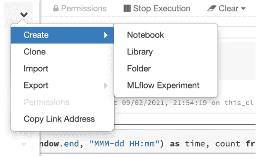

图 7.1 – 在目录中创建库

系统会提示您出现**创建库**对话框，您需要在其中选择所需的库源并遵循相应的流程。

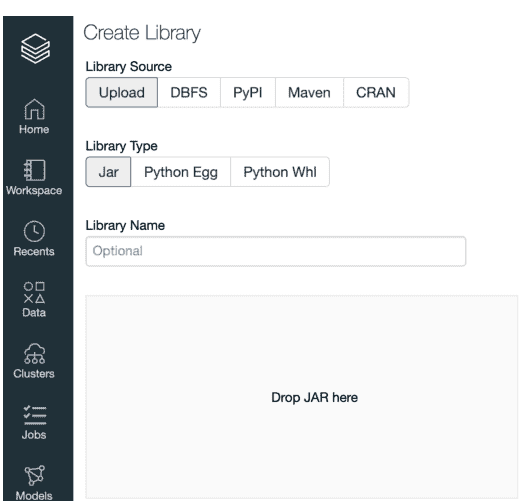

图 7.2 – 从 UI 创建库

可用的选项如下：

- **上传**一个库。
- 引用已上传的库。
- **PyPI** 包。
- **Maven** 包。
- **CRAN** 包（用于 R 包）：

要安装工作区库，我们可以使用 Jar、Python egg 或 Python wheel。为此，将库的 Egg 或 wheel 拖到放置框中，可选地输入库名称，然后单击**创建**按钮。文件将被上传到**Databricks 文件系统 (DBFS)**，我们也可以选择在集群上安装该库。您也可以引用工作区中或 S3 存储桶中已有的 Eggs 或 wheels。

在运行的集群中安装的库，以及它们的详细信息和状态，通过单击工作区中的库详细信息显示。

如果您想删除工作区库，您必须先卸载它，然后才能删除工作区中包含该库的目录，方法是将其移至回收站文件夹，在从集群卸载后即可。

## 集群库

集群库可被该集群上运行的所有笔记本和作业使用。这些库可以直接从公共存储库（如 PyPI 或 Maven）安装，从之前安装的工作区库安装，或使用初始化脚本安装。

在集群上安装库有三种方法：

- 安装已上传到工作区的已存在工作区库。
- 为特定集群仅安装库。
- 使用在集群创建时运行的初始化脚本。

请记住，如果库需要自定义配置，您将需要使用在集群创建时运行的初始化脚本来安装它。还请考虑，当库安装在集群上时，附加到该集群的笔记本和作业不会立即看到新库。因此，您必须先分离然后重新附加笔记本到集群以使其可见。

Azure Databricks 将按它们在集群上安装的顺序处理所有工作区库，因此如果库之间存在依赖关系并且所需库的安装顺序相关时，也要注意这些情况。

要安装已存在于工作区中的库，您可以从集群 UI 或库 UI 开始：

- **集群 UI**：要使用集群 UI 安装，请单击侧边栏上的**集群**选项，选择您想要安装库的集群，并在**库**选项卡中单击**安装新**。在**库源**按钮列表中，选择**工作区**，然后选择一个工作区库，最后单击**安装**。您还可以通过单击库并使用**自动安装到所有集群**复选框选项，将库配置为安装到所有集群。

- **库 UI：**要使用 UI 安装库，请转到包含库的文件夹，然后单击库名称并按照上一节中提到的步骤进行，选择在集群上安装的选项：

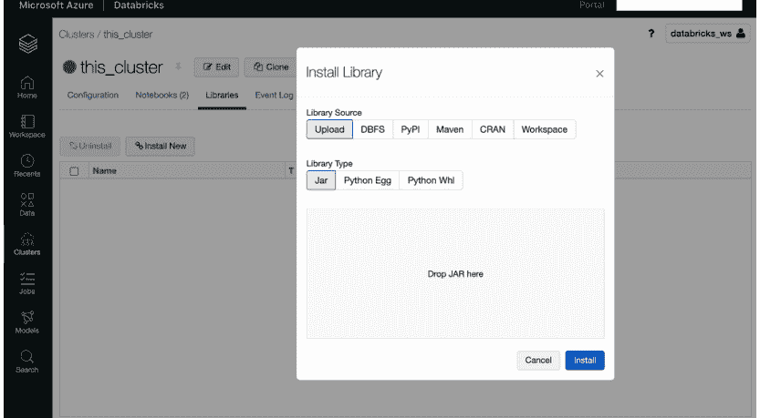

图 7.3 – 从 UI 安装集群范围的库

如前所述，如果您的库需要自定义配置，您将需要使用初始化脚本安装库。

要卸载库，您可以从集群或库开始，转到集群 UI，选择库所在的集群，并在库选项卡中，选择要从中卸载库的集群旁边的复选框，然后单击卸载然后确认。状态将更改为卸载等待重启。

要使用库 UI 卸载，请转到包含库的文件夹，单击库名称，并选择要从中卸载库的集群旁边的复选框，然后单击卸载然后确认。状态更改为卸载等待重启。

与安装时相同，要从集群卸载库，库仅在集群重启时才会被移除。在此之前，已卸载库的状态将显示为卸载等待重启。

要更新集群上安装的库，您应该卸载要更新的版本并安装新版本。

## 笔记本范围的 Python 库

如果我们不想通过安装例如自定义或未测试的库来影响附加到集群的所有笔记本，我们可以在笔记本级别指定要安装的库。笔记本范围允许您管理和共享在特定笔记本中运行的自定义 Python 环境。当我们在笔记本级别安装库时，我们仅影响该笔记本及其关联的作业，只有它们能够访问该库，因此，附加到同一集群的其他笔记本不会受到影响。

所有笔记本范围的库在会话之间不会持久存在，必须在每个会话开始时或笔记本与计算集群断开连接时重新安装。

安装笔记本范围库有三种方法：

- 在笔记本中运行 `%pip` 魔法命令。`%pip` 命令在 Databricks Runtime 7.1 及以上版本均受支持。
- `%conda` 命令，仅在 Databricks Runtime 6.4 ML 及以上和 Databricks Runtime 6.4 for Genomics 及以上受支持。
- 我们可以使用 Databricks **Library** 实用程序，它允许我们安装 Python 库并为笔记本会话创建环境，该环境在驱动程序和执行器上均可用。**Library** 实用程序仅在 Databricks Runtime 上受支持，而非 Databricks Runtime ML 或 Databricks Runtime for Genomics。

需要强调的一点是，`%conda` 魔法命令在 Databricks Runtime 上不可用。它们仅在 Databricks Runtime ML 和 Databricks Runtime for Genomics 上可用。在这些环境中，我们可以像其他 Python 环境一样使用 `%conda`，除了以下 conda 命令不受支持：

- `activate`
- `create`
- `init`
- `run`
- `env create`
- `env remove`

使用 %conda 允许我们保存、重用或共享环境。环境在笔记本从集群分离时每次都会丢失，但我们可以使用 %conda 将其保存以供以后使用或共享。Databricks 建议这些环境在运行相同版本 Databricks 的集群上执行。我们可以将环境保存为 conda YAML 规范：

```
%conda env export -f /dbfs/sub_dir/my_env.yml
```

使用 conda env update 导入文件到另一个笔记本：

```
%conda env update -f dbfs/sub_dir/my_env.yml
```

虽然在 Databricks Runtime 6.4 ML 及以上和 Databricks Runtime 6.4 for Genomics 中，我们可以不加区别地使用 %pip 和 %conda；组合使用它们可能会导致命令之间交互。为了避免冲突，在使用 %pip 和 %conda 时请注意以下事项：

- 如果您使用 API 或集群 UI 安装了库，在笔记本级别安装库时应仅使用 %pip 命令。
- 如果您在集群上使用笔记本范围的库，附加到该笔记本的集群上运行的初始化脚本可以使用 conda 或 pip 命令安装库。但是，如果初始化脚本使用 pip 命令，您应该仅在笔记本中使用 %pip 命令而不是 %conda 以保持版本一致性。
- 最好始终选择 pip 命令或 conda 命令来管理库，而不是两者结合。

由于我们的重点是 Databricks Runtime，我们将重点使用 %pip 作为在笔记本级别管理库的默认方法。

当我们在笔记本级别安装库时，我们集群中的驱动节点仍需要在节点间安装这些库。因此，使用笔记本范围的库会产生驱动程序与节点之间更多的流量，因为驱动程序试图在执行器节点间保持环境一致。当使用超过 10 个节点的集群工作时，Databricks 推荐的驱动节点最低规格以跟上编排如下：

- 使用 100 节点 CPU 集群时，使用 Lsv2 存储优化实例类型。
- 使用 10 节点 GPU 集群时，使用 NC 或 NV 等加速计算和高性能实例类型。
- 对于更大的集群，使用具有更大处理规格的驱动节点。


笔记本状态会在任何修改环境的 %pip 或 %conda 命令后重置，因此必须考虑所有这些命令必须放在笔记本开头，以免丢失创建的变量和未保存的结果。因此，如果我们在创建方法、函数或变量之后再执行 %pip 或 %conda 命令，这些方法和变量将无法恢复。

有时，正如任何有经验的 Python 用户都会知道，使用 %pip 或 %conda 安装或卸载包可能会导致一些不稳定的行为，甚至导致某些功能停止工作。为了克服这个问题，最简单的解决方案之一是通过将笔记本从运行中的集群分离然后重新附加来重启环境。如果这不能解决问题，我们可以直接重启笔记本所连接的集群，以便驱动程序和执行程序节点从干净状态重新安装所有库：

- 使用 %pip 或 %conda 安装或卸载包等同于在任何其他 Python 环境中的使用。例如，要安装特定版本的库，我们可以在一个单元格中运行以下命令：

```
%pip install pandas==1.2.1
```

- 或者，另一方面，我们可以通过使用 %pip install 并指定我们包所在路径来安装 Wheel 包：

```
%pip install /path/to/my_package.whl
```

- 要卸载库，必须传递 -y 选项以将默认设置为 yes，因为运行此选项时没有键盘输入：

```
%pip uninstall -y pandas
```

虽然我们可以使用 %pip 命令安装和卸载库，但我们无法卸载包含在 Databricks Runtime 中的库或在集群级别安装的任何库。如果你在笔记本中安装了一个库，其版本与 Databricks Runtime 或集群中安装的版本不同，使用 %pip 卸载它将使版本恢复为 Databricks Runtime 或集群中安装的版本：

- 我们也可以使用 %pip 命令从 GitHub 等仓库安装库，指定版本或 Git 子目录的选项：

```
%pip install git+https://github.com/databricks/
databricks-cli
```

- 你也可以使用 `%pip` 命令从 DBFS 安装自定义包。为此，我们需要运行 `%pip install` 命令并指定 DBFS 中自定义包所在路径：

```
%pip install /dbfs/mypackage-0.0.1-py3-none-any.whl
```

- 此选项允许我们使用 Python Wheels 在本地安装包。需要注意的是，当文件上传到 DBFS 时，这会自动重命名文件，将空格、句点和连字符替换为下划线。这可能成为一个问题，因为 pip 希望 Wheel 文件使用句点来表示版本（如版本 1.0.1）并且使用连字符而不是空格或下划线。因此，要从上传到 DBFS 的 Wheel 安装 Python 包，我们必须先重命名文件，使其与 pip 预期的一致：

```
%pip install /dbfs/mycustompackage-0.0.1-py3-none-any.whl
```

- 我们也可以使用 `%pip` 列出 requirements 文件中的所有已安装库：

```
%pip freeze > /dbfs/sub_dir/requirements.txt
```

包含在文件路径中的任何子目录都应在运行 `%pip freeze` 之前创建。如果运行 `%pip freeze` 且目录未正确创建其所有子文件夹，命令将失败。

- 我们也可以使用 `%pip` 使用 requirements 文件安装库。requirements 文件包含使用 pip 安装的 Python 包列表，例如我们刚刚使用 `%pip freeze` 创建的文件，它始终是一个名为 `requirements` 的文本文件。以下是一个使用位于 DBFS 中的 requirements 文件安装库的示例：

```
%pip install -r /dbfs/requirements.txt
```

这样，我们可以安装所有必需的库，而无需逐个手动安装，这有助于我们重现环境以重现结果和流程。

关于在笔记本级别管理库的一些最终说明如下：

- 使用 `init` 脚本安装的库将可供连接到该集群的所有笔记本使用。
- 从集群 UI 或 API 安装的库可供集群上的所有笔记本使用，这些库是使用 pip 安装的，因此你应该只在这些笔记本中使用 `%pip` 命令。

- 运行 Databricks Runtime ML 或 Databricks Runtime for Genomics 的集群可以使用运行 `conda` 或 `pip` 命令的 `init` 脚本来安装库。但是，如果 `init` 脚本仅包含 `pip` 命令，则你应该只在笔记本中使用 `%pip` 命令。

在笔记本级别管理库允许我们在运行实验时提供关注点分离，而不会影响连接到集群的所有笔记本。了解这与位于集群或工作区级别的库的关系以及如何利用它来高效管理库非常重要。

在下一节中，我们将更深入地讨论如何在 Azure Databricks 中使用 PySpark API。

## PySpark API

我们在描述 Azure Databricks 的功能时一直在所有章节中使用 PySpark API，而没有过多讨论其功能以及我们如何利用它们在处理大数据时进行可靠的 ETL 操作。PySpark 是 Apache Spark 的 Python API，Apache Spark 是一个集群计算框架，是 Azure Databricks 的核心。

## PySpark 的主要功能

PySpark 允许你以 Python 的易用性利用分布式计算的力量，并且除非另有说明，否则它是本书记载我们计算的默认方式。

PySpark 的基础在于其子包的功能，其中最核心的是以下内容：

- **PySpark DataFrames**：按一组命名列存储的行数据。这些 DataFrames 是不可变的，允许我们执行延迟计算。
- **PySpark SQL 模块**：用于处理来自各种来源和格式的结构化和半结构化数据集的高抽象模块。
- **流式源**：用于读取流式数据的容错且可扩展的模块，该数据被转换为批处理并在预定义的时间间隔内读取，使用 map、reduce 等函数中表达的复杂算法进行处理，然后最终写入不同的文件系统。

- **MLlib**：一个包含多个针对集群计算优化的机器学习算法的库，用于分类、回归、聚类、数据准备、实用程序等。
- **RDDs**：这代表 **弹性分布式数据集**。这是一个位于分布式数据集之上的抽象层，是 Azure Databricks 中运行的任何流程的构建块。

由于我们的重点将放在数据处理上，因此了解 PySpark DataFrames 对我们非常重要；因此，我们将在下一节中回顾使用它们的基础操作。

## 操作 PySpark DataFrames

在本节中，我们将介绍使用 Python 的常见 PySpark DataFrame 函数，这些函数可在任何 Azure Databricks 笔记本中执行。步骤如下：

- 1. 我们第一步是创建 PySpark DataFrame。我们可以通过使用 `createDataFrame` 方法创建名为 `df` 的 DataFrame，其列名为 `id` 和 `value`，如下所示：

```
data = [(1, 'c1', 'a1'), (2, 'c2', 'a2')]
columns = ['id', 'val1', 'val2']
df = spark.createDataFrame(
    data,
    columns)
```

使用 `createDataFrame` 方法时，必须考虑以下几点：

- a) 如果模式由列名列表定义，则每列的类型将从数据中推断。
- b) 如果模式使用 `pyspark.sql.types.DataType` 或数据类型字符串定义，则必须与实际数据匹配。

- 2. 例如，要创建一个空白 DataFrame，我们可以先使用 `StructField` 定义数据模式并将信息存储在名为 `schema` 的变量中：

```
columns = [
    StructField("id", IntegerType(), True),
    StructField("value", StringType(), True),
]
schema = StructType(columns)
```


3. 之后，我们可以使用 `createDataFrame` 和 `sc.emptyRDD` 创建空的 DataFrame，并使用已定义的数据模式：

```
multiplier_df = sqlContext.createDataFrame(sc.emptyRDD(), schema)
```

4. 然后，要向其中添加一行，我们可以将其作为临时 DataFrame 的联合插入：

```
row = [(1, "c1","a1")]
rdd = sc.parallelize(row)
df_temp = spark.createDataFrame(rdd, schema)
```

5. 最后，我们可以使用 `union` 函数按行连接两个 DataFrame：

```
df = df.union(df_temp)
```

6. 我们还可以使用 `createDataFrame` 和 `toDF` 方法从数据列表创建 DataFrame：

```
df = spark.createDataFrame(data).toDF(*columns)
```

7. 当然，我们也可以从 CSV 和 JSON 文件创建 PySpark DataFrame。例如，要将数据从 CSV 读取到 DataFrame 中，我们可以执行以下操作：

```
df = spark.read.csv("/dbfs/file_path.csv")
```

8. 同样，我们也可以对 JSON 文件执行相同操作：

```
df = spark.read.json("/dbfs/file_path.json")
```

9. TXT 文件也适用：

```
df = spark.read.text("/dbfs/file_path.txt")
```

10. 在将数据加载到 DataFrame 后，我们就可以开始对其进行操作。其中最常见的操作之一是对具有相同模式的其他 DataFrame 执行 union，正如我们在使用该方法向现有 DataFrame 追加新行时所看到的那样。例如，我们可以创建一个 DataFrame：

```
data = [(1, 'c1', 'a1'), (2, 'c2', 'a2')]
columns = ['id', 'val1', 'val2']
df = spark.createDataFrame(
    data,
    columns
)
```

然后，我们可以显示模式并展示 DataFrame：

```
df.printSchema()
```

```
df.show(truncate=False)
```

这会产生以下输出：

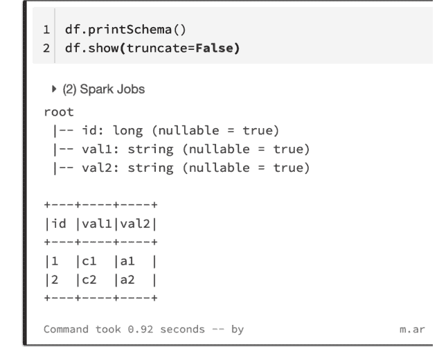

图 7.4 – DataFrame 的模式及其内容

然后，我们创建另一个 DataFrame，将其与之前创建的 DataFrame 合并，考虑到它们必须具有相同的模式：

```
data_new = [(3, 'c2', 'a2'), (4, 'c3', 'a3')]
```

```
columns_new = ['id', 'val1', 'val2']
```

```
df_new = spark.createDataFrame(
    data_new,
    columns_new
)
```

然后，我们显示模式并确保它与我们将要合并数据的 DataFrame 匹配：

```
df_new.printSchema()
```

```
df_new.show(truncate=False)
```

最后，我们可以合并两个 DataFrame 并显示结果：

```
union_df = df.union(df_new)
```

```
union_df.show(truncate=False)
```

11. 合并两个 DataFrame 后，我们可以运行 select 语句来显示某一列的结果：

```
union_df.select("val1").show()
```

12. 我们也可以选择多列：

```
union_df.select("id", "val1").show()
```

13. 我们也可以在具有嵌套结构的情况下使用 select；一种方法是如下所示：

```
nested_df.select("col1.value1","col2.value2").show(truncate=False)
```

14. 我们还可以使用 `filter` 函数根据特定条件过滤结果：

```
union_df.filter(union_df.val1 == "c2") \
    .show(truncate=False)
```

我们也可以使用等效于 filter 的 `where` 函数。

15. 在下一个示例中，我们将使用 `col` 和 `asc` 函数来引用列和查询中结果的升序，该查询基于多个条件过滤结果。这是一个使用 `|` 符号引用的或条件，并且它同时应用于 id 和 value 列：

```
from pyspark.sql.functions import col, asc
```

```
filter_df = union_df.filter((col("id") == "3") | (col("val1") == "c2")).sort(asc("id"))
```

```
display(filter_df)
```

16. 同样，我们可以使用 `&` 符号表示与条件：

```
filter_df = union_df.filter((col("id") == "3") &
    (col("val1") == "c2")).sort(asc("id"))
display(filter_df)
```

17. 然后，我们可以通过先删除文件（如果存在），然后写入文件，将合并后的 DataFrame 持久化到 Parquet 文件：

```
dbutils.fs.rm("/tmp/filter_results.parquet", True)
filter_df.write.parquet("/tmp/filter_results.parquet")
```

18. 如果你想在写入 DataFrame 时指定按特定列分区，可以按以下方式操作：

```
filter_df.write.\
    partitionBy("id", "val1").\
    parquet("/tmp/filter_results.parquet")
```

请确保分区不会创建大量分区列，否则元数据的开销可能会导致进程变慢。

19. 如果我们的数据包含空值，我们可以使用 `fillna` 函数替换它们。在下一个示例中，我们用 "-" 字符替换它们：

```
non_null_union = union_df.fillna("-")
```

20. 为了对列应用函数，我们可以使用 `withColumn` 函数。以下示例将 id 列的数据类型更改为整数：

```
non_null_union = non_null_union.\
    withColumn("id", col("id").cast("Integer"))
```

21. 我们还可以使用 `agg` 和 `countDistinct` 函数对数据执行计数和聚合。我们将对 `union_df` DataFrame 中的 val 列的不同值的数量进行聚合：

```
from pyspark.sql.functions import countDistinct
count_distinct_df = non_null_union.select("id", "val1") \
    .groupBy("id") \
    .agg(countDistinct("val1").alias("distinct_val1"))
display(count_distinct_df)
```

22. 最后，我们可以从 DataFrame 获取描述性统计信息：

```
count_distinct_df.describe().show()
```

23. 然后可以将此查询的结果注册为临时视图，以便我们可以使用 SQL 命令查询它。为此，我们可以运行以下命令：

```
count_distinct_df.createOrReplaceTempView("count_distinct")
```

24. 之后，我们可以使用 SQL 命令执行查询：

```
select_sql = spark.sql('''
SELECT * FROM count_distinct
''')
```

25. 为了将注册在 Hive 元存储中的表加载到 DataFrame 中，我们可以使用 `table` 函数：

```
count_distinct_df = table("count_distinct_df")
```

26. 我们还可以缓存一个我们知道将在多个查询中频繁使用的表。缓存是加快多次访问相同数据的应用程序的一种方法。我们有两个用于缓存 DataFrame 的函数调用，`cache` 和 `persist`，区别在于 `cache` 会将 DataFrame 缓存到内存中，而 `persist` 可以缓存到内存、磁盘或堆外内存，并且等同于不带参数的 `cache`。要缓存之前的 DataFrame，我们可以运行以下命令：

```
count_distinct_df.cache()
```

27. 为了清除当前缓存上的所有缓存表，我们可以在全局级别或按表使用以下命令：

```
sqlContext.clearCache()
sqlContext.cacheTable("count_distinct_df")
sqlContext.uncacheTable("count_distinct_df")
```

现在我们已经回顾了 PySpark 的大多数重要命令，我们可以在 Azure Databricks 中处理数据时使用它们。

在下一节中，我们将学习一种不同于 pandas DataFrame API 的数据操作方式，其名称为 Koalas。

## pandas DataFrame API（Koalas）

使用 Python 的数据科学家和数据工程师非常熟悉在操作数据时使用 pandas DataFrame。pandas 是用于数据操作和分析的 Python 库，但它缺乏处理大数据功能，因此仅适用于处理小型数据集。当我们需要处理更多数据时，最常见的选择是 PySpark，正如我们在上一节中演示的那样，它是一个与 pandas 语法非常不同的库。

Koalas 是一个库，可以简化从 pandas 过渡到在 Azure Databricks 中使用大数据的工作流程。Koalas 的语法与 pandas API 非常相似，但具有 PySpark 的功能。

并非所有 pandas 方法都已实现，并且存在许多细微差异或细微差别，必须考虑这些差异或细微差别，可能并不明显。如果不了解 PySpark，就无法理解 Koalas。

Koalas 功能围绕 Koalas DataFrame 构建，Koalas DataFrame 是分布在多个工作节点上的数据集合，按行组织并具有命名列。这是与 pandas DataFrame 的主要区别，后者加载到单台机器上。

在下一节中，我们将了解如何从使用 pandas 和小型数据集迁移到在 Azure Databricks 中使用 Koalas API 处理大量数据。

## 使用 Koalas API

我们将接下来描述如何使用 Koalas API 创建不同的对象，这些对象在 pandas 库中具有对应的对象。首先，我们将导入以下包，这些包在 Koalas API 功能示例中导入，并允许我们更灵活地使用 Koalas：

```
import numpy as np
```

```
import pandas as pd
```

```
import databricks.koalas as ks
```

首先，我们将创建一个 Koalas Series。这可以通过传递值列表创建，与创建 pandas Series 的方式非常相似。Koalas Series 也可以由 pandas Series 创建。

pandas Series 的创建方式如下：

```
pandas_series = pd.Series([1, 10, 5, np.nan, 10, 2])
```


以非常相似的方式，我们可以创建一个 Koalas Series：

```
koala_series = ks.Series([1, 10, 5, np.nan, 10, 2])
```

如前所述，我们可以通过传递之前创建的 pandas Series 来创建 Koalas Series：

```
koala_series = ks.Series(pandas_series)
```

我们也可以使用 from_pandas 函数创建它：

```
koala_series = ks.from_pandas(pandas_series)
```

需要注意的是，与 pandas 不同，由于 Koalas API 的分布式特性，Koalas 不保证保持索引的顺序。然而，我们可以使用 Series.sort_index() 来保持有序的索引，如下一个示例所示，其中我们对 Koalas Series 应用 sort_index：

```
koala_series.sort_index()
```

Koalas DataFrame 可以像 pandas DataFrame 一样以类似的方式创建。例如，我们可以通过传递 NumPy 数组来创建 Koalas DataFrame，就像我们对 pandas DataFrame 所做的那样。

要从 NumPy 数组创建 pandas DataFrame，我们可以执行以下操作：

```
pandas_df = pd.DataFrame({'val1': np.random.rand(5),
'val2': np.random.rand(5)})
```

非常相似地，我们可以做同样的事情从 NumPy 数组创建 Koalas DataFrame：

```
koalas_df = ks.DataFrame({'val1': np.random.rand(5),
'val2': np.random.rand(5)})
```

我们也可以通过将 pandas DataFrame 作为参数传递给 Koalas DataFrame 方法来创建 Koalas DataFrame：

```
koalas_df = ks.DataFrame(pandas_df)
```

或者我们可以使用 from_pandas 函数：

```
koalas_df = ks.from_pandas(pandas_df)
```

正如我们在 pandas DataFrame 中所做的那样，我们可以使用 head 方法在 Koalas DataFrame 中显示顶部行。例如，要显示前 10 行，我们可以执行以下操作：

```
koalas_df.head(10)
```

head 选项实际上是 Koalas 为使其使用更类似于 pandas 而封装的 PySpark limit 函数，这也可能解释了 Koalas 中 head 函数与 pandas 中 head 函数行为可能存在差异的原因。

我们可以使用 describe 函数快速显示 Koalas DataFrame 中数据的统计摘要：

```
koalas_df.describe()
```

我们可以使用 transpose 函数转置 Koalas DataFrame：

```
koalas_df.transpose()
```

使用此函数时，最好始终设置最大计算行数，以防止因行数超过 compute.max_rows 参数值而导致失败，该参数默认为 1000。因此，我们可以防止意外执行昂贵的操作。要设置此选项，我们可以执行以下操作，其中我们将最大计算行数设置为 2000：

```
from databricks.koalas.config import set_option, get_option
```

```
ks.get_option('compute.max_rows')
```

```
ks.set_option('compute.max_rows', 2000)
```

对于选择和访问 Koalas DataFrame 中存储的数据，也类似于 pandas DataFrame。例如，从 Koalas DataFrame 中选择单个列会返回一个 Series。在下一个示例中，我们访问 DataFrame 的 val1 列：

```
koalas_df['val1']
```

我们也可以以以下方式访问列：

```
koalas_df.val1
```

我们可以通过传递要选择的列名列表来从 Koalas DataFrame 中选择多个列：

```
koalas_df[['val1', 'val2']]
```

loc 和 iloc 切片方法在 Koalas DataFrame 中也可用。例如，要从 Koalas DataFrame 中选择行，我们可以使用 loc：

```
koalas_df.loc[1:2]
```

使用 iloc 方法通过引用行和列的索引也可以对行和列进行切片：

```
koalas_df.iloc[:3, 1:2]
```

为了防止昂贵的操作，在 Koalas 中默认禁用添加来自其他 DataFrame 或 Series 的列。这是因为这些操作需要连接，而连接是昂贵的操作，可能导致不必要的成本。

为了控制此行为，如果我们希望启用添加此功能，可以将 compute.ops_on_diff_frames 设置为 True。如果需要更多详细信息，请参阅文档中的可用选项：

```
ks.get_option('compute.ops_on_diff_frames')
```

```
koalas_series = ks.Series([200, 350, 150, 400, 250],
```

```
    index=[0, 1, 2, 3, 4])
```

```
koalas_df['val3'] = koalas_series
```

执行列添加后，我们可以将此选项重置为默认值，以避免以后潜在的不当使用：

```
ks.set_option('compute.ops_on_diff_frames', False)
```

pandas 中最有用的函数之一是 apply 方法，它在 Koalas DataFrame 中也可用。例如，我们可以应用 np.cumsum 函数在列之间求和：

```
koalas_df.apply(np.cumsum)
```

我们还可以指定要应用函数的轴，其中我们可以将轴设置为 1 以使用列。默认参数为 0 或 index：

```
koalas_df.apply(np.cumsum, axis=1)
```

使用 apply 函数时，最好为用户自定义函数指定返回数据类型提示。否则，Koalas API 将对用户自定义函数进行试运行以采样数据类型，这在计算上可能很昂贵，因此最好始终指定函数的输出数据类型。

在下一个示例中，我们看到如何在一个名为 square_root 的自定义函数中定义预期的返回数据类型：

```
def square_root(x) -> ks.Series[np.float64]:
    return x ** .5
koalas_df.apply(square_root)
```

当处理如果被意外触发可能导致高计算成本的操作时，我们可以使用 compute.shortcut_limit（默认值 = 1000），该选项指定使用 pandas API 计算的行数。如果数据大小低于此阈值，Koalas 将使用 pandas API 进行计算。因此，将此限制设置得过高可能会导致处理速度变慢或出现内存不足错误，但反过来，它可以防止我们触发大量计算。

在下一个示例代码中，我们将设置更高的 compute.shortcut_limit 值，在本例中设置为 5000：

```
ks.set_option('compute.shortcut_limit', 5000)
```

我们可以使用 plot.line 函数制作折线图：

```
koalas_df = ks.DataFrame({'val1': [15, 18, 489, 675, 1776],\
    'val2': [4, 25, 181, 600, 1900]},\
    index=[1, 2, 3, 4, 5])
koalas_df.plot.line()
```

我们可以使用 plotting.sample_ratio 选项设置绘图数据的比例，该选项默认为 1000。我们也可以通过设置 plotting.max_rows 选项来实现相同目的。

使用 DataFrame.plot.hist 方法在 Koalas DataFrame 中也包含了制作直方图的功能。例如，我们可以使用随机数据创建 DataFrame 并使用前面提到的函数进行绘图：

```
koalas_df = pd.DataFrame(
    np.random.randint(1, 10, 1000),\
    columns=['c1'])
koalas_df['c2'] = koalas_df['c1'] + np.random.randint(1, 10, 1000)
koalas_df = ks.from_pandas(koalas_df)
koalas_df.plot.hist(bins=14, alpha=0.5)
```

在下一节中，我们将简要介绍如何使用 Koalas API 进行 SQL 查询。

## 在 Koalas 中使用 SQL

Spark DataFrame 的一个特性是我们可以通过多种方式查询数据，其中一种是使用 SQL 查询从表中获取数据。

此功能也扩展到 Koalas DataFrame，我们可以使用 Koalas API 进行 SQL 查询，该 API 使用 ks.sql 支持标准 SQL 语法。查询以 Koalas DataFrame 的形式返回结果：

```
koalas_df = ks.DataFrame({'year': [2010, 2011, 2012, 2013, 2014],
'c1': [15, 24, 689, 575, 1376],
'c2': [4, 27, 311, 720, 1650]})
ks.sql("SELECT * FROM { koalas_df } WHERE c1 > 100")
```

使用 SQL 语句查询数据是一个特性，它充当了习惯使用 pandas DataFrame 的数据科学家与习惯使用 SQL 查询数据的工程师或商业智能分析师之间的桥梁。

下一节将展示如何无缝地将 Koalas DataFrame 转换为 Spark DataFrame。

## 使用 PySpark

由于 Koalas 建立在 PySpark 之上，你可以在 Koalas DataFrame 中应用多个 PySpark 功能，例如 Spark UI、历史服务器等。例如，我们可以轻松地使用 Koalas DataFrame 的 to_spark 方法将 Koalas DataFrame 转换为 PySpark DataFrame，反之亦然，这类似于 to_pandas 方法。反过来，PySpark DataFrame 可以使用 PySpark DataFrame 的 to_koalas 方法转换为 Koalas DataFrame，该方法是 Spark DataFrame 类的扩展：

```
koalas_df = ks.DataFrame({'c1': [1, 2, 3, 4, 5],
'c2': [10, 20, 30, 40, 50]})
spark_df = koalas_df.to_spark()
type(spark_df)
spark_df.show()
```


将 PySpark DataFrame 转换为 Koalas 时需要注意，这项操作在默认索引类型为序列时可能会导致内存不足错误。默认索引类型可通过 `compute.default_index_type` Koalas 选项进行管理，该选项默认设置为 sequence。如果我们处理的索引是大型数据集的序列，则应使用 distributed-sequence：

```
from databricks.koalas import option_context
with option_context("compute.default_index_type", "distributed-sequence"):
    koalas_df = spark_df.to_koalas()
```

PySpark DataFrame 没有索引，而 Koalas DataFrame 有。因此，将 PySpark DataFrame 转换为 Koalas DataFrame 需要创建新的索引，此操作可能会产生一定的开销。我们可以通过指定可作为索引列的列来避免此问题，如以下示例所示：

```
spark_df.to_koalas(index_col='c1')
```

我们也可以利用 PySpark 的缓存功能，该功能在 Koalas 中也可用。我们可以使用此选项来存储 Koalas 操作的结果，避免重复运行计算，从而提高需要频繁访问输出的操作的性能。缓存选项应用于 Koalas DataFrame 的方式如下：

```
koalas_df.cache()
```

本节中关于 Koalas 的所有示例都侧重于从 pandas 迁移到 Azure Databricks 中的分布式计算时的易用性，深度不足以解释所有可用功能，因此始终建议查看官方 Koalas API 文档以了解所有可用功能的最新动态。

在本章的下一节中，我们将学习在 Azure Databricks 中使用 Bokeh、Matplotlib 和 Plotly 等常见 Python 库可视化数据的[content]

将 PySpark DataFrame 转换为 Koalas 时需要注意，这项操作在默认索引类型为序列时可能会导致内存不足错误。默认索引类型可通过 `compute.default_index_type` Koalas 选项进行管理，该选项默认设置为 sequence。如果我们处理的索引是大型数据集的序列，则应使用 distributed-sequence：

```
from databricks.koalas import option_context
with option_context("compute.default_index_type", "distributed-sequence"):
    koalas_df = spark_df.to_koalas()
```

PySpark DataFrame 没有索引，而 Koalas DataFrame 有。因此，将 PySpark DataFrame 转换为 Koalas DataFrame 需要创建新的索引，此操作可能会产生一定的开销。我们可以通过指定可作为索引列的列来避免此问题，如以下示例所示：

```
spark_df.to_koalas(index_col='c1')
```

我们也可以利用 PySpark 的缓存功能，该功能在 Koalas 中也可用。我们可以使用此选项来存储 Koalas 操作的结果，避免重复运行计算，从而提高需要频繁访问输出的操作的性能。缓存选项应用于 Koalas DataFrame 的方式如下：

```
koalas_df.cache()
```

本节中关于 Koalas 的所有示例都侧重于从 pandas 迁移到 Azure Databricks 中的分布式计算时的易用性，深度不足以解释所有可用功能，因此始终建议查看官方 Koalas API 文档以了解所有可用功能的最新动态。

在本章的下一节中，我们将学习在 Azure Databricks 中使用 Bokeh、Matplotlib 和 Plotly 等常见 Python 库可视化数据的[content]

将 PySpark DataFrame 转换为 Koalas 时需要注意，这项操作在默认索引类型为序列时可能会导致内存不足错误。默认索引类型可通过 `compute.default_index_type` Koalas 选项进行管理，该选项默认设置为 sequence。如果我们处理的索引是大型数据集的序列，则应使用 distributed-sequence：

```
from databricks.koalas import option_context
with option_context("compute.default_index_type", "distributed-sequence"):
    koalas_df = spark_df.to_koalas()
```

PySpark DataFrame 没有索引，而 Koalas DataFrame 有。因此，将 PySpark DataFrame 转换为 Koalas DataFrame 需要创建新的索引，此操作可能会产生一定的开销。我们可以通过指定可作为索引列的列来避免此问题，如以下示例所示：

```
spark_df.to_koalas(index_col='c1')
```

我们也可以利用 PySpark 的缓存功能，该功能在 Koalas 中也可用。我们可以使用此选项来存储 Koalas 操作的结果，避免重复运行计算，从而提高需要频繁访问输出的操作的性能。缓存选项应用于 Koalas DataFrame 的方式如下：

```
koalas_df.cache()
```

本节中关于 Koalas 的所有示例都侧重于从 pandas 迁移到 Azure Databricks 中的分布式计算时的易用性，深度不足以解释所有可用功能，因此始终建议查看官方 Koalas API 文档以了解所有可用功能的最新动态。

在本章的下一节中，我们将学习在 Azure Databricks 中使用 Bokeh、Matplotlib 和 Plotly 等常见 Python 库可视化数据的[content]

将 PySpark DataFrame 转换为 Koalas 时需要注意，这项操作在默认索引类型为序列时可能会导致内存不足错误。默认索引类型可通过 `compute.default_index_type` Koalas 选项进行管理，该选项默认设置为 sequence。如果我们处理的索引是大型数据集的序列，则应使用 distributed-sequence：

```
from databricks.koalas import option_context
with option_context("compute.default_index_type", "distributed-sequence"):
    koalas_df = spark_df.to_koalas()
```

PySpark DataFrame 没有索引，而 Koalas DataFrame 有。因此，将 PySpark DataFrame 转换为 Koalas DataFrame 需要创建新的索引，此操作可能会产生一定的开销。我们可以通过指定可作为索引列的列来避免此问题，如以下示例所示：

```
spark_df.to_koalas(index_col='c1')
```

我们也可以利用 PySpark 的缓存功能，该功能在 Koalas 中也可用。我们可以使用此选项来存储 Koalas 操作的结果，避免重复运行计算，从而提高需要频繁访问输出的操作的性能。缓存选项应用于 Koalas DataFrame 的方式如下：

```
koalas_df.cache()
```

本节中关于 Koalas 的所有示例都侧重于从 pandas 迁移到 Azure Databricks 中的分布式计算时的易用性，深度不足以解释所有可用功能，因此始终建议查看官方 Koalas API 文档以了解所有可用功能的最新动态。

在本章的下一节中，我们将学习在 Azure Databricks 中使用 Bokeh、Matplotlib 和 Plotly 等常见 Python 库可视化数据的[content]

将 PySpark DataFrame 转换为 Koalas 时需要注意，这项操作在默认索引类型为序列时可能会导致内存不足错误。默认索引类型可通过 `compute.default_index_type` Koalas 选项进行管理，该选项默认设置为 sequence。如果我们处理的索引是大型数据集的序列，则应使用 distributed-sequence：

```
from databricks.koalas import option_context
with option_context("compute.default_index_type", "distributed-sequence"):
    koalas_df = spark_df.to_koalas()
```

PySpark DataFrame 没有索引，而 Koalas DataFrame 有。因此，将 PySpark DataFrame 转换为 Koalas DataFrame 需要创建新的索引，此操作可能会产生一定的开销。我们可以通过指定可作为索引列的列来避免此问题，如以下示例所示：

```
spark_df.to_koalas(index_col='c1')
```

我们也可以利用 PySpark 的缓存功能，该功能在 Koalas 中也可用。我们可以使用此选项来存储 Koalas 操作的结果，避免重复运行计算，从而提高需要频繁访问输出的操作的性能。缓存选项应用于 Koalas DataFrame 的方式如下：

```
koalas_df.cache()
```

本节中关于 Koalas 的所有示例都侧重于从 pandas 迁移到 Azure Databricks 中的分布式计算时的易用性，深度不足以解释所有可用功能，因此始终建议查看官方 Koalas API 文档以了解所有可用功能的最新动态。

在本章的下一节中，我们将学习在 Azure Databricks 中使用 Bokeh、Matplotlib 和 Plotly 等常见 Python 库可视化数据的[content]

将 PySpark DataFrame 转换为 Koalas 时需要注意，这项操作在默认索引类型为序列时可能会导致内存不足错误。默认索引类型可通过 `compute.default_index_type` Koalas 选项进行管理，该选项默认设置为 sequence。如果我们处理的索引是大型数据集的序列，则应使用 distributed-sequence：

```
from databricks.koalas import option_context
with option_context("compute.default_index_type", "distributed-sequence"):
    koalas_df = spark_df.to_koalas()
```

PySpark DataFrame 没有索引，而 Koalas DataFrame 有。因此，将 PySpark DataFrame 转换为 Koalas DataFrame 需要创建新的索引，此操作可能会产生一定的开销。我们可以通过指定可作为索引列的列来避免此问题，如以下示例所示：

```
spark_df.to_koalas(index_col='c1')
```

我们也可以利用 PySpark 的缓存功能，该功能在 Koalas 中也可用。我们可以使用此选项来存储 Koalas 操作的结果，避免重复运行计算，从而提高需要频繁访问输出的操作的性能。缓存选项应用于 Koalas DataFrame 的方式如下：

```
koalas_df.cache()
```

本节中关于 Koalas 的所有示例都侧重于从 pandas 迁移到 Azure Databricks 中的分布式计算时的易用性，深度不足以解释所有可用功能，因此始终建议查看官方 Koalas API 文档以了解所有可用功能的最新动态。

在本章的下一节中，我们将学习在 Azure Databricks 中使用 Bokeh、Matplotlib 和 Plotly 等常见 Python 库可视化数据的[content]

将 PySpark DataFrame 转换为 Koalas 时需要注意，这项操作在默认索引类型为序列时可能会导致内存不足错误。默认索引类型可通过 `compute.default_index_type` Koalas 选项进行管理，该选项默认设置为 sequence。如果我们处理的索引是大型数据集的序列，则应使用 distributed-sequence：

```
from databricks.koalas import option_context
with option_context("compute.default_index_type", "distributed-sequence"):
    koalas_df = spark_df.to_koalas()
```

PySpark DataFrame 没有索引，而 Koalas DataFrame 有。因此，将 PySpark DataFrame 转换为 Koalas DataFrame 需要创建新的索引，此操作可能会产生一定的开销。我们可以通过指定可作为索引列的列来避免此问题，如以下示例所示：

```
spark_df.to_koalas(index_col='c1')
```

我们也可以利用 PySpark 的缓存功能，该功能在 Koalas 中也可用。我们可以使用此选项来存储 Koalas 操作的结果，避免重复运行计算，从而提高需要频繁访问输出的操作的性能。缓存选项应用于 Koalas DataFrame 的方式如下：

```
koalas_df.cache()
```

本节中关于 Koalas 的所有示例都侧重于从 pandas 迁移到 Azure Databricks 中的分布式计算时的易用性，深度不足以解释所有可用功能，因此始终建议查看官方 Koalas API 文档以了解所有可用功能的最新动态。

在本章的下一节中，我们将学习在 Azure Databricks 中使用 Bokeh、Matplotlib 和 Plotly 等常见 Python 库可视化数据的[content]
It is important to notice when converting a PySpark Data Frame to Koalas that this operation can cause an out-of-memory error when the default index type is a sequence. The default index type can be managed using the compute.default_index_type Koalas option, which by default is set to sequence. If we are dealing with indexes that are the sequence of a large dataset, we should use distributed-sequence:

```
from databricks.koalas import option_context
with option_context("compute.default_index_type", "distributed-sequence"):
    koalas_df = spark_df.to_koalas()
```

PySpark DataFrames do not have indices while Koalas DataFrames do. Therefore, converting a PySpark DataFrame into a Koalas DataFrame requires creating new indexes, an operation that could cause some overhead. We can avoid this issue by specifying the column that can be used as an index column, as in the next example:

```
spark_df.to_koalas(index_col='c1')
```

We can also take advantage of the PySpark caching feature, which is also available in Koalas as well. We can use this option in order to store the results of the Koalas operations and not have to run computations more than once, which can improve the performance of operations where outputs need to be accessed frequently. The cache option is applied to a Koalas DataFrame in the following way:

```
koalas_df.cache()
```

All of the examples presented in this section about Koalas focus on the ease of use when migrating from pandas into distributed computing in Azure Databricks and lack enough depth to explain all the available features, so it is always good to take a look at the official Koalas API documentation to keep up to date with all the available features.

In the next section of this chapter, we will learn the basics and possibilities to visualize our data in Azure Databricks using common Python libraries such as Bokeh, Matplotlib, and Plotly.

## Visualizing data

We can use popular Python libraries such as Bokeh, Matplotlib, and Plotly to make visualizations in Azure Databricks. In this section, we will learn how we can use these libraries in Azure Databricks and how we can make use of notebook features to work with these visualizations.

## Bokeh

Bokeh is a Python interactive data visualization library used to create beautiful and versatile graphics, dashboards, and plots.

To use Bokeh, you can install the Bokeh PyPI package either by installing it at the cluster level through the libraries UI and attaching it to your cluster or by installing it at the notebook level using pip commands.

Once we have installed the library and we can import it into our notebook, to display a Bokeh plot in Databricks, we must first create the plot and generate an HTML file embedded with the data for the plot, created, for example, by using Bokeh's file_html or output_file functions, and then pass this HTML to the Databricks displayHTML function.

For example, to create a simple plot using Bokeh, we can do the following. First, we import the required libraries from Bokeh:

```
from bokeh.plotting import figure
from bokeh.embed import components, file_html
from bokeh.resources import CDN
```

Then, we generate some data to visualize it. We will use a series of x and y coordinates arranged into a list to create a simple line:

```
x = [1, 2, 3, 4, 5, 6, 7, 8, 9]
y = [2, 4, 3, 4, 5, 6, 7, 9, 8]
```

Then, we can create a new object to store the line plot and add some title and axis labels to it:

```
p = figure(title="this simple line example",
           x_axis_label='x_val', y_axis_label='y_val')
```

We will also add a legend to the line and specify the line thickness:

```
p.line(x, y, legend_label="this line.", line_width=2)
```

Finally, we create the HTML file with the embedded Bokeh plot in an object:

```
html = file_html(p, CDN, "my_plot")
```

Finally, we can display it in an Azure Databricks notebook using the displayHTML function:

```
displayHTML(html)
```

This results in the following output:

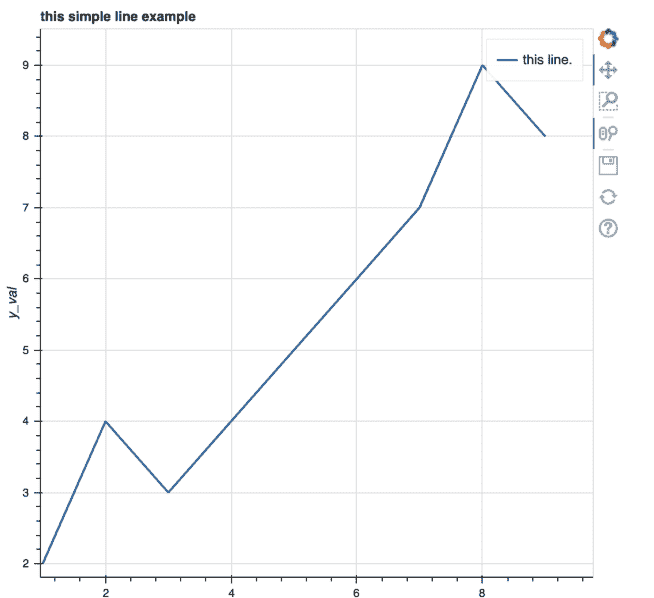

Figure 7.5 – Bokeh line plot

It is important to take into account that the maximum size for a notebook cell, both contents and output, is 16 MB, so we need to make sure that the size of the plot packed into the HTML doesn’t reach this limit.

## Matplotlib

The method for displaying Matplotlib figures used depends on which version of Databricks Runtime your cluster is running, but from Databricks Runtime 6.5 and above, we can directly display figures inline using the display function.

To make the case for how easy it is to work with Matplotlib, we will create a simple example displaying a scatter plot. First, we will generate fake data using numpy:

```
import numpy as np
import matplotlib.pyplot as plt
x = np.linspace(0, 2*np.pi, 50)
y = np.sin(x)
```

Then, we initialize the objects that will hold the plot and select to plot the y data over the x axis using a dashed line:

```
fig, ax = plt.subplots()
ax.plot(x, y, 'k--')
```

We can set the ticks and tick labels for both the x and y axes:

```
ax.set_xlim((0, 2*np.pi))
ax.set_xticks([0, np.pi, 2*np.pi])
ax.set_xticklabels(['0', '$\pi$', '2$\pi$'])
ax.set_ylim((-1.5, 1.5))
ax.set_yticks([-1, 0, 1])
```

Finally, we can use display(fig) to display our figure inline in an Azure Databricks notebook:

```
display(fig)
```

The output is as follows:

```
import numpy as np
import matplotlib.pyplot as plt
x = np.linspace(0, 2*np.pi, 50)
y = np.sin(x)
fig, ax = plt.subplots()
ax.plot(x, y, 'k--')
ax.set_xlim((0, 2*np.pi))
ax.set_xticks([0, np.pi, 2*np.pi])
ax.set_xticklabels(['0', '$\pi$', '2$\pi$'])
ax.set_ylim(-1.5, 1.5)
ax.set_yticks([-1, 0, 1])
display(fig)
```

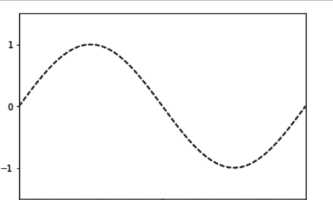

Figure 7.6 – Matplotlib line plot

The use of Matplotlib is very similar to its use in other Python IDEs such as Jupyter notebooks, with the added difference of using the display function to visualize the plots.

Next, we will see how we can use Plotly to visualize data using the display function as well.

## Plotly

Plotly is an interactive graphing library in Python that Azure Databricks supports. To use Plotly, you can either install the Plotly PyPI package and attach it to your cluster or use pip commands to install it as a notebook-scoped library.

In Databricks notebooks, it is recommended to use Plotly on its offline version and take into account that its performance may not be the best when handling large datasets. Therefore, if there are performance issues, you should try to reduce the amount of data used in the plot:

To display a Plotly plot, we must first store the resulting plot in an object and then pass this object to the displayHTML function. In order to exemplify this, let's first import Plotly and Numpy and then create some fake data to create a plot out of it:

```
from plotly.offline import plot
from plotly.graph_objs import *
import numpy as np
Then, we can create some random data to plot:
x = np.random.randn(1000)
y = np.random.randn(1000)
```

After this, we will create the plot but instead of calling the plot function to display the visualization, we will store the plot in an object, making sure that we pass the output_type keyword argument set to div:

```
p = plot(
[
    Histogram2dContour(x=x, y=y,
    contours=Contours(coloring='heatmap')),
    Scatter(x=x, y=y, mode='markers',
    marker=Marker(color='white', size=3, opacity=0.3))
],
    output_type='div'
)
```

Finally, we can display the plot by calling the displayHTML function:

```
displayHTML(p)
```

The output is as follows:

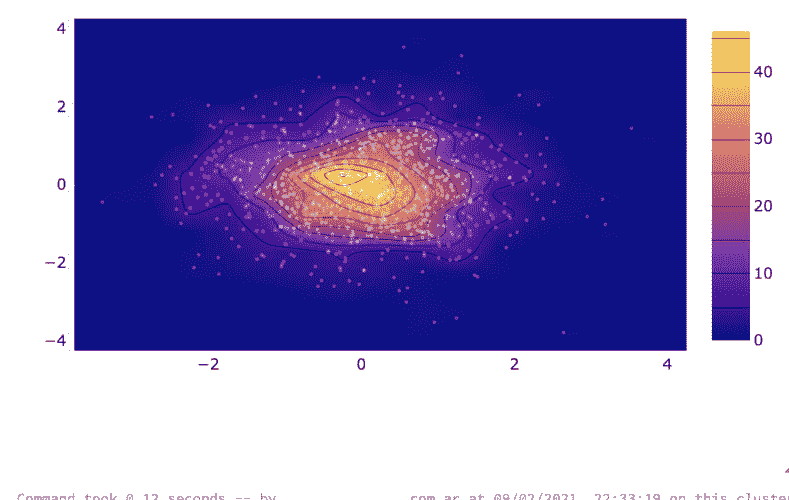

Figure 7.7 – Plotly scatter plot

As we have seen in this section, using common libraries to visualize data is really easy once we understand the minor differences between working locally and using these libraries in Azure Databricks.

## Summary

In this chapter, we have turned our focus to deepening our knowledge on how we can manipulate data using the PySpark API and using its core features. We have also gone through the steps required to install and use Python libraries at different instance levels and how we can use them to visualize our data using the display function.

Finally, we went through the basics of the Koalas API, which makes it easier to migrate from working with pandas to working with big data in Azure Databricks.

In the next chapter, will learn how to use Azure Databricks to run machine learning experiments, train models, and make inferences on new data using libraries such as XGBoost, sklearn, and Spark’s MLlib.


### 8
Databricks Runtime
for Machine
Learning

本章将深入探讨经典机器学习算法的开发，用于基于表格数据训练和部署模型，同时也将探索库和算法。示例将重点关注使用 Azure Databricks Runtime for Machine Learning（Databricks Runtime ML）的特殊性和优势。

在本章中，我们将探索以下概念，这些概念侧重于我们如何提取和改进数据中可用的特征，以训练我们的机器学习和深度学习模型。我们将涵盖的主题如下：

- Loading data
- Feature engineering
- Time-series data sources
- Handling missing values
- Extracting features from text
- Training machine learning models on tabular data

在接下来的章节中，我们将讨论执行所介绍操作所需的库，并提供有关最佳实践以及一些核心概念如何与其相关联的背景信息。

不用多说，让我们开始在 Azure Databricks 中使用机器和深度学习模型吧。

## Loading data

**Comma-separated values (CSV)** 是机器学习应用中最广泛使用的表格数据格式。顾名思义，它以行形式存储数据，以逗号或制表符分隔。

本节介绍专门针对机器学习和深度学习应用加载数据的相关信息。虽然我们可以认为这些概念已在前几章和章节中介绍过，但我们将强化有关如何直接将表格数据读入 Azure Databricks 以及最佳实践的相关概念。

### Reading data from DBFS

在 Azure Databricks 等分布式计算环境中训练机器学习算法时，拥有共享存储的需求变得很重要，尤其是在使用分布式深度学习应用时。Azure **Databricks File System (DBFS)** 允许使用 Spark 和本地文件 **application programming interfaces (APIs)** 为任何集群高效访问数据：

在 Azure Databricks 中，我们可以选择一个提供高性能 **Filesystem in Userspace (FUSE)** 挂载的 Machine Learning Runtime，这是一个虚拟文件系统，可以通过 /dbfs 位置被所有集群节点访问。这允许在集群节点中运行的进程使用分布式存储系统通过本地文件 API 读取同一位置。

- 例如，当我们将文件写入 DBFS 位置，如以下代码片段所示时，我们正在使用跨所有集群节点的共享文件系统：

```
with open("/dbfs/tmp/test_dbfs.txt", 'w') as f:
    f.write("This is\n")
    f.write("in the shared\n")
    f.write("file system.\n")
```

- 同样，我们可以使用本地文件 API 读取分布式文件系统上的文件，如以下代码片段所示：

```
with open("/dbfs/tmp/test_dbfs.txt", "r") as f_read:
    for line in f_read:
        print(line)
```

- 这样，我们可以将输出显示到控制台，如以下屏幕截图所示：

```
Cmd 1
1 with open("/dbfs/tmp/test_dbfs.txt", 'w') as f:
2     f.write("This is\n")
3     f.write("in the shared\n")
4     f.write("file system.\n")
5 with open("/dbfs/tmp/test_dbfs.txt", "r") as f_read:
6     for line in f_read:
7         print(line)
8
```

This is

in the shared

file system.

Figure 8.1 – Output of reading a file in the shared filesystem

使用 Azure Databricks Runtime ML 时，我们可以选择使用 dbfs:/ml 文件夹，这是一个特殊文件夹，已针对深度学习操作的高性能输入/输出（I/O）进行了优化。这尤其方便作为解决 Azure Databricks 中不支持大于 2 千兆字节（GB）的文件的限制的变通方法，因此建议将数据保存在此文件夹中。

我们可以通过读取表或本地 CSV 文件来加载用于机器和深度学习应用训练和推理的数据，正如我们在下一节中将看到的那样。数据加载后，我们有大量选项将其转换为 Spark DataFrames、pandas DataFrames 或 NumPy 数组。

在下一节中，我们将再次介绍如何在 Azure Databricks 中读取 CSV 文件以使用分布式深度学习应用。

### Reading CSV files

机器学习数据最常见的格式之一是 CSV，它经常用于保存表格数据。在这里，我们使用术语表格数据来描述数据结构化为行表示观测值，而观测值又使用变量或属性的形式的列来描述。

正如我们在前几章中看到的，我们有多种方法将 CSV 文件加载到 Azure Databricks 中。第一个选项是使用 PySpark API 将数据导入 Spark DataFrame 以解析数据。以下代码片段将读取存储在 DBFS 中指定 databricks 数据集文件夹中的文件，并将其读入 Spark DataFrame，同时推断文件中底层数据类型：

```
diamonds = spark.read.format('csv').options(header='true',
 inferSchema='true').load('/databricks-datasets/Rdatasets/data-001/csv/ggplot2/diamonds.csv')
```

在 Azure Databricks 中，我们也有使用结构化查询语言（SQL）命令从 CSV 文件导入数据到临时视图的选项，然后我们可以查询该视图。我们可以通过在单元格中使用 %%sql 魔法并将 CSV 文件中的数据加载到临时视图来实现，如下所示：

```
%sql
CREATE TEMPORARY VIEW diamonds
USING CSV
OPTIONS (path "/databricks-datasets/Rdatasets/data-001/csv/ggplot2/diamonds.csv", header "true", mode "FAILFAST")
```

请注意，在这里，我们传递了 FAILFAST 模式以停止文件的解析，如果发现有故障的行则引发异常。

一旦数据导入到视图中，我们就可以使用 SQL 命令对临时视图执行查询，如下所示：

```
%sql
SELECT * FROM diamonds
```

这将向我们展示我们刚刚创建的临时视图，如以下屏幕截图所示：

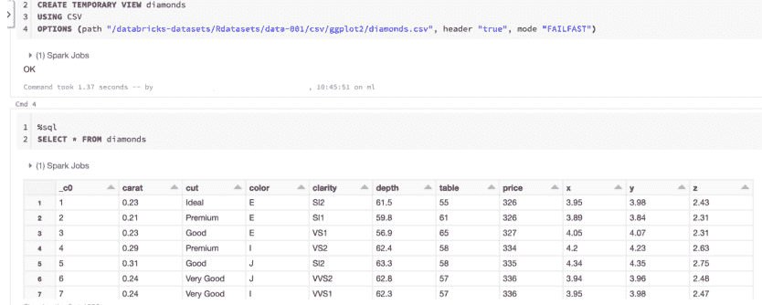

Figure 8.2 - Using SQL to read from a CSV file

如果我们指定了模式读取 CSV 文件，我们可能会遇到一些问题，如果指定的模式与我们指定的不同——例如，我们可能在指定为整数数据类型的列中有一个字符串值。这可能导致结果与实际数据有很大差异。因此，始终验证数据的正确性是一个很好的做法。

我们可以通过选择解析器运行的可用模式之一来指定 CSV 解析器的行为。此模式的可用选项如下所述：

- **PERMISSIVE**：这是默认模式。在这里，未正确解析的字段中插入空值。这使我们能够检查未正确解析的行。
- **DROPMALFORMED**：此模式会丢弃包含无法正确解析的值的行。
- **FAILFAST**：如果发现任何格式错误的数据，此模式将中止文件的读取。

要设置模式，请使用 mode 选项，如以下代码片段所示：

```
drop_wrong_schema = sqlContext.read.format("csv").
option("mode", "FAILFAST")
```

在下一个示例中，我们将读取一个 CSV 文件，指定数据的已知模式，并将解析器模式设置为如果类型与指定不符则丢弃格式错误的数据。如前所述，指定模式始终是一个很好的做法。如果数据的模式已为已知，最好避免模式推断。在这里，我们将读取一个包含 ID、name 和 last name 列的文件，第一个为整数，其余为字符串：

```
from pyspark.sql.types import StructType, StructField
from pyspark.sql.types import DoubleType, IntegerType,
StringType
data_schema = StructType([
    StructField("id", IntegerType()),
    StructField("name", StringType()),
    StructField("lastname", StringType())
])
(sqlContext
.read
.format("com.databricks.spark.csv")
.schema(data_schema)
.option("header", "true")
.option("mode", "DROPMALFORMED")
.load("some_input_file.csv"))
```

现在我们已经了解了如何从 CSV 文件读取表格数据，我们可以使用数据从中提取特征。这些特征将使我们能够准确建模数据，并拥有更有效的机器学习和深度学习模型。在下一节中，我们将学习如何在 Azure Databricks 中执行特征工程。

## Feature engineering

机器学习模型使用输入数据进行训练，以便稍后对未见数据做出预测。此输入数据通常由特征组成，这些特征通常以结构化列的形式出现。算法使用这些数据来推断可能用于推断结果的模式。在这里，特征工程的需求出现了两个主要目标，如下所示：

- Refactoring the input data to make it compatible with the machine learning algorithm we have selected for the task. For example, we need to encode categorical values if these are not supported by the algorithm we choose for our model.


- 根据我们为当前问题选择的性能指标改进模型产生的预测。

通过特征工程，我们从原始输入数据中提取相关特征，以便能够根据要解决的问题所建模的方式准确地表示它，从而在新数据上的模型性能得到改善。需要记住的是，所使用的特征将比其他一切更能影响模型的性能。

特征工程可以被视为将输入数据转换为机器学习算法更容易解释的形式的过程，通过使关键特征或模式更加透明来实现，尽管我们有时可以生成新特征以使数据可视化更易于解释或使模式推断对模型算法更清晰。

特征工程中应用了多种策略。其中一些列在这里：

- 缺失数据插补和管理
- 异常值处理
- 分箱
- 对数变换
- 独热编码
- 归一化
- 分组和聚合操作
- 特征拆分
- 缩放

其中一些策略仅在某些算法或数据集中有应用，而其他策略在所有情况下都可能有益。

一种常见的看法是认为你建模的特征越好，你将获得的性能就越好。虽然在某些情况下这是正确的，但也可能具有误导性。

模型的性能有许多因素，不同因素的重要性程度不同。其中这些因素包括算法的选择、可用数据以及提取的特征。你还可以将问题建模的方式以及用于估计性能的目标指标添加到这些因素中。尽管如此，优秀的特征对于有效描述数据中固有的结构是必要的，并且会使算法的工作变得更容易。

在处理大量数据时，使用 Spark SQL 和 MLlib 等工具在特征工程中非常有效。Databricks Runtime ML 中还包含了一些第三方库，例如 scikit-learn，它提供了从数据中提取特征的有用方法。

本节无意深入每个算法的机制，尽管会强化一些概念以理解它们在 Azure Databricks 中的应用方式。

## Tokenizer

分词可以通常描述为一个过程，我们将一串输入字符转换为由构成它的各个部分形成的数组。这些部分称为标记，通常是单个单词，但可以是特定数量的字符，或称为 n-gram 的单词组合。我们稍后将使用这些生成的标记进行某种其他形式的处理以提取或转换特征。在这种意义上，分词过程可以被视为特征工程的任务。标记是根据传递给解析器的特定模式来识别的。

在 PySpark 中，我们可以使用简单的 Tokenizer 类来对字符串输入序列进行分词。以下代码示例展示了如何将句子拆分为单词序列：

```
from pyspark.ml.feature import Tokenizer
sentenceDataFrame = sqlContext.createDataFrame([
    (0, "Spark is great for Data Science"),
    (0, "Also for data engineering"),
    (1, "Logistic regression models are neat")
], ["label", "sentence"])
tokenizer = Tokenizer(inputCol="sentence", outputCol="words")
wordsDataFrame = tokenizer.transform(sentenceDataFrame)
for words_label in wordsDataFrame.select("words", "label").take(3):
    print(words_label)
```

这里，我们可以看到编码后的标记：

```
from pyspark.ml.feature import Tokenizer
sentenceDataFrame = sqlContext.createDataFrame([
(0, "Spark is great for Data Science"),
(0, "Also for data engineering"),
(1, "Logistic regression models are neat")
], ["label", "sentence"])
tokenizer = Tokenizer(inputCol="sentence", outputCol="words")
wordsDataFrame = tokenizer.transform(sentenceDataFrame)
for words_label in wordsDataFrame.select("words", "label").take(3):
    print(words_label)
```

Row(words=['spark', 'is', 'great', 'for', 'data', 'science'], label=0)
Row(words=['also', 'for', 'data', 'engineering'], label=0)
Row(words=['logistic', 'regression', 'models', 'are', 'neat'], label=1)

Figure 8.3 – Output of the word tokenization

我们还可以使用更高级的 RegexTokenizer 分词器，使用正则表达式指定标记边界。

## Binarizer

二值化是一个过程，你在特征上建立一个数值阈值，以便将它们转换为二值特征。二值化非常有用，可以对包含连续数值特征的输入数据进行预处理，如果我们假设数据具有概率正态分布。这使得数据更容易被机器学习和深度学习算法处理，因为它们将数据描述为更明确的结构。

在 PySpark 中，我们可以使用简单的 Binarizer 类，它允许我们对连续数值特征进行二值化。除了常见的 inputCol 和 outputCol 参数外，简单的 Binarizer 类还有一个 threshold 参数，用于建立二值化连续数值特征的阈值。大于此阈值的特征被二值化为 1.0，而小于或等于此阈值的特征被二值化为 0.0。以下代码示例展示了如何使用 Binarizer 类对数值特征进行二值化。首先，我们导入 Binarizer 类并创建一个包含标签和特征列的示例 DataFrame：

```
from pyspark.ml.feature import Binarizer
continuousDataFrame = sqlContext.createDataFrame([
```

```
(0, 0.345),
(1, 0.826),
(2, 0.142)
], ["label", "feature"] )
```

接下来，我们实例化 Binarizer 类，指定阈值以及输入和输出列。然后，我们转换示例 DataFrame 并存储和显示结果。执行此操作的代码如下所示：

```
binarizer = Binarizer(threshold=0.5, inputCol="feature",
                        outputCol="binarized_feature")
binarizedDataFrame = binarizer.transform(continuousDataFrame)
binarizedFeatures = binarizedDataFrame.select("binarized_feature")
for binarized_feature, in binarizedFeatures.collect():
    print(binarized_feature)
```

我们应该看到根据我们建立的阈值转换后的 DataFrame 的二值化特征被打印出来。接下来，我们将学习如何应用多项式展开来在更高维空间中表达特征。

## Polynomial expansion

在数学中，多项式展开是一种数学运算，用于将一个特征表示为其他更高级别特征的乘积。因此，它可用于扩展传递的特征，将其表示为更高维度中的一组特征。

多项式展开可以被视为将特征扩展到多项式空间的过程，以便尝试在该扩展空间中找到否则可能难以在低维空间中找到的模式。这在处理做出简单假设的算法时很常见，例如线性回归，否则可能无法捕捉相关模式。我们转换特征的多项式空间由原始维度的 n 次组合形成。PySpark PolynomialExpansion 类为我们提供了此功能。以下代码示例展示了如何使用它将特征扩展到 3 次多项式空间：

```
from pyspark.ml.feature import PolynomialExpansion
from pyspark.ml.linalg import Vectors
df = spark.createDataFrame([
    (Vectors.dense([2.0, 1.0])),
```

```
(Vectors.dense([0.0, 0.0])), 
(Vectors.dense([3.0, -1.0])), 
], ["features"])
polyExpansion = PolynomialExpansion(degree=3,
inputCol="features", outputCol="polyFeatures")
polyDF = polyExpansion.transform(df)
polyDF.show(truncate=False)
```

这里，我们可以看到多项式展开中创建的变量：

```
from pyspark.ml.feature import PolynomialExpansion
from pyspark.ml.linalg import Vectors

df = spark.createDataFrame([
    (Vectors.dense([2.0, 1.0])),
    (Vectors.dense([0.0, 0.0])),
    (Vectors.dense([3.0, -1.0]))
], ["features"])

polyExpansion = PolynomialExpansion(degree=3, inputCol="features", outputCol="polyFeatures")
polyDF = polyExpansion.transform(df)

polyDF.show(truncate=False)
```

(2) Spark Jobs
df: pyspark.sql.dataframe.DataFrame = [features: udt]
polyDF: pyspark.sql.dataframe.DataFrame = [features: udt, polyFeatures: udt]
+---------------+---------------------------------------------------------------+
|features       |polyFeatures                                                   |
+---------------+---------------------------------------------------------------+
|[2.0,1.0]      |[2.0,4.0,8.0,1.0,2.0,4.0,1.0,2.0,1.0]                            |
|[0.0,0.0]      |[0.0,0.0,0.0,0.0,0.0,0.0,0.0,0.0,0.0,0.0,0.0,0.0]                |
|[3.0,-1.0]     |[3.0,9.0,27.0,-1.0,-3.0,-9.0,1.0,3.0,-1.0]                      |
+---------------+---------------------------------------------------------------+

Figure 8.4 – Output features of the polynomial expansion

将我们的特征转换到更高维空间是特征工程中使用的一个很好的工具。它允许我们以不同的术语描述数据，并提高机器学习算法对数据中可能隐藏的更复杂模式的敏感性。


## StringIndexer

PySpark 的 StringIndexer 类将标签的字符串列编码为标记索引的列。这些索引的范围从 0 到 numLabels，按标签频率排序。因此，最频繁的标签将被编索引为 0。如果输入列为数值，PySpark StringIndexer 类会将其转换为字符串并对字符串值进行索引。

StringIndexer 类接收输入列名和输出列名。在此，我们将展示如何使用它来对名为 cluster 的列进行索引：

```
from pyspark.ml.feature import StringIndexer
df = sqlContext.createDataFrame(
    [(0, "a"), (1, "b"), (2, "c"), (3, "a"),
     (4, "a"), (5, "c")],
    ["id", "cluster"])
indexer = StringIndexer(inputCol="cluster",
                        outputCol="categoryIndex")
indexed = indexer.fit(df).transform(df)
indexed.show()
```

在下面的截图中，我们可以看到字符串已正确地编索引为变量的 DataFrame：

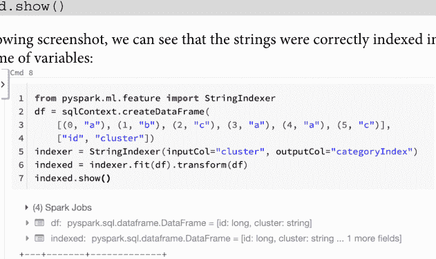

图 8.5 – StringIndexer 类的输出转换

在此示例中，a 集群获得索引 0，因为它是出现频率最高的，其次是索引为 1 的 c 和索引为 2 的 b。

## One-hot encoding

One-hot 编码是特征工程中使用的转换，用于创建一组二进制值（通常称为哑变量），主要用于将具有多个可能值的分类变量表示为仅具有单个高值（1）而其他均为低值（0）的变量。这些布尔特征中的每一个代表原始分类变量中的一个可能值。

One-hot 编码有时用于可视化、模型效率，或根据训练算法的要求准备数据。为此，我们通过对分类变量进行编码来构建不同的特征。不是使用具有多个层级的单个特征列，而是将该列拆分为每个层级的布尔特征，其中唯一接受的值为 1 或 0。

One-hot 编码是一种尤其在神经网络和其他深度学习算法中流行的技术，用于对分类特征进行编码，使期望连续特征的算法，例如逻辑回归，能够使用这些分类特征。在 PySpark 和 Azure Databricks 中，我们可以使用 OneHotEncoder 类将标签索引的列映射到编码的二进制向量列，其中最多只有一个可能值。在此，我们使用 OneHotEncoder 类将分类特征转换为数值特征：

```
from pyspark.ml.feature import OneHotEncoder

df = spark.createDataFrame([
    (0.0, 1.0),
    (1.0, 0.0),
    (2.0, 1.0),
    (0.0, 2.0),
    (0.0, 1.0),
    (2.0, 0.0)
], ["clusterV1", "clusterV2"])

encoder = OneHotEncoder(inputCols=["clusterV1",
                                 "clusterV2"],
                        outputCols=["catV1", "vatV2"])

model = encoder.fit(df)
encoded = model.transform(df)
encoded.show()
```

在此，我们看到获得的编码变量：

```
from pyspark.ml.feature import OneHotEncoder
df = spark.createDataFrame([
    (0.0, 1.0),
    (1.0, 0.0),
    (2.0, 1.0),
    (0.0, 2.0),
    (0.0, 1.0),
    (2.0, 0.0)
], ["clusterV1", "clusterV2"])
encoder = OneHotEncoder(inputCols=["clusterV1", "clusterV2"],
                        outputCols=["catV1", "vatV2"])
model = encoder.fit(df)
encoded = model.transform(df)
encoded.show()
```

(3) Spark Jobs
df: pyspark.sql.dataframe.DataFrame = [clusterV1: double, clusterV2: double]
encoded: pyspark.sql.dataframe.DataFrame = [clusterV1: double, clusterV2: double ... 2 more fields]
+---------+---------+---------------+---------------+
|clusterV1|clusterV2|catV1          |vatV2          |
+---------+---------+---------------+---------------+
|0.0      |1.0      |(2,[0],[1.0])  |(2,[1],[1.0])  |
|1.0      |0.0      |(2,[1],[1.0])  |(2,[0],[1.0])  |
|2.0      |1.0      |(2,[],[])      |(2,[1],[1.0])  |
|0.0      |2.0      |(2,[0],[1.0])  |(2,[],[])      |
|0.0      |1.0      |(2,[0],[1.0])  |(2,[1],[1.0])  |
|2.0      |0.0      |(2,[],[])      |(2,[0],[1.0])  |
+---------+---------+---------------+---------------+

图 8.6 – One-hot 编码的输出

以这种方式，我们可以使用 one-hot 编码将 Spark DataFrame 中一个或多个列的分类特征转换为数值特征，这些特征可以稍后进行转换或直接传递给我们的模型进行训练和推理。

## VectorIndexer

在 Azure Databricks 中，我们可以使用 VectorIndexer 类作为 one-hot 编码的替代方案来对分类特征进行索引。该类用于包含类型为 Vector 的列的数据帧。它通过判断哪些特征是分类的并将这些特征的原始值转换为分类索引来工作。其遵循的步骤概述如下：

- 1. 它接收一个类型为 Vector 的列作为输入，以及一个 maxCategories 参数，该参数指定单个变量的最大类别数阈值。
- 2. 它根据特征所持有的不同值的数量来判断哪些特征是分类的。不同值数量最多为 maxCategories 的特征将被标记为分类。
- 3. 它为每个被声明为分类的特征计算基于 0 的类别索引。
- 4. 最后，它通过将原始特征值转换为索引来对分类特征进行索引。

对分类特征的这种索引使我们能够克服某些算法例如决策树和树集成在处理分类特征方面的局限性，以提高性能或简单地能够使用仅允许数值特征的算法。

在下面的代码示例中，我们将读取一个标记点的示例数据集，并使用 PySpark VectorIndexer 类来判断组成数据集的哪些特征应被视为分类变量。我们稍后将把这些分类特征的值转换为索引：

```
from pyspark.ml.feature import VectorIndexer
from pyspark.mllib.util import MLUtils
data = MLUtils.loadLibSVMFile(sc, "data/mllib/sample_libsvm_data.txt").toDF()
indexer = VectorIndexer(inputCol="features",
                        outputCol="indexed",
                        maxCategories=10)
indexerModel = indexer.fit(data)
# Create new column "indexed" with categorical values transformed to indices
indexedData = indexerModel.transform(data)
```

这种将分类数据转换为连续数据的方法可以随后传递给 DecisionTreeRegressor 等算法，以便能够处理分类特征。

## Normalizer

另一种常见的特征工程方法是把数据带入给定区间。第一个原因是将计算限制在固定范围的值上，以防止数值不准确并限制可能因处理过大或过小的数字而产生的计算能力需求。第二个原因是规范化特征的数值，因为某些机器学习算法在数据被规范化时会处理得更好。我们可以采用几种方法来规范化数据。

这些不同的方法是因为某些机器学习算法需要不同的规范化策略才能高效运行。例如，在 k 近邻（KNN）的情况下，特定特征中的值范围会影响该特征在模型中的权重。因此，值越大，特征的重要性越高。在神经网络的情况下，这种规范化本身可能不会影响最终的性能结果，但它会加快训练速度，并避免由于值过大或过小在模型中向后续层传播而导致的梯度爆炸和消失问题。另一方面，基于决策树的机器学习算法既不会因规范化受益也不会受损。

正确的规范化策略取决于问题和所选算法，而非某些一般统计或计算考虑，正确的选择始终与领域知识密切相关。

在 PySpark 中，Normalizer 类是一个 Transformer，它转换 Vector 行的数据集，将每个 Vector 规范化为具有单位范数。它接收参数值 p，该参数指定用于规范化的 p-范数。此 p 值默认为 2，这相当于说我们正在转换为欧几里得范数。

下面的代码示例演示了如何加载 libsvm 格式的数据集，然后将每一行规范化为具有单位范数：

```
from pyspark.mllib.util import MLUtils
from pyspark.ml.feature import Normalizer
data = MLUtils.loadLibSVMFile(sc, "data/mllib/sample_libsvm_data.txt")
dataFrame = sqlContext.createDataFrame(data)
```


# 使用 $L^1$ 范数归一化每个向量。
normalizer = Normalizer(inputCol="features",
    outputCol="normFeatures", p=1.0)
l1NormData = normalizer.transform(dataFrame)
# 使用 $L^\infty$ 范数归一化每个向量。
lInfNormData = normalizer.transform(dataFrame, {normalizer.p: float("inf")})

这种归一化过程在特征工程中被广泛使用，有助于我们标准化数据并改善学习算法的行为。

## StandardScaler

在自然界的许多领域，事物往往受正态或高斯概率分布的支配。我们在特征工程中称之为归一化的过程是减去一个特征的均值，这使我们能够将特征中心化到 0。然后，我们用标准差除以此值，这将告诉我们特征围绕 0 的分布情况。最后，我们将得到一个以 0 为中心、取值范围在 -1 到 1 之间的变量。

在 Azure Databricks 中，我们可以使用 PySpark StandardScaler 类将向量行的数据集转换为归一化特征，这些特征具有单位标准差和/或 0 均值。它接受以下参数：

- withStd: 此参数默认设置为 true。它将数据缩放到单位标准差，这意味着我们除以标准差。
- withMean: 此参数默认设置为 false。它将在缩放前将数据中心化，使均值等于 0。它会创建密集输出，因此这不适用于稀疏输入并会引发异常。

PySpark StandardScaler 类是一个转换器，可以在数据集上拟合以生成 StandardScalerModel；此后该模型可用于计算输入数据的汇总统计信息。然后 StandardScalerModel 可以转换为数据集中的列向量，其中特征具有单位标准差和/或 0 均值。

请注意，如果某个特征的标准差已经为 0，StandardScalerModel 将默认返回 0.0 作为该特征在向量中的值。

在下面的代码示例中，我们将展示如何加载 libsvm 格式的数据集，然后将每个特征归一化为单位标准差。

- 1. 首先，我们将进行必要的导入并读取数据集，该数据集是 mllib 文件夹中的示例数据集：

```
from pyspark.mllib.util import MLUtils
from pyspark.ml.feature import StandardScaler
data = MLUtils.loadLibSVMFile(sc, "data/mllib/sample_libsvm_data.txt")
dataFrame = sqlContext.createDataFrame(data)
scaler = StandardScaler(inputCol="features",
                        outputCol="scaledFeatures",
                        withStd=True, withMean=False)
```

- 2. 然后，我们可以通过将 StandardScaler 类拟合到从输入数据创建的 DataFrame 来计算汇总统计信息，如下所示：

```
scalerModel = scaler.fit(dataFrame)
```

- 3. 最后，我们可以将每个特征归一化为单位标准差，如下所示：

```
scaledData = scalerModel.transform(dataFrame)
```

归一化在数据科学中被广泛使用。它帮助我们将所有连续数值放在同一尺度上，可以帮助我们克服在使用学习算法时由于连续变量未限制在固定范围内且未中心化而产生的大量问题。

## Bucketizer

PySpark Bucketizer 类将连续特征的列转换为特征桶的列，这些桶由用户使用 splits 参数指定：

splits 参数用于将连续特征映射到桶中。指定 n+1 个 splits 将产生 n 个桶。由 splits x 和 y 定义的桶将保存范围在 [x,y) 内的值，除了最后一个桶，它还将包含范围在 y 内的值。这些 splits 必须严格递增。请记住，除非另有指定，否则 splits 之外的值将被视为错误。splits 的示例可在以下代码片段中看到：

```
splits = Array(Double.NegativeInfinity, 0.0, 1.0,
    Double.PositiveInfinity)
splits = Array(0.0, 1.0, 2.0)
```

必须显式提供 split 值以覆盖所有 Double 值。

请注意，如果你不知道目标列的上下界，最好实践是在 splits 的边界添加 Double.NegativeInfinity 和 Double.PositiveInfinity，以防止因“超出 Bucketizer 边界”异常而可能出现的任何错误。还请注意，这些 splits 必须按严格递增顺序指定。

在下面的示例中，我们将展示如何使用 PySpark Bucketizer 类将 Double 值的列分桶到另一个按索引的列中：

- 1. 首先，我们将进行必要的导入并定义要分桶的 DataFrame，如下所示：

```
from pyspark.ml.feature import Bucketizer
splits = [-float("inf"), -0.5, 0.0, 0.5, float("inf")]
data = [(-0.5,), (-0.3,), (0.0,), (0.2,)]
dataFrame = sqlContext.createDataFrame(data,
    ["features"])
bucketizer = Bucketizer(splits=splits,
    inputCol="features",
    outputCol="bucketedFeatures")
```

- 2. 然后，我们可以将原始数据转换为其桶索引，如下所示：

```
bucketedData = bucketizer.transform(dataFrame)
display(bucketedData)
```

3. 这是得到的分桶数据：

```
from pyspark.ml.feature import Bucketizer
splits = [-float("inf"), -0.5, 0.0, 0.5, float("inf")]
data = [(-0.5,), (-0.3,), (0.0,), (0.2,)]
dataFrame = sqlContext.createDataFrame(data, ["features"])
bucketizer = Bucketizer(splits=splits, inputCol="features", outputCol="bucketedFeatures")
#Then we can transform original data into its bucket index.
bucketedData = bucketizer.transform(dataFrame)
display(bucketedData)
```

(2) Spark Jobs
dataFrame: pyspark.sql.dataframe.DataFrame = [features: double]
bucketedData: pyspark.sql.dataframe.DataFrame = [features: double, bucketedFeatures: double]

|  | features | bucketedFeatures |
|---|---|---|
| 1 | -0.5 | 1 |
| 2 | -0.3 | 1 |
| 3 | 0 | 2 |
| 4 | 0.2 | 2 |

Showing all 4 rows.

Figure 8.7 – Bucketizer output features

4. 在 PySpark 中，我们也可以在 Bucketizer 上使用 QuantileDiscretizer 类，其中 QuantileDiscretizer 是一个能够处理非数字值 NaN 的估计器，这就是两者之间的区别，因为 Bucketizer 类是一个转换器，如果输入数据包含 NaN 值则会引发错误。以下代码片段提供了两个类产生相似输出的情况示例：

```
from pyspark.ml.feature import QuantileDiscretizer
from pyspark.ml.feature import Bucketizer
data = [(0, 18.0), (1, 19.0), (2, 8.0), (3, 5.0), (4, 2.2)]
df = spark.createDataFrame(data, ["id", "hour"])
result_discretizer = QuantileDiscretizer(numBuckets=3, inputCol="hour", outputCol="result").fit(df).transform(df)
result_discretizer.show()
splits = [-float("inf"),3, 10, float("inf")]
```

```
result_bucketizer = Bucketizer(splits=splits,
inputCol="hour",
outputCol="result").transform(df)
result_bucketizer.show()
```

这里 QuantileDiscretizer 类将根据数据确定桶的 splits，而 Bucketizer 类将根据你通过 splits 指定的内容将数据排列到桶中。

因此，当你已经知道期望哪些桶时，最好使用 Bucketizer，而 QuantileDiscretizer 类会为你估计 splits。

在前面的示例中，两个过程的输出相似，因为输入数据和所选 splits 的原因。否则，在不同场景下结果可能会有显著差异。

## Element-wise product

逐元素乘积是在特征工程中处理以矩阵形式排列的数据时非常常用的数学运算。PySpark ElementwiseProduct 类将每个输入向量乘以先前指定的权重向量。为此，它将使用逐元素乘法，将输入向量的每一列按标量乘数缩放，该乘数定义为权重。

ElementwiseProduct 类以 scalingVec 作为主要参数，即此操作的转换向量。

以下示例将举例说明如何使用 ElementwiseProduct 类和转换向量值来转换向量：

```
from pyspark.mllib.linalg.distributed import RowMatrix
v1 = sc.parallelize([[2.0, 2.0, 2.0], [3.0, 3.0, 3.0]])
mat = RowMatrix(v1)
v2 = Vectors.dense([0.0, 1.0, 2.0])
transformer = ElementwiseProduct(v2)
transformedData = transformer.transform(mat.rows)
print transformedData.collect()
```

此操作可以理解为 Hadamard 积，也称为输入数组与权重向量之间的逐元素乘积，这反过来会产生另一个向量作为结果。


## 时间序列数据源

在数据科学和工程领域，最常见的挑战之一是时间数据处理。存储地理空间或交易数据的集合，其中大部分位于应用程序的金融和经济领域，是一些最常见的时间戳索引数据的例子。在金融、欺诈，甚至社会经济时间数据等领域工作，最终都会导致需要连接、聚合和可视化数据点。

这种时间数据通常以日期时间格式出现，其格式本身可能不同，而且包含的信息也可能不同。其中一个例子是 DD/MM/YYYY 和 MM/DD/YYYY 格式之间的差异。对这些不同的日期时间格式的误解如果使用的格式不匹配，可能会导致失败或错误形成的结果。此外，这种数据不是以数值格式出现，这——正如我们在本章前面的部分所看到的——会导致需要克服的若干障碍，其中之一是这种数据无法被机器和深度学习中使用的大多数学习算法轻松解释。

这正是特征工程发挥作用的地方，它为我们提供了从这些数据中转换和创建新特征的工具。一个例子可以是重新组织数据为数值特征，如日、月、年，甚至使用动态时间规整等技术来操作特征，以比较不同长度的时间序列，就像比较二月和三月的销售额时那样，二月和三月分别有 28 天和 31 天。

在 Azure Databricks 中，我们有多个功能可供使用，允许我们对时间序列执行连接、聚合和窗口操作，并且具有并行处理这些操作的额外好处。此外，Koalas API 允许我们使用类似 Pandas 的语法来处理这些数据，使得从实验到生产的过渡变得更容易处理。

在本示例中，我们将使用金融数据来说明如何在 Azure Databricks 中操作时间数据集。我们将使用的数据是一个基于股票市场的示例，包含不同公司交易的贸易信息。你可以在此链接找到有关此类数据的更多信息：https://www.tickdata.com/product/nbbo/：

- 1. 我们可以通过在 Azure 笔记本单元中运行以下代码来获取示例数据。这将下载我们稍后读取的数据：

```
%sh
wget https://pages.databricks.com/rs/094-YMS-629/images/ASOF_Quotes.csv ;
```

```
wget https://pages.databricks.com/rs/094-YMS-629/images/ASOF_Trades.csv ;
```

在这里，我们下载了两种数据集，一种用于交易，一种用于报价。我们将在之后通过时间列合并这些数据，以比较同一时间点进行的交易和报价。

- 2. 在读取数据之前，我们将为其定义一个模式，因为这些信息我们已经知道。我们将把 PySpark TimestampType 类分配给保存交易执行和报价时间的时间数据列。我们还将重命名交易和执行时间列名为 events_ts，最后将此数据转换为 Delta 格式。执行此操作的代码如下所示：

```
from pyspark.sql.types import *
trade_schema = StructType([
    StructField("symbol", StringType()),
    StructField("event_ts", TimestampType()),
    StructField("trade_dt", StringType()),
    StructField("trade_pr", DoubleType())
])
quote_schema = StructType([
    StructField("symbol", StringType()),
    StructField("event_ts", TimestampType()),
    StructField("trade_dt", StringType()),
    StructField("bid_pr", DoubleType()),
    StructField("ask_pr", DoubleType())
])
```

一旦我们下载了数据并为 Spark 数据帧指定了所需的模式，我们就可以根据数据模式解析 CSV 文件并将它们存储为 Delta 表，我们之后可以对其进行查询。

- 3. 我们决定使用 Delta 表以受益于优化的数据格式，该格式允许我们使用大型压缩平面文件工作并利用底层引擎的强大功能，使我们能够根据可用数据的量轻松扩展和并行化过程。代码如下所示：

```
spark.read.format("csv").schema(trade_schema).
option("header", "true").option("delimiter", ",").load("/tmp/finserv/ASOF_Trades.csv").write.mode('overwrite').
```

```
format("delta").save('/tmp/finserv/delta/trades')
```

```
spark.read.format("csv").schema(quote_schema).option("header", "true").option("delimiter", ",").load("/tmp/finserv/ASOF_Quotes.csv").write.mode('overwrite').format("delta").save('/tmp/finserv/delta/quotes')
```

- 4. 在将数据读取并存储到 Delta 表之后，我们可以通过将生成的 Delta 表显示为 Spark Data Frame 来检查数据是否已正确解析，如下所示：

```
display(spark.read.format("delta").load("/tmp/finserv/delta/trades"))
```

现在我们有了交易数据可用，我们可以将其用于合并交易和报价，聚合交易，并在其上执行窗口操作。

## 连接时间序列数据

在处理时间序列数据时，按时间连接是一种合并技术，通常是指在时间戳的精确时刻获取给定事件的值。对于大多数这种时间数据，不同类型的日期时间序列将被连接在一起。在我们的特定情况下，我们希望知道数据集中每个公司的交易在我们可用的任何给定时间点的特定状态。这里，这些状态可以是——例如——NBBO，它是交易和投资中国家最佳出价报价的缩写。

在以下示例中，我们将获取数据集中每个公司 NBBO 的状态。我们将处理数据，以便为每个公司在我们作为时间戳拥有的每个数据点上拥有最新的出价和报价的最新状态。一旦我们计算出这一点，我们就可以可视化出价和报价之间的差异，以理解公司的流动性可能在何时达到低点：

- 1. 首先，我们将在 symbol 上合并数据。我们假设我们已经将 Delta 表加载到两个名为 trades 和 offers 的 Spark 数据帧中，我们将在 symbol 列上合并它们。代码如下所示：

```
un= trades.filter(col("symbol") == "K").select('event_ts', 'price', 'symbol', 'bid', 'offer', 'ind_cd').union(quotes.filter(col("symbol") == "K").select('event_ts', 'price', 'symbol', 'bid', 'offer', 'ind_cd'))
```

- 2. 在执行合并后，我们可以按如下方式可视化结果：

```
display(un)
```

- 3. 现在我们的数据已合并到单个 Spark DataFrame 中，我们可以执行窗口操作。首先，我们需要定义将使用的窗口函数。为此，我们将使用 Window 类，它是 PySpark 中用于执行窗口操作的内置方法。在以下代码片段中，我们将按 symbol 列分区，它代表公司：

```
from pyspark.sql.window import Window
```

```
partition_spec = Window.partitionBy('symbol')
```

- 4. 然后，我们需要指定将用于排序数据的机制。这里，我们使用 ind_cd 列作为排序键，它是指定报价在交易之前的列：

```
join_spec = partition_spec.orderBy('event_ts').
```

```
rowsBetween(Window.unboundedPreceding,
```

```
Window.currentRow)
```

- 5. 然后，我们将使用 SQL 命令查询数据并通过在 last bid 和 join_spec 上运行 SELECT 操作来获取 lasted_bid 值，如下所示：

```
%sql
```

```
select(last("bid", True).over(join_spec).alias("latest_bid"))
```

这样，我们就演示了使用 PySpark API 在 Azure Databricks 中操作时间序列数据以在时间数据上运行连接、合并和聚合是多么容易。在下一节中，我们将学习如何利用类似 Pandas 的语法的优势，使从笔记本到生产的过渡变得更容易。


## 使用 Koalas API

在处理时间序列时，执行与插补和删除重复项相关的任务是很常见的。这些重复记录往往发生在以高频率向数据集中插入多条记录时。我们可以使用 Koalas API 使用非常熟悉的类似 Pandas 的语法执行这些操作，正如在前几章中探讨的那样：

+   1. 在下面的代码示例中，我们将把 Delta 表读入 Koalas DataFrame，并通过按 event_ts 列分组然后检索该时间点的最大值来进行去重：

```
import databricks.koalas as ks
kdf_src = ks.read_delta("/tmp/finserv/delta/ofi_quotes2")
grouped_kdf = kdf_src.groupby(['event_ts'], as_index=False).max()
grouped_kdf.sort_values(by=['event_ts'])
grouped_kdf.head()
```

+   2. 现在我们已经从 DataFrame 中移除了重复项，我们可以对数据进行一次位移，以创建一个滞后的 Koalas Data Frame，这对于执行移动平均或其他统计趋势计算非常有帮助。如以下代码片段所示，Koalas 使通过使用 Koalas DataFrame 的 shift 方法在窗口内获取滞后或领先值变得很容易：

```
grouped_kdf.set_index('event_ts', inplace=True, drop=True)
lag_grouped_kdf = grouped_kdf.shift(periods=1, fill_value=0)
lag_grouped_kdf.head()
```

+   3. 现在我们已经计算了滞后值，我们需要能够将此数据集与原始 DataFrame 合并，以便将所有数据整合到一个单一结构中以便于统计趋势的计算。在下面的代码示例中，我们演示了如何将两个不同的数据帧合并为一个：

```
lagged = grouped_kdf.merge(lag_grouped_kdf, left_index=True, right_index=True, suffixes=['', '_lag'])
lagged.head()
```

Koalas API 对于建模数据非常有帮助，并且使执行必要的转换变得容易，即使在处理时间序列数据时也是如此。在下一节中，我们将学习如何在 Azure Databricks 中工作时如何处理数据帧中可能存在的缺失值。

## 处理缺失值

现实生活中的数据远非完美，出现缺失值的情况非常常见。数据变得不可用的机制对于制定良好的插补策略非常重要。我们称插补为处理数据中缺失值的过程，在大多数上下文中，这些值表示为 NaN 值。其最重要方面之一是知道哪些值缺失：

+   1. 在下面的代码示例中，我们将展示如何通过对 Spark isNull 方法的布尔输出求和并将此布尔输出转换为整数来找出哪些列具有缺失或空值：
+   2. 另一种替代方案是使用 Spark 数据帧 describe 方法的输出来过滤每个列的缺失值计数，最后减去行数以获得实际的缺失值数量，如下所示：
+   3. 一旦我们识别出空值，我们就可以使用 na.drop() 方法删除包含空值的行，如下所示：
+   4. 我们还可以指定删除具有大于 2 个空值的行，如下所示：

```
from pyspark.sql.functions import col, sum
df.select(*(sum(col(c).isNull().cast("int")).alias(c) for c in df.columns)).show()
```

```
from pyspark.sql.functions import lit
rows = df.count()
summary = df.describe().filter(col("summary") == "count")
summary.select(*((lit(rows)-col(c)).alias(c) for c in df.columns)).show()
```

```
null_df.na.drop().show()
```

```
null_df.na.drop(thresh=2).show()
```

5. 另一个可用的选项是使用此方法的 how 参数。例如，我们可以将此参数指定为 any，这表示删除具有任意数量空值的行，如以下代码片段所示：

```
null_df.na.drop(how='any').show()
```

6. 我们还可以使用 subset 参数在单个列上删除空值，该参数接受列名列表，如以下代码片段所示：

```
null_df.na.drop(subset=['Sales']).show()
```

7. 例如，我们可以指定删除在指定子集列中所有具有空值的记录，如下所示：

```
null_df.na.drop(how='all',subset=['Name','Sales']).show()
```

如前所述，处理缺失数据时可用的选项之一是执行插补，可以理解为根据预定义策略填充这些空值，我们知道这种策略不会改变数据的实际分布。最好插补空值而不是丢弃数据。

8. 例如，我们可以选择用有助于我们识别它们的字符串填充空值，如下所示：

```
null_df.na.fill('NA').show()
```

9. 或者，我们也可以用整数值填充缺失值，像这样：

```
null_df.na.fill(0).show()
```

另一个常见选项是用从现有值计算得出的均值或中位数填充缺失值。这样，我们试图保留数据的实际分布，并尽量不严重影响其他计算，例如列均值。尽管如此，需要记住的是，如果我们重新计算均值，我们将得到另一个值。

10. 在这里，我们可以用该特定列的平均均值填充数值列，如下所示：

```
from pyspark.sql.functions import mean
mean_val=null_df.select(mean(null_df.Sales)).collect()
print(type(mean_val)) #mean_val is a list row object
```

```
print('mean value of Sales', mean_val[0][0])
mean_sales=mean_val[0][0]
```

11. 现在我们已经计算了均值并将其存储为名为 mean_sales 的变量，我们可以使用此值填充 sales 列中的空值，如下所示：

```
null_df.na.fill(mean_sales,subset=['Sales']).show()
```

以这种方式，我们可以处理数据中发现的所有可能的空值或缺失值，尽管将用于处理它们的方法在很大程度上取决于创建缺失值的机制以及问题的领域知识。

## 从文本中提取特征

从文本中提取信息依赖于能够捕捉底层语言结构。这意味着我们旨在捕捉标记之间的含义和关系，以及它们在句子中试图传达的含义。与理解文本中的含义相关的此类操作和任务产生了称为自然语言处理（NLP）的跨学科领域的一个分支。在这里，我们将重点介绍一些与使用 Azure Databricks 中的 PySpark API 将文本转换为可稍后用于机器学习和深度学习算法的数值特征相关的示例。

### TF-IDF

词频-逆文档频率（TF-IDF）是一种非常常用的文本预处理操作，用于将句子转换为基于组成它们的标记相对频率创建的特征。词频-逆文档频率用于创建一组数值特征，这些特征是根据单词对上下文的相关性构建的，而不仅仅是对集合或语料库中的文档。

在 Azure Databricks ML 中，TF-IDF 是一个分为两个单独部分的操作，第一部分是 TF（+哈希），随后是 IDF：

-   - **TF**：HashingTF 是一个 PySpark Transformer 类，它接受一组术语并将它们转换为固定长度的特征向量。在特征工程中，当我们提到“术语集”时，这可能意味着我们指的是词袋（BOW）。该算法将 TF 计数与哈希技巧（有时称为特征哈希）结合起来，以便快速高效地将特征向量化为向量或矩阵，以进行降维。

-   - **IDF**：`IDF` 是一个 PySpark Estimator 类，它在数据集上拟合并产生 `IDFModel` 作为结果。`IDFModel` 将特征向量作为输入，在本例中来自 `HashingTF` 类，并缩放每个特征列。它将根据其在语料库中出现的频率自动降低应用于列的权重。

在下面的示例中，我们以一组句子的数组作为输入。每个句子将使用 PySpark `Tokenizer` 类拆分为标记，这将为每个句子产生一个 BOW：

+   1. 稍后——并且如前所述，在以下代码块中——我们将应用 `HashingTF` 类以降低特征向量的维度：

```
from pyspark.ml.feature import HashingTF, IDF, Tokenizer
sentenceData = sqlContext.createDataFrame([
    (0, "Hi I heard about Spark"),
    (0, "I wish Java could use case classes"),
    (1, "Logistic regression models are neat")
], ["label", "sentence"])
tokenizer = Tokenizer(inputCol="sentence",
outputCol="words")
wordsData = tokenizer.transform(sentenceData)
hashingTF = HashingTF(inputCol="words",
                    outputCol="rawFeatures",
                    numFeatures=20)
```

+   2. 稍后，我们将应用 IDF 类来重新缩放获得的特征，这是我们在机器学习或深度学习算法中使用它时的一种良好实践，以避免梯度问题并通常提高性能。此代码显示在以下片段中：

```
featurizedData = hashingTF.transform(wordsData)
idF = IDF(inputCol="rawFeatures",outputCol="features")
idFModel = idf.fit(featurizedData)
rescaledData = idfModel.transform(featurizedData)
```

+   3. 最后，我们可以按如下方式显示获得的特征：

```
for features_label in rescaledData.
    select("features","label").take(3):
    print(features_label)
```


4. 我们可以看到生成变量的整个过程，如下图所示：

```
from pyspark.ml.feature import HashingTF, IDF, Tokenizer
sentenceData = sqlContext.createDataFrame([
(0, "Hi I heard about Spark"),
(0, "I wish Java could use case classes"),
(1, "Logistic regression models are neat")
], ["label", "sentence"])
tokenizer = Tokenizer(inputCol="sentence", outputCol="words")
wordsData = tokenizer.transform(sentenceData)
hashingTF = HashingTF(inputCol="words", outputCol="rawFeatures", numFeatures=20)
featurizedData = hashingTF.transform(wordsData)
idf = IDF(inputCol="rawFeatures", outputCol="features")
idfModel = idf.fit(featurizedData)
rescaledData = idfModel.transform(featurizedData)
for features_label in rescaledData.select("features","label").take(3):
    print(features_label)
```

Figure 8.8 – Output features of the TF-IDF operation

这样，我们就从文本中提取出了特征，并将其转换为可输入到任何学习算法中的缩放数值特征。

## Word2vec

Word2vec 是一种在 NLP 特征工程中使用的嵌入技术。它使用神经网络从大量文本语料中学习词语之间的关联，并生成代表每个词元的向量。该向量具有的属性使我们能够仅通过测量代表它们的向量之间的距离，例如使用余弦相似度，来指示两个词之间的语义相似性。这些向量通常称为词嵌入，它们通常有数百个维度来表示。

在 PySpark 中，Word2vec 是一个 Estimator 类，它接受词元数组作为输入并训练 Word2VecModel，这是一个将每个词映射到单个固定大小向量的模型。

在下面显示的代码示例中，我们从一组文档开始，每个文档都表示为一系列词。对于每个文档，我们将其转换为特征向量。然后可以将该特征向量传递给学习算法：

1. 在下面的代码示例中，我们将创建一个 Spark 数据帧，其中句子被拆分为其词元，使用简单的字符串拆分，意味着每一行代表该句子的 BOW：

```
from pyspark.ml.feature import Word2Vec
documentDF = sqlContext.createDataFrame([
    ("Hi I heard about Spark".split(" "), ),
    ("I wish Java could use case classes".split(" "), ),
    ("Logistic regression models are neat".split(" "), )
], ["text"])
```

2. 然后，我们可以将这些数组映射为向量，如下所示：

```
word2Vec = Word2Vec(vectorSize=3, minCount=0,
inputCol="text", outputCol="result")
```

3. 最后，我们可以将 Word2Vec 模型拟合到刚刚创建的数组，并通过使用拟合后的模型转换输入 DataFrame 来获得结果特征，如下所示：

```
model = word2Vec.fit(documentDF)
result = model.transform(documentDF)
for feature in result.select("result").take(3):
    print(feature)
```

4. 我们可以在 Azure Databricks 笔记本中的单个单元格上看到整个过程的执行情况：

```
Cmd 14
1 from pyspark.ml.feature import Word2Vec
2 documentDF = sqlContext.createDataFrame([
3   ("Hi I heard about Spark".split(" "), ),
4   ("I wish Java could use case classes".split(" "), ),
5   ("Logistic regression models are neat".split(" "), )
6 ], ["text"])
7 word2Vec = Word2Vec(vectorSize=3, minCount=0, inputCol="text", outputCol="result")
8 model = word2Vec.fit(documentDF)
9 result = model.transform(documentDF)
10 for feature in result.select("result").take(3):
11   print(feature)
12
```

(4) Spark Jobs
documentDF: pyspark.sql.dataframe.DataFrame = [text: array]
result: pyspark.sql.dataframe.DataFrame = [text: array, result: udt]
Row(result=DenseVector([-0.0627, -0.0219, -0.0816]))
Row(result=DenseVector([0.0242, 0.0236, 0.023]))
Row(result=DenseVector([0.0483, -0.0189, -0.0037]))

Figure 8.9 – Output embeddings using Word2Vec

这样，我们就可以非常简单地从文本源创建数值表示，使用文本嵌入中最广泛使用的模型之一：Word2Vec。

## Training machine learning models on tabular data

在本示例中，我们将使用数据科学中非常流行的数据集，即葡萄酒理化性质数据集，来预测特定葡萄酒的质量。我们将使用 Azure Databricks Runtime ML，因此请确保将笔记本附加到运行此版本运行时环境的集群上，如本章开头要求中所述。

## Engineering the variables

我们将按以下步骤开始：

- 1. 我们第一步是加载训练模型所需的数据。我们将加载存储为 DBFS 中示例数据集的数据集，但你也可以从 UCI 机器学习库中获取它们。代码显示在以下片段中：
```
import pandas as pd
white_wine = pd.read_csv("/dbfs/databricks-datasets/wine-quality/winequality-white.csv", sep=",")
red_wine = pd.read_csv("/dbfs/databricks-datasets/wine-quality/winequality-red.csv", sep=";")
```
- 2. 接下来，我们将把这两个 pandas DataFrame 合并成一个，并添加一个新的二进制特征 is_red 来区分它们，如下所示：
```
red_wine['is_red'] = 1
white_wine['is_red'] = 0
data = pd.concat([red_wine, white_wine], axis=0)
```
- 3. 之后，我们将从列名中删除空格，以便能够将其保存为 Spark 数据帧，如下所示：
```
data.rename(columns=lambda x: x.replace(' ', '_'), inplace=True)
data.head()
```
- 4. 这里，我们可以看到创建的 Pandas DataFrame：

```
data.rename(columns=lambda x: x.replace(' ', '_'), inplace=True)
data.head()
```

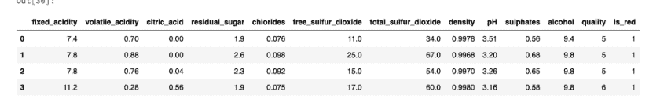

Figure 8.10 – Renamed columns of the dataset

5. 现在我们有了统一的数据集，我们将为所有质量高于 7 的葡萄酒创建一个名为 high_quality 的新特征，如下所示：

```
high_quality = (data.quality >= 7).astype(int)
data.quality = high_quality
```

6. 之后，我们可以将数据集拆分为训练集和测试集，我们稍后将用它们来训练机器学习模型，并在 quality 列上进行推断。在以下代码块中，我们导入 scikit-learn train_test_split 函数，以便将数据拆分为由 X 定义的特征和定义为 y 的目标列：

```
from sklearn.model_selection import train_test_split
train, test = train_test_split(data, random_state=123)
X_train = train.drop(["quality"], axis=1)
X_test = test.drop(["quality"], axis=1)
y_train = train.quality
y_test = test.quality
```

结果是，特征和目标列被拆分为可用于训练和基准测试模型的训练集和测试集。

## Building the ML model

这里，我们将使用分类器，因为我们要预测的是表格数据集上的二进制输出。所选算法将是 scikit-learn Python 库中可用的随机森林分类器。我们还将使用 MLflow 来跟踪模型性能，并保存模型以供以后使用：

- 1. 我们将首先执行所有必要的导入，如下所示：

```
import mlflow
import mlflow.pyfunc
import mlflow.sklearn
import numpy as np
from sklearn.ensemble import RandomForestClassifier
from sklearn.metrics import roc_auc_score
from mlflow.models.signature import infer_signature
```

2. 我们将创建一个名为 SklearnModelWrapper 的包装类，围绕模型继承自 mlflow.pyfunc.PythonModel 类。该类将返回实例属于特定类别的概率。代码显示在以下片段中：

```
class SklearnModelWrapper(mlflow.pyfunc.PythonModel):
    def __init__(self, model):
        self.model = model
    def predict(self, context, model_input):
        return self.model.predict_proba(model_input)[:,1]
```

3. 在定义模型后，我们将使用 mlflow.start_run 创建一个新的 MLflow 运行，以便我们可以跟踪性能。我们还可以调用 mlflow.log_param 来显示传递给模型的哪些参数。在下面的代码示例中，mlflow.log_metric 将记录我们选择的性能指标，例如本例中的接收器操作特征 ROC：

```
with mlflow.start_run(run_name='untuned_random_forest'):
    n_estimators = 10
    model = RandomForestClassifier(n_estimators=n_estimators, random_state=np.random.RandomState(123))
    model.fit(X_train, y_train)
    predictions_test = model.predict_proba(X_test)[:,1]
    auc_score = roc_auc_score(y_test, predictions_test)
    mlflow.log_param('n_estimators', n_estimators)
    mlflow.log_metric('auc', auc_score)
    wrappedModel = SklearnModelWrapper(model)
    signature = infer_signature(X_train, wrappedModel.predict(None, X_train))
    mlflow.pyfunc.log_model("random_forest_model", python_model=wrappedModel, signature=signature)
```


4. 在前面的代码片段中，`predict_proba` 函数将返回一个元组，其中包含属于两个类别之一的概率。我们只保留其中一个，因此使用 `[:, 1]` 对输出进行切片。在模型部署后，我们创建了一个稍后将用于验证输入的签名。在这里，我们可以看到整个代码在 Azure Databricks 笔记本上的运行：

```
import mlflow
import mlflow.pyfunc
import mlflow.sklearn
import numpy as np
from sklearn.ensemble import RandomForestClassifier
from sklearn.metrics import roc_auc_score
from mlflow.models.signature import infer_signature

class SklearnModelWrapper(mlflow.pyfunc.PythonModel):
    def __init__(self, model):
        self.model = model

    def predict(self, context, model_input):
        return self.model.predict_proba(model_input)[:,1]

with mlflow.start_run(run_name='untuned_random_forest'):
    n_estimators = 10
    model = RandomForestClassifier(n_estimators=n_estimators, random_state=np.random.RandomState(123))
    model.fit(X_train, y_train)
    predictions_test = model.predict_proba(X_test)[:,1]
    auc_score = roc_auc_score(y_test, predictions_test)
    mlflow.log_param('n_estimators', n_estimators)
    mlflow.log_metric('auc', auc_score)
    wrappedModel = SklearnModelWrapper(model)
    signature = infer_signature(X_train, wrappedModel.predict(None, X_train))
    mlflow.pyfunc.log_model("random_forest_model", python_model=wrappedModel, signature=signature)
```

/databricks/python/lib/python3.7/site-packages/mlflow/models/signature.py:123: UserWarning: Hint: Inferred schema represent missing values. If your input data contains missing values at inference time, it will be encoded as float. To avoid this problem is to infer the model schema based on a realistic data sample (training dataset) that includes missing values as doubles (float64) whenever these columns may have missing values. See `Handling Integers With Missing Values`_ for more details.
inputs = _infer_schema(model_input)
Command took 1.82 seconds --

Figure 8.11 – Fitting the model using the MLflow start_run decorator

5. 在模型训练完成后，我们可以检查模型学习到的特征重要性输出作为合理性检查，如下所示：

```
feature_importances = pd.DataFrame(model.feature_importances_, index=X_train.columns.tolist(),
columns=['importance'])

feature_importances.sort_values('importance', ascending=False)
```

6. 在这里，我们可以看到哪些变量对模型最重要：

```
feature_importances = pd.DataFrame(model.feature_importances, index=X_train.columns.tolist(), columns=['importance'])
feature_importances.sort_values('importance', ascending=False)
```

Out[39]:

|  | importance |
|---|---|
| alcohol | 0.162047 |
| density | 0.115506 |
| volatile_acidity | 0.089138 |
| chlorides | 0.082570 |
| pH | 0.081632 |
| citric_acid | 0.081109 |
| total_sulfur_dioxide | 0.081001 |
| sulphates | 0.078901 |
| residual_sugar | 0.077866 |
| free_sulfur_dioxide | 0.076833 |
| fixed_acidity | 0.071625 |
| is_red | 0.001771 |

Figure 8.12 – Model feature importance

7. 它显示酒精和密度在预测质量方面都很重要。您可以点击右上角的 Experiment 按钮查看 Experiment Runs 侧边栏，如以下屏幕截图所示：

Figure 8.13 – Tracked experiment runs

在本例中，该模型实现了 0.889 的曲线下面积（AUC）。

## Registering the model in the MLflow Model Registry

下一步将是在 MLflow Model Registry 中注册我们刚刚训练的模型，MLflow Model Registry 是一个集中式模型注册表，允许我们管理训练模型的完整生命周期，并可在 Azure Databricks 中的任何位置使用我们的模型。此模型存储库不仅会存储模型，还会为其提供版本控制，并允许我们添加描述和注释：

- 1. 在下一个示例中，我们将展示如何以编程方式注册我们的模型，但您也可以使用 Azure Databricks 工作区中的用户界面（UI）来完成此操作。首先，我们将存储刚刚训练的模型的最新运行的运行 ID。我们通过使用 tags.mlflow.runName 参数按模型名称进行过滤来搜索运行 ID，如下所示：

```
run_id = mlflow.search_runs(filter_string='tags.mlflow.runName = "untuned_random_forest"').iloc[0].run_id
model_name = "wine_quality"
model_version = mlflow.register_model(f"runs://{run_id}/random_forest_model", model_name)
```

如果您导航到 Azure Databricks 工作区中的 Models 页面，您将看到我们刚刚注册的模型。

- 2. 在我们的模型成功注册后，我们可以设置此模型的阶段。我们将把模型移至生产环境并在笔记本中加载它，如以下代码片段所示：

```
from mlflow.tracking import MlflowClient
client = MlflowClient()
client.transition_model_version_stage(
name=model_name,
version=model_version.version,
stage="Production",
)
```

3. 我们可以在此处在单元格输出中看到模型已正确注册：

```
run_id = mlflow.search_runs(filter_string="tags.mlflow.runName = 'untuned_random_forest'").iloc[0].run_id
model_name = "wine_quality"
model_version = mlflow.register_model(f"runs:/{run_id}/random_forest_model", model_name)

Successfully registered model 'wine_quality'.
2021/03/15 10:14:16 INFO mlflow.tracking.model_registry.client: Waiting up to 300 seconds for model version to finish creation.
version 1
Created version '1' of model 'wine_quality'.
```

Figure 8.14 – Correctly registered model

4. 现在，我们可以通过引用使用 f"models:/{model_name}/production" 路径来使用我们的模型。然后可以将模型加载到 Spark 用户定义函数（UDF）中，以便将其应用于 Delta 表以进行批量推理。以下代码将加载我们的模型并将其应用于 Delta 表：

```
import mlflow.pyfunc
from pyspark.sql.functions import struct
apply_model_udf = mlflow.pyfunc.spark_udf(spark, f"models:/{model_name}/production")
new_data = spark.read.format("delta").load(table_path)
```

5. 一旦模型已加载并且数据已从 Delta 表中读取，我们就可以使用 struct 将输入变量传递给作为 UDF 注册的模型，如下所示：

```
udf_inputs = struct(*(X_train.columns.tolist()))
new_data = new_data.withColumn(
"prediction",
apply_model_udf(udf_inputs)
)
display(new_data)
```

在这里，Delta 表中的每条记录现在都将有一个关联的预测。

## Model serving

我们可以使用 MLflow 模型服务为低延迟预测提供端点，以便我们可以使用 REST API 发出请求并将预测作为响应获取。

您需要您的 Databricks 令牌才能向端点发出请求。如前几章所述，您可以在 Azure Databricks 中的 **User Settings** 页面获取您的令牌。

在能够向我们的端点发出请求之前，请记住在 Azure Databricks 工作区中的模型页面上启用服务。您可以在以下屏幕截图中看到如何操作的提醒：

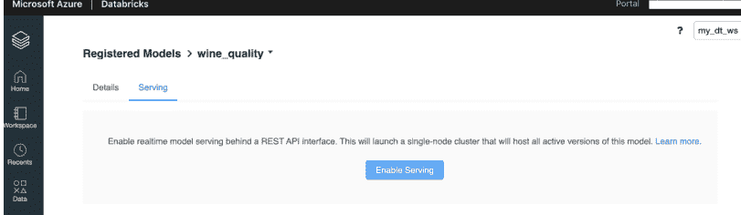

Figure 8.15 – Enabling model serving

- 1. 最后，我们可以调用我们的模型。以下示例函数将发出一个 Pandas 数据框，并返回数据框中每一行的推理结果：

```
import os
import requests
import pandas as pd
def score_model(dataset: pd.DataFrame):
    url = 'https://YOUR_DATABRICKS_URL/model/wine_quality/Production/invocations'
    headers = {'Authorization': f'Bearer {your_databricks_token}'}
    data_json = dataset.to_dict(orient='split')
    response = requests.request(method='POST',
    headers=headers, url=url, json=data_json)
    if response.status_code != 200:
        raise Exception(f'Request failed with status {response.status_code}, {response.text}')
    return response.json()
```


2. 我们可以通过将 X_test 数据传递给本地模型来比较我们得到的结果，如以下代码片段所示。我们应该得到相同的结果：

```
num_predictions = 5
served_predictions = score_model(X_test[:num_predictions])
model_evaluations = model.predict(X_test[:num_predictions])
pd.DataFrame({
"Model Prediction": model_evaluations,
"Served Model Prediction": served_predictions,
})
```

这样，我们就可以通过将已发布的模型作为端点来发出请求，从而在较小的数据批次上实现低延迟预测。

## Summary

在本节中，我们涵盖了许多与如何提取和改进数据中可用的特征相关的示例，使用的方法包括分词、 polynomial expansion 和 one-hot encoding 等。这些方法使我们能够为模型的训练准备变量，并被视为特征工程的一部分。

接下来，我们深入探讨了如何使用 TF-IDF 和 Word2Vec 从文本中提取特征，以及如何使用 PySpark API 在 Azure Databricks 中处理缺失数据。最后，我们以一个示例结束，展示了如何训练深度学习模型并使其准备好用于服务，并在发布 REST API 请求时获取预测。

在下一章中，我们将更专注于使用 TFRecords 和 Petastorm 处理深度学习的大量数据，以及如何在 Azure Databricks 中利用现有模型从新数据中提取特征。

### 9

## Databricks Runtime for Deep Learning

本章将深入探讨经典深度学习算法的开发，用于基于非结构化数据训练和部署模型，同时探索库和算法。示例将侧重于使用 Databricks 进行 DL 的特殊性和优势，创建 DL 模型。在本章中，我们将学习如何在 Azure Databricks 中高效训练深度学习模型以及可供使用的不同库的实现。

本章将介绍以下主题：
- Loading data for deep learning
- Managing data using TFRecords
- Automating scheme inference
- Using Petastorm for distributed learning
- Reading a dataset
- Data preprocessing and featurization

本章将更侧重于深度学习模型而非机器学习模型。主要区别在于我们将更专注于处理大量非结构化数据。本章将以一个示例结束，展示如何使用 TensorFlow 中的预训练模型基于新领域数据提取特征。

### Technical requirements

要完成本章中的示例，您需要具备以下条件：
- An Azure Databricks subscription
- An Azure Databricks notebook attached to a running cluster with Databricks Runtime ML of version 7.0 or higher.

### Loading data for deep learning

在本章中，我们将学习如何为分布式训练准备数据。为此，我们将学习如何高效加载数据，以创建可以利用 Azure Databricks 分布式计算特性并处理大量数据的基于深度学习的应用。我们将描述两种用于处理分布式训练的大型数据集的方法。这两种方法分别是 Petastorm 和 TFRecord，它们是使我们在 Azure Databricks 中将大型复杂数据集加载到深度学习算法时工作更轻松的库。

快速浏览一下，Petastorm 和 TFRecord 方法的主要特点如下：
- **Petastorm:** 它是一个开源库，允许我们直接以 Apache Parquet 格式加载数据来训练我们的深度学习算法。这是 Azure Databricks 的一大优势，因为 Parquet 是在处理大量数据时广泛使用的格式。
- **TFRecord:** 另一种选择是使用 TFRecord 格式作为 Azure Databricks 中分布式深度学习的数据源，该格式基于 TensorFlow 框架。TFRecord 格式是一种简单的面向记录的二进制格式，可用于存储 TensorFlow 应用的数据或存储训练数据。在 TensorFlow 库中，`tf.data.TFRecordDataset` 是一个用于此目的的类，它由 TFRecord 文件中的记录组成。

在本章的以下部分中，我们将描述并说明将数据保存到 TFRecord 文件并重新加载以训练我们的深度学习 TensorFlow 模型的推荐方法，以及如何使用 Petastorm 读取 Parquet 文件以在 Azure Databricks 中训练深度学习模型。

### Using TFRecords for distributed learning

尽管它仍然不是 TensorFlow 的常用组件，但 TFRecord 文件格式是 TensorFlow 用于存储训练模型数据的专有二进制存储格式。二进制格式在处理大型数据集时具有优势，因为它可以显著提高处理和加载管道的性能，从而减少训练模型所需的时间。这种二进制数据存储更高效，占用的空间更少，读写所需的时间也更短。

TFRecord 格式还允许我们利用 Azure Databricks 等系统的多处理和分布式计算功能，这些系统在处理太大而无法完全存储在内存中的大量数据时常用。在这些情况下，当数据量太大而无法存储在内存中时，二进制格式变得特别有用，因为它减少了数据的内存占用和处理所需的时间，然后此过程以批处理方式进行。

TFRecord 的另一个特性是它也针对存储序列数据（如时间序列或词嵌入）进行了优化，这在销售趋势或自然语言处理应用中非常有用。

在下一节中，我们将学习如何构建 TFRecords，如何使用它们处理大量数据，以及如何通过指定 schema inference 来优化其加载过程，所有这些都使我们能够在 Azure Databricks 中高效训练模型。

### Structuring TFRecords files

TFRecord 文件格式是一种简单的面向记录的二进制格式，其设计目标是更高效地存储机器和深度学习模型训练的数据。TFRecordDataset 类允许我们将 TFRecord 格式的文件作为训练管道的一部分进行流式传输。这些 TFRecord 文件将数据存储为二进制字符串序列，这使得在从文件读取或写入之前必须预先定义数据的结构。为了指定数据的结构，我们可以使用 tf.train.Example 或 tf.train.SequenceExample TensorFlow 类来存储数据样本，之后必须对其进行序列化，然后才能使用 TFRecordWriter 写入磁盘。

使该库更优化的原因之一是 tf.train.Example 不是常见的 Python 类，而是一个 protocol buffer，这是一种更高效地序列化结构化数据的方法。

在 Azure Databricks 中，我们可以使用 `spark-tensorflow-connector` 库来利用 TFRecord 文件格式的优势，并使用它将 Apache Spark DataFrames 保存为 TFRecord 文件。该库允许通过简单地使用 PySpark API 将 Spark 数据帧转换为 TFRecords，并且默认安装在 Azure Databricks Machine Learning Runtime 中，这是一个针对机器和深度学习应用优化的运行时。如果您未使用此版本的运行时，则需要从 Maven 仓库手动将库安装到集群或笔记本中，如我们在之前章节中看到的那样。

`spark-tensorflow-connector` 库使我们能够通过 PySpark API 在分布式文件系统（如 Azure Databricks Spark 数据帧）中读取 TFRecord 文件。当我们读取数据时，可以向解析器传递以下选项：
- **load**: 它指定 TFRecord 文件的输入路径，并且与 Spark 类似，它可以接受标准的 globbing 表达式。
- **schema**: 它是 TFRecord 文件的 schema。可选地，我们可以使用 Spark `StructType` 定义此 schema。如果未传递任何内容，schema 将从 TFRecord 文件中推断。
- **recordType**: 这是 TFRecord 文件的输入格式，接受两个可能的选项，即 `Example` 和 `SequenceExample`。默认选项是 `Example`。

当我们将 Spark Dataframe 写入 TFRecord 文件时，可以向 API 传递以下选项：
- **save**: 这是写入 TFRecord 文件的输出路径，可以是本地或分布式文件系统位置。
- **codec**: 这是用于压缩 TFRecord 文件的 codec。例如，如果我们指定选项 `org.apache.hadoop.io.compress.GzipCodec`，它将启用 gzip 压缩。在读取压缩的 TFRecord 文件时，用于压缩它们的 codec 可以自动推断，因此这不是必需的选项。
- **recordType**: 这是 TFRecord 文件的期望输出格式。与读取时一样，可用选项为 `Example` 和 `SequenceExample`，默认选项为 `Example`。


- **writeLocality**：它将决定 TFRecord 文件是写入工作节点本地还是分布式文件系统。可选选项如下：
  a) **distributed**：这是默认选项，决定文件使用 Spark 默认文件系统写入。
  b) **local**：此选项以分区方式将文件写入各个工作节点的磁盘，每个工作节点本地磁盘上写入部分数据。

当我们使用本地模式时，它会将数据写入每个工作节点的本地磁盘上，每个工作节点存储数据的一个子集。哪个子集数据存储在哪个工作节点上取决于数据帧的分区方式。之后，这些数据子集将被合并成一个单一的 TFRecord 文件并写入分区所在的节点。这是一个在分布式方式训练机器和深度学习算法时很有用的功能，其中每个工作节点接收到一个数据子集进行训练。当指定本地模式作为选项时，传递给写入器的路径将被理解为每个工作节点上的基路径，数据子集将写入该路径。

## 使用 TFRecords 管理数据

在本节中，我们将演示如何将 Spark DataFrames 中的图像数据保存到 TFRecords 并使用 Azure Databricks 中的 TensorFlow 加载它。我们将以 Databricks 文件系统上可用的 flowers 示例数据集为例，其中包含存储在五个子目录下的花卉照片，每个类别一个。

我们将加载 flowers Delta 表，该表包含使用二进制文件数据源预处理的花卉数据集并存储为 Spark DataFrame。我们将使用此数据来演示如何将 Spark DataFrames 中的数据保存到 TFRecords：

- 1. 作为第一步，我们将使用 PySpark 加载数据：

```
from pyspark.sql.functions import col
import tensorflow as tf
spark_df = spark.read.format("delta").load("/databricks-datasets/flowers/delta") \
    .select(col("content"), col("label_index")) \
    .limit(100)
```

2. 接下来，我们将把加载的数据保存为 TFRecord 类型文件：

```
path = '/ml/flowersData/converted_data.tfrecord'
spark_df.write.format("tfrecords").mode("overwrite").save(path)
display(dbutils.fs.ls(path))
```

正如你所见，由于底层 spark-tensorflow-connector 库的存在，我们可以轻松地将 Spark DataFrames 保存到 TFRecord 文件，该库将 Spark 与 TensorFlow 集成：

```
from pyspark.sql.functions import col
import tensorflow as tf
spark_df = spark.read.format("delta").load("/databricks-datasets/flowers/delta") \
.select(col("content"), col("label_index")) \
.limit(100)
```

spark_df: pyspark.sql.dataframe.DataFrame = [content: binary, label_index: long]

```
path = '/ml/flowersData/converted_data.tfrecord'
spark_df.write.format("tfrecords").mode("overwrite").save(path)
display(dbutils.fs.ls(path))
```

|  | path | name | size |
|---|---|---|---|
| 1 | dbfs:/ml/flowersData/converted_data.tfrecord/_SUCCESS | _SUCCESS | 0 |
| 2 | dbfs:/ml/flowersData/converted_data.tfrecord/part-r-00000 | part-r-00000 | 17175166 |

Showing all 2 rows.

Fig.9.1 – Output location of the tfrecord file

3. 学习如何在 Azure Databricks 中使用 TFRecords 的下一步是加载 TFRecord 数据到 TensorFlow。首先，我们将创建一个 TFRecordDataset 作为输入管道：

```
import os
filenames = [f"/dbfs{path}/{name}" for name in os.listdir("/dbfs" + path) if name.startswith("part")]
```

```
dataset = tf.data.TFRecordDataset(filenames)
```

4. 为了能够使用数据，我们需要创建一个解码器函数来读取、解析和规范化数据。我们使用 map 函数将记录解析为张量，该函数将把我们的解码器函数应用于每个样本。首先，我们将定义解码器函数，它将以一个序列化示例作为必需参数，图像大小作为可选参数：

```
def decode_and_normalize(serialized_example, image_size = 224):
    # Parse from single example
    feature_dataset = tf.io.parse_single_example(
        serialized_example,
        features={
            'content': tf.io.FixedLenFeature([], tf.string),
            'label_index': tf.io.FixedLenFeature([], tf.int64),
        })
    # Decode the parsed data
    image = \
    tf.io.decode_jpeg(feature_dataset['content'])
    label = \
    tf.cast(feature_dataset['label_index'], tf.int32)
    # Resize the decoded data into the desired size
    image = tf.image.resize(image, [image_size, image_size])
    # Finally, normalize the data
    image = \
    tf.cast(image, tf.float32) * (1. / 255) - 0.5
    return image, label
```

5. 一旦我们定义了解码函数，我们就可以使用它通过映射数据集并将其应用于其中的每个样本来解析我们的数据：

```
parsed_dataset = dataset.map(decode_and_normalize)
```

这样，我们就解析了数据集，现在它可以作为输入数据用于训练机器或深度学习模型。

在下一节中，我们将深入探讨如何在 Azure Databricks 中使用 TFRecord 的完整示例。

## 自动模式推断

spark-tensorflow-connector 库，该库将 Spark 与 TensorFlow 集成，支持在将 TensorFlow 记录读取到 Spark DataFrames 时自动进行模式推断。模式推断是一个昂贵的操作，因为它需要额外的一次数据读取，因此最好显式指定它，这将提高我们管道的整体性能。

以下 Python 代码示例演示了我们如何在作为示例创建的一些测试数据上执行此操作：

- 1. 我们首先要定义数据的模式：

```
from pyspark.sql.types import *
path = "test-output.tfrecord"
fields = [StructField("id", IntegerType()),
StructField("IntegerCol", IntegerType()),
StructField("LongCol", LongType()),
StructField("FloatCol", FloatType()),
StructField("DoubleCol", DoubleType()),
StructField("VectorCol", ArrayType(DoubleType(),
True)),
StructField("StringCol", StringType())]
schema = StructType(fields)
```

- 2. 接下来，我们创建一个包含测试数据的 Spark DataFrame，对其进行并行化，并将其作为 TFRecord 文件写入：

```
test_rows = [[11, 1, 23, 10.0, 14.0, [1.0, 2.0], "r1"],
[21, 2, 24, 12.0, 15.0, [2.0, 2.0], "r2"]]
rdd = spark.sparkContext.parallelize(test_rows)
df = spark.createDataFrame(rdd, schema)
```

```
df.write.format("tfrecords").option("recordType", "Example").save(path)
After this, we can read the TFRecord file back to a Spark Data frame in the next way:
df = spark.read.format("tfrecords").option("recordType", "Example").load(path)
df.show()
```

3. 这里，我们看到整个过程在 Azure Databricks 笔记本中运行：

```
from pyspark.sql.types import *
path = "test-output.tfrecord"
fields = [StructField("id", IntegerType()),
StructField("IntegerCol", IntegerType()),
StructField("LongCol", LongType()),
StructField("FloatCol", FloatType()),
StructField("DoubleCol", DoubleType()),
StructField("VectorCol", ArrayType(DoubleType(), True)),
StructField("StringCol", StringType())]
schema = StructType(fields)

test_rows = [[11, 1, 23, 10.0, 14.0, [1.0, 2.0], "r1"], [21, 2, 24, 12.0, 15.0, [2.0, 2.0], "r2"]]
rdd = spark.sparkContext.parallelize(test_rows)
df = spark.createDataFrame(rdd, schema)
path= 'dbfs:/tmp/dataset'
df.write.format("tfrecords").option("recordType", "Example").save(path)
display(df)
```

(3) Spark Jobs
df: pyspark.sql.dataframe.DataFrame = [id: integer, IntegerCol: integer ... 5 more fields]

| id | IntegerCol | LongCol | FloatCol | DoubleCol | VectorCol | StringCol |
|---|---|---|---|---|---|---|
| 1 | 11 | 1 | 23 | 10 | 14 | [1, 2] | r1 |
| 2 | 21 | 2 | 24 | 12 | 15 | [2, 2] | r2 |

Showing all 2 rows.

Fig.9.2 – TFRecord column example data types

正如你所见，Spark 与 Azure Databricks 中 TFRecord 文件格式的集成是无缝的，允许我们直接在 Spark DataFrames 中读写 TFRecord 文件。

## 使用 TFRecordDataset 加载数据

我们用于处理 TFRecord 文件的另一个可用选项是使用 TFRecordDataset TensorFlow 类。当我们需要标准化输入数据以提高加载过程的性能时，这很有用：

- 1. 你也可以传递一个包含我们希望 TFRecordDataset 类读取的文件路径的列表，如下一代码块所示：

```
filenames = [<your_tfrecode_file_1>,..., [<your_tfrecode_file_n>]
raw_dataset = tf.data.TFRecordDataset(filenames)
```

raw_dataset 是一个 TFRecordDataset 类，包含序列化的 tf.train.Example 记录。当我们迭代它时，它将以标量字符串张量的形式返回这些记录。

- 2. 在下一个示例中，我们将使用 take 方法仅显示 raw_dataset 中的前 10 条记录：

```
for raw_record in raw_dataset.take(10):
    print(repr(raw_record))
```

请记住，要迭代 TFRecordDataset，必须启用急切执行。

- 3. tf.train.Example 标量字符串张量然后可以使用 tf.io.FixedLenFeature 函数进行解析。请注意，我们需要定义 feature_description，因为数据集使用图执行，此描述用于构建它们的形状和类型签名：

```
feature_description = {
    'feature0': tf.io.FixedLenFeature([], tf.int64, default_value=0),
    'feature1': tf.io.FixedLenFeature([], tf.string, default_value=''),
    'feature2': tf.io.FixedLenFeature([], tf.float32, default_value=0.0),
}
```


feature_description 是一个字典，用于保存特征的描述，这对于我们的解析函数是必要的。

4. 这里，我们下一步将定义解析函数，该函数将使用之前定义的 feature_description 字典读取 tf.train.Example 类输入：

```
def _parsing_function(proto_input):
    return tf.io.parse_single_example(proto_input,
    feature_description)
```

5. 作为读取 TFRecord 文件的下一步，我们将使用 tf.data.Dataset.map 方法将我们定义的解析函数应用于数据集中的每个项目：

```
parsed_dataset = raw_dataset.map(_parsing_function)
parsed_dataset
```

我们也可以使用 tf.io.parse_example 函数以批量的方式解析数据，作为逐个读取的替代方案。

6. 我们可以通过在启用急切执行时显示数据集中的观测值来检查数据。这里，无论数据集中有多少个观测值，我们只会显示其中前 10 个，它们将显示为特征的字典：

```
for parsed_record in parsed_dataset.take(10):
    print(repr(parsed_record))
```

显示的每个项目都是一个 tf.Tensor，它是 TensorFlow 的一个类，其值是该张量的 numpy 元素。

7. 要将观测值写入 TFRecord 文件，我们需要在写入文件之前将每个观测值转换为 tf.train.Example 类。这里，我们将把 n_obs 个 tf.train.Example 记录写入 TFRecord 文件：

```
with tf.io.TFRecordWriter(filename) as writer:
    for i in range(n_obs):
        example = serialize_example(feature0[i],
                                    feature1[i],
                                    feature2[i])
        writer.write(example)
```

TFRecord 文件格式在处理需要使用并行或分布式方法处理的大量数据时优化了我们的训练管道。如本节所示，我们可以使用 TensorFlow 的原生工具来操作 TFRecord 文件，以利用 Azure Databricks 等分布式计算系统的优势。在下一节中，我们将介绍 Petastorm，这是一个用于启用使用 Parquet 文件作为机器和深度学习应用训练数据的库。

## 使用 Petastorm 进行分布式学习

Petastorm 是一个开源库，允许我们使用存储为 Apache Parquet 文件的数据集对机器和深度学习算法进行单机或分布式训练。它支持流行的框架，如 PyTorch、TensorFlow 和 PySpark，也可用于其他 Python 应用。Petastorm 为我们提供了一个简单的函数，用于将 Parquet 格式的功能增强为 Petastorm 特定的数据，以便在机器和深度学习模型训练中使用。我们只需通过创建来自 Databricks 文件系统的读取器对象并对其进行迭代即可读取数据。底层 Petastorm 库使用 PyArrow 库读取 Parquet 文件。

在本节中，我们将讨论如何使用 Petastorm 进一步扩展 Azure Databricks 中机器和深度学习训练管道的性能。

## 介绍 Petastorm

如前所述，Petastorm 是一个开源库，它使单机或分布式训练和评估机器和深度学习模型成为可能，使用存储在 Apache Parquet 格式中的数据以及已加载到 Spark DataFrames 中的数据。该库支持流行的科学数据框架，如 TensorFlow、PyTorch 和 PySpark。当我们需要使用存储在 Parquet 格式中的数据训练机器和深度学习模型时，Petastorm 是最佳选择。

Petastorm 库具有各种功能，如优化的数据共享、数据分区、洗牌和行过滤，以及使用 n-gram 支持时间序列。

当模型利用观察到的环境变量来更好地理解环境并预测该环境中的未来事件时，需要时间上下文时使用 n-gram。

当输入数据是时间序列时，Petastorm 可以提供这种时间上下文。当从 Petastorm Reader 对象请求 n-gram 时，连续的行将被合并为单个训练样本，以提供时间上下文，同时保持数据结构化。

使用 Petastorm 加载数据时，我们有两个可用的选项来并行化数据加载和解码操作：

- **线程池**：此实现用于观测值是编码数据或高分辨率图像时。选择此模式时，大部分处理时间都花费在通过 C++ 代码解码图像，几乎没有 Python 代码。
- **进程池**：此实现适用于行大小较小时。选择此模式时，大部分解码仅使用 Python 代码在并行运行的多个进程中完成。

为并行化数据加载和解码操作而选择的选项将取决于您想要读取的数据类型。

正如我们在本节中介绍的，Petastorm 是一个开源库，帮助我们利用 Parquet 文件格式的效率，并允许我们以分布式方式使用它来训练深度学习模型。在下一节中，我们将学习如何使用 Petastorm 创建数据集并使用它准备图像数据，以在 Azure Databricks 机器学习运行时中训练我们的深度学习模型。

## 生成数据集

同样，我们为其他数据集文件格式所做的那样，当我们想要使用 Petastorm 生成数据集时，我们需要首先定义一个数据模式，称为 Unischema。这是我们唯一需要这样做的时候，因为 Petastorm 然后会将其广播到所有受支持的框架，如 PySpark、TensorFlow 和纯 Python。

定义的 Unischema 被序列化为 Parquet 存储元数据中的自定义字段，因此只需指定数据集的路径即可读取它。

以下示例展示了如何创建 Unischema 实例，该实例将用于定义数据集的模式。为了正确定义模式，需要传递到字段属性中的必需参数是字段名称、表示为 NumPy 数据类型的数据类型、数组的形状、用于编码和解码数据的编解码器，以及字段是否可为空：

```
first_schema = Unischema('first_schema', [
    UnischemaField('id', np.int32, (),
    ScalarCodec(IntegerType()), False),
    UnischemaField('image1', np.uint8, (128, 256, 3)
    CompressedImageCodec('png'), False),
```

```
UnischemaField('array_4d', np.uint8, (None, 128, 30, None), Ndar rayCodec(), False),
]
```

我们也可以使用 PySpark API 来写入 Petastorm 数据集。以下代码示例演示了如何使用 Petastorm 和之前定义的数据模式创建 10 行数据集：

```
rows_count = 10
with materialize_dataset(spark, output_url, 'first_schema', rowgroup_size_mb):
    rows_rdd = sc.parallelize(range(rows_count))\
    .map(row_generator)\
    .map(lambda x: dict_to_spark_row(first_schema', x))
    spark.createDataFrame(rows_rdd,
                          first_schema'.as_spark_schema()) \
    .write \
    .parquet('file:///tmp/example_dataset')
```

让我们更详细地解释一下这个示例中发生了什么。materialize_dataset 是上下文管理器，它将根据指定的数据模式处理所有必要的配置，并最终写入 Petastorm 特定的元数据。输出文件路径可以指向本地或 Databricks 文件系统中的位置。rowgroup_size_mb 定义 Parquet 行组的目标大小（以兆字节为单位），row_generator 是一个返回与指定数据模式匹配的 Python 字典的函数。dict_to_spark_row 将根据指定的模式验证数据类型并将字典转换为 pyspark.Row 对象。

我们可以使用 Petastorm Spark 转换器 API 从 Spark DataFrames 加载数据，该 API 使我们能够将 Spark DataFrames 转换为 TensorFlow 或 PyTorch 格式。这是通过首先将输入 Spark DataFrame 写入 Parquet 文件，然后可以使用 tf.data.Dataset 或 torch.utils.data.DataLoader 加载该文件来完成的。

当我们进行分布式训练深度学习模型时，推荐的工作流程是在 Azure Databricks 中加载和处理数据，使用 Petastorm spark_dataset_converter 方法将数据从 Spark DataFrame 转换为 TensorFlow 数据集或 PyTorch DataLoader，最后使用它来训练我们的深度学习模型。


# 读取数据集

使用 Petastorm 读取数据集可以非常简单。在本节中，我们将演示如何轻松地将 Petastorm 数据集加载到两个常用的深度学习框架中，即 TensorFlow 和 PyTorch：

1. 要加载我们的 Petastorm 数据集，我们使用 `petastorm.reader.Reader` 类，它实现了迭代器接口，允许我们使用纯 Python 高效地遍历样本。`petastorm.reader.Reader` 类可以使用 `petastorm.make_reader` 工厂方法创建：

```
from petastorm import make_reader
with make_reader('dfs://some_dataset') as reader:
    for sample in reader:
        print(sample.id)
        plt.imshow(sample.image1)
```

2. 以下代码示例展示了如何将数据集流式传输到 TensorFlow `Examples` 类中，正如我们之前所见，它是一个命名元组，其键为数据集中 Unischema 中指定的键，值是 `tf.tensor` 对象：

```
from petastorm.tf_utils import tf_tensors
with Reader('dfs://some_dataset') as reader:
    tensor = tf_tensors(reader)
    with tf.Session() as sess:
        sample = sess.run(tensor)
        print(sample.id)
        plt.imshow(sample.image1)
```

通过这种方式，我们可以将 Parquet 数据读取到 TensorFlow 原生数据结构中。未来，它们将能够使用 `tf.data.Dataset` 接口访问数据。

3. 与加载数据到 TensorFlow 类似，使用 Petastorm 数据集加载的数据可以通过适配器类 `petastorm.pytorch.DataLoader` 整合到 PyTorch 中，如下个 Python 代码示例所示：

```
from petastorm.pytorch import DataLoader
with DataLoader(Reader('dfs://some_dataset')) as train_loader:
    sample = next(iter(train_loader))
```

```
print(sample['id'])
plt.plot(sample['image1'])
```

Petastorm 将数据存储在 Parquet 数据格式中，而 Parquet 数据格式由 Spark 原生支持，其优点是使我们能够使用各种 PySpark 方法来分析和处理数据集。

4. 下一个 Python 代码示例展示了如何将 Petastorm 数据集作为 Spark DataFrame 实例读取：

```
from petastorm.spark_utils import dataset_as_rdd
rdd = dataset_as_rdd('dfs://some_dataset', spark,
    [first_schema.id, first_schema.image1])
print(rdd.first().id)
```

现在我们的 Petastorm 数据集已作为 Spark DataFrame 加载，它允许我们使用标准工具读取和可视化它。请注意，此数据尚未解码，并且查看具有可显示的数据类型的字段的值会很有用，例如字符串或标量。

5. 例如，在下面的代码中，我们展示了如何根据数据集的路径从 Parquet 文件创建一个 Spark DataFrame 对象：

```
dataframe = spark.read.parquet(dataset_url)
```

6. 然后我们可以用任何 Spark DataFrame 的方式显示模式：

```
dataframe.printSchema()
```

7. 我们也可以执行诸如计数之类的操作：

```
dataframe.count()
And do operations like show on a single column:
dataframe.select('id').show()
We can also utilize SQL as it can be used to query a Petastorm dataset:
number_of_rows = spark.sql(
    'SELECT count(id) '
    'from parquet.`file:///example_dataset`').collect()
```

一旦我们能够加载 Petastorm 数据集，我们就可以将其用于为分布式深度学习训练准备数据，正如我们在下一节中将举例说明的那样。

# 使用 Petastorm 为深度学习准备数据

本节将演示在 Azure Databricks 上的工作流程，使用 Spark 加载和预处理数据，并使用 Parquet 格式将数据保存到优化的 FUSE 挂载 `dbfs:/ml` 位置。然后我们将使用 Petastorm 加载数据并将其传递给深度学习框架进行训练或推理：

1. 首先，我们将在 `dbfs:/ml` FUSE 挂载中创建一个唯一的 working 目录，该挂载针对机器和深度学习应用进行了优化：

```
import os
import subprocess
import uuid
work_dir = os.path.join("/ml/tmp/petastorm",
    str(uuid.uuid4()))
dbutils.fs.mkdirs(work_dir)
def get_local_path(dbfs_path):
    return os.path.join("/dbfs", dbfs_path.lstrip("/"))
```

虽然可以在 PySpark 中使用许多文件格式，但在本示例中我们将使用 LIBSVM 格式的 MNIST 数据集，并使用 Spark 内置的 LIBSVM 数据源加载它。

2. LIBSVM 是一个常用的开源机器学习库，针对核化支持向量机进行了优化。每个 LIBSVM 文件都是文本格式文件，其中每一行代表一个带标签的稀疏特征向量，使用以下格式：

```
label index1:value1 index2:value2
```

3. 其中索引为基于一且按升序排列。加载后，特征索引将被转换为基于零。我们的第一步是下载数据，因此在下一个代码示例中，我们将从 URL 获取数据并将其作为 Spark DataFrame 加载，指定文件中特征的数量，在我们的例子中为 784：

```
data_url = "https://www.csie.ntu.edu.tw/~cjlin/
libsvmtools/datasets/multiclass/mnist.bz2"
libsvm_path = os.path.join(work_dir, "mnist.bz2")
subprocess.check_output(["wget", data_url, "-O", get_local_path(libsvm_path)])
```

```
df = spark.read.format("libsvm") \
.option("numFeatures", "784") \
.load(libsvm_path)
```

4. Petastorm 库允许我们在加载数据的 Spark DataFrame 中使用标量和数组列。在这里，我们的数据使用 MLlib 向量表示，这是一种需要特殊处理的自定义类型。我们首先需要注册一个用户定义函数，将 MLlib 向量转换为密集数组。我们可以通过在 Azure Databricks 笔记本中的单元格中运行以下 Scala 代码来做到这一点：

```
%scala
import org.apache.spark.ml.linalg.Vector
val toArray = udf {v: Vector => v.toArray }
spark.sqlContext.udf.register("toArray", toArray)
```

5. 我们将使用此用户定义函数将 MLlib 稀疏向量转换为密集数组，然后以 Parquet 格式写入文件。Petastorm 库将 Parquet 文件的行分组采样为批次。如前所述，批大小是 I/O 和计算性能利用的重要参数，如果使用 `dfs:/ml` 目录中的优化 FUSE 挂载，结果会更好。控制批大小的参数是 `parquet.block.size` 选项，它会传递给解析器：

```
parquet_path = os.path.join(work_dir, "parquet")
df.selectExpr("toArray(features) AS features", "int(label) AS label") \
.repartition(10) \
.write.mode("overwrite") \
.option("parquet.block.size", 1024 * 1024) \
.parquet(parquet_path)
```

我们可以使用 Petastorm 库以 Parquet 格式加载数据来创建例如 `tf.data.Dataset` 类实例，然后将其馈送到我们的深度学习框架中以训练我们的模型。在这里，我们将演示如何通过使用 Keras 创建一个简单的卷积神经网络模型来实现这一点，Keras 是 TensorFlow 中包含的深度学习框架。

6. 我们将进行所有必要的库导入并创建一个函数来检索具有所需架构的模型，在我们的例子中将是二维卷积层，后跟最大池化和 dropout 层：

```
import tensorflow as tf
from tensorflow import keras
from tensorflow.keras import models, layers
from petastorm import make_batch_reader
from petastorm.tf_utils import make_petastorm_dataset
def get_model():
    model = models.Sequential()
    model.add(layers.Conv2D(32, kernel_size=(3, 3),
                        activation='relu',
                        input_shape=(28, 28, 1)))
    model.add(layers.Conv2D(64, (3, 3),
                        activation='relu'))
    model.add(layers.MaxPooling2D(pool_size=(2, 2)))
    model.add(layers.Dropout(0.25))
    model.add(layers.Flatten())
    model.add(layers.Dense(128, activation='relu'))
    model.add(layers.Dropout(0.5))
    model.add(layers.Dense(10, activation='softmax'))
    return model
```

7. 在 Azure Databricks Machine Learning Runtime 7.0 之前的版本中，我们需要将保存为 Parquet 格式时创建的 `_*` 文件列入白名单，但现在，Azure Databricks Machine Learning Runtime 已预先安装了 `pyarrow` 库，该库会自动忽略所有 `_*` 文件。我们现在可以使用 `get_local_path` 函数定义我们的数据集的 Petastorm 路径：

```
petastorm_dataset_url = "file://" + get_local_path(parquet_path)
```

8. 在下一个 Python 代码示例中，我们将使用 Petastorm `make_batch_reader` 函数以批数据加载 Parquet 文件的行组，以训练使用先前定义的函数获得的 Keras 模型：

```
with make_batch_reader(petastorm_dataset_url, num_epochs=100) as reader:
```


```
dataset = make_petastorm_dataset(reader) \
.map(lambda x: (tf.reshape(x.features, [-1, 28, 28, 1]),
 tf.one_hot(x.label, 10)))

model = get_model()
optimizer = keras.optimizers.Adadelta()
model.compile(optimizer=optimizer,
    loss='categorical_crossentropy',
    metrics=['accuracy'])
model.fit(dataset, steps_per_epoch=10, epochs=10)
```

9. 在这里，我们可以看到在运行 ML Runtime 的 Azure Databricks 笔记本中训练过程的输出：

```
Cmd 16
> 1 with make_batch_reader(petastorm_dataset_url, num_epochs=100) as reader:
2     dataset = make_petastorm_dataset(reader) \
3 .map(lambda x: (tf.reshape(x.features, [-1, 28, 28, 1]), tf.one_hot(x.label, 10)))
4     model = get_model()
5     optimizer = keras.optimizers.Adadelta()
6     model.compile(optimizer=optimizer,
7         loss='categorical_crossentropy',
8         metrics=['accuracy'])
9     model.fit(dataset, steps_per_epoch=10, epochs=10)
10
s removed, simply drop this attribute
    column_as_pandas = column.data.chunks[0].to_pandas()
10/10 [==============================] - 1s 149ms/step - loss: 49.8006 - accuracy: 0.0885
Epoch 2/10
10/10 [==============================] - 1s 122ms/step - loss: 46.9740 - accuracy: 0.1024
Epoch 3/10
10/10 [==============================] - 1s 116ms/step - loss: 46.6869 - accuracy: 0.0794
Epoch 4/10
10/10 [==============================] - 1s 125ms/step - loss: 45.8081 - accuracy: 0.0927
Epoch 5/10
10/10 [==============================] - 1s 134ms/step - loss: 43.4356 - accuracy: 0.0897
Epoch 6/10
10/10 [==============================] - 1s 125ms/step - loss: 40.5104 - accuracy: 0.1079
Epoch 7/10
10/10 [==============================] - 1s 122ms/step - loss: 39.6522 - accuracy: 0.0952
Epoch 8/10
10/10 [==============================] - 1s 121ms/step - loss: 38.5819 - accuracy: 0.0915
Epoch 9/10
10/10 [==============================] - 1s 126ms/step - loss: 38.0751 - accuracy: 0.1042
Epoch 10/10
10/10 [==============================] - 1s 113ms/step - loss: 37.3983 - accuracy: 0.1063
Command took 15.50 seconds -- by
```

图 9.3 – 使用 Petastorm 训练模型

在本例中，我们定义了一个 Keras 深度学习模型，并使用读取为数据批处理的 Parquet 文件对其进行训练，以进一步优化流程。如本节所示，Petastorm 库为我们提供了高效的方法来使用 Parquet，该格式在 Spark 和 Azure Databricks 中原生受支持，以训练深度学习模型。在下一节中，我们将深入探讨一个具体示例，说明如何使用 Azure Databricks Machine Learning Runtime 为特征化训练深度学习模型。

## 数据预处理和特征化

特征化是我们用来将非结构化数据，如文本、图像或时间序列数据，转换为数值连续特征的过程，这些特征更易于机器和深度学习模型处理。它可以与特征工程区分开来，因为在特征工程中，变量已经以数值形式存在，或者具有更明确的结构，这导致我们需要重构或转换这些变量，使机器或深度学习算法更容易提取模式。在特征化中，我们需要首先定义一种方法，从我们拥有的非结构化数据中提取数值特征。

我们基本上需要进行特征化，因为我们的深度学习模型无法直接解释非结构化数据，因此，我们不仅需要提取它，而且需要以计算高效的方式进行。如果我们使用需要频繁重新训练的模型，此过程需要纳入我们的深度学习管道中。

Azure Databricks Machine Learning Runtime 为我们提供了对深度学习特征化模型的支持，可用于从数据中提取上述特征。我们有可用的预训练模型，可用于计算在其他下游流程或模型中使用的特征。这些预训练模型可以使用已包含的深度学习框架 TensorFlow 和 PyTorch 创建，这些框架已包含在 Azure Databricks Machine Learning Runtime 中。

在本节中，我们将举例说明如何在 Azure Databricks 中通过迁移学习进行数据特征化，迁移学习是一种深度学习方法，可使用特征化作为底层技术，将领域知识从一个问题重用到另一个问题。此特征化将使用预训练模型应用于从原始数据表示中提取数值变量。

## 使用预训练模型进行迁移学习的特征化

在本节中，我们将演示如何在 Azure Databricks Machine Learning Runtime 中使用预训练模型生成可用于下游模型和流程的特征。在这里，我们将通过使用这些提取的特征进行迁移学习来训练新模型来展示这一点。

如前所述，特征化是一种用于特征编码的技术，以便能够将一个模型的领域知识应用于不同但相关的问题。我们可以从实用角度看到这一点，即使用提取的模式来执行一项任务，以便能够将其外推到新任务，同时有可能提高效率并减少训练新模型所需的时间。

本节将演示如何使用 Azure Databricks Machine Learning Runtime 使用预训练的 TensorFlow 模型提取用于迁移学习的特征，使用以下工作流程：

- 1. 我们将从一个预训练的深度学习模型开始——在本例中，是来自 `tensorflow.keras.applications` 的图像分类模型。
- 2. 我们将移除预训练深度学习模型的最后一层，使其产生数值特征张量作为输出，而不是模型的实际预测。
- 3. 我们将把该模型应用于不同的领域知识图像数据集，以便能够用它来编码数值特征。
- 4. 然后，我们可以使用这些编码的特征来训练新的下游模型，尽管在本例中我们将省略此最后一步。

在本例中，我们将使用 pandas 库的 **用户定义函数（UDFs）** 以分布式方式将特征化应用于我们的数据集。pandas UDF 是一种高效的方法，可将此特征化作为数据集转换过程的一部分应用，并且与 `Scalar Iterator` 一样，pandas UDF 为深度学习应用提供了灵活且高性能的支持。

如前所述，在本节中我们将加载数据集并使用 pandas UDF 从中提取特征。我们将采取的步骤是使用 Spark DataFrame 从二进制数据源读取数据加载数据，加载将用于迁移学习的预训练模型，最后，使用 Scalar Iterator pandas UDF 将其应用于从数据集中编码特征。

## 使用 pandas UDF 进行特征化

使用预训练模型使用 pandas UDF 编码新特征的工作流程可以概括如下：

- 1. 首先，我们需要将数据加载到 DataFrame 中。
- 2. 之后，我们需要准备将用于特征化的预训练模型。
- 3. 接下来，我们将定义图像加载过程以及如何应用特征编码。
- 4. 最后，我们通过将预训练模型作为 pandas UDF 应用来提取特征。

此工作流程是一种概括，也可应用于图像预处理和自定义模型训练管道。它也很高效，因为它利用 pandas UDF 来提高特征提取的性能：

- 1. 我们的第一步是进行必要的库导入，其中包括实例化 ResNet50 预训练模型，该模型包含在 TensorFlow 框架中：

```
import pandas as pd
from PIL import Image
import numpy as np
import io
import tensorflow as tf
from tensorflow.keras.applications.resnet50 import ResNet50, preprocess_input
from tensorflow.keras.preprocessing.image import img_to_array
from pyspark.sql.functions import col, pandas_udf, PandasUDType
```

- 2. 我们将使用本例中的 flowers 数据集作为示例数据集。此数据集包含存储在五个文件夹下的花卉照片，每个文件夹代表一种花卉类型。此数据集也存储在 Azure Databricks 数据集示例目录中：

```
%fs ls /databricks-datasets/flower_photos
```


3. 在我们确定了数据集的路径后，就可以使用 Spark API 二进制文件作为数据源来加载图像。我们也可以选择使用原生的 Spark API 图像数据源，但二进制文件数据源会在我们处理图像的方式上提供更大的灵活性：

```
images = spark.read.format("binaryFile") \
    .option("pathGlobFilter", "*.jpg") \
    .option("recursiveFileLookup", "true") \
    .load("/databricks-datasets/flower_photos")
```

4. 加载数据后，我们可以使用 display 函数对其进行可视化，并将结果限制为 5 条记录：

```
display(images.limit(5))
```

5. 这里，我们可以看到该过程的输出：

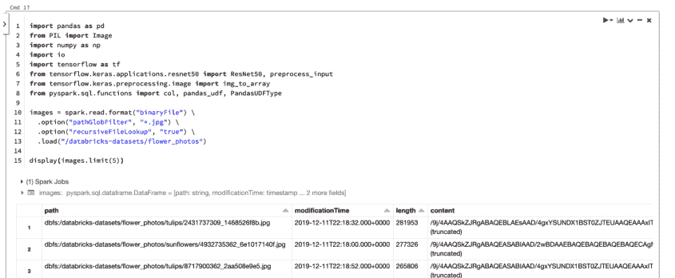

图 9.4 – 二进制图像文件

6. 接下来，我们将准备用于特征提取的预训练模型，通过下载它并截断最后一层。在本例中，我们将使用前面讨论过的 ResNet50 预训练模型。在加载模型时，有一些关于模型大小的概念需要牢记。如果我们处理的是小于 1 GB 的中等大小模型，良好的做法是将模型下载到集群驱动程序，然后将其权重广播到工作节点上。这就是本示例将采用的方法。另一种方法是当我们处理大于 1 GB 的模型时。在这些情况下，最好将模型权重直接加载到分布式存储中。

7. 我们将实例化我们的模型并指定移除最后一层，显示模型摘要以验证最后一层已被移除，然后最终将模型权重广播到工作节点：

```
model = ResNet50(include_top=False)
model.summary()  # verify that the top layer is removed
bc_model_weights = sc.broadcast(model.get_weights())
```

8. 下一步是定义一个函数，该函数返回一个 ResNet50 模型，其最后一层被截断，并将预训练权重广播到工作节点：

```
def model_fn():
    model = ResNet50(weights=None, include_top=False)
    model.set_weights(bc_model_weights.value)
    return model
```

现在我们有了用于实例化截断并广播模型的函数，我们可以定义 pandas UDF，该 UDF 将用于使用 Scalar Iterator pandas UDF 对 pd.Series 数组中的图像进行特征化，以提高在工作节点上加载大型模型的性能。

9. 下一个函数将用于预处理原始图像字节，并在稍后用于预测：

```
def preprocess(content):
    img = Image.open(io.BytesIO(content)).resize([224, 224])
    arr = img_to_array(img)
    return preprocess_input(arr)
```

10. 接下来，我们定义另一个函数，该函数将负责使用前面定义的函数解码原始图像的 pd.Series 数组，对其应用预训练模型，并返回图像特征的 pd.Series。在这里，我们将输出的多维张量展平，以便在加载到 Spark DataFrame 时更好地处理它们：

```
def featurize_series(model, content_series):
    input = np.stack(content_series.map(preprocess))
    preds = model.predict(input)
    output = [p.flatten() for p in preds]
    return pd.Series(output)
```

11. 下一步是为我们的特征化函数定义一个 Scalar Iterator pandas UDF 包装器。这里使用的装饰器将指定此过程的输出将是类型为 ArrayType(FloatType) 的 Spark DataFrame 列。content_series_iter 参数指定对数据批进行迭代，其中每个批都是图像的 pandas Series 数组。使用 Scalar Iterator pandas UDF 允许我们加载模型一次并在不同数据批上多次使用它，从而提高加载大型模型的性能：

```
@pandas_udf('array<float>', PandasUDFType.SCALAR_ITER)
def featurize_udf(content_series_iter):
    model = model_fn()
    for content_series in content_series_iter:
        yield featurize_series(model, content_series)
```

这样我们就成功注册了我们的函数，该函数稍后可用于基于我们的预训练模型获得特征。

## 将特征化应用于图像的 DataFrame

pandas UDF 允许我们管理大量非结构化数据记录，例如大型图像，但可能导致诸如内存不足 Out of Memory 错误等问题：

- 1. 我们可以在下面的单元格中给出一个提示，以允许更有效地处理此类错误，通过使用 maxRecordsPerBatch 选项减少箭头批大小：

```
spark.conf.set("spark.sql.execution.arrow.maxRecordsPerBatch", "1024")
```

2. 我们现在可以在整个 Spark DataFrame 上运行特征化。请注意，此操作可能需要相当长的时间，因为它将大型模型应用于完整数据集：

```
features_df = images.repartition(16).select(col("path"), featurize_udf("content").alias("features"))
features_df.write.mode("overwrite").parquet("dbfs:/ml/tmp/flower_photos_features")
```

3. 这里，我们可以看到正在运行的过程，将结果转储为 Parquet 文件可能需要一些时间：

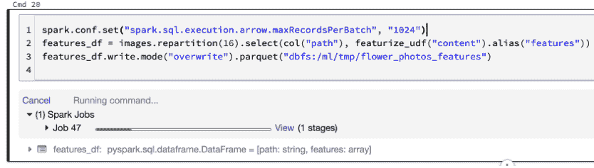

图 9.5 - 提取并写入特征

最后，我们使用预训练模型计算了提取的特征，现在我们能够使用从预训练模型中提取的领域知识来训练新模型。此最后一步在此示例中未显示，因为它被视为不同的过程。

## 总结

在本章中，我们讨论了如何使用 TFRecords 和 Petastorm 作为库来使加载大量数据以训练我们的分布式深度学习模型的过程变得更容易。这使我们了解了这些记录的结构，我们如何处理昂贵的操作，例如自动模式推断，我们如何准备记录以供使用，以及我们如何不仅在深度学习框架的上下文中使用它们，而且还用于纯 Python 应用程序。

我们以一个示例结束本章，说明了如何利用预训练模型来提取新的特征，这些特征基于领域知识，后续可用于提取特征以训练新模型。

在下一章中，我们将学习如何在 Azure Databricks 中微调深度学习模型的参数以提高其性能。

### 10
Azure Databricks 中的模型跟踪和调优

在上一章中，我们学习了如何在 Azure Databricks 中创建机器学习和深度学习模型，以及如何在分布式训练期间加载数据集。找到使用机器学习解决问题的正确机器学习算法是一回事，但找到最佳超参数是另一项同样或更复杂的任务。在本章中，我们将重点关注使用 MLflow 作为模型存储库的模型调优、部署和控制。我们还将使用 Hyperopt 来搜索模型最佳超参数集。我们将使用使用 scikit-learn Python 库构建的深度学习模型来实现这些库的使用。

更具体地说，我们将学习如何跟踪机器学习模型训练的运行以找到最优的超参数集，使用 MLflow 部署和管理模型的版本控制，并学习如何使用 Hyperopt 作为模型调优中随机搜索和网格搜索等操作的替代方案。我们将涵盖以下主题：

- - 使用 AutoML 调优超参数
- - 使用 MLflow 自动化模型跟踪

- - 使用 Hyperopt 进行超参数调优
- - 使用 scikit-learn、Hyperopt 和 MLflow 优化模型选择

在深入这些概念之前，让我们先了解一下本章的要求。

## 技术要求

要在本章中练习示例，您必须具备以下条件：

- - 一个 Azure Databricks 订阅。
- - 一个附加到正在运行的集群的 Azure Databricks 笔记本，该集群使用 Databricks Runtime ML 版本 7.0 或更高版本。

## 使用 AutoML 调优超参数

在机器学习和深度学习中，超参数调优是我们选择将由学习算法使用的最优超参数集的过程。在这里，超参数是用于控制学习过程的值。相比之下，其他参数将从数据中学习。从这个意义上说，超参数是一个遵循其统计含义的概念；也就是说，它是从先验分布中得出的参数，在我们开始从数据中学习之前捕获先验信念。

在机器学习和深度学习中，通常也将超参数称为我们在开始训练模型之前设置的参数。这些参数将控制训练过程。深度学习中使用的超参数示例如下：

- - 学习率
- - 训练轮数
- - 隐藏层
- - 隐藏单元
- - 激活函数


这些参数将直接影响我们模型的性能和训练时间，其选择在我们模型的成功中起着至关重要的作用。例如，学习率过低的神经网络将无法准确捕捉观察数据中的模式。找到良好的超参数需要我们尽可能高效地映射搜索空间，这可能是一项艰巨的任务。这是因为为了找到每组良好的值，我们需要训练一个新模型，而这在时间和计算资源方面可能是一项昂贵的操作。用于此的一些技术包括常见的算法，如网格搜索、随机搜索和贝叶斯优化。

我们可以应用的一种更高效地搜索最佳超参数的技术是 **AutoML**，它代表 **自动化机器学习**。这是自动应用机器学习来解决优化问题的过程，在我们的案例中是优化训练算法中使用的超参数。这有助于我们克服手动搜索正确超参数或应用诸如网格搜索和随机搜索等技术时可能出现的问题，这些算法必须运行很长时间。这是因为它们会在不评估这些区域可能有多有希望的情况下搜索搜索空间中的所有可能值。

Azure Databricks Runtime for Machine Learning（Databricks Runtime ML）为我们提供了两种自动映射可能超参数搜索空间的选项。它们被称为 MLflow 和 Hyperopt，这两个开源库将 AutoML 应用于自动化模型选择和超参数调优。

HyperOpt 是一个 Python 库，专为大规模贝叶斯优化模型的超参数而设计。它可以用于以分布式方式将搜索过程扩展到多个计算核心。虽然我们将只关注超参数优化方面，但它也可以用于优化管道，以及数据预处理、学习算法选择，当然还有超参数调优。要使用 HyperOpt，我们需要定义一个优化器，该优化器将应用于要优化的期望函数以优化任何函数，在我们的案例中可以是最大化性能指标或最小化损失函数。在我们的示例中，HyperOpt 将采用超参数的搜索空间，并根据之前的结果移动，从而以一种知情的方式在搜索空间中移动，这使其与随机搜索和网格搜索等算法不同。

Azure Databricks Runtime for Machine Learning 中用于自动映射可能超参数搜索空间的另一个可用库是 MLflow，我们已在前几章中讨论过。MLflow 是一个开源平台，用于管理端到端机器学习和深度学习模型生命周期，并支持自动化模型调优跟踪。这种自动化模型跟踪来自其与 Spark MLlib 库的集成。它允许我们通过使用 CrossValidator 和 TrainValidationSplit 来跟踪哪些超参数能产生最佳结果，这些工具会自动记录验证指标和超参数，以便更轻松地获得最佳模型。

在接下来的章节中，我们将学习如何将 HyperOpt 和 MLflow 应用于 Azure Databricks Runtime for Machine Learning 训练的模型，以跟踪并获得最佳超参数。

## 使用 MLflow 自动化模型跟踪

正如我们之前提到的，MLflow 是一个用于管理机器和深度学习模型生命周期的开源平台，它允许我们进行实验、确保可重复性并支持轻松的模型部署。它还为我们提供了一个集中的模型注册表。总体而言，MLflow 的组件如下：

- MLflow Tracking：它记录与实验相关的所有数据，例如代码、数据、配置和结果。
- MLflow Projects：它以确保结果可以在不同平台间运行之间重现的格式封装代码。
- MLflow Models：这为我们提供了机器学习和深度学习模型的部署平台。
- Model Registry：我们机器学习和深度学习模型的中央存储库。

在本节中，我们将重点关注 MLflow Tracking，这是允许我们记录和注册代码、属性、超参数、工件以及与训练深度学习和机器学习模型相关的其他组件的组件。MLflow Tracking 组件依赖于两个概念，即实验和运行。实验是我们执行训练过程的地方，是主要组织单元；所有运行都属于一个实验。因此，这些实验指的是特定的运行，我们可以可视化它、比较它，并下载与其相关的日志和工件。以下信息存储在每个 MLflow 中：

- Source：这是实验运行所在的笔记本。
- Version：如果运行是由 MLflow Project 触发的，则为笔记本版本或 Git 提交哈希。
- Start and end time：训练过程的开始和结束时间。
- Parameters：包含训练过程中使用的模型参数的字典。
- Metrics：包含模型评估指标的字典。MLflow 记录并让你可视化模型在运行过程中的性能。
- Tags：这些作为键值对保存的运行元数据。你可以在运行完成期间和之后更新标签。键和值都是字符串。
- Artifacts：这些是运行中使用的任何格式的数据文件，例如模型本身、训练数据或使用的任何其他类型的数据。

在 Azure Databricks Runtime for Machine Learning 中，每当我们在训练算法的代码中使用 CrossValidator 或 TrainValidationSplit 时，MLflow 都会存储超参数和评估指标，以便更轻松地可视化并最终找到最佳模型。

在接下来的章节中，我们将学习如何在训练算法时使用 CrossValidator 和 TrainValidationSplit 来利用 MLflow 的优势并可视化产生最佳结果的超参数。

## 管理 MLflow 运行

当我们在训练模型时使用 CrossValidator 或 TrainValidationSplit 时，我们将拥有嵌套的 MLflow 运行。嵌套方式如下：

- Main run：CrossValidator 或 TrainValidationSplit 的信息记录到主运行中。如果没有活动的运行，MLflow 将创建一个新运行并记录到其中，并在退出进程前结束它。
- Child runs：每个超参数值及其对应的性能指标都记录在依赖于父运行的子运行中。

当我们执行多步骤处理的超参数搜索时，这些嵌套运行很常见。例如，我们可以拥有如下所示的嵌套运行：

```
with mlflow.start_run(nested=True):
    mlflow.log_param("lr", 0.05)
    mlflow.log_param("batch_size", 256)
    with mlflow.start_run(nested=True):
        mlflow.log_param("max_runs", 16)
        mlflow.log_param("epochs", 10)
        mlflow.log_metric("rmse", 98)
mlflow.end_run()
```

这些嵌套运行将在 MLflow UI 中显示为可展开的树，以便我们可以更详细地查看结果。这使我们能够在主运行中保持不同子运行的结果井然有序。

在讨论 MLflow 运行管理时，我们需要确保我们正在记录到主运行。为了确保这一点，当调用 fit() 函数时，它应被包裹在 mlflow.start_run() 语句中以将信息记录到正确的运行中。正如我们已经看到的，这样我们就可以轻松地将指标和参数放置在运行中。如果在同一个活动运行中多次调用 fit() 函数，MLflow 将为参数和指标的名称附加唯一标识符以避免任何可能的命名冲突。

在下一节中，我们将看到一个使用 MLflow tracking 与 MLlib 结合找到机器学习模型最佳超参数集的示例。


## 使用 MLlib 自动化 MLflow 跟踪

在本节中，我们将举例说明如何使用 MLflow 来跟踪 PySpark MLlib DecisionTreeClassifier 模型的性能。MLflow 将跟踪模型的训练过程，并允许我们存储整个过程中使用的所有 artifacts。我们将重点关注检查产生最佳结果的超参数以找到最佳设置。模型将使用 MNIST 数据集进行训练，该数据集包含在 Databricks 示例数据集中。数据集采用 LIBVSM 格式，并分为训练集和测试集。它包含两列——一列为标签，另一列为编码为 784 个特征的图像。让我们开始吧：

- 1. 首先，我们将加载数据，同时指定特征数量并将数据缓存到 worker 内存中：

```
train_data = spark.read.format("libsvm") \
    .option("numFeatures", "784") \
    .load("/databricks-datasets/mnist-digits/data-001/
    mnist-digits-train.txt")
test_data = spark.read.format("libsvm") \
    .option("numFeatures", "784") \
    .load("/databricks-datasets/mnist-digits/data-001/
    mnist-digits-test.txt")
train_data.cache()
test_data.cache()
```

- 2. 之后，我们可以显示每个数据集中的记录数并显示训练数据：

```
print("Train images:{} ; test images {}".format(train_data.count(), test_data.count()))
display(train_data)
```

为了将这些特征传递给机器学习模型，我们需要进行一些特征工程。我们可以使用 MLlib 将这些操作标准化为单个 pipeline，从而将多个预处理操作打包到单个工作流中。MLlib Pipelines 与 scikit-learn 中的 pipeline 实现非常相似，具有五个主要组件。如下所示：

- - DataFrame：保存我们数据的实际 DataFrame。
- - Transformer：将数据从特征 DataFrame 转换到预测 DataFrame 的算法，例如。
- - Estimator：这是拟合数据以生成模型的算法。
- - Parameter：一起指定的多个 Transformer 和 Estimators 参数。
- - Pipeline：将多个 Transformer 和 Estimators 操作组合成单个工作流。

在这里，我们将有一个由两个步骤组成的 pipeline，即 StringIndexer 用于将标签从数值转换为分类特征，以及 DecisionTreeClassifier 模型，它将根据特征列中的训练数据预测标签。让我们开始吧：

3. 首先，让我们进行必要的导入并创建 pipeline：

```
from pyspark.ml.classification import
DecisionTreeClassifier, DecisionTreeClassificationModel
```

```
from pyspark.ml.feature import StringIndexer
```

```
from pyspark.ml import Pipeline
```

4. 现在，我们可以实例化 StringIndexer 和 DecisionTreeClassifier：

```
indexer = StringIndexer(inputCol="label",
```

```
outputCol="indexLabel")
```

```
model = DecisionTreeClassifier(labelCol="indexLabel")
```

5. 最后，我们可以将 StringIndexer 和 DecisionTreeClassifier 串联成单个工作流：

```
pipeline = Pipeline(stages=[indexer, model])
```

6. 到目前为止，我们遵循了创建普通 pipeline 的标准方法。我们现在要做的是包含 CrossValidator MLflow 类，以便我们可以运行模型的交叉验证过程。每个验证模型的评估指标都将被 MLflow 跟踪，并允许我们调查哪些超参数产生了最佳结果。

在本例中，我们将在 CrossValidator MLflow 类中指定两个要检查的超参数，分别是：

a) maxDepth：此参数决定 DecisionTreeClassifier 中树的最大深度。更深的树可以产生更好的结果，但训练成本更高，并且产生的模型更容易过拟合。

b) maxBins：此参数决定将连续特征离散化为有限数字集时生成的 bin 数。它是在分布式计算环境中以更有效的方式训练模型的<|message|> 参数。在本例中，我们将首先指定值为二，这将把灰度特征转换为 1 或 0。我们还将使用值为 4 进行测试，以获得更大的粒度。

7. 现在，我们可以定义用于衡量模型性能的评估器。我们将使用 PySpark MulticlassClassificationEvaluator，然后使用 weightedPrecision 作为指标：

```
from pyspark.ml.evaluation import
MulticlassClassificationEvaluator
model_evaluator =
MulticlassClassificationEvaluator(labelCol="indexLabel",
metricName="weightedPrecision")
```

8. 接下来，我们将定义要检查的参数网格：

```
from pyspark.ml.tuning import CrossValidator,
ParamGridBuilder
hyperparam_grid = ParamGridBuilder() \
.addGrid(model.maxDepth, [2, 6]) \
.addGrid(model.maxBins, [2, 4]) \
.build()
```

9. 现在，我们准备使用之前定义的 pipeline、评估器和超参数网格值创建 CrossValidator。正如我们之前提到的，CrossValidator 将跟踪我们创建的模型以及我们使用的超参数：

```
cross_validator = CrossValidator(
    estimator=pipeline,
    evaluator=model_evaluator,
    estimatorParamMaps=hyperparam_grid,
    numFolds=3)
```

10. 一旦我们定义了交叉验证过程，我们就可以开始训练过程。如果有可用的 MLflow 跟踪服务器，它将开始记录我们每次运行的数据，以及当前活动运行下运行中使用的所有其他 artifacts。如果我们没有活动运行，它将创建一个新的运行：

```
import mlflow
import mlflow.spark
with mlflow.start_run():
    cv_model = cross_validator.fit(train_data)
    test_metric = model_evaluator.evaluate(cv_model.transform(test_data))
    mlflow.log_metric(f'model_metric_{model_evaluator.getMetricName()}', test_metric)
    mlflow.spark.log_model(spark_model=cv_model.bestModel, artifact_path='best-model')
```

11. 在前面的代码中，我们创建了一个新的运行来跟踪模型。请记住，我们使用 with mlflow.start_run(): 语句是为了避免多次运行单元格时出现命名冲突。前面的步骤将保证 cv.fit() 函数返回它能够找到的最佳模型，之后我们评估其在测试数据上的性能，然后将此评估结果记录到 MLflow 中：

## chapter_10 (Python)

```
from pyspark.ml.evaluation import MulticlassClassificationEvaluator
model_evaluator = MulticlassClassificationEvaluator(labelCol="indexLabel", metricName="weightedPrecision")
from pyspark.ml.tuning import CrossValidator, ParamGridBuilder
hyperparam_grid = ParamGridBuilder() \
    .addGrid(model.maxDepth, [2, 6]) \
    .addGrid(model.maxBins, [2, 4]) \
    .build()

cross_validator = CrossValidator(
    estimator=pipeline,
    evaluator=model_evaluator,
    estimatorParamMaps=hyperparam_grid,
    numFolds=3
)
import mlflow
import mlflow.spark
with mlflow.start_run():
    cv_model = cross_validator.fit(train_data)
    test_metric = model_evaluator.evaluate(cv_model.transform(test_data))
    mlflow.log_metric(f"model_metric_{model_evaluator.getMetricName()}", test_metric)
    mlflow.spark.log_model(spark_model=cv_model.bestModel, artifact_path="best-model")
```

* (63) Spark Jobs
MLlib 将自动在 MLflow 中跟踪试验。完成你的 tuning fit() 调用后，查看 MLflow UI 以查看已记录的运行。

使用 MLflow 跟踪 API 从此笔记本记录运行。了解更多

Figure 10.1 – 使用 MLflow 跟踪训练运行

12. 一旦我们完成了训练过程，我们将能够在 Azure Databricks 工作区中的 MLflow UI 的 Models 选项卡下看到结果。我们也可以通过单击我们在其中训练模型的笔记本中的实验图标来查看训练过程的结果。我们可以通过单击 Experiment Runs 轻松比较不同运行的结果，这将允许我们查看所有笔记本运行：

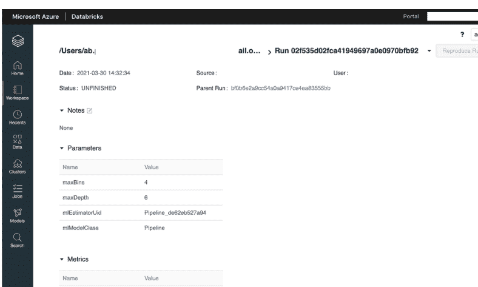

Figure 10.2 – MLflow Model Registry UI

我们可以通过在搜索运行框中传递参数来明确查找这些运行的特定结果。例如，我们可以通过在搜索框中传递 params.maxDepth = 6 来搜索我们在 maxDepth 超参数中使用值为 6 时获得的结果。

我们还可以通过创建超参数的不同值与特定性能指标的散点图来比较结果，这在我们尝试查找和比较最佳超参数集时非常有用。

下一节将深入探讨一种更自动化的寻找使某个函数最小化的最佳超参数集的方法。我们将使用损失函数来实现这一点。我们将使用 Hyperopt 来定义和探索搜索空间并找到使损失函数最小化的超参数。


## 使用 Hyperopt 进行超参数调优

Azure Databricks Runtime for Machine Learning 包含 Hyperopt，这是一个 Python 库，旨在在分布式计算系统上使用，以促进为一组最佳超参数学习的过程。其核心是一个接收我们需要最小化或最大化的函数，以及定义搜索空间的参数集的库。借助这些信息，Hyperopt 将探索搜索空间以找到最佳超参数集。Hyperopt 使用随机搜索算法来探索搜索空间，这比使用随机搜索或网格搜索等传统确定性方法更有效。

Hyperopt 针对分布式计算环境进行了优化，并为 PySpark MLlib 和 Horovod 等库提供支持，后者是一个用于分布式深度学习训练的库，我们稍后将重点介绍。它也可以应用于单机环境以及 TensorFlow 和 PyTorch 等更常见的库。

使用 Hyperopt 的一般工作流程如下：

- 1. 首先，我们必须找到我们想要优化的函数。这可以是我们想要最大化的性能指标，也可以是我们想要最小化的损失函数。
- 2. 接下来，我们必须定义 Hyperopt 将在其中扫描以优化已定义目标函数的最佳参数的条件搜索空间。Hyperopt 支持在同一运行中使用多种算法，这使我们能够定义多个模型进行探索。
- 3. 在那之后，我们必须定义将用于扫描搜索空间的搜索算法。
- 4. 最后，我们可以通过运行 fmin() Hyperopt 函数来启动探索过程。这将把目标函数作为参数，并将搜索空间用于识别最佳参数集。

话虽如此，Hyperopt 的两个最关键部分如下：

- 我们将作为优化目标传递的目标函数。一般来说，这是损失函数或性能指标。
- 定义搜索空间的超参数字典。我们可以为每组超参数值选择不同的分布。

在下一节中，我们将学习如何将 Hyperopt 应用于 Azure Databricks Runtime for Machine Learning，以找到特定任务的最佳超参数，而不管应用了什么算法。

## Hyperopt 概念

在本节中，我们将介绍 Hyperopt 的某些概念，以确定其核心功能，以及我们如何使用它们有效地扫描搜索空间，以找到有助于最小化或最大化我们目标函数的超参数。正如我们之前提到的，当我们开始使用 Hyperopt 时，我们必须定义以下内容：

- 目标函数
- 我们将扫描的搜索空间
- 将用于保存搜索空间中点评估结果的数据库
- 将用于扫描搜索空间的搜索算法

在这里，我们的主要目标是找到代表最佳超参数的最佳标量集。Hyperopt 允许我们详细定义搜索空间，以提供有关目标函数在搜索空间中何处表现更好的信息。其他优化库通常假设搜索空间是具有相同分布的更大向量空间的子集，这通常不是这种情况。Hyperopt 使我们定义搜索空间的方式使我们能够进行更有效的扫描。

Hyperopt 允许我们非常简单地定义目标函数，但当我们增加在执行期间想要跟踪的参数数量时，它也具有递增的复杂性。最简单的示例如下，我们找到使线性函数 y(x) = x 最小化的 x 值：

```
from hyperopt import fmin, tpe, hp
best_param = fmin(
    fn=lambda x: x,
    space=hp.uniform('x', 0, 1),
    algo=tpe.suggest,
    max_evals=100)
print(best_param)
```

我们可以分解前面的执行，通过分解其参数：

- Hyperopt `fmin()` 函数接收 `fn` 关键字参数和要最小化的函数。在这种情况下，我们使用一个非常简单的 lambda 函数；即 `f(y)=x`。
- space 参数用于传递搜索空间。在这里，我们使用 Hyperopt 中的 `hp` 函数为 x 变量指定 0 到 1 范围内的均匀搜索空间。`hp.uniform` 是库内置的一个函数，有助于我们为特定变量指定搜索空间。
- `algo` 参数用于选择搜索算法。在这种情况下，`tpe` 代表 Parzen 估计器。我们也可以将这些参数设置为 `hyperopt.random.suggest`。搜索算法是一个完整的主题，因此我们只会简要提及这一点，但您可以自由搜索有关 Hyperopt 应用的算法类型以找到最适合您的超参数集的更多详细信息。
- 最后，使用 `max_evals` 参数指定最大评估次数。

一旦我们指定了所有必需的参数，我们就可以开始运行，它将返回一个 Python 字典，其中包含使目标函数最小化的指定变量的值。

尽管我们这里的最小工作示例看起来非常简单，但 Hyperopt 的复杂性随着我们在优化目标函数时拥有的规范数量的增加而增加。我们在制定最佳策略时可以问自己的一些问题如下：

- 除了 `fmin()` 函数的实际返回值之外，还需要什么类型的信息？我们可以在过程中收集统计数据和其他数据，这对我们来说可能有用以便保留。
- 我们是否需要使用需要一个以上输入值的优化算法？
- 我们是否应该并行化此过程，如果是这样，我们是否希望这些并行进程之间进行通信？

回答这些问题将定义我们实现优化策略的方式。

在并行优化过程中，Hyperopt 优化算法与目标函数之间会进行通信，以获得搜索空间中该特定点的目标函数的实际值。在这种通信中，目标函数返回的值，即浮点损失，也称为负效用，与搜索空间中的该点相关联。

这里显示的简单示例说明了使用 Hyperopt 定义目标函数和搜索空间是多么简单。然而，当我们想要存储的信息不仅仅是目标函数在搜索空间中返回的浮点值时，它仍然不足。它也是一个不与搜索算法或并发函数交互的评估。

为了解决第一个问题，我们可以使用一个返回嵌套字典的目标函数，其中包含统计数据和诊断所需的键值。为此，我们有一组目标函数必须返回的强制值：

- `status`：我们可以从 `hyperopt.STATUS_STRINGS` 中选择一个键来显示竞争的状态。这样，我们就可以跟踪我们的评估是否成功完成或失败。
- `loss`：这是当实际目标函数在搜索空间中该特定点被评估时返回的浮点值。如果竞争状态为 OK，则必须存在。

我们还可以在目标函数的选项中指定一些额外的可选参数。这些键值如下：

- `loss_variance`：指定随机目标函数的确定性的浮点值。
- `true_loss`：您可以使用此名称存储模型的损失，以便我们可以使用内置绘图工具。这在我们处理超参数优化时特别有用，因为它允许我们非常简单地绘制探索结果。
- `true_loss_variance`：模型损失的不确定性。

此功能允许我们将这些值存储在与 JSON 兼容的数据库中，例如 MongoDB。以下代码示例向我们展示了如何定义一个非常简单的 f(x) = x 目标函数，该函数以键值字典的形式返回执行的狀態：

```
import pickle
import time
```


```
from hyperopt import fmin, tpe, hp, STATUS_OK
def objective(x):
    return {'loss': x, 'status': STATUS_OK }
best = fmin(objective,
    space=hp.uniform('x', -5, 5),
    algo=tpe.suggest,
    max_evals=50)
print(best)
```

我们可以通过使用 Trials 对象充分利用能够返回字典的能力，该对象允许我们在执行优化时存储更多信息。在下面的示例中，我们正在修改目标函数，使其返回更复杂的输出，该输出稍后将存储在 Trials 对象中。我们可以通过将其作为 Hyperopt fmin() 函数的参数传递来实现：

```
import pickle
import time
from hyperopt import fmin, tpe, hp, STATUS_OK, Trials
def objective(x):
    return {
        'loss': x,
        'status': STATUS_OK,
        'eval_time': time.time(),
        'more_data': {'type': None, 'value': [0, 1]},
        'attachments':
            {'time_module': pickle.dumps(time.time)}
    }
trials_obj = Trials()
best_params = fmin(objective,
    space=hp.uniform('x', -5, 5),
    algo=tpe.suggest,
    max_evals=50,
    trials=trials_obj)
print(best_params)
```

执行完成后，我们可以访问 Trials 对象以检查优化过程中目标函数返回的值。我们有不同的方式可以访问 Trials 对象中存储的值：

- trials.trials: 返回包含搜索所有参数的字典列表。
- trials.results: 目标函数返回的字典。
- trials.losses(): 所有成功试验的实际损失。
- trials.statuses(): 每个试验的状态。

此 Trials 对象可以保存为 pickle 对象或使用自定义代码进行解析，以便我们更深入地了解试验结果。

试验的附件可以这样访问：

```
msg = trials.trial_attachments(trials.trials[0])['time_module']
time_module = pickle.loads(msg)
```

在此示例中，我们正在获取第一个试验的 time_module 附件。

需要注意的一点是，在 Azure Databricks 中，我们可以选择将 Trials 和 SparkTrials 对象都传递给 fmin() 函数的 trials 参数。SparkTrials 对象在我们执行单机算法时传递，例如将 scikit-learn 模型用作目标函数。在这里，Trials 对象用于分布式训练算法，例如 MLlib 或 Horovod 模型。SparkTrials 类允许我们在无需引入任何自定义逻辑的情况下分发优化的执行。它还提高了计算向工作节点的分布。

不要将 SparkTrials 对象与为分布式训练设计的算法一起使用，因为这会导致执行在集群中并行化。

现在我们对如何配置 fmin() Hyperopt 函数的基本参数有了更清晰的认识，我们可以深入了解搜索空间是如何定义的。

## 定义搜索空间

我们可以将搜索空间表达为一组嵌套函数，它们定义了不同测试用例的各个搜索空间。例如，在以下代码块中，我们为 x 参数指定了搜索空间，其中包含两个测试空间 test_space_1 和 test_space_2：

```
from hyperopt import hp
```

```
search_space = hp.choice('a',
    [('test_space_1', 1 + hp.lognormal('x', 0, 1)),
     ('test_space_2', hp.uniform('y', -5, 5))]
)
```

这里，Hyperopt 将根据搜索算法从这些嵌套随机表达式中采样。此算法采用自适应探索策略，而不是仅从搜索空间中抽样。在前面的示例中，我们定义了三个参数：

- a: 选择要使用的情况
- test_space_1: 为 x 参数生成正值
- test_space_2: 为 y 参数生成正值

每个表达式的第一个参数是标签，算法在内部使用它将参数选择返回给调用者。在此示例中，代码的工作方式如下：

- 如果 a 变量为 0，我们将使用 x 而不使用 y。
- 如果 a 变量为 1，则将使用 y 而不使用 x。

x 和 y 变量是条件参数，取决于 a 的结果。如果我们以这种条件方式编码变量，我们就说明当 a 为 0 时 x 变量对目标函数没有影响，这有助于搜索算法更有效地分配信用。这利用了用户对要分析的目标函数的领域知识。

search_space 是一个变量空间，其定义为图表达式，描述如何在不生成搜索空间的情况下采样一个点。这优化了执行的内存和计算使用。这些图表达式称为 pyll 图，定义在 hyperopt.pyll 类中。

你可以通过对其进行采样来探索示例搜索空间：

```
import hyperopt.pyll.stochastic
print(hyperopt.pyll.stochastic.sample(search_space))
```

我们现在知道如何定义搜索空间，在该空间中我们将优化目标函数。需要注意的是，我们在搜索空间中定义测试用例的方式也会影响搜索算法在自适应搜索期间对试验的工作方式。在下一节中，我们将了解在 Azure Databricks 中使用 Hyperopt 的一些最佳实践。

## 在 Hyperopt 中应用最佳实践

到目前为止，我们已经讨论了如何指定要最小化的目标函数的执行以及我们将对其进行评估的搜索空间。此外，我们还看到在定义超参数可能值的探索方式方面有很大的灵活性，以及如何通过在搜索空间中定义条件参数来利用领域知识。

我们必须牢记 Hyperopt 库本身的一些方面，以及它在 Azure Databricks 中的执行方式。在 Azure Databricks 中使用 Hyperopt 优化目标函数时，这里有一些需要记住的重要概念：

- Hyperopt Tree of Parzen Estimator 算法是一种贝叶斯方法，比常见的网格和随机搜索方法更有效。它允许我们扫描更大的一组可能超参数。在定义搜索空间时应用领域知识以提高探索性能。
- 当我们使用 `hyperopt.choice()` 并使用 MLflow 跟踪优化进度时，MLflow 将记录选择列表的索引。我们可以使用 Hyperopt 的 `hyperopt.space_eval()` 函数获取参数值。
- 在处理大型数据集时，始终建议在数据的小子集上进行实验，以逐步了解最佳搜索空间。这有助于我们在整个数据集上定义将使用的搜索空间。
- 当我们使用 SparkTrials 对象时，建议使用仅 CPU 集群。这是因为在 Azure Databricks 中，与 CPU 集群相比，GPU 集群中的并行性会降低。
- 不要在自动缩放集群上使用 SparkTrials，因为并行值是在执行开始时选择的。因此，如果集群扩展，它不会提高执行的性能。

应用这些概念将确保我们在 Azure Databricks 中使用 Hyperopt 执行优化时充分利用其优势。在下一节中，我们将了解更多关于如何在 Azure Databricks 中改进深度学习模型的推理。

## 使用 scikit-learn、Hyperopt 和 MLflow 优化模型选择

正如我们在前几节中所看到的，Hyperopt 是一个 Python 库，允许我们在分布式计算环境（如 Azure Databricks）中跟踪可用于超参数模型调优的优化运行。在本节中，我们将通过一个训练 scikit-learn 模型的示例。我们将使用 Hyperopt 跟踪调优过程并将结果记录到 MLflow，即模型生命周期管理平台。

在 Azure Databricks Runtime for Machine Learning 中，我们拥有一个经过优化的 Hyperopt 版本，可支持 MLflow 跟踪。在这里，我们可以使用 SparkTrials 对象在并行执行期间记录单机模型的调优过程结果。我们将使用这些工具为多个 scikit-learn 模型找到最佳超参数集。

我们将执行以下操作：

- 准备训练数据集。
- 使用 Hyperopt 定义要最小化的目标函数。
- 定义 Hyperopt 搜索空间，我们将在其上扫描最佳超参数。
- 定义将用于扫描搜索空间的搜索算法。
- 执行优化并在 MLflow 中跟踪最佳参数集。

让我们开始：

1. 首先，我们将导入我们将使用的所有必要库：

```
import numpy as np
from sklearn.datasets import fetch_california_housing
from sklearn.model_selection import cross_val_score
from sklearn.svm import SVC
from sklearn.ensemble import RandomForestClassifier
from sklearn.linear_model import LogisticRegression
from hyperopt import fmin, tpe, hp, SparkTrials, STATUS_OK, Trials
import mlflow
```


2. 在本示例中，我们将使用加州住房数据集，该数据集作为 scikit-learn 中的示例数据集包含在内。该数据集保存了 1990 年美国人口普查的数据，其中包含加州 20,000 套房屋的房屋价值，以及有关收入、居住人数、房间数等特征的数据。为了获取此数据集，我们将使用 fetch_california_housing() scikit-learn 函数并将结果转储到名为 features 和 target 的变量中：

```
features, target = fetch_california_housing(return_X_y=True)
```

3. 现在我们已将数据集拆分为特征和目标，我们将对预测变量进行缩放，这在机器学习和深度学习中是一种常见做法。这样，我们将确保具有缩放一致性。这将帮助我们克服当特征未离散化为缩放变量时出现的一系列问题。我们的数据集中可用的特征如下：

+   a) 街区人均中位家庭收入
+   b) 房屋年龄
+   c) 街区每户平均房间数
+   d) 平均卧室数
+   e) 街区总人口
+   f) 平均房屋居住人数
+   g) 纬度
+   h) 经度

4. 通过查看各列中特征的尺度——这是一个简单的操作，可以在 pandas DataFrame 中使用 describe() 方法完成——我们可以看到均值中的数量级差异很大：

```
import pandas as pd
```

```
features_df = pd.DataFrame(features)
```

```
features_df.describe()
```

5. 正如我们所见，这些变量的范围和尺度可能非常不同：

```
import pandas as pd

features_df = pd.DataFrame(features)
features_df.describe()
```

Out[5]:

|  | 0 | 1 | 2 | 3 | 4 | 5 | 6 | 7 |
|---|---|---|---|---|---|---|---|---|
| count | 20640.000000 | 20640.000000 | 20640.000000 | 20640.000000 | 20640.000000 | 20640.000000 | 20640.000000 | 20640.000000 |
| mean | 3.870671 | 28.639486 | 5.429000 | 1.096675 | 1425.476744 | 3.070655 | 35.631861 | -119.569704 |
| std | 1.899822 | 12.585558 | 2.474173 | 0.473911 | 1132.462122 | 10.386050 | 2.135952 | 2.003532 |
| min | 0.499900 | 1.000000 | 0.846154 | 0.333333 | 3.000000 | 0.692308 | 32.540000 | -124.350000 |
| 25% | 2.563400 | 18.000000 | 4.440716 | 1.006079 | 787.000000 | 2.429741 | 33.930000 | -121.800000 |
| 50% | 3.534800 | 29.000000 | 5.229129 | 1.048780 | 1166.000000 | 2.818116 | 34.260000 | -118.490000 |
| 75% | 4.743250 | 37.000000 | 6.052381 | 1.099526 | 1725.000000 | 3.282261 | 37.710000 | -118.010000 |
| max | 15.001100 | 52.000000 | 141.909091 | 34.066667 | 35682.000000 | 1243.333333 | 41.950000 | -114.310000 |

Figure 10.3 - The statistical summary of the features

6. 街区人口以千为单位衡量，但平均卧室数约为 1.1。为了防止具有大值的特征被认为更重要，对特征进行缩放和归一化是一种标准做法。为了使特征归一化为相同的尺度，我们可以使用 scikit-learn StandardScaler 函数：

```
from sklearn.preprocessing import StandardScaler
scaler = StandardScaler()
scaled_features = scaler.fit_transform(features)
```

7. 现在我们已经对预测特征进行了缩放，我们可以通过在 scaled_features 数据集上调用 mean(axis=0) NumPy 方法来检查均值是否接近 0：

```
scaled_features.mean(axis=0)
```

8. 现在我们的预测特征已归一化并缩放，我们将不得不将数值目标列转换为离散值：

```
from sklearn.preprocessing import StandardScaler
scaler = StandardScaler()
scaled_features = scaler.fit_transform(features)
print(scaled_features.mean(axis=0))
```

[ 6.60969987e-17  5.50808322e-18  6.60969987e-17 -1.06030602e-16
 -1.10161664e-17  3.44255201e-18 -1.07958431e-15 -8.52651283e-15]

Figure 10.4 – The scaled feature means

9. 此目标列向量是每套房屋的价值，是一个连续的正标量。我们将将其转换为目标列向量，其离散值为当房屋价值大于均值时为 1，否则为 0。这样，预测可以被表述为一个问题；例如，给定预测特征，此房屋的价值是否大于均值？为了离散化值，我们将与均值进行比较并使用 numpy.where() 函数将比较产生的布尔值转换为 1 和 0：

```
target_discrete = np.where(target < np.median(target), 0, 1)
```

这样，我们就将目标变量编码为一个具有两个水平的列向量，即 1 或 0。这表示房屋价格是否高于均值。

10. 现在我们已经准备好数据集，我们可以开始为优化我们将用于训练有效分类模型的几个 scikit-learn 模型的超参数设定阶段。为此，我们将使用以下三个 scikit-learn 分类器模型：

+   a) 支持向量机
+   b) 逻辑回归
+   c) 随机森林

11. 我们将创建一个要最小化的目标函数，将其传递给 Hyperopt。它将运行训练并计算在几种类型的模型上定义的 'type' 参数的交叉验证性能指标。关于此函数需要注意的一点是，因为我们使用的是 fmin() Hyperopt 函数，所以它会尝试最小化目标函数。因此，为了提高性能指标——在本例中为准确率——我们必须使用负准确率。否则，Hyperopt 将尝试最小化准确率，而这显然是我们不想做的：

```
def objective(params):
    classifier_type = params['type']
    del params['type']
    if classifier_type == 'svm':
        clf = SVC(**params)
    elif classifier_type == 'rf':
        clf = RandomForestClassifier(**params)
    elif classifier_type == 'logreg':
        clf = LogisticRegression(**params)
    else:
        return 0
    accuracy = cross_val_score(
        clf,
        scaled_features,
        target_discrete).mean()
    return {'loss': -accuracy, 'status': STATUS_OK}
```

请注意，此函数的输出是一个键值字典，其中包含两个必需的参数。这些是 'loss'，即负准确率，以及 'status'，它使用我们之前导入的 Hyperopt 状态字符串之一定义。

12. 下一步是定义我们将用于扫描每个选定 scikit-learn 模型所有可能超参数的搜索空间。这将帮助我们找到产生最佳准确率的超参数。我们将使用 hyperopt.choice() 函数来选择不同的模型并为每个分类算法指定搜索空间。此选择的标签为 classifier_type。它将根据搜索空间中给出的标签在目标函数中迭代之前定义的算法类型：

```
search_space = hp.choice('classifier_type', [
    {
        'type': 'svm',
        'C': hp.lognormal('SVM_C', 0, 1.0),
        'kernel': hp.choice('kernel', ['linear', 'rbf'])
    },
    {
        'type': 'rf',
        'max_depth': hp.quniform('max_depth', 1, 3, 5),
        'criterion': hp.choice('criterion', ['gini', 'entropy'])
    },
    {
        'type': 'logreg',
        'C': hp.lognormal('LR_C', 0, 1.0),
        'solver': hp.choice('solver', ['liblinear', 'lbfgs'])
    },
])
```

搜索空间表达式中内部的 hyperopt.choice() 函数将 'type' 参数传递给目标函数，后者反过来创建一个名为 classifier_type 的内部变量并使用它来选择适当的算法。然后它将剩余参数传递给模型。请注意，在目标函数中，在创建内部变量后删除了 'type' 参数，以避免在目标算法中出现任何可能的命名冲突。

13. 现在，我们必须选择将用于扫描搜索空间的搜索算法。正如我们之前所见，Hyperopt 为此提供了两个主要选项：

+   a) `hyperopt.tpe.suggest`: 这是 **Tree of Parzen Estimators (TPE)** 算法，这是一种基于贝叶斯的算法，可根据之前的结果自适应地选择超参数。
+   b) `hyperopt.rand.suggest`: 这是一种随机搜索算法，与 TPE 算法不同，它是一种非自适应方法，使用搜索空间上的采样策略。

14. 在本示例中，我们将使用 TPE 算法，因此我们将选择 `tpe.suggest`，如下所示：

```
search_algorithm = tpe.suggest
```

15. 下一步是定义将保存每次试验结果的对象。我们将使用 SparkTrials 来跟踪探索的进度并将其记录在 MLflow 中。正如我们之前提到的，我们将使用 SparkTrials 对象而不是原生的 `Trials` Hyperopt 对象，因为我们使用的是设计为在单台机器上运行的算法。如果我们使用 MLlib 算法，则必须使用 MLflow API 来跟踪 `Trials` 结果。

反过来，SparkTrials 是一个可以接收两个可选参数的对象，如下所示：

+   a) `parallelism`: 这是并行拟合和评估的算法数量。此参数的默认值等于可用 Spark 任务槽的数量。
+   b) `timeout`: `fmin()` 可以运行的最大时间（以秒为单位）。没有最大时间限制。

Spark 中 `parallelism` 的默认值是 8。对于此参数的推荐设置是显式将其设置为正值，因为 Spark 任务槽取决于集群的大小。

16. 准备优化运行的最后一步是使用 `mlflow.start_run()` MLflow 包装器。我们将使用它在 MLflow 平台上记录此次探索的结果。这将自动跟踪运行的进度，以及目标函数和搜索空间中定义的所有变量和标签：

```
with mlflow.start_run():
    best_hyperparams = fmin(


```
fn=objective,
space=search_space,
algo=search_algorithm,
max_evals=32,
trials= SparkTrials()
```

17. `max_evals` 参数允许我们指定将在搜索空间中评估的最大点数。因此，我们可以将此值视为 Hyperopt 将为每个搜索空间拟合和评估的最大模型数量：

```
search_algorithm = tpe.suggest
with mlflow.start_run():
    best_hyperparams = fmin(
        fn=objective,
        space=search_space,
        algo=search_algorithm,
        max_evals=32,
        trials= SparkTrials())
```

* (32) Spark Jobs
由于请求的并行度为 None 或非正值，并行度将被设置为 (4)，即 Spark 的默认并行度 (4)，或 1，二者中的较大者。我们建议将并行度显式设置为正值，因为 Spark 任务槽的总数取决于集群规模。
使用 SparkTrials 的 Hyperopt 将自动在 MLflow 中跟踪试验。要查看与笔记本关联的 MLflow 实验，请单击笔记本上下文栏右上角的“Runs”图标。在那里，您可以查看所有运行。
要查看试验的日志，请检查 Spark executor 日志。要查看 executor 日志，请展开上方的“Spark Jobs”，直到看到试验作业的阶段旁边的 (i) 图标。单击它并找到任务列表。单击任务的“stderr”链接以查看试验日志。
100%|██████████| 32/32 [03:08<00:00, 5.88s/trial, best loss: -0.8359011627906977]
Total Trials: 32: 32 succeeded, 0 failed, 0 cancelled.
Command took 3.16 minutes -- by /2021, 14:12:16 on dplearn

Figure 10.5 – Tracking the training run with MLflow

18. 执行最终确定后，我们可以检查产生最佳结果的超参数：

```
import hyperopt
print(hyperopt.space_eval(search_space,
                          best_hyperparams))
```

我们应该在控制台中看到最佳超参数集以“键值字典”的形式打印出来，并附带在搜索空间中为定义的最小化函数找到的最佳参数的名称和值：

```
Cmd 8
1 import hyperopt
2 print(hyperopt.space_eval(search_space, best_hyperparams))

{'C': 3.6002403259280142, 'kernel': 'rbf', 'type': 'svm'}
Command took 0.02 seconds -- by at 30/03/2021, 14:12:24 on dplearn
```

Figure 10.6 – Best hyperparameters

我们可以通过单击笔记本右上角的实验图标来查看 MLflow 实验。此选项将显示在运行期间获得的所有结果，并且，正如我们之前提到的，允许我们可视化产生最佳结果的超参数和算法集。我们还可以检查特定参数变化的影响。

以这种方式，我们可以同时调整多个模型，并跟踪每个定义搜索空间中模型的性能。借助 Hyperopt 和 MLflow，我们可以轻松定义高级管道，使用 Azure Databricks Runtime for Machine Learning 并行微调模型。

## Summary

在本章中，我们了解了 Azure Databricks 的一些有价值功能，这些功能允许我们使用 MLflow Model Registry 跟踪训练运行，以及找到机器学习模型的最优超参数集。我们还学习了如何使用 Hyperopt 优化我们扫描最优参数搜索空间的方式。这是一套很棒的工具，因为我们可以微调具有完整超参数跟踪的模型，这些超参数用于训练。我们还使用自适应搜索策略探索了定义的超参数搜索空间，这比常见的网格和随机搜索策略更优化。

在下一章中，我们将探讨如何使用集成到 Azure Databricks 中的 MLflow Model Registry。MLflow 使跟踪机器学习模型的整个生命周期以及训练过程中使用的所有相关参数和工件变得更容易，但它也允许我们轻松部署这些模型，以便我们可以发出 REST API 请求来获取预测。MLflow 在 Azure Databricks 中的集成增强了创建和部署机器学习模型的整个工作流程。

### 11