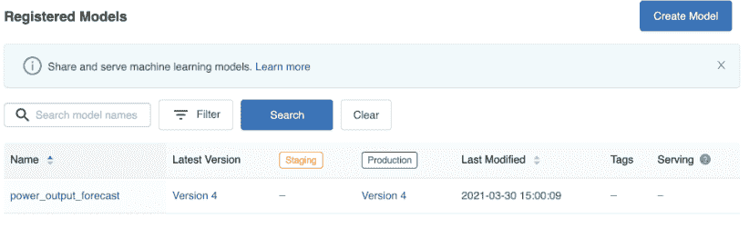
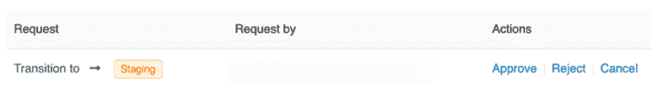
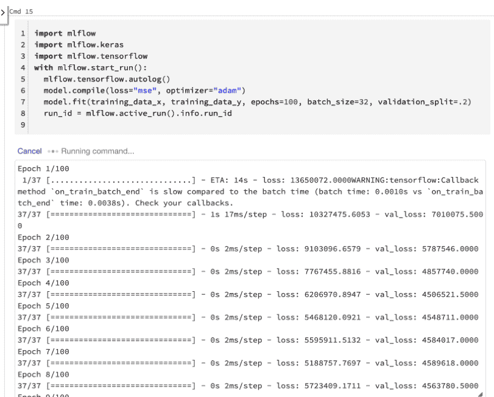
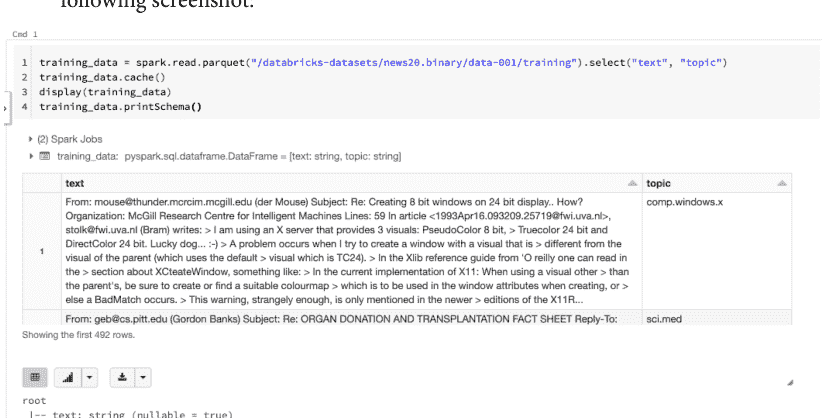
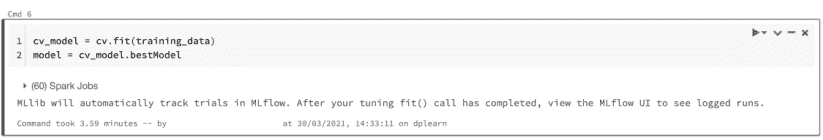
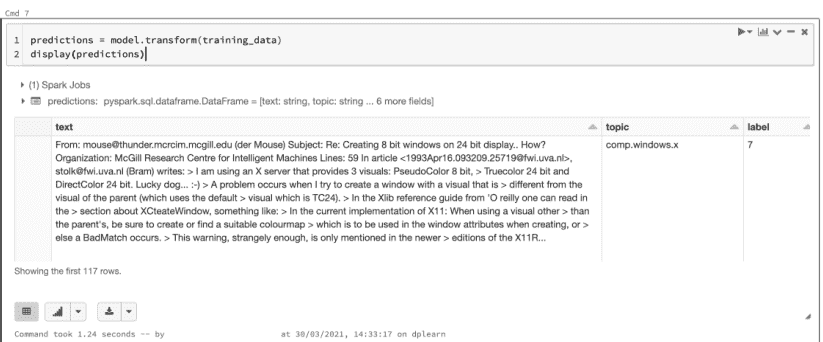
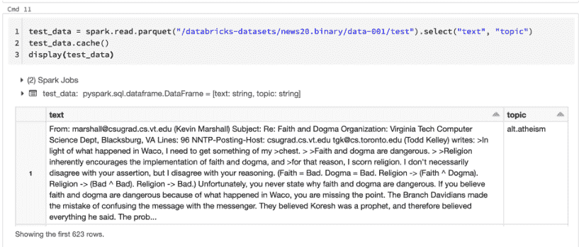
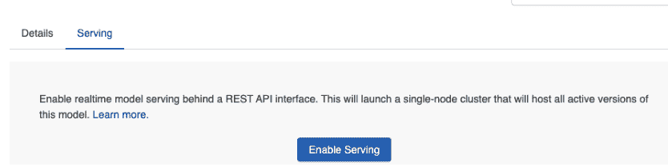

Managing and Serving Models with MLflow and MLeap

在上一章中，我们学习了如何在 Azure Databricks 中微调创建的模型。下一步是如何有效地跟踪和使用我们训练的模型。软件开发有明确的方法来跟踪代码，具有暂存或生产版本代码等阶段以及通用代码生命周期管理流程，但将此应用于机器学习模型并不常见。其原因可能各不相同，但一个原因可能是数据科学团队遵循自己的方法论，这可能更接近学术界而不是软件生产，以及机器学习没有明确定义的开发生命周期方法。我们可以在 Azure Databricks 中将软件中常用的方法论应用于机器学习模型。

本章将重点探讨我们部署的模型和流程如何用于推理。为此，我们必须提供一种打包所用管道的方法，并弄清如何部署它们以提供预测。我们将使用 MLflow 库更详细地研究这一点，MLflow 是一个开源平台，集成到 Azure Databricks 中，允许我们管理从训练到部署的整个端到端机器学习模型生命周期。

MLflow 允许您跟踪机器学习训练过程。训练过程称为 *experiment*，我们可以访问之前的实验以记录和比较参数，集中模型存储，并将模型作为 **REpresentational State Transfer (REST) application programming interface (API)** 部署。我们将学习如何将 MLflow 与上一章中学到的工具结合使用。示例将重点关注机器学习算法训练过程的跟踪和记录，以及如何部署和管理模型并对其应用版本控制。

我们将探索的概念如下：

- Managing the machine learning models
- Model Registry example
- Exporting machine learning pipelines using MLEap
- Serving models with MLflow

在深入这些概念之前，让我们先回顾一下执行此处所示示例的技术要求。

## Technical requirements

要在此章中练习给出的示例，您需要以下内容：

- An Azure Databricks subscription
- An Azure Databricks notebook attached to a running cluster with Databricks Runtime for Machine Learning (Databricks Runtime ML) with version 7.0 or higher

## Managing machine learning models

正如我们之前看到的，在 Azure Databricks 中我们可以使用 MLflow Model Registry，它是一个开源平台，用于管理机器学习或深度学习模型的完整生命周期。它允许我们直接管理具有时间顺序血缘、模型版本控制和阶段转换的模型。它为我们提供了诸如 Experiments 和 Runs 等工具，允许我们快速可视化训练运行和超参数优化的结果，并维护适当的模型版本控制，以跟踪我们可用于服务的模型，并在必要时快速更新当前版本。

MLflow 在 Azure Databricks 中有一个 Model Repository 用户界面 (UI)，我们可以在其中设置我们的模型以响应推理的 REST API 请求，在阶段之间转换模型，并可视化与模型关联的指标和非结构化数据，例如描述和注释。它使我们能够通过 Model Registry API 或直接从 Model Registry UI 管理我们的模型：



Figure 11.1 – Models in the MLflow registry

在本节中，我们将学习 MLflow 的核心概念并强化我们在前几章中看到的一些方法。

在我们深入了解如何在 MLflow 中管理模型的具体方法之前，让我们先看看与模型相关的核心概念，如下：

- **Model**：这是实际的 MLflow 模型，它使用 mlflow.[model-flavor].log_model 方法从实验或运行中记录到注册表中，之后可以注册到 Model Registry。
- **Registered Model**：这是一个首先记录到 Model Registry 然后在模型存储库中注册的模型。它应具有唯一名称，并具有版本、血缘和其他相关工件等属性。
- **Model Stage**：MLflow 中的模型可以处于一个或多个可分配给它的可用阶段。阶段的可用选项为 None、Staging、Production 和 Archived。任何具有适当读写权限的用户都可以将模型在阶段之间转换。
- **Model Version**：这表示模型提交到存储库的次数。这意味着当我们注册模型时，它会被分配版本 1，每次使用相同名称注册模型时，版本都会递增。


- **Activities:** 模型所经历的每个事件，例如阶段转换、新版本被注册等。这使我们能够在整个生命周期中更详细地跟踪模型。
- **Description:** 我们可以添加到模型上的非结构化元数据，以便更好地了解模型的用途，以及与其开发或使用相关的任何其他数据。

通过对 Azure Databricks 中 MLflow Model Registry 模型基本概念的这一非常简要的描述，我们可以开始学习如何注册模型、在阶段之间转换它，以及如何使用注册表中的可用模型。这些概念将在下一节中更详细地展示。

## 使用 MLflow notebook 实验

正如我们在前几节中看到的，在 Azure Databricks notebook 中使用 MLflow `mlflow.start_run()` 会将运行中使用的指标和参数作为活动实验记录下来。每个实验都有一个 run ID，这是一个唯一的数字标识符。我们可以通过单击 notebook 工具栏中的 Experiment 按钮来可视化 notebook 实验及其对应的运行。这将向我们展示运行参数和相关指标。我们也有下载运行中使用的所有相关工件的选项。

我们无法删除 notebook 实验，因为它们是 notebook 本身的一部分。这一点很重要，因为如果我们使用 `MLflow Client.tracking.delete_experiment()`，它也会删除 notebook 本身。

所有 MLflow 运行都将被记录到活动实验中。如果没有活动实验，Azure Databricks 将创建一个新的。我们可以通过以下方式设置要记录工件的活动实验：

- 使用 `mlflow.set_experiment()` 指定要记录运行的实验
- 将实验 ID 设置为 `mlflow.start_run()` 命令的参数
- 设置名为 `MLFLOW_EXPERIMENT_NAME` 或 `MLFLOW_EXPERIMENT_ID` 的环境变量

如果我们未指定任何实验，运行将被记录到 notebook 实验中。

值得注意的是，MLflow 中有两种类型的实验，概述如下：

- **Workspace experiment**: 这与任何 notebook 都没有关联。任何作业或 notebook 都可以通过指定 workspace 实验 ID 将运行记录到其中一个实验中。
- **Notebook experiment**: 这与特定 notebook 相关联，并且是在未将实验 ID 作为运行参数传递时的默认选项。只有该特定 notebook 内的 MLflow 运行才能记录到 Notebook 实验中。

Workspace 实验可以在 Azure Databricks Workspace UI 中创建，也可以通过使用 MLflow API 创建：

- 我们可以使用实验的运行来查询其上使用的指标和参数。例如，如果我们想查询实验中 **R-squared (R2)** 指标大于 0.3 的运行，我们可以进入 Notebook 工具栏中 Experiment 选项卡的 Search Runs 字段并输入以下表达式：

```
metrics.r2 > 0.3
```

- 以类似的方式，我们可以使用以下语法筛选具有特定参数集的运行：

```
params.max_depth = 4
```

```
params.max_depth = 4 AND metrics.accuracy > 0.8
```

- 你也可以选择通过在 Search Runs 框中使用 Filter 选项，根据模型的状态或版本筛选运行。你可以访问包含 State 和 Linked models 的下拉菜单。
- 我们可以通过以下方式跟踪用于运行的 Notebook 或 Git 项目的版本：

  a) 如果该运行是由 Azure Databricks notebook 或作业创建的，我们可以单击运行的 **Source** 字段。

  b) 如果运行是由 Git 项目创建的，运行的 **Source** 字段将是用于触发运行的 Git 项目分支的链接。

- 最后，如果是 workspace 实验并且运行已记录到该实验中，模型将显示为可在 Model Registry UI 中注册模型页面下载的工件。

现在我们对实验和运行的概念有了更多的了解，我们将在下一节中学习如何在 Azure Databricks 中注册和管理机器学习或深度学习模型的生命周期。

## 使用 MLflow API 注册模型

如前所述，我们有多种方式可以在 MLflow Model Registry 中注册模型。我们可以非常简单地使用 MLflow API 通过使用 `mlflow.[model-flavor].log_model` 方法来记录并注册模型到注册表中。如果没有以相同名称注册过其他模型，它将返回一个 ModelVersion MLflow 对象，并将此第一个模型命名为 Version 1。如果我们已有同名模型，它将增加模型版本并返回模型的新当前版本：

- 以下代码片段中展示了一个示例，使用 Azure Databricks 中的 Python MLflow API：

```
with mlflow.start_run(run_name=<run-name>) as run:
    <train and evaluate the model>
    mlflow.<model-flavor>.log_model(<model-flavor>=<model>,
        artifact_path="<model-path>",
        registered_model_name="<model-name>"
    )
```

- 我们也可以在实验中的训练结束后，使用指定的模型名称注册模型。这在我们开发了多个模型并且想将其中一个特定模型注册到注册表时特别有用。我们可以通过使用 `mlflow.register_model()` 方法并将模型路径作为参数传递来实现。可以通过以下方式完成：

```
result_model=mlflow.register_model(
"runs:<new_model_path>",
"<model-to-update-name>")
```

如果我们已有同名模型，这将更新模型的版本；否则，它将创建一个新模型并命名为 Version 1。

- 此外，我们还可以使用 MLflow `create_registered_model()` 方法创建新的注册模型，如以下代码片段所示。虽然这种方法与之前的方法类似，但如果模型已在 Model Registry 中存在，此方法将引发 `MlflowException` 错误：

```
client = MlflowClient()
result = client.create_registered_model("<model-name>")
```

现在我们已将模型注册到 MLflow Model Registry 中，我们可以控制模型的状态。我们将在下一节中了解如何做到这一点。

## 转换模型阶段

我们之前提到过，可以为模型分配多个阶段。具体来说，这些阶段是 None、Staging、Production 和 Archived。与其他数据工程环境中常见的情况一样，Staging 阶段是所有处于实验或测试阶段的模型所在的位置，而 Production 阶段则是所有经过测试并现正被生产流程消费的模型所在的位置。最后，Archived 阶段是我们放置已被更新版本取代或计划删除的模型的位置。模型的阶段不是排他的，因此一个模型可以属于多个阶段。

任何具有适当权限的用户都可以请求将模型转换到另一个阶段，但如果你拥有完全权限，你可以无需中介完成此转换。如果你在此模型的权限不足，请求可以由具有更高访问权限的人进行审核。

你可以在 Model Registry UI 中看到有关转换模型的请求，如以下屏幕截图所示：



图 11.2 – 请求将模型移动到另一个阶段

我们将按如下方式开始转换：

1. 要在阶段之间转换模型，我们可以使用 Model Registry UI 或 MLflow API 以编程方式执行此操作。为此，我们可以使用 `transition_model_version_stage()` 方法，如以下代码片段所示：

```
client = MlflowClient()
client.transition_model_version_stage(
    name="<our_model>",
    version=<model-version>,
    stage="<target_stage>",
    description="<description>"
)
```


As mentioned before, we can pass the next possible values in the stage argument of the transition_model_version_stage() method:

- a) staging
- b) archived
- c) production
- d) none

2. The description parameter allows us to pass any relevant information regarding that model. For example, you can include what the purpose of the development of that model was or which kind of approach was taken when it was built, and why. We can just update the description of the model by using the MLflow update_model_version() method, as we can see in the following code example:

```
mlflow_client = MlflowClient()
mlflow_client.update_model_version(
    name="<model-name>",
    version=<model-version>,
    description="<updated_description>"
)
```

3. We can also just update the name of a registered model, using the MLflow client.rename_registered_model() method. Conceptually, we can do this in the following way:

```
mlflow_client=MlflowClient()
mlflow_client.rename_registered_model("<model-name>", "<new-name>")
```

4. If we are not sure about the model name and version that we want to update, we can always get a list of all registered models in the Model Registry by calling the MLflow client API list_model_versions() method, as is conceptually shown in the following code snippet:

```
from pprint import pprint
mlflow_client = MlflowClient()
all_models = [pprint(rm) for rm in mlflow_client.list_registered_models()]
```

5. If you want to find the current version of a specified model name and fetch all the details, we can use the MLflow client search_model_version() method, as illustrated in the following code snippet:

```
from pprint import pprint
ml_client= MlflowClient()
[pprint(mv) for mv in client.search_model_versions(f"name={model_name}")]
```

6. If we want to remove a specific model version, we can specify a list of versions that we want to delete and use the MLflow client delete_model_version() method. For example, if we wanted to delete versions 1 and 2 of the house_price_classifier model, we would run the following code:

```
client = MlflowClient()
versions = [1, 2]
for version in versions:
    client.delete_model_version(name="house_price_classifier", version=version)
```

In this section, we have gone through some of the most common methods to manage the model lifecycle with MLflow. The next section will be a full working example in which we will train a simple model, register it on the Model Registry, and use it to do inference on a new observation once it has been deployed.

## Model Registry example

In this section, we will go through an example in which we will develop a machine learning model and use the MLflow Model Registry to save it, manage the stages in which it belongs, and use it to make predictions. The model will be a Keras neural network, and we will use the Windfarm US dataset to predict the power output of wind farms based on parameters from weather conditions such as wind direction, speed, and air temperature. We will make use of MLflow to keep track of the stage of the model and be able to register and load it back again to make predictions:

- 1. First, we will retrieve the dataset that will be used to train the model. We will use the pandas read_csv() function to load directly from the Uniform Resource Identifier (URI) of the file in GitHub, as follows:

```
import pandas as pd
wind_farm_data = pd.read_csv("https://github.com/dbcuzumar/model-registry-demo-notebook/raw/master/dataset/windfarm_data.csv", index_col=0)
```

The dataset has predictive features such as the wind speed, direction, and air temperature taken every 8 hours, and as a target the total daily power output over a period of 7 years. Our objective will be to train a deep learning neural network to predict the power output of a farm given these predictive features.

2. After the data has been loaded into a Pandas DataFrame, we will split the data into training and validation data, as follows:

```
training_data = pd.DataFrame(wind_farm_data["2014-01-01":"2018-01-01"])
training_data_x = training_data.drop(columns="power")
training_data_y = training_data["power"]
validation_data = pd.DataFrame(wind_farm_data["2018-01-01":"2019-01-01"])
validation_x= validation_data.drop(columns="power")
validation_y = validation_data["power"]
```

3. The next step is to define a model that will be used to make predictions on new data. We will define a simple TensorFlow Keras model that we can use in the following way:

```
import tensorflow as tf
from tensorflow.keras.layers import Dense
from tensorflow.keras.models import Sequential
model = Sequential()
model.add(Dense(120,
    input_shape=( training_data_x.shape[-1],),
    activation="relu",
    name="hidden_layer"))
model.add(Dense(1))
```

4. We have defined a simple neural network with one single hidden layer of 120 neurons with a ReLU activation function. The output is a single dense layer of a single cumulative neuron. The next step is to compile the model, for which we will use mean-squared error (MSE) as the performance metric and Adam as optimizer, and fit it on the training data. To register the model into the MLflow Model Registry, we will use the MLflow with the mlflow.start_run() method and the mlflow.tensorflow.autolog() method to automatically capture all the model artifacts and parameters.

The code is shown in the following snippet:

```
import mlflow
import mlflow.keras
import mlflow.tensorflow
with mlflow.start_run():
    mlflow.tensorflow.autolog()
    model.compile(loss="mse", optimizer="adam")
    model.fit(training_data_x, training_data_y,
              epochs=100, batch_size=32,
              validation_split=.2)
    run_id = mlflow.active_run().info.run_id
```

5. This will start the training process, and you will see the results of each one of the epochs in the console, as follows:



Figure 11.3 – Tracking the training of the model using MLflow

The model has now been logged in to the MLflow Model Registry, and all the related artifacts and performance metrics can be tracked there. We can now register the model using the MLflow API or the Model Registry UI in the Azure Databricks workspace:

- 1. To create a new registered model using the API, we can use the mlflow.register_model() function. This way, we will create a new model with a Version 1 name. We will specify a path where the model will be stored and a model name to do this, as follows:

```
model_path = "wind_farm_model"
model_name = "power_output_forecast"
model_uri = f"runs:/{run_id}/model"
model_details = \
mlflow.register_model(model_uri=model_uri,
    name=model_name)
```

- 2. We can use MLflow not only to store the model artifacts but also to provide valuable context relating to the development of the model using descriptions and keeping lineage control, stating the model's version, as illustrated in the following code snippet:

```
from mlflow.tracking.client import MlflowClient
description="This model was trained as an example for the Azure Databricks book with data from US wind farms to predict the power output based on wind speed, direction and air temperature."
mflow_client = MlflowClient()
mflow_client.update_registered_model(
    name=model_details.name,
    description= description
)
```

Providing meaningful descriptions helps to keep track of the purpose of the context of the development of the model, provide details about its attributes and usage, and—particularly—explicit the algorithm that was used and the data source used in the training. Descriptions then can be used to do the following:

- a) Provide context that drives the development of the model.
- b) Mention the methodology used and algorithm selected.
- c) State differences between different versions of the same model.
- d) Provide a high-level description of the data sources and feature engineering methods applied.

Now that we have properly described the model registered in MLflow, we can set it to one of the available stages. To do this, you will need to have the proper permissions at the user or model level. As mentioned before, we can choose to place our model in the None, Staging, Production, or Archived stage.

3. To transition a model between stages, we can use the MLflow client API `update_model_version()` method. If you don't have the appropriate level of permission, you can create a request for a model stage transition using the REST API. We will transition our model to the Production stage in the following code example:

```
mflow_client.transition_model_version_stage(
    name=model_details.name,
    version=model_details.version,
    stage='Production',
)
```

This results in the following output:

```
Cmd 17
1 from mlflow.tracking.client import MlflowClient
2
3 mflow_client = MlflowClient()
4
5 mflow_client.transition_model_version_stage(
6     name=model_details.name,
7     version=model_details.version,
8     stage='Production',
9 )
```

Out[30]: <ModelVersion: creation_timestamp=1617109202500, current_stage='Production', description ='', last_updated_timestamp=1617109209073, name='power_output_forecast', run_id='23d4e110709446b48931ffe518cc6165', run_link='', source='dbfs:/databricks/mlflow-tracking/197254732634776/23d4e110709446b48931ffe518cc6165/artifacts/model', status='READY', status_message='', tags={}, user_id='7882912336567795', version='4'>

Figure 11.4 – Transitioning the stage of a model


4. 我们可以使用 MLflow 客户端 API 的 `get_model_version()` 方法来验证当前模型的阶段为 Production，如下所示：

```
model_vs = mflow_client.get_model_version(
    name=model_details.name,
    version=model_details.version,
)
print(f"The current model stage is: '{ model_vs.current_stage }'"
```

5. 模型现在已在 Model Registry 中处于 Production 阶段，因此我们可以使用它来利用新数据预测风电场的功率输出。我们将加载指定阶段的最新版本模型并用它在验证数据上进行预测，如下所示：

```
from mlflow.tracking.client import MlflowClient
mflow_client = MlflowClient()
model_name = "power_output_forecast"
model_stage = 'Production'
model_version = mflow_client.get_latest_versions(model_name, stages=[model_stage])[0].version
model_uri = f"models:/{model_name}/{model_stage}"
model = mlflow.pyfunc.load_model(model_uri)
power_predictions = pd.DataFrame(model.predict(validation_x))
power_predictions.index = pd.to_datetime(weather_data.index)
print(power_predictions)
```

MLflow 注册表通过跟踪模型的版本，使我们能够对不同阶段的模型建立血缘关系。我们可以在流行的机器学习和深度学习框架（如 scikit-learn 和 TensorFlow）中训练和开发新模型，并以非常简单的方式将它们部署到 staging 或 production 环境中。此外，MLflow 库确保在我们将模型转换到不同阶段或创建新版本后，应用程序代码仍能正常工作。

在本示例中，我们简要展示了如何在 Azure Databricks 中创建新的 TensorFlow Keras 模型并使用 Python 以编程方式通过 MLflow Model Registry 管理其生命周期是多么简单。

在下一节中，我们将使用流行的 scikit-learn 框架创建功率预测模型的新版本，在 Staging 中执行模型测试，并通过将新模型版本转换到 Production 来更新生产模型。

## 使用 MLeap 导出和加载管道

当我们训练机器学习或深度学习模型时，我们的意图是能够多次使用它来预测数据的新的观测值。为此，我们不仅必须能够存储模型，还必须能够将其重新加载到一个或多个平台中。因此，我们需要将模型序列化以供将来评分或预测使用。

MLEap 是用于序列化并执行在流行框架（如 Apache Spark、scikit-learn 和 TensorFlow）中创建的机器学习和深度学习管道的常用格式。它通常用于进行单次预测而不是批量预测。这些序列化管道称为 bundles，可以导出为模型，并在以后加载并部署回 Azure Databricks 以进行新的预测。

在本节中，我们将学习如何使用 MLEap 导出并重新加载一个 DecisionTreeClassifier MLlib 模型，以便在 Azure Databricks 中使用保存的管道进行预测。我们将遵循的步骤如下：

- 我们将创建一个使用 MLlib 模型构建的管道并对其进行拟合。
- 我们将使用 MLEap 将管道序列化并导出为 ZIP 文件并保存它。
- 我们将重新加载序列化的模型并使用它对新的未见数据进行预测。

需要注意的是，MLEap 已包含在 Azure Databricks Runtime ML 中，因此如果您使用的是通用运行时，您需要在集群或笔记本级别从 Maven 仓库安装 MLEap-Spark 包，以及作为 PyPi 包的 MLflow，以便跟踪实验运行并能够将模型也保存到 MLflow Model Registry 中：

1. 第一步将是创建我们稍后将序列化和重用的管道。我们将创建一个 MLlib DecisionTreeClassifier，用于预测可在 Azure Databricks 中获得的 News 示例数据集的标签。我们将首先通过运行以下代码读取用于训练模型的数据并将其缓存到工作节点的内存中：

```
training_data = spark.read.parquet("/databricks-datasets/news20.binary/data-001/training").select("text", "topic")
training_data.cache()
```

2. 数据缓存后，我们可以将其可视化并显示 Spark 数据帧的架构，如下所示：

```
display(training_data)

training_data.printSchema()
```

3. 我们模型的目的是根据我们拥有的训练数据推断新条目的主题。你可以在以下屏幕截图中看到架构的第一行：



图 11.5 – 训练数据架构和第一行

4. 数据加载后，我们可以定义管道。我们必须应用特征工程，将作为输入的非结构化文本数据转换为 DecisionTreeClassifier MLlib 模型可以消费的数值特征。为此特征工程，我们将使用 StringIndexer、Tokenizer 和 HashingTF PySpark 转换器，使用词频-逆文档频率（TF-IDF）方法从文本中提取特征。我们将通过定义用于提取特征的预处理函数来开始定义管道，如下所示：

```
from pyspark.ml.feature import StringIndexer, Tokenizer, HashingTF

label_indexer = StringIndexer(
inputCol="topic",
outputCol="label",
handleInvalid="keep")
tokenizer = Tokenizer(inputCol="text",
                    outputCol="words")
hashing_tf = HashingTF(inputCol="words",
                       outputCol="features")
```

5. 接下来，我们可以定义将要使用的模型。如前所述，我们将使用 MLlib DecisionTreeClassifier，因为它支持多标签分类。以下是我们将用于定义模型的代码：

```
from pyspark.ml.classification import DecisionTreeClassifier
classifier = DecisionTreeClassifier()
```

6. 现在，我们可以非常简单地将 MLlib 管道定义为特征提取操作和我们选择的分类模型的串联，如下所示：

```
from pyspark.ml import Pipeline
pipeline = Pipeline(stages=[label_indexer, tokenizer,
                           hashing_tf, dt])
```

7. 下一步是训练并调优我们刚刚定义的管道。为此，我们将使用 CrossValidator MLlib 类来微调 TF-IDF 过程中使用的特征数量。在以下代码块中，我们将为提取的特征数量定义参数网格，并定义要在管道上运行的交叉验证：

```
from pyspark.ml.evaluation import MulticlassClassificationEvaluator
from pyspark.ml.tuning import CrossValidator, ParamGridBuilder
hyperparam_grid = ParamGridBuilder().addGrid(
hashing_tf.numFeatures, [500, 750, 1000]).build()
cv = CrossValidator(estimator=pipeline,
evaluator=MulticlassClassificationEvaluator(),
estimatorParamMaps=hyperparam_grid)
```

8. 接下来，我们将在训练数据上拟合 CrossValidator 并为指定的超参数搜索空间保存找到的最佳模型，如下所示：

```
cv_model = cv.fit(training_data)
model = cv_model.bestModel
```

9. 最后，我们可以使用模型对数据进行预测，如以下屏幕截图所示：



图 11.6 – MLflow 日志显示模型正在被跟踪

10. 在这里，我们将模型应用于用于训练它的数据，如下所示：

```
predictions = model.transform(training_data)
display(predictions)
```

这会产生以下输出：



图 11.7 – 文本主题的预测

到目前为止，我们还没有引入任何重大复杂性，我们的模型仍然只在当前环境中可用。我们仍然需要将此管道转换为可以导出到其他环境以对新数据进行预测的序列化 bundle。


11. 我们将使用 MLeap 将模型序列化为单个 ZIP 文件。我们将创建一个目录来保存我们序列化的模型，如以下代码片段所示：

```
%sh
mkdir /tmp/mleap__serialized_pipeline
```

12. 目录创建完成后，我们可以使用 SimpleSparkSerializer MLeap 函数序列化模型，如下所示：

```
import mleap.pyspark
from mleap.pyspark.spark_support import SimpleSparkSerializer
model_path="/tmp/mleap__serialized_pipeline"
model_filename="serialized_pipeline.zip"
model_uri=f"jar:file://{model_path}/{model_filename}"
model.serializeToBundle(model_uri, predictions)
```

现在，MLlib 管道已序列化为单个 ZIP 文件 bundle。请务必记住，当序列化 bundle 为 ZIP 文件时，模型 URI 必须以 jar:file 开头并以 zip 结尾。

13. 作为下一步，我们将把文件从临时目录复制到 Databricks 文件系统中的位置。这样，我们将模拟从诸如 MLflow 的模型注册表或 Blob 或数据湖存储中获取序列化 ZIP 文件 bundle 的情况。要将文件从临时目录复制到 Databricks 文件系统，我们可以使用 dbutils 工具，如以下代码片段所示：

```
dbutils.fs.cp(f"file://{model_path}/{model_filename}", f"dbfs:/data/{model_name}")
display(dbutils.fs.ls("dbfs:/data"))
```

14. 在实现的下一部分中，我们将加载并反序列化管道。我们可以在不同的执行上下文中使用它，从而使我们能够使用序列化管道进行新的预测。我们可以加载刚刚序列化并保存在 Databricks 文件系统中的管道，如以下代码片段所示：

```
from pyspark.ml import PipelineModel
model_path="/tmp/mleap__serialized_pipeline"
model_filename="serialized_pipeline.zip"
```

```
model_uri=f"jar:file:{model_path}/{model_filename}"

deserialized_pipeline = PipelineModel.
    deserializeFromBundle(model_uri)
```

我们已加载并反序列化了管道，现在它可用于对未见数据进行预测。这在我们使用 Spark 环境训练模型，但之后该管道需要在非 Spark 应用程序中使用时尤其有用。如果您打算仅使用 Spark 进行预测，建议使用 MLlib 内置方法来持久化和加载模型。

15. 让我们加载一些测试数据以使用反序列化管道进行预测。我们将加载并显示示例 News 数据集的测试部分，如下所示：

```
test_data = spark.read.parquet("/databricks-datasets/news20.binary/data-001/test").select("text", "topic")
test_data.cache()
display(test_data)
```

16. 现在，我们将使用反序列化管道对测试数据进行预测，如下所示：

```
predictions = deserialized_pipeline.transform(test_data)
display(predictions)
```

17. 如以下屏幕截图所示，我们能够通过传递与用于拟合管道的数据具有相同模式的新数据来获得预测：



当我们打算在 Spark 环境之外运行预测时，MLeap 序列化很有用，因为它将整个管道打包到序列化 ZIP 文件格式 bundle 中。运行预测的应用程序应基于 Scala 或 Java，因为 MLeap 具有基于其自身类型的数据帧的格式，称为 LeapFrames。作为最后一个概念，我们可以将 MLeap 视为用于序列化机器学习模型的 MLflow 格式的替代方案。

下一节将介绍如何使用 MLflow 在 Azure Databricks 上提供模型示例。

## 使用 MLflow 提供模型

在 Azure Databricks 中使用 MLflow 作为机器学习模型的存储库的好处之一是，它允许我们将来自模型注册表的预测作为 REST API 端点轻松提供。这些端点会在每个阶段的模型更新时自动更新，因此这是使用 MLflow 模型注册表跟踪模型生命周期的补充功能。

启用模型作为 REST API 端点提供可以从 Azure 工作区中的模型注册表 UI 进行。要启用模型提供，请转到模型注册表 UI 中的模型页面并单击提供选项卡中的启用提供按钮。

单击按钮后，如以下屏幕截图所示，您应该会看到状态为待处理。几分钟后，状态将更改为就绪：



图 11.9 – 启用模型的提供

如果您想禁用模型的提供，可以在注册模型的页面上的提供选项卡上单击停止按钮。

要向已部署的模型发出请求，我们需要知道其唯一的 URI。已部署模型的 URI 也取决于模型的版本，因此生成的 URI 类似于这样：

```
<databricks-instance>/model/<registered-model-name>/<model-version>/invocations
```

如果我们有一个名为 house_classifier 的模型，并且我们想知道该模型版本 3 的 URI，代码将如下所示：

```
https://<your_databricks-instance>/model/house_classifier/3/invocations
```

如果该模型分配了特定阶段，则它也包含在端点的 URI 中。例如，前一个模型的生产阶段将具有如下的 URI 端点：

```
https://<your_databricks-instance>/model/house_classifier/Production/invocations
```

您可以在 MLflow UI 中注册模型的提供页面上的模型版本选项卡顶部看到提供模型的可用 URI 列表。

您可以通过向其中一个可用端点发出 REST API 请求或使用 Azure 工作区中的模型提供 UI 来测试已部署的模型。

Azure Databricks 在启用注册模型提供时会创建唯一的集群，并部署除已归档版本之外的所有模型版本。如果发生任何错误，Azure Databricks 将重新启动集群，如果您禁用提供，它将终止集群。如前所述，当我们更新正在提供的模型的版本时，该模型提供也会自动更新。为了能够查询这些端点，我们只需使用生成的 Databricks 访问令牌对自己进行身份验证即可。

MLflow 模型提供旨在用于低吞吐量且非关键，使用限制为每个请求 16 兆字节 (MB)。对于需要更高吞吐量的应用程序，您应考虑使用批量预测。使用的集群都是通用集群，因此它们将具有与这些集群相同的可扩展性配置。

请注意，即使不存在活动的模型版本，集群也会被维护，因此如果注册的模型不再需要，您应始终禁用其提供。

## 对模型进行评分

对 MLflow 已部署模型进行评分的最直接方法是测试模型在提供 UI 中。在那里，您可以插入结构化为 **JavaScript Object Notation (JSON)** 格式的数据并使用它通过单击发送请求按钮来测试模型。这样，我们可以确保模型返回有效的预测。

下一步显然是通过向可用端点发出 REST API 请求来使用此模型所做的预测。

例如，我们可以使用 curl bash 命令向模型发出请求。例如，对于给定的模型，我们可以按以下代码片段所示结构化请求：

```
curl -X POST -u token:$DATABRICKS_API_TOKEN $MODEL_VERSION_URI \
  -H 'Content-Type: application/json' \
  -d '[\n    {\n        "sepal_length": 4.2,\n        "sepal_width": 3.1,\n        "petal_length": 2.1,\n        "petal_width": 0.1\n    }\n]'
```

在此示例中，我们将请求传递给在 Iris 数据集上训练的简单分类器。您应将端点中的 DATABRICKS_API_TOKEN 和 MODEL_VERSION_URI 占位符分别替换为您生成的 Databricks API 令牌和模型 URI。

在这里，我们将 JSON 作为键值结构化数据传递并从模型端点接收响应。

我们也可以使用 Python 以编程方式执行此操作。在下一个示例中，我们将使用 Pandas DataFrames 和 NumPy 数组向端点发出请求：

- 1. 首先，我们将定义一个函数来将数据序列化为 JSON，如下所示：

```
import numpy as np
import pandas as pd
def create_tf_serving_json(data):
```


return {'inputs': {name: data[name].tolist() for name in data.keys()} if isinstance(data, dict) else data.tolist()}

2. 然后，我们可以使用将传递给模型进行预测的数据创建一个 Pandas 数据框，如下所示：

```
data = pd.DataFrame([{
    "sepal_length": 4.2,
    "sepal_width": 3.1,
    "petal_length": 2.1,
    "petal_width": 0.1
}])
```

3. 现在，我们可以将此数据序列化为 JSON 并作为 POST 请求发送到模型端点，如下所示：

```
import requests
headers = {
    "Authorization": f"Bearer {databricks_token}",
    "Content-Type": "application/json",
}
data_json = data.to_dict(orient='records')
response = requests.request(method='POST',
                            headers=headers,
                            url=model_uri,
                            json=data_json)
if response.status_code != 200:
    raise Exception(f"Request failed with status {response.status_code}, {response.text}")
print(response.json())
```

这样，我们就可以使用 Pandas 数据框对模型进行评分，但我们也可以使用 NumPy 数组，因为两者都具有将数据序列化为字典的方法，这些字典可以轻松转换为 JSON 格式。

4. 在这里，我们将数据作为 NumPy 数组传递：

```
data = np.array([[5.1, 3.5, 1.4, 0.2]])
data_json = create_tf_serving_json(data)
response = requests.request(method='POST',
                            headers=headers,
                            url=model_uri,
                            json=data_json)
if response.status_code != 200:
    raise Exception(f"Request failed with status {response.status_code}, {response.text}")
print(response.json())
```

在模型注册表 UI 的 **Serving** 选项卡中，您将被提示提供服务集群的状态以及可用的各个模型版本的数据及其 URI。您可以在 **Model Events** 选项卡中检查集群的状态，该选项卡还保存与该模型关联的所有事件的数据。您也可以在 **Model Versions** 选项卡中查询特定版本事件。

## Summary

机器学习模型的开发过程可能是一项复杂的工作，因为该学科本身具有混合背景，并且通常与常见的软件开发生命周期脱节。此外，如果我们无法导出用于提取数据特征的预处理管道，在将模型从开发转移到生产时，我们将遇到问题。

正如本章所述，我们可以使用 MLflow 来管理模型生命周期并对使用的模型应用分级和版本控制，并有效地序列化预处理管道以用于预处理待推断的数据。

在下一章中，我们将探讨分布式学习的概念，这是一种可以将深度学习模型的训练过程有效地分发给许多工作者的技术。
