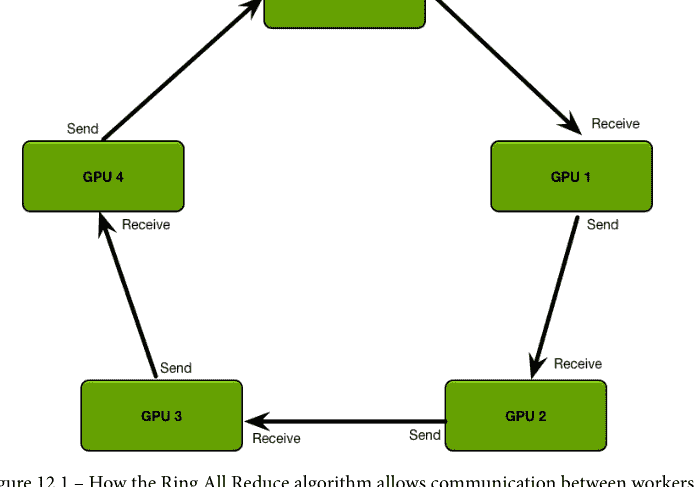
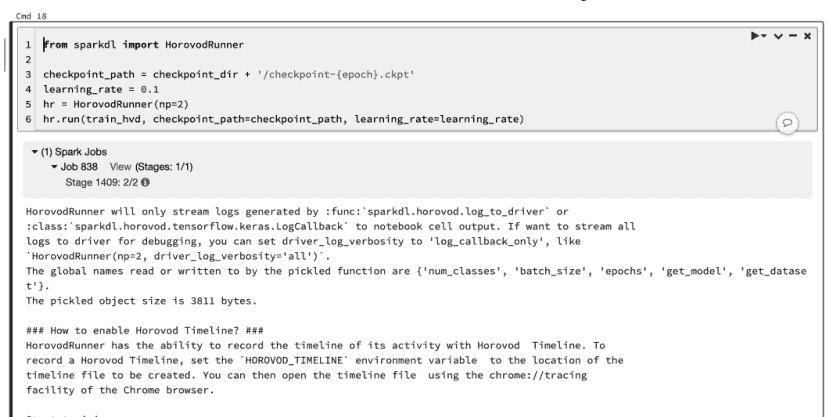
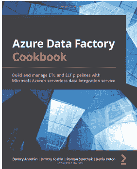
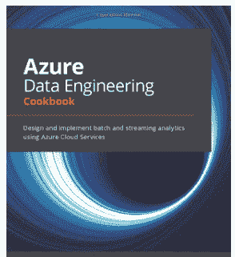

## 12 Distributed Deep Learning in Azure Databricks

在上一章中，我们学习了如何在 Azure Databricks 中有效地序列化机器学习管道并管理机器学习模型的完整开发生命周期。本章将重点介绍如何在 Azure Databricks 中应用分布式训练。

深度学习模型的分布式训练是一种将训练过程分布在计算机集群中的工作者中的技术。此过程并不简单，其实现需要我们微调工作者之间通信和传输数据的方式，否则分布式训练可能比单机训练花费更长时间。Azure Databricks Runtime for Machine Learning 包含 Horovod，这是一个库，可以让我们解决分布式训练深度学习算法时出现的大多数问题。我们还将展示如何利用 TensorFlow 机器学习框架的原生 Spark 支持在 Azure Databricks 中训练深度学习模型。

本章中我们将介绍的概念如下：

- Distributed training for deep learning
- Using the Horovod distributed learning library in Azure Databricks
- Using the Spark TensorFlow Distributor package

在深入研究这些概念之前，让我们先了解一下执行此处所示示例的要求。

## Technical requirements

在本章中，我们将使用与数据科学和优化任务中的常见主题相关的概念和工具。我们假设您已经很好地理解了诸如神经网络和超参数调优之类的概念，并且对 TensorFlow、PyTorch 或 Keras 等机器学习框架也有一般了解。

在本章中，我们将讨论各种技术，以便使用 Azure Databricks 分布和优化深度学习模型的训练，因此如果您不熟悉这些术语，建议您查阅 TensorFlow 文档，了解神经网络是如何设计和训练的。

为了在该章中处理给出的示例，您需要以下内容：

- An Azure Databricks subscription.
- An Azure Databricks notebook attached to a running cluster with Databricks Runtime ML version 7.0 or higher.

## Distributed training for deep learning

深度神经网络（DNNs）在过去几十年里推动了人工智能（AI）在计算机视觉和神经网络处理等领域的发展。这些网络每天都被应用于解决各种用例中的挑战。

为了扩展模型性能，有必要开发具有数百万个可训练参数的复杂模型架构，使得训练所需的计算成为一项资源密集型操作。随着用于训练模型的可获得数据量的增加，我们需要扩展深度学习模型的训练管道，以便能够使用这些可用数据。

通常，为了训练 DNN，我们需要遵循以下三个基本步骤，如下所示：

- 1. 将数据通过网络的层传递以计算模型损失，此操作称为前向传播。
- 2. 将此损失从输出层反向传播到第一层以计算梯度。
- 3. 我们使用计算出的梯度来更新训练过程中模型权重的优化步骤。

DNN 训练过程的可扩展性可以通过以下两种方式实现：

- Using data parallelization
- Using model parallelization

数据并行化策略涉及将模型复制到每个可用工作者中并进行拟合，使用分配的数据部分。之后，工作者之间相互通信，以便正确更新模型的权重，使用平均计算的梯度。

尽管听起来很简单，但实现起来可能相当复杂，如果操作不当，由这种方式带来的复杂性完全会抵消分布式训练带来的性能提升。

现代神经网络在过去十年中发展迅速。图像处理中使用的一些架构具有数百万个参数，需要在大量数据上进行训练。这种计算密集型的训练过程导致了将过程并行化到多个工作者中的技术的发展。

随着用于训练模型的数据量的增加，我们可以增加运行计算的工作者数量。通常，工作者接收神经网络的副本，并且小批量数据被分发给每个工作者以根据训练数据批次计算梯度。这些梯度被平均以重新计算神经网络的新权重。

当数据增加且模型具有数百万个可训练参数时，这些梯度可能在内存中占用数 GB 的空间，并且工作者之间的通信开始成为一个问题，因为我们达到了网络的最大带宽。


我们面临的另一个阻碍是，梯度通常的计算方式需要等待所有工作节点的梯度都计算完毕。解决这一问题的另一种方法是引入运行梯度异步计算的算法，但这些算法通常很难调试。

这时，源自高性能计算的一种技术——*ring allreduce* 技术派上了用场。它允许我们通过利用最优带宽 ring allreduce 来提高神经网络训练过程的性能。

## The ring allreduce technique

随着我们引入新的工作节点来处理计算梯度规模的增加，我们开始注意到通信成本开始线性增长。我们可以配置工作节点之间的通信，以便找到利用可用带宽的最佳策略。为此，我们使用 ring all reduce，这是一种通信算法，其中通信成本无论引入多少个工作节点都保持恒定，并且仅取决于系统中最慢的连接。

`ring allreduce` 算法将工作节点按逻辑环排列，其中每个工作节点只能向其右邻居发送数据并从其左邻居接收数据。该算法在以下图表中有所描述：



Figure 12.1 – How the Ring All Reduce algorithm allows communication between workers

ring allreduce 算法分为两个步骤工作。首先，每个工作节点交换数据，使每个工作节点拥有结果的一部分，然后运行 allgather 操作，使所有工作节点都拥有完整的结果。

我们可以通过利用神经网络中梯度的固有计算过程来进一步改善工作节点之间的通信。

为了训练神经网络，我们首先运行前向传播，然后运行反向传播以计算神经网络各层的梯度，从输出层开始一直到输入层。因此，最先可用的梯度是来自输出层的梯度。我们可以利用这一过程，在所有梯度完成之前就发送梯度，以避免带宽使用峰值和与其它工作节点的通信重叠。这样，我们就克服了必须等待每个工作节点完成对神经网络所有层的梯度计算的不便。

这种方法的优点在于它与用于创建模型的网络架构和框架无关，并且允许我们更好地利用并行计算的力量来分布式训练深度学习模型。

horovod 库应用 ring allreduce 算法，以在 Azure Databricks 等分布式计算系统中实现深度学习网络的分布式训练。在下一节中，我们将学习如何利用 HorovodRunner 高效地训练深度学习模型。

## Using the Horovod distributed learning library in Azure Databricks

horovod 是一个用于分布式深度学习训练的库。它支持常用的框架，如 TensorFlow、Keras 和 PyTorch。如前所述，它基于 tensorflow-allreduce 库，并实现了 ring allreduce 算法，以便从单图形处理单元 GPU 训练轻松迁移到并行 GPU 分布式训练。

为此，我们将单 GPU 深度学习模型的训练脚本改编为在训练过程中使用 horovod 库。一旦我们改编了脚本，它就可以在单 GPU 或多 GPU 上运行，而无需更改代码。

horovod 库使用数据并行化策略，通过以优化的方式实现 ring allreduce 算法来克服通信限制，从而允许高效地将训练分布到多个 GPU 并行处理。

它以一种方式实现，即每个 GPU 获取一批数据以独立计算梯度。例如，如果我们有 32 的批大小和两个可用 GPU，每个 GPU 将接收 16 条记录的集合来计算梯度更新。这些梯度更新随后在所有可用 GPU 之间同步并取平均值，以便最终用于更新模型权重。

在对数据批次的每次训练运行中，horovod 遵循以下概述的过程来处理 GPU 之间的分布式计算：

- 每个工作节点接收模型的副本和数据集。
- 一旦收到开始信号，工作节点就会在分配的数据批次上计算梯度。
- 使用 ring allreduce 算法在 GPU 之间同步和平均计算的梯度。
- 所有工作节点使用计算出的平均梯度更新其模型的权重。

此操作最关键的方面之一是保持工作节点之间模型的一致性。如果模型以某种方式分歧，这将导致梯度计算不一致。这就是 ring allreduce 算法在高效同步表示模型可训练参数的张量方面发挥重要作用的地方。

为了开发可高效用于深度学习模型分布式训练的训练管道，一个常见的流程概述如下：

- 使用 Horovod 支持的框架之一，如 TensorFlow、Keras 或 PyTorch，为单机创建训练脚本。
- 添加 hvd.init() 函数以初始化 horovod 库。
- 使用 config.gpu_options.visible_device_list 选项选择其中一个可用 GPU 服务器。
- 使用 hvd.DistributedOptimizer 包装优化器，以在工作节点之间分发梯度下降计算。
- 使用 hvd.BroadcastGlobalVariablesHook() 分发初始变量状态，以确保所有工作节点模型随机权重的初始化一致。另一种选择是使用 hvd.broadcast_global_variables() 广播全局起始变量。
- 将代码设置为在 0 号工作节点保存检查点，以避免因重叠的读写操作导致数据损坏。
- 使用 HorovodRunner 包装一个单一的 Python 函数，该函数打包训练过程。

horovod 是 Azure Databricks Runtime for machine learning 中可用的库。在本章的下一节中，我们将学习如何使用它来分发深度学习模型的训练并有效并行化超参数调优。

作为示例，我们将展示如何修改代码以能够以分布式模式运行的构造。我们将使用 TensorFlow 模型的玩具模型示例。这假设我们有一个 TensorFlow v1 模型，我们希望将其作为分布式模型进行训练。步骤如下：

1. 为此，我们首先需要导入 TensorFlow 和 Horovod 并初始化 Horovod，如下所示：

```
import tensorflow as tf
import horovod.tensorflow as hvd
hvd.init()
```

2. 接下来，我们将 ping 将用于处理节点本地 rank 的 GPU，如下所示：

```
config = tf.ConfigProto()
config.gpu_options.visible_device_list = str(hvd.local_rank())
```

3. 在此之后，我们可以开始构建模型并定义将使用的损失函数。我们将抽象此点并假设您已经有一个要优化的损失函数。

4. 下一步是应用 Horovod 分布式优化器到所选优化器，以分发梯度计算的训练。作为示例，我们将定义一个 TensorFlow AdagradOptimizer 优化器，并将学习率设置为 Horovod 传递给工作节点的 size 大小的变量依赖项，一个用于控制学习率的参数。代码如下所示片段所示：

```
opt = tf.train.AdagradOptimizer(0.01 * hvd.size())
```

5. 现在，我们可以使用 Horovod 分布式优化器来包装所选优化器，如下所示：

```
opt = hvd.DistributedOptimizer(opt)
```


6. 在初始化期间添加一个钩子以从 rank 0 广播初始化变量到所有其他进程非常重要，这样才能复制依赖于随机初始化参数的结构，例如模型权重的初始化。执行此操作的代码在以下片段中说明：

```
hooks = [hvd.BroadcastGlobalVariablesHook(0)]
```

7. 此时，我们可以使用预定义的损失函数开始训练操作，如下所示：

```
train = opt.minimize(loss)
```

8. 我们需要指定仅在 worker 0 上保存的检查点，以防止其他 worker 之间重叠写入操作。我们运行以下代码来实现此目的：

```
checkpoint_dir = '/tmp/training_logs' if hvd.rank() == 0
else None
```

9. 现在，我们将使用 MonitoredTrainingSession 检查点来处理会话初始化、加载和保存到检查点以及在操作完成或发生任何错误时关闭所需的操作。此代码在以下片段中显示：

```
with tf.train.\
    MonitoredTrainingSession(checkpoint_dir=checkpoint_dir,
                            config=config,
                            hooks=hooks) as mon_sess:
        while not mon_sess.should_stop():
            mon_sess.run(tr)
```

这样，我们就可以修改 TensorFlow v1 训练脚本以使用 Horovod 进行分布式训练。在这里，Horovod 将动态修改每个 worker 中的批量大小和学习率，并随可用 worker 数量同步处理训练。hvd.DistributedOptimizer 优化器将负责在每个 worker 的数据批次上计算梯度，并根据平均梯度修改模型参数。

最后，我们确保广播所有初始化变量以确保 worker 之间模型的<|message|>一致性，并强制 rank 0 worker 写入检查点以防止检查点损坏。

在下一节中，我们将深入了解如何使用 Horovod 在 **中央处理单元 (CPU)** 或 GPU 集群中对深度学习模型进行分布式训练的更具体示例。

## 安装 horovod 库

`horovod` 库已预安装在 Azure Databricks Runtime for Machine Learning 中，因此在大多数情况下，除非您使用的是普通的 Azure Databricks Runtime，否则您无需安装它。尽管如此，有一点需要注意的是，如果您升级或降级用于构建模型的框架之一，例如 TensorFlow、Keras 或 PyTorch，您将需要重新安装 `horovod` 库并重新编译它。

在需要升级或降级其中一个框架的情况下，我们可能会遇到导入错误，表明 `horovod` 是在所需框架之前安装的，例如 TensorFlow、Keras 或 PyTorch。这是由于 Horovod 在安装期间编译，如果在安装期间未存在所需库，则不会编译。

如果我们重新安装了其中一个必需库，我们可以通过执行以下步骤来克服此问题：

- 1. 检查所需库是否已正确安装。
- 2. 使用 Python `pip` 卸载 `horovod`。
- 3. 使用 `pip` 安装 `CMake` Python 库。
- 4. 使用 Python `pip` 重新安装 `horovod`。

这样，我们可以确保 `horovod` 库是在所需框架安装后编译的。

一旦我们可以在环境中使用 `horovod` 库，我们将把注意力集中在可以利用的可用功能上，以便在 Azure Databricks 中高效地用于分布式训练。

## 使用 horovod 库

在本节中，我们将展示如何应用 `horovod` 以便在 **Modified National Institute of Standards and Technology (MNIST)** 数据集上使用 Keras TensorFlow **应用程序编程接口 (API)** 训练一个简单的分类器，然后调整代码以便以分布式方式进行训练。首先，我们将创建两个函数，分别用于创建数据集和构建模型。

为了跟踪运行和进程，horovod 库使用进程 ID 和进程数作为参数。这些参数是 rank 和 size，后续将由 HorovodRunner 用于跟踪和控制进程。

## 在单节点上训练模型

我们将创建一个函数，该函数将 rank 和 size 作为参数，并返回准备好用于训练模型的数据。此函数在单节点或分布式学习期间均有效。步骤如下：

- 1. 我们将使用 keras.datasets.mnist.load_data() 函数获取数据集，然后调整其大小并预处理，以便可以直接用于训练模型。请注意，在以下代码片段中，导入位于函数内部：

```
def get_dataset(num_classes, rank=0, size=1):
    from tensorflow import keras
    (x_train, y_train), (x_test, y_test) = keras.datasets.
    mnist.load_data('MNIST-data-%d' % rank)
    x_train, y_train = \
    x_train[rank:size],y_train[rank:size]
    x_test,y_test = x_test[rank:size],y_test[rank:size]
    x_train = x_train.reshape(x_train.shape[0], 28, 28, 1)
    x_test = x_test.reshape(x_test.shape[0], 28, 28, 1)
    x_train = x_train.astype('float32')/255
    x_test = x_test.astype('float32')/255
    y_train = keras.utils.to_categorical(y_train,
        num_classes)
    y_test = keras.utils.to_categorical(y_test,
        num_classes)
    return (x_train, y_train), (x_test, y_test)
```

此函数允许我们在节点上加载数据集并将其预处理为所需格式，以便传递给模型进行训练。

2. 下一步是定义一个用于创建将要训练的模型的函数。
我们将定义一个 Keras 卷积神经网络 (CNN)，在最大池化展平后和最终 softmax 层后添加 dropout。我们将使用 64 个神经元的隐藏密集层。请注意，在以下代码片段中，我们在函数内部进行了导入，以便稍后将模块导入到 worker：

```
def get_model(num_classes):
    from tensorflow.keras import models
    from tensorflow.keras import layers
    model = models.Sequential()
    model.add(layers.Conv2D(32, 3,
                        activation='relu',
                        input_shape=(28, 28, 1)))
    model.add(layers.MaxPooling2D())
    model.add(layers.Dropout(0.1))
    model.add(layers.Flatten())
    model.add(layers.Dense(64, activation='relu'))
    model.add(layers.Dropout(0.2))
    model.add(layers.Dense(num_classes,
                        activation='softmax'))
    return model
```

3. 现在，我们可以使用刚刚定义的函数在单节点上运行训练。我们将创建一个 train 函数，该函数既可以在单节点上执行，也可以在分布式 worker 集合上执行。请考虑学习率必须是函数中的参数，以便 Horovod 在分布式训练过程中控制每个 worker 的学习率。代码在以下片段中显示：

```
def train(learning_rate=0.1,
          batch_size = 64,
          epochs = 10,
          num_classes = 10):
    from tensorflow import keras
    (x_train, y_train), (x_test, y_test) = \
    get_dataset(num_classes)
    model = get_model(num_classes)
```

```
optimizer = keras.optimizers.Adadelta(lr=learning_rate)
model.compile(optimizer=optimizer,
                loss='categorical_crossentropy',
                metrics=['accuracy'])
model.fit(x_train, y_train,
          batch_size=batch_size,
          epochs=epochs,
          verbose=2,
          validation_data=(x_test, y_test))
return model
```

4. 现在，我们可以使用刚刚定义的函数在单节点上运行训练。为了获得训练好的模型，我们只需调用该函数并指定所需参数，如以下代码片段所示：

```
model = train(learning_rate=0.1,
              batch_size = 64,
              epochs = 10,
              num_classes = 10)
```

5. 该过程需要几分钟进行训练，之后模型将被返回，准备好使用。一旦过程完成，我们可以通过使用之前定义的 get_dataset() 函数在测试数据上计算模型准确度来测试它，如下所示：

```
_, (x_test, y_test) = get_dataset(num_classes)
loss, accuracy = model.evaluate(x_test, y_test,
                                batch_size=128)
print("loss:", loss)
print("accuracy:", accuracy)
```

我们现在可以在测试集上看到模型的损失和准确度，如以下屏幕截图所示：


```
num_classes = 10
_, (x_test, y_test) = get_dataset(num_classes)
loss, accuracy = model.evaluate(x_test, y_test, batch_size=128)
print("loss:", loss)
print("accuracy:", accuracy)
```

79/79 [==============================] - 1s 8ms/step - loss: 0.0808 - accuracy: 0.9752
loss: 0.08081278949975967
accuracy: 0.9751999974250793

Figure 12.2 – The loss and accuracy of the model in the test set

The way in which the get_dataset() and get_model() functions are designed made it easy not only to retrain on new parameters but also to be reusable when these are distributed to the nodes, which is what we will do in the next section.

## Distributing training with HorovodRunner

In order to distribute the training to the workers, we will start by creating a checkpoint location for HorovodRunner in the Databricks File System (DBFS) ml-fuse directory available in Azure Databricks Runtime for Machine Learning, as follows:

```
import os
import time
checkpoint_dir = '/dbfs/ml/MNISTDemo/train/{ time.time() }/'
os.makedirs(checkpoint_dir)
print(checkpoint_dir)
```

This directory is available to all the workers and it's optimized for machine learning I/O operations on training data. The directory can be seen in the following screenshot:

```
import os
import time
checkpoint_dir = f'/dbfs/ml/MNISTDemo/train/{ time.time() }/'
os.makedirs(checkpoint_dir)
print(checkpoint_dir)
```

/dbfs/ml/MNISTDemo/train/1617111715.7711205/

Figure 12.3 – The ml directory

The next step is to define a function that will adapt the training function we have previously defined to be able to be distributed to the workers. The function itself packs a lot of operations, therefore we can explain the steps that it follows as the following:

- 1. It imports the required modules into each of the workers.
- 2. It initializes horovod using the horovod.tensorflow.keras.init() function.
- 3. It pings the GPU to be used if the run is local and if there is a GPU available otherwise, it will skip this step.
- 4. It uses the get_dataset() and get_model() functions that were defined earlier for horovod to dynamically adjust the learning rate based on the available GPUs, rank, and size.
- 5. It applies the Horovod distributed optimizer in order to distribute and compute the gradients during the distributed training.
- 6. It creates a callback process to distribute the state variables from the rank 0 to all the other processes in order to ensure consistency of the worker model states when the process has randomly initiated weights.
- 7. It enforces to save the checkpoints in the 0 worker to prevent conflicts or corruption of data due to overlapping read/write operations.

We will define the Horovod training function for distributed training, as follows:

```
def train_hvd(checkpoint_path, learning_rate=1.0):
from tensorflow.keras import backend as K
from tensorflow.keras.models import Sequential
import tensorflow as tf
from tensorflow import keras
    import horovod.tensorflow.keras as hvd
    hvd.init()
    gpus = tf.config.experimental.list_physical_devices('GPU')
    for gpu in gpus:
        tf.config.experimental.set_memory_growth(gpu, True)
    if gpus:
        tf.config.experimental.set_visible_devices(gpus[hvd.local_rank()], 'GPU')
    (x_train, y_train), (x_test, y_test) = get_dataset(num_
```

```
classes, hvd.rank(), hvd.size()
    model = get_model(num_classes)
        optimizer = keras.optimizers.Adadelta(lr=learning_rate * hvd.size())
        optimizer = hvd.DistributedOptimizer(optimizer)
    model.compile(optimizer=optimizer,
                    loss='categorical_crossentropy',
                    metrics=['accuracy'])
    callbacks = [
        hvd.callbacks.BroadcastGlobalVariablesCallback(0),
    ]
    if hvd.rank() == 0:
        callbacks.append(keras.callbacks.ModelCheckpoint(
    checkpoint_path,
    save_weights_only = True))
    model.fit(x_train, y_train,
                batch_size=batch_size,
                callbacks=callbacks,
                epochs=epochs,
                verbose=2,
                validation_data=(x_test, y_test))
```

We will use this function in order to distribute the training to the workers. We will set an np parameter in HorovodRunner that relates to the specified number of parameters—a value that is dependent on the number of available workers. So, if we specify np=1, HorovodRunner will train on the driver node on a single-process execution.

In this example, we will set the np value to 2:

```
from sparkdl import HorovodRunner
checkpoint_path = checkpoint_dir + '/checkpoint-{epoch}.ckpt'
hr = HorovodRunner(np=2)
hr.run(train_hvd, checkpoint_path=checkpoint_path,
    learning_rate=0.1)
```

The process will be executed by HorovodRunner by transforming the defined functions to get the dataset and create the model, and then transform them into pickle files that will then be distributed to the workers, as illustrated in the following screenshot:



Figure 12.4 – Dataset transformed to pickle files

The workers in turn read and deserialize the functions and run them in order to train the model.

After the process has been completed, we can load the model trained by HorovodRunner and use it to run predictions on new data. We can use the Keras model that we have previously defined using the tf.train.latest_checkpoint() function to load the latest saved checkpoint file, as follows:

```
import tensorflow as tf
hvd_model = get_model(num_classes)
hvd_model.compile(optimizer=tf.keras.optimizers.
Adadelta(lr=learning_rate),
                loss='categorical_crossentropy',
                metrics=['accuracy'])
hvd_model.load_weights(tf.train.latest_checkpoint(os.path.dirname(checkpoint_path)))
```

We can test that the model has been correctly loaded by running predictions on the test dataset, as follows:

```
num_classes = 10
_, (x_test, y_test) = get_dataset(num_classes)
loss, accuracy = hvd_model.evaluate(x_test, y_test,
                                    batch_size=128)
print("loaded model loss and accuracy:", loss, accuracy)
```

In this way, and by making small but meaningful changes to the code, we have adopted a single machine-training script in order to be able to use it for distributed learning in Azure Databricks, running on both CPU and GPU clusters.

In the next section, we will learn how to leverage the advantages of the horovod library in order to tune the model's hyperparameter.

## Distributing hyperparameter tuning using Horovod and Hyperopt

As we have seen previously, we can improve the performance of the model by tuning the hyperparameter using Hyperopt. Hyperopt evaluated the best hyperparameter by generating trials for different points in the defined search space, using an adaptive strategy. The evaluations take advantage of the distributed nature of Azure Databricks.

The Hyperopt trials are evaluated on a single node while HorovodRunner is launched from the driver node, and distributes the training to the workers. We will learn how we can use HorovodRunner in order to increase the performance of the model tuning, using distributed learning to run the trials.

The first objective is to define a function that will be passed to HorovodRunner in order to run the distributed learning. To do this, we will define a function to minimize, specify a search space of hyperparameters, and use the Hyperopt fmin() function to tune the model. The change compared to the example in the previous section is that this training will be optimized to run a distribution, using HorovodRunner. The next train function is passed to the Hyperopt fmin() function, to be the target function to be minimized. It is configured to return a dictionary with key values named loss and Status, as required by the Hyperopt fmin() function.

Here, we are using the previously defined train_hvd() function:

```
from hyperopt import fmin, tpe, hp, Trials, STATUS_OK
from sparkdl import HorovodRunner

def wrap_train(params):
    hr = HorovodRunner(np=2)
    loss, acc = hr.run(train_hvd,
                        learning_rate=params['learning_rate'],
                        batch_size=params['batch_size'],
                        checkpoint_dir=checkpoint_dir)
    return {'loss': loss, 'status': STATUS_OK}
```

The next step is to define the search space over which we will scan for the best set of hyperparameters. Here, we will use the Hyperopt optimization algorithm to tune the learning rate and batch size:

```
import numpy as np
space = {
    'learning_rate': hp.loguniform('learning_rate',
                                   np.log(1e-4),
                                   np.log(1e-1)),
    'batch_size': hp.choice('batch_size', [32, 64, 128]),
}
```

Now that we have defined the objective function and the search space that will be scanned, we can use the Hyperopt fmin() function to run the hyperparameter optimization. While Hyperopt will take advantage of the parallel execution on each of the workers, the horovod library will distribute the process to each of the available workers.

To run the optimization, we must use the max_eval parameter in order to specify the number of points that will be evaluated for each defined test case in the search space, generating a model as a trial, and use it to evaluate the model in that point of the search space.


在这种情况下，我们将使用 `hyperopt.tpe.suggest` 作为搜索算法，它是 Tree of Parzen Estimator，一种自适应方法，会根据之前的結果选择要测试的超参数。基于此，我们可以通过运行以下代码块找到最佳参数：

```
best_param = fmin(
    fn=wrap_train,
    space=space,
    algo=tpe.suggest,
    max_evals=8,
    return_argmin=False,
)
```

一旦要最小化的目标函数得到优化，我们就可以打印出产生最佳模型的參數，如下所示：

```
print(best_param)
```

需要注意的一个重要点是，在 Hyperopt 的 `fmin()` 函数中，我们没有使用 `trials` 参数。这是因为当 Hyperopt 与 HorovodRunner 结合使用时，我们不需要传递 `trials` 参数，因为 Hyperopt 将使用默认的 Trials 类而不是 SparkTrials。这是因为 SparkTrials 类在分布式训练中不可用，因为评估是在单个节点上完成的。

在这个简单的示例中，我们扩展了 HorovodRunner 的功能，以便将其用于最初在单节点上训练的 CNN TensorFlow 模型的超参数调优。为此，我们创建了一个由 hyperopt 库最小化的目标目标函数，定义了基于我们想要扫描的超参数的搜索空间，并使用运行 Azure Databricks Runtime for Machine Learning 的两个工作节点的集群进行超参数调优。

下一节将介绍 Spark TensorFlow Distributor，这是一个允许我们在 Azure Databricks 中分发训练 TensorFlow 机器学习模型的库。

# 使用 Spark TensorFlow Distributor 包

深度学习中最常用的框架之一是 TensorFlow 库，它还支持在 CPU 和 GPU 集群上进行分布式训练。我们可以使用 Spark TensorFlow Distributor 在 Azure Databricks 中训练深度学习模型，它是一个旨在简化在具有大量数据的分布式计算系统中训练具有复杂架构和大量可训练参数的 TensorFlow 模型的库。

由于标准执行模式是 Map/Reduce 模式，Spark 在分布式训练方面受到限制。在此模式下，作业在每个工作器中独立执行，它们之间没有任何通信。在 Spark 3.0 中，有一种名为 barrier execution 的新执行模式，它允许我们在执行期间在工作器之间进行通信，从而轻松地以分布式方式训练深度学习模型。

Spark TensorFlow Distributor 是一个 TensorFlow 原生包，它利用了 barrier execution 模式，允许工作器在执行期间相互共享数据。它已预装在 Azure Databricks Runtime for Machine Learning 上，但你也可以在集群上使用 pip 安装，如下所示：

```
pip install spark-tensorflow-distributor
```

在 barrier execution 模式实现之前，有必要管理基于 Map/Reduce 的作业，这使得分布式训练深度学习模型的实现非常低效。

Spark TensorFlow Distributor 库围绕 `tensorflow.distribute.Strategy` TensorFlow API 构建，该 API 旨在在 GPU 或 CPU 集群中分发训练。它可用于在对训练脚本进行少量更改的同时分发训练。它是为了实现以下目的而构建的：

- 简化从单机训练到集群分布式训练的过渡。
- 分发使用 TensorFlow 制作的自定义训练脚本。

在本节中，我们将演示如何使用 Spark TensorFlow Distributor 库的 MirroredStrategyRunner 类为 TensorFlow 深度学习模型实现分布式训练策略。

要使用 Spark TensorFlow Distributor 库，我们只需要提供一个具有特定结构的 `train()` 函数，包将处理必要的配置。

我们将首先导入 TensorFlow 库并设置初始参数，即工作节点数和可用 GPU。我们假设驱动程序和节点具有相同类型的实例，因此总可用 GPU 的计算方法是工作节点中的 GPU 数量乘以集群中的实例数量。代码如下所示：

```
import tensorflow as tf

NUM_WORKERS = 2
CLUSTER_GPUS = len(tf.config.list_logical_devices('GPU')) * NUM_WORKERS
USE_GPU = CLUSTER_GPUS > 0
```

接下来，我们将创建一个在分发训练到工作节点之前将在单机上运行的训练函数。需要注意的是，建议在函数内部进行导入。这是因为训练函数将被序列化为 pickle，这样可以避免此过程中的任何可能问题。在函数中，工作流程按如下方式实现：

- 1. 我们定义并调用一个函数来加载 MNIST 数据集并将其转换为归一化的张量数据集。
- 2. 我们定义并调用一个函数来创建和编译将要训练的模型。
- 3. 我们定义 autoshard 数据策略，这是在分布式学习中用于指定数据分发方式的 TensorFlow 参数。如果选项设置为 FILES，数据将按文件分区分发到工作节点。如果选项设置为 DATA，所有工作节点都会收到完整数据集，但只会处理分配给它们的部分。
- 4. 我们在训练数据上拟合模型。

让我们使用默认的学习率、缓冲区和批大小定义训练函数，如下所示：

```
def train(BUFFER_SIZE = 5000, BATCH_SIZE = 32, learning_rate=0.005):
    import tensorflow as tf
    import uuid

    def get_datasets():
        (mnist_images, mnist_labels), _ = \
            tf.keras.datasets.mnist.load_data(path=str(uuid.uuid4()+'mnist.npz'))

        dataset = tf.data.Dataset.from_tensor_slices((
            tf.cast(mnist_images[..., tf.newaxis] / 255.0,
                    tf.float32),
            tf.cast(mnist_labels, tf.int64))
        )

        dataset = dataset.repeat().shuffle(BUFFER_SIZE).
        batch(BATCH_SIZE)
        return dataset
```

现在我们已经定义了将加载、预处理并返回训练数据的函数，我们可以定义一个将创建 Keras CNN 的函数，如下所示：

```
def get_model():
    model = tf.keras.Sequential([
        tf.keras.layers.Conv2D(32, 3, activation='relu',
                                input_shape=(28, 28, 1)),
        tf.keras.layers.MaxPooling2D(),
        tf.keras.layers.Flatten(),
        tf.keras.layers.Dense(128, activation='relu'),
        tf.keras.layers.Dense(10, activation='softmax'),
    ])
    model.compile(
        loss=tf.keras.losses.sparse_categorical_crossentropy,
        optimizer=tf.keras.optimizers.SGD(learning_rate=learning_rate),
        metrics=['accuracy'],
    )
    return model
    train_datasets = get_datasets()
    worker_model = get_model()
    options = tf.data.Options()
    options.experimental_distribute.auto_shard_policy = \
        tf.data.experimental.AutoShardPolicy.DATA
    train_datasets = train_datasets.with_options(options)
    worker_model.fit(x=train_datasets, epochs=3,
                     steps_per_epoch=5)
```

一旦我们定义了将处理模型创建、编译和训练的函数，我们就可以使用 Spark TensorFlow Distributor MirroredStrategyRunner 类以本地模式运行训练。此模式将在所有驱动程序可用 GPU 上训练模型。代码如下所示：

```
from spark_tensorflow_distributor import MirroredStrategyRunner
runner = MirroredStrategyRunner(num_slots=1,
                                local_mode=True,
                                use_gpu=USE_GPU)
runner.run(train)
```

以这种非常简单的方式，我们可以通过将 `local_mode` 参数设置为 True 在本地节点上执行代码。现在，为了运行分布式训练，我们将 `local_mode` 参数设置为 False，因为我们希望我们的函数在 Spark 集群的工作节点上运行。

我们将定义一个取决于是否可用 GPU 的槽数。如果有 GPU 可用，槽数将设置为可用 GPU 的数量。如果我们使用的是 CPU 集群，我们应该将槽数设置为合理的数字，在我们的例子中是 4，如以下代码片段所示：

```
NUM_SLOTS = CLUSTER_GPUS if USE_GPU else 4
runner = MirroredStrategyRunner(num_slots=CLUSTER_GPUS,
                                use_gpu=USE_GPU)
runner.run(train)
```

MirroredStrategyRunner 类是一种为具有多个 GPU 可用的节点设计的策略，但我们也可以为分布式训练指定自定义策略。为此，你需要在 `train()` 函数内创建一个 `tf.distribute.Strategy` 对象，并在 MirroredStrategyRunner 函数中将 `use_custom_strategy` 设置为 True。

作为示例，我们可以更改分布式训练策略以使用 `tf.distribute.experimental.MultiWorkerMirroredStrategy`。MultiWorkerMirroredStrategy 策略旨在以同步方式在可能有或没有 GPU 的工作节点之间分发训练。它类似于 MirroredStrategy，但不同之处在于它实现了 All-Reduce 执行模式以使节点能够协同工作。代码如下所示：

```
def train_custom_strategy():
    import tensorflow as tf
```


strategy = tf.distribute.experimental.MultiWorkerMirroredStrategy(
    tf.distribute.experimental.CollectiveCommunication.NCCL)
with strategy.scope():
    import uuid
    BUFFER_SIZE = 10000
    BATCH_SIZE = 32
    def make_datasets():
        (mnist_images, mnist_labels), _ = \
            tf.keras.datasets.mnist.load_data(path=str(uuid.uuid4())+'mnist.npz')

        dataset = tf.data.Dataset.from_tensor_slices((
            tf.cast(mnist_images[..., tf.newaxis] / 255.0,
                tf.float32),
            tf.cast(mnist_labels, tf.int64))
        )
        dataset = dataset.repeat().shuffle(BUFFER_SIZE).batch(BATCH_SIZE)
        return dataset

    def get_model():
        model = tf.keras.Sequential([
            tf.keras.layers.Conv2D(32, 3, activation='relu',
                input_shape=(28, 28, 1)),
            tf.keras.layers.MaxPooling2D(),
            tf.keras.layers.Flatten(),
            tf.keras.layers.Dense(138, activation='relu'),
            tf.keras.layers.Dense(10, activation='softmax'),
        ])
        model.compile(
            loss=tf.keras.losses.sparse_categorical_crossentropy,
            optimizer=tf.keras.optimizers.SGD(learning_rate=0.001),
            metrics=['accuracy'],
        )
        return model

train_datasets = make_datasets()
worker_model = get_model()
options = tf.data.Options()
options.experimental_distribute.auto_shard_policy = \
    tf.data.experimental.AutoShardPolicy.DATA
train_datasets = train_datasets.with_options(options)
worker_model.fit(x=train_datasets, epochs=3,
    steps_per_epoch=5)

现在，我们可以通过运行 MirroredStrategyRunner 并将 local_mode 和 use_custom_strategy 参数设置为 True 来在本地执行指定的训练策略，从而分发模型的训练，如下所示：

```
runner = MirroredStrategyRunner(num_slots=1,
                                use_custom_strategy=True,
                                local_mode=True,
                                use_gpu=USE_GPU)
runner.run(train_custom_strategy)
```

我们可以在本地模式下运行以在扩展训练之前验证脚本是否正常工作。我们可以通过验证日志中是否打印了 CollectiveCommunication.NCCL 来检查这一点。

正如我们所见，Spark TensorFlow Distributor 是 HorovodRunner 的替代方案，用于管理 TensorFlow 深度学习模型的分布式训练。我们可以使用此库以非常简单的方式在单节点和集群上训练模型，能够利用 GPU 或 CPU 集群的强大功能进行深度学习模型的分布式训练。

## 摘要

在本章中，我们学习了如何使用 Horovod 和 Azure Databricks 中的原生 TensorFlow for Spark 的分布式学习来提高深度学习算法训练管道的性能。我们讨论了驱动有效分发关键操作（例如梯度下降和模型权重更新）能力的核心算法，这些算法在随 Azure Databricks Runtime for Machine Learning 提供的 horovod 库中是如何实现的，以及我们如何使用 TensorFlow 框架中现在可用的原生 Spark 支持来进行深度学习模型的分布式训练。

本章结束了本书。希望它能让你更轻松地学习 Azure Databricks 中用于数据工程和数据科学的令人难以置信的众多功能。如前所述，大多数代码示例都是官方库的修改或取自 Azure Databricks 文档，以便提供有良好文档记录的示例，因此向帮助构建这些库和工具的所有开发人员致敬。


Packt.com

订阅我们的在线数字图书馆，全面访问超过 7,000 本书籍和视频，以及帮助您规划个人发展和推进职业生涯的行业领先工具。更多信息，请访问我们的网站。

## 为什么订阅？

- 使用来自 4,000 多名行业专业人士的实用电子书和视频，花更少时间学习，花更多时间编码
- 使用专为你打造的技能计划改善学习
- 每月免费获得一本电子书或视频
- 完全可搜索，便于轻松访问重要信息
- 复制、粘贴、打印和书签内容

你知道 Packt 为每本出版的书籍提供电子书版本，文件格式为 PDF 和 ePub 吗？你可以在 packt.com 升级到电子书版本，作为印刷书籍的客户，你有权享受电子书的折扣。欲了解更多详情，请联系 customercare@packtpub.com。

在 www.packt.com，你还可以阅读大量免费技术文章，订阅多种免费通讯，并获得 Packt 书籍和电子书的独家折扣和优惠。

## 你可能喜欢的其他书籍

如果你喜欢这本书，你可能对 Packt 的这些其他书籍感兴趣：



### Azure Data Factory Cookbook

Dmitry Anoshin, Dmitry Foshin, Roman Storchak, Xenia Ireton

ISBN: 978-1-80056-529-6

- 在 ADF 中创建编排和转换作业
- 使用 Azure Synapse 开发、执行和监控数据流
- 使用 Azure Data Lake 和 ADF 创建大数据管道
- 使用 Apache Spark 和 ADF 构建机器学习应用
- 将本地 SSIS 作业迁移到 ADF
- 将 ADF 与常用的 Azure 服务集成，如 Azure ML、Azure Logic Apps 和 Azure Functions
- 在 HDInsight 和 Azure Databricks 中运行大数据计算作业
- 使用 ADF 的内置连接器将数据从 AWS S3 和 Google Cloud Storage 复制到 Azure Storage



### Azure Data Engineering Cookbook

Ahmad Osama

ISBN: 978-1-80020-655-7

- 使用 Azure Blob 存储存储大量非结构化数据
- 对 Cosmos Table API 执行 CRUD 操作
- 使用 Azure SQL Database 实现弹性池和业务连续性
- 使用 Azure Synapse Analytics 摄取和分析数据
- 开发 Data Factory 数据流以从多个来源提取数据
- 管理、维护和保护 Azure Data Factory 管道
- 使用 Azure Stream Analytics 和 Data Explorer 处理流数据

## Packt 正在寻找像你这样的作者

如果你有兴趣成为 Packt 的作者，请访问 authors.packtpub.com 并立即申请。我们已与成千上万的开发人员和技术专业人士合作，就像你一样，帮助他们与全球技术社区分享他们的见解。你可以提交通用申请、申请我们正在招聘作者的特定热门主题，或提交你自己的想法。

## 留下评论 - 让其他读者知道你的想法

请通过你在购买书籍的网站上留下评论，与他人分享你对这本书的想法。如果你是在 Amazon 购买的书籍，请在此书的 Amazon 页面上留下诚实的评论。这对其他潜在读者做出购买决策、我们了解客户对产品的看法以及作者看到他们与 Packt 合作的书名的反馈都至关重要。它只需要你几分钟的时间，但对其他潜在客户、我们的作者和 Packt 来说都很有价值。谢谢！
