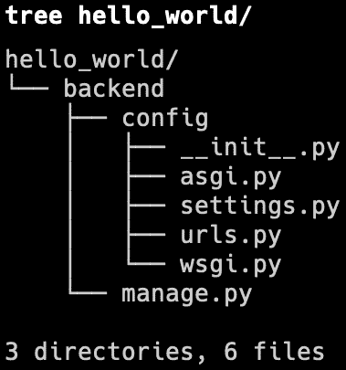
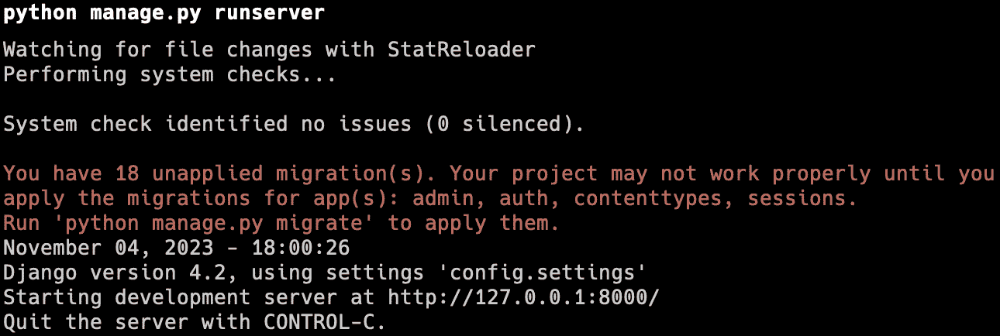
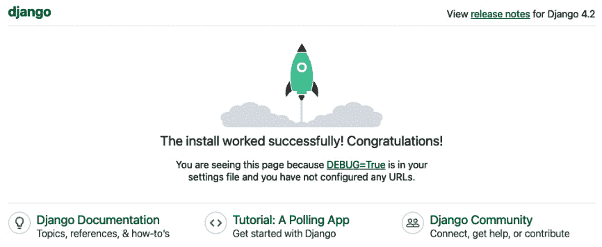
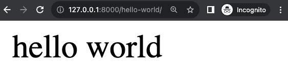
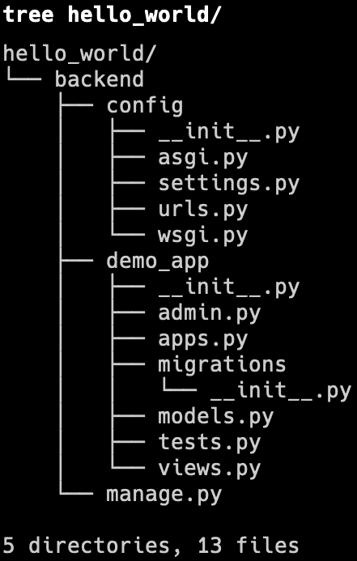
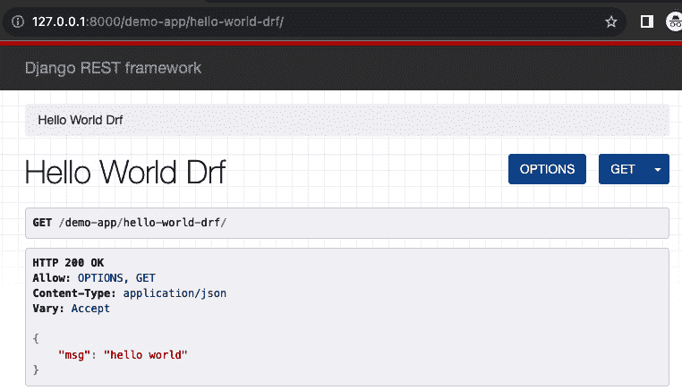
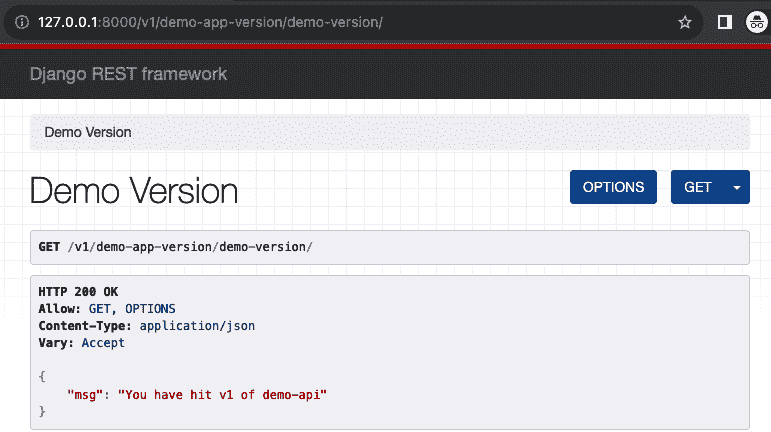
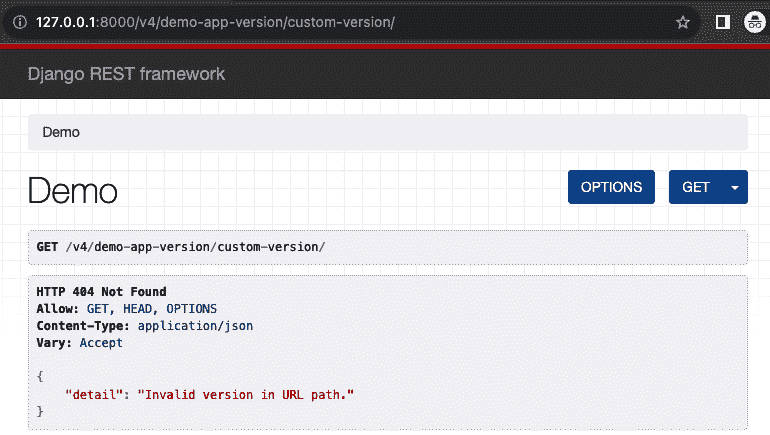

# 使用 DRF 设置 Django

在 2003 年，`Django` 项目由来自报纸网络运营公司 *World Online* 的开发者 *Adrian Holovaty* 和 *Simon Willison* 启动，并在 2005 年夏季开源并首次发布。当 Django 最初构建时，世界仍在使用拨号调制解调器互联网连接，移动设备尚未普及，智能手机尚未面世，人们通过台式机和笔记本电脑访问网页。Django 是那个时代构建 Web 应用所需所有功能的完美框架。

在过去二十年里，技术发生了极大演变：

*   我们已从拨号互联网连接转向 4G/5G 互联网连接
*   2022 年，55% 的全球互联网流量来自移动设备（[`radar.cloudflare.com/`](https://radar.cloudflare.com/)）

在本書中，我们将看到如何使用 Django 构建现代 Web 应用，并深入探讨开发者创建可扩展的初创公司 Web 应用所需了解的核心概念。为初创公司构建产品的开发者不仅仅是编写 Django 代码的普通开发者；他们需要开发代码、为业务逻辑编写测试、将应用部署到网络，并最终持续监控已部署的服务。在这里，我们将学习使用 Django 开发 Web 应用是多么容易，以及行业开发者，特别是初创公司开发者遵循的最佳实践，以使他们的开发周期更简单、更快。

在本章中，我们将学习 Django 的基础知识以及如何设置 Django 项目并组织项目文件夹。由于我们将在本书的大部分内容中主要使用 RESTful API，因此我们将学习 REST API 的约定以及使用 `Django Rest Framework` (`DRF`) 设置 Django 项目以创建 RESTful API 的核心。我们还将重点关注 API 版本控制以及如何使用 DRF 实现版本控制。DRF 为我们提供了创建函数式视图和基于类的视图的灵活性；我们将在本章中学习它们，以及它们的优缺点。

我们将涵盖以下主题：

*   为什么选择 Django？
*   使用 Django 和 DRF 创建“Hello World” Web 应用
*   使用 DRF 创建 RESTful 端点
*   使用 DRF 处理视图
*   介绍 API 开发工具

## 技术要求

在本章中，我们将进行基础项目设置并编写我们的第一个 Hello World 应用。虽然本书面向已经知道如何编写基础 Web 应用的开发者，但任何具备良好编程技能的人都可以拿起本书学习如何创建可扩展的 Django Web 应用。以下是你应具备的技能，以便跟上本章内容：

*   良好的 Python 编程知识，并熟悉包以及在 Python 中编写循环、条件语句、函数和类。
*   对 Web 应用的工作原理有基本了解，并且之前编写过某种形式的 API 或 Web 应用。
*   虽然我们将尝试从头开始涵盖大部分概念，但具备 Django 的基础知识会更好。Django Girls 教程是学习基础的好资源：[`tutorial.djangogirls.org/en/`](https://tutorial.djangogirls.org/en/)。

你可以在本书的 GitHub 仓库中找到本章的代码：[`github.com/PacktPublishing/Django-in-Production/tree/main/Chapter01`](https://github.com/PacktPublishing/Django-in-Production/tree/main/Chapter01)。

重要提示

如果你对本章或其他章节中提到的任何主题有任何疑问，欢迎创建 GitHub issue 并说明所有相关信息（[`github.com/PacktPublishing/Django-in-Production/issues`](https://github.com/PacktPublishing/Django-in-Production/issues)），或加入我们的 *Django in Production* Discord 频道提问。以下是 Discord 服务器的邀请链接，你可以直接联系我：[`discord.gg/FCrGUfmDyP`](https://discord.gg/FCrGUfmDyP)。

## 为什么选择 Django？

Django 是一个基于 Python 的 Web 框架，Python 是目前最受欢迎且易于学习的编程语言之一。由于 Python 是数据科学和人工智能/机器学习的首选语言，开发者可以轻松学习 Django，而无需为构建 Web 应用再学习一种额外语言。

Django 的口号“*Django – The web framework for perfectionists with deadlines*”证明了其对更快、更高效开发的承诺，这一点进一步强调了其自带电池原则，即所有基础和广泛使用的功能都随框架一起提供，而不是我们必须安装额外的包。这使 Django 相对于其他框架，如 Flask 具有额外优势。

### Django 自带了什么？

Django 在过去十年中不断发展，目前已是 5.x 版本，拥有一些令人期待的新功能，例如异步支持。然而，Django 的核心模块仍然相同，遵循相同的原则。当新开发者想要学习 Django、组织想要为新项目选择 Django，或资源有限的初创公司想要为其技术栈选择完美框架时，他们都想知道为什么应该学习 Django。为回答这个问题，我们将了解更多关于 Django 的功能。

让我们看看 Django 开箱即提供的显著功能：

*   在任何组织中，执行速度对于产品的成功非常重要。Django 的设计旨在帮助开发者以惊人的速度将应用从概念阶段带到产品阶段。
*   Django 负责用户身份验证、内容管理、站点地图、RSS 订阅以及开发者在任何框架中寻找的许多其他基础 Web 任务。
*   安全是任何组织都非常关注的问题，Django 帮助开发者避免常见的<|start|>安全陷阱。
*   Mozilla、Instagram、Disqus 和 Pinterest 等网站都使用 Django 构建，这使得 Django 成为经实战检验且可扩展的框架。
*   Django 的多功能框架可用于不同的目的，从内容管理系统到社交网络再到科学计算平台。


但 Django 是否仍然相关的问题非常主观。最终，这取决于使用场景。我们知道 Django 是一个优秀的 Web 开发框架，然而，由于全球超过 55% 的互联网流量来自使用 Android 或 IOS 应用的移动设备，你可能会想知道 Django 是否适用于为移动用户构建功能？Django 作为一个独立的框架可能不足以应对当今的现代 Web 开发，因为越来越多的组织正转向 API First 开发，但在与 `Django Rest Framework (DRF)`、`Tastypie` 等框架集成时，Django 就成为开发者的首选框架。

对于时间和资源有限的初创公司来说，选择一个框架变得更加至关重要，这样他们就不必从零开始构建每个功能，而是利用框架来完成大部分繁重的工作。

让我们快速了解一下 Django 使用的框架原则：MVT 框架。

## 什么是 MVT 框架？

我们大多数人都听说过 `MVC` 框架（*Model-View-Controller*），它代表了现代 Web 框架的一种范式，其中我们有以下内容：

*   `Model` 代表数据和业务逻辑层
*   `View` 代表数据如何在 UI/设计布局中向用户呈现
*   `Controller` 根据用户的输入更新模型和/或视图

Django 认为标准名称存在争议，因此它对 MVC 有自己的解释。在这里，我们有以下内容：

*   `View` 代表向最终用户展示*哪些*数据，而不是数据如何表示
*   `Template` 代表数据如何向最终用户表示
*   `Model` 代表数据层

这就是为什么 Django 遵循 `MVT` 框架（*Model-View-Template*）。但现在，问题是，Django 中的控制器是什么？框架本身就是控制器，因为它使用其内置功能处理整个路由逻辑。

重要说明

你不需要深入研究 MVT 概念，因为随着你在 Django 中编写更多代码，这个概念会成为肌肉记忆。

MVT 是一个使用模板的概念，但在当今世界，大多数产品都是为多个领域构建的，例如移动、物联网和 SaaS 平台。为了为所有这些领域构建产品，开发者生态系统也发生了演变；现在，组织正转向 `API-first` 开发方法（[`blog.postman.com/what-is-an-api-first-company/`](https://blog.postman.com/what-is-an-api-first-company/)）。这意味着 API 是“第一类公民”；产品的每个功能都是以 API-first 模型构建的，这有助于创建更好的客户端（移动应用、前端应用等）和服务器集成。它涉及在客户端和服务器之间建立契约，以便每个团队可以并行工作而无需太多依赖。一旦两个团队完成工作，产品的集成和开发周期就会变得更快，并且开发体验更好。

移动设备使用量的增长意味着构建平台无关的后端 API 很重要，这些 API 可以被任何客户端使用，Android 应用、iOS 应用、浏览器框架等等。作为一个独立的 MVT 框架，Django 能满足所有这些需求吗？不能。使用 Django 的开箱即用功能创建 API 所需的额外工作量与重新发明轮子类似。这就是为什么大多数组织在使用 Django 的同时使用 Django 的 REST 框架来创建 API。

重要说明

在本书中，我们将不关注模板和仅使用 Django 构建的独立 Web 应用，而是专注于使用 Django 和 DRF 创建 API。有关仅使用 Django 入门的更多信息，我最喜欢的资源之一是 Django Girls 教程：[`tutorial.djangogirls.org/en/`](https://tutorial.djangogirls.org/en/)。

现在我们已经了解了 MVT 框架是什么以及 Django 如何成为 MVT 框架，让我们使用 Django 和 DRF 创建一个基本的 Hello World Web 应用，并设置我们的项目结构和开发环境。

# 使用 Django 和 DRF 创建“Hello World”Web 应用

如前所述，Django 是一个基于 Python 的 Web 框架，因此我们需要使用 Python 编程语言编写代码。如果你已经在使用 Linux 或 macOS 系统，则 Python 已预装。然而，对于 Windows 系统，你必须按照官方 Python 网站上的说明进行安装：[`www.python.org/downloads/`](https://www.python.org/downloads/)。

我们还将使用 `virtualenv` 作为我们首选的工具来管理多个项目的不同环境，使我们能够创建隔离的 Python 环境。

重要说明

我们不会深入研究 `virtualenv`，因为我们希望你知道如何以及为什么为不同项目使用 `virtualenv`。你可以在其官方网站上找到有关 `virtualenv` 的详细信息：[`virtualenv.pypa.io/en/latest/index.html`](https://virtualenv.pypa.io/en/latest/index.html)。

首先，让我们使用最新版本的 Python（最好 >3.12.0）创建一个虚拟环境。以下命令适用于 Linux/Unix/macOS；对于 Windows，请查看下一节：

```
pip install virtualenv
virtualenv -p python3 v_env
source /path to v_env/v_env/bin/activate
```

现在，我们将分解代码的含义：

*   `pip install virtualenv` 在系统上安装 `virtualenv`。`pip` 是随 Python 提供的内置包管理器，已在 Mac 和大多数 Linux 环境中预装。
*   `virtualenv -p python3 v_env` 使用名称 `v_env` 创建一个新的虚拟环境（这只是我们给虚拟环境起的名字；你可以取另一个相关名称）。`-p python3` 标志用于告诉我们应使用哪个解释器来创建虚拟环境。
*   `source /path to v_env/v_env/bin/activate` 执行 `activate` 脚本，该脚本将虚拟 Python 解释器加载为 shell 中的默认 Python 解释器。

现在 Python 虚拟环境已设置好，我们将专注于管理包依赖。要安装 Django 的最新版本，请运行以下命令：

```
pip install Django==5.0.2
```

对于 Windows 系统，从 [`www.python.org/downloads/windows/`](https://www.python.org/downloads/windows/) 下载 Python 3.12 或更高版本并按照向导进行安装。请记住在安装步骤中勾选 `Add python.exe to PATH` 复选框。

要验证你的 Python 安装，请在终端中使用以下命令：

```
C:\Users\argo\> python --version
Python 3.12.0
```

一旦 Python 安装成功，你可以使用以下命令设置虚拟环境并安装 Django：

```
py -m pip install --user virtualenv
py -m venv venv
.\<path to venv created>\venv\Scripts\activate
// to install Django
pip install Django==5.0.2
```

Windows 特定命令的解释与我们对 Linux/MacOS 系统的解释相同。

重要说明

我们不使用 poetry、PDM、pipenv 或任何其他依赖和包管理工具，以避免使初始设置过于复杂。

此外，我们更喜欢使用 Docker 环境来创建更多隔离并提供更好的开发体验。我们将在 *第 10 章* 中了解更多关于 Docker 的内容。*

通过之前的命令，我们的本地 Python 和 Django 开发环境已准备就绪。现在，是时候创建我们的基本 Django 项目了。

## 创建我们的 Django hello_world 项目


我们都喜欢 `django-admin` 命令以及在创建新项目或应用时它提供的所有样板代码。然而，在处理大型项目时，默认的项目结构就没那么有用了。这是因为当我们在生产环境中使用 Django 时，有许多其他需要整合到项目中的组件。项目结构以及与项目一起使用的其他工具总是带有主观性；你在当前项目中认为可行的方法，可能在一年后创建的下一个项目中就不适用了。

### 重要说明

互联网上有大量资源会建议不同的项目结构。我最喜欢的一个是 `django-cookiecutter`。它为项目集成了大量工具，并提供了一个可遵循的结构，但对于任何新手来说，由于它集成了许多可能用不到的第三方工具，以及一些可能不理解的配置，开始使用起来可能会令人望而生畏。但与其担心这些，你只需跟随本书即可！

我们将创建自己的极简项目结构，并逐步将其他工具集成到项目中。首先，让我们使用 Django 创建 `hello_world` 项目：

```
mkdir hello_world && cd hello_world
mkdir backend && cd backend
django-admin startproject config .
```

这里，我们创建了项目文件夹 `hello_world`，然后在其内部创建了一个名为 `backend` 的子文件夹。我们使用 `backend` 文件夹来存放所有与 Django 相关的代码；随着我们学习更多关于 CI/CD 功能并将更多工具整合到项目中，我们将在与 `backend` 子文件夹同一层级创建更多文件夹。最后，我们使用 Django 管理命令创建了项目。

### 重要说明

注意 `startproject` 命令后附加的 `.`（点）；这告诉 Django 管理命令在当前文件夹中创建项目，而不是创建一个名为 `config` 的单独文件夹来存放项目。默认情况下，如果你不添加 `.`，那么 Django 将在其中创建名为 `config` 的额外文件夹，项目结构将在其中创建。为了更好地理解，你可以尝试带 `.` 和不带 `.` 的命令，以清楚地了解它对结构的影响。

执行这些命令后，我们应该能看到此处所示的项目结构：

 

Figure 1.1: Expected project structure after executing the commands

现在项目结构已准备就绪，让我们运行 `python manage.py runserver` 来验证我们的 Django 项目。我们应该在 shell 中看到以下输出：

 

Figure 1.2: The python manage.py runserver command’s output in the shell

请忽略控制台中以红色显示的未应用迁移警告 `You have 18 unapplied migrations(s)`；当我们在下一章学习更多关于数据库、模型和迁移的内容时，我们将详细介绍这个问题。

现在，打开你的浏览器并访问 `http://localhost:8000` 或 `http://127.0.0.1:8000`（如果前者无法加载）。我们将看到如图 *Figure 1**.3* 所示的屏幕，这验证了我们的服务器正在成功运行：

### 请注意

你可以使用 `http://localhost:8000` 或 `http://127.0.0.1:8000` 在浏览器中打开 Django 项目。如果你在访问 `http://localhost:8000` 时遇到任何错误，请尝试对本书中提到的所有 URL 使用 `http://127.0.0.1:8000`。

 

Figure 1.3: Our Django server running successfully with port 8000

现在，让我们创建我们的第一个 `hello_world` 视图。为此，请按照以下步骤操作：

1. 打开 `config/urls.py` 文件。
2. 在 `hello_world` 中添加一个新的 `view` 函数。
3. 将 `hello_world` 视图函数链接到 `hello-world` 路径。

我们的 `config/urls.py` 文件应如下所示的代码片段：

```
from django.contrib import admin
from django.http import HttpResponse
from django.urls import path
def hello_world(request):
    return HttpResponse('hello world')
urlpatterns = [
    path('admin/', admin.site.urls),
    path('hello-world/', hello_world)
]
```

4. 打开 `http://127.0.0.1:8000/hello-world/` 以获取如图 *Figure 1**.4* 所示的结果：

 

Figure 1.4: http://127.0.0.1:8000/hello-world/ browser response

到目前为止，我们已经了解了如何创建项目文件夹结构以及如何在 Django 中创建第一个视图。我们使用的示例是最小的 Django 项目示例之一，不涉及应用。因此，让我们看看如何在 Django 中创建应用，以帮助我们更好地管理项目。

## 在 Django 中创建我们的第一个应用

Django 应用可以被视为在大型项目中执行单一功能的小型包。Django 提供了管理命令来在项目中创建新应用；这些是内置命令，用于执行重复且复杂的任务。Django 社区喜欢管理命令，因为它们减少了大量手动工作并封装了许多复杂任务，例如迁移等。我们将在后续章节中学习更多关于 Django 管理命令的内容，在那里我们将创建一个自定义管理命令。然而，每当你看到 `manage.py` 后跟一个命令时，那就是一个 Django 管理命令。

那么，让我们使用 Django 管理命令接口创建一个新的 `demo_app`：

```
python manage.py startapp demo_app
```

运行此命令将创建此处所示的文件夹结构：

 

Figure 1.5: Project structure with demo_app added

我们可以看到，已创建了一个 `demo_app` 文件夹，其中包含 Django 为新应用生成的样板代码。

### 重要说明

每当我们创建一个新应用时，必须做的一件重要事情是告诉 Django 关于这个新应用。不幸的是，使用 Django 管理命令创建新应用时，这不会自动发生。这是一个手动过程，你需要在 `settings.py` 文件中的 `INSTALLED_APPS` 列表中添加新应用的详细信息。Django 使用它来识别添加到项目中的所有依赖应用，并检查任何数据库相关更改，甚至注册信号和接收器。

虽然目前由于我们没有使用 `models` 让 Django 自动识别任何数据库相关更改，添加新应用到 `INSTALLED_APPS` 列表不是必需的，但仍然是良好的实践。我们的 `INSTALLED_APPS` 列表应如下所示：

```
INSTALLED_APPS = [
    ...
    'django.contrib.staticfiles',
    'demo_app',
]
```

请记住在每个新应用条目后加上逗号（`,`）；这是开发人员最常犯的错误之一，它会导致 Django 将两个应用名称拼接在一起，并在最终纠正之前生成语法错误。

### 重要说明

在 Django 中，第三方应用集成也是通过 `INSTALLED_APPS` 完成的，因此我们将在以下部分看到有关如何维护 `INSTALLED_APPS` 的最佳实践。

现在我们已经使用样板代码创建了一个新的 Django 应用，我们可以将应用视图与 `urls.py` 链接起来。

## 使用 urls.py 链接应用视图

在本节中，我们将链接由 Django 管理命令创建的 `views.py`。`views.py` 用于向应用端点添加业务逻辑。就像我们在上一节中添加了 `hello_world` 函数视图一样，我们可以在 `views.py` 文件中添加不同的函数式或基于类的视图。


让我们在 `demo_app/views.py` 文件中创建一个简单的 `hello_world` 函数视图：

```
from django.http import HttpResponse
def hello_world(request, *args, **kwargs):
    return HttpResponse('hello world')
```

随着项目的增长和应用数量的增加，我们主要的 `urls.py` 文件会变得越来越杂乱，单个文件中有数百个 URL 模式。因此，将主要的 `config/urls.py` 文件拆分为每个应用的较小的 `urls.py` 文件是有利的，这可以提高项目的可维护性。

现在，我们将创建一个名为 `backend/demo_app/urls.py` 的新文件，在其中添加与 `demo_app` 相关的所有路由。随后，当我们向项目添加更多应用时，我们将为每个应用创建单独的 `urls.py` 文件。

### Important note

`urls.py` 文件名可以是任意的，但我们保持不变以符合 Django 惯例。

在 `backend/demo_app/urls.py` 文件中添加以下代码：

```
from django.urls import path
from demo_app import views
urlpatterns = [
    path('hello-world/', views.hello_world)
]
```

在这里，我们为 `hello-world` 路径定义了 URL 模式，它链接到我们之前创建的基础函数视图。

### Opinionated note

我们使用绝对导入来导入我们的 `demo_app` 视图。这是我们在本书中将遵循的惯例，我们也推荐在其他项目中使用。 使用绝对导入相对于相对导入的优势在于它简单明了，易于阅读。 只要看一眼，有人就能轻松判断导入了什么资源。 此外，PEP-8 明确建议使用绝对导入。

现在，让我们将 `demo_app/urls.py` 文件连接到主项目 `config/urls.py` 文件：

```
from django.contrib import admin
from django.urls import include
from django.urls import path
urlpatterns = [
    path('admin/', admin.site.urls),
    path('demo-app/', include('demo_app.urls'))
]
```

接下来，在浏览器中打开 `http://127.0.0.1:8000/demo-app/hello-world/` 以确保我们的 `demo-app` 视图已与 Django 链接。 你应该能在屏幕上看到 `hello world` 显示出来，就像我们在 *Figure 1.4* 中看到的那样。

到目前为止，我们一直在使用原生的 Django，但现在，我们将看看如何将 DRF 集成到我们的项目中。

# Integrating DRF

在以 API 为先的开发世界中，开发人员每天为他们构建的每个功能创建 API，DRF 是一个强大且灵活的工具包，用于使用 Django 构建 API。

## Important note

如果你不熟悉 DRF 的基础知识，我们将在本书中讲解基础知识。 然而，你可以在这里找到更多信息：[`www.django-rest-framework.org/tutorial/quickstart/`](https://www.django-rest-framework.org/tutorial/quickstart/)。

现在，让我们将 DRF 集成到我们的 `hello_world` 项目中。 首先，我们需要在虚拟环境中安装 DRF：

```
pip install djangorestframework
```

现在，转到 `settings.py` 并将 `rest_framework` 添加到 `INSTALLED_APPS`。 正如你可能还记得，当我们将 `demo_app` 集成到项目中时，我们提到随着项目的增长，`INSTALLED_APPS` 列表也会增长。 为了更好地管理，我们将 `INSTALLED_APPS` 列表拆分为三个部分：

* `DJANGO_APPS`: 这将包含所有默认的 Django 应用以及我们将添加到项目的任何新的 Django 内置应用
* `THIRD_PARTY_APPS`: 在这里，我们将维护我们集成到项目中的所有第三方应用，例如 `rest_framework`
* `CUSTOM_APPS`: 我们将把为项目创建的所有应用添加到此列表中——在我们的例子中是 `demo_app`

以下是 `settings.py` 文件中 `INSTALLED_APPS` 列表的示例：

```
DJANGO_APPS = [
    'django.contrib.admin',
    'django.contrib.auth',
    'django.contrib.contenttypes',
    'django.contrib.sessions',
    'django.contrib.messages',
    'django.contrib.staticfiles',
]
THIRD_PARTY_APPS = [
    'rest_framework',
]
CUSTOM_APPS = [
    'demo_app',
]
INSTALLED_APPS = DJANGO_APPS + CUSTOM_APPS + THIRD_PARTY_APPS
```

到目前为止，我们一直在使用 Django `HttpResponse`。 现在，我们将 DRF 响应集成到我们的视图中。 因此，转到 `demo_app/views.py` 文件并添加以下代码：

```
from rest_framework.decorators import api_view
from rest_framework.response import Response
@api_view(['GET'])
def hello_world_drf(request, *args, **kwargs):
    return Response(data={'msg':'hello world'})
```

DRF 基于函数的视图集成将完全改变我们端点的 UI。 如果你打开 `http://127.0.0.1:8000/demo-app/hello-world-drf/`，它将具有更详细的 UI，比之前提供更多信息。 当我们开始处理除 `GET` 请求之外的 HTTP 请求时，这尤其有帮助。

以下是我们集成了 DRF 的基础 Django 项目：



Figure 1.6: Using the DRF response in our hello-world-drf view

现在我们有一个在 Django 中运行的项目，让我们学习一些良好的实践，这些实践可以帮助你在不自己犯错的情况下更进一步，而不是从你之前犯过的错误中学习。 DRF 是最受欢迎的 Django 包，因为它帮助开发人员创建 REST 端点。 现在，让我们看看创建 REST API 的一些良好实践。

# Creating RESTful API endpoints with DRF

最流行且广泛使用的 API 是 REST API。 在整本书中，我们将使用 REST API。 REST 已存在二十多年，每个公司都有其解释和实现。 在以下部分中，我们将尝试将行业中使用的所有最佳实践付诸实践。

## Opinionated note

RESTful API 不是协议； 相反，它是开发人员遵循的标准约定。 设计 RESTful API 时没有对错之分。 由于没有强制执行的标准，我们提供的细节纯粹是主观的，来自我过去的经验。 你可以自由选择喜欢的要点，忽略你认为与实现无关的内容。

## Best practices for defining RESTful APIs

让我们看一下开发人员在定义 RESTful 端点时在行业中使用的一些通用良好实践：

* 在端点路径中使用名词而不是动词，并使用适当的 HTTP 请求方法。 这里有一些例子（*请注意，这里使用的 URL 示例只是我们应该如何定义 REST URL 的大纲，我们并没有定义 `exact code*）：

```
# To get all blogs
Avoid GET /get-all-blogs, rather use GET /blogs
# To delete a particular blog
Avoid POST /delete-blog rather use DELETE /blogs/<blogId>
# To create a new blog with POST request
Avoid POST /create-new-blog rather use POST /blogs
# To update an existing blog with a PUT request
Avoid PUT /update-blog rather use PUT /blogs/<blogId>
```

* 使用适当的 HTTP 方法来执行 CRUD 操作是首选的。 有多种 HTTP 方法，但我们只涵盖最常用的五种方法：
  * `GET`: 用于检索实体，无论是列表还是详情
  * `POST`: 用于创建任何新实体
  * `PUT`: 用于更新实体
  * `PATCH`: 用于部分更新实体
  * `DELETE`: 用于删除实体

* 建议在端点中创建复数名词。 当你需要获取单个条目时，则在端点后使用 `id` 来检索信息。 例如，要获取博客列表，使用 `GET /blogs`，要获取一个博客的详情，使用 `GET /blogs/<blog id>`。


*   为端点使用逻辑嵌套结构对于清理 API 接口和维护良好的信息架构非常重要。例如，要获取特定博客的所有评论，API 应该是 `GET /blogs/<blog id>/comments`。

*   对 API 进行版本控制很重要，因为它有助于在不破坏新系统中契约的情况下支持旧系统。例如 `/v1/blogs/` 和 `/v2/blogs`。我们将在 *Using API versioning* 部分稍后了解更多关于此的内容。

*   服务器应根据操作发送适当的 HTTP 响应状态码，并附带消息正文（如果适用）。以下是一些最常用的 HTTP 状态码：
    *   `2xx`：用于任何成功。例如，`200` 用于任何请求成功返回数据，`201` 用于创建新条目，等等。
    *   `3xx`：用于任何重定向。
    *   `4xx`：用于任何错误。例如，使用 `400` 表示请求错误，使用 `404` 表示请求的数据未找到。
    *   `5xx`：当服务器因任何意外请求而崩溃或服务器不可用时。

*   服务器必须接受并以 JSON 响应进行响应。API 不支持其他数据类型，例如纯文本、XML 等。

## 使用 DRF 创建 REST API 的最佳实践

DRF 是一个框架，可以帮助我们更快地创建 REST 端点。遵循最佳实践的同时编写可扩展且可维护的代码是开发人员的责任。让我们看看使用 DRF 可以实现的一些最佳实践。

### 使用 API 版本控制

创建 API 版本可能是与客户端合作时最重要的事情之一，而这些客户端的更新不在你的控制之下。一个例子是开发移动应用。一旦终端用户安装了集成了给定 API 的移动应用，我们就必须在终端用户更新移动应用版本以使用更新的 API 之前支持该 API。

在创建端点时，开发人员应考虑所有可能将来的需求以及所有边界情况。然而，就像无法预测未来一样，开发人员也无法总是预见到当前 API 设计可能需要重新设计。重新设计意味着破坏客户端和服务器之间的契约。这就是 API 版本控制重要性显现的时候。经过良好版本控制的 API 将在不破坏任何现有客户端的情况下实现新契约。

实现 API 版本控制有多种方式：

*   `Accept` 头版本控制：由于版本通过 `Accept` 头传递，因此每当创建新版本时，客户端无需在每次创建新版本时更新任何端点：
```
GET /bookings/ HTTP/1.1
Host: example.com
Accept: application/json; version=1.0
```

*   `URL` 路径版本控制：API 版本通过 URL 路径模式传递。这是使用最广泛的 API 版本控制方法之一，因为它提供了更好的可见性：
```
GET /v1/bookings/ HTTP/1.1
Host: example.com
Accept: application/json
```

*   查询参数版本控制：URL 中的查询参数包含版本。在 URL 路径版本控制之后，这是第二常见的版本控制方法，因为它具有更清晰的界面和更好的可发现性：
```
GET /something/?version=1.0 HTTP/1.1
Host: example.com
Accept: application/json
```

*   主机名版本控制：这涉及使用子域在主机名中传递 API 版本。这种类型的版本控制用于将整个服务迁移到新版本而不是单个端点时：
```
GET /bookings/ HTTP/1.1
Host: v1.example.com
Accept: application/json
```

DRF 开箱即支持所有四种 API 版本控制方法，并且如果需要，还提供创建自定义 API 版本逻辑的选项。我们将主要探索 `URLPathVersioning`，因为它是通过 DRF 实现版本控制的最简单和最流行的方法之一。

在 URL 路径版本控制中，API 版本在 URL 路径中传递，这使得客户端和服务器都可以轻松识别。要在 DRF 中集成 `URLPathVersioning`，请在 Django `config/settings.py` 文件中添加以下内容：
```
REST_FRAMEWORK = {
    'DEFAULT_VERSIONING_CLASS': 'rest_framework.versioning.URLPathVersioning'
}
```

现在，我们必须将版本添加到 URL 路径中。重要的是将 URL 参数命名为 `<version>`，因为 DRF 默认期望它是 `<version>`。这里，`<version>` 是 URL 的模式，这意味着任何匹配此模式的 URL 都将被链接到视图。

重要提示

要了解有关 `urlpatterns` 的更多信息，请访问 [`docs.djangoproject.com/en/stable/topics/http/urls/`](https://docs.djangoproject.com/en/stable/topics/http/urls/)。

建议在 URL 开头添加 `<version>`，因此让我们在主 `config/urls.py` 文件中这样做：
```
urlpatterns = [
    path('admin/', admin.site.urls),
    path('<version>/demo-app-version/', include('demo_app.urls'))
]
```

一旦我们使用 `<version>` 配置了 URL，我们就可以尝试创建一个新视图并在视图中检索版本。将以下代码添加到你的 `demo_app/urls.py` 文件中：
```
from django.urls import path
from demo_app import views
urlpatterns = [
    path('hello-world/', views.hello_world),
    path('demo-version/', views.demo_version),
]
```

我们将在视图中检索 API 版本并在响应中返回版本：
```
@api_view(['GET'])
def demo_version(request, *args, **kwargs):
    version = request.version
    return Response(data={
        'msg': f'You have hit {version} of demo-api'
    })
```

现在，当我们打开 `http://127.0.0.1:8000/v1/demo-app-version/demo-version/` 时，我们应该能够看到以下屏幕：



Figure 1.7: Output showing which version we have hit for the given API

如果我们将 URL 更改为 `http://127.0.0.1:8000/v9/demo-app/demo-version/`，那么我们会看到它返回 v9。v9 可能尚未发布，因此这可能会让访问该端点的终端用户感到困惑。为了解决这个问题，我们将看看如何自定义 DRF 的版本类，以便我们可以添加约束来帮助我们设计更好的应用程序。

#### 使用 DRF 中的自定义版本类

让我们看看如何扩展 DRF 提供的 `URLPathVersioning` 类来解决我们刚刚提出的问题。首先，创建一个名为 `demo_app/custom_versions.py` 的文件。此文件将为每个视图包含一个自定义版本类，以及一个用于尚未具有多个版本的视图的默认类：
```
from rest_framework.versioning import URLPathVersioning
class DefaultDemoAppVersion(URLPathVersioning):
    allowed_versions = ['v1']
    version_param = 'version'
class DemoViewVersion(DefaultDemoAppVersion):
    allowed_versions = ['v1', 'v2', 'v3']
class AnotherViewVersion(DefaultDemoAppVersion):
    allowed_versions = ['v1', 'v2']
```

让我们看看前面的代码做了什么：

*   `DefaultDemoAppVersion` 类可用于 `demo_app` 中创建的所有视图。它具有 `allowed_versions` 属性，列出了在使用此基于类的视图时可在 URL 路径中使用的允许版本。`version_param` 是我们用于定义版本的 URL 路径参数名称；它可以是任何名称，具体取决于你如何命名参数，但在我们的例子中，我们使用的是 `<version>`，它在 `config/urls.py` 文件中使用。此类将默认用于 demo 应用中创建的所有视图，直到添加新版本后，我们将创建单独的类，如下所示。


*   `DemoViewVersion` 类将包含 `DemoView` 在 URL 路径中允许的所有 `allowed_versions` 属性的列表。

*   `AnotherViewVersion` 类将包含另一个类允许的所有版本。

将以下代码添加到 `demo_app/views.py` 文件以集成自定义版本类（请注意，自定义 `versioning_class` 只能链接到基于类的视图，因此我们在这里使用 `APIView`）：

```
from rest_framework.response import Response
from rest_framework.views import APIView
from demo_app import custom_versions
class DemoView(APIView):
    versioning_class = custom_versions.DemoViewVersion
    def get(self, request, *args, **kwargs):
        version = request.version
        return Response(data={'msg': f' You have hit {version}'})
class AnotherView(APIView):
    versioning_class = custom_versions.AnotherViewVersion
    def get(self, request, *args, **kwargs):
        version = request.version
        if version == 'v1':
            # perform v1 related tasks
            return Response(data={'msg': 'v1 logic'})
        elif version == 'v2':
            # perform v2 related tasks
            return Response(data={'msg': 'v2 logic'})
```

让我们探索代码并了解在使用自定义版本类时幕后发生了什么：

*   `DemoView` 类是一个基于类的 `APIView`，我们通过 `versioning_class` 属性传递视图允许的版本。这允许请求对象具有从 URL 路径解析的 version 属性。由于我们指定了 `DemoViewVersion` 类，因此该视图仅允许 URL 路径中的 `v1`、`v2` 和 `v3` 版本。路径中的任何其他版本都将导致 `404` 响应。

*   `AnotherView` 类是一个基于类的视图，我们将 `AnotherViewVersion` 传递为 `versioning_class` 属性。在此视图中，我们通过检查不同版本并在有 `v1` 或 `v2` 请求时做出不同响应来分支请求。

现在，要将视图逻辑链接到 `demo_app/urls.py` 文件，请添加以下代码：

```
urlpatterns = [
    path('hello-world/', views.hello_world),
    path('demo-version/', views.demo_version),
    path('custom-version/', views.DemoView.as_view()),
    path('another-custom-version/', views.AnotherView.as_view())
]
```

如果我们在浏览器中访问 `http://127.0.0.1:8000/v4/demo-app-version/custom-version/`，我们将看到如下所示的错误，如 *图 1.8* 所示，因为我们在自定义 `versioning_class` 中仅允许三个版本：



图 1.8：404 错误消息显示“URL 路径中的版本无效”

这满足了我们仅允许 API 的某些版本的目的；任何其他 API 版本都将导致错误响应。

重要说明

自定义版本控制只能附加到基于类的视图。如果您未传递任何自定义 `versioning_class`，则 Django 将从默认设置中选取 `DEFAULT_VERSIONING_CLASS`。

### 避免使用 Router

Ruby on Rails 等框架提供将请求自动映射到给定 URL 模式的功能，具体取决于功能。DRF 借鉴了这一概念并将其作为 Routers 功能纳入框架。虽然这是一个很棒的概念，可以学习和尝试，但开发人员应避免在生产环境中使用它，因为这违背了 Django 的原则：“*显式优于隐式*。”

Django 提到它不应展示太多魔法。我个人见过一些遗留系统，开发人员添加了 Router，几个月后，当另一位开发人员想要修复视图中的错误时，他们无法直接找到对应的视图，直到他们恍然大悟，识别出 Router 概念的那一刻。

有见解的说明

避免使用 Router 是我通过艰难的方式学到的，并且我看到许多开发人员在生产环境中避免使用它。但这也是通过糟糕的经历发展出来的一种观点；你总可以在自己的项目中尝试以更好的方式实现它。

如果您想了解有关 Router 的更多信息，可以在此处了解：[`www.django-rest-framework.org/api-guide/routers/`](https://www.django-rest-framework.org/api-guide/routers/)。

至此，我们已经学习了如何创建 RESTful API 并处理版本控制。现在，让我们学习如何使用 DRF 处理视图。我们主要在视图中编写业务逻辑。

# 使用 DRF 处理视图

DRF 扩展了 Django 的视图概念，为创建 REST 端点提供更好的接口。就像 Django 中的函数式和基于类的视图一样，DRF 也支持两者。然而，这取决于开发人员选择哪种类型的视图适合其用例。

作为经验法则，当我有一个独立的端点且逻辑简单且未来不会有任何复杂性时，我总是倾向于函数式视图。基于类的视图有一个学习曲线，这阻止了开发人员最初使用它们，但一旦进入门槛被突破，开发人员很少会回到函数式视图。让我们更详细地探索这两种类型的视图。

## 函数式视图

Django 提供了一个简单的函数式视图接口，帮助任何开发人员更快地开始开发；这就是为什么它对任何开始 Django 的开发人员都很受欢迎。DRF 保持了 Django 视图的简洁性，并允许开发人员使用简单的装饰器 `@api_view` 将 Django 视图转换为 DRF。我在逻辑简单或在不会变得过于复杂的简单项目上工作时更喜欢使用它。

DRF 为我们提供了 `@api_view` 来处理常规 Django 函数式视图。添加装饰器会将通常的 Django `HttpRequest` 转换为 `Request` 实例。装饰器接受给定函数式视图块允许的所有 HTTP 方法的列表；未列出的任何方法都不会被允许。默认情况下，如果未提及任何 HTTP 方法，则它只允许 `GET` 方法。对于视图的响应，我们应该使用 DRF 中的 `Response` 类而不是 Django 中的 `HttpResponse`；它会自动处理绕过视图的 `跨站请求伪造`（`CSRF`）并为我们提供与后端服务交互的 UI。

让我们看一个 DRF 函数式视图的示例：

```
from rest_framework.decorators import api_view
from rest_framework.response import Response
@api_view(['GET', 'POST', 'PUT'])
def hello_world(request, *args, **kwargs):
    if request.method == 'POST':
        return Response(data={'msg': 'POST response block'})
    elif request.method == 'PUT':
        return Response(data={'msg': 'PUT response block'})
    return Response(data={'msg': 'GET response block'})
```

现在，让我们学习如何处理基于类的视图，它们在整个行业中被广泛使用。

## 基于类的视图

如前所述，基于类的视图有一个学习曲线，因此很多开发人员最初会避免使用它。即使我也避免了几个月，直到我看到了更大的图景，但从那以后，就再也没有回头。它利用了继承属性并有助于实现 `不要重复自己`（`DRY`）原则。对于大型代码库来说，这是绝对必须的，我建议任何开始新项目的开发人员从一开始就实现它。

DRF 提供了两种类型的基于类的视图：`APIView` 和通用视图。

### APIView


DRF 的 `APIView` 类是 Django `View` 类的扩展。使用 `APIView` 类会将默认的 Django `HttpRequest` 转换为 `Request` 对象，并且处理方法可以返回 DRF 的 `Response` 对象而不是 Django 的 `HttpResponse`。它支持额外的策略属性，如 `authentication_classes`、`permission_classes` 和 `versioning_classes`，这让开发者的生活变得轻松许多。我们将在后面的章节中使用它们并详细讨论。

使用 `APIView` 的接口很简单：要为给定端点实现任何 HTTP 请求方法，只需在类中创建同名的新方法；例如，`GET` 请求会有 `get` 方法，`DELETE` 请求会有 `delete` 方法，以此类推。每当针对给定 HTTP 方法发出请求时，对应的方法会被自动调用。

让我们用 `APIView` 实现一个快速示例以了解更多：

```
from rest_framework.views import APIView
class DemoAPIView(APIView):
    def get(self, request, *args, **kwargs):
        return Response(data={'msg': 'get request block'})
    def post(self, request, *args, **kwargs):
        return Response(data={'msg': 'post request block'})
    def delete(self, request, *args, **kwargs):
        return Response(data={'msg': 'delete request block'})
```

将实现的 `APIView` 类链接到 `urls.py` 文件的方式与我们之前链接函数视图的方式不同。相反，我们使用 `<class name>.as_view()` 将其链接到对应的 URL：

```
urlpatterns = [
    ...
    path('apiview-class/', views.DemoAPIView.as_view())
]
```

随着我们学习 DRF 和 Django 周围的不同概念，我们将进一步扩展对 `APIView` 的了解。

### 通用视图

在构建 Web 应用时，会出现开发者在做重复性工作的单调任务的时候。这时 DRY 原则就会发挥作用，开发者会思考如何解决这种重复模式。答案是 `Generic Views`。

`Generic Views` 是 Django 和 DRF 中最受欢迎的功能之一，帮助开发者以闪电般的速度构建基础的 CRUD 操作 API。通用视图与 DRF 的序列化器和模型概念紧密耦合，所以我们将在学习这些概念后在后面的章节中详细讨论通用视图。

主观性说明

我们这里不讨论 `Viewsets`，因为它主要与 `Router` 一起使用。我们已经讨论过为什么应该避免在 Django 中使用 Router，但如果你想了解更多，你可以去 DRF 文档，那里用相关示例解释得相当好。

有关 `Viewsets` 的更多详情，请参阅 [`www.django-rest-framework.org/api-guide/viewsets/`](https://www.django-rest-framework.org/api-guide/viewsets/)。

现在我们已经看到了 DRF 的基本集成以及如何使用视图，让我们专注于如何改善开发体验。Web 开发不仅仅是写代码——还在于使用合适的工具。在整本书中，我们将为不同目的介绍更多工具。现在，让我们学习关于 API 开发工具的知识。

# 介绍 API 开发工具

在开发 API 时，确保端点能处理每种可能的输入非常重要，并且在将 API 交给客户端团队集成之前，我们需要手动测试 API。虽然为创建的每一块代码/API 编写单元测试和集成测试总是更有利，但我们可能无法做到。因此，API 开发工具在这一旅程中非常有用。

Postman 是开发者社区中最受欢迎的工具之一，帮助开发者在开发过程的每个阶段构建 API。虽然通常使用 Postman 来测试 API，但它的用例远不止测试 API，如下所示：

* 创建带有 API 契约的模拟服务器，帮助客户端团队在后端 API 开发期间独立工作
* 为团队创建文档和 OpenAPI 规范以便使用端点
* 创建 API 集合，可按使用场景对 API 进行分组
* 创建可在远程服务器上定期运行的测试，以确保 API 的契约未发生变化

Postman 网站上的教程系列非常直观：[`learning.postman.com/docs/getting-started/introduction/`](https://learning.postman.com/docs/getting-started/introduction/)。如果您不熟悉，请阅读教程，因为我们将在整本书中使用 Postman 来测试我们的端点。您也可以使用其他工具来实现相同目的，例如 `hoppscotch`（[`hoppscotch.io/`](https://hoppscotch.io/)）和 `testmace`（[`testmace.com/`](https://testmace.com/)）。

学习新工具是一项对任何开发者成长都很重要的技能，因为这些工具让我们的开发之旅更轻松。在整本书中，我们将介绍并学习新的工具来帮助实现这一点。

# 总结

在本章中，我们学习了如何使用 Python 的虚拟环境设置本地开发环境，并从头创建了一个 Django 项目。当我们开始新项目时，项目结构非常重要，在本章中，我们学习了如何遵循最佳实践为 Django Web 应用创建新的项目结构。

在整本书中，我们将使用 REST API，因此我们提供了 REST API 的基本介绍以及创建它们的最佳实践，例如命名约定、添加版本控制以及使用适当的 HTTP 方法和状态码。我们还学习了如何将 DRF 与 Django 集成，并使用 URL、函数视图和基于类的视图创建一个基础演示应用。

通过阅读本章，我们应该能够从头创建包含多个 Django 应用的 Django Web 应用，以及 URL 和视图。我们应该能够将 Django 应用添加到 `settings.py` 并使用 DRF 创建 RESTful API。

到目前为止，我们只使用静态响应工作，未涉及任何数据库。在下一章中，我们将学习如何设置数据库并将 Postgres 数据库连接到我们的 Django 项目。

# 2
