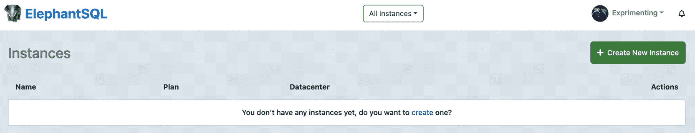
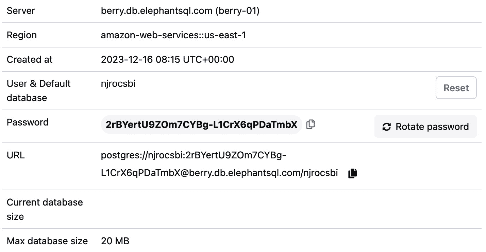
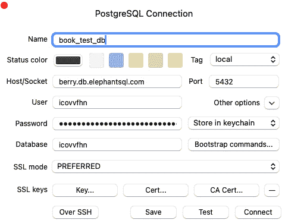
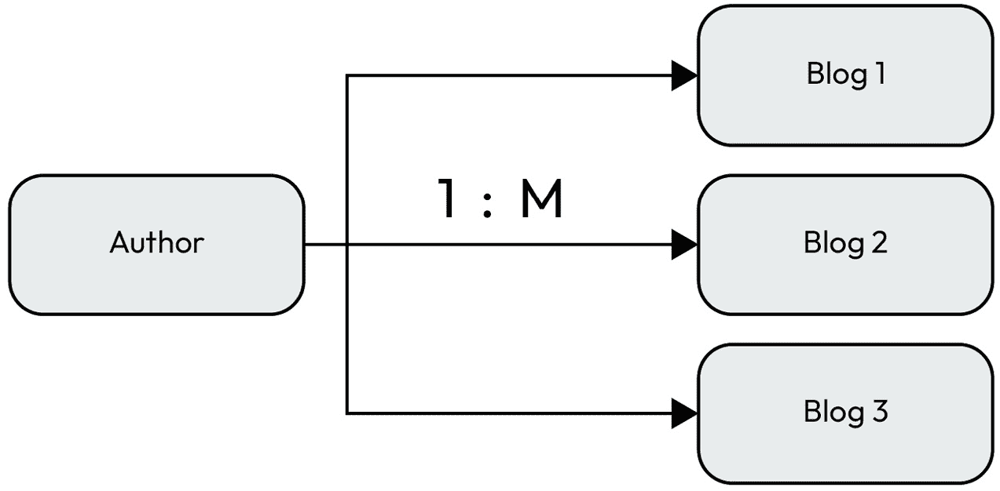
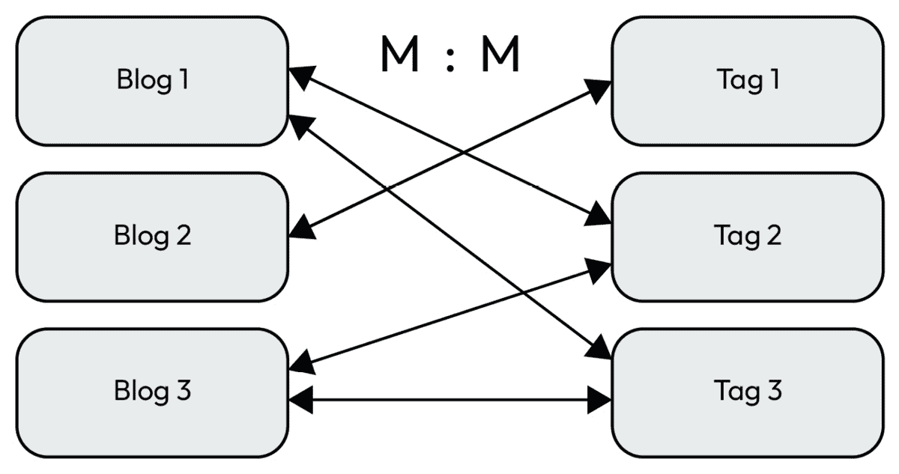
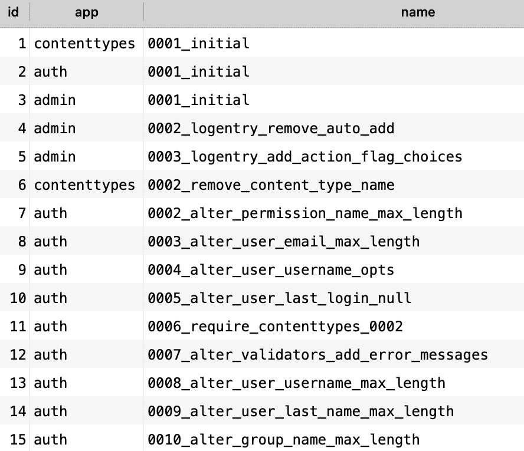
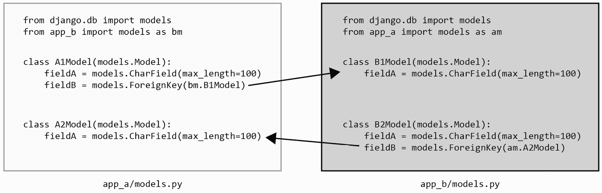
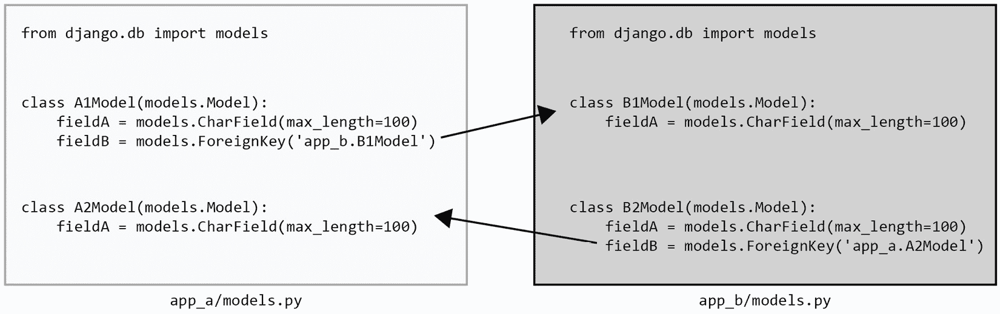
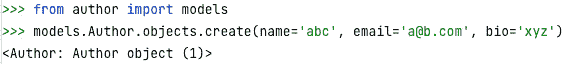
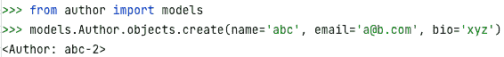

# 探索 Django ORM、模型和迁移

在 *第 1 章* 中，我们看到了如何创建 Django 项目并将视图集成到项目中。视图中的所有响应都是静态的，我们没有看到如何实现代码以使用数据库获取动态响应。

在本章中，我们将看到如何将 PostgreSQL 数据库集成到我们的 Django 项目中，以及 Django 开箱即用的对模型和数据库的支持。如果你之前使用过 `relational database management systems`（`RDBMSs`），你会知道每当模式更新时执行迁移有多痛苦。然而，Django 提供了开箱即用的迁移支持，它将所有复杂性抽象到两个管理命令之下。

之后，我们将学习在使用 Django 模型时的一些最佳实践，以及如何在大数据库表上检查性能优化。最后，我们将查看在 Django 4.1 中引入的最新的功能：Async ORM。

本章将涵盖以下主题：

* 使用 Django 项目设置 PostgreSQL
* 使用模型和 Django ORM
* 理解 Django 迁移的核心
* 探索使用模型的最佳实践
* 学习性能优化
* 探索 Django Async ORM

# 技术要求


在本章中，我们将使用 Django 模型和数据库。要使用本章中的代码，你需要在系统中安装 Django，并具备上一章讨论的项目结构。你应该能够创建 Django 应用并将视图连接到 URL，就像我们之前学习的那样。

除此之外，你的技能集中应包含以下内容：

* 你应该了解 RDBMS 的基础知识以及数据库在高层面的工作原理。你还应熟悉数据库规范化和反规范化的概念。
* 你应该了解 Django ORM 的基础知识，并且之前使用过 Django 模型（你可能已经跟随并理解了上一章提到的 Django Girls 教程）。
* 你应该了解 SQL 周围的概念，并在你的系统上安装了 PostgreSQL，或拥有稳定的互联网连接以使用远程 PostgreSQL 服务器（[`www.elephantsql.com/`](https://www.elephantsql.com/)）。
* 你应该安装了 TablePlus（[`tableplus.com/`](https://tableplus.com/)）或任何数据库管理 GUI 工具。

本书的 GitHub 仓库，其中包含本章的所有代码，可以在 [`github.com/PacktPublishing/Django-in-Production/tree/main/Chapter02`](https://github.com/PacktPublishing/Django-in-Production/tree/main/Chapter02) 找到。

重要说明

数据库和 Django ORM 涵盖的概念范围很广，本章不可能涵盖每个主题。我的个人经验表明，许多开发者不了解一些基本概念，这阻碍了他们在项目中使用高级概念，并导致他们犯下新手错误。虽然我们会尽量解释所有重要概念，但你可以查看本章中提供的信息框，它们会引导你查阅官方文档以获取额外信息。

重要说明

在本章中，我们将使用 Django ORM 和 Django ORM 查询的代码片段。本章中使用的代码片段可能不是自足的，可能需要额外的代码才能执行。如果你对代码片段的理解有任何问题，或无法独立执行它们，请加入我们的 *Django in Production* Discord 频道并在那里提问。以下是我们 Discord 服务器的邀请链接，你可以直接联系到我：[`discord.gg/FCrGUfmDyP`](https://discord.gg/FCrGUfmDyP)。

# 使用 Django 项目设置 PostgreSQL

Django 默认集成了 `SQLite3` 用于初始开发目的，这有助于开发者在无需初始数据库设置麻烦的情况下开始项目。在我们的例子中，我们在 *Chapter 1* 中使用了 SQLite3。然而，它是一个基于文件的数据库，不建议在生产中使用，因为它无法扩展。

相反，我们将在整本书中将 `PostgreSQL` 作为与 Django 配合使用的数据库选择。由于始终建议尽可能让本地开发环境与生产环境保持一致，我们将为本地开发设置 PostgreSQL。

重要说明

你可以通过在 `settings.py` 文件中做少量更改，使用其他受支持的数据库，如 MySQL、MariaDB 和 Oracle（[`docs.djangoproject.com/en/stable/ref/databases/#databases`](https://docs.djangoproject.com/en/stable/ref/databases/#databases)）。但请记住，并非所有数据库都支持所有 ORM 功能，因此如果你使用其他数据库，请查阅文档以获取更多详细信息。

在本地系统上设置 PostgreSQL 有时可能是一项艰巨的任务，因此我建议为此目的使用 Docker（我们将在 *Chapter 11* 中了解更多）。然而，为了便于学习，我们将使用 ElephantSQL，一个远程 PostgreSQL 服务器，来开始。ElephantSQL（[`www.elephantsql.com/`](https://www.elephantsql.com/)）提供了一个配置有限的免费 PostgreSQL 服务器；这足以让你跟随本书中我们将学习的所有内容。

那么，让我们看看如何使用 ElephantSQL 创建一个 PostgreSQL 服务器，然后将其用于配置 Django 使用 PostgreSQL。

## 创建 PostgreSQL 服务器

如果你已经拥有 PostgreSQL 服务器，可以跳到 *Configuring Django with PostgreSQL* 部分。如果没有，请按照以下步骤使用 ElephantSQL 创建你的免费 PostgreSQL 服务器：

1. 前往 [`customer.elephantsql.com/login`](https://customer.elephantsql.com/login) 并创建一个新的免费账户（不需要信用卡，任何人都可以创建）。
2. 登录后，你将看到以下屏幕。点击 **Create New Instance**：

 

Figure 2.1: ElephantSQL – new user dashboard
1. 接下来，填写以下详细信息：
   1. **Name**：实例的名称；你可以选择任何你认为合适的名称
   2. **Plan**：选择 **Tiny Turtle (Free)**
   3. **Region**：你可以选择任何区域和云提供商
2. 之后，你应该能在 ElephantSQL 仪表板上看到你的数据库实例。*Figure 2.2* 显示了我的数据库配置：

 

Figure 2.2: PostgreSQL server details, as shown in the ElephantSQL dashboard

请注意 **Server**、**User & Default database** 和 **Password** 字段，我们将在下一步中使用这些信息。
1. 现在，我们将尝试使用 TablePlus（[`tableplus.com/`](https://tableplus.com/)）或任何其他数据库 GUI 工具通过端口 `5432` 连接到 PostgreSQL 服务器。使用你刚刚收集的信息填写连接向导中的详细信息并点击 **Test**；你应该会看到以下屏幕：

 

Figure 2.3: The PostgreSQL Connection wizard screen of TablePlus when the test connection is successful

重要说明

默认情况下，PostgreSQL 运行在端口 `5432` 上。ElephantSQL 也为终端用户通过不同应用程序连接公开了相同的端口。
1. 一旦所有字段都变绿，你可以点击 **Connect** 按钮在本地 GUI 中打开数据库。

现在我们已经从本地系统建立了与远程 PostgreSQL 服务器的连接，我们将学习如何配置 Django 使其能够连接到 PostgreSQL。

## 配置 Django 使用 PostgreSQL

在上一章中，我们学习了如何创建 Django 项目结构；我们将继续沿用相同的结构。在整本书中，我们将使用一个博客应用的示例来理解 Django 的不同深入功能。你可以在 [`github.com/PacktPublishing/Django-in-Production`](https://github.com/PacktPublishing/Django-in-Production) 查看项目结构。

一旦你准备好 `myblog` 项目，我们就可以配置数据库。Django 中的数据库配置放在 `settings.py` 文件中。如果你打开默认的 `settings.py` 文件，你将能够找到 `DATABASES` 变量，其中已经配置了 SQLite3：

```
DATABASES = {
    'default': {
        'ENGINE': 'django.db.backends.sqlite3',
        'NAME': BASE_DIR / 'db.sqlite3',
    }
}
```

现在，让我们使用在 *Creating a PostgreSQL server* 部分看到的远程 PostgreSQL 服务器配置来替换 SQLite3 设置。更新值后，`settings.py` 文件的数据库配置应如下所示：


```
DATABASES = {
    'default': {
        'ENGINE': 'django.db.backends.postgresql',
        'HOST': 'tiny.db.elephantsql.com',
        'NAME': 'wcgzvqra',
        'USER': 'wcgzvqra',
        'PORT': 5432,
        'PASSWORD': 'lyuX6vWvAtrqZSY1oiPKNBMoKFkctBVn',
    }
}
```

添加 PostgreSQL 配置后，在终端中运行 `python manage.py runserver`。这会给出一个长错误，提示 `No module named 'psycopg2' is found`。要修复此问题，Django 需要一个额外的包 `psycopg2`，它是 Python 的 PostgreSQL 适配器。

本书中我们不会使用 `psycopg2`，因为它需要使用源代码构建。相反，我们将使用 `binary`，因为它更推荐给初学者。让我们使用以下命令安装此包：

```
pip install psycopg2-binary
```

这将在我们的本地 Python 环境中安装 PostgreSQL 客户端包。

重要说明

在开发期间使用 `psycopg2-binary`，但在生产环境中尽量避免使用。有关更多信息，请参阅 [`www.psycopg.org/docs/install.html#psycopg-vs-psycopg-binary`](https://www.psycopg.org/docs/install.html#psycopg-vs-psycopg-binary)。

现在，再次运行 `python manage.py runserver` 命令；我们应该会看到默认的起飞屏幕，就像我们在浏览器中打开 `http://127.0.0.1:8000` 时看到的那样（就像我们在 *Chapter 1* 中看到的那样）。

重要说明

在 `settings.py` 文件中硬编码数据库或任何项目相关配置并不是推荐或最优的方式。我们应该使用环境变量来执行此类操作。我们将在 *Chapter 11* 中使用 Docker 时学习更多关于使用环境变量获取项目配置的内容。

现在我们已将 PostgreSQL 集成到 Django 项目中，让我们学习如何使用模型和 Django ORM。

# 使用模型和 Django ORM

对于任何组织而言，数据都是 Django 中最重要的基础元素之一，而 `models.py` 文件用于结构化数据库中数据的存储方式。一个架构良好的系统将拥有坚实的 Django 模型基础，在此基础上，开发者在创建数据库模式之前花费了足够的时间并进行了适当的调研。

开发者在设计模式时最常见的问题之一是是否执行规范化或反规范化。答案始终是“视情况而定”。它取决于多个因素，例如数据访问模式和我们试图解决的性能瓶颈。因此，作为经验法则，始终更倾向于先从规范化的数据库模式设计开始，然后随着我们发现不同的用例，尝试通过引入缓存或索引来解决问题，最后再进行反规范化。

重要说明

我们不会关注如何使用 Django 模型的基础知识，或如何使用 Django ORM 编写查询。如果您不熟悉 Django 模型的基础知识，请阅读官方网站上的 Django 教程或阅读官方文档 [`docs.djangoproject.com/en/stable/ref/models/querysets/`](https://docs.djangoproject.com/en/stable/ref/models/querysets/)。

我们不会介绍 Django ORM 的基本概念，但在下一节中，我们将把 Django 模型集成到博客应用中。

## 添加 Django 模型

对于不同的博客应用，我们可以根据功能拥有不同类型的数据库模型。在我们的应用中，我们将从 `blog` 和 `author` 等基本功能开始。我们将创建单独的 Django 应用来添加这些模型：

```
python manage.py startapp author
python manage.py startapp blog
```

现在，将应用添加到 `settings.py` 中的 `CUSTOM_APPS` 部分：

```
CUSTOM_APPS = [
    'blog',
    'author',
]
```

现在，前往 `author/models.py` 文件并添加 `Author` 模型：

```
class Author(models.Model):
    name = models.CharField(max_length=100)
    email = models.EmailField()
    bio = models.TextField()
    def __str__(self):
        return self.name
```

同样，将 `Blog` 模型添加到 `blog/models.py` 文件中：

```
class Blog(models.Model):
    title = models.CharField(max_length=100)
    content = models.TextField()
    author = models.ForeignKey('author.Author', on_delete=models.CASCADE)
    created_at = models.DateTimeField(auto_now_add=True)
    updated_at = models.DateTimeField(auto_now=True)
    def __str__(self):
        return self.title
```

现在，运行迁移命令以创建迁移，并将迁移应用到数据库：

```
python manage.py makemigrations
python manage.py migrate
```

至此，我们已成功使用 Django ORM 添加了基本数据库模型。现在，让我们讨论一些关于不同 Django ORM 功能的重要要点，以便我们更好地了解如何高效地使用 Django。

## 基本 ORM 概念

在本节中，我们将学习不同的 ORM 概念，帮助 Django 开发者高效地使用 ORM 实现业务逻辑。

### Null 与 blank

创建新模型字段时，`null=True` 表示允许该列存储 `null` 值，而 `blank=True` 表示 Django 管理后台将允许该字段以空字符串作为有效值。简而言之，`null=True` 是数据库约束，而 `blank=True` 是 Django 应用约束。

我们也可以同时使用 `null` 和 `blank`。例如，我们可以允许 `Author` 模型的 `bio` 字段同时为 `null` 和 `blank`：

```
class Author(models.Model):
    ...
    bio = models.TextField(null=True, blank=True)
```

### auto_now 与 auto_now_add

`DateTime` 字段有两个选项，允许开发者自动将当前时间保存到数据库字段中：

*   `auto_now` 在有人编辑给定行时，用当前 `DateTime` 字段更新值
*   `auto_now_add` 仅在对象创建时添加当前时间戳

现在，一个重要问题是，我们应该在什么时候使用它们？作为基本经验法则，我建议使用 `auto_now_add` 来捕获 *created at* 时间戳，并使用 `auto_now` 来捕获最后的 *updated at* 时间戳。

让我们学习如何在 Django ORM 中使用这些选项：

```
class Blog(models.Model):
    ...
    created_at = models.DateTimeField(auto_now_add=True)
    updated_at = models.DateTimeField(auto_now=True)
    ..
```

### 避免使用原始 SQL 查询

Django ORM 是数据库查询的包装器，因此，有时开发者会想直接添加 SQL 查询逻辑。Django 为我们提供了不同的接口，例如 `connection.cursor` 上下文管理器和 `<Model>.objects.raw()` 模型 ORM 接口，通过 Django 数据库连接执行原始查询。尽量避免在 Django 中使用原始 SQL 查询，并且除非必要，请确保在应用代码中有足够的检查以防止 SQL 注入。

### 使用查询表达式和数据库函数

查询表达式是开发者因学习曲线而避免使用的一种最被低估的功能。在构建应用逻辑时，您应始终尝试在 SQL 中执行所有数学和逻辑操作。例如，如果应用用例需要我们查找员工的平均薪资，我们应避免在 Python 中编写逻辑；相反，我们应使用 Django ORM 的 `aggregate` 来执行此操作，例如 `<model>.objects.aggregate(Avg('salary'))`。

重要说明

Django 文档提供了大量查询表达式和数据库函数的示例，例如 *aggregate*、*F* 和 *window* 函数，它们有助于在数据库层执行计算。这比在 Python 中编写的常规逻辑更快、更具可扩展性。


请阅读以下文档以了解更多关于查询表达式和数据库函数的信息，以便更好地使用 Django ORM 层。对于查询表达式，请查看 [`docs.djangoproject.com/en/stable/ref/models/expressions/`](https://docs.djangoproject.com/en/stable/ref/models/expressions/)。对于数据库函数，请查看 [`docs.djangoproject.com/en/stable/ref/models/database-functions/`](https://docs.djangoproject.com/en/stable/ref/models/database-functions/)。

### 使用反向外键查找

当我们在 Model A 和 Model B 之间创建外键关系时，也会建立反向关系。例如，让我们考虑 **Author** 和 **Blog** 模型：

```
class Author(models.Model):
    name = models.CharField(max_length=100)
    email = models.EmailField()
    bio = models.TextField()
class Blog(models.Model):
    title = models.CharField(max_length=200)
    content = models.TextField()
    author = models.ForeignKey('author.Author', on_delete=models.PROTECT)
```

在前面的代码中，我们定义了 `Author` 模型和 `Blog` 模型，它们通过 `ForeignKey` 字段关联。现在，让我们学习如何在应用程序中使用外键。

设置虚拟数据

在运行本节中的代码片段之前，我们需要用虚拟数据填充数据库。你可以自己创建虚拟数据，也可以按照本书 GitHub 仓库中提到的说明进行操作：[`github.com/PacktPublishing/Django-in-Production/tree/main/Chapter02`](https://github.com/PacktPublishing/Django-in-Production/tree/main/Chapter02)。

在这个示例中，通过直接访问 `author` 对象，很容易从 `blog` 对象获取作者信息：

```
>>> from blog import models as blog_models
>>> author_obj = blog_models.Blog.objects.get(id=1).author
>>> author_obj
<Author: John Doe>
```

但是如果我们需要从 `author` 对象获取博客信息，我们可以使用反向外键查找：

```
>>> from author import models as author_models
>>> author = author_models.Author.objects.get(email='john@gmail.com')
>>> all_blogs_by_an_author = author.blog_set.all()
>>> selected_blog = author.blog_set.filter(title='Python is cool')
>>> selected_blog
<QuerySet [<Blog: Python is cool>]>
```

这里，`blog_set` 是自动命名的，因为我们没有设置任何 `related_name` 属性。我们可以通过使用 `.all()` 获取所选作者的所有博客，并且也可以像我们在 `filter` 选项中所做的那样将其用作常规 QuerySet。

至此，我们已经学习了一些基本概念，可以帮助我们更好地使用 ORM 和 Django 模型。现在，让我们学习如何从 Django ORM 中检索原始 SQL 查询。

## 如何从 ORM 获取原始查询

Django 在 SQL 查询之上提供了大量的抽象层，使我们能够在不深入 SQL 查询复杂性的情况下执行任何数据库相关操作。然而，有时有必要查看 Django 在幕后创建的原始查询，以便进行某些优化或更深入地查看查询。

在使用 QuerySet 时，检索数据库查询非常容易。例如，如果我们打印 QuerySet 的 `.query` 属性，则可以获取原始 SQL 查询：

```
>>> from author import models
>>> all_authors = models.Author.objects.filter(email__endswith='@gmail.com').values_list('name').query
SELECT "author_author"."name" FROM "author_author" WHERE "author_author"."email"::text LIKE %@gmail.com
```

在 Django 中，我们有一些非 QuerySet 的查询，例如 `count`。当我们尝试为非 QuerySet 对象检索查询时，会出现以下错误：

```
>>> from author import models
>>> author_count = models.Author.objects.filter(email='a').count()
Traceback (most recent call last):
  File "<console>", line 1, in <module>
AttributeError: 'int' object has no attribute 'query'
```

要检索这些查询，我们可以使用 `ConnectionProxy` 对象，通过 `django.db import connection` 导入它；所有数据库查询都通过此代理传递并被记录。由于连接对象会在 Django 访问数据库时记录所有数据库查询，因此它会将所有查询一个接一个地存储为列表形式，其中最新的数据库查询会被追加到列表的最后一个位置。每个连接查询有两个属性——原始 SQL 查询在 `sql` 键中，给定查询的总执行时间以秒为单位在 `time` 键中：

```
>>> from django.db import connection
>>> from author import models
>>> author_count = models.Author.objects.filter(email='a').count()
>>> connection.queries[-1]
{'sql': 'SELECT COUNT(*) AS "__count" FROM "author_author" WHERE "author_author"."email" = \'a\'', 'time': '0.166'}
```

原始 SQL 查询已突出显示。

重要说明

`ConnectionProxy` 对象仅在 Django 服务器以 `DEBUG=True` 模式运行时才记录日志，这意味着我们在本地开发服务器上工作时能够检索查询。对于生产环境，还有其他监控工具，例如 `newrelic`，可以帮助我们以更好的方式检索信息。我们将在 *Chapter 14* 中了解更多关于 `newrelic` 的内容。

## 使用 Django ORM 进行规范化

数据库模式设计是任何开发者的核心技能。设计数据库模式时没有对错之分——我们只需遵循基本原则并对某些决策进行推理。在 RDBMS 中，三种类型的关系可以满足所有用例：

* 一对一关系，其中每个实体最多有一个相关实体
* 一对多（外键）关系，其中一个实体可以有多个相关实体（反之亦然）
* 多对多关系，其中多个实体可以与多个其他相关实体相关

作为经验法则，我们应该始终从规范化数据库模式开始，然后根据数据访问模式和性能瓶颈慢慢迁移到非规范化模式。让我们学习如何在 Django 中实现规范化以及何时实现。

### OneToOneField

正如我们刚才提到的，一对一关系意味着对于每个实体，只会有一个相关实体。例如，每个博客只会有一个封面图片与之关联，因此我们可以在这里使用 `OneToOneField` 来建立关系：

 

Figure 2.4: A one-to-one relationship between Blog and CoverImage

在 Django 中，`OneToOneField` 类似于 `ForeignKey`，只是对 `ForeignKey` 额外添加了 `unique=True` 约束：

```
class Blog(models.Model):
    title = models.CharField(max_length=200)
    content = models.TextField()
    author = models.ForeignKey(Author, related_name='author_blogs', on_delete=models.PROTECT)
class CoverImage(models.Model):
    image_link = models.URLField()
    blog = models.OneToOneField(Blog, related_name='blog_ci', on_delete=models.PROTECT)
```

`OneToOneField()` 可以存在于任一表中——即 `Blog` 或 `CoverImage`。另一个表中的对象可以使用反向外键查找访问相关数据，这与本章前面学到的概念相同。

### ForeignKey 字段

`ForeignKey` 用于在两个不同模型之间表示一对多关系。例如，一位作者可以撰写多篇博客，如下所示：

 

Figure 2.5: ForeignKey relationship between Author and Blog

在 Django 中，我们可以在 `Author` 和 `Blog` 模型之间创建 `ForeignKey` 关系：


```
class Author(models.Model): 
     name = models.CharField(max_length=100) 
     email = models.EmailField() 
     bio = models.TextField()
class Blog(models.Model):
    title = models.CharField(max_length=200)
    content = models.TextField()
    author = models.ForeignKey(Author, related_name='author_blogs', on_delete=models.PROTECT)
```

在前面的代码中，每个 `author` 对象可以关联多个博客，但反过来则不行。

### 重要说明

我们可以通过建立自引用关系在模型中创建递归关系。这可以通过使用 `models.ForeignKey('self', on_delete=models.PROTECT)` 约束来实现。

`ForeignKey` 和 `OneToOneField` 中我们都有的一个重要属性是 `on_delete`，它决定了当父相关对象被删除时我们会做什么。Django 提供了多种选项，但如果你不确定，始终使用 `PROTECT`；这会阻止删除操作的发生并防止你的数据损坏。

### ManyToManyField

`ManyToManyField` 用于创建一种关系，其中一个模型的多個对象与另一个模型的多個对象相关联。例如，一篇博客可以有多个标签，而一个标签可以关联多篇博客：

 

Figure 2.6: ManyToManyField relationship between Blog and Tag

当我们创建 `ManyToManyField` 时，Django 默认会创建一个中间表来在两个表之间建立映射关系。

#### Customizing ManyToManyField

使用 `through`，Django 提供了接口，允许我们使用任何自定义模型在表之间创建映射关系。这是一个高级功能，你可以从官方文档中了解更多：https://docs.djangoproject.com/en/stable/ref/models/fields/#django.db.models.ManyToManyField.through.

Django ORM 足够强大，可以提供大量高级数据库规范化查询。

### Important note

Django 文档提到了我们在 Django 中处理关系时可以使用的大量不同功能。我们在本节中只是触及了皮毛，因此请查看官方文档页面以了解更多关于它们的信息：[`docs.djangoproject.com/en/stable/ref/models/fields/#module-django.db.models.fields.related`](https://docs.djangoproject.com/en/stable/ref/models/fields/#module-django.db.models.fields.related)。

我们对每个规范化字段都使用了 `on_delete` 选项。它是 `ForeignKey` 和 `OneToOneField` 的强制选项。让我们探索 Django 提供的 `on_delete` 的不同选项。

## Exploring on_delete options

在上一节中，在处理规范化数据时，我们将数据保存在多个表中，并使用数据库字段将每个条目链接到另一个条目。由于数据保存在不同的表中，如果有人删除了引用另一张表的行会发生什么？这正是 `on_delete` 关键字解决的用例。例如，我们有 `Author` 表，然后是 `Blog` 表。每篇博客都是由一位作者撰写的，所以如果我们有 `author_1`，他撰写了 10 篇不同的博客，那么在我们的数据库中，`Author` 表中会有 `author_1` 的条目，而 `Blog` 表中会有 10 篇不同博客的条目。现在，如果有人删除了 `author_1` 条目，那么这 10 篇博客的数据将被损坏。为了解决这个问题，我们可以告诉 Django 当有人尝试删除 `author_1` 条目时如果存在相关条目该怎么做。

Django 在定义模型时配置 `on_delete` 时提供了七种不同的选项，我们可以使用：

*   `CASCADE`: 当相关模型对象被删除时，Django 也会删除所有依赖的模型对象。
*   `PROTECT`: Django 不允许删除与之关联有依赖模型对象的任何模型对象。
*   `RESTRICT`: 这会通过引发 `RestrictedError` 来阻止被引用对象被删除。
*   `SET_NULL`: 这会将 `foreignkey` 值设置为 `null`。只有在 `null` 设置为 true 时才可能。
*   `SET_DEFAULT`: 这会将 `foreignkey` 值设置为其默认值。
*   `SET`: 使用自定义函数为 `foreignkey` 字段生成自定义值。
*   `DO_NOTHING`: 不采取任何操作。

现在，让我们学习模型继承以及在 Django 中编码时我们应该如何利用继承。

## Using model inheritance

在 Django 中实现任何模型时，我们使用标准的 Python 继承概念从 `django.db.models.Model` 继承基类。在使用模型继承时，开发人员可以选择每个父模型是否通过 `multi-table inheritance` 拥有数据库表，或者父模型是否通过 `abstract base classes` 作为没有物理数据库表的抽象模型。让我们学习 Django 提供的不同类型的模型继承。

### Abstract base classes

在 Django 中构建不同的应用程序逻辑时，我们会遇到具有几乎所有字段和多个通用模型方法的模型，只剩下几个字段和属性。这些正是我们应该使用抽象模型的完美场景。

例如，始终在创建的所有模型对象中拥有时间戳是一个很好的实践，而不是一遍又一遍地重复相同的代码；我们可以创建一个基础时间戳抽象模型，并让所有其他模型继承它：

```
class BaseTimeStampModel(models.Model):
    created_at = models.DateTimeField(auto_now_add=True)
    updated_at = models.DateTimeField(auto_now=True)
    class Meta:
        abstract = True
class CoverImage(BaseTimeStampModel):
    image_link = models.URLField()
```

当我们使用此模型时，只会创建一个 `CoverImage` 模型以及 `created_at` 和 `updated_at` 字段。请注意我们在 `Meta` 类中添加的额外抽象属性：`abstract` 标志定义模型为抽象，因此如果我们不添加 `abstract` 标志，则我们的迁移将在数据库中创建实际的数据库模型表。

### Multi-table inheritance

在多表继承中，每个模型在数据库中都会有对应的表。在这里，Django 在幕后自动创建一个 `OneToOneField` 关系字段来支持多表继承。

然而，你应该避免使用多表继承，因为每个子表都会获得一个与一对一关系关联的新父表。这会导致不必要的创建多个表，并且由于 Django 在幕后创建关系，你对其控制非常有限。始终优先使用抽象模型或自定义 `OneToOne` 关系。简而言之，避免在生产环境中使用多表继承。

### Proxy model

有时我们有 Django 模型需要暴露给不同的 Django 应用程序或仅修改模型类的 Python 行为。代理模型非常适合此类用例。它们可以被认为是 SQL 中视图概念的等价物，即 **虚拟表**，如下所示：

```
class Author(models.Model):
    first_name = models.CharField(max_length=100)
    last_name = models.CharField(max_length=100)
    email = models.EmailField()
class BlogAuthor(Author):
    class Meta:
        proxy = True
    def perform_something(self):
        pass
```

在这个例子中，`BlogAuthor` 是一个代理模型，不会在数据库中创建任何表，但它是 `Author` 模型的包装器。此外，请注意我们在 `Meta` 类中设置的 `proxy` 标志，以启用模型的代理行为。


到目前为止，我们已经探索了 Django 模型的概念，了解了如何在 Python 中创建不同的字段和模型。接下来，我们将探索这段 Python 代码是如何转换为数据库表的，以及 Django 如何为我们提供迁移接口。

# 理解 Django 迁移的核心

`Migration` 对于工程师来说是令人最畏惧的词汇之一，无论是将旧框架迁移到新框架，还是将数据从旧系统迁移到新系统，或是在我们的案例中，迁移数据库架构相关的变更。事实上，在许多早期初创公司中，开发者主要使用 NoSQL，因为业务处于如此初创的阶段；开发者不想每隔一天就进行数据库迁移，因为业务需求必须适应新的数据库架构需求。

然而，Django 开箱即用地解决了数据库架构迁移问题。在本节中，我们将学习 Django 在幕后如何处理迁移，以及如何像专业人士一样使用 Django 迁移来解决抛给我们的任何挑战。

## 揭秘迁移管理命令

每当我们问任何开发者如何在 Django 中执行迁移时，我们得到的常见答案是，我们可以通过运行以下命令来执行迁移：

```
python manage.py makemigrations
python manage.py migrate
```

虽然这就是 Django 执行迁移的方式，但 Django 在幕后抽象了许多复杂性，只暴露了这两个管理命令。让我们深入探讨一下，当我们运行这些命令时，Django 在幕后执行了什么以及如何执行。

### makemigrations 命令

一旦我们创建了新模型或更新了现有模型，我们运行 `makemigrations` 命令来根据上一个数据库架构和模型变更后的新数据库架构创建新的迁移文件。这是通过比较应用的 `migrations` 文件夹中存在的先前迁移文件来实现的；`migrations` 文件夹将以 `0001_initial.py` 作为第一个文件。后续文件将使用顺序文件编号创建。

Django 会根据其识别到的差异类型自动生成新的迁移文件名。Django 的迁移系统可以使用 `migrations` 文件夹来识别当前 `models.py` 架构与现有数据库架构之间的差异。为了给新创建的迁移文件一个有意义的名称，请使用 `makemigrations --name`。

我们还应该记住，Django 中生成的迁移文件不是 SQL 文件，而是 Django-Python 脚本。

重要提示

我们应该将 `migrations` 文件夹提交到 VCS（例如 `git`），以便在协作期间，开发者不会遇到数据库架构不一致的情况。在协作时，常见的情况是在同一应用的 `migrations` 文件夹中出现重复的文件编号。虽然 Django 在这些情况下为我们提供了保障，但始终建议建立系统测试来标记任何此类冲突，以便我们在验证数据库相关变更后手动解决这些问题。

一旦迁移文件创建完成，我们需要使用 `migrate` 命令将迁移应用到数据库。

### migrate 命令

`migrate` 命令执行新生成的迁移文件并执行数据库架构变更。一旦数据库架构为某个迁移文件更新，它会在 `django_migrations` 表中创建一个新条目。该表由 Django 用于识别哪些迁移变更已应用到数据库，哪些是新的。例如，*图 2.7* 显示了 `django_migrations` 表的截图，其中包含三个主要列：

* `app`：迁移文件所属的应用
* `name`：`migrations` 文件夹中被执行的文件名
* `applied`：迁移被应用的时间戳：



图 2.7：django_migrations 表

除了这两个主要管理命令外，Django 还为我们提供了另外两个命令：

* `sqlmigrate`：这会给出迁移的 SQL 语句
* `showmigrations`：这会显示当前项目的迁移和状态

现在，让我们介绍一些技巧，说明如何为不同的用例使用 Django 迁移命令。

## 像专业人士一样执行数据库迁移

在本节中，我们将学习如何处理迁移，以及在处理 Django 迁移时应避免的一些事项。

### 执行反向迁移

大多数时候，我们都是向前执行迁移，这意味着我们对模型做了一些更改，然后运行那两个神奇的命令，让 Django 为我们处理数据库架构变更。但当我们在功能之间工作时，我们必须在本地分支之间切换；虽然代码会更改，但我们的数据库架构不会更改，这时我们开始遇到数据库架构问题。Django 对此问题有解决方案；就像我们可以在数据库中进行新的架构变更一样，Django 也有一种方法来还原我们执行的数据库架构变更。

例如，假设 blog 应用有四个 `migrations` 文件，最后一个迁移文件是在当前工作分支中创建的。当我们切换分支到 `main` 时，`main branch` 只有三个迁移变更，所以我们希望拥有三个数据库迁移。要实现这一点，我们将使用 Django 的反向迁移。通过使用带有迁移文件编号的 Django `migrate` 命令（`python manage.py migrate <app_name> <migration_num>`），我们可以执行反向迁移。

让我们查看一个真实的反向迁移示例。在此示例中，我们正在执行反向迁移并展示我们在控制台中会收到的输出：

```
~ python manage.py migrate blog 0001
Operations to perform:
  Target specific migration: 0001_initial, from blog
Running migrations:
  Rendering model states... DONE
  Unapplying blog.0002_coverimage_alter_blog_author... OK
```

前面的代码移除了我们在 `0002` 迁移中应用的数据库变更。

重要提示

有时，当你运行反向迁移命令时，终端可能会出现反向失败的消息。这通常是由于数据依赖或另一个应用相关的依赖所致；你必须逐案处理。解决此类问题的方案超出了本书的范围，遗憾的是，几乎没有资源可以帮助解决这个问题。

### 使用假迁移

当我们手动应用某些数据库架构变更操作时，我们可以使用这种强大的假迁移来使我们的数据库和 Django 迁移系统重新同步。例如，假设我们需要在一个大表中创建一个新列，我们知道这可能需要很长时间来执行；我们不想通过 Django 管理命令执行此操作。相反，我们会希望让我们的 DBA 执行此操作。然后，一旦新列被添加，我们就可以使用 `fake` 标志运行 `migrate` 命令。通过使用带有 `fake` 标志的 Django `migrate` 命令（例如 `python manage.py migrate <app_name> <migration_num> --fake`），我们可以执行假迁移。

让我们学习如何运行假迁移。要执行假迁移，我们需要新的迁移文件变更需要应用。如果我们用一些更改更新模型代码，这将创建数据库迁移。更新 author 模型以向 `name` 字段添加 `db_index` 并添加新的 `demo_field`，如下所示：

```
class Author(models.Model):
    name = models.CharField(max_length=100)
    demo_field = models.TextField(default='demo')
    email = models.EmailField(unique=True)
    bio = models.TextField()
```


现在，运行 `python manage.py makemigrations` 命令；我们将在 `author/migrations` 文件夹中得到一个新的假字段。我们不想将更改应用到数据库中，因此我们将伪造迁移。要伪造我们的迁移，我们将以假迁移的方式执行 `author` 应用 `0002` 的 `migrate` 命令：

```
~ python manage.py migrate author 0002 --fake
Operations to perform:
  Target specific migration: 0002_author_demo_field, from author
Running migrations:
  Applying author.0002_author_demo_field... FAKED
```

这里，`0002` 迁移文件的更改被伪造了——也就是说，没有执行数据库模式更改，但我们仍然向 `django_migrations` 表中添加了一条记录。

现在，要撤消这些假数据库迁移更改，我们可以使用 `migrate` 命令：

```
~ python manage.py migrate author 0001 --fake
Operations to perform:
  Target specific migration: 0001_initial, from author
Running migrations:
  Rendering model states... DONE
  Unapplying author.0002_author_demo_field... FAKED
```

请记住，如果我们在回滚时不使用 `fake` 标志，那么我们将遇到错误，因为我们尝试回滚的数据库迁移从未真正应用到数据库表中。

### 重要说明

在生产环境中使用假迁移更改时请务必小心。只有当数据库模式与现有 Django 模型定义相同时，才应用假迁移。

### 避免为数据迁移创建自定义迁移

Django 提供了创建自定义迁移文件的方法，有时开发人员会想创建自定义迁移文件来执行数据迁移。然而，虽然这是一种很好的做法，但我始终会避免这样做。为什么呢？因为你将在生产环境中运行的数据迁移文件也会在其他开发人员的本地系统上运行，通常数据迁移文件需要数据文件；这会造成问题，因为该迁移文件与生产环境兼容，但与本地和暂存应用不兼容。

### 在重复迁移上创建系统检查

你应该创建系统检查，以防止开发人员合并具有相同迁移文件编号的重复迁移文件。每当 Django 遇到此类重复项时，它会给你提供选择。尽管它们是完美的解决方案，但如果你已配置 CI/CD，那么可能为时已晚，无法获得这些选项。

### 添加新字段

始终在向现有数据库表插入新列时添加默认值。优先添加空值，因为与一些随机值相比，使用空值的数据库迁移所需时间要少得多。

现在我们已经了解了 Django 迁移的工作原理，让我们学习在处理模型和 ORM 时应遵循的最佳实践。

# 探索模型和 ORM 的最佳实践

Django 的官方文档是对如何使用模型和 ORM 的非常详细的指南，它可以帮助你使用 ORM 编写复杂的查询。但当你创建实际应用时，这不仅仅是编写好的查询；还有很多细枝末节是你应该知道的，或者在自己犯错后才了解的。在本节中，我们将学习所有那些小技巧，它们可以帮助我们更好地使用 Django 模型和 ORM。

## 使用基础模型

抽象基础模型是 Django 中最受欢迎的模型继承方式之一。我们应该在发现模型属性重复时创建通用的基础模型。我发现的最有用的基础模型之一是 `TimeStampedBaseModel`，它具有 `created_at` 和 `updated_at` 字段。使用此基础模型创建任何模型将自动添加 `created at` 和 `updated at` 时间戳字段；例如，每当有人创建 `DemoModel` 对象或更新它时，我们将拥有相应的时间戳。让我们看一下实现：

```
from django.db import models
class TimeStampedBaseModel(models.Model):
    created_at = models.DateTimeField(auto_now_add=True)
    updated_at = models.DateTimeField(auto_now=True)
    class Meta:
        abstract = True
class DemoModel(TimeStampedBaseModel):
    name = models.CharField(max_length=100)
```

我们应该创建一个通用的 Django 应用，其中将包含所有全局基础模型，例如 `TimeStampedBaseModel`；这将使我们能够在整个项目的不同 Django 应用中使用 `TimeStampedBaseModel`。

## 对任何 DateTime 相关数据使用 timezone.now()

每当你处理任何 `DateTime` 相关数据时，始终使用 `django.utils.timezone.now()` 函数。常规的 Python `datetime.now()` 函数不感知时区，因此它不会在时间戳数据库字段中保存时区信息。然而，`timezone.now()` 为我们提供了时区信息，这将有助于我们在数据库中保存时区。

### 重要说明

Django 设置中有 `TIME_ZONE` 变量，用于定义时区；默认情况下，每个 Django 项目都设置为 UTC，因此你需要将设置配置为相应的时区。你可以在这里了解更多：[`docs.djangoproject.com/en/stable/topics/i18n/timezones/`](https://docs.djangoproject.com/en/stable/topics/i18n/timezones/)。

## 如何避免模型中的循环依赖

`Circular dependency` 是开发人员的噩梦。在成熟的代码库中出现循环依赖很常见，当它发生在模型之间时，就变得难以解决。这发生在我们有两个应用之间存在相互依赖的外键引用时。

例如，查看 *Figure 2.8* 中显示的示例。我们有两个应用模型相互依赖，创建了循环依赖错误：

 

Figure 2.8: When two apps have circular dependency due to model reference

Django 为我们提供了一种方法来避免此循环依赖错误，即通过基于字符串的外键引用。例如，在 *Figure 2.9* 中，`A1Model` 将在外键引用中使用 `app_b.B1Model`，我们无需导入 `app_b` 的模型；同样，`B2Model` 将更新为使用 `app_a.A2Model` 作为字符串引用。在从 `models.py` 文件中删除导入后，就不会再有循环依赖错误，如下所示：

 

Figure 2.9: Circular dependency resolved using a string-based reference

我们在 `ForeignKey` 字段中添加的模型字符串引用会在 Django 内部自动创建为 `ForeignKey` 引用。

## 为所有模型定义 __str__

在开发阶段，经常需要在 Django shell 上工作，因此使用人类可读的字符串而不是随机 ID 来识别模型对象非常重要。作为示例，对于 author 对象，例如 `<Author: Author object (1)>`，如果我们在 author 模型定义中未定义 `__str__`，我们将得到 *Figure 2.10* 中显示的输出：

 

Figure 2.10: The Author object string’s output when we don’t have the `__str__` method defined

现在，让我们为 `Author` 模型定义 `__str__` 方法：

```
class Author(models.Model):
    name = models.CharField(max_length=100)
    email = models.EmailField()
    bio = models.TextField()
    def __str__(self):
        return f'{self.name}-{self.id}'
```

使用此模型，如果我们创建一个新对象，我们将得到 `Author: <name>-<id>` 作为输出，如 *Figure 2.11* 所示，这更易于阅读和操作：

 


Figure 2.11: The Author object string’s output when we have the `__str__` method defined

## Use custom model methods

Create custom model methods whenever possible to keep your data interface clean. For example, if we have to get the full name of an author, we should use model methods to avoid repetitive business logic in the application layer, like so:

```
class Author(models.Model):
    first_name = models.CharField(max_length=100)
    last_name = models.CharField(max_length=100)
    email = models.EmailField()
    bio = models.TextField()
    def get_author_name(self):
        return f'{self.first_name} {self.last_name}'
    def get_short_bio(self):
        return f'{self.bio[:200]}...'
```

Here, the `get_short_bio` and `get_author_name` model methods help us retrieve information by just calling the object with the method. For example, `<authorObj>.get_author_name()` would return the full name of the author we have filtered.

### Important note

You shouldn’t add too much logic inside the model method as adding all the business logic to the model can cause it to explode and your code will start to smell. An ideal approach would be to keep a balance and try to identify the limit whenever your model starts to become difficult to test.

Note that model methods only work for single objects, not on QuerySet objects; when you find yourself writing similar filter or ORM queries again and again, you should start considering writing a custom model manager.

We won’t dive into the details of how to implement model managers since the official documentation already goes into this in detail. You can read more about it here: [`docs.djangoproject.com/en/stable/topics/db/managers/`](https://docs.djangoproject.com/en/stable/topics/db/managers/).

## Keep the default primary key

By default, Django gives your auto-increment `Integer` field, which is an `id` field, to all the models you define. For most regular use cases, this ID should be kept as your primary key since it gives you a couple of added advantages, such as filtering entities based on the primary key range, sorting queries based on creation (since the primary key is always auto-incremented), and easy human readability of the primary key.

You should have a strong reason to use an ID field other than the regular `Integer` auto-incremented `id` field. Most applications use UUID or some other unique identifier to replace the existing one. Here are some of the reasons you might want to consider UUID:

* The total number of rows is going to outgrow the `Integer` range
* You don’t want users to guess the next or previous entries using ID

### Important note

In many data-sensitive applications, it is recommended to use both auto ID and UUID, where the default ID can be used internally and UUID can be exposed to the end user.

## Use transactions

By default, Django ORM can commit the data to the database whenever `create()`, `save()`, or `update()` methods are called. When a business use case needs you to update/create multiple rows in a single request, this might become a data corruption problem if transactions are not used.

For example, when a user registers, we have to create a `User` table entry and a `Profile` table entry. However, for some reason, the `User` table entry was created but the backend crashed before the `Profile` table entry was created. Since our application will need both `User` and `Profile` table entries, the user is unable to access our application.

To avoid such scenarios, it is always advisable to wrap queries inside transactions so that whenever there is any issue during the whole process, the whole transaction is rolled back:

```
from django.db import transaction
def viewfunc(request):
    # This code executes in autocommit mode (Django's default).
    # do_db_stuff()
    with transaction.atomic():
        # This code executes inside a transaction.
        pass
        # do_more_db_stuff()
        # do_one_more_db_stuff()
```

In this example, the `do_db_stuff()` function will perform the default auto-commit on any query written inside the function, while the other two functions will only perform commits after both of them are successful.

Read nore

Django provides a wrapper over the database transaction concept. A few important topics any Django developer should know about regarding Django transactions are the `atomic` transaction decorator, `Savepoints` to manage better commit and rollback control, and database-dependent transaction logic – that is, PostgreSQL and MySQL have different transaction locks. You can read more in Django’s official documentation: [`docs.djangoproject.com/en/stable/topics/db/transactions/`](https://docs.djangoproject.com/en/stable/topics/db/transactions/).

## Avoid generic foreign keys

In Django, `GenericForeignKey` is a concept where one model is allowed to have a relationship with any other model in the whole project. Though this is one of the unique features of Django ORM and we have seen this as an interview question in a lot of companies, we should avoid using it in production. Since no constraint is added to the table, it can cause data integrity issues and as the data’s size increases, it causes queries to become slower and slower. `GenericForeignKey` gives us a faster implementation advantage but in the long run, this becomes a bottleneck.

### Read more

The official documentation doesn’t mention all the pitfalls and advantages in detail. Luke Plant, one of the core contributors of Django, narrowed down all the pros and cons of `GenericForeignKey` in this blog: [`lukeplant.me.uk/blog/posts/avoid-django-genericforeignkey/`](https://lukeplant.me.uk/blog/posts/avoid-django-genericforeignkey/).

## Use finite state machines (FSMs)

Most applications will need us to maintain some state for the data. For example, a blogging application would have multiple stages, such as *submitted* > *reviewed* > *published*. The stages should be captured using a database field, `state`. When a new blog is created, the `state` field will have *submitted* as the `state` value. After the blog is thoroughly checked and edited, the state field will have *reviewed* as its value. Finally, when published, the `state` field will have *published* as its value. To programmatically implement this logic in our application, we would have to implement multiple validations and state management.

We can write our own custom logic and validation to handle multiple corner cases, but why should we reinvent the wheel? There is a great package that gives us an interface to just worry about the business logic while it takes care of the underlying infrastructure. I would recommend using Django FSM for any state management-related use case.

### Read more

`django-fsm` is a Django package that helps with simple declarative state management for Django models. Django FSM uses decorators to create a cleaner interface and introduces a new `FSMField`, which is a specialized character field for implementing application state management better. You can learn more about Django FSM here: [`github.com/viewflow/django-fsm`](https://github.com/viewflow/django-fsm).

## Break the model into packages

It is recommended to not have a lot of models inside a single app. However, there can be legacy reasons why new apps were not created and a single model file is 10,000+ lines of code long with 10+ different models. Though there is no such hard limit on how many lines of code a single file can have, it becomes a nightmare for a developer to work on such humongous files. Luckily, Django provides a way to break `models.py` into smaller files and have `models` as a package.

To do so, just create a folder called `models` with an `__init__.py` file, then add all the models you want to add to the package:


```
### blog_app/models/__init__.py
from .comment import Comment
from .post import Post
#### blog_app/models/comment.py
class Comment(models.Model):
    # comment fields
#### blog_app/models/post.py
class Post(models.Model):
    # post fields
```

这种实现让我们可以像使用默认的单个 `models.py` 文件一样使用 `models`。

重要提示

我们没有使用 `from .post import *` 以避免导入不必要的导入。

你可以在此处阅读有关 Django 如何支持将模型组织到包中的更多信息：[`docs.djangoproject.com/en/stable/topics/db/models/#organizing-models-in-a-package`](https://docs.djangoproject.com/en/stable/topics/db/models/#organizing-models-in-a-package)。

现在我们已经学习了很多最佳实践，可以帮助我们像专业人士一样使用 Django ORM 和模型，让我们学习如何使用 Django 在数据层执行优化。

# 学习性能优化

在当今的现代网络世界中，任何在 0.1 到 1 秒之间的 API 响应都被认为是一个良好的整体响应时间。在整个请求-响应周期中，数据库通常会成为瓶颈，我们会看到响应变慢，主要是由于糟糕的查询或糟糕的数据库设计决策所致。

因此，在本节中，我们将学习如何在 Django ORM 和数据库层检查性能优化。在之前的章节中，我们学习了如何使用模型并使用不同的规范化技术设计数据库模式，但在这里，我们的主要目标是学习如何高效地使用 Django ORM 以获得性能优化。

我们应该首先理解的第一种技术，以深入了解应用程序性能，就是使用数据库查询的 `explain` 功能。

## 使用 explain 和 analyze 解开性能之谜

当我们在当今世界开发应用程序时，很多人可能会对我们使用 RDBMS 皱眉，因为大多数初级天真的开发者认为 SQL 本身就很慢。SQL 性能取决于我们用来访问数据的查询以及数据库模式是否设计为处理数据访问模式。SQL 为我们提供了一个强大的内置工具，称为 `explain`，帮助我们了解它在幕后将如何执行数据库查询。

让我们考虑你从当前位置前往给定目的地的例子。你首先要做的事情是打开 Google 地图并查找路线，它会告诉你如何旅行以及你需要旅行多远才能到达目的地。

将 `explain` 视为查询的 Google 地图。`Explain` 会告诉你查询将如何被执行，以及它将遵循哪些不同步骤来给出查询结果。Django ORM 层在 `explain` SQL 接口之上提供了一个包装器，你可以在 Django 本身中使用它来获取 explain-analyze 计划：

```
>>> print(Blog.objects.filter(title='My Blog').explain())
    Seq Scan on blog  (cost=0.00..35.50 rows=10 width=12)
      Filter: (title = 'My Blog'::bpchar)
```

Django 为 PostgreSQL 提供了对 `explain` 接口的额外支持，通过传递 `verbose` 和 `analyze` 标志 —— 即 `explain(verbose=True,analyze=True)`。通过将这些标志传递为 `true`，我们可以获得 Django ORM 运行的 SQL 语句的详细 SQL 执行计划分析，这相当于 `explain plan`。

重要提示

关于如何阅读 `explain analyze` 的 `explain` 和 `analyze` 结果的讨论超出了本书的范围，因为它需要大量额外的上下文。你可以在各自的数据库文档中了解它们：[`www.postgresql.org/docs/current/sql-explain.html`](https://www.postgresql.org/docs/current/sql-explain.html)。

现在我们已经了解了各种数据访问模式以及如何找到瓶颈，让我们考虑第一个解决方案，它可以解决大多数性能问题：为列添加 `index`。

## 使用索引

`index` 是最广泛使用的性能优化解决方案之一。让我们尝试理解什么是索引。想象一下，你正在试图在一个公寓楼中找到 A 先生的家。该建筑可能有一个公寓编号结构，其中第 14 层的第 2 个公寓可能被称为 1402。同样，2609 意味着你必须去 26 层并找到该层上的第 9 个公寓。如果你有公寓号，找到 A 先生就会很容易。但如果你只知道 A 先生的名字而不知道他的公寓号，你就必须敲遍建筑物里的每一扇门，直到找到他为止。

现在，让我们以数据库的角度来考虑这个问题：这里，建筑物是表，公寓是每一行，公寓号是 `index`。如果有人尝试使用 `index` 查找特定行，那么他们会比尝试使用未索引的字段查找给定行获得更快的响应。在幕后，大多数数据库使用 `B-tree` 作为存储索引的数据结构，这使我们能够以 O(logN) 时间复杂度访问任何给定行。

现在我们了解了使用 `index` 的优势，让我们使用 Django 模型向表添加 `index`。在 Django 中，我们必须使用 `Meta` 类来为列定义 `index`。例如，如果我们发现 `Author` 表在名字上有很多 ORM 过滤器，那么我们应该为 `first_name` 列添加 `index`，这有助于我们利用 `index` 获得更快的响应。以下模型定义帮助我们为 `Author` 模型的 `first_name` 列添加 `index`：

```
class Author(models.Model):
    first_name = models.CharField(max_length=100)
    last_name = models.CharField(max_length=100)
    email = models.EmailField()
    bio = models.TextField()
    class Meta:
        indexes = [
            models.Index(fields=['first_name']),
        ]
```

关于索引有几点重要事项：

*   默认情况下，如果我们为任何模型使用默认的 `id` 字段，则它已经是索引的

*   任何主键字段、外键字段和一对一字段默认都是索引的

*   使用 `index` 有助于我们更快地检索数据，但它会减慢向给定表写入数据的速度

*   聚簇 `index` 应该在分析数据访问模式后使用

索引可以解决我们大多数性能问题，并且对于具有大量读取量的大表来说，应该始终用作第一个优化。如果使用正确，Django ORM 也可以帮助我们获得显著的性能提升。在下一节中，我们将学习如何像专业人士一样使用 Django ORM。

## 像专业人士一样使用 Django ORM

Django 的官方文档提供了详细的列表，说明你如何使用 Django ORM 执行任何类型的数据库相关查询。由于可用的 ORM 功能列表庞大，有时可能会让人不知所措，因此在本节中，我们将只学习少量可以执行的 Django ORM 优化。

重要提示

本节的想法是为你提供一个 TL;DR 版本，说明你可以使用 Django ORM 执行的操作，并将你引导至官方文档，在那里你可以详细了解它。

### Exists 与 count

检查数据库中是否存在给定条目是很常见的。开发人员通常选择的第一个查询是过滤查询，之后他们会检查 QuerySet 的长度或使用 `count()` 查询。在处理小型数据集时，使用过滤器或 `count()` 查询是可以的；然而，在处理大型表时，`count` 语句可能会带来性能损失。为了获得更好的性能，当你想找出数据库中是否存在特定条目时，始终建议使用 `exists()` 查询。

### 利用 QuerySets 的延迟加载


QuerySets 默认是延迟加载的，因此在编写代码时应充分利用这一特性。我们可以连续添加过滤查询，Django 在我们对其进行求值之前不会执行它们。在下面的示例中，我们在调用 `print` 语句时只用一次查询命中数据库：

```
some_query = Book.objects.filter(author_id=1)
another_query = some_query.filter(name__startswith='a')
yet_another_query = another_query.filter(name__endswith='s')
print(yet_another_query)
```

当我们运行 `print` 语句时，全部三个 Django ORM 过滤语句会同时被执行；在 `print` 语句之前不会触发任何数据库查询，我们只会在执行最后的 `print` 语句时才命中数据库。在处理应用程序逻辑时，我们应记住延迟加载 QuerySets，不要不必要地求值任何查询。

### Important note

虽然延迟加载 QuerySet 有助于我们在应用程序逻辑涉及多个表时节省额外的数据库调用，但重要的是要确保我们没有让 Django 在非索引字段上创建连接。例如，如果我们从某个函数返回一个 QuerySet 并在另一个 QuerySet 中使用该结果，它会自动在两个查询之间创建连接并导致性能下降。但如果我们对结果中的 QuerySet 进行求值后再使用它，那么我们的响应会快得多。这完全取决于应用程序和使用场景，因此开发人员在编写使用 Django ORM 的查询时应牢记这一点。

### Using select_related and prefetch_related

在创建不同的业务逻辑时，我们会遇到需要从不同表访问数据的实现。在 SQL 中，我们可以通过执行连接来从多个表中检索数据；同样，Django 也提供了 `select_related`，它在底层使用连接查询来获取来自多个表的数据。

让我们创建一个数据库调试装饰器来检索一些查询统计信息。`database_debug` 装饰器拦截由单个函数执行的全部查询，获取命中数据库的查询总数，并以可读格式格式化全部 SQL 查询：

```
from django.db import connection
from django.db import reset_queries
def database_debug(func):
    def inner_func(*args, **kwargs):
        reset_queries()
        results = func(*args, **kwargs)
        query_info = connection.queries
        print(f'function_name: {func.__name__}')
        print(f'query_count: {len(query_info)}')
        queries = [f'{ query["sql"]}\n' for query in query_info]
        print(f'queries: \n{"".join(queries)}')
        return results
    return inner_func
```

为了了解在使用 `select_related` 时和不使用它时的性能影响，让我们查看一下 `Author` 和 `Blog` 的简单模型：

```
from django.db import models
class Author(models.Model):
    name = models.CharField(max_length=100)
    email = models.EmailField()
    bio = models.TextField()
class Blog(models.Model):
    title = models.CharField(max_length=200)
    content = models.TextField()
    author = models.ForeignKey(Author, on_delete=models.PROTECT)
```

现在，我们将为一组博客获取作者的全部名字：

```
@database_debug
def regular_query():
    blogs = models.Blog.objects.all()
    return [blog.author.name for blog in blogs]
## OUTPUT
function_name: regular_query
query_count: 4
queries:
SELECT "blog_blog"."id", "blog_blog"."title", "blog_blog"."content", "blog_blog"."author_id", "blog_blog"."created_at", "blog_blog"."updated_at" FROM "blog_blog"
SELECT "author_author"."id", "author_author"."name", "author_author"."email", "author_author"."bio" FROM "author_author" WHERE "author_author"."id" = 1 LIMIT 21
SELECT "author_author"."id", "author_author"."name", "author_author"."email", "author_author"."bio" FROM "author_author" WHERE "author_author"."id" = 2 LIMIT 21
SELECT "author_author"."id", "author_author"."name", "author_author"."email", "author_author"."bio" FROM "author_author" WHERE "author_author"."id" = 2 LIMIT 21
```

我们表中有总共三个博客，每当我们尝试为任何博客获取作者的名字时，Django 都会进行额外的查询。考虑到这个示例，Django 进行一次查询来获取全部博客，然后进行剩余的三个查询来获取作者的名字，总共为四次查询。这清楚地表明这种查询在生产环境中是多么低效。

因此，让我们看看如何通过使用 Django 的 `select_related` 功能来改进：

```
@database_debug
def select_related_query():
    blogs = models.Blog.objects.select_related('author').all()
    return [blog.author.name for blog in blogs]
## Result
function_name: select_related_query
query_count: 1
queries:
SELECT "blog_blog"."id", "blog_blog"."title", "blog_blog"."content", "blog_blog"."author_id", "blog_blog"."created_at", "blog_blog"."updated_at", "author_author"."id", "author_author"."name", "author_author"."email", "author_author"."bio" FROM "blog_blog" INNER JOIN "author_author" ON ("blog_blog"."author_id" = "author_author"."id")
```

在这个示例中，我们可以看到，使用一次查询（与之前的四次查询相比）就可以实现相同的功能。根据查询，我们可以看到 Django 使用 `INNER JOIN` SQL 查询在一次查询中获取作者模型数据。

Django 提供了另一种通过 `prefetch_related` 语法预填充数据的方法：

```
@database_debug
def prefetch_related_query():
    blogs = models.Blog.objects.prefetch_related('author').all()
    return [blog.author.name for blog in blogs]
## Result
function_name: prefetch_related_query
query_count: 2
queries:
SELECT "blog_blog"."id", "blog_blog"."title", "blog_blog"."content", "blog_blog"."author_id", "blog_blog"."created_at", "blog_blog"."updated_at" FROM "blog_blog"
SELECT "author_author"."id", "author_author"."name", "author_author"."email", "author_author"."bio" FROM "author_author" WHERE "author_author"."id" IN (1, 2)
```

在前述 `prefetch_related` 的代码中，Django 在 Python 内部执行连接操作，而在 `select_related` 中，Django 执行 SQL 连接操作。

在这里，我们进行了两次查询：第一个查询获取有关博客的信息，而第二个查询检索所选博客中存在的全部作者的作者信息，我们是从第一个查询中获取的。一旦我们有这两个 SQL 查询检索信息，Django 就会在 Python 内部执行连接操作。

现在我们对 `select_related` 和 `prefetch_related` 的工作原理有了基本了解，让我们学习一下关于它们的一些重要要点：

* `select_related` 使用单个查询获取全部信息，并且仅适用于 `OneToOneField` 和 `ForeignKey` 字段。
* `prefetch_related` 使用两个查询获取全部所需信息，并且最适用于 `ManyToManyField` 操作和反向 `ForeignKey` 查找。
* `select_related` 使用 SQL 连接操作，而 `prefetch_related` 使用 Python 中的连接操作。
* `prefetch_related` 也可以自定义以从另一个字段获取数据。`prefetch()` 对象用于控制 `prefetch_related` 的操作。

### Important note

我们不会详细介绍 `prefetch`，因为官方文档提供了对其的详细解释以及其用例：`https://docs.djangoproject.com/en/stable/ref/models/querysets/#prefetch-objects`。

### Avoiding bulk_create and bulk_update


在为给定表创建/更新多个条目时，你可能会想使用 `bulk_create()` 或 `bulk_update()` 方法来优化性能。这些方法在你有一个基础应用时使用是很好的，但随着项目的增长，你会发现项目中增加了更多复杂性。模型的 `save()` 方法不会被调用，因此 `pre_save` 和 `post_save` 信号不会被触发。这可能会导致应用程序中出现意外的行为。

Read more

要了解有关 `bulk_create` 的更多信息，请访问 [`docs.djangoproject.com/en/stable/ref/models/querysets/#bulk-create`](https://docs.djangoproject.com/en/stable/ref/models/querysets/#bulk-create)。

### 使用 get_or_create 和 update_or_create

`get_or_create` 和 `update_or_create` 帮助我们创建一个幂等的 API 接口，可以在无需我们创建重复条目的情况下处理并发请求。例如，如果客户端尝试使用相同的名称创建新条目，那么我们的代码不会创建重复条目，而只有一个条目。请注意，唯一约束应该在数据库层中维护，而不是留在应用程序逻辑中。

Read more

要了解有关 `bulk_update` 的更多信息，请访问 [`docs.djangoproject.com/en/stable/ref/models/querysets/#get-or-create`](https://docs.djangoproject.com/en/stable/ref/models/querysets/#get-or-create)。

## 数据库连接配置

在生产环境中使用适当的数据库连接配置对于稳定且可扩展的 Web 应用程序非常重要。在本节中，我们将介绍一些你在生产环境中应使用的配置，以获得更好的性能。

### 使用 CONN_MAX_AGE

每个 Django 服务器进程将使用单独的 TCP 连接连接到数据库。默认情况下，Django 在每次请求时创建一个新连接，并在响应返回后关闭它。如果你的应用程序有持续的流量，这种默认行为可能会导致性能下降。Django 为我们提供了一种配置设置的方式，以在数据库和应用程序服务器之间保持一致的 TCP 连接。这可以通过向 `CONN_MAX_AGE` 添加合适的值来配置。默认情况下，它设置为 `0`，这意味着它将在每次请求时创建一个新连接。通过将其设置为正整数值，连接将保持持久指定的秒数。要使连接永久保持持久，请将值设置为 `None`。在修改这些设置之前，我们需要考虑的一个重要因素是数据库必须支持这么多连接；否则，我们将收到 `FATAL: too many connections` 的错误。

Read more

要了解有关为持久连接配置 Django 的更多信息，请访问 [`docs.djangoproject.com/en/stable/ref/databases/#persistent-connections`](https://docs.djangoproject.com/en/stable/ref/databases/#persistent-connections)。

### 使用 connect_timeout

可能会出现开发人员编写了一个执行时间很长的糟糕 ORM 查询的情况。在此期间，我们的 Django 进程将被阻塞。因此，我们应该配置数据库，使其对从 Django 服务器发出的 SQL 查询设置超时，以便我们的整个应用程序不会因为一个请求命中了糟糕的查询而看到更高的延迟。

在 PostgreSQL 中，可以使用以下代码进行此配置（你需要为其他数据库更新代码中突出显示的部分）：

```
from django.db.backends.signals import connection_created
from django.dispatch import receiver
@receiver(connection_created)
def setup_query_timeout(connection, **kwargs):
    # Set Timeout for every statement as 60 seconds.
    with connection.cursor() as cursor:
        cursor.execute("set statement_timeout to 60000;")
```

在前面的代码中，每当建立连接时，Django 将向此片段发送信号，然后它将触发一个查询，将超时设置为 60 秒，用于 Django 服务器发送到数据库的每个查询。

Django 3.1 通过在请求-响应周期中原生支持异步行为，为 Django 视图引入了异步行为。然而，当我们需要处理 ORM 时，它仍然有丑陋的语法，如下所示：

```
from asgiref.sync import sync_to_async
def _get_blog(pk):
    return Blog.objects.select_related('author').get(pk=pk)
get_blog = sync_to_async(_get_blog, thread_sensitive=True)
```

由于额外的包装器，并不是很多开发人员适应这种语法，但最终，在 Django 4.1 中，我们对 Django ORM 具有原生异步行为的支持。让我们学习如何利用 Django 异步 ORM。

# 探索 Django 异步 ORM

Django 异步 ORM 在 Django 4.1 中引入，以帮助开发人员利用 Python 中异步行为的原生支持。当我们在 Django 中使用异步视图或代码时，我们不能使用原生的同步 ORM。使用同步 Django ORM 意味着我们正在从异步代码中调用阻塞的同步代码，这将阻塞事件循环。Django 有一种方法可以阻止这种情况，我们将在此类操作期间看到 Django 抛出 `SynchronousOnlyOperation` 错误。

Read more

如果你不熟悉 Python 中的 async-await 支持，请查看官方文档以了解 Python 如何原生支持 async-await：[`docs.python.org/3/library/asyncio-task.html`](https://docs.python.org/3/library/asyncio-task.html)。

我们应该将 Django 异步 ORM 与 Django 异步视图/代码一起使用。异步查询 API 将给出与原始同步 Django ORM 查询 API 相同的响应。唯一的区别是我们编写查询语法的不同。

例如，假设我们必须使用 `get` 查询找到一篇博客。让我们看看使用同步代码时我们的代码是什么样的：

```
def get_blog(request):
  blog_details = Blog.objects.get(id=10)
  return JsonResponse({'title': blog_details.title})
```

现在，如果我们想使用异步代码使用相同的 `get` 操作，语法会发生变化。我们必须添加 `async-await` 关键字，并在 Django 同步接口前添加 `a`：

```
async def get_blog(request):
  blog_details = await Blog.objects.aget(id=10)
  return JsonResponse({'title': blog_details.title})
```

Django 的异步功能仍在积极开发中，我们希望看到更多异步支持可用于该框架。并且通过这一点，我们已经了解了 Django 异步 ORM 的语法更改有多简单。

Important note

除非你有非常具体的需要要求使用异步 ORM，否则建议避免在生产环境中使用 Django 异步 ORM，主要是因为官方文档也在开发中，没有太多示例可用。有关更多详细信息，请查看官方文档：[`docs.djangoproject.com/en/stable/topics/db/queries/#asynchronous-queries`](https://docs.djangoproject.com/en/stable/topics/db/queries/#asynchronous-queries)。

在撰写本书时，Django 5 事务不通过异步 ORM 支持。然而，到你阅读本节时，这可能会发生变化。请访问 [`docs.djangoproject.com/en/stable/topics/db/queries/#transactions`](https://docs.djangoproject.com/en/stable/topics/db/queries/#transactions) 以查看最新状态。

现在我们已经了解了如何在 Django 项目中使用 Django 异步 ORM，这就把我们带到了 *第 2 章* 的结尾。

# Summary


在本章中，我们学习了大量关于如何使用模型和数据库的概念。首先，我们学习了如何使用 ElephantSQL 配置 Django 项目，这使我们能够在本地系统上使用 PostgreSQL，而无需设置 PostgreSQL 服务器的麻烦。然后，我们学习了 ORM 的基本概念，以及如何在 Django 模型中使用规范化，以及模型的继承概念。

迁移是任何应用程序的关键部分，我们看到了 Django 如何简化数据库模式迁移的痛苦。我们学习了在常规开发周期中使用 Django 迁移的技巧，以及在处理它时应遵循的最佳实践。Django ORM 是框架应如何处理数据库交互的先驱之一。之后，我们在查看开发人员可以用来构建可扩展应用程序的几个性能优化技巧之前，介绍了可以遵循的 Django ORM 最佳实践。

Django 4.1 引入了 ORM 中备受期待的 Async 支持，这有助于开发人员开始构建异步应用程序。总的来说，在本章中，我们学习了所有与 Django 相关的概念，而与 DRF 无关。因此，在下一章中，我们将学习如何将 Django 模型与 DRF 序列化器连接起来。

# 3
