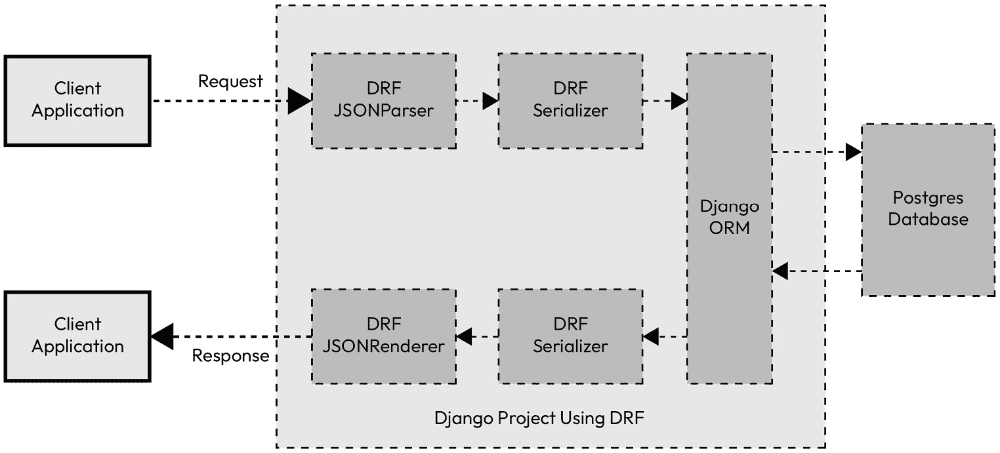

# 使用 DRF 序列化数据

在 *第 2 章* 中，我们学习了如何使用 Django 工作数据库和模型。我们学到的所有概念都与 Django 相关，以及开发人员如何充分利用 Django 框架与数据库交互。在本章中，我们将再向前迈进一步，了解 DRF 如何与 Django ORM 和模型集成，以帮助我们创建将被客户端应用程序消费的 API。

我们将详细学习序列化和反序列化的概念，以及客户端如何使用 JSON 数据类型与服务器应用程序交互。验证每个输入并从多个表中获取数据对开发人员来说很常见，因此 DRF 借助序列化器帮助实现此类用例的更精简接口。DRF 提供了可以开箱即用地与 Django 模型一起使用的序列化器，可以进行自定义。最后，我们将学习如何在使用 *APIViews* 和 *Generic Views* 中使用序列化器，我们在第一章中学习过。

本章将涵盖以下主题：

* 理解 DRF 序列化器的基础知识
* 使用模型序列化器
* 实现序列化器关系
* 使用序列化器验证数据
* 精通 DRF 序列化器
* 使用序列化器与 DRF 视图

# 技术要求

在本章中，我们将深入学习 DRF 序列化器以及开发人员如何在应用程序代码中充分利用序列化器。要跟上本章涵盖的概念，您应该清楚地了解 Django 模型和 ORM。我们将讨论相关字段和视图，因此您应该理解本书的前两章。虽然我们将涵盖序列化器的所有概念，但了解如何创建 DRF 序列化器会有所帮助。

以下是本章所有代码和说明的 GitHub 仓库：[`github.com/PacktPublishing/Django-in-Production/tree/main/Chapter03`](https://github.com/PacktPublishing/Django-in-Production/tree/main/Chapter03)。

# 理解 DRF 序列化器的基础知识

在上一章中，我们学习了如何使用 Django 模型和 ORM 使用数据库。然而，在 Web 应用程序的世界中，客户端和服务器之间的交互是通过 REST API 使用 JSON 请求-响应格式进行的。让我们看看客户端-服务器 API 交互的样子。

客户端应用程序使用 JSON 数据格式通过 ReST API 将信息发送到服务器。运行在 DRF 上的 Django 服务器默认使用 `JSONParser` 将数据从 JSON 格式解析为 Python 原生格式。然后，Python 原生格式中的数据将被传递给序列化器，使用 Django ORM 将数据保存到数据库中。同样，当使用 Django ORM 从数据库检索数据时，它将通过序列化器传递以将数据反序列化为 Python 原生格式。Python 原生格式数据将通过 `JSONRenderer` 传递以将数据渲染为 JSON 格式，最终将响应发送给客户端。

*图 3**.1* 描述了我们讨论的数据流，为 DRF 和 Django 为客户端-服务器交互执行的底层数据转换提供了清晰的理解。



图 3.1：DRF JSONParser、Serializer 和 JSONRenderer 的数据工作流

## 配置自定义解析器和渲染器

通常，大多数现代客户端应用程序使用 JSON 内容类型与服务器交互。如果您发现客户端发送的数据未被 DRF 视图解析，那么您应该调查客户端发送的 `Content-Type` 标头。DRF 为您提供添加不同解析器的灵活性，并且解析器是使用定义的 `Content-Type` 标头选择的。同样，DRF 为您提供配置渲染器的灵活性。您可以通过分别在 `APIView` 类中定义 `parser_classes` 和 `renderer_classes` 属性来配置解析器和渲染器。

DRF 序列化器帮助我们将复杂数据类型（如 QuerySets 和模型实例）转换为原生 Python 数据类型，这些类型可以很容易地使用渲染器转换以向客户端返回响应。DRF 序列化器还提供反序列化接口，帮助我们将 Python 原生数据类型转换为复杂数据类型，并提供数据验证支持。

在本章中，我们将不讨论通用序列化器类；然而，由于大多数应用程序开发人员使用 `ModelSerializer` 类来实现业务逻辑，我们将接下来讨论它。

# 使用模型序列化器

序列化器的最常见用例是从 Django 模型保存或检索数据。DRF 提供了 `ModelSerializer`，它帮助我们将 DRF 序列化器集成到 Django 模型中，可以序列化和反序列化其中存在的字段。`ModelSerializers` 在可序列化字段和模型定义中存在的数据库字段之间映射。

让我们使用几个基本的 `ModelSerializer` 示例来理解概念。我们将使用在 *第 2 章* 中构建的相同的 `Blog` Django 模型并创建 `BlogSerializer` 来序列化数据。我们可以在任何地方定义序列化器，但为了具有可维护的代码，建议为每个应用有一个单独的 `serializers.py` 文件，其中包含所有序列化器定义：

```
# blog/models.py
class Blog(BaseTimeStampModel):
    title = models.CharField(max_length=200)
    content = models.TextField()
    author = models.ForeignKey(Author, related_name='author_blogs', on_delete=models.PROTECT)
# blog/serializers.py
class BlogSerializer(serializers.ModelSerializer):
    class Meta:
        model = Blog
        fields = '__all__'
```

现在，让我们打开 Django shell 来探索 `BlogSerializer`。首先，我们将找到所有自动链接到我们序列化器的序列化器字段。在以下代码片段中，我们可以看到 `Blog` 模型中存在的所有字段都已添加到我们的序列化器中：

```
>>> from blog import serializers
>>> print(serializers.BlogSerializer())
BlogSerializer():
    id = IntegerField(label='ID', read_only=True)
    title = CharField(max_length=100, validators=[<UniqueValidator(queryset=Blog.objects.all())>])
    content = CharField(style={'base_template': 'textarea.html'})
    created_at = DateTimeField(read_only=True)
    updated_at = DateTimeField(read_only=True)
    author = PrimaryKeyRelatedField(queryset=Author.objects.all())
```


序列化器用于从 Django 模型中创建、更新和检索信息。让我们检查一下如何使用 `BlogSerializer` 执行这三种操作的基础知识。

## 创建新的模型对象

模型序列化器通过 REST API 改善了在 Django 模型中创建新条目的整体体验。由于 `ModelSerializer` 将 Django 模型中定义字段链接到序列化器，因此输入数据的验证会自动由 DRF 序列化器处理。

例如，在以下代码片段中，我们可以看到如何将输入数据传递给序列化器。序列化器关联的验证器会通过 `<serialize instance>.is_valid()` 调用以验证输入值，返回 `True`/`False`。要将数据保存到数据库，我们需要调用 `<serialize instance>.save()` 方法（我们应该始终记住仅在调用 `is_valid()` 方法后才调用 `save()` 方法）。验证错误可以从 `<serialize instance>.errors` 属性中检索。

让我们现在查看一个使用 DRF 序列化器保存新博客对象的示例。请注意，`author` 值为 `1` 是我们想要链接到模型的 `Author` 对象的外键：

```
>>> from blog import serializers
>>> input_data = {
...    'title': 'new blog title',
...    'content': 'this is content',
...    'author': 1
... }
>>> new_blog = serializers.BlogSerializer(data=input_data)
>>> new_blog.is_valid()
True
>>> new_blog.save()
<Blog: Blog object (11)>
```

DRF 还为我们提供了修改默认 `create` 行为的机制。通过重写 `ModelSerializer` 的 `create` 方法，我们可以在调用 `save()` 方法时实现自定义行为。例如，让我们在任何新对象创建调用中添加一个 `print` 语句：

```
class BlogCustomSerializer(serializers.ModelSerializer):
    def create(self, validated_data):
        print('*** Custom Create method ****')
        return super(BlogCustomSerializer, self).create(validated_data)
    class Meta:
        model = Blog
        fields = '__all__'
```

如果我们想要创建多个对象，我们可以传递新对象的列表以及一个额外的标志 `many`，该标志告诉序列化器将要创建多个对象。以下代码片段显示了创建多个对象的实现：

```
>>> from blog import serializers
>>> input_data = {
...    'title': 'new blog title',
...    'content': 'this is content',
...    'author': 1
... }
>>> new_blog = serializers.BlogSerializer(data=[input_data, input_data], many=True)
>>> new_blog.is_valid()
True
>>> new_blog.save()
*** Custom Create method ****
*** Custom Create method ****
[<Blog: Blog object (12)>, <Blog: Blog object (13)>]
```

一旦我们创建了新条目，我们可能想要修改现有值；DRF 提供了使用序列化器更新现有数据库条目的干净接口。

## 更新现有模型对象

要使用序列化器更新模型实例，我们必须将要更新的现有博客对象作为 `instance` 属性传递，如果我们只想更新特定字段，则还需要传递 `partial` 标志。以下代码片段显示了如何仅更新现有模型实例的标题的示例：

```
>>> from blog import serializers
>>> update_input_data = {
...    'title': 'new blog title',
... }
>>> existing_blog = models.Blog.objects.get(id=10)
>>> new_blog = serializers.BlogSerializer(instance=existing_blog, data=update_input_data, partial=True)
>>> new_blog.is_valid()
True
>>> new_blog.save()
<Blog: Blog object (10)>
```

然后我们可以重写 `update` 方法以向序列化器使用的任何更新操作添加自定义逻辑：

```
class BlogCustom2Serializer(serializers.ModelSerializer):
    def update(self, instance, validated_data):
        print('*** Custom Update method ****')
        return super(BlogCustom2Serializer, self).update(instance, validated_data)
    class Meta:
        model = Blog
        fields = '__all__'
```

前面代码片段中突出显示的部分显示了我们如何重写现有的更新方法并添加了 `print` 语句。

现在，让我们探索如何使用模型序列化器序列化从数据库检索的 QuerySet 信息。

## 从模型对象实例检索数据

当我们将模型对象实例传递给模型序列化器时，它会根据字段定义将数据序列化为字典格式。在以下代码片段中，我们将单个数据库对象传递给模型序列化器类以序列化值。`blog_obj.data` 具有来自 `Blog` 对象实例的序列化信息：

```
>>> from blog import serializers
>>> from blog import models
>>> from pprint import pprint
>>> tenth_blog = models.Blog.objects.get(id=10)
>>> blog_obj = serializers.BlogSerializer(instance=tenth_blog)
>>> pprint(blog_obj.data)
{'author': 1,
 'content': 'this is content',
 'created_at': '2023-10-01T10:12:09.192181Z',
 'id': 10,
 'title': 'updated_blog title',
 'updated_at': '2023-10-02T08:21:01.422111Z'}
```

同样，当我们将 QuerySet 传递给序列化器时，我们可以序列化所有模型对象。我们需要在实例化序列化器时传递 `many` 标志，以便它识别我们正在尝试序列化多个模型对象：

```
>>> from pprint import pprint
>>> from blog import models, serializers
>>> multiple_blogs = models.Blog.objects.all()
>>> blog_objs = serializers.BlogSerializer(instance=multiple_blogs, many=True)
>>> pprint(blog_objs.data)
```

现在我们已经了解了如何使用序列化器创建、更新和检索数据，让我们探索如何使用 `Meta` 类配置模型序列化器。

## 探索 Meta 类

DRF 序列化器遵循 Django 模型的概念来定义元数据。任何与序列化器字段定义无关的内容都应定义在内部 `Meta` 类中。

让我们学习几个需要在 `ModelSerializer` 的内部 `Meta` 类上声明的重要属性：

* `model`: `ModelSerializer` 需要映射到一个 Django 模型；为此，我们使用 `model` 属性将相应的 Django 模型映射到序列化器：

```
class BlogSerializer(serializers.ModelSerializer):
    class Meta:
        model = Blog
        fields = '__all__'
```

在示例中，我们有一个 Django 模型 `Blog`，它使用 model 属性链接到 `BlogSerializer`。

* `fields`: 当我们将 Django 模型声明为 `ModelSerializer` 时，我们还必须定义序列化器要使用的相应字段。`fields` 属性接受我们希望序列化器包含的字段名称列表作为输入。它还接受一个特殊值 `'__all__'`，这将表示应使用链接模型中的所有字段。例如，如果我们使用以下片段，`BlogSerializer` 将具有在 `Blog` 模型中定义的所有字段：

```
class BlogSerializer(serializers.ModelSerializer):
    class Meta:
        model = Blog
        fields = '__all__'
```

现在，如果我们使用模型字段名称列表声明字段，我们将只能在序列化器输出中看到这些值。例如，在以下片段中，我们将只有三个定义的字段：

```
class BlogSerializer(serializers.ModelSerializer):
    class Meta:
        model = Blog
        fields = ['id', 'title', 'created_at']
```


进入`/path/to/xxx`目录，找到`xxx.json`。

## `exclude`

在某些情况下，我们可能希望将模型的所有字段添加到序列化器中，除了少数几个字段；这时 `exclude` 属性非常有用。当我们定义 `exclude` 属性时，除了列表中定义的字段外，所有字段都会被序列化器忽略。例如，在下面的代码片段中，`Blog` 模型中存在的所有字段都会出现，除了在 `exclude` 属性中定义的 `updated_at`：

```
class BlogSerializer(serializers.ModelSerializer):
    class Meta:
        model = Blog
        exclude = ['updated_at']
```

我们应该始终记住，对于 `ModelSerializer`，必须提供 `fields` 或 `exclude`。此外，`exclude` 属性仅映射到 Django 模型类中定义的模型字段。

## `read_only_fields`

单个 `ModelSerializer` 可用于从数据库保存和检索数据。因此，我们会有这样的用例：我们希望某些字段仅在检索数据时序列化，而不在写入操作期间序列化。在此示例中，`updated_at` 字段仅在我们从数据库检索数据时被序列化：

```
class BlogSerializer(serializers.ModelSerializer):
    class Meta:
        model = Blog
        fields = '__all__'
        read_only_fields = ['updated_at']
```

还有另一种定义只读字段的方法——即在定义字段时定义。序列化器字段定义在声明字段定义时接受一个参数 `read_only`。默认情况下，任何 `AutoField` 都设置为只读行为。

## `extra_kwargs`

此属性是 DRF `ModelSerializer` 提供的一个最令人困惑但功能强大的功能之一。由于 DRF 的文档中没有任何细节，因此很难理解如何使用 `extra_kwargs`，但我们将检查一些可使用 `extra_kwargs` 字典配置的基本选项：

* `write_only`：我们可以定义字段是否应为仅写入的布尔类型值
* `min_length`：字段的最小长度，适用于字符串字段
* `max_length`：给定字段的最大长度，适用于字符串字段
* `Required`：用于标记字段是否必需的布尔值
* `Validators`：用于为给定字段设置自定义验证器

除了刚刚提到的之外，还有其他属性，例如 `default` 和 `source`，我们可以根据用例进行配置。让我们看一个如何在模型序列化器中使用 `extra_kwargs` 的基本示例：

```
class BlogSerializer(serializers.ModelSerializer):
    class Meta:
        model = Blog
        fields = '__all__'
        extra_kwargs = {
            'updated_at': {'write_only': True},
            'title': {'min_length': 100, 'required': True},
        }
```

每个父键将是字段名，属性应为键的值——例如，`'updated_at': {'write_only': True}` 表示 `updated_at` 字段为仅写入。

**Important note**

如果字段在序列化器类中明确定义，则 `extra_kwargs` 选项中定义的属性将被始终忽略。

## `Depth`

Django 模型具有外键关系字段和其他相关字段链接。默认情况下，DRF 不会检索除外键之外的任何相关字段值。当我们定义 `depth` 属性时，它会自动遍历关系以检索所有信息，并最终以 JSON 结构表示。以下代码片段将检索所有外键关系值并返回第一级信息：

```
class BlogSerializer(serializers.ModelSerializer):
    class Meta:
        model = Blog
        fields = '__all__'
        depth = 1
```

`depth` 是一个整数值，用于确定序列化器应检索的关系深度，默认情况下 `depth` 设置为 `0`。

现在我们已经了解了如何配置 Model Serializers，让我们学习序列化器的另一个重要方面——关系。

# Implementing Serializer relations

Django 模型有三种类型的关系字段——`ForeignKey`、`ManyToManyField` 和 `OneToOneField`（它们都支持反向关系）。到目前为止，我们已经了解了如何有效地使用模型序列化器，但现在让我们探索如何在序列化器中处理相关字段。

默认情况下，当模型具有任何相关字段时，`ModelSerializer` 会将关联字段链接到序列化器定义中的 `PrimaryKeyRelatedField`。DRF 序列化器将为所有类型的相关字段序列化器使用 `PrimaryKeyRelatedField`，并传递不同的选项。

在这里，我们将学习如何创建相关字段序列化器：

* 对于 `ForeignKey`，DRF 模型序列化器将 `PrimaryKeyRelatedField` 分配给序列化器
* 对于 `OneToOneField`，DRF 模型序列化器将 `PrimaryKeyRelatedField` 分配给序列化器，并附加一个 `UniqueValidator`
* 对于 `ManyToManyField`，DRF 模型序列化器将 `PrimaryKeyRelatedField` 分配给序列化器，并带有两个附加标志 `many=True` 和 `allow_empty=True`

默认情况下，`PrimaryKeyRelatedField` 是读写字段，除非我们特别提及 `read_only=True` 标志。以下是我们如何为相应的相关模型字段使用 `PrimaryKeyRelatedField` 的示例：

```
# blog/models.py
class Blog(models.Model):
    author = models.ForeignKey(
        Author, on_delete=models.PROTECT
    )
    cover_image = models.OneToOneField(
        CoverImage, on_delete=models.PROTECT
    )
    tags = models.ManyToManyField(Tags)
# blog/serializers.py
class BlogCustom3Serializer(serializers.ModelSerializer):
    author = serializers.PrimaryKeyRelatedField(
        queryset=Author.objects.all()
    )
    tags = serializers.PrimaryKeyRelatedField(
        queryset=Tags.objects.all(), many=True, allow_empty=True
    )
    cover_image = serializers.PrimaryKeyRelatedField(
        queryset=CoverImage.objects.all(),      validators=[validators.UniqueValidator(CoverImage.objects.all())]
    )
    class Meta:
        model = Blog
        fields = '__all__'
```

在此示例中，我们手动定义了 DRF 在幕后自动创建的所有不同类型的相关字段序列化器。

`PrimaryKeyRelatedField` 中的 `QuerySet` 参数是什么？

`queryset` 参数用于在我们尝试创建新条目时验证字段输入。对于只读操作，`queryset` 不使用；因此，当我们创建具有只读相关字段的序列化器时，可以忽略它。对于任何写入操作，必须提供 `queryset` 参数，因为它将使用提供的查询集执行验证。

DRF 提供了创建嵌套序列化器的灵活性，这在我们想要获取嵌套对象数据时很有帮助。我们可以使用 `depth` 配置来获取默认字段，但如果我们需要来自嵌套对象的自定义字段，则嵌套序列化器非常方便。

## Working with nested Serializers

我们应该在想要从嵌套对象中获取选定字段时使用嵌套序列化器。例如，让我们为所有博客获取作者姓名和作者简介。`BASerializer` 仅公开作者姓名和简介，因此最终序列化的数据将仅为每个博客的作者姓名和简介。然后，`source` 属性用于告诉序列化器它应该使用哪个数据库模型字段来传递相关对象信息：


```
class BASerializer(serializers.ModelSerializer):
    class Meta:
        model = Author
        fields = ['name', 'bio']
class BlogCustom4Serializer(serializers.ModelSerializer):
    author_details = BASerializer(source='author')
    class Meta:
        model = Blog
        fields = '__all__'
```

我们也可以通过添加 `many=True` 标志，使用嵌套序列化器传递 `ManyToManyFields` 或反向关系。默认情况下，嵌套序列化器始终为只读。要将其用于写操作，我们必须更新 `create` 和/或 `update` 方法。

在处理关联字段时，我们可能需要从关联表的多个层级获取字段值，并且可能不想使用过多的嵌套序列化器。DRF 提供了两种不同的选项，使用 `source` 或 `SerializerMethodField` 来解决此用例。让我们看看如何使用 `source` 参数。

## 探索 source

在内部，DRF 可以扫描嵌套对象并检索相关字段。`source` 属性可以被视为将特定序列化器字段和数据库字段映射的一种方式。我们可以使用 `source` 属性执行多个操作来实现以下功能：

* 在不更改数据库模型的情况下，为 API 重命名给定字段
* 添加一个序列化器只读字段，该字段在幕后访问模型方法
* 在不编写自定义代码的情况下访问对象的多个层级

让我们通过示例来探索这些操作，以便更好地理解。在下面的示例中，`AuthorSerializer` 使用 `source` 属性实现了三个自定义字段：

```
# author/models.py
class Author(models.Model):
    bio = models.TextField()
    def fetch_short_bio(self):
         return self.bio[:100]
# author/serializers.py
class AuthorSerializer(serializers.ModelSerializer):
    long_bio = serializers.CharField(source='bio')
    short_bio = serializers.CharField(source='fetch_short_bio')
    class Meta:
        model = Author
        fields = '__all__'
        exclude = ['bio', 'email']
```

这里，我们使用 `source` 属性将 `bio` 模型字段重命名为 `long_bio`。然后，在 `short_bio` 字段中，我们使用 `source` 属性从 `Author` 模型访问模型方法 `fetch_short_bio`。

`source` 属性足够强大，可以访问对应模型中存在的不同属性。如果我们想要执行数据操作，那么 DRF 提供了 `SerializerMethodField`，它可以访问模型对象实例以执行任何类型的操作。

## 探索 SerializerMethodField

`SerializerMethodField` 是一个只读字段，可以在任何序列化器类中定义。它会自动将模型实例对象传递给方法。例如，如果我们想计算特定博客的总词数，我们可以使用 `SerializerMethodField`。在这种情况下，`word_count` 字段是一个方法序列化器字段，默认情况下 DRF 会查找 `get_<field name>` 来获取对应的方法：

```
class BlogCustom5Serializer(serializers.ModelSerializer):
    word_count = serializers.SerializerMethodField()
    def get_word_count(self, obj):
        return len(obj.content.split())
    class Meta:
        model = models.Blog
        fields = '__all__'
```

如果我们想使用自定义方法名，则可以将 `method_name` 参数传递给定义。例如，我们可以将方法命名为 `use_custom_word_count` 并将其传递给 `method_name` 以进行关联：

```
class BlogCustom6CustomSerializer(serializers.ModelSerializer):
    word_count = serializers.SerializerMethodField(
        method_name='use_custom_word_count'
    )
    def use_custom_word_count(self, obj):
        return len(obj.content.split())
    class Meta:
        model = models.Blog
        fields = '__all__'
```

我们可以在方法中执行任何类型的操作 - 例如，访问外键字段数据或进行额外查询。

重要提示

默认情况下，反向外键关系不会添加到序列化器中，但我们可以使用 `source` 关键字手动添加它们。此外，在读操作中使用关联字段序列化器时要非常小心。因为默认情况下没有使用 `select_related` 或 `prefetch_related` 查询，开发人员可能会遇到 `N+1 query problem`，导致性能下降。我们将在本章后半部分 *Avoiding the N+1 query Problem* 中讨论如何克服这个问题。

现在我们已经了解了如何使用关联字段序列化器，我们将看到 DRF 序列化器如何为验证器提供接口并使用 DRF 序列化器实现不同类型的验证。

# 使用序列化器验证数据

DRF 序列化器最受欢迎的功能之一是它开箱即用的数据验证框架。默认情况下，每当模型被定义为模型序列化器时，它会自动选择字段类型和数据库字段验证器，并将其应用于序列化器。当我们将原始数据传递给序列化器并调用 `is_valid()` 方法时，它会根据自动生成的验证器评估数据并给我们一个布尔值。

现在，让我们研究一些深入的概念以及 DRF 序列化器中验证器的实现。

## 自定义字段级验证

DRF 序列化器字段可以具有链接到特定字段的自定义验证逻辑。通过在序列化器类中定义 `validate_<field name>` 方法，DRF 会在调用 `is_valid()` 方法时自动执行验证器。例如，如果我们不希望标题中包含下划线，可以使用以下代码片段：

```
class BlogCustom7Serializer(serializers.ModelSerializer):
    def validate_title(self, value):
        print('validate_title method')
        if '_' in value:
            raise serializers.ValidationError('illegal char')
        return value
    class Meta:
        model = models.Blog
        fields = '__all__'
```

这里，`validate_title` 会在我们调用 `is_valid` 方法时由 DRF 序列化器自动执行。

每当我们创建自定义验证器时，请记住在任何无效状态下使用 `raise ValidationError`。DRF 特别查找 `ValidationError`。

## 定义自定义字段级验证器

某些字段会一再添加到不同的序列化器中；因此需要相同的验证逻辑。为了避免重复相同的逻辑，我们可以定义一个验证器函数并将其传递给 `validator` 属性，使用 `extra_kwargs` 或 `field` 属性。在下面的示例中，标题和内容字段具有相同的验证器，用于检查值中是否存在无效字符：

```
def demo_func_validator(attr):
    print('func val')
    if '_' in attr:
        raise serializers.ValidationError('invalid char')
    return attr
class BlogCustom8Serializer(serializers.ModelSerializer):
    class Meta:
        model = models.Blog
        fields = '__all__'
        extra_kwargs = {
            'title': {
                'validators': [demo_func_validator]
            },
            'content': {
                'validators': [demo_func_validator]
            }
        }
```

就我个人而言，我更喜欢使用 `extra_kwargs` 来定义任何自定义字段级验证器，因为它更冗长且提高了可读性。

## 执行对象级验证

我们已经学习了如何执行字段级验证；现在，让我们学习如何执行对象级验证。这种类型的验证在我们具有涉及多个字段的某些验证时特别有帮助：


``` 
class BlogCustom9Serializer(serializers.ModelSerializer):
    def validate(self, attrs):
        if attrs['title'] == attrs['content']:
            raise serializers.ValidationError('Title and content cannot have value')
        return attrs
    class Meta:
        model = models.Blog
        fields = '__all__'
```

DRF 仅在所有字段级验证成功执行后才会执行对象级验证。通过在序列化器中定义自定义逻辑的 `validate()` 方法，我们可以执行对象级验证。例如，让我们添加一个验证逻辑，以阻止用户为博客的标题和内容赋予相同的值：

## 定义自定义对象级验证器

我们可以定义可以在多个序列化器中使用的自定义对象级验证器。为此，我们需要在 `Meta` 类中声明 `validators` 属性。在这里，我们将实现与前面示例中相同的逻辑——我们希望防止 `title` 和 `content` 字段具有相同的值。`Custom_obj_validator` 是一个自定义对象验证器，我们在其中实现逻辑：

```
def custom_obj_validator(attrs):
    print('custom object validator')
    if attrs['title'] == attrs['content']:
        raise serializers.ValidationError('Title and content cannot have the same')
    return attrs
class BlogCustom10Serializer(serializers.ModelSerializer):
    class Meta:
        model = models.Blog
        fields = '__all__'
        validators = [custom_obj_validator]
```

我们已经看到了在字段级和对象级实现验证器的多种方法，但了解评估顺序很重要，以便我们可以高效地实现验证器；我们将在接下来讨论这一点。

## 验证器的评估顺序

让我们探索不同验证器的评估顺序，这将帮助我们决定在哪里添加自定义逻辑；为了清晰起见，我们使用了字段级和对象级验证器的示例：

```
def func_validator(attr): # 1- Evaluates first
    print('func val')
    if '*' in attr:
        raise serializers.ValidationError('Illegal char')
    return attr
class BlogCustom11Serializer(serializers.ModelSerializer):
    def validate_title(self, value): # 2-If func_validator succeeds
        print('validate_title method')
        if '_' in value:
            raise serializers.ValidationError('Illegal char')
        return value
    def validate(self, attrs): # 3- If all field validator succeeds
        print('main validate method')
        return attrs
    class Meta:
        model = models.Blog
        fields = '__all__'
        extra_kwargs = {
            'title': {
                'validators': [func_validator]
            }
        }
```

在 `extra_kwargs` 中定义的验证器将始终先执行，即 `func_validator`，然后是字段级 validate 方法，即 `validate_title`。如果所有字段验证器都成功，则对象验证器 `validate()` 方法将被执行。为了更好地理解，请尝试使用不同的输入值运行上述示例——例如，提供一个无效的标题值，然后在传递对象级无效值时添加正确的标题值。

## 从 DRF 序列化器类中移除默认验证器

DRF 序列化器具有默认验证器，它们始终检查输入值。在某些时候，我们可能有这样的用例：我们希望禁用 DRF 生成的所有默认字段验证器。如果我们将 `validator` 属性赋值为一个空字符串，则所有自动生成的验证器将被禁用。

例如，在以下代码片段中，`BlogSerializer` 的任何自动生成的字段级验证器都被禁用，但如果我们在 `validator` 方法中定义验证，则 `validator` 方法仍然适用并将被执行以进行验证：

```
class BlogCustom12Serializer(serializers.ModelSerializer):
    class Meta:
        model = models.Blog
        fields = '__all__'
        validators = []
```

在本节中，我们学习了使用 DRF 序列化器进行数据验证的不同方法。字段级和对象级验证器各有优缺点，开发人员应根据验证需求使用它们。让我们现在开始学习 DRF 序列化器的复杂性，以及如何掌握 DRF 序列化器的不同用例。

# 精通 DRF 序列化器

我们已经学习了 DRF 序列化器的所有重要概念，因此在本节中，我们将学习如何高效地使用 DRF 序列化器，以及一些新的概念，这些概念可以帮助我们进一步掌握它们。

## 使用 source

我们之前学习了如何使用 `source` 选项执行多种类型的操作，并且今后应尽可能在序列化器字段中使用此参数。这是因为它大大减少了为诸如重命名字段、创建扁平响应结构或访问相关字段数据等基本任务编写手动代码的需求。

## 拥抱 SerializerMethodField

`SerializerMethodField` 为我们提供了在运行时执行数据操作的很大灵活性。我们应该在需要对单个对象的多个字段进行计算，或转换数据时使用方法序列化器。

## 使用 validators

始终尝试添加 `validators`，以便我们无需使用自定义代码来执行数据验证。我们在本章中讨论了添加验证器的多种方法，包括字段级和对象级，我们应该尝试评估适当的验证器类型并相应地实现它们。

## 使用 to_internal_value

`to_internal_value` 方法可以在验证运行之前访问原始输入字段。如果我们想对数据执行任何操作或对整个输入数据进行操作，可以使用此方法。让我们查看一个快速示例，说明如何使用它：

```
class BlogCustom13Serializer(serializers.ModelSerializer):
    def to_internal_value(self, data):
        print('before validation', data)
        return super().to_internal_value(data)
    class Meta:
        model = models.Blog
        fields = '__all__'
```

在这个示例中，我们在调用 `ModelSerializer` 原生提供的 `to_internal_value` 方法的原始实现之前简单地添加了一个打印语句。`data` 变量包含原始输入值，可以根据需要进行操作。

## 使用 to_representation

`to_representation` 方法接收模型对象实例并将其转换为 Python 原始数据类型。我们可以重写此方法以在序列化器实例返回的序列化数据之前执行数据操作。例如，在 `BlogCustom14Serializer` 中，我们可以将博客的 `title` 字段转换为大写文本：

```
class BlogCustom14Serializer(serializers.ModelSerializer):
    def to_representation(self, instance):
        resp = super().to_representation(instance)
        resp['title'] = resp['title'].upper()
        return resp
    class Meta:
        model = models.Blog
        fields = '__all__'
```

在这个示例中，我们将标题字段设为大写。同样，我们可以在返回响应之前对任何字段执行任何类型的操作。

## 使用 context 参数传递信息

在高级用例中，我们可能需要将请求对象或任何其他附加信息传递给序列化器。DRF 序列化器为此目的提供了 `context` 参数。在序列化器初始化期间通过 `context` 参数传递的任何键值对都可在所有序列化器方法中使用。当我们想将任何请求对象数据传递给序列化器以进行自定义计算时，此功能非常方便。

在前述示例中，我们在初始化 `BlogSerializer` 时向 `context` 参数传递一个简单的键值对：


```
class BlogCustom15Serializer(serializers.ModelSerializer):
    def to_internal_value(self, data):
        print('Printing context –', self.context)
        return super().to_internal_value(data)
    class Meta:
        model = models.Blog
        fields = '__all__'
>>> input_data = BlogSerializer(
    data={'title':'abc'}, context={'request': 'some value'}
)
>>> input_data.is_valid()
# Printing context – {'request': 'some value'}
```

同样的键值对也可以通过 `to_internal_value` 方法中的 `context` 访问。`self.context` 是一个对象属性；我们可以在 Serializer 的任何其他方法中访问 `self.context` 值。

## 自定义字段

DRF 还提供了一个清晰的接口，通过子类化 `Field` 类或继承现有字段来创建自定义字段。官方文档解释得相当好：

[`www.django-rest-framework.org/api-guide/fields/#custom-fields`](https://www.django-rest-framework.org/api-guide/fields/#custom-fields)。

## 向 PrimaryKeyField 传递自定义 QuerySet

在创建新的关联字段时，我们可能有这样一个用例：只允许为过去由请求用户创建的字段使用 `ForeignKey`。例如，当我们为新博客添加标签时，我们希望确保只能将作者创建的标签添加到博客中。这是一个非常常见的用例，开发者通常通过在 Serializer 外部编写自定义代码来验证输入数据来解决。

然而，相反，我们可以通过使用 `context` 和前面讨论的自定义字段概念来执行此操作。在下面的示例中，我们创建了一个新的 `CustomPKRelatedField`，它重写了默认的 `get_queryset` 行为：

```
class CustomPKRelatedField(serializers.PrimaryKeyRelatedField):
    def get_queryset(self):
        req = self.context.get('request', None) #context value
        queryset = super().get_queryset() #retrieve default filter
        if not req:
            return None
        return queryset.filter(user=req.user) #additional filter
class BlogCustom16Serializer(serializers.ModelSerializer):
    tags = CustomPKRelatedField(queryset=models.Tags.objects.all())
    class Meta:
        model = models.Blog
        fields = '__all__'
```

现在，`CustomPKRelatedField` 将自动过滤由请求用户创建的任何标签，并对具有超出过滤条目的标签的任何输入请求抛出错误。

## 构建 DynamicFieldsSerializer

我们已经学习了如何创建不同的序列化器字段并使用序列化器概念操作数据；然而，在我们所有的示例中，字段始终是预定义的。也许存在这样的用例，我们希望动态添加序列化器字段；DRF 通过覆盖 Serializer 类中字段定义的常规行为来支持这种类型的自定义。

阅读更多

DRF 还为我们提供了一种创建动态序列化器的方法，它将即时生成字段。官方文档提供了开发者如何更好地使用此功能的示例：[`www.django-rest-framework.org/api-guide/serializers/#dynamically-modifying-fields`](https://www.django-rest-framework.org/api-guide/serializers/#dynamically-modifying-fields)。

## 避免 N+1 查询问题

N+1 查询问题是在 Serializer + ORM 执行 *N* 个额外的 SQL 语句来获取本可以在执行主 SQL 查询时检索到的数据时出现的性能问题。N+1 查询问题是一个巨大的性能瓶颈，会减慢大量生产环境中的应用程序，并且在使用访问关联字段的列表序列化器时相当常见。

我们可以通过使用 `select_related` 和 `prefetch_related` 查询集来避免这个问题。建议逐案解决这个问题，并将适当的 Django ORM QuerySet 传递给序列化器。

现在我们已经掌握了序列化器及其提供的不同配置，我们将重点关注将 DRF 序列化器与 DRF 视图集成。

# 使用序列化器与 DRF 视图

在实际应用开发中，DRF 序列化器与 DRF 视图紧密合作以与客户端应用程序交互。让我们通过博客 API 示例学习如何将 DRF 序列化器集成到 DRF 视图中。在以下示例代码中，我们将 `BlogSerializer` 集成到 `APIView` 中，以实现博客模型的读写操作：

```
class BlogGetCreateView(views.APIView):
    def get(self, request):
        blogs_obj_list = Blog.objects.all()
        blogs = BlogSerializer(blogs_obj_list, many=True)
        return Response(blogs.data)
    def post(self, request):
        input_data = request.data
        b_obj = BlogSerializer(data=input_data)
        if b_obj.is_valid():
           b_obj.save()
           return Response(b_obj.data, status= HTTP_201_CREATED)
        return Response(b_obj.errors, status= HTTP_400_BAD_REQUEST)
```

在前面的示例中，当有 `get` HTTP 请求时，我们列出所有博客，而在 `post` HTTP 请求中，我们创建新的博客条目。类似地，我们可以在 `APIView` 类中为其他 HTTP 方法实现业务逻辑。

## 重要说明

我们将直接专注于实现高级用例。对于基本集成，请查看 DRF 教程：[`www.django-rest-framework.org/tutorial/3-class-based-views/`](https://www.django-rest-framework.org/tutorial/3-class-based-views/)。

## 使用通用视图

每当我们创建简单的 CRUD 操作 API 时，使用通用视图总是更有利的。让我们看看如何将序列化器集成到 `GenericAPIView` 中。`GenericAPIView` 具有 `serializer_class` 配置，通过它我们可以链接关联的序列化器。

对于任何写操作，DRF 会自动处理将输入字段传递给序列化器并在数据库上执行保存操作。正如我们之前所学，对于任何读取操作，我们需要为序列化器提供一个 QuerySet。在 `GenericAPIView` 中，我们可以使用 `queryset` 属性配置链接查询，或通过自定义 `get_queryset()` 方法。然而，使用 `get_queryset` 方法将查询集传递给序列化器始终是首选。

这里有一个示例——让我们创建一个 API 来创建新博客并列出所有 ID 大于 10 的博客：

```
class BlogGetUpdateView(generics.ListCreateAPIView):
    serializer_class = BlogSerializer
    def get_queryset(self):
        blogs_queryset = Blog.objects.filter(id__gt=1)
        return blogs_queryset
```

`BlogGetUpdateView` 使用通用视图抽象出获取所有博客列表和创建新博客 API 的所有实现细节。我们使用 `get_queryset` 将 `queryset` 值传递给我们的 `BlogSerializer` 序列化器。

阅读更多

在实现基本的 CRUD API 时，通用视图非常有帮助且实现更快。DRF 为自定义通用视图行为的创建提供了混入。官方文档提到了 DRF 开箱即用的所有可用混入：

[`www.django-rest-framework.org/api-guide/generic-views/#mixins`](https://www.django-rest-framework.org/api-guide/generic-views/#mixins)。

## 使用 SearchFilter 和 OrderingFilter 进行过滤

我们学习了如何使用 `get_queryset` 方法为序列化器自定义查询集；此方法接口提供了对我们想要通过序列化器传递的数据的低级控制。然而，如果我们有一些通用用例，例如按某些字段对数据进行排序或执行基本搜索操作，那么我们应该使用 `filter_backends` 属性。DRF 提供了两个基本的过滤后端，`SearchFilter` 和 `OrderingFilter`，来执行基本操作。例如，让我们在 `BlogGetUpdateView` 中使用 `OrderingFilter` 按博客标题对所有结果进行排序：


```
class BlogGetUpdateFilterView(generics.ListAPIView):
    serializer_class = BlogSerializer
    filter_backends = [filters.OrderingFilter]
    ordering_fields = ['title']
```

同样，我们可以使用 `SearchFilter` 后端。官方文档提到了如何使用不同过滤器的基本示例，以及如何创建自定义过滤器后端。

Read more

DRF 还支持创建自定义过滤器并扩展现有过滤器。官方文档提供了示例，并对开发者如何最好地使用此功能进行了适当的解释：

[`www.django-rest-framework.org/api-guide/filtering/#api-guide`](https://www.django-rest-framework.org/api-guide/filtering/#api-guide)。

在本节中，我们学习了如何将 DRF 序列化器与 DRF 视图集成。我们还看到了 DRF 如何开箱即用地支持过滤器，以及我们如何使用它们来改进开发。

# Summary

在本章中，我们学习了如何使用 DRF 序列化器。首先，我们探索了基本 DRF 序列化器的概念，以及 DRF 如何使用 Renderer 和 Parser 将数据从 JSON 转换为 Python 原生数据类型（反之亦然）。然后，我们学习了如何使用 DRF `ModelSerializer` 与 Django 模型。

DRF 序列化器开箱即用地提供数据验证支持。在本章中，我们学习了使用序列化器集成字段级和对象级验证的不同方法。我们还学习了如何将 DRF 序列化器集成到与 Django 关联的字段中并使用嵌套序列化器。

最后，我们学习了如何将 DRF 序列化器与 DRF 视图集成，以全面了解序列化器在整体应用程序开发中的工作方式。

在下一章中，我们将学习如何使用 Django 管理后台以及如何使用 Django 管理命令。
