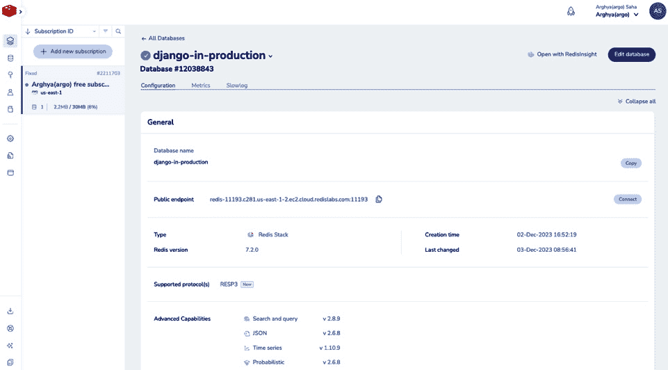

# 第 2 部分 – 使用 Django 的高级概念

在本部分，我们可以预期学习 Django 的高级概念，例如缓存、分页、Django 信号和中间件。Celery 框架是用于异步任务最流行的框架之一，我们将在本部分学习如何将 Celery 集成到 Django 项目中。我们还将学习如何为 Django 项目编写测试用例，以及在与 Django 协作时软件行业使用的最佳实践和约定。

本部分包含以下章节：

* *第 6 章*，*缓存、日志记录和节流*
* *第 7 章*，*使用分页、Django 信号和自定义中间件*
* *第 8 章*，*使用 Celery 与 Django*
* *第 9 章*，*在 Django 中编写测试*
* *第 10 章*，*探索 Django 中的约定*

# 6

# 缓存、日志记录和节流

在 *第 5 章* 中，我们学习了如何对每个请求进行认证并执行授权，以确保客户端有权访问资源。这些操作会为每个请求产生额外的数据库调用。对于大多数用例来说，这些额外的数据库调用是可以忽略的。但随着系统的构建，我们可能会遇到希望数据库读取操作响应更快的情况；缓存在此发挥重要作用。本章将学习如何在 Django 中使用缓存。节流是限制客户端在一定时期内发出请求数量的过程。日志记录和节流是我们行业中广泛使用的高级概念。

在本章中，我们将学习：

* 使用 Django 进行缓存
* 使用 Django 进行日志记录
* 使用 Django 进行节流

## 技术要求

我们期望读者对缓存的含义及其对终端用户的益处有一个基本概念。我们期望读者熟悉与节流相关的概念以及实现节流的用例。

缓存和节流都需要一个额外的内存数据库：`Redis`。尽管我们将使用抽象的 Redis API 进行实现，但建议读者了解 Redis 是什么及其基本概念。除此之外，我们将学习如何在 Django 中执行日志记录操作。Django 日志框架使用并扩展了 Python 内置的 logging 模块，因此我们期望读者在高层面上了解 Python logging 模块的工作原理。

了解更多

要对 Redis 有基本了解，可以查阅 Redis 的官方文档，或在 [`university.redis.com/`](https://university.redis.com/) 参加其中一个 Redis 课程。

Python 官方文档在 [`docs.python.org/3/library/logging.html`](https://docs.python.org/3/library/logging.html) 提供了关于内置 logging 模块的简明学习指南。

## 使用 Django 进行缓存

缓存被认为是计算机科学中必要的恶。它有助于获得性能提升，但也使系统变得复杂。计算机科学中最重要的复杂性之一是使缓存失效。在本节中，我们将学习 Django 中缓存的实现方式，以及如何使用 Django 和 DRF 改善开发者的整体缓存体验。

Django 开箱即用地提供了不同类型的缓存策略：

* `本地内存缓存`：数据缓存在应用内存本身中。
* `数据库缓存`：Django 会将缓存结果存储在数据库本身中。
* `文件系统缓存`：缓存条目以文件形式保存在文件系统上。
* `基于内存数据库的缓存`：Django 支持使用 Memcache 和 Redis 等缓存数据库在项目中使用。我们将在本章学习如何将 Redis 集成到 Django 项目中。
* `自定义缓存`：开发者也可以编写自定义后端来创建自己的策略以集成到 Django。

从 Django 4 开始，Django 开箱即用地支持 Redis 作为缓存的内存数据库。让我们先学习如何使用 Redis 数据库。就像 Postgres 一样，我们必须在系统上安装 Redis 才能使用它。然而，我们不想在系统上设置 Redis 的麻烦；因此，本章我们将使用 Redis 云服务。稍后，在 *第 11 章* 中，我们将学习如何使用 Docker 使用 Redis。

重要说明

我们不会在本章深入探讨 Redis 配置和设置。我们将主要关注将 Redis 集成到 Django 项目中，以及如何在项目中使用缓存。随着项目的增长，开发者需要进一步微调缓存配置以处理规模和高级用例。


要在此处使用 Redis，请访问 [`app.redislabs.com/#/login`](https://app.redislabs.com/#/login)，创建一个新账户，并按照向导创建新的 Redis 数据库。*图 6.1* 显示了我们将使用的 Redis Labs 仪表板：



图 6.1：来自 RedisLabs 的 Redis 仪表板

一旦我们创建了 Redis 数据库，我们需要从 RedisLabs 仪表板中识别以下信息：

* **Public endpoint**：此项包含主机 URL 和端口的信息
* **Redis user**：对于免费计划，用户始终为 `default`
* **Redis password**：此项在 **Default user password** 字段中提及

现在让我们检查如何使用配置并为 Django 添加 Redis 缓存支持。

向 `settings.py` 文件添加以下配置：

```
CACHES = {
    'default': {
        'BACKEND': 'django.core.cache.backends.redis.RedisCache',
        'LOCATION': 'redis://<user>:<password>@<public endpoint>',
    }
}
```

除了在 `settings.py` 文件中进行配置外，我们还必须使用 `pip` 安装 `redis` 包。我们可以通过 `pip install redis` 来完成。

添加配置后，我们需要测试我们的 Redis 配置是否有效且正常工作。为此，打开 Django shell 并运行以下命令：

```
>>> from django.core.cache import cache
>>> cache.set('hello', 'World', 600)
>>> cache.get('hello')
'World'
```

如果我们看到输出 `World`，则确认 Django 中的缓存配置按预期工作。

### Important note

Redis 支持仅从 Django 4 及以上版本开始添加到 Django。如果您使用的是更低版本，可以考虑升级 Django 版本或使用 `django-cacheops`，我们在下一节中讨论过。

现在我们的 Django 项目已配置为使用 Redis 支持缓存基础设施。Django 原生支持缓存响应和不同的实用程序。DRF 使用 Django 提供的实用程序来支持缓存响应和不同的缓存功能。

### Read more

Django 的缓存框架提供了可以缓存响应的基本缓存功能。官方文档包含了实现视图级缓存的所有细节。我们不会深入探讨它们，因为此缓存接口提供了一个大多数开发人员已经了解的基本实现。

Django: [`docs.djangoproject.com/en/stable/topics/cache/#the-per-view-cache`](https://docs.djangoproject.com/en/stable/topics/cache/#the-per-view-cache)

DRF: [`www.django-rest-framework.org/api-guide/caching/`](https://www.django-rest-framework.org/api-guide/caching/%20)

除了视图级缓存接口外，Django 还提供了一个低级 API 来实现我们自己的缓存接口。我们在之前的章节中学习了如何利用 DRF 构建现代应用程序，而缓存是其中的重要组成部分。我们可以使用 Django 提供的低级 API 来创建我们的缓存层，但我们必须编写大量额外的代码，这是不推荐的。因此，我建议使用额外的包：`django-cacheops`。

## Using django-cacheops

Django 4 提供了开箱即用的 Redis 作为缓存层的支持，但 Django 提供的默认缓存接口更适合缓存视图。随着我们在应用程序中构建复杂功能，我们需要在函数内部实现业务逻辑时实现缓存。Django 提供了一个低级 API 接口来使用底层缓存框架并直接与 Redis 交互，但对于开发人员来说，实现缓存功能变得过于麻烦。为此，我始终建议使用 `django-cacheops`（[`github.com/Suor/django-cacheops`](https://github.com/Suor/django-cacheops)），这是一个第三方包，它抽象了使用低级缓存 API 时的所有额外开销。以下是 `django-cacheops` 包的说明：

*Django cacheops is a slick ORM cache with automatic granular event-driven invalidation.*

让我们快速看看如何使用 `django-cacheops` 配置 Redis。首先，将 `cacheops` 添加到 `settings.py` 文件中的 `INSTALLED_APPS` 列表中。现在使用我们在上一节中从 Redis Labs 获得的 Redis 服务器的相同配置：

```
CACHEOPS_REDIS = {
    "host": "<public endpoint>",  # Redis endpoint
    "port": 15014,  # for redis lab, port is 15014
    "socket_timeout": 3,  # connection timeout in seconds, optional
    "password": "<REDIS_PASSWORD>",
}
```

现在我们已在项目中配置了 `django-cacheops`，让我们实现最常见且广泛使用的缓存用例。让我们尝试获取给定作者编写的所有博客：

```
@cached(timeout=60*10)
def get_all_blogs(author_id):
    print('Fetching blogs from database')
    blogs = Blog.objects.filter(author_id=author_id)
    blogs_data = BlogSerializer(blogs, many=True).data
    return blogs_data
@api_view(['GET'])
def get_blogs_by_author(request):
    author_id = request.GET.get('author_id')
    blogs = get_all_blogs(author_id)
    return Response({'blogs': blogs})
```

在我们的示例中，我们缓存了 `get_all_blogs` 对不同 `author_id` 的响应，缓存时间为 10 分钟。这意味着如果我们在 10 分钟内向函数传递相同的 `author_id`，输出将使用保存在 Redis 中的缓存结果返回。缓存由 `cached` 装饰器完成。为了验证我们的缓存，我们添加了一个 `print` 语句。现在，第一次我们应该在终端中看到 `print` 语句的输出：`Fetching blogs from database`。

`cached` 装饰器接受 `timeout` 作为参数，表示以秒为单位的总时间，之后缓存值将被从 Redis 中移除。`cacheops` 还负责创建唯一的缓存键名称和其他低级实现细节，这些细节对于确保没有冲突非常重要。

### Important note

应该确保返回的值是已求值的 QuerySet 值，而不是在进行 DB 查询之前未求值的 QuerySet。在我们的示例中，我们有 `return list(blogs)`，这意味着我们返回的是查询的值；如果我们返回 `blogs` 变量，则缓存的工作方式会不同。尽管函数会被缓存，但它会返回一个缓存的 QuerySet，该 QuerySet 在返回值时始终会命中数据库。

我们还需要实现一种使缓存失效的方式，以便在我们更新数据库中的数据后不使用缓存中的陈旧数据。`django-cacheops` 提供了简单的 `invalidate('<key>')` 接口来删除所有缓存结果。例如，如果我们必须使作者 ID 为 12 的结果失效，则需要调用：

```
get_all_blogs.invalidate(12)
```

如果我们必须使给定函数的全部缓存结果失效，则在调用 invalidate 时不要传递任何参数。例如，要删除 `get_all_blogs` 函数的所有缓存结果，我们需要不带任何参数调用 invalidate：

```
get_all_blogs.invalidate() # removes all cached response
```

让我们现在列出在使用 `django-cacheops` 时应了解的所有功能和注意事项：

* 您应该使用简单的基于时间失效的缓存来优化昂贵的 DB 查询：

```
@cached(timeout=no_of_sec)
def some_costly_function(data_input):
    return …
```

自动地，我们的函数现在针对特定的 `data_input` 在给定时间范围内被缓存。对于 `data_input` 的不同值，我们将有不同的结果被计算并缓存。`timeout` 参数以总秒为单位输入，之后缓存结果将被从 Redis 中驱逐。

* 实现一个手动失效接口，以便在需要时可以轻松访问：


```
some_costly_function.invalidate('abc')
# This would invalidate the caching for the input argument of
# 'abc' but would have the other functions cached
some_costly_function.invalidate()
# This would invalidate the caching for overall function.
```

* 在 auth 表上实现缓存是一把双刃剑；除非与 auth 表的数据库查询存在明显的延迟，否则应避免使用。

* `Cacheops` 提供了通过 `settings.py` 文件中的配置来缓存 Django 应用所有表的接口。在我看来，这是不应该做的，因为它会在模型表上形成一层 blanket 缓存，导致开发者在生产环境中看不到预期结果而产生大量困惑。我始终建议使用函数级缓存，因为这样对任何人来说都更明确、更详细，更容易检测。

* 如果确实需要在 DB 层实现缓存——例如，如果我们必须缓存 auth user 表的所有 get 查询——我们可以在 Django `settings.py` 文件中配置 `cacheops`：

```
CACHEOPS = {
    # Cache any User.objects.get() calls for 15 minutes
    # This also includes .first() and .last() calls,
    # as well as request.user or post.author access,
    # where Blog.author is a foreign key to auth.User
    'auth.user': {'ops': 'get', 'timeout': 60*15},
    # Cache all gets and QuerySet fetches
    # to other django.contrib.auth models for an hour
    'auth.*': {'ops': {'fetch', 'get'}, 'timeout': 60*60}
}
```

* 每当你想在任何数据源更新时实现缓存结果的自动失效时，使用 `cached_as` 装饰器。例如，如果我们想在 blog 表更新时使缓存失效，我们应该使用 `cached_as` 装饰器并将模型名 `Blog` 作为参数传递：

```
from cacheops import cached_as
@cached_as(models.Blog, timeout=15*60)
def get_all_blogs(author_id):
    blogs = models.Blog.objects.filter(author_id=author_id)
    return list(blogs)
```

每当 `Blog` 模型数据有任何更新时，`get_all_blogs` 函数中的缓存将被自动失效。

除了上述提示和注意事项外，强烈建议阅读官方文档中提供的所有额外信息。现在让我们学习在生产环境中实现缓存时应遵循的几个良好实践。

## 生产环境缓存的最佳实践

让我们看看在生产环境中实现缓存时我们应牢记的几点重要事项：

* 生产环境中始终使用高可用性的 Redis 集群。建议使用 AWS 的 ElastiCache 或 Redis Lab 等托管服务，并采用主-从配置用于生产。这很重要，因为如果你有一个高读系统且缓存宕机，所有读查询都会命中数据库，这可能产生连锁效应并导致整个系统宕机。

* 避免对每个 DB 查询都进行过早缓存。很多开发者试图节省额外的 10 ms 数据库查询调用，从而使系统变得复杂。

* 缓存实现始终保持详细，并在函数上添加缓存，而不是整体视图或 DB 表。

* 缓存失效是缓存实现的重要组成部分。始终在生产环境中创建用于使缓存失效的接口。我个人曾观察到由于缺乏缓存失效机制而导致的几个生产问题；例如，数据库中的特定数据已更新，但用户仍看到陈旧数据。因此，作为经验法则，如果你缓存了一些重要函数，请尽早创建失效接口以避免任何生产事故。

* 切勿缓存处理敏感数据的任何 API 或函数。例如，切勿缓存用户身份验证令牌。不应缓存身份验证令牌，因为我们希望每次都执行身份验证。

我们已经了解了缓存以及如何在 Django、DRF 中实现缓存，并使用 `django-cacheops`。在以下部分，我们将学习节流的概念以及 DRF 如何为我们在 Django 中构建的 API 提供实现节流的接口。节流使用我们在 Django 设置配置中提到的相同默认缓存基础设施。

# 使用 Django 进行节流

节流是限制用户在给定时间范围内可以发出的 API 请求数量的过程。Django 本身不提供开箱即用的节流功能，但 DRF 提供。在本节中，我们将学习如何使用 DRF 结合节流。

不同的系统对节流有不同的用例。对于 SaaS 产品，节流是根据其付费计划限制每个客户每分钟的 API 调用次数所必需的。Shopify 后端 API 就是一个例子。标准产品公司不希望其 API 被任何外部客户滥用，因此会对超过特定阈值的请求进行节流。

重要提示

我们应该理解，在本节中我们是在应用层实现节流。这通常不是保护服务免受暴力攻击的推荐方法，因为应用级节流仍可能增加应用的请求队列并降低整体系统性能。我们应始终使用 `web application firewall` (`WAF`) 实现节流。这将保护你的系统在发生大规模暴力攻击时不会积压请求。请注意，当你构建新系统且不期望高流量时，可以将 WAF 的引入推迟到系统后期的某个时间点。DRF 提供的应用级节流应用于纳入业务层实现。

DRF 使用 Django 的默认缓存框架作为后端。在设置节流之前，我们应该在 Django 中设置缓存；除了我们在上一节学到的基本 Django Redis 设置外，我们无需做任何额外工作。一旦使用 Django 后端缓存设置好 Redis，我们需要配置节流类。不建议通过 `setting.py` 中的 `DEFAULT_THROTTLE_CLASSES` 配置对所有 API 进行 blanket 节流，因为不同 API 的吞吐量不同。最好在独立评估每个端点的流量模式后为其创建单独的节流限制。我们需要在 `settings.py` 文件中定义默认节流速率。`'anon'` 键表示允许多少 *未登录请求*，而 `'user'` 键表示 *已登录请求* 的配置：

```
REST_FRAMEWORK = {
    'DEFAULT_THROTTLE_RATES': {
        'anon': '100/day',
        'user': '1000/day'
        'scope': '10000/day'
    }
}
```

DRF 提供了三种开箱即用的节流类，可帮助我们实现节流：

* `AnonRateThrottle`：为未登录用户请求实现节流。默认情况下，节流速率将取自 `'anon'` 默认节流速率配置的值。内部，DRF 会使用 `X-Forwarded-For` 头来识别 IP 地址并确定请求的来源。因此，配置应用转发客户端 IP 地址到该头中非常重要。


## `UserRateThrottle`
为已登录用户请求实现限流。默认情况下，限流速率将取自 `'user'` 默认限流速率配置中传入的值。这对终端用户调用的总 API 数量设置了一个全局速率限制；因此，在附加 `UserRateThrottling` 时应谨慎。它将使用用户 ID 生成唯一的限流键。如果未找到，则会回退到 IP 地址。默认作用域 `'user'` 键可以通过为扩展类分配新的作用域值来覆盖。

### `ScopedRateThrottle`
对组合在一起的特定 API 实现限流。例如，如果我们想对两个 API 组合实现限流，我们应该使用具有定义作用域的 `ScopedRateThrottle`。

DRF APIViews 有一个 `throttle_classes` 属性，它接受所有限流类的列表。如果我们要在 `BlogApiView` 上附加一个 `AnonRateThrottle`，我们可以通过在以下代码片段中添加限流类来实现：

```
from rest_framework.views import APIView
from rest_framework.throttling import AnonRateThrottle
class BlogApiView(APIView):
    throttle_classes = [AnonRateThrottle]
    ...
```

同样，我们可以将 `UserRateThrottle` 类附加到 `APIView`。对于 `ScopedRateThrottle`，我们需要传递额外的 `throttle_scope` 属性。例如，`BlogApiView` 和 `BlogDetailApiView` 都分配了相同的 `throttle_scope`，这意味着总速率限制将分配给这两个 API，而 `Blog2ApiView` 将具有独立的限制：

```
from rest_framework.views import APIView
from rest_framework.throttling import AnonRateThrottle
class BlogApiView(APIView):
    throttle_classes = [ScopedRateThrottle]
    throttle_scope = 'blog_limit'
    ...
class BlogDetailApiView(APIView):
    throttle_classes = [ScopedRateThrottle]
    throttle_scope = 'blog_limit'
    ...
class Blog2ApiView(APIView):
    throttle_classes = [ScopedRateThrottle]
    throttle_scope = 'blog_2_limit'
    ...
```

我们可以在 `settings.py` 文件中设置限流限制，如以下片段所示：

```
REST_FRAMEWORK = {
    'DEFAULT_THROTTLE_RATES': {
        'blog_limit': '1000/day',
        'blog_2_limit': '100/day'
    }
}
```

所有限流类都是可扩展的，可以轻松覆盖它们。也可以将多个限流类传递给一个 APIView，因此我们可以为单个 API 视图添加多个规则。如果将多个限流类附加到单个 APIView，则在执行视图主体之前，所有类都需要通过，否则会引发 `exceptions.Throttled`。

有关如何创建自定义限流类并扩展现有类的更多详细信息，可以查看官方文档：[`www.django-rest-framework.org/api-guide/throttling/`](https://www.django-rest-framework.org/api-guide/throttling/)

## 生产环境中限流的最佳实践

现在让我们来看一下在生产环境中实现限流时应遵循的几个最佳实践：

* 始终优先使用 WAF 或其他组件实现限流。仅当应用程序规模较小且使用其他方法增加的复杂性超过其优势时，才应在应用层实现限流。
* 避免在 DRF 设置中添加全局应用限流。它可能在生产环境的任何时候产生反效果。
* 为所有被限流的请求添加监控和日志记录。这有助于您监控任何意外的限流行为，或根据使用模式不时提高限流限制。
* 始终记得将客户端的正确 IP 地址传递给 `X-Forwarded-For`，以便限流后端执行预期行为。由于客户端和 Django 服务器之间存在多个组件，使用错误的 IP 地址很常见。始终 double-check 客户端 IP 是否正确传播到 Django 服务器。
* 默认的 `UserRateThrottle` 始终使用全局速率限制。建议通过扩展 `UserRateThrottle` 类使用自定义作用域。

我们现在将学习如何在 Django 中实现日志记录，以及日志记录如何帮助我们在生产环境中更好地运行。

# 使用 Django 进行日志记录

日志记录可以被视为编程中每个数据的记录。Django 使用 Python 内置的日志模块（[`docs.python.org/3/library/logging.html`](https://docs.python.org/3/library/logging.html)）来捕获日志。在 Django 中，日志记录作为通用 Django `django.setup()` 函数的一部分进行配置，因此除非明确禁用，否则它始终可用。Python 的日志模块提供了设置和配置日志的广泛选项；因此，使用 Django 进行日志记录时也可用所有这些配置。在本节中，我们将学习如何在 Django 中设置日志记录以及在 Django 项目中使用日志记录的最佳实践。

重要说明

Python 中的日志记录是一个广泛的主题，有时日志记录的配置会很棘手。在本节中，我们不会详细介绍如何使用 Python 提供的所有不同选项。相反，我们将检查我已在多个项目中使用并发现非常有帮助的标准配置。

如果您想深入了解详细配置，请阅读 Python 日志模块官方文档和 Django 日志文档：[`docs.djangoproject.com/en/stable/topics/logging/`](https://docs.djangoproject.com/en/stable/topics/logging/)

## 设置日志记录

默认情况下，Django 日志发送到控制台。每当我们在 Django 代码中添加 print 语句时，输出就会打印到控制台。在本地设置中工作时，开发人员首先采用这种方法来记录数据并开发应用程序。然而，这种方法在生产环境中不起作用，因为开发人员无法访问控制台。这就是将日志输出到文件很有帮助的地方。

让我们看看如何配置 Django 来设置日志基础设施。请注意，我们将只使用一个标准配置，它主要解决日志记录的所有标准用例。要在 Django 中启用日志记录，我们需要在 Django `settings.py` 文件中添加一个片段，如以下代码片段所示：

```
LOGGING = {
    "version": 1,
    "disable_existing_loggers": False,
    "formatters": {"verbose": {"format": "%(asctime)s %(process)d %(thread)d %(message)s"}},
    "loggers": {
        "django_default": {
            "handlers": ["django_file"],
            "level": "INFO",
        },
    },
    "handlers": {
        "django_file": {
            "class": "logging.handlers.RotatingFileHandler",
            "filename": "path/to/django_logs.log",
            "maxBytes": 1024 * 1024 * 10,  # 10MB
            "backupCount": 10,
            "formatter": "verbose"
        },
    },
}
```

让我快速解释 `LOGGING` 对象中每一行的含义：

* `version`：这意味着使用的配置版本是 `logging.config.dictConfig` *版本 `1`* 格式。
* `disable_existing_loggers`：Django 提供了一些默认的日志配置。`disable_existing_loggers` 标志用于启用/禁用默认日志配置设置。一般来说，保持此标志为 false。这意味着 Django 配置的默认记录器仍然处于活动状态。
* `formatters`：格式化程序是键值对，每个键代表我们可用于记录消息的格式化程序。我们配置了一个 `verbose` 格式化程序来记录额外信息，例如时间戳、进程 ID 等。
* `loggers`：记录器是在创建日志时使用的命名空间。一个应用程序可以有多个记录器。在我们的应用程序中，我们将自定义记录器命名为 `django_default`，每当我们需要使用此日志配置时，我们将使用此名称：


进入`/path/to/xxx`目录，找到`xxx.json`。

在表达式`cvar = avar + bvar`中，加法运算符（`+`）将`avar`与`bvar`相加，得到它们的和`cvar`

在`List.of(arg0, arg1, arg2)`中，`List`接口的工厂方法`of()`接受一系列的元素，返回包含它们的只读列表。

之后我们这样调用`cmd`命令：`cmd arg0 arg1 arg2`。

```
if (condVar > someVal) {console.log("xxx")}
```


我们可能想要手动打开每个文件并阅读日志消息，但在有多台服务器的情况下，这种方法并不具备可扩展性。我们可以使用不同的日志处理栈来执行此操作。其中最常见且使用最广泛的栈是 `Elasticsearch-Logstash-Kibana` (`ELK`)，但这需要一些手动设置的工作。我建议使用 `NewRelic` 来处理和浏览日志。我们将在 *第 14 章* 学习 NewRelic 的设置以及如何使用 NewRelic 处理和访问日志。让我们学习一下在生产环境中进行日志记录时应遵循的几个最佳实践

## 生产环境日志记录的最佳实践

我们已经学习了如何在 Django 中设置日志记录以及如何创建和访问日志消息。现在让我们学习在使用生产环境日志记录时应考虑的几个最佳实践：

* 不要在生产环境中使用日志记录来收集错误。我们看到的最常见错误之一是开发人员在生产环境中使用日志记录来捕获错误。虽然这对于小型项目有效，但这种方法不可扩展。应使用 `Sentry` 或 `Rollbar` 等错误监控工具来实现此目的。我们将在 *第 14 章* 了解更多关于这些工具的信息。
* 不要使用电子邮件传输日志。相反，使用日志管理代理将生成的日志传输到日志引擎，以便更好地访问日志。使用 `NewRelic` 或 `ELK` 栈等工具来访问和浏览日志。
* 避免将敏感信息传递给日志。我们的应用程序可能可以访问有关用户的信息，而随着我们开始使用日志来捕获不同的信息，我们应确保不会在日志中捕获敏感信息。例如，避免捕获电子邮件地址、密码、付款详情等。这可以通过使用 Python 日志模块提供的自定义日志过滤器来实现。
* 使用前面所示的通用日志函数。这将使日志具有一致的格式，使日志代理更容易解析，并帮助我们更好地扫描它们。
* 在当前用例结束后删除日志。如果我们不删除所有旧的和不必要的日志，这可能会因日志消耗量大而产生高成本。随着应用程序的增长，您应跟踪如何删除旧的日志函数调用。

我们已经学习了如何在 Django 中实现日志记录以及在项目中实现日志记录的最佳实践。这可以被视为 Django 日志记录的样板设置。通过提到的设置，可以获得大部分使用日志记录的信息。但是，如果您有不同的需求，请随时访问官方文档并改进您的设置。

# 摘要

在本章中，我们学习了如何使用 RedisLabs 设置 Redis 服务器。Redis 是一种重要的内存数据库，用于不同的应用程序，例如缓存和限流。我们学习了如何将 Redis 集成到原生 Django 中并使用 Redis 进行缓存。Django 内置的缓存支持不足以向 API 添加缓存，但 `django-cacheops`，一个第三方包，可以简化缓存实现。我们还学习了如何将 `django-cacheops` 与 Redis 设置以及在生产环境中使用它的最佳实践。

除了缓存之外，Redis 还用于限流，我们学习了如何在 Django 中设置限流以及如何创建自定义应用程序级限流。Django 中的日志记录使用 Python 内置的日志模块。对于开发人员来说，在 Django 中设置日志记录是一项艰巨的任务，因此我们学习了您可以在生产环境中使用的基本样板日志记录设置来记录消息。我们将在 *第 14 章* 再次回顾日志记录设置，在那里我们将学习如何使用 NewRelic 设置日志记录并简化浏览日志的整体体验。

在 *第 7 章*，我们将学习如何在 DRF 和 Django 信号中使用分页。我们还将发现如何在 Django 中创建自定义中间件以及中间件的不同应用。
