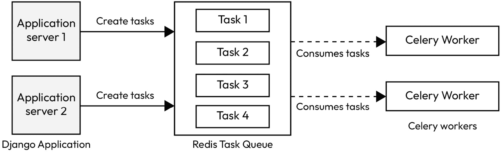
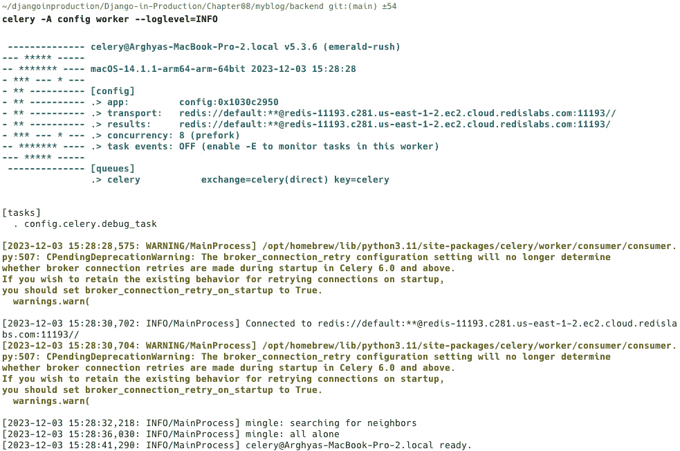
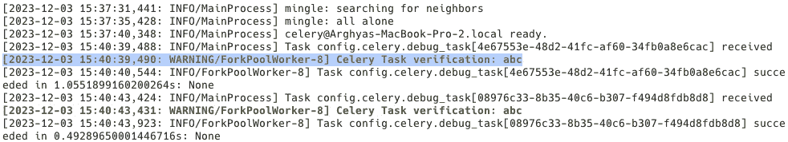
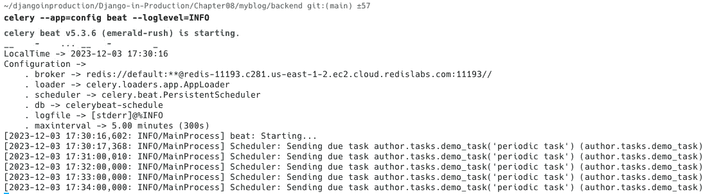
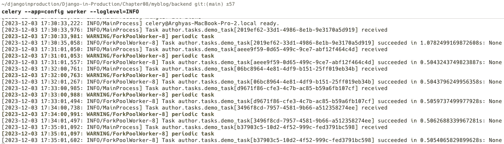
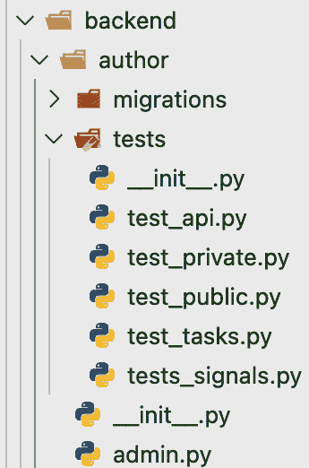
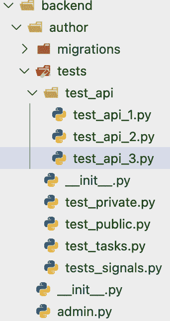

# 使用分页、Django 信号和自定义中间件

在 *第 6 章*，我们学习了如何将 Redis 集成到 Django 项目中并将 Redis 用作缓存层。缓存对于获得性能提升很重要，但有时我们希望优化发送给客户端的整体响应。这可以通过实现 `pagination` 来实现。

在本章中，我们将学习如何在 Django 和 `Django Rest Framework` (`DRF`) 中实现分页。除了分页之外，我们还将重点介绍 Django 信号以及它们如何帮助开发人员在不同应用程序之间解耦逻辑。在 *第 5 章*，我们看到了 Django 身份验证和授权如何开箱即用地使用 Django 中间件支持；现在我们将学习如何在 Django 中创建自定义中间件。

本章将涵盖以下主题：

* 在 Django 和 DRF 中分页响应
* 揭秘 Django 信号
* 使用 Django 中间件
* 创建自定义中间件

## 技术要求

在本章中，我们将学习如何在 Django 和 DRF 中实现分页。我们希望您熟悉 *pagination* 术语及其优势。Django 信号和自定义中间件也是高级主题，因此我们希望您熟悉我们在前几章中涵盖的所有概念。您应熟悉 Django 请求-响应周期，我们在 *第 3 章* 中讨论过。

## 在 Django 和 DRF 中分页响应

当客户端发送请求从服务器获取记录时，不建议一次性发送数据库中存在的所有条目。这就是分页概念发挥作用的时候。例如，如果我们保存了 1,000 篇博客，一次性将所有博客发送给客户端的请求将增加页面加载时间并给系统带来性能瓶颈。为了解决这些问题，我们将引入分页的概念。

### 理解分页

让我们举一个例子来理解分页的概念。客户端请求获取博客列表，我们的网站上发布了 1,000+ 篇博客。我们会分小批发送一些博客，例如每次 10 篇。这就是分页。用户将与 UI 交互并请求下一批博客。服务器可以为 API 实现不同类型的分页：

* Cursor API 分页
* Keyset API 分页
* Offset API 分页
* 基于时间的 API 分页

我们将在 *在 DRF 中使用分页* 部分学习所有这些技术。简而言之，我们可以将分页视为我们有一个条目列表，我们在将每个数据切片发送给客户端之前将列表切片成更小的部分的概念。

让我们学习关于可以使用 Django ORM 以最简单的方式实现的基本分页，通过创建一个 `get_blog_without_pagination` 视图，该视图返回所有博客。此视图适用于小规模，但在我们有 1,000+ 博客时，此视图会很慢且不太有用，因为读者不期望阅读全部 1,000+ 博客。将以下代码添加到 `blog/views.py`：

```
def get_blog_without_pagination(request):
    blogs = Blog.objects.all()
    blogs_data = BlogSerializer(blogs, many=True).data
    return Response({'blogs': blogs_data})
```

我们还需要将视图链接到 URL，因此将以下代码添加到 `blog/urls.py` 文件：

```
urlpatterns = [
    . . .
    path('unpaginated/', views.get_blog_without_pagination),
    . . .
]
```

当我们打开 [`127.0.0.1/blog/unpaginated/`](http://127.0.0.1/blog/unpaginated/) 时，我们将获得数据库中创建的所有博客的列表。随着创建更多博客，这不可扩展。


为了添加分页，我们需要将响应拆分为更小的块，例如每个响应 10 篇博客。我们可以使用 Django ORM 的 `limit` `offset` 来实现。让我们为同一个视图实现分页。使用以下代码创建新的 `get_blog_with_pagination` 视图：

```
@api_view(['GET'])
def get_blog_with_pagination(request):
	page = int(request.GET.get('page', 1))
	page_size = int(request.GET.get('page_size', 10))
	offset = (page-1)*page_size
	limit = page*page_size
	blogs = Blog.objects.all()[offset:limit]
	blogs_data = BlogSerializer(blogs, many=True).data
	return Response({'blogs': blogs_data})
```

此外，我们需要通过向 `blog/urls.py` 文件添加以下代码来将视图链接到 URL：

```
urlpatterns = [
	. . .
	path('paginated/', views.get_blog_with_pagination),
	. . .
]
```

当我们打开 [`127.0.0.1/blog/paginated/?page=1&page_size=2`](http://127.0.0.1/blog/paginated/?page=1&page_size=2) 时，我们将获得创建的两篇博客列表。现在用户通过查询参数请求博客数据并传递需要返回博客的页码。我们的 API 调用将以 `page` 和 `page_size` 作为输入并相应地返回博客数量。

在使用 Django 构建产品功能时，我们需要实现分页。对于几乎所有用例，我们都可以使用本节讨论的自定义分页逻辑。

DRF 还提供了开箱即用的接口来使用不同的分页技术。让我们学习如何使用 DRF 使用分页。

## 在 DRF 中使用分页

Django 开箱即用地提供了 `Paginator` 类（[`docs.djangoproject.com/en/stable/topics/pagination/`](https://docs.djangoproject.com/en/stable/topics/pagination/)），可用于实现分页。DRF 利用相同的 `Paginator` 类为 API 提供分页支持。我们不会深入探讨 Django 提供的 `Paginator` 类的细节；相反，我们将重点关注 DRF 提供的分页类型。

请注意

我们没有讨论 DRF 中分页的集成，因为 DRF 的文档提供了如何设置不同类型分页的详细信息。您可以从官方文档（[`www.django-rest-framework.org/api-guide/pagination/`](https://www.django-rest-framework.org/api-guide/pagination/)）中了解实现细节。

在我们的 GitHub 代码仓库中，我们添加了不同的示例来为 DRF 集成分页。请查看 `Chapter07` 的 README 文件了解更多详情：[`github.com/PacktPublishing/Django-in-Production/tree/main/Chapter07`](https://github.com/PacktPublishing/Django-in-Production/tree/main/Chapter07)。

主要有三种分页类型可用：

* `PageNumberPagination` – 这种分页在 URL 查询参数中发送页码。例如，如果我们有 100 篇博客并且我们将博客拆分为 20 的批次，那么我们将有 5 页，每页 20 篇博客。每当客户端请求第 1 页时，我们将提供前 20 篇博客；随着客户端请求中的页码增加，我们将分享下一批博客。在这里，客户端无法控制响应中将获取多少条目。

* `LimitOffsetPagination` – 在这里，客户端可以完全控制响应中需要获取多少条目以及从何处偏移获取数据。这种分页类型为客户端提供了更多的数据检索控制，但也可能给 API 带来漏洞。例如，恶意用户可能会以 1,000 的限制命中 API，这会对我们的服务器造成不必要的压力。因此，为了解决这个问题，我们应该设置一个检查，以阻止客户端请求中传递的任何不切实际的 `limit` 值，从而给服务器带来负载。

* `CursorPagination` – 基于游标的分页是一种有点复杂的分页技术，在实现时需要关注细节，否则很容易适得其反。基于游标的分页是大型系统中实现分页的可扩展技术。我建议开发人员在没有涉及其他方法无法解决的强扩展问题之前，避免实现基于游标的分页。有关该概念的更多详细信息，请阅读 David Carmer 关于 Disqus 如何实现基于游标分页的文章（[`cra.mr/2011/03/08/building-cursors-for-the-disqus-api/`](https://cra.mr/2011/03/08/building-cursors-for-the-disqus-api/)）。

就像其他 DRF 类一样，您可以轻松扩展内置的分页类，根据用例创建自定义 `Pagination` 类。

在本节中，我们学习了分页如何有助于提高网站的性能，以及如何在 DRF 中使用不同的分页类。现在，让我们来看一下 Django 提供的另一个高级概念：Django 信号。

# 揭秘 Django 信号

Django 有很多开箱即用的功能，但其中一个被低估且脱颖而出的功能是 Django 信号。Django 开箱即用地包含一个“信号调度器”，它帮助开发人员编写解耦的逻辑。信号调度器会通知一组接收器某些操作已经发生。这在我们希望对单个事件执行多个操作时很有用。默认情况下，Django 提供了一些内置信号，有助于构建常见的应用程序，如下所示：

* `Model signals` – 这些是数据库操作信号，可以帮助开发人员在即将执行或已经执行某种数据库操作时触发操作。以下是针对某些 Django 模型操作事件分派的默认 Django 信号列表：

  * `pre_save` 和 `post_save` – 这些信号在调用模型的 `save()` 方法之前和之后触发。请注意，当使用 `update()` 方法时，这些信号*不会触发*。

  * `pre_delete` 和 `post_delete` – 这些信号在从 `Model` 对象或查询集调用 `delete()` 方法之前触发。

  * `m2m_changed` – 当 Django 模型的 `ManyToManyField` 发生变化时触发此信号。由于此列表中之前提到的所有信号均不适用于 M2M 字段，因此每当有模型更改时都会触发 `m2m_changed`。`m2m_changed` 发送的参数具有 `action` 数据，其值可以是以下之一：

    * `pre_add` 和 `post_add` – 在一个或多个对象添加到多对多字段的关系之前和之后发送。

    * `pre_remove` 和 `post_remove` – 在一个或多个对象从多对多字段的关系中移除之前和之后发送。

    * `pre_clear` 和 `post_clear` – 在多对多字段的 M2M 关系被清除之前和之后发送。

* `Management signals` – 这些信号在执行 `manage.py migrate` 命令时触发。我见过的一个用例是使用它来通知开发团队新的迁移更改已在生产环境中执行。以下是针对某些 Django 管理命令执行而分派的默认 Django 信号列表：

  * `pre_migrate` – 在迁移过程开始时触发

  * `post_migrate` – 在迁移过程完成后触发

* `Request/response signals` – 这些信号在 Django 应用程序接收到请求时以及响应被处理并发送回客户端时触发。以下是针对 Django 请求/响应事件分派的默认 Django 信号列表：

  * `request_started` – 当 Django 从客户端接收到信号并开始处理时发送

  * `request_finished` – 当 Django 将 HTTP 响应交付给客户端时发送


*   `got_request_exception` – 每当 Django 在请求/响应周期中遇到异常时触发

*   **数据库包装器** – 每当 Django 连接到数据库时，这些信号就会被触发。这有助于对 Django 数据库连接执行任何自定义操作。关于在数据库中设置查询超时的常见用例之一在 *第 2 章* 中进行了讨论。以下 Django 信号在我们建立 DB 连接时被分发：

    *   `connection_created` – 每当 Django 服务器与数据库之间建立数据库连接时就会触发

我们已经了解了 Django 为我们提供的可使用的默认信号。随着项目的增长，对信号的需求也在演变。因此，有时我们刚刚讨论的信号可能不足以支持所有用例。Django 提供了创建自定义信号的方法，如以下章节所述。

## Creating custom signals

Django 信号是在 Django 项目内部编写解耦逻辑的强大机制。*揭秘 Django 信号* 部分中提到的内置信号可以帮助我们处理默认用例，但如果我们有自定义用例，Django 自定义信号可以帮助我们解决它。例如，如果我们希望每当用户在我们的网站上购买产品时发送多重通信，例如电子邮件、短信和 WhatsApp，我们可以通过自定义 Django 信号来实现。我们会在每次购买时分发自定义信号，我们的接收器会监听自定义信号并对收到的每个新信号采取行动。

让我们现在尝试实现一个自定义信号，每当发布新博客时就会始终发送电子邮件：

1.  在 `blog` 应用内部创建一个 `signals.py` 文件（可以命名为任何名称，但最好命名为 `signals.py` 以便更易于识别）。在 `blog/signals.py` 文件中添加信号的定义：

```
from django import dispatch
notify_author = dispatch.Signal()
```

2.  我们希望在发布博客时分发 `blog_published` 信号。我们将在 `blogs/public.py` 文件中的 `publish_blog` 方法上添加触发器：

```
from blogs import signals
def publish_blog():
    # publish blog logic
    signals.notify_author.send(sender=None, blog_id=123)
```

3.  我们现在已在发布博客时分发了信号。我们需要在应用程序中添加一个接收器来监听已分发的信号并执行操作。在 `author` 应用中创建 `author/receiver.py` 文件：

```
from django.dispatch import receiver
from blog import signals
@receiver(signals.notify_author)
def send_email_to_author(sender, blog_id, **kwargs):
    # Sends email to author
    print('sending email to author logic', blog_id)
```

4.  现在，我们需要确保在应用加载时注册接收器。这是[content]
*   `got_request_exception` – 每当 Django 在请求/响应周期中遇到异常时触发

*   **数据库包装器** – 每当 Django 连接到数据库时，这些信号就会被触发。这有助于对 Django 数据库连接执行任何自定义操作。关于在数据库中设置查询超时的常见用例之一在 *第 2 章* 中进行了讨论。以下 Django 信号在我们建立 DB 连接时被分发：

    *   `connection_created` – 每当 Django 服务器与数据库之间建立数据库连接时就会触发

我们已经了解了 Django 为我们提供的可使用的默认信号。随着项目的增长，对信号的需求也在演变。因此，有时我们刚刚讨论的信号可能不足以支持所有用例。Django 提供了创建自定义信号的方法，如以下章节所述。

## Creating custom signals

Django 信号是在 Django 项目内部编写解耦逻辑的强大机制。*揭秘 Django 信号* 部分中提到的内置信号可以帮助我们处理默认用例，但如果我们有自定义用例，Django 自定义信号可以帮助我们解决它。例如，如果我们希望每当用户在我们的网站上购买产品时发送多重通信，例如电子邮件、短信和 WhatsApp，我们可以通过自定义 Django 信号来实现。我们会在每次购买时分发自定义信号，我们的接收器会监听自定义信号并对收到的每个新信号采取行动。

让我们现在尝试实现一个自定义信号，每当发布新博客时就会始终发送电子邮件：

1.  在 `blog` 应用内部创建一个 `signals.py` 文件（可以命名为任何名称，但最好命名为 `signals.py` 以便更易于识别）。在 `blog/signals.py` 文件中添加信号的定义：

```
from django import dispatch
notify_author = dispatch.Signal()
```

2.  我们希望在发布博客时分发 `blog_published` 信号。我们将在 `blogs/public.py` 文件中的 `publish_blog` 方法上添加触发器：

```
from blogs import signals
def publish_blog():
    # publish blog logic
    signals.notify_author.send(sender=None, blog_id=123)
```

3.  我们现在已在发布博客时分发了信号。我们需要在应用程序中添加一个接收器来监听已分发的信号并执行操作。在 `author` 应用中创建 `author/receiver.py` 文件：

```
from django.dispatch import receiver
from blog import signals
@receiver(signals.notify_author)
def send_email_to_author(sender, blog_id, **kwargs):
    # Sends email to author
    print('sending email to author logic', blog_id)
```

4.  现在，我们需要确保在应用加载时注册接收器。这是[content]
*   `got_request_exception` – 每当 Django 在请求/响应周期中遇到异常时触发

*   **数据库包装器** – 每当 Django 连接到数据库时，这些信号就会被触发。这有助于对 Django 数据库连接执行任何自定义操作。关于在数据库中设置查询超时的常见用例之一在 *第 2 章* 中进行了讨论。以下 Django 信号在我们建立 DB 连接时被分发：

    *   `connection_created` – 每当 Django 服务器与数据库之间建立数据库连接时就会触发

我们已经了解了 Django 为我们提供的可使用的默认信号。随着项目的增长，对信号的需求也在演变。因此，有时我们刚刚讨论的信号可能不足以支持所有用例。Django 提供了创建自定义信号的方法，如以下章节所述。

## Creating custom signals

Django 信号是在 Django 项目内部编写解耦逻辑的强大机制。*揭秘 Django 信号* 部分中提到的内置信号可以帮助我们处理默认用例，但如果我们有自定义用例，Django 自定义信号可以帮助我们解决它。例如，如果我们希望每当用户在我们的网站上购买产品时发送多重通信，例如电子邮件、短信和 WhatsApp，我们可以通过自定义 Django 信号来实现。我们会在每次购买时分发自定义信号，我们的接收器会监听自定义信号并对收到的每个新信号采取行动。

让我们现在尝试实现一个自定义信号，每当发布新博客时就会始终发送电子邮件：

1.  在 `blog` 应用内部创建一个 `signals.py` 文件（可以命名为任何名称，但最好命名为 `signals.py` 以便更易于识别）。在 `blog/signals.py` 文件中添加信号的定义：

```
from django import dispatch
notify_author = dispatch.Signal()
```

2.  我们希望在发布博客时分发 `blog_published` 信号。我们将在 `blogs/public.py` 文件中的 `publish_blog` 方法上添加触发器：

```
from blogs import signals
def publish_blog():
    # publish blog logic
    signals.notify_author.send(sender=None, blog_id=123)
```

3.  我们现在已在发布博客时分发了信号。我们需要在应用程序中添加一个接收器来监听已分发的信号并执行操作。在 `author` 应用中创建 `author/receiver.py` 文件：

```
from django.dispatch import receiver
from blog import signals
@receiver(signals.notify_author)
def send_email_to_author(sender, blog_id, **kwargs):
    # Sends email to author
    print('sending email to author logic', blog_id)
```

4.  现在，我们需要确保在应用加载时注册接收器。这是[content]
*   `got_request_exception` – 每当 Django 在请求/响应周期中遇到异常时触发

*   **数据库包装器** – 每当 Django 连接到数据库时，这些信号就会被触发。这有助于对 Django 数据库连接执行任何自定义操作。关于在数据库中设置查询超时的常见用例之一在 *第 2 章* 中进行了讨论。以下 Django 信号在我们建立 DB 连接时被分发：

    *   `connection_created` – 每当 Django 服务器与数据库之间建立数据库连接时就会触发

我们已经了解了 Django 为我们提供的可使用的默认信号。随着项目的增长，对信号的需求也在演变。因此，有时我们刚刚讨论的信号可能不足以支持所有用例。Django 提供了创建自定义信号的方法，如以下章节所述。

## Creating custom signals

Django 信号是在 Django 项目内部编写解耦逻辑的强大机制。*揭秘 Django 信号* 部分中提到的内置信号可以帮助我们处理默认用例，但如果我们有自定义用例，Django 自定义信号可以帮助我们解决它。例如，如果我们希望每当用户在我们的网站上购买产品时发送多重通信，例如电子邮件、短信和 WhatsApp，我们可以通过自定义 Django 信号来实现。我们会在每次购买时分发自定义信号，我们的接收器会监听自定义信号并对收到的每个新信号采取行动。

让我们现在尝试实现一个自定义信号，每当发布新博客时就会始终发送电子邮件：

1.  在 `blog` 应用内部创建一个 `signals.py` 文件（可以命名为任何名称，但最好命名为 `signals.py` 以便更易于识别）。在 `blog/signals.py` 文件中添加信号的定义：

```
from django import dispatch
notify_author = dispatch.Signal()
```

2.  我们希望在发布博客时分发 `blog_published` 信号。我们将在 `blogs/public.py` 文件中的 `publish_blog` 方法上添加触发器：

```
from blogs import signals
def publish_blog():
    # publish blog logic
    signals.notify_author.send(sender=None, blog_id=123)
```

3.  我们现在已在发布博客时分发了信号。我们需要在应用程序中添加一个接收器来监听已分发的信号并执行操作。在 `author` 应用中创建 `author/receiver.py` 文件：

```
from django.dispatch import receiver
from blog import signals
@receiver(signals.notify_author)
def send_email_to_author(sender, blog_id, **kwargs):
    # Sends email to author
    print('sending email to author logic', blog_id)
```

4.  现在，我们需要确保在应用加载时注册接收器。这是[content]
*   `got_request_exception` – 每当 Django 在请求/响应周期中遇到异常时触发

*   **数据库包装器** – 每当 Django 连接到数据库时，这些信号就会被触发。这有助于对 Django 数据库连接执行任何自定义操作。关于在数据库中设置查询超时的常见用例之一在 *第 2 章* 中进行了讨论。以下 Django 信号在我们建立 DB 连接时被分发：

    *   `connection_created` – 每当 Django 服务器与数据库之间建立数据库连接时就会触发

我们已经了解了 Django 为我们提供的可使用的默认信号。随着项目的增长，对信号的需求也在演变。因此，有时我们刚刚讨论的信号可能不足以支持所有用例。Django 提供了创建自定义信号的方法，如以下章节所述。

## Creating custom signals

Django 信号是在 Django 项目内部编写解耦逻辑的强大机制。*揭秘 Django 信号* 部分中提到的内置信号可以帮助我们处理默认用例，但如果我们有自定义用例，Django 自定义信号可以帮助我们解决它。例如，如果我们希望每当用户在我们的网站上购买产品时发送多重通信，例如电子邮件、短信和 WhatsApp，我们可以通过自定义 Django 信号来实现。我们会在每次购买时分发自定义信号，我们的接收器会监听自定义信号并对收到的每个新信号采取行动。

让我们现在尝试实现一个自定义信号，每当发布新博客时就会始终发送电子邮件：

1.  在 `blog` 应用内部创建一个 `signals.py` 文件（可以命名为任何名称，但最好命名为 `signals.py` 以便更易于识别）。在 `blog/signals.py` 文件中添加信号的定义：

```
from django import dispatch
notify_author = dispatch.Signal()
```

2.  我们希望在发布博客时分发 `blog_published` 信号。我们将在 `blogs/public.py` 文件中的 `publish_blog` 方法上添加触发器：

```
from blogs import signals
def publish_blog():
    # publish blog logic
    signals.notify_author.send(sender=None, blog_id=123)
```

3.  我们现在已在发布博客时分发了信号。我们需要在应用程序中添加一个接收器来监听已分发的信号并执行操作。在 `author` 应用中创建 `author/receiver.py` 文件：

```
from django.dispatch import receiver
from blog import signals
@receiver(signals.notify_author)
def send_email_to_author(sender, blog_id, **kwargs):
    # Sends email to author
    print('sending email to author logic', blog_id)
```

4.  现在，我们需要确保在应用加载时注册接收器。这是[content]
*   `got_request_exception` – 每当 Django 在请求/响应周期中遇到异常时触发

*   **数据库包装器** – 每当 Django 连接到数据库时，这些信号就会被触发。这有助于对 Django 数据库连接执行任何自定义操作。关于在数据库中设置查询超时的常见用例之一在 *第 2 章* 中进行了讨论。以下 Django 信号在我们建立 DB 连接时被分发：

    *   `connection_created` – 每当 Django 服务器与数据库之间建立数据库连接时就会触发

我们已经了解了 Django 为我们提供的可使用的默认信号。随着项目的增长，对信号的需求也在演变。因此，有时我们刚刚讨论的信号可能不足以支持所有用例。Django 提供了创建自定义信号的方法，如以下章节所述。

## Creating custom signals

Django 信号是在 Django 项目内部编写解耦逻辑的强大机制。*揭秘 Django 信号* 部分中提到的内置信号可以帮助我们处理默认用例，但如果我们有自定义用例，Django 自定义信号可以帮助我们解决它。例如，如果我们希望每当用户在我们的网站上购买产品时发送多重通信，例如电子邮件、短信和 WhatsApp，我们可以通过自定义 Django 信号来实现。我们会在每次购买时分发自定义信号，我们的接收器会监听自定义信号并对收到的每个新信号采取行动。

让我们现在尝试实现一个自定义信号，每当发布新博客时就会始终发送电子邮件：

1.  在 `blog` 应用内部创建一个 `signals.py` 文件（可以命名为任何名称，但最好命名为 `signals.py` 以便更易于识别）。在 `blog/signals.py` 文件中添加信号的定义：

```
from django import dispatch
notify_author = dispatch.Signal()
```

2.  我们希望在发布博客时分发 `blog_published` 信号。我们将在 `blogs/public.py` 文件中的 `publish_blog` 方法上添加触发器：

```
from blogs import signals
def publish_blog():
    # publish blog logic
    signals.notify_author.send(sender=None, blog_id=123)
```

3.  我们现在已在发布博客时分发了信号。我们需要在应用程序中添加一个接收器来监听已分发的信号并执行操作。在 `author` 应用中创建 `author/receiver.py` 文件：

```
from django.dispatch import receiver
from blog import signals
@receiver(signals.notify_author)
def send_email_to_author(sender, blog_id, **kwargs):
    # Sends email to author
    print('sending email to author logic', blog_id)
```

4.  现在，我们需要确保在应用加载时注册接收器。这是[content]
*   `got_request_exception` – 每当 Django 在请求/响应周期中遇到异常时触发

*   **数据库包装器** – 每当 Django 连接到数据库时，这些信号就会被触发。这有助于对 Django 数据库连接执行任何自定义操作。关于在数据库中设置查询超时的常见用例之一在 *第 2 章* 中进行了讨论。以下 Django 信号在我们建立 DB 连接时被分发：

    *   `connection_created` – 每当 Django 服务器与数据库之间建立数据库连接时就会触发

我们已经了解了 Django 为我们提供的可使用的默认信号。随着项目的增长，对信号的需求也在演变。因此，有时我们刚刚讨论的信号可能不足以支持所有用例。Django 提供了创建自定义信号的方法，如以下章节所述。

## Creating custom signals

Django 信号是在 Django 项目内部编写解耦逻辑的强大机制。*揭秘 Django 信号* 部分中提到的内置信号可以帮助我们处理默认用例，但如果我们有自定义用例，Django 自定义信号可以帮助我们解决它。例如，如果我们希望每当用户在我们的网站上购买产品时发送多重通信，例如电子邮件、短信和 WhatsApp，我们可以通过自定义 Django 信号来实现。我们会在每次购买时分发自定义信号，我们的接收器会监听自定义信号并对收到的每个新信号采取行动。

让我们现在尝试实现一个自定义信号，每当发布新博客时就会始终发送电子邮件：

1.  在 `blog` 应用内部创建一个 `signals.py` 文件（可以命名为任何名称，但最好命名为 `signals.py` 以便更易于识别）。在 `blog/signals.py` 文件中添加信号的定义：

```
from django import dispatch
notify_author = dispatch.Signal()
```

2.  我们希望在发布博客时分发 `blog_published` 信号。我们将在 `blogs/public.py` 文件中的 `publish_blog` 方法上添加触发器：

```
from blogs import signals
def publish_blog():
    # publish blog logic
    signals.notify_author.send(sender=None, blog_id=123)
```

3.  我们现在已在发布博客时分发了信号。我们需要在应用程序中添加一个接收器来监听已分发的信号并执行操作。在 `author` 应用中创建 `author/receiver.py` 文件：

```
from django.dispatch import receiver
from blog import signals
@receiver(signals.notify_author)
def send_email_to_author(sender, blog_id, **kwargs):
    # Sends email to author
    print('sending email to author logic', blog_id)
```

4.  现在，我们需要确保在应用加载时注册接收器。这是[content]
*   `got_request_exception` – 每当 Django 在请求/响应周期中遇到异常时触发

*   **数据库包装器** – 每当 Django 连接到数据库时，这些信号就会被触发。这有助于对 Django 数据库连接执行任何自定义操作。关于在数据库中设置查询超时的常见用例之一在 *第 2 章* 中进行了讨论。以下 Django 信号在我们建立 DB 连接时被分发：

    *   `connection_created` – 每当 Django 服务器与数据库之间建立数据库连接时就会触发

我们已经了解了 Django 为我们提供的可使用的默认信号。随着项目的增长，对信号的需求也在演变。因此，有时我们刚刚讨论的信号可能不足以支持所有用例。Django 提供了创建自定义信号的方法，如以下章节所述。

## Creating custom signals

Django 信号是在 Django 项目内部编写解耦逻辑的强大机制。*揭秘 Django 信号* 部分中提到的内置信号可以帮助我们处理默认用例，但如果我们有自定义用例，Django 自定义信号可以帮助我们解决它。例如，如果我们希望每当用户在我们的网站上购买产品时发送多重通信，例如电子邮件、短信和 WhatsApp，我们可以通过自定义 Django 信号来实现。我们会在每次购买时分发自定义信号，我们的接收器会监听自定义信号并对收到的每个新信号采取行动。

让我们现在尝试实现一个自定义信号，每当发布新博客时就会始终发送电子邮件：

1.  在 `blog` 应用内部创建一个 `signals.py` 文件（可以命名为任何名称，但最好命名为 `signals.py` 以便更易于识别）。在 `blog/signals.py` 文件中添加信号的定义：

```
from django import dispatch
notify_author = dispatch.Signal()
```

2.  我们希望在发布博客时分发 `blog_published` 信号。我们将在 `blogs/public.py` 文件中的 `publish_blog` 方法上添加触发器：

```
from blogs import signals
def publish_blog():
    # publish blog logic
    signals.notify_author.send(sender=None, blog_id=123)
```

3.  我们现在已在发布博客时分发了信号。我们需要在应用程序中添加一个接收器来监听已分发的信号并执行操作。在 `author` 应用中创建 `author/receiver.py` 文件：

```
from django.dispatch import receiver
from blog import signals
@receiver(signals.notify_author)
def send_email_to_author(sender, blog_id, **kwargs):
    # Sends email to author
    print('sending email to author logic', blog_id)
```

4.  现在，我们需要确保在应用加载时注册接收器。这是[content]
*   `got_request_exception` – 每当 Django 在请求/响应周期中遇到异常时触发

*   **数据库包装器** – 每当 Django 连接到数据库时，这些信号就会被触发。这有助于对 Django 数据库连接执行任何自定义操作。关于在数据库中设置查询超时的常见用例之一在 *第 2 章* 中进行了讨论。以下 Django 信号在我们建立 DB 连接时被分发：

    *   `connection_created` – 每当 Django 服务器与数据库之间建立数据库连接时就会触发

我们已经了解了 Django 为我们提供的可使用的默认信号。随着项目的增长，对信号的需求也在演变。因此，有时我们刚刚讨论的信号可能不足以支持所有用例。Django 提供了创建自定义信号的方法，如以下章节所述。

## Creating custom signals

Django 信号是在 Django 项目内部编写解耦逻辑的强大机制。*揭秘 Django 信号* 部分中提到的内置信号可以帮助我们处理默认用例，但如果我们有自定义用例，Django 自定义信号可以帮助我们解决它。例如，如果我们希望每当用户在我们的网站上购买产品时发送多重通信，例如电子邮件、短信和 WhatsApp，我们可以通过自定义 Django 信号来实现。我们会在每次购买时分发自定义信号，我们的接收器会监听自定义信号并对收到的每个新信号采取行动。

让我们现在尝试实现一个自定义信号，每当发布新博客时就会始终发送电子邮件：

1.  在 `blog` 应用内部创建一个 `signals.py` 文件（可以命名为任何名称，但最好命名为 `signals.py` 以便更易于识别）。在 `blog/signals.py` 文件中添加信号的定义：

```
from django import dispatch
notify_author = dispatch.Signal()
```

2.  我们希望在发布博客时分发 `blog_published` 信号。我们将在 `blogs/public.py` 文件中的 `publish_blog` 方法上添加触发器：

```
from blogs import signals
def publish_blog():
    # publish blog logic
    signals.notify_author.send(sender=None, blog_id=123)
```

3.  我们现在已在发布博客时分发了信号。我们需要在应用程序中添加一个接收器来监听已分发的信号并执行操作。在 `author` 应用中创建 `author/receiver.py` 文件：

```
from django.dispatch import receiver
from blog import signals
@receiver(signals.notify_author)
def send_email_to_author(sender, blog_id, **kwargs):
    # Sends email to author
    print('sending email to author logic', blog_id)
```

4.  现在，我们需要确保在应用加载时注册接收器。这是[content]
*   `got_request_exception` – 每当 Django 在请求/响应周期中遇到异常时触发

*   **数据库包装器** – 每当 Django 连接到数据库时，这些信号就会被触发。这有助于对 Django 数据库连接执行任何自定义操作。关于在数据库中设置查询超时的常见用例之一在 *第 2 章* 中进行了讨论。以下 Django 信号在我们建立 DB 连接时被分发：

    *   `connection_created` – 每当 Django 服务器与数据库之间建立数据库连接时就会触发

我们已经了解了 Django 为我们提供的可使用的默认信号。随着项目的增长，对信号的需求也在演变。因此，有时我们刚刚讨论的信号可能不足以支持所有用例。Django 提供了创建自定义信号的方法，如以下章节所述。

## Creating custom signals

Django 信号是在 Django 项目内部编写解耦逻辑的强大机制。*揭秘 Django 信号* 部分中提到的内置信号可以帮助我们处理默认用例，但如果我们有自定义用例，Django 自定义信号可以帮助我们解决它。例如，如果我们希望每当用户在我们的网站上购买产品时发送多重通信，例如电子邮件、短信和 WhatsApp，我们可以通过自定义 Django 信号来实现。我们会在每次购买时分发自定义信号，我们的接收器会监听自定义信号并对收到的每个新信号采取行动。

让我们现在尝试实现一个自定义信号，每当发布新博客时就会始终发送电子邮件：

1.  在 `blog` 应用内部创建一个 `signals.py` 文件（可以命名为任何名称，但最好命名为 `signals.py` 以便更易于识别）。在 `blog/signals.py` 文件中添加信号的定义：

```
from django import dispatch
notify_author = dispatch.Signal()
```

2.  我们希望在发布博客时分发 `blog_published` 信号。我们将在 `blogs/public.py` 文件中的 `publish_blog` 方法上添加触发器：

```
from blogs import signals
def publish_blog():
    # publish blog logic
    signals.notify_author.send(sender=None, blog_id=123)
```

3.  我们现在已在发布博客时分发了信号。我们需要在应用程序中添加一个接收器来监听已分发的信号并执行操作。在 `author` 应用中创建 `author/receiver.py` 文件：

```
from django.dispatch import receiver
from blog import signals
@receiver(signals.notify_author)
def send_email_to_author(sender, blog_id, **kwargs):
    # Sends email to author
    print('sending email to author logic', blog_id)
```

4.  现在，我们需要确保在应用加载时注册接收器。这是[content]
*   `got_request_exception` – 每当 Django 在请求/响应周期中遇到异常时触发

*   **数据库包装器** – 每当 Django 连接到数据库时，这些信号就会被触发。这有助于对 Django 数据库连接执行任何自定义操作。关于在数据库中设置查询超时的常见用例之一在 *第 2 章* 中进行了讨论。以下 Django 信号在我们建立 DB 连接时被分发：

    *   `connection_created` – 每当 Django 服务器与数据库之间建立数据库连接时就会触发

我们已经了解了 Django 为我们提供的可使用的默认信号。随着项目的增长，对信号的需求也在演变。因此，有时我们刚刚讨论的信号可能不足以支持所有用例。Django 提供了创建自定义信号的方法，如以下章节所述。

## Creating custom signals

Django 信号是在 Django 项目内部编写解耦逻辑的强大机制。*揭秘 Django 信号* 部分中提到的内置信号可以帮助我们处理默认用例，但如果我们有自定义用例，Django 自定义信号可以帮助我们解决它。例如，如果我们希望每当用户在我们的网站上购买产品时发送多重通信，例如电子邮件、短信和 WhatsApp，我们可以通过自定义 Django 信号来实现。我们会在每次购买时分发自定义信号，我们的接收器会监听自定义信号并对收到的每个新信号采取行动。

让我们现在尝试实现一个自定义信号，每当发布新博客时就会始终发送电子邮件：

1.  在 `blog` 应用内部创建一个 `signals.py` 文件（可以命名为任何名称，但最好命名为 `signals.py` 以便更易于识别）。在 `blog/signals.py` 文件中添加信号的定义：

```
from django import dispatch
notify_author = dispatch.Signal()
```

2.  我们希望在发布博客时分发 `blog_published` 信号。我们将在 `blogs/public.py` 文件中的 `publish_blog` 方法上添加触发器：

```
from blogs import signals
def publish_blog():
    # publish blog logic
    signals.notify_author.send(sender=None, blog_id=123)
```

3.  我们现在已在发布博客时分发了信号。我们需要在应用程序中添加一个接收器来监听已分发的信号并执行操作。在 `author` 应用中创建 `author/receiver.py` 文件：

```
from django.dispatch import receiver
from blog import signals
@receiver(signals.notify_author)
def send_email_to_author(sender, blog_id, **kwargs):
    # Sends email to author
    print('sending email to author logic', blog_id)
```

4.  现在，我们需要确保在应用加载时注册接收器。这是[content]
*   `got_request_exception` – 每当 Django 在请求/响应周期中遇到异常时触发

*   **数据库包装器** – 每当 Django 连接到数据库时，这些信号就会被触发。这有助于对 Django 数据库连接执行任何自定义操作。关于在数据库中设置查询超时的常见用例之一在 *第 2 章* 中进行了讨论。以下 Django 信号在我们建立 DB 连接时被分发：

    *   `connection_created` – 每当 Django 服务器与数据库之间建立数据库连接时就会触发

我们已经了解了 Django 为我们提供的可使用的默认信号。随着项目的增长，对信号的需求也在演变。因此，有时我们刚刚讨论的信号可能不足以支持所有用例。Django 提供了创建自定义信号的方法，如以下章节所述。

## Creating custom signals

Django 信号是在 Django 项目内部编写解耦逻辑的强大机制。*揭秘 Django 信号* 部分中提到的内置信号可以帮助我们处理默认用例，但如果我们有自定义用例，Django 自定义信号可以帮助我们解决它。例如，如果我们希望每当用户在我们的网站上购买产品时发送多重通信，例如电子邮件、短信和 WhatsApp，我们可以通过自定义 Django 信号来实现。我们会在每次购买时分发自定义信号，我们的接收器会监听自定义信号并对收到的每个新信号采取行动。

让我们现在尝试实现一个自定义信号，每当发布新博客时就会始终发送电子邮件：

1.  在 `blog` 应用内部创建一个 `signals.py` 文件（可以命名为任何名称，但最好命名为 `signals.py` 以便更易于识别）。在 `blog/signals.py` 文件中添加信号的定义：

```
from django import dispatch
notify_author = dispatch.Signal()
```

2.  我们希望在发布博客时分发 `blog_published` 信号。我们将在 `blogs/public.py` 文件中的 `publish_blog` 方法上添加触发器：

```
from blogs import signals
def publish_blog():
    # publish blog logic
    signals.notify_author.send(sender=None, blog_id=123)
```

3.  我们现在已在发布博客时分发了信号。我们需要在应用程序中添加一个接收器来监听已分发的信号并执行操作。在 `author` 应用中创建 `author/receiver.py` 文件：

```
from django.dispatch import receiver
from blog import signals
@receiver(signals.notify_author)
def send_email_to_author(sender, blog_id, **kwargs):
    # Sends email to author
    print('sending email to author logic', blog_id)
```

4.  现在，我们需要确保在应用加载时注册接收器。这是[content]
*   `got_request_exception` – 每当 Django 在请求/响应周期中遇到异常时触发

*   **数据库包装器** – 每当 Django 连接到数据库时，这些信号就会被触发。这有助于对 Django 数据库连接执行任何自定义操作。关于在数据库中设置查询超时的常见用例之一在 *第 2 章* 中进行了讨论。以下 Django 信号在我们建立 DB 连接时被分发：

    *   `connection_created` – 每当 Django 服务器与数据库之间建立数据库连接时就会触发

我们已经了解了 Django 为我们提供的可使用的默认信号。随着项目的增长，对信号的需求也在演变。因此，有时我们刚刚讨论的信号可能不足以支持所有用例。Django 提供了创建自定义信号的方法，如以下章节所述。

## Creating custom signals

Django 信号是在 Django 项目内部编写解耦逻辑的强大机制。*揭秘 Django 信号* 部分中提到的内置信号可以帮助我们处理默认用例，但如果我们有自定义用例，Django 自定义信号可以帮助我们解决它。例如，如果我们希望每当用户在我们的网站上购买产品时发送多重通信，例如电子邮件、短信和 WhatsApp，我们可以通过自定义 Django 信号来实现。我们会在每次购买时分发自定义信号，我们的接收器会监听自定义信号并对收到的每个新信号采取行动。

让我们现在尝试实现一个自定义信号，每当发布新博客时就会始终发送电子邮件：

1.  在 `blog` 应用内部创建一个 `signals.py` 文件（可以命名为任何名称，但最好命名为 `signals.py` 以便更易于识别）。在 `blog/signals.py` 文件中添加信号的定义：

```
from django import dispatch
notify_author = dispatch.Signal()
```

2.  我们希望在发布博客时分发 `blog_published` 信号。我们将在 `blogs/public.py` 文件中的 `publish_blog` 方法上添加触发器：

```
from blogs import signals
def publish_blog():
    # publish blog logic
    signals.notify_author.send(sender=None, blog_id=123)
```

3.  我们现在已在发布博客时分发了信号。我们需要在应用程序中添加一个接收器来监听已分发的信号并执行操作。在 `author` 应用中创建 `author/receiver.py` 文件：

```
from django.dispatch import receiver
from blog import signals
@receiver(signals.notify_author)
def send_email_to_author(sender, blog_id, **kwargs):
    # Sends email to author
    print('sending email to author logic', blog_id)
```

4.  现在，我们需要确保在应用加载时注册接收器。这是[content]
*   `got_request_exception` – 每当 Django 在请求/响应周期中遇到异常时触发

*   **数据库包装器** – 每当 Django 连接数据库时，这些信号会被触发。这有助于对 Django 数据库连接执行自定义操作。关于在数据库中设置查询超时的常见用例在 *第 2 章* 中讨论。建立 DB 连接时分发的 Django 信号如下：

    *   `connection_created` – 每当 Django 服务器与数据库建立连接时触发

我们已了解 Django 提供的默认信号。随着项目增长，对信号的需求也在演变。因此，有时前面讨论的信号不足以支持所有用例。Django 提供了创建自定义信号的方式，如下节所述。

## Creating custom signals

Django 信号是编写解耦逻辑的强大机制。*揭秘 Django 信号* 部分提到的内置信号可处理默认用例，若有自定义用例，Django 自定义信号可帮助解决。例如，若用户在网站购买产品时需发送邮件、短信和 WhatsApp，可通过自定义 Django 信号实现。每次购买时分发自定义信号，接收器监听信号并对新信号执行操作。

现在尝试实现一个自定义信号，新博客发布时始终发送邮件：

1.  在 `blog` 应用内创建 `signals.py` 文件，可任意命名，但建议命名为 `signals.py` 以便识别。在 `blog/signals.py` 中添加信号定义：

```
from django import dispatch
notify_author = dispatch.Signal()
```

2.  发布博客时分发 `blog_published` 信号。在 `blogs/public.py` 的 `publish_blog` 方法中添加触发：

```
from blogs import signals
def publish_blog():
    # publish blog logic
    signals.notify_author.send(sender=None, blog_id=123)
```

3.  信号已在发布时分发。现在需添加接收器监听并执行操作。在 `author` 应用创建 `author/receiver.py`：

```
from django.dispatch import receiver
from blog import signals
@receiver(signals.notify_author)
def send_email_to_author(sender, blog_id, **kwargs):
    # Sends email to author
    print('sending email to author logic', blog_id)
```

4.  现在需确保应用加载时注册接收器。这是[content]
*   `got_request_exception` – 每当 Django 在请求/响应周期中遇到异常时触发

*   **数据库包装器** – 每当 Django 连接到数据库时，这些信号就会被触发。这有助于对 Django 数据库连接执行任何自定义操作。关于在数据库中设置查询超时的常见用例之一在 *第 2 章* 中进行了讨论。以下 Django 信号在我们建立 DB 连接时被分发：

    *   `connection_created` – 每当 Django 服务器与数据库之间建立数据库连接时就会触发

我们已经了解了 Django 为我们提供的可使用的默认信号。随着项目的增长，对信号的需求也在演变。因此，有时我们刚刚讨论的信号可能不足以支持所有用例。Django 提供了创建自定义信号的方法，如以下章节所述。

## Creating custom signals

Django 信号是在 Django 项目内部编写解耦逻辑的强大机制。*揭秘 Django 信号* 部分中提到的内置信号可以帮助我们处理默认用例，但如果我们有自定义用例，Django 自定义信号可以帮助我们解决它。例如，如果我们希望每当用户在我们的网站上购买产品时发送多重通信，例如电子邮件、短信和 WhatsApp，我们可以通过自定义 Django 信号来实现。我们会在每次购买时分发自定义信号，我们的接收器会监听自定义信号并对收到的每个新信号采取行动。

让我们现在尝试实现一个自定义信号，每当发布新博客时就会始终发送电子邮件：

1.  在 `blog` 应用内部创建一个 `signals.py` 文件（可以命名为任何名称，但最好命名为 `signals.py` 以便更易于识别）。在 `blog/signals.py` 文件中添加信号的定义：

```
from django import dispatch
notify_author = dispatch.Signal()
```

2.  我们希望在发布博客时分发 `blog_published` 信号。我们将在 `blogs/public.py` 文件中的 `publish_blog` 方法上添加触发器：

```
from blogs import signals
def publish_blog():
    # publish blog logic
    signals.notify_author.send(sender=None, blog_id=123)
```

3.  我们现在已在发布博客时分发了信号。我们需要在应用程序中添加一个接收器来监听已分发的信号并执行操作。在 `author` 应用中创建 `author/receiver.py` 文件：

```
from django.dispatch import receiver
from blog import signals
@receiver(signals.notify_author)
def send_email_to_author(sender, blog_id, **kwargs):
    # Sends email to author
    print('sending email to author logic', blog_id)
```

4.  现在，我们需要确保在应用加载时注册接收器。这是[content]
*   `got_request_exception` – 每当 Django 在请求/响应周期中遇到异常时触发

*   **数据库包装器** – 每当 Django 连接到数据库时，这些信号就会被触发。这有助于对 Django 数据库连接执行任何自定义操作。关于在数据库中设置查询超时的常见用例之一在 *第 2 章* 中进行了讨论。以下 Django 信号在我们建立 DB 连接时被分发：

    *   `connection_created` – 每当 Django 服务器与数据库之间建立数据库连接时就会触发

我们已经了解了 Django 为我们提供的可使用的默认信号。随着项目的增长，对信号的需求也在演变。因此，有时我们刚刚讨论的信号可能不足以支持所有用例。Django 提供了创建自定义信号的方法，如以下章节所述。

## Creating custom signals

Django 信号是在 Django 项目内部编写解耦逻辑的强大机制。*揭秘 Django 信号* 部分中提到的内置信号可以帮助我们处理默认用例，但如果我们有自定义用例，Django 自定义信号可以帮助我们解决它。例如，如果我们希望每当用户在我们的网站上购买产品时发送多重通信，例如电子邮件、短信和 WhatsApp，我们可以通过自定义 Django 信号来实现。我们会在每次购买时分发自定义信号，我们的接收器会监听自定义信号并对收到的每个新信号采取行动。

让我们现在尝试实现一个自定义信号，每当发布新博客时就会始终发送电子邮件：

1.  在 `blog` 应用内部创建一个 `signals.py` 文件（可以命名为任何名称，但最好命名为 `signals.py` 以便更易于识别）。在 `blog/signals.py` 文件中添加信号的定义：

```
from django import dispatch
notify_author = dispatch.Signal()
```

2.  我们希望在发布博客时分发 `blog_published` 信号。我们将在 `blogs/public.py` 文件中的 `publish_blog` 方法上添加触发器：

```
from blogs import signals
def publish_blog():
    # publish blog logic
    signals.notify_author.send(sender=None, blog_id=123)
```

3.  我们现在已在发布博客时分发了信号。我们需要在应用程序中添加一个接收器来监听已分发的信号并执行操作。在 `author` 应用中创建 `author/receiver.py` 文件：

```
from django.dispatch import receiver
from blog import signals
@receiver(signals.notify_author)
def send_email_to_author(sender, blog_id, **kwargs):
    # Sends email to author
    print('sending email to author logic', blog_id)
```

4.  现在，我们需要确保在应用加载时注册接收器。这是[content]
*   `got_request_exception` – 每当 Django 在请求/响应周期中遇到异常时触发
*   **数据库包装器** – 每当 Django 连接数据库时这些信号会触发，有助于对数据库连接做自定义操作。关于设置查询超时的常见用例在 *第 2 章* 讨论。建立 DB 连接时分发的信号：
    *   `connection_created` – Django 服务器与数据库建立连接时触发
我们已了解 Django 提供的默认信号。随着项目增长，信号需求也在演变，有时现有信号不足以支持所有用例。Django 支持创建自定义信号，见下节。
## Creating custom signals
Django 信号是编写解耦逻辑的强大机制。*揭秘 Django 信号* 部分的内置信号可处理默认用例，若有自定义需求，自定义信号可解决。例如用户购买产品时需发送邮件、短信、WhatsApp，可用自定义信号实现。每次购买分发信号，接收器监听并处理。
现在实现一个新博客发布时发送邮件的自定义信号：
1.  在 `blog` 应用内创建 `signals.py`，建议用此名便于识别。在 `blog/signals.py` 中定义信号：
```
from django import dispatch
notify_author = dispatch.Signal()
```
2.  发布博客时分发 `blog_published` 信号。在 `blogs/public.py` 的 `publish_blog` 方法中添加触发：
```
from blogs import signals
def publish_blog():
    # publish blog logic
    signals.notify_author.send(sender=None, blog_id=123)
```
3.  信号已在发布时分发，需添加接收器监听并执行操作。在 `author` 应用创建 `author/receiver.py`：
```
from django.dispatch import receiver
from blog import signals
@receiver(signals.notify_author)
def send_email_to_author(sender, blog_id, **kwargs):
    # Sends email to author
    print('sending email to author logic', blog_id)
```
4.  需确保应用加载时注册接收器，这是关键步骤。(*我曾浪费大量开发时间调试接收器为何不工作。*) 需将信号接入 Django 应用的代码片段如下。打开 `author/apps.py` 并添加：
```
from django.apps import AppConfig
class ApplicationConfig(AppConfig):
    name = "author"
    def ready(self):
        from author import receivers
```
完成！现在有自定义信号，新博客发布时会发送邮件。实现很简单，关键是各步骤都正确完成。
5.  为测试信号，将 `blog/public.py` 与视图连接并访问端点。在 `blog/public.py` 中添加视图：
```
@api_view(['GET'])
def publish_blog(request):
    blog_id = request.GET.get('id')
    public.publish_blog(blog_id)
    return Response({'status': 'success'})
```
将视图连接到 `blog/urls.py`：
```
urlpatterns = [
    path('publish/', views.publish_blog)
]
```
访问 [`127.0.0.1/blog/publish`](http://127.0.0.1/blog/publish) 端点，信号应正常工作。终端中查看 **Sending email to the author logic** 消息以验证集成。
默认 Django 信号是同步的。若任务需交互外部系统且延迟较高，建议用 Celery 创建异步信号。*第 8 章* 将讨论 Celery 及异步信号。
下面检查生产环境使用信号的最佳实践。
## Working with signals in production
Django 信号属于高级特性。多数在线教程未覆盖生产使用或不同模式。本节介绍生产中使用 Django 信号时应注意的要点：
*   若无强需求避免使用信号。项目增长后，通过信号连接的代码难以调试。
*   为每个 Django 应用创建单独文件如 `signals.py` 集中管理信号。虽可将信号放在 `models.py`，但项目复杂后会混乱。
*   同理，使用 `receiver.py` 文件集中存放接收器代码。
*   分发信号时除非用例指定，否则始终使用 `send_robust`。多个接收器可能监听同一信号，若其中一个失败会导致后续不执行。使用 `send_robust` 可确保即使前一个失败，信号仍传播给下一个接收器。
*   防止重复信号。分发代码可能多次执行，使用 `dispatch_uid` 可缓解此问题。
*   在大型代码库中调试信号很困难，应负责任使用并为信号用例添加适当注释。
*   尽量避免 `pre_save` 和 `post_save` 信号。随着项目复杂化和多开发者协作，这些信号难以追踪。建议创建类似实现的包装信号，便于项目增长时追踪。
我们已学习使用 Django 信号的最佳实践。接下来学习 Django 中间件及如何创建自定义中间件。
# Working with Django middleware
Django 中间件是挂载到 Django 请求/响应周期的普通 Python 类。可在视图处理请求前修改请求，或在响应发送前修改响应。每个中间件在请求/响应周期中调用两次：第一次在客户端收到请求时，第二次在响应发送回客户端时。


默认情况下，Django 提供了大量中间件，我们也在 *第三章* 中学习了 DRF 如何利用 Django 中间件框架来集成 REST API。默认的 Django 中间件主要用于身份验证，并且与安全相关。当我们创建一个新项目时，Django 会在 `settings.py` 文件中自动插入此中间件：

```
MIDDLEWARE = [
    "django.middleware.security.SecurityMiddleware",
    "django.contrib.sessions.middleware.SessionMiddleware",
    "django.middleware.common.CommonMiddleware",
    "django.middleware.csrf.CsrfViewMiddleware",
    "django.contrib.auth.middleware.AuthenticationMiddleware",
    "django.contrib.messages.middleware.MessageMiddleware",
    "django.middleware.clickjacking.XFrameOptionsMiddleware",
]
```

需要注意的是，这些中间件项在 `settings.py` 文件中定义的顺序，就是请求到来时被评估的顺序，而响应发送回客户端时则是相反的顺序。

Django 中间件利用了简单的 Python 类概念。`middleware` 类在 Django 服务器启动时实例化，然后对于每个请求，它都会执行 `__call__` 方法内部编写的所有代码。Django 还提供了一种创建我们自己的自定义中间件的方法，可以轻松地将其插入到系统中。让我们学习如何在 Django 中创建自定义中间件。

# 创建自定义中间件

自定义 Django 中间件应用于执行我们希望对所有请求/响应运行的代码。例如，我们希望为所有请求/响应添加自定义头，或者我们希望为请求添加日志记录或监控。在 *第六章* 中，我们学习了如何使用自定义中间件为每个请求添加 `get user_id` 用于日志记录。在本节中，我们将学习 Django 自定义中间件的核心概念。

让我们现在检查如何在 Django 中创建自定义中间件：

1. 创建一个名为 `custom_middleware.py` 的文件（也可以使用其他名称）。将以下代码添加到 `common/custom_middleware.py` 文件中：

```
class CustomMiddleware:
    def __init__(self, get_response):
      self.get_response = get_response
    def __call__(self, request):
      print("custom middleware before request view")
      # Code to be executed for each request
      response = self.get_response(request)
      # Code to be executed for each response
      print("custom middleware after response view")
      return response
```

在前面的代码片段中，我们有两个 `print` 语句来描述自定义中间件。在我们的示例中，我们添加了一个 `print` 语句，但我们可以扩展此概念来实现任何逻辑。我们也可以使用中间件修改 `request` 或 `response` 对象。例如，Django 使用默认的身份验证中间件将 `user` 属性添加到 `request` 对象。

需要注意 `response = self.get_response(request)` 代码，它负责确保我们将代码执行发送到下一个中间件或请求视图逻辑以供执行。`self.get_response` 给出的结果是视图或前一个中间件返回的响应。

2. 将自定义中间件添加到 `settings.py` 文件中的中间件配置中。我们添加中间件的顺序非常重要：

```
MIDDLEWARE = [
    "django.middleware.security.SecurityMiddleware",
    "django.contrib.sessions.middleware.SessionMiddleware",
    "django.middleware.common.CommonMiddleware",
    "django.middleware.csrf.CsrfViewMiddleware",
    "django.contrib.auth.middleware.AuthenticationMiddleware",
    "django.contrib.messages.middleware.MessageMiddleware",
    "django.middleware.clickjacking.XFrameOptionsMiddleware",
    # Custom middleware
    "common.custom_middleware.CustomMiddleware",
]
```

对于每个请求，我们的 `CustomMiddleware` 类现在将被执行。为了验证 `CustomMiddleware` 集成，运行 Django 服务器，然后打开浏览器上的任何 [URL（例如，`http`](http://127.0.0.1:8000/blog/paginated/)**://127.0.0.1:8000/blog/paginated/**)。我们将在终端中看到以下输出：

```
Starting development server at http://127.0.0.1:8000/
Quit the server with CONTROL-C.
custom middleware before request view
custom middleware after response view
[03/Dec/2023 12:27:31] "GET /blog/paginated/?page=2&page_size=2 HTTP/1.1" 200 10734
```

自定义中间件会在每次向我们的 Django 服务器发出请求时打印出来。

我们的自定义中间件可用于实现除我们已实现的打印之外的不同逻辑。多个第三方包使用中间件概念来修改任何 `request`/`response` 对象。虽然中间件是 Django 中非常重要的概念，但你也应该记住中间件带来的性能开销。中间件会在每个请求上执行，因此我们在编写/使用中间件之前应该了解我们的用例，否则它可能会降低我们的性能。

# 总结

在本章中，我们学习了 Django 中的三个高级概念。我们学习了分页的不同概念，以及 Django 和 DRF 如何利用分页来改进 RESTful API。接下来，我们学习了 Django 信号的概念，以及 Django 如何提供开箱即用的信号来解耦不同的应用程序逻辑。Django 还提供了扩展自定义信号的接口。最后，我们学习了 Django 中间件概念。Django 中间件用于修改 `request`/`response` 对象。我们还学习了如何创建自定义中间件并在我们的 Django 项目中使用它。

在本章中，我们学习了 Django 的所有高级概念，任何开发人员都应该能够舒适地实现这些概念，以便编写可扩展的 Django 应用程序。

在下一章中，我们将重点学习使用 Django 进行分布式任务队列编程。Celery 是最流行的 Python 框架之一，与 Django 一起使用以实现长时间运行的逻辑。随着我们构建应用程序，我们会遇到长时间运行的用例或需要调度的任务。Celery 有助于实现这些长时间运行/周期性任务。

# 8

# 使用 Django 的 Celery

我们在前几章中学习了 Django 和 DRF 提供的开箱即用功能。Django 和 DRF 都为框架提供了定制和可扩展性的范围，但异步编程在 Django 中缺失了相当长一段时间。然而，随着 Django 4 的引入，Django 开始使用不同的异步接口原生支持异步编程。这仍然无法帮助执行长时间运行的作业或按周期间隔执行的作业的需求。为了解决这一需求，我们使用 Python 中一个众所周知的第三方包 `Celery`。

Celery 是一个简单、灵活且可靠的分布式系统，用于处理大量消息。它是一个任务队列，专注于实时处理，同时也支持任务调度。在本章中，我们将学习如何将 Celery 与 Django 结合使用，并使用 `celery beat` 在 Django 中执行周期性任务。由于 Celery 本身就是一个完全不同的框架，我们不会深入研究该框架，而是专注于实现细节，并提供高层次的概述来帮助你入门。

在本章中，我们将学习以下主题：

*   使用 Django 进行异步编程
*   使用 Django 的 Celery
*   使用 Django 的 `celery beat`

# 技术要求

在本章中，我们将介绍异步编程的一些高级概念，因此读者必须精通以下内容：


*   同步编程与异步编程的区别，以及后者相对于前者的优势。
*   消息代理和任务队列的基本概念。`Celery` 是一个用于处理任务队列和任务调度的框架。
*   如何设置 Redis 并在本地系统中使用远程 Redis 服务器（我们在 *第 6 章* 中讨论过此内容）。

# Django 中的异步编程

Django 4 在其核心框架中引入了异步编程的概念。虽然 Django 引入了对异步视图的支持，但官方文档（[`docs.djangoproject.com/en/stable/topics/async/#performance`](https://docs.djangoproject.com/en/stable/topics/async/#performance)）指出，异步视图会导致性能下降。

因此，截至 Django 4.x，原生的异步编程适配尚未成熟。虽然大多数常见和基本功能不需要任何异步支持，但作为框架，Django 因此落后于 Express 和 Spring 等其他框架。为了解决这个问题，Django 开发者使用第三方框架来实现异步支持。一般来说，当有一个可以在后台执行的长时间运行任务时，异步编程会有所帮助。例如，当我们需要发送一封电子邮件时，我们的 Django 视图会向电子邮件服务发出外部 API 调用并等待响应。整个过程可能需要一段时间，让客户端请求等待电子邮件服务是没有额外价值的；相反，更倾向于在后台执行此任务。对于此类异步的长时间运行/后台任务，可以使用 `Celery` 等框架。`Celery` 是一个分布式任务队列，用于将任务从主要请求-响应工作流中卸载。

注意

应该记住，`Celery` 本身是一个框架，具有自己的功能和复杂的架构。`Celery` 的架构超出了本书的范围。我们将在本章中仅关注 `Celery` 与 Django 的集成。要了解 `Celery` 的架构和高级概念，建议您查阅 `Celery` 官方文档 [`docs.celeryq.dev/en/stable/index.html`](https://docs.celeryq.dev/en/stable/index.html)。

在下一节中，我们将学习如何将 `Celery` 与 Django 一起使用，并利用 `Celery` 的功能在后台执行长时间运行的任务。

# 使用 Celery 与 Django

让我们通过一个小的实际例子来了解 `Celery` 在内部是如何工作的。想象一下，你想执行 10 个不同的任务，而你只有 2 个人来完成它们。每个人一次只能处理一个特定的任务，并且新任务可能在任何时候到来。为了解决这个问题，工作人员会创建一个列表，每当有新任务进来时，他们就会将任务添加到该列表中。每当一个人完成任务时，你就会从列表中划掉该任务，然后为他们分配下一个任务。如果为你增加更多人，那么你就可以更快地完成任务。这就是 `Celery` 所做的。

在 `Celery` 中，有一个任务队列跟踪所有传入的任务 - 任务队列使用 RabbitMQ 或 Redis 保存。有 `Celery` 工作进程从队列中获取任务并处理它们。Django 生成这些任务并将它们推送到任务队列，`Celery` 从中获取任务并使用 `Celery` 工作进程执行它们。

现在让我们看看如何将 `Celery` 集成到 Django 项目中。我们将使用 Redis 来创建和维护项目中的 `Celery` 任务队列。在 *图 8**.1* 中，我们有一个简约的 `Celery`-Django 架构：

 

图 8.1：Celery 与 Django 的架构

在 Django 中运行的应用服务器创建任务并将这些任务发送到 Redis 任务队列。然后 `Celery` 工作进程一个接一个地从队列中获取这些任务并运行它们。这是一个过度简化的例子，说明 `Celery` 和 Django 在内部是如何工作的，但它应该能让你对架构有一个很好的了解。

现在让我们看看如何安装 `Celery` 并将其集成到我们的系统中。

## 集成 Celery 和 Django

`Celery` 提供了多种代理集成，如 RabbitMQ、Redis 和 Amazon SQS。我们将使用 Redis 作为 `Celery` 服务的代理。在 *第 6 章* 中，我们学习了如何在本地使用远程 Redis 服务器，并且我们将在此处为我们的 `Celery` 代理使用相同的 Redis 服务器。让我们看看将 `Celery` 集成到 Django 的步骤：

1. 作为第一步，我们需要使用 `pip install celery` 命令在项目中安装 `Celery`。

2. 在与 `settings.py` 文件相同的文件夹中创建一个新的 `celery.py` 文件，其中包含以下代码（对于我们来说，位置是 `backend/config/celery.py`）：

```
import os
from celery import Celery
celery_settings_value = "<project name>.settings"
# change <project name> with folder name where your settings.py file is present.
os.environ.setdefault("DJANGO_SETTINGS_MODULE", celery_settings_value)
app = Celery("<project name>")
# change <project name> with folder name where your settings.py file is present.
app.config_from_object("django.conf:settings", namespace="CELERY")
app.autodiscover_tasks()
task = app.task
@app.task(bind=True)
def debug_task(self, data):
    print(data)
```

3. 现在我们必须将 Redis 代理连接详细信息添加到 `settings.py` 文件中。你需要在 RedisLabs 中更新 Redis 连接详细信息。在此步骤中，我们告诉 `Celery` 使用 Redis 作为代理和结果后端：

```
REDIS_CONNECTION_STRING = '<user>:<pass>@<endpoint>'
# Use redis lab credentials
CELERY_BROKER_URL = f"redis://{REDIS_CONNECTION_STRING}"
CELERY_RESULT_BACKEND = f"redis://{REDIS_CONNECTION_STRING}"
```

我们已经集成了 Django、`Celery` 和 Redis。`Celery` 使用工作进程来执行任务。现在我们需要定义工作进程。就像 Django 管理命令一样，`Celery` 也有一个管理命令，可用于定义工作进程。

4. 打开一个新终端并运行以下命令（请注意 - `<project>` 关键字需要替换为 `celery.py` 文件所在的文件夹名称）：

```
celery --app=<project> worker --loglevel=INFO
```

此命令创建一个可用于在本地开发环境中测试和工作的 `Celery` 工作进程。如果我们的集成成功，我们应该能够看到 *图 8**.2* 中显示的输出：

 

图 8.2：运行 Celery 工作进程的终端

一旦我们确认 `Celery` 工作进程正在运行，我们就可以停止工作进程并进入 Django 集成步骤。

1. 为了测试我们的集成，让我们从 Django 视图调用我们的 `Celery` 任务。将以下代码添加到 `blog/views.py` 文件中：

```
from config.celery import debug_task
@api_view(['GET'])
def verify_blog(request):
    verify_word = request.GET.get('verify_word')
    debug_task.delay(f"Celery Task verification: {verify_word}")
    return Response({'status': 'success'})
```

*请注意，我们从 `config.celery` 导入 `debug_task`，因为我们已在 `config` 文件夹/应用中创建了 `celery.py` 文件。你的版本可能有其他名称，因此请确保检查。*

现在我们需要将视图链接到 URL。将以下代码添加到 `blog/urls.py` 文件中：

```
urlpatterns = [
    path('verify/', views.verify_blog)
]
```

我们已成功将 `Celery` 集成到我们的 Django 项目中。

现在为了验证我们的 `Celery` 集成是否按预期工作，让我们在终端上运行 `Celery` 工作进程，运行以下命令：

```
celery --app=config worker --loglevel=INFO
```


我们应该看到与图 8.2 所示类似的输出。现在让进程运行并打开一个新的终端，在其中我们需要运行 `python manage.py runserver` 命令。通过访问 `http://127.0.0.1:8000/blog/verify/?verify_word=abc` 在浏览器中打开 `/verify` 端点。我们应该在浏览器上得到成功响应，并且当我们查看 Celery worker 终端时，应该看到输出显示 `Celery Task verification: abc`，与图 8.3 所示类似：



图 8.3：由 Django 启动的 Celery 任务的输出

## 重要说明

Celery 本身并不支持热重载。开发人员经常会遇到这样的问题：他们更新了代码，但在本地开发服务器中任务并没有按预期工作。请记住，当我们启动 Celery worker 时，它会将代码加载到内存中并持续运行，除非我们手动重启 Celery worker。

为了解决这个问题，我们可以使用 Watchdog 等第三方包并创建自定义命令。阅读有关 Watchdog 的更多信息请访问 [`github.com/gorakhargosh/watchdog`](https://github.com/gorakhargosh/watchdog)。

我们已经将 Celery 与 Django 集成。让我们现在学习如何在 Django 项目中有效地使用 Celery，并检查 Celery 提供的不同接口。

## Celery 的接口

Celery 可用于执行 Django 应用程序需要运行的任何长时间运行的任务。每当 Django 遇到需要执行的长时间运行/后台作业时，它就会让 Celery 来处理该任务。

作为良好的实践，建议在每个应用中创建单独的 `tasks.py` 文件。例如，我们的 blog 应用应该有一个 `blog/tasks.py` 文件，其中包含与 blog 应用相关联的所有 Celery 任务。让我们考虑一个用例——每当博客发布时，我们希望向该博客的所有关注者发送电子邮件。这是一个理想的用例，我们应该让 Celery worker 处理向所有关注者发送电子邮件的任务。我们需要使用以下代码创建 `blog/tasks.py` 文件：

```
from blog import private
from config.celery import task
@task(bind=True)
def send_email_to_followers(self, author_id, blog_id):
    print('Sending email to all follower logic')
```

在此片段中，我们创建了一个名为 `send_email_to_followers` 的 Celery 任务，每当作者撰写新博客时，该任务就会向所有关注者发送电子邮件。

现在我们将此 Celery 任务集成到 Django 视图中。我们使用 `send_email_to_followers` 函数调用创建的 Celery 任务，并按需发送 `author_id` 和 `blog_id` 值：

```
From blog import tasks
def publish_blog(request):
    blog = save_blog(request)
    # publish blog code
    tasks.send_email_to_followers.delay(blog.author_id, blog.id)
```

请注意，我们使用 `.delay` 关键字来调用 Celery 任务。如果不使用 `.delay`，那么 `publish_blog` 将像一个简单的 Python 函数一样运行，而不会由 Celery worker 执行。

我们已经学习了如何创建 Celery 任务并在 Django 中使用它们。在我们的示例中，我们使用了最基本的可配置和任务定义。随着代码规模和复杂性的增长，您可能需要集成 Celery 的更多高级功能。

### 重要说明

Celery 本身是一个框架，拥有大量内置功能。我们仅关注高层接口和作为入门时应注意的重要点。强烈建议您阅读官方文档并了解 Celery 提供的所有高级功能。您可以在 [`docs.celeryq.dev/en/stable/userguide/index.html`](https://docs.celeryq.dev/en/stable/userguide/index.html) 找到官方文档

Celery 的高级功能超出了本书的范围。然而，我们接下来将回顾一些在生产环境中运行 Celery 和 Django 时有用的最佳实践和高级概念。

## 使用 Celery 的最佳实践

让我们学习一些最佳实践，这些实践可以帮助我们在生产环境中编写可扩展的 Celery 任务。 （如所述，我们将专注于介绍概念，而不会深入细节）：

* 使用 `.delay` 调用任务是开始使用 Celery 的好方法。但随着我们开始转向 Celery 的更高级概念，我们应该开始使用 `.apply_async` 来调用 Celery 任务。由于 `.delay` 是 `.apply_async` 的额外包装，因此抽象掉了许多可能有用的选项。
* 在任务定义中使用 `autoretry_for` 选项。这对于让 Celery 在遇到任何故障时重试特别有帮助。
* 在任务定义中使用 `max_retries` 选项来配置 Celery 在将任务标记为失败之前可以执行的最大重试次数。
* 对长时间运行的任务始终使用 `time_limit`。这是一个硬性限制。超过此阈值后，Celery 将自动终止任务。应为所有任务实现硬性限制，以防止长时间运行的任务占用所有 worker 并阻塞任务队列。
* 始终保持任务简短——将长任务拆分为较小的任务块。例如，如果您必须向 100 个用户发送电子邮件，请创建一个任务，该任务会再次生成多个任务以向每个用户发送单独的电子邮件。
* 创建保证幂等性和原子行为的 Celery 任务对于创建可扩展的 Celery 系统非常重要。
* 始终确保创建向后兼容的 Celery 任务。例如，如果一个 Celery 任务在任务定义中接受三个参数，例如 `def add_task(a,b,c)`，现在我们想删除第三个参数，那么所有使用三个参数创建的现有任务都将开始失败。因此，我们应该确保编写向后兼容的代码，以便现有任务不会因未来更改而中断。
* 随着项目的增长，您可能会开始大量使用 Celery。Celery 使用队列数据结构来存储任务并按 `first in, first out` (`FIFO`) 顺序执行它们，但可能存在需要优先处理某些任务而不是其他任务的用例。这可以通过使用不同的队列来实现，并且还可以通过在创建任务时设置优先级来实现。请阅读有关优先级的官方文档以获取更多详细信息，网址为 [`docs.celeryq.dev/en/stable/userguide/routing.html#redis-message-priorities`](https://docs.celeryq.dev/en/stable/userguide/routing.html#redis-message-priorities)
* Django 信号本质上是同步的，但通过使用 Celery 我们可以创建异步信号。
* 不要将数据库对象传递给任务，因为数据库对象可能被另一个进程更新。为了避免在陈旧数据上工作，始终将对象 ID 传递给任务。这确保任务始终获取最新数据以执行操作。
* Celery 默认使用模块和任务名称分配任务名称。虽然在您有良好的命名约定时效果很好，但在任务名称未正确添加时可能会导致调试问题。Celery 具有 `name` 接口，可让您在需要时为 Celery 任务提供自定义名称。
* 如果您有依赖于 Celery 的重要业务逻辑，请始终拥有定期运行的对账作业，以确保 Celery 任务已按预期执行。

我们现在已经学习了如何将 Celery 集成到 Django 项目中，以及在生产环境中实现 Celery 时应遵循的最佳实践。还有一个 Celery 帮助开发人员解决的重要用例——周期性任务。 `celery beat` 是一个调度程序，它会定期检查任何周期性任务并为 worker 创建 Celery 任务以执行。

# 使用 celery beat 与 Django


周期性任务是 Celery 最常见的用例之一。例如，假设你希望每周定期向用户发送电子邮件，或每周创建某些汇总报告。对于此类重复性任务，Celery 提供了 `celery beat`，它是一个调度器，会不断检查是否有任何计划任务需要在给定时间执行，然后运行它。`celery beat` worker 会代替 Django 应用程序创建任务并将其放入 Redis 任务队列中，然后 Celery worker 从中取出任务并执行。

让我们学习如何将 `celery beat` 集成到我们的 Django 项目中：

1. 创建周期性任务有多种方式，例如在设置文件中添加 `crontab` 配置，或将 beat 调度插入到 `app.conf.beat_schedule` 对象中。它们工作得很好，但缺乏易用性。真正脱颖而出的一种选择是使用 `on_after_finalize.connect` 信号。

在下面的示例中，我们创建一个每分钟运行一次并触发 `demo_task` 的周期性任务。将以下代码添加到 `author/tasks.py` 文件中：

```
from config.celery import app
from config.celery import task
from celery.schedules import crontab
@app.on_after_finalize.connect
def setup_basic_periodic_tasks(sender, **kwargs):
    sender.add_periodic_task(
       crontab(),
       demo_task.s("periodic task")
    )
@task(bind=True)
def demo_task(self, value):
    print(value)
```

我们可以通过使用 `crontab` 语法来更改间隔。有关更多详细信息，请查看 `Celery crontab` 的官方文档，网址为 [`docs.celeryq.dev/en/main/userguide/periodic-tasks.html#crontab-schedules`](https://docs.celeryq.dev/en/main/userguide/periodic-tasks.html#crontab-schedules)

2. `celery beat` 是一个单独的进程，会持续监控任何计划任务。我们需要在终端上运行一个新的 Celery 命令来运行 `celery beat` 服务。请注意，`<project>` 关键字需要替换为包含 `celery.py` 文件的文件夹名称（在我们的例子中是 `config`），就像我们为 Celery 设置时所做的那样：

```
celery --app=<project> beat --loglevel=INFO
```

现在我们有一个正在运行的 `celery beat` 实例，它会不断检查任何周期性任务，然后将这些任务推送到 Redis 队列中，Celery worker 将从中获取任务并执行它们。因此，我们已将 `celery beat` 集成到我们的 Django 项目中以运行周期性任务。

让我们验证我们的 `celery beat` 集成项目。由于我们已经创建了一个每分钟运行一次的周期性任务，我们应该能够在终端中检查输出。首先，通过在终端中运行以下命令启动 `celery beat` 服务器：

```
celery --app=config beat --loglevel=INFO
```

让 `celery beat` 在一个终端中运行，现在打开一个新的终端并通过运行以下命令启动 Celery worker：

```
celery --app=config worker --loglevel=INFO
```

现在我们有两个 Celery 实例正在运行：一个运行 `celery beat` 服务，另一个运行 Celery worker。我们应该能够看到 `celery beat` 的输出，类似于 *Figure 8.4* 所示，每分钟创建一个 `demo_task` 实例：



Figure 8.4: Logs showing celery beat creating demo_task every minute

`celery beat` 负责创建任务，但 Celery worker 负责任务的执行。我们可以检查 Celery worker 的输出，显示 `demo_task` 每分钟执行一次，如 *Figure 8.5* 所示：



Figure 8.5: Logs showing the Celery worker executing a demo task

重要说明

任何时候都应始终运行单个 `celery beat` 实例。如果我们运行多个 `celery beat` 实例，我们会看到周期性任务的重复执行。

然而，我们可能希望运行 `celery beat` 的备份实例以防止任何故障。对于此类场景，我们可以使用名为 `celery-redbeat` 的第三方包。有关更多详细信息，请查看 `celery-redbeat` 包提供的文档，网址为 [`redbeat.readthedocs.io/en/latest/index.html`](https://redbeat.readthedocs.io/en/latest/index.html)

`celery beat` 是用于自动化重复性任务的最强大的工具之一。我们已经了解了如何将 Django 与 Celery 和 `celery beat` 集成。在 *Chapter 11* 中，我们将学习如何将整个 Django、Celery 和 `celery beat` 设置 Docker 化以改善整体开发体验。此外，监控 Celery worker 和 `celery beat` 服务也很重要。我们还应定期对 Celery worker 和 `celery beat` 进行健康检查。我们将在 *Chapter 14* 中讨论这些内容。

# Summary

在本章中，我们学习了如何使用 Celery 解决长时间运行任务的问题。在 Web 开发中，长时间运行的任务很常见，例如当我们必须生成月度报告、向一批用户发送电子邮件、处理从上传文件中获取的数据等等。Celery 非常适合解决此类用例。同样，有很多用例需要任务调度功能。例如，如果我们希望每周向用户发送每周汇总报告、向终端用户发送提醒电子邮件等等，`celery beat` 将是我们构建此类功能的首选工具。

在 *Chapter 9* 中，我们将学习如何使用 Django 编写单元和集成测试。编写单元测试是开发周期中最重要但经常被忽视的阶段之一。我们将学习编写单元和集成测试时应遵循的所有最佳实践。

# 9

# Writing Tests in Django

在 *Chapter 8* 中，我们学习了 Celery 以及如何编写 Celery 任务来解决我们长时间运行任务的问题。Celery 帮助我们使用 Celery Beat 实现周期性任务。因此，有了迄今为止获得的所有知识，我们可以创建解决业务用例的应用程序。我们应该始终记住的一件事是，编写代码很容易，尤其是在从头开始编写时，但困难的部分在于我们必须维护代码并在现有代码库中添加新功能/改进功能。这就是编程中最重要的概念之一进入画面的时候 – `testing`。

在本章中，我们将学习测试的不同方面以及为什么测试很重要，学习如何编写可维护的测试用例，使系统不会变得脆弱，但能为您提供灵活性和信心来快速发布新功能。

本章将涵盖以下主题：

* 介绍软件开发中的不同类型的测试
* 为 Django 和 DRF 设置测试
* 学习在 Django 项目中编写测试的最佳实践

# Technical requirements

在本章中，我们将学习测试的概念；我们希望您熟悉 Django 的概念，如前几章所述。我们假设您对软件开发领域的测试有基本了解。此外，您应具备在 Python 中编写测试用例的基本知识，并具有为代码编写单元/集成测试用例的一些经验。

以下是本章所有代码和说明的 GitHub 仓库：[`github.com/PacktPublishing/Django-in-Production/tree/main/Chapter09`](https://github.com/PacktPublishing/Django-in-Production/tree/main/Chapter09)。

重要说明


在本章中，我们正在学习测试用例，并且我们将从上一章中编写/引用代码示例。由于我们涵盖的概念很多，不可能在本章中包含所有代码片段。为了更好地跟进，建议你参考保存在 GitHub 仓库中的代码示例。同时，欢迎通过 Discord 联系我以解答任何疑问：[`discord.gg/r7UDTKbgQw`](https://discord.gg/r7UDTKbgQw)。

# 在软件开发中介绍不同类型的测试

我们所有开发者都喜欢编写代码并构建系统和应用程序。我们所有人都讨厌参加会议。开发者们讨厌的另一件事是*编写测试*。我们都经历过。当我开始我的职业生涯时，每当我的资深同事/导师要求我为代码编写测试用例时，我就会感到恐惧。为代码编写测试用例所需的时间几乎是构建该功能所需时间的两倍。

但*测试是必要的恶*，现在我是一名高级工程师，构建了数十个可扩展的系统，我总是更喜欢为我参与的任何项目编写测试。这给了我将代码部署到生产环境而不担心破坏现有系统的信心，并且有助于更快地交付功能。

当我们构建新功能时，我们总是手动测试代码。例如，如果我必须编写代码来判断一个数字是否为质数，我会编写代码，然后传递不同的值来测试它是否按预期工作。然后，假设需求更新了——我现在必须判断输入是否为质数且大于 100。再次，我必须更新代码并通过输入不同的值手动测试我的逻辑。然后，需求再次更新——我必须找到一个大于 100 但小于 200 的质数。

这在软件开发中并不罕见。随着我们开始构建系统，我们预计会收到更新的需求，并且我们必须确保我们的代码对之前的逻辑以及新逻辑都有效。我们刚刚看到了质数查找器的例子。想象一下，如果我们必须对像航班预订系统这样的大型应用程序做类似的事情。手动测试所有边界情况将是一场噩梦。这就是“自动化测试”概念发挥作用的地方。通过编写测试，我们可以确保我们的代码在所有用例中都能执行，并且我们的系统足够稳定。

编写单元测试的优势在项目成熟后会变得尤为突出。我在多个项目中亲身经历过。在最初的几个月里，功能开发和测试几乎是 1:1 的比例——例如，如果一名开发者花费一小时编写功能代码，他们可能需要花费同样一小时为代码编写测试用例。随着项目的增长，这一点保持一致，然后你会问的主要问题是，为什么要花费 2 倍的时间，而团队可以在一半时间内完成同样的任务？答案在于那些不为代码编写测试用例的团队。在最初的几个月里，团队可以在一半时间内编写相同的功能，但随着项目的增长，交付功能所需的时间会呈指数级增长，因为他们必须手动测试所有用例，并且还会向生产环境引入更多 bug，这需要更多的生产代码回滚和更多的时间来调试问题。因此，编写测试用例的团队从长远来看是获胜者，具有更快的交付速度和更稳定的系统。

软件开发中有多种类型的测试，例如**单元测试**、**集成测试**、**回归测试**、**安全测试**和**用户验收测试**。我们只讨论开发者应负责的主要自动化测试类型。

## 单元测试

单元测试是一种测试方法，我们为代码的最小单元编写测试。单元测试应由开发者编写，并存储在与源代码相同的仓库中。这些是自动化测试，每当代码有更新时就会运行。例如，如果我们有一个博客应用程序，我们会为博客功能编写多个单元测试——我们为计算博客字数的函数编写单元测试。单元测试是测试的最小单元——每个方法/函数应只做一项任务，可以通过编写的单元测试轻松测试。如果你可以轻松编写单元测试，这意味着你的代码编写良好并且结构良好，拆分为更小的模块。如果无法正确编写单元测试，通常建议将应用程序代码重写为更小的解耦模块，因为定义良好的模块总是更容易编写单元测试。我们将在本章详细学习如何在 Django 中编写单元测试。

## 集成测试

集成测试是一种测试方法，我们测试系统的不同单元如何协同工作。它涉及端到端地测试系统的功能。例如，我们的集成测试会确保当我们将原始内容传递给函数或 API 时，可以将博客连同处理数据一起保存到我们的数据库中。集成测试是一个广泛的话题，你应该尽可能多地编写集成测试。决定开发者应在集成测试中覆盖哪些功能需要经验。

## E2E 测试

**端到端** (**E2E**) 测试是一种测试方法，我们验证功能从开始到结束的工作情况。编写 E2E 测试用例有助于我们确保业务逻辑正确工作且系统正常运行。我们不会深入探讨如何编写 E2E 测试，但我们会让你探索编写它们的各种技术。你可以使用 Postman 编写 Postman 脚本来验证契约的 E2E 测试（[`learning.postman.com/docs/writing-scripts/test-scripts/`](https://learning.postman.com/docs/writing-scripts/test-scripts/)）。你也可以使用其他第三方工具，如 Playwright ([`playwright.dev/`](https://playwright.dev/)) 或 Puppeteer ([`pptr.dev/`](https://pptr.dev/)) 来编写 E2E 测试。

现在，让我们深入探讨如何在 Django 项目中设置测试，并学习如何为我们的模块编写基本测试。

# 为 Django 和 DRF 设置测试

在本章中，我们将主要关注如何为 Django 和 DRF 项目编写单元测试和集成测试。在 Python 和 Django 社区中，长期以来一直存在关于以下哪个包更适合为项目编写测试的争论：

*   `unittest` ([`docs.djangoproject.com/en/stable/topics/testing/`](https://docs.djangoproject.com/en/stable/topics/testing/)) 与 Django 一起提供，并且也是 Python `unittest` 包的扩展
*   `pytest-django` ([`pytest-django.readthedocs.io/en/latest/`](https://pytest-django.readthedocs.io/en/latest/)) 在内部使用 `pytest` 并提供大量抽象，处理编写测试的所有基本细微差别

我们不会参与这场争论，让开发者根据自己的经验和偏好决定哪个包更好。我们将采取简单的方法，遵循 Django 官方文档的建议，使用默认的 Django `unittest` 来设置测试并学习它们。


现在让我们开始在 Django 中编写测试用例。Django 和 DRF 都使用 Python 的标准测试模块 `unittest`。在本书中，我们主要关注使用 DRF 为 Django 应用编写 API；因此，在本节中，我们将重点关注为 DRF 编写的 API 编写测试用例。DRF 扩展了默认的 Django 测试用例类用于 API，并为我们提供了一个编写测试用例的接口。DRF 的官方文档提到了所有可用的测试用例类（[`www.django-rest-framework.org/api-guide/testing/`](https://www.django-rest-framework.org/api-guide/testing/)）。让我们进行初始设置和配置。

## 结构化并命名我们的测试用例

当我们在 Django 项目中创建一个 Django 应用时，Django 默认会在应用文件夹内创建一个 `tests.py` 文件。我们不会使用 `tests.py` 文件来编写测试用例，因为在一个单一文件中编写一个应用的所有测试逻辑会很困难。相反，我们将删除此文件并在我们的 Django 应用内创建一个名为 `tests` 的新包。在此 `tests` 包内，我们将创建包含所有测试用例的新文件，并且这些文件应以 `test` 关键字开头，例如 `test_api.py` 或 `test_public.py`，以便 Django `unittest` 框架可以自动检测测试文件。例如，在 *图 9**.1* 中，我们可以看到如何将 `tests` 文件夹放置在 `author` 应用内，然后创建多个 `test_<>.py` 文件来包含所有相应的测试代码。我们在 `test_api.py` 中编写了 `api.py` 的测试，在 `test_public.py` 中编写了 `public.py` 的测试，以此类推。

 

图 9.1：Django 应用中测试的文件结构

重要提示

我们应始终确保我们的测试文件以 `test` 开头；否则，Django `unittest` 框架将无法自动检测测试用例。通常，开发人员会犯 *附加* `test` 而不是 *前缀* `test` 的错误。这样，开发人员会认为他们已经编写了测试并且测试已通过，但实际上，这些测试文件从未被 Django 检测到，并且其代码仍然没有测试用例。在本章的后半部分，我们讨论了如何编写自动化脚本来捕获这些问题。

随着项目的成熟，测试用例会增长，拥有比原始代码大 3x–4x 的测试用例是正常的；因此，我们也应进一步拆分测试文件。我们可以创建一个包并遵循相同的命名约定，即以 `test_<api>.py` 开头，如 *图 9**.2* 所示。

 

图 9.2：一个测试包的示例，test_api

Django 的 `unittest` 将检测子文件夹中的所有测试并运行以 `test` 开头的测试文件。现在我们已经了解了如何创建测试文件并适当地命名它们，让我们探索设置数据库以编写测试用例。

## 为测试设置数据库

在为 Django 应用编写大多数测试用例时，我们必须使用数据库。使用 SQLite 或类似数据库来实现更快的测试用例运行可能很诱人。然而，你应避免与生产环境有任何此类偏差，因为我们编写测试用例是为了在开发过程中尽早捕获任何问题。通过使用 SQLite 或类似数据库，我们可能会实现更快的测试执行，但我们的测试环境将与生产环境完全不同，我们可能会在生产中遇到数据完整性问题，而这些问题不会被我们的测试用例捕获。

对于所有需要数据库的测试，Django 会创建一个单独的数据库，并且不会使用用于常规请求的“真实”数据库。Django 创建的默认测试数据库将在 `settings.py` 文件的 `DATABASES` 配置中提到的 `NAME` 值前加上 `test_`。

然而，如果我们想为测试数据库添加特定名称，则可以通过在 `TEST` 属性内添加 `NAME` 配置来实现：

```
DATABASES = {
    "default": {
        "ENGINE": "django.db.backends.postgresql",
        "USER": "mydatabaseuser",
        "NAME": "mydatabase",
        "TEST": {
            "NAME": "mytestdatabase",
        },
    },
}
```

在命名测试数据库时，始终建议使用详细名称，以便工程师可以轻松找到数据库名称。默认情况下，每次运行测试后，Django 将销毁在测试执行期间创建的数据库；无论测试是否通过或失败都会发生这种情况。如果我们想保留来自上一个测试用例的数据，应运行以下命令：

```
python manage.py test --keepdb
```

这不是理想的方法，开发人员在添加 `keepdb` 标志时应谨慎，因为来自先前测试的数据现在存在于数据库中，并且可能会导致一些不可预测的行为。

重要提示

注意 Django 需要在每次运行测试用例时创建和删除测试数据库。`settings.py` 文件中使用的 Postgres 连接详细信息应具有创建和删除数据库的权限。如果你使用的是 ElephantSQL，免费层不允许你创建多个数据库，并且在运行测试用例时你会遇到错误。要修复此问题，你可以使用本地 Postgres 设置或其他在线服务，例如 Neon（[`neon.tech`](https://neon.tech)）。有关使用 Neon's 详细信息，请查看 [`github.com/PacktPublishing/Django-in-Production/tree/main/Chapter09#setting-up-a-database-for-tests`](https://github.com/PacktPublishing/Django-in-Production/tree/main/Chapter09#setting-up-a-database-for-tests) 处的说明。

现在我们已经设置了数据库并了解了在哪里创建测试用例，让我们创建一个 DRF 中的基本测试用例。

# 在 DRF 中编写基本测试

让我们为一个发送静态响应的 API 编写一个基本测试。首先，让我们有一个基本 API，它对 **GET** 请求返回 **"hello world!"** 作为响应。将以下代码添加到 `blog/views.py` 文件中：

```
from rest_framework import status
from rest_framework.decorators import api_view
from rest_framework.response import Response
@api_view(['GET'])
def basic_req(request):
  if request.method == 'GET':
    resp = {"msg": "hello world!"}
    return Response(data=resp, status=status.HTTP_200_OK)
```

URL 配置为 `/blog/hello-world/`，通过将以下代码添加到 `blog/urls.py` 文件中：

```
urlpatterns = [
    path("hello-world/", views.basic_req),
]
```

我们现在创建了一个基本 URL，它响应 **"hello world"** 响应。我们现在将编写一个测试用例来验证此 API 的响应。在以下示例中，我们将使用 DRF 的默认测试框架为我们的 API 编写测试：

```
from django.urls import reverse
from rest_framework.test import APITestCase
from rest_framework import status
class BasicTests(APITestCase):
  def test_basic_req(self):
    """
    Test the basic url path response.
    """
    #ARRANGE-Create a URL and expected response.
    url = '/blog/hello-world/'
    expected_data = {"msg": "hello world!"}
    # ACT – Perform API call by DRF's test APIClient.
    response = self.client.get(url, format='json')
    # ASSERT- Verify the response.
    self.assertEqual(response.status_code, status.HTTP_200_OK)
    self.assertEqual(response.data, expected_data)
```

一旦我们编写了上述代码，我们就可以使用 Django 的管理命令执行测试。Django 将自动识别测试文件并执行它们：

```
python manage.py test
```

运行上述命令将执行测试并显示测试用例结果。


*我们不会深入讲解测试用例是如何运行的以及成功或失败的输出是什么样的，因为我们期望你已经了解 Python `test cases`*。

在我们的示例中，我们遵循了最常用的测试模式之一，`Arrange-Act-Assert`：

1. `Arrange` 输入以及设置测试用例所需的一切。我们在 `arrange` 步骤中定义了 URL 和预期的响应数据。任何专门针对测试所需的数据或设置都应添加到测试用例顶部。我们首先设置 URL 并定义 `expected_data` 值。

2. `Act` 于目标行为。在本节中，我们对实际应用程序代码做出适当的调用并将结果保存在每个变量中。对于我们的案例，我们使用 DRF 的 `APIClient` 测试接口向 `hello-world` 路径发出 API 调用。如果我们正在编写单元测试，则在 `act` 步骤中，我们调用函数并将返回值保存在变量中。

3. `Assert` 预期数据。在我们的 `act` 步骤中，我们捕获了目标 URL 的数据。现在，在此步骤中，我们验证我们的响应值是否与我们期望的相同。例如，我们 API 中期望的状态码为 `200`，响应数据消息应为 `hello world!`；我们在此步骤中验证 API 状态码和响应数据。

DRF 的官方文档提供了更多针对不同 API 和用例编写测试用例的示例。阅读更多内容请访问 [`www.django-rest-framework.org/api-guide/testing`](https://www.django-rest-framework.org/api-guide/testing)。

让我们现在关注测试的高级实现。

## 编写高级用例的测试

应用程序代码绝不仅仅是一个向我们发送响应的基本 API；在现实生活中，我们的应用程序将具有各种复杂逻辑，我们将为许多高级主题编写代码。在本节中，我们将学习如何为诸如身份验证、模型、Celery 和信号等高级用例编写测试用例。

### 测试 API 身份验证

大多数时候，我们创建的 API 都需要某种身份验证。当我们为 API 编写测试时，我们还需要确保我们的 API 测试身份验证和授权。DRF 的 `APIClient` 提供了不同的接口来测试身份验证：

* `self.client.login(username=<string>, password=<string>)`：这允许我们将测试客户端请求作为使用 `SessionAuthentication` 的常规登录请求进行身份验证。

* `self.client.credentials(HTTP_AUTHORIZATION=<header string>)`：这允许我们使用 HTTP 头对 `APIClient` 测试请求进行身份验证。我们在 *第 5 章* 中讨论了 DRF API 基于令牌的身份验证。现在，我们将通过一个示例来看如何为我们的 `APIClient` 测试编写使用 API 令牌的登录。在以下示例中，我们有 `test_unauthenticated_req`，它将向我们展示请求未登录时会发生什么。我们期望响应代码为 `401`。在 `test_authenticated_req` 中，我们使用 `self.client.credentials` 登录请求。这有助于我们断言 API 只有在头部通过正确的令牌进行身份验证时才会工作：

```
class BasicTests2(APITestCase):
  def test_unauthenticated_req(self):
    url = '/blog/hello-world-2/'
    response = self.client.get(url, format='json')
    # Since user is not logged in it would get 401.
    self.assertEqual(response.status_code, status.HTTP_401_UNAUTHORIZED)
  def test_authenticated_req(self):
    url = '/blog/hello-world-2/'
    expected_data = {"msg": "hello world!"}
    user = User.objects.create_user( username='demouser', password='demopass')
    token, created = Token.objects.get_or_create(user ='demouser')
    # Login the request using the HTTP header token.
    self.client.credentials(HTTP_AUTHORIZATION= f'Token {token.key}')
    response = self.client.get(url, format='json')
    # User is logged in we would get the expected 200 response code.
    self.assertEqual(response.status_code, status.HTTP_200_OK)
    self.assertEqual(response.data, expected_data)
  def test_wrong_authenticated_req(self):
    url = '/blog/hello-world-2/'
    # Login to the request using a random wrong token.
    self.client.credentials(HTTP_AUTHORIZATION= f'Token random')
    response = self.client.get(url, format='json')
    # Request has wrong token so it would get 401.
    self.assertEqual(response.status_code, status.HTTP_401_UNAUTHORIZED)
```

为令牌验证添加测试失败和成功非常重要。在 `test_wrong_authenticated_req` 中，我们验证我们的请求是否检查了正确的令牌以进行身份验证。通过添加随机令牌，我们会得到未认证的响应。这断言了我们的身份验证系统对给定 API 有效。

* `self.client.force_authenticate(user=<obj>, token=<obj>)`：当我们为具有复杂响应的 API 编写测试时，我们可能不想测试身份验证流程，而是强制身份验证请求。对于此类用例，DRF 提供了 `force_authenticate` 接口。如果我们将 `user` 对象传递给 `force_authenticate` 方法，则 `user` 对象会自动分配给 `request.user` 属性。在以下示例中，我们使用 `force_authenticate` 方法将 `a1` 用户登录到请求中，并且 `request.user` 对象将具有 `a1` 用户对象：

```
def test_force_authenticate_with_user(self):
    """
    Setting `.force_authenticate()` with a user forcibly authenticates.
    """
    u1 = User.objects.create_user('a1', 'a1@abc.co')
    url = '/blog/hello-world-2/'
    # Forcefully login and update request.user
    self.client.force_authenticate(user=u1)
    response = self.client.get(url)
    # Tests work with the login user.
    self.assertEqual(response.status_code, status.HTTP_200_OK)
    self.assertEqual(response.data, expected_data)
```

同样，我们可以传递 `token` 对象来更新相应的 `request.user`，或者我们可以同时传递 `user` 和 `token` 对象来更新 `request` 对象属性。

我们已经看到了 DRF 提供的三种不同方法来测试身份验证工作流程并使我们的测试请求成为已登录请求。始终记住至少编写一个测试来验证整个身份验证工作流程，并使用 `force_authenticate` 请求将请求标记为已登录。

在为不同场景编写测试时，我们每次为已登录的 API 编写时都会使用 `force_authenticate` 方法，这意味着我们必须一遍又一遍地重复相同的强制身份验证代码。为了解决这个问题，我们应该使用来自 `unittest.Testcase` 基类的 `setUp` 方法。

#### 设置和拆除测试用例

每当我们为特定 API 编写测试用例时，可能需要执行相同的任务集来设置环境——例如，创建数据或登录用户。这样的任务应实现在 `setUp` 方法中。在以下示例中，我们在 `setUp` 中对客户端请求进行强制登录，因此每次从 `BasicTests` 类运行新测试时，`setUp` 都会运行并登录请求；这有助于我们每次编写测试时都进行登录请求。同样，如果我们希望在每次执行测试后执行操作，可以使用 `tearDown` 方法。例如，如果我们希望在每次测试请求运行后注销用户，我们使用此方法：


```python
class BasicTests3(APITestCase):
  def setUp(self):
    self.url = '/blog/hello-world/'
    user = User.objects.create_user('a1', 'a1@abc.co')
    self.client.force_authenticate(user=user)
    print('Running Setup')
  def test_with_setup_authenticated_req(self):
    print('test 1 running')
    expected_data = {"msg": "hello world!"}
    response = self.client.get(self.url, format='json')
    # User is logged in, expected 200 response code.
    self.assertEqual(response.status_code, status.HTTP_200_OK)
    self.assertEqual(response.data, expected_data)
    # demo test
  def test_demo(self):
    print('test 2 running')
    self.assertEqual(1,1)
  def tearDown(self):
    self.client.logout()
    print('Running teardown')
```

在前面的示例中，我们添加了 `print` 语句来了解测试用例的执行顺序。我们可以看到 `setUp` 和 `tearDown` 各执行了两次，因为我们有两个测试用例。

在编写测试用例时，我们需要与不同的模型对象交互来编写更好的测试用例，并且创建具有外键关系的模型对象变得很棘手。此外，开发人员在创建数据库中的初始数据设置时经常遇到问题，这可以帮助他们为业务逻辑编写测试。为了解决这个问题，开发人员可能想要使用 fixtures；然而，在大规模情况下，fixtures 难以管理，因此我建议使用以下包作为 fixtures 的替代品，`factory_boy`（[`github.com/FactoryBoy/factory_boy`](https://github.com/FactoryBoy/factory_boy)）。

### 使用 factory_boy

`factory_boy` 是一个 fixtures 替代品，可以轻松地在 Django 中创建复杂的 DB 对象。开发人员不再需要手动创建模型对象；他们可以专注于编写核心测试用例，让 `factory_boy` 在幕后创建所有所需的模型依赖项。`factory_boy` 包是 Python 中的一个通用模块，可以与不同的 Python 基于 ORM 协同工作。我们将主要关注使用 Django ORM 创建模型对象。

让我们看一个如何创建具有外键关系的模型对象的示例。我们将定义两个模型工厂，`AuthorFactory` 和 `BlogFactory`。它们直接链接到 `Meta` 类属性中定义的 Django 模型对象。请记住为每个类定义继承 `DjangoModelFactory`。我们将代码保存在 `factoryboy.py` 或任何其他相关文件名中，但一定要确保将所有 factory boy 定义代码放在单独的文件中，以便您可以清楚地将工厂代码与其它测试文件区分开来。这种文件分离也将使我们能够避免任何循环依赖问题，因为我们可能会使用 `SubFactory` 从不同应用调用其他 `factoryboy.py` 文件：

```python
from factory import SubFactory, Sequence
from factory.django import DjangoModelFactory
from blog import models as blog_models
from author import models as author_models
class AuthorFactory(DjangoModelFactory):
    class Meta:
        model = author_models.Author
    name = Sequence(lambda n: f'Author {n}')
    email = Sequence(lambda n: f'a{n}@gm.com')
class CoverImageFactory(DjangoModelFactory):
    class Meta:
        model = blog_models.CoverImage
    image_link = Sequence(lambda n: f'https://www.example.com/image/{n}')
class BlogFactory(DjangoModelFactory):
    class Meta:
        model = blog_models.Blog
    title = Sequence(lambda n: f'Blog {n}')
    content = Sequence(lambda n: f'Blog content {n}')
    author = SubFactory(AuthorFactory)
    cover_image = SubFactory(CoverImageFactory)
```

现在，我们将使用 `BlogFactory` 进行 API 测试：

```python
class BlogTestCase4(APITestCase):
    def test_total_blogs(self):
        blogs = BlogFactory.create_batch(4)
        url = '/blog/unpaginated/'
        resp = self.client.get(url, format='json')
        self.assertEqual(len(resp.data['blogs']), 4)
```

在我们的 `BlogTestCase` 中，我们使用 `BlogFactory` 创建了四个博客的批次。重要的是要理解 `factory_boy` 会自动为每个对应的 `Blog` 创建依赖的 `Author` 和 `CoverImage` 对象。现在，开发人员可以专注于编写核心业务逻辑测试用例，而不必花费太多时间在开始编写核心测试用例之前创建数据库对象。

`factory_boy` 有很多可提供的内容，我们只是触及了它的冰山一角。探索官方文档以获得更深入的理解并查看不同的用例：[`factoryboy.readthedocs.io/en/stable/introduction.html`](https://factoryboy.readthedocs.io/en/stable/introduction.html)。

### 使用 setUpTestData

使用 `factory_boy` 创建数据库对象是高效且推荐的。有可能我们需要为同一个 API 编写的多个测试创建相同的对象。诱人的是使用 `setUp` 方法来改进我们的代码质量。`setUp` 方法在每个测试用例之前运行，并且还会删除来自上一个测试用例创建的任何对象。`setUp` 方法为类的每个测试方法执行一次，这在我们有数千个测试用例时会造成性能下降。让我们看一个示例来理解这个问题；每次测试运行时，我们都会创建博客对象，然后在移动到下一个对象之前删除它：

```python
class BlogTestCase5(APITestCase):
    def setUp(self):
        self.blog = BlogFactory(title='a1', content='a')
        print('Running Setup multiple times')
    def test_word_count_1(self):
        expected_count = 3
        print('test_word_count_1 running')
        self.assertEqual(expected_count, 3)
    def test_title_length_1(self):
        expected_length = 2
        print('test_title_length_1 running')
        self.assertEqual(expected_length, 2)
```

这会使我们的测试用例在创建和删除博客条目上花费更长时间。通过添加 `print` 语句，我们可以验证 `setUp` 方法被调用了两次，因为我们有两个测试用例。

我们可以通过将所有通用数据创建代码移动到 `setUpTestData` 类方法来优化它：

```python
class BlogTestCase6(APITestCase):
    @classmethod
    def setUpTestData(cls):
        cls.blog = BlogFactory(title='a1', content='a')
        print('Running Setup only once')
    def test_word_count_2(self):
        expected_count = 3
        print('test_word_count_2 running')
        self.assertEqual(expected_count, 3)
    def test_title_length_2(self):
        expected_length = 2
        print('test_title_length_2 running')
        self.assertEqual(expected_length, 2)
```

在我们的示例中，我们将博客对象创建移动到 `setUpTestData` 方法。通过这样做，我们在测试类实例化时只创建一次博客对象，并且博客对象存储在测试类实例中。我们的测试用例将以相同的方式运行——也就是说，在每次测试用例方法运行后，博客对象将被重置为之前的状态。在幕后，Django 将为每次测试用例运行执行类级原子事务，并在测试用例执行后回滚，确保在每次测试用例运行后数据返回到原始状态。有关更多详细信息，您可以参考 Django 官方文档：[`docs.djangoproject.com/en/stable/topics/testing/tools/#django.test.TestCase.setUpTestData`](https://docs.djangoproject.com/en/stable/topics/testing/tools/#django.test.TestCase.setUpTestData)。

这种优化看起来像是微小的收益，但随着项目的成熟，这样的微小收益有助于 CI/CD 流水线运行得更快。

在编写测试用例时使用 mocks 在行业中很常见，但强烈建议尽可能避免 mocking。让我们学习 mocking 的陷阱以及为什么我们应该避免使用 mocks。

### 尽可能少使用 mocks


在编写测试用例时，你不可避免地会遇到模拟对象。`Mocking` 是测试领域最受欢迎的概念之一，开发者用它来编写单元/集成测试，随着应用程序逻辑/代码变得复杂，开发者倾向于在复杂的代码片段中使用模拟。

`Mock` 是 Python `unittest` 框架中的内置包。在构建 Web 应用程序时，我们会有复杂的逻辑或外部系统集成，或与应用程序不同部分交互的代码块。为此类代码块编写测试用例很困难，可能需要大量精力。使用 `mock`，我们可以将想要测试的系统的某些部分替换为模拟对象。当我们的代码与外部系统交互时，或我们的应用程序代码需要大量精力进行初始设置时，模拟是有益的。我们不会重点解释如何使用模拟，因为这是一个非常广泛的话题，我们需要单独一章来解释模拟的概念和用例。

阅读 Python `unittest` 官方文档中关于 Python 测试库中模拟概念的更多内容：[`docs.python.org/3/library/unittest.mock.html`](https://docs.python.org/3/library/unittest.mock.html)

### 主观想法

经常，开发者倾向于追逐代码测试覆盖率指标，只是为了满足这些指标而编写测试。增加任何复杂代码覆盖率的最简单方法是通过编写会模拟复杂逻辑的单元测试；这会导致大量脆弱的测试或伪测试，从而放弃编写系统测试的原始用例。建议在编写测试用例时尽可能避免使用 `mock`，编写能够体现实际生产系统的实际测试。这样，你就不会仅仅为了数字而追逐覆盖率指标，测试代码覆盖率百分比代表了代码的真实状态。

在现实生活中，在生产环境中，我们会看到 `mock` 的广泛使用。因此，建议开发者做出判断何时使用它，并深入理解模拟的根深蒂固的问题和概念，以便编写更好的代码。以下是一些我推荐给任何想要了解如何使用 mock 编写测试用例的人的资源：

*   [`www.youtube.com/watch?v=ww1UsGZV8fQ`](https://www.youtube.com/watch?v=ww1UsGZV8fQ)：解释在编写测试时修补函数时幕后发生了什么
*   [`www.youtube.com/watch?v=rk-f3B-eMkI`](https://www.youtube.com/watch?v=rk-f3B-eMkI)：解释我们如何停止使用模拟，这可以帮助我们重新思考编写良好设计的应用程序代码的方式
*   [`www.youtube.com/watch?v=Ldlz4V-UCFw`](https://www.youtube.com/watch?v=Ldlz4V-UCFw)：解释在不过度使用模拟的情况下编写测试的不同方法

在下一节，让我们学习如何为我们的 Celery 应用程序编写测试用例。Celery 是我们 Django 应用程序不可或缺的一部分，因此始终建议为我们的 celery 任务的业务逻辑编写测试用例。

### 为 Celery 编写测试

在 *第 8 章*，我们学习了如何使用 Celery 在 Django 中为长时间运行的代码块编写代码。Celery 是业务用例不可或缺的一部分，因此我们应该有覆盖 Celery 任务的测试用例。Celery 任务只不过是一个普通的函数，具有额外的装饰器，将函数转换为 Celery 任务。

Celery 官方文档中有一个部分提到我们如何在 Celery 中编写任务：[`docs.celeryq.dev/en/stable/userguide/testing.html`](https://docs.celeryq.dev/en/stable/userguide/testing.html)。官方文档也建议不要对任何单元测试使用 `Eager mode`。然而，有时，使用 Eager 比官方文档建议的模拟 Celery 任务更好。因此，为 Celery 任务编写测试在很大程度上是一个选择，开发者需要在仔细考虑项目和专业知识后决定是否使用模拟或 Eager 模式。

#### 主观想法

由于 Celery 任务是常规任务，大多数时候我建议编写更多断言 Celery 任务业务逻辑的单元测试。为了测试任何任务的启动，我建议简单地模拟任务调用并验证模拟任务是否按预期行为被调用。

除了 Celery 任务之外，我们还学习了如何在 *第 7 章* 中使用 Django Signals 框架解耦我们的代码。在下一节中，我们将学习如何为 Django 信号和接收器编写测试用例。

### 为信号和接收器编写测试

`Signals` 是 Django 提供的一个重要功能。Django 信号为我们提供了一个抽象层，这也是编写信号和接收器测试用例很棘手的主要原因。由于接收器是独立的函数，在任何信号上触发，因此很容易通过为 `receiver` 函数编写单元测试来为它们编写单元测试。

Django 文档中没有推荐的方法说明你应该如何测试信号。因此，不同的开发者找到了多种编写测试的方法。我通常用来测试接收器连接的一种方法是将我们想要测试的接收器函数断开连接，然后验证接收器是否已断开连接。这是什么意思？让我们举个例子，`my_handler` 接收器连接到 `post_save` Django 模型信号。创建一个新文件 `author/receivers.py`，并添加以下代码：

```
from django.db.models.signals import pre_save
from django.dispatch import receiver
from author.models import Author
@receiver(post_save, sender=MyModel)
def my_handler(sender, **kwargs):
    print('my handle receiver')
```

现在，我们想测试我们的接收器函数是否成功连接到 `Author` 的 `post_save` 信号。我们将使用反转原则来测试此场景；接收器只有在连接到正确的信号时才能断开连接——用一个类比来说，你只能在灯泡打开时关闭灯泡。将以下代码添加到 `author/tests/tests_signals.py` 文件中：

```
class SignalsTest(TestCase):
    def test_connection(self):
        result = signals.post_save.disconnect(
           receiver=my_handler, sender=Author
        )
        self.assertTrue(result)
```

阅读有关 `disconnect` 函数的更多信息，请参阅 Django 官方文档：[`docs.djangoproject.com/en/stable/topics/signals/#disconnecting-signals`](https://docs.djangoproject.com/en/stable/topics/signals/#disconnecting-signals)。

使用测试和信号的另一个重要概念是为测试用例停止 Django 信号。通过在测试用例期间在不需要时禁用信号，我们可以更快地运行测试用例。例如，如果我们编写了应用程序逻辑，其中创建 `User` 对象会自动触发模型信号，从而创建更多数据库条目并执行数据库操作。如果我们编写的单元测试不会测试或影响信号引起的逻辑更改，那么我们的测试将自动运行缓慢。

为了解决这个问题，我们可以使用 `factory_boy` 来静音与 Django 模型或任何额外信号相关的所有信号。我们可以使用上下文管理器与 `factory_boy` 提供的 `mute_signals` 接口，以确保在我们创建新模型对象时不会触发任何信号：

```
from factory.django import mute_signals
class SignalsTest(TestCase):
    def test_demo(self):
        with mute_signals(signals.pre_save, signals.post_save):
            # pre_save/post_save won't be called here.
            return SomeFactory(), SomeOtherFactory()
```


阅读更多关于如何使用 `factory_boy` 来静默信号并加快测试执行的内容：[`factoryboy.readthedocs.io/en/stable/orms.html#factory.django.mute_signals`](https://factoryboy.readthedocs.io/en/stable/orms.html#factory.django.mute_signals)。

我们已经学习了如何编写测试用例以及如何测试 Django 的不同功能。现在，我们将学习测试的一个高级特性，Django 运行器。Django 运行器是开发者可以用来设置测试数据库或自定义测试的高级功能。

## 使用 Django 运行器

当我们执行 Django 管理命令来运行测试时，`python manage.py test`，Django 内部会找到运行测试的配置。此配置存在于 Django 测试运行器中，即 `DiscoverRunner` 类。就像其他任何 Django 接口一样，`DiscoverRunner` 也可以根据需求进行扩展。

让我们在本节中扩展默认的 `DiscoverRunner`，这应该有助于开发者处理任何自定义用例。让我们想象一下，我们希望在执行任何测试用例之前向数据库中添加数据，然后我们可以使用 `DiscoverRunner` 来加载我们的数据。我们可以创建一个新类——例如 `FillData` 类，它有一个 `setup_databases` 方法，用于填充测试用例所需的数据。然后，创建一个 `CustomRunner` 类，该类继承两个类，`FillData` 和 Django 的默认运行器 `DiscoverRunner`：

```
from django.test.runner import DiscoverRunner
class FillData:
    def setup_databases(self, *args, **kwargs):
        temp = super(FillData, self).setup_databases(*args, **kwargs)
        print("### Populating Test Cases Database ###")
        # Create any data
        print("### Database populated ############")
        return temp
class CustomRunner(FillData, DiscoverRunner):
    pass
```

一旦我们创建了 `CustomRunner` 类，我们需要将其保存在给定文件中——例如，`myblog/backend/common/custom_runner.py`。现在，我们需要告诉 Django 每次测试用例配置时都使用我们的 `CustomRunner`。为此，我们需要在设置文件中设置 `TEST_RUNNER` 标志：

```
TEST_RUNNER = 'common.custom_runner.CustomRunner'
```

现在，每次我们运行测试管理命令时，Django 都会从我们定义的 `CustomRunner` 类中获取测试配置。为了验证集成，我们可以运行 `python manage.py test`，我们将看到输出，其中包含我们添加到 `CustomRunner` 中的 `print` 语句。

注意

我们分享的 `CustomRunner` 示例是一个高级用例，我们希望你对 MRO 和 Python 多重继承的其他高级概念有良好的理解。

以下是开发者可以为 Django 自定义测试运行器配置的几个自定义用例：

*   配置 `parallel` 以便 Django 可以并行运行测试
*   使用 `test_name_patterns` 配置测试名称模式以便高效运行测试
*   设置 `tags` 和 `exclude_tags` 以将不同测试分组在一起
*   `failfast` 在任何一个测试用例失败时立即停止测试用例的执行

Django 提供了创建自定义运行器的很大灵活性；然而，并非所有自定义都通常被开发者使用。创建自定义运行器超出了本书的范围，我们留给你去探索官方文档以获得更多理解。阅读官方 Django 文档中的更多内容：[`docs.djangoproject.com/en/stable/topics/testing/advanced/#defining-a-test-runner`](https://docs.djangoproject.com/en/stable/topics/testing/advanced/#defining-a-test-runner)。

现在我们已经涵盖了在 Django 中编写测试的所有用例，让我们继续下一节，我们将在其中介绍编写测试用例的最佳实践。

# 学习编写测试的最佳实践

到目前为止，我们已经探索了编写测试用例的所有优势，以及如何为不同的 Django 组件编写它们。在本节中，我们将学习编写测试用例的最佳实践。

## 更频繁地使用单元测试

编写测试用例总是很棘手，很难为所有场景编写测试用例。随着应用程序变得复杂，开发者可能无法编写测试用例来覆盖所有场景，因此解决此问题的最佳方法是编写尽可能多的单元测试。每当我们编写新的业务逻辑时，我们通常会添加小的函数/方法，这些函数/方法将具有新的/更新的业务逻辑，因此为此类函数编写单元测试有助于增加覆盖率。如果我们编写了模块化的代码，那么为我们的应用程序编写单元测试就很容易了，这是开发者需要理解的事情——*只有当应用程序代码不模块化且 `结构不良` 时，编写测试用例才困难*。

现在问题来了，什么时候以及写多少 *集成测试*？答案是，*取决于情况*。对于更复杂的业务应用程序，最好通过集成测试覆盖 90% 的成功场景和 30% 的失败场景。对于非关键系统，拥有较少的集成测试也可行，但我们应该有几个成功和失败场景的集成测试。

## 避免定时炸弹测试失败

定时炸弹测试是开发者常犯的最新手错误之一。编写测试用例时，开发者可能会将当前日期时间硬编码为预期日期时间，或编写不考虑时区的逻辑。这会在午夜或一天/一夜的特定时间导致测试用例失败。

有一个流行的库，`Freezegun`（[`github.com/spulec/freezegun`](https://github.com/spulec/freezegun)），可以帮助我们高效地模拟日期时间，以避免任何基于时间的测试用例失败。让我们看一个例子，我们不希望用户在我们的博客应用程序中发送垃圾邮件，因此你希望将用户每天发布博客的数量限制为 10 条。我们需要为此类场景编写测试用例，在其中我们可以模拟任何尝试获取日期时间的函数。Freezegun 可以帮助我们在装饰器或上下文管理器范围内自动模拟任何日期时间。在以下代码中，我们模拟了名为 `today` 的日期时间，然后将其更改为下一天。这有助于我们以更清晰的方式编写测试用例：

```
from django.utils import timezone
from freezegun import freeze_time
from blog.factoryboy import BlogFactory, AuthorFactory
from blog import public
class BlogTests7(APITestCase):
    def test_blog_time_block(self):
        today = timezone.now().date()
        tomo = timezone.now().date() + timezone.timedelta(days=1)
        with freeze_time(today) as frozentime:
            # Post 10 blogs
            author = AuthorFactory()
            create_10_blogs = BlogFactory.create_batch(10, author=author)
            # Check if the user can post more blogs today
            user_can_post = public.check_if_allowed_to_publish_blog(author)
            # Validate that the user cannot post a blog today.
            self.assertFalse(user_can_post)
            # Move the date to the next day
            frozentime.move_to(tomo)
            # Validate that the user cannot post a blog tomorrow.
            result = public.check_if_allowed_to_publish_blog(author)
            self.assertTrue(result)
```

模拟日期时间是最棘手的场景之一，但 `freezetime` 使其变得简单得多。

## 避免脆弱的测试


# 编写可维护的测试

在为应用程序代码编写测试时，我们会遇到这样的场景：应用程序代码逻辑的任何更新都会破坏单元/集成测试。这是不可避免的，这也是一个好迹象，说明你编写了良好的测试用例，当代码的预期行为发生变化时测试会失败，从而使测试用例失败。然而，随着项目的成熟，这会成为瓶颈，有时我们可能会发现更新应用程序代码只需要一个小时，但修复测试用例可能需要整整一天。这时你需要退一步重新评估你的测试用例以及开发者如何编写测试用例。没有银弹可以修复这个问题，避免编写脆弱的测试需要经验。然而，有一些指导原则可以帮助你改进：

* **编写更多单元测试**：通过编写更多检查核心业务逻辑的单元测试，开发者将能够轻松识别失败的测试用例及其原因。这将帮助他们更快地修复。
* **使用动态数据**：使用动态数据有助于使测试用例更灵活。例如，使用 `factory_boy` 从返回值断言模型对象始终是首选。*请记住，测试的动态数据是一把双刃剑，如果没有适当实现，它会造成很多损害*。
* **避免业务逻辑耦合**：我们应该编写仅测试函数/方法输出的测试；如果你开始测试实现细节和业务逻辑，那么即使输出契约保持一致，你的测试也注定会在每次业务逻辑更新时失败。
* **创建小型测试用例**：添加检查函数/方法的多个用例的测试用例很诱人，但这会导致无法识别哪个测试用例失败的问题，并且需要太多更新来识别和解决失败的测试用例。

这些是主观观点，应仅作为建议/指导使用；每个开发者对其系统有更好的了解，应该做出更好的判断来改进编写更好的测试。

## 在测试中使用反向函数进行 URL 路径

在 Django/DRF 中编写测试时，我们必须使用 URL 来访问我们的视图和 API。直接使用定义的 URL 可能很诱人，但建议使用 `django.urls` 包中的 `reverse` 函数来拥有能够管理 URL 路径任何更新的健壮测试用例。`reverse` 函数负责创建动态 URL，这可以帮助你专注于编写业务逻辑测试用例，而不必担心创建 URL。这也是一把双刃剑，如果为遗留代码更新 URL 路径可能会导致失败，但此类更改应在代码到达生产环境之前在代码审查期间被标记。

## 使用身份验证测试

你可以在 DRF/Django 中的任何 API 轻松添加身份验证；同样，任何开发者都可以轻松地从 API 中移除身份验证，因此强烈建议为每个 API 编写身份验证验证测试用例。我们之前讨论过如何在 *Testing API authentication* 部分为身份验证编写测试用例。务必确保编写至少一个测试来验证 API 的 *基于令牌* 或其他任何身份验证系统。例如，编写一个测试将利用 `self.client.credentials` 方法进行登录请求。

## 使用测试标签对测试进行分组

随着项目的成熟，我们将拥有快速、慢速、核心或某些不同类型的测试用例。可能无法在本地或开发阶段运行所有测试，因此我们可能希望对测试进行分组以执行/跳过它们。我们可以将不同的测试用例分组到不同的段中，并根据需要运行它们。Django 提供了一个简单的装饰器接口，可以帮助我们将类似的测试用例标记为一组。例如，在以下代码中，我们将 `SampleTestCase` 中的不同测试标记为 `fast`、`slow` 或 `core`。这可以帮助我们一起执行所有 `core` 测试用例或 `fast` 测试用例。将以下代码添加到 `blog/tests.py` 文件中：

```
from django.test import tag
from rest_framework.test import APITestCase
class BlogTests8(APITestCase):
    @tag("fast")
    def test_fast(self):
        print("fast test running")
    @tag("slow")
    def test_slow(self):
        print("slow test running")
    @tag("slow", "core")
    def test_slow_but_core(self):
        print("slow but core test running")
```

要运行特定组的标记测试用例，我们可以使用以下命令：

```
python manage.py test --tag=core
```

此命令将只运行所有标记为 `core` 标签的测试用例——在我们的例子中是 `test_slow_but_core`。有关如何高效使用测试用例的 `tag` 概念的更多详细信息，请查看 Django 的官方文档：[`docs.djangoproject.com/en/stable/topics/testing/tools/#tagging-tests`](https://docs.djangoproject.com/en/stable/topics/testing/tools/#tagging-tests)。

## 使用 Postman 创建集成测试套件

Postman 是一个验证 API 契约的绝佳工具。然而，很少有开发者利用 Postman 测试脚本的强大功能来编写 E2E 测试。我们可以编写 E2E 测试来验证每个 API 的契约。这可以通过编写测试脚本来实现。一旦我们有了测试脚本，我们就可以编写监控器来持续测试结果。这样，我们可以在任何预生产环境中设置 E2E 测试设置，并在任何测试失败时收到通知。以下是一些可以帮助你开始编写 Postman E2E 测试的重要链接：

* 如何在 Postman 中编写测试脚本：[`learning.postman.com/docs/writing-scripts/script-references/test-examples/`](https://learning.postman.com/docs/writing-scripts/script-references/test-examples/)
* 如何创建监视器以定期检查测试是否通过：[`learning.postman.com/docs/monitoring-your-api/intro-monitors/`](https://learning.postman.com/docs/monitoring-your-api/intro-monitors/)
* 如何使用 Postman CLI 从 CI/CD 流水线运行测试用例：[`learning.postman.com/docs/postman-cli/postman-cli-overview/`](https://learning.postman.com/docs/postman-cli/postman-cli-overview/)

编写 Postman 测试脚本并通过 Postman 监控器定期运行它们，是为你的 API 设置任何测试套件的最简单、最快的方法之一。你也可以使用市场上可用的任何其他工具来实现此目的——例如，Insomnia 提供了这样的测试界面（[`docs.insomnia.rest/insomnia/unit-testing`](https://docs.insomnia.rest/insomnia/unit-testing)）。

## 创建不同类型的测试

为应用程序代码编写测试是开发项目的一部分，团队应始终计算编写测试用例所需的时间，然后提供项目的最终估算。除了编写单元测试和集成测试外，我们还应编写一些系统级测试，以帮助维护代码质量和系统的良好健康状况：

* **覆盖率阈值**：我们应为每个 `Pull Request` (`PR`) 设置代码覆盖率阈值。每当提出的 `PR` 降低整体覆盖率时，我们应将 CI 流水线标记为失败的测试。


## 包文件测试
第三方包在生产环境中被广泛使用，我们应该清楚地知道哪些代码会被部署到生产环境。当开发者向仓库添加某个特定包时，他们会在将代码移至生产环境之前对该包及其 API 进行大量测试。包的测试始终基于当时可用的包版本，但如果包被更新，那么代码很可能以某种意想不到的方式运行。为了避免这种情况，建议始终编写测试来检查 `requirements.txt` 文件中添加的 Python 包是否具有特定版本。

## 静态检查测试
自动静态检查是您应该添加到项目中的最重要的设置之一。静态检查应使用 `githooks` 配置，例如 `commit` 和 `push`。本地 `githook` 也可能损坏，或者开发者在本地绕过了静态检查测试。为了避免此类情况，我们应在 CI 流水线中设置静态检查测试，以便在静态检查测试失败时失败。对于静态检查，我们可以添加 `flake8`（[`pypi.org/project/flake8/`](https://pypi.org/project/flake8/)）和 `black`（[`pypi.org/project/black/`](https://pypi.org/project/black/)）。在 *第 12 章* 中，我们将详细讨论它们的集成。

## 迁移文件测试
迁移是 Django 最受欢迎的功能之一，它负责所有与数据库相关的更改。很容易直接从应用程序代码执行任何与数据库相关的更改。在 *第 2 章* 中，我们学习到始终编写向后兼容的迁移。为了增强这一实践，我们应添加测试来检查任何执行销毁操作的迁移更改。例如，我们应有测试在出现包含 `drop table` 命令或任何其他销毁命令的新迁移文件时失败。这样，就不会有任何意外的破坏性操作在未经人工干预的情况下进入生产环境。

## 验证测试文件名
Django/Python 会自动从文件名模式检测所有测试用例——即以 `test` 开头的文件。然而，开发者可能在文件名中出现拼写错误，或将 `test` 关键字添加到文件名的末尾。在这种情况下，框架将无法检测到测试，并且测试不会自动执行。因此，我们应编写一个测试来检测所有文件名不匹配的情况。

这些系统级测试是使用 `githooks` 和 `CI pipelines` 添加的，我们将在 *第 12 章* 中更详细地讨论它们。

## 避免测试

什么时候应该避免测试？虽然始终最好为每个项目添加测试，但我们都知道不可能总是编写测试用例。即使在实时紧张的情况下，我仍然建议编写一些基本的集成测试用例，以对项目提供一定的验证和信心。

以下是您可以决定跳过编写测试用例的几个场景，尽管这些是主观的：

* **业余项目**：如果您正在做业余项目，并且确定项目不会被扩展。然而，请注意，许多业余项目已成为价值数十亿美元的公司。
* **拥有简单用例的独立开发者**：如果您是简单项目的独立开发者，该项目仅执行 CRUD 操作或非常小的功能，那么您可以避免编写测试。
* **概念验证项目**：概念验证项目生命周期短，处于探索阶段；它们可以避免测试用例，因为项目可以轻松 pivot。

大多数开发者在应用程序代码完成后才编写测试用例，而在初创公司的时间关键阶段，我们可能会在未编写测试用例的情况下将代码推送到生产环境。避免测试用例可能很诱人，但绝不应该被鼓励。

有一种开发流程强调先编写测试用例，然后再编写应用程序。让我们在下一节中了解更多关于 `test-driven development`（`TDD`）的内容。

# 探索测试驱动开发

TDD 是一种开发流程，我们首先编写会失败的测试，然后编写应用程序代码，使所有失败的测试通过。这有助于我们编写更小的代码块，并对每个函数/方法应提供什么输出有一个明确的契约。TDD 是一种思维方式，新开发者可能需要一些指导才能转变到这种思维模式。

我们不会深入探讨 TDD 的细节；有一门课程详细探讨了这一点：[`www.packtpub.com/product/hands-on-test-driven-development-with-python-video/9781789138313`](https://www.packtpub.com/product/hands-on-test-driven-development-with-python-video/9781789138313)。

至此，我们已涵盖与在 Django/DRF 中编写测试相关的所有主题。

# 总结

在本章中，我们学习了不同的测试技术以及测试为开发周期和生产稳定性带来的价值。我们探讨了如何在 DRF 中设置测试并为不同场景编写测试用例。我们学习了如何使用第三方包如 `factory_boy` 来改善编写测试的开发者体验。

我们看到了一些最佳实践和建议，以改善开发周期中的测试用例。Postman 作为工具在编写测试以监控契约方面非常有帮助；我们学习了如何使用 Postman 功能为我们的 API 编写集成测试。

在 *第 10 章* 中，我们将讨论在 Django 和 DRF 中开发应用程序时可以遵循的最佳实践/约定。约定和良好实践大多是主观的，来自多年编写生产级代码的经验。我将在下一章中分享我在不同 Django 项目中工作时学到的观点和经验教训。

我特别想感谢 *Adam Johnson* 编写了精彩的书籍 *Speed Up Your Django Tests*，它启发我在本章中涵盖了一些关于测试的额外主题。

# 10
