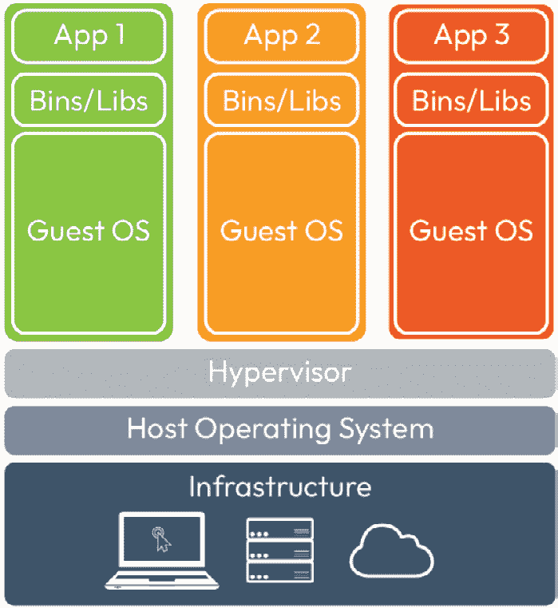
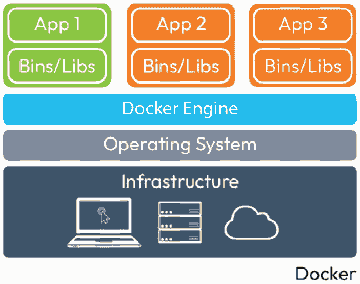
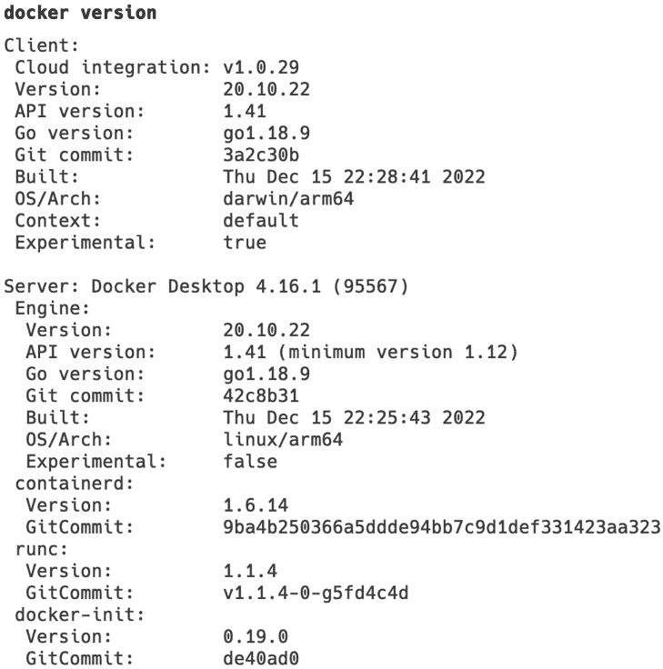
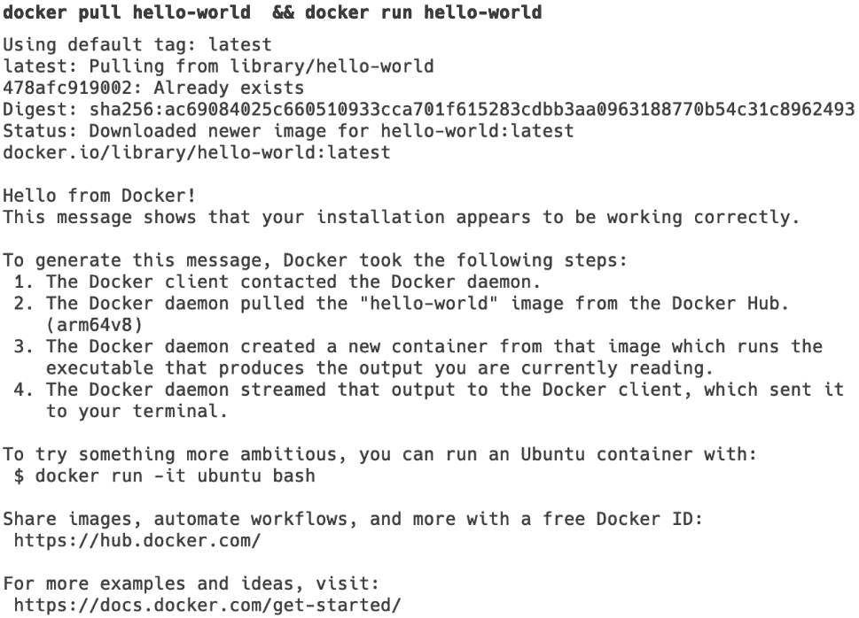
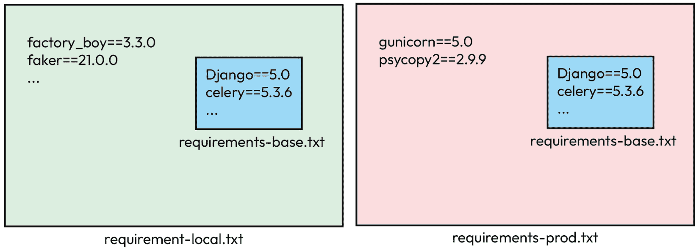
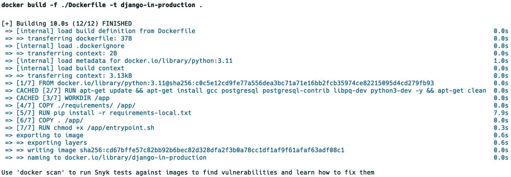
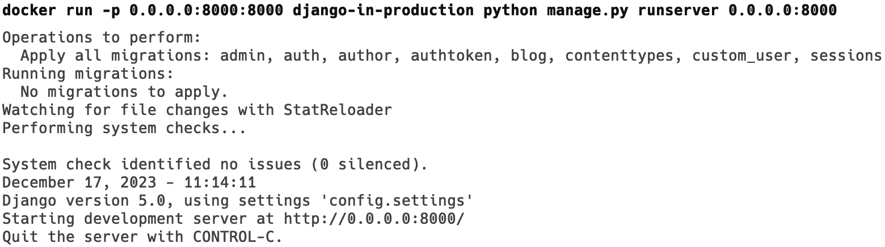
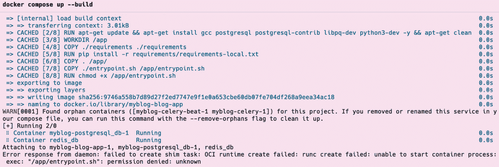
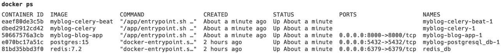

# Dockerizing Django Applications

在之前的章节中，我们讨论了如何为 Django 应用编写应用代码。在接下来的几章中，我们将探索可以用来改善开发体验、将代码部署到可扩展的生产系统以及监控生产系统的不同工具。

让我们开始改进我们的开发体验。在 *第 1 章* 中，在为 Django 项目设置本地开发时，我们提到了 `Docker`。我们将学习如何使用 Docker 开发我们的 Django 应用。本章我们将主要关注使用容器在本地系统上运行所有服务的情况下，将我们的 Django 应用 Docker 化。

在本书记述的之前章节中，我们在本地使用 Django 项目时使用了不同的远程服务用于 Postgres 和 Redis，以便我们不会被任何安装步骤阻塞。为了确保每个人都能轻松遵循书中给出的所有说明，而不会因可能过时的教程或本地系统配置的差异而遇到困难，我确保仅使用最少的本地系统依赖项，以便指南易于遵循。但随着项目的增长，本地设置项目将变得很重要；为此目的，Docker 是大多数开发者的首选工具。

在本节中，我们将学习如何使用 Docker 在本地系统上设置 Django、Celery、Celery Beat、Redis 和 Postgres。由于项目的 Docker 设置仅在项目创建的初始阶段完成，我们将采用一个样板项目模板并对项目进行 Docker 化，而不深入细节。

让我们看看本章将涵盖的主要主题：

*   学习 Docker 的基础知识
*   为 Django 项目创建 `Dockerfile`
*   使用 `docker-compose.yaml` 组合服务

## 技术要求

在本章中，我们将讨论如何将 Docker 与 Django 应用一起使用。我们不会深入 Docker 和容器的细节。我们期望你对 Docker 有基础的理解。对于本章，你需要具备以下条件：

*   对容器和 Docker 的理解
*   对如何在本地系统上安装 Docker 的理解
*   熟悉访问 Docker 开发环境

由于我们不会关注 Docker 的基础和细节，如果你不熟悉上述要求，请从以下书籍/视频中阅读/复习 Docker 的概念：

*   *Docker Deep Dive, Second Edition* – By *Nigel Poulton*
*   *Docker for Developers* – By *Richard Bullington-McGuire*, *Andrew K. Dennis*, and *Michael Schwartz* from *Packt Publishing*
*   *The Ultimate Docker Container Book, Third Edition* – By *Dr. Gabriel N. Schenker* from *Packt Publishing*
*   *A Developer’s Essential Guide to Docker Compose* – By *Emmanouil Gkatziouras* from *Packt Publishing*

以下是本章所有代码和说明的 GitHub 仓库：[`github.com/PacktPublishing/Django-in-Production/tree/main/Chapter11`](https://github.com/PacktPublishing/Django-in-Production/tree/main/Chapter11)。

## 学习 Docker 的基础知识

Docker 是一个开源容器化平台，允许开发者构建、部署和管理容器化应用。在我们深入 Docker 的概念之前，让我们学习一些将建立基础的概念：

*   **虚拟化** – 虚拟化的概念可以追溯到 1970 年代。它是在从实际硬件抽象的虚拟层中运行不同操作系统/软件的虚拟实例的过程。

考虑一个 10 栋别墅的类比，每栋别墅都有自己的设施，不能与邻居共享。所有业主都住在自己的别墅中，并受分配给他们的面积限制。他们可以在自己的别墅中做任何事情，但无法进入邻居的别墅。*图 11.1* 显示了使用虚拟机的虚拟化概念示例。



图 11.1：使用虚拟化概念的虚拟机


`Virtual machine` – 虚拟机在物理机器之上运行，可以访问分配给它们的资源，并且不能访问超过其分配的资源。

`Hypervisor` – Hypervisor 是一种用于创建和运行虚拟机的程序。

虚拟机的概念无缝工作并且在行业中仍然使用，但它也存在资源使用效率低下的问题。沿用同样的类比，为什么每栋平房都有自己的停车位？它们可以有一个停车场，供居民停车使用。

Docker 通过让开发者将应用程序打包成小型容器来解决这个问题，然后容器可以在机器上独立运行。沿用同样的类比，Docker 可以被视为一栋公寓楼，租户住在每个公寓里，每个租户都可以使用设施。每个公寓在停车区都有分配给他们的停车位。现在我们有了一种高效利用停车区的方法。

Docker 在容器之间提供逻辑隔离，每个容器在其自己的空间中独立运行，而不知道/无法访问其他容器中的数据，除非特别共享。

 

Figure 11.2: Docker high-level architecture

在使用 Docker 的过程中，我们会遇到与 Docker 相关的多个术语。以下是将帮助我们更好地理解 Docker 的关键概念：

*   `Dockerfile` – `Dockerfile` 是一个文本文档，为构建 Docker 镜像提供指导并详细说明容器的基础操作系统。它概述了必要的元素，例如语言、环境变量、文件路径、网络端口和其他要求，以及容器执行时预期采取的操作。

*   `Docker images` – Docker 镜像同时封装了可执行应用程序源代码以及应用程序容器化执行所必需的所有工具、库和依赖项。运行 Docker 镜像会将其转换为容器的单个实例或多个实例。

*   `Docker containers` – Docker 容器镜像是一个紧凑、独立、可执行的软件包，包含应用程序执行所需的一切，包括代码、运行时、系统工具、库和配置。

*   `Docker Engine` – Docker Engine 是一个客户端-服务器应用程序，促进构建、传输和基于容器的应用程序执行所需的过程和工作流程。它启动一个服务器端守护进程，负责管理镜像、容器、网络和存储卷。

*   `Docker daemon` – Docker daemon 是主机系统上幕后运行的服务，负责监督 Docker 容器的创建、执行和分发。此进程在主机的操作系统上运行，作为客户端通信的接口。

*   `Docker registry` – Docker registry 是 Docker 镜像的存储中心。它充当存储库，可驻留在本地供个人用户使用，也可公开，例如在 Docker Hub 上，使应用程序开发中的协作工作成为可能。团队甚至在同一组织内也可以通过将容器上传到 Docker Hub 无缝交换或分发容器——一个类似于 GitHub 的云存储库。

*   `Docker Hub` – Docker Hub，自称“世界上最大的容器镜像库和社区”，充当 Docker 镜像的公共存储库。拥有超过 100,000 个容器镜像的集合，它汇集了商业软件供应商、开源计划和个人开发者的贡献。存储库包括 Docker, Inc. 制作的镜像、Docker Trusted Registry 的认证镜像以及许多其他镜像。Docker Hub 用户可以自由地轻松共享其镜像，并且可以轻松访问预配置的基础镜像以启动任何容器化工作。

*   `Docker Compose` – Docker Compose 简化了多个容器的编排，将它们集体视为单个服务。虽然独立执行每个容器，但它促进了容器之间的无缝交互和通信。

我们将在本章后半部分学习更多关于 Docker Compose 的内容（在 *Composing services using docker-compose.yml* 部分）。现在让我们学习如何在本地系统上安装 Docker 并使用它。

## Installing Docker

Docker 是一件开源软件，可免费从官方网站下载。Docker 可用于 Linux、Windows 和 Mac 操作系统。每个平台的安装和运行 Docker 的说明都已在官方指南中得到充分记录和解释，因此我们在此不予赘述。请按照以下说明操作：

*   对于 macOS 用户，请按照 [`docs.docker.com/desktop/install/mac-install/`](https://docs.docker.com/desktop/install/mac-install/) 给出的步骤操作。

*   对于 Windows 用户，请按照 [`docs.docker.com/desktop/install/windows-install/`](https://docs.docker.com/desktop/install/windows-install/) 给出的步骤操作。

*   对于 Linux 用户，请按照 [`docs.docker.com/desktop/install/linux-install/`](https://docs.docker.com/desktop/install/linux-install/) 给出的步骤操作。

一旦我们安装了 Docker，我们可以运行 `docker version` 命令来验证我们的安装。*Figure 11**.3* 显示了运行 Docker 所需的所有 Docker 驱动程序的输出。*请注意：版本号可能因平台不同以及您 `installing Docker* 的时间而不同。

 

Figure 11.3: Output of the docker version command

Docker 安装完成后，让我们在本地系统上测试 Docker。

## Testing Docker on your local system

现在 Docker 已安装在我们的本地系统上，让我们尝试运行一个 Docker 容器来验证 Docker 设置。Docker 有一个示例镜像，我们可以用它来运行容器。Docker 提供了官方镜像供我们测试。`hello-world` 镜像是一个简单的示例，开发人员用它来验证设置。

通过运行以下命令，我们可以验证本地机器上的 Docker 设置：

```
> docker pull hello-world  && docker run hello-world
```

*Figure 11**.4* 显示了我们运行 `docker run` 命令时应该看到的输出：

 

Figure 11.4: The output of the hello-world Docker image

现在我们已经验证了 Docker 设置并运行了 `hello-world` Docker 镜像，让我们学习一些我们需要使用的几个重要命令。

## Important commands for Docker

Docker CLI 有多个命令可用于交互和执行不同的操作。在这里我们将介绍开发人员经常使用的最常见命令：

*   `docker ps` 显示正在运行的容器的列表以及基本信息，例如容器 ID、名称和状态。这是一种快速检查当前活动容器的简便方法。

*   `docker pull` 从注册表中下载 Docker 镜像。

*   `docker build` 从 `Dockerfile` 构建 Docker 镜像。

*   `docker run` 从指定镜像创建并启动新容器。它允许您自定义容器的各个方面，例如端口映射、环境变量等。

*   `docker start` 启动已停止的容器。它使容器重新活跃起来，让您恢复其操作。

*   `docker exec` 在正在运行的容器内执行命令。对于在特定容器内执行任务或运行应用程序而不启动新容器非常方便。


`docker stop` stops a running container.

`docker restart` restarts a container.

`docker log` displays the logs of a container.

Read more

For more Docker CLI commands, refer to [`docs.docker.com/engine/reference/run/`](https://docs.docker.com/engine/reference/run/).

Alternatively, check the frequently used commands from their official one-page cheat sheet here:

[`docs.docker.com/get-started/docker_cheatsheet.pdf`](https://docs.docker.com/get-started/docker_cheatsheet.pdf).

We will learn how to create our own custom Docker image and work with it. But before that, we need to learn how to manage package dependencies with the `requirements.txt` file in a Django project.

# Working with the requirements.txt file

Different projects can have different dependency needs to run. That’s why we use the `requirements.txt` file to capture all the third-party packages installed and used in a project. But as projects grow, we can realize that some of the dependency packages are useful only while we are developing locally, some are useful in our CI pipeline, and some are used only for production. Hence it is important that we break our `requirements.txt` file into multiple parts.

We need to split our `requirements.txt` file into multiple files that would be used for different purposes. This is common in large projects and is always better to implement as soon as we create a new project. This ensures that only the actually used packages are shipped to production.

Here is a structure seen in most large projects:

* `requirements-base.txt` – This file contains all the common third-party packages that are used in all the environments. For example, Django and Celery are third-party packages that are used across all the environments, so we should add them to the base file.
* `requirements-local.txt` – This file contains all the packages that are going to be used in the base file and are needed to run the project locally. This can contain a lot of mocks and also testing packages that developers use daily.
* `requirements-ci.txt` – This file contains all the packages that are going to be used in the base file and are needed to run the project in the CI pipeline.
* `requirements-stage.txt` – This file contains all the packages similar to the production environment but can be used to test any package upgrades without affecting the production environment.
* `requirements-prod.txt` – This file contains all the packages that are going to be used in the base file and any special packages that are needed in production.

Here is an example of a `requirements-base.txt` file that has only base packages:

```
Django==5.0
djangorestframework==3.14.0
redis==5.0.1
django-cacheops==7.0.2
```

Now our production packages would be stored in the `requirements-prod.txt` file, which has all the base packages along with the extra packages:

```
-r requirements-base.txt
gunicorn==21.0.1
```

The first line, `-r requirements-base.txt`, is important because it tells Python to include all the packages from the `requirements-base.txt` file and then add the packages mentioned in the `requirements-prod.txt` file. *Figure 11.5* shows the `requirements.txt` concepts:



Figure 11.5: requirement.txt

There are other dependency tools in Python that can be used for package management. For example, there are `Poetry`, `pdm`, `pipenv`, but we will stick to `pip` and `requirements.txt` since we are using Docker and it will simplify our setup.

Now let us create our own Docker image for our Django project code that we can run locally.

# Creating a Dockerfile for a Django project

A `Dockerfile` is a text document that has all the instructions needed to create a Docker image. We can consider a `Dockerfile` as a recipe that we can follow to cook any item. Let us take the boilerplate `Dockerfile` example we would need for our Django project. Create a `/myblog/backend/Dockerfile` file with the following content:

```
# Pull the official base image
FROM python:3.11
# Set environment variables
ENV PYTHONDONTWRITEBYTECODE 1
ENV PYTHONUNBUFFERED 1
# Install different Linux packages.
RUN apt-get update \
&& apt-get install gcc postgresql postgresql-contrib libpq-dev python3-dev netcat-traditional -y \
&& apt-get clean
# set working directory and install packages using pip.
WORKDIR /app
COPY ./requirements ./requirements
RUN pip install -r requirements/requirements-local.txt
# Copy the Application code
COPY . /app/
COPY ./entrypoint.sh /app/entrypoint.sh
# Give permission to entrypoint.sh file as executable.
RUN chmod +x /app/entrypoint.sh
# run entrypoint.sh
ENTRYPOINT ["/app/entrypoint.sh"]
```

Save the content of the file as `Dockerfile` in `/<path to project>/<Django manage.py folder>/Dockerfile`. Let us learn what `Dockerfile` does:

* `FROM python:3.11` – We are downloading the base Python image where we shall install all the packages. One popular idea developers have with Docker is to use the `Alpine` image, but I strongly advise you to stay away from the `Alpine` image because the `Alpine` image with Python leads to longer build time, performance issues, and obscure bugs in production. (Read more about the issues with the `Alpine` Docker image at [`pythonspeed.com/articles/alpine-docker-python/`](https://pythonspeed.com/articles/alpine-docker-python/).) I would strongly recommend using the default Python image if you are starting and don’t have any specific requirements and space constraints.
* `Set Python environment variables` – Setting `PYTHONDONTWRITEBYTECODE` to `1` tells Python not to create the `__pycache__` folders. Setting `PYTHONUNBUFFERED` to `1` tells Python to pass the `stdout` and `stderr` streams to be unbuffered. This helps to get an immediate output of the logs, and the Django management command output is instantly visible.
* `Install Linux packages` – We use different drivers and packages to connect to databases and other services.
* `Install Python packages` – We have first set the working directory, then copied all the `requirements` files. Run the `pip` command to install all the Python packages.
* `Copy application code` – Copy the application code and give execution permission to the `entrypoint.sh` file.
* Run the `entrypoint.sh` file.

Once our Docker container is initiated, we need to execute commands inside our container. For example, in a Django project, we want to run our migration command every time we start our Django server. This way, we can ensure that our database has applied all the latest database migrations. We can perform such operations using the `entrypoint.sh` script. We need to create an `entrypoint.sh` file. Here is an example of our `entrypoint.sh` file:

```
#!/bin/sh
if [ "$DB_HOSTNAME" = "postgres" ]
then
    echo "Waiting for Postgres..."
    while ! nc -z $DB_HOSTNAME $DB_PORT; do
      sleep 0.1
    done
    echo "PostgreSQL started"
fi
python manage.py migrate
exec "$@"
```

In the preceding snippet of code, we are first waiting for the Postgres database to be ready for connection. Once the database is ready to accept the connection, we will run the Django migration commands. The last line, `exec "$@"`, is a very important command; it takes the command from the `docker-compose.yaml` file and replaces the parent process, rather than creating a different process. Read more about how the `entrypoint.sh` script works and what it can do here: [`stackoverflow.com/questions/32255814/`](https://stackoverflow.com/questions/32255814/).

Now run the following command to build a Docker image for your Django project:

```
> docker build -f ./Dockerfile -t django-in-production .
```


*Figure 11**.6* 显示了 `docker build` 命令的输出。在此步骤中，我们正在下载 Python 镜像，然后安装所有依赖的 Python 包。



Figure 11.6: Output of the docker build command

要启动 Docker 容器，请运行以下命令：

```
> docker run -p 0.0.0.0:8000:8000 django-in-production python manage.py runserver 0.0.0.0:8000
```

*Figure 11**.7* 显示了 `docker run` 命令的输出，其中我们将 `python manage.py runserver 0.0.0.0:8000` 命令传递给容器，并将端口 `8000` 暴露给主机机器。



Figure 11.7: Output of the docker run command

现在我们可以看到我们的 Django 应用正在运行，并且可以通过浏览器访问。我们可以通过在浏览器中打开 `http://0.0.0.0.8000/admin/` 来验证。

我们已经创建了 Django Docker 镜像，但我们仍然在使用远程服务来运行 Postgres 和 Redis。现在我们将学习如何使用 `docker-compose` 协调 Postgres 和 Redis 等不同服务并连接到我们的 Django 项目。

# 使用 docker-compose.yaml 组合服务

现在让我们探索如何创建一个 `docker-compose.yaml` 文件来协调我们的 Django 项目、Celery、Celery Beat、Postgres 和 Redis 服务。向 `/myblog/docker-compose.yml` 文件添加以下代码：

```
version: "3.8"
services:
  postgresql_db:
    image: postgres:16.1
    volumes:
      - ~/volumes/proj/dip/postgres/:/var/lib/postgresql/data/
    ports:
      - 5432:5432
    env_file:
      - ./.env
    environment:
      - POSTGRES_USER=${DB_USERNAME}
      - POSTGRES_PASSWORD=${DB_PASSWORD}
      - POSTGRES_DB=${DB_NAME}
  redis_db:
    image: redis:7.2
    container_name: redis_db
    ports:
      - 6379:6379
    command: redis-server --requirepass ${REDIS_PASSWORD}
    env_file:
      - ./.env
    volumes:
      - $PWD/redis-data:/var/lib/redis
      - $PWD/redis.conf:/usr/local/etc/redis/redis.conf
  blog_app:
    build:
     context: ./backend
     dockerfile: Dockerfile
    command: python manage.py runserver 0.0.0.0:8000
    volumes:
      - ./backend/:/app/
    ports:
      - 8000:8000
    env_file:
      - ./.env
    depends_on:
      - postgresql_db
      - redis_db
  celery:
    build: ./backend
    command: celery --app=config worker -l info
    volumes:
      - ./backend/:/app/
    env_file:
      - ./.env
    depends_on:
      - postgresql_db
      - redis_db
  celery_beat:
    build: ./backend
    command: celery --app=config beat -l info -S redbeat.RedBeatScheduler
    volumes:
      - ./backend/:/app/
    env_file:
      - ./.env
    depends_on:
      - postgresql_db
      - redis_db
```

让我们学习 `service` 配置的每个部分的作用（请注意，服务名称可以是任何其他名称，因为我们是根据方便来命名的）：

*   `postgres_db` – 运行 Postgres 数据库服务器。我们使用 `.env` 文件加载所有环境变量值，然后在 `environment` 部分映射这些值。
*   `redis_db` – 运行用于缓存和维护我们 Celery 异步任务队列的 Redis 数据库服务器。
*   `blog-app` – 运行 Django 应用。
*   `celery` – 运行 Celery 服务以运行异步任务。
*   `celery-beat` – 运行 Celery Beat 服务以运行可执行的周期性任务。

重要说明

我们使用在 *Creating a Dockerfile for a Django project* 部分中创建的相同 `Dockerfile` 来运行我们的 Django、Celery 和 Celery Beat 服务。`Dockerfile` 和 `entrypoint.sh` 步骤相同；唯一的区别是我们传递给服务的命令。

另一个重要步骤：在本地开发环境中运行 Docker 时，我们必须在主机文件系统中为 `entrypoint.sh` 文件赋予执行权限。我们使用 `volumes` 配置覆盖 Docker 容器中的文件，该配置将所有文件挂载到 Docker 容器中。我们使用 `volumes` 来为 Django 开发启用热重载。通过在 Mac 或 Linux 上在 `<project>/myblog/` 文件夹中运行以下命令，我们可以为 `entrypoint.sh` 文件赋予适当的权限：

```
> chmod +x backend/entrypoint.sh
```

如果我们没有为 `entrypoint.sh` 文件提供适当的权限，那么在 *Starting Django applications using Docker* 部分尝试运行 `docker-compose` 命令时，我们会看到以下错误。在 *Figure 11**.8* 中，我们可以看到 `exec: "/app/entrypoint.sh": permission denied: unknown` 错误。因此，添加适当的权限非常重要。



Figure 11.8: Error due to a bad permission for entrypoint.sh

要更新 `entrypoint.sh` 文件权限的 Windows 特定命令，请访问 [`www.educative.io/answers/what-is-chmod-in-windows`](https://www.educative.io/answers/what-is-chmod-in-windows)。

现在我们已经创建了包含 Django 应用运行所需所有服务的 `docker-compose` 文件，但每个服务的配置需要传递。为此，我们创建一个包含所有必需变量的 `.env` 文件。

## 创建 .env 文件

我们将创建一个包含所有配置值以及不同服务所需的敏感密钥值的 `.env` 文件。以下是 `docker-compose` 运行所有不同服务所需的环境变量示例。创建 `/myblog/.env` 文件并添加以下代码：

```
DEBUG=True
DJANGO_ALLOWED_HOSTS=*
DB_ENGINE=django.db.backends.postgresql
DB_NAME=django_in_production
DB_USERNAME=root
DB_PASSWORD=root
DB_HOSTNAME=postgresql_db
DB_PORT=5432
REDIS_HOST=redis_db
REDIS_PORT=6379
REDIS_PASSWORD=redisPassWord
```

现在我们已在 `.env` 文件中定义了所有配置值，并将 `.env` 文件保存在与 `docker-compose.yaml` 文件相同的目录中。*这些值可以不同，可以根据您的喜好进行更新*。下一步，我们必须为所有服务加载 `.env` 文件，以便在我们希望它们可访问的位置加载。以我们的 `docker-compose.yaml` 文件为例，我们按如下方式加载 `.env` 值：

```
version: "3.8"
services:
  blog-app:
    ... other settings
    env_file:
      - ./.env
    ... other settings
  celery:
    ... other settings
    env_file:
      - ./.env
    ... other settings
```

我们的 `blog-app` 服务和 `celery` 服务将从 `.env` 文件加载环境变量。

在 Docker 中传递环境变量还有其他方法。你可以在此处阅读更多内容：[`docs.docker.com/compose/environment-variables/set-environment-variables/`](https://docs.docker.com/compose/environment-variables/set-environment-variables/)。

传递的环境变量需要在 Django 和 Celery 服务中访问。让我们学习如何使用 Python 在后端服务中访问环境变量值。

## 在 Django 中访问环境变量

一旦添加了环境变量，我们需要在 Docker 容器中运行的 Django 应用中访问它们。环境变量可以使用 Python 的 `os` 库访问。例如，让我们访问 `.env` 文件中设置的 `DEBUG` 标志：

```
import os
DEBUG = os.environ.get("DEBUG", False)
```

同样，我们可以访问其他环境变量，并根据 `.env` 文件中设置的值使我们的 `settings.py` 文件动态化。我们可以使用从 `.env` 文件中获取的环境变量配置 Django 设置，这样秘密值就不会添加到版本控制中。

重要说明


请记得将 `.env` 文件添加到 `.gitignore` 文件中。我们不希望 `.env` 文件或任何可能导致安全漏洞的敏感值被提交到 Git 历史记录中。

还有另一个可用的包，`django-environ`（[`github.com/joke2k/django-environ`](https://github.com/joke2k/django-environ)），它可以以更好的格式加载环境变量。但我会留给你阅读并决定是使用基本的 `os` 库还是 `django-environ`。就个人偏好而言，我喜欢使用基本的 `os` 库，因为使用第三方包总会增加维护开销。读取简单的环境变量不应该需要额外的包。

现在让我们使用 Docker Compose 启动我们的 Django 应用。

## 使用 Docker 启动 Django 应用

我们的 Django 项目现在已使用 Docker 设置完成，我们可以通过执行以下命令启动项目：

```
> docker-compose -f docker-compose.yaml up --build
```

现在 Docker 将下载镜像并构建 `docker-compose.yaml` 文件中提到的全部五个不同的服务。我们的 Django 应用现在已独立运行在本地系统上，而不依赖于任何远程服务。

为了验证所有服务是否正常运行，我们可以使用以下命令：

```
> docker ps
```

*图 11.9* 显示了 `docker ps` 命令的结果以及在本地系统上运行的全部五个容器：



图 11.9：docker ps 命令的输出

Docker 是一个强大的工具，帮助开发者在本地系统上独立运行服务。我们已利用 Docker 的强大功能，成功使用不同的 Docker 容器在本地运行我们的 Django 应用。

# 总结

在本章中，我们对如何使用 Docker 设置 Django 应用进行了高层次概述。我们使用了一个包含 Postgres、Redis、Django、Celery 和 Celery Beat 的样板模板，以使用 Docker 在本地运行服务。我们没有深入探讨这些主题，因为 Docker 本身是一个庞大的主题，并且预计你对 Docker 有一定的了解，这样你就可以将本章作为设置项目的参考。

在下一章中，我们将重点介绍如何使用 GitHub Actions 实现 CI 流水线、设置 Git hooks，以及使用不同的分支策略进行版本控制。我们还将讨论有关如何设置代码评审流程的几点。

# 12
