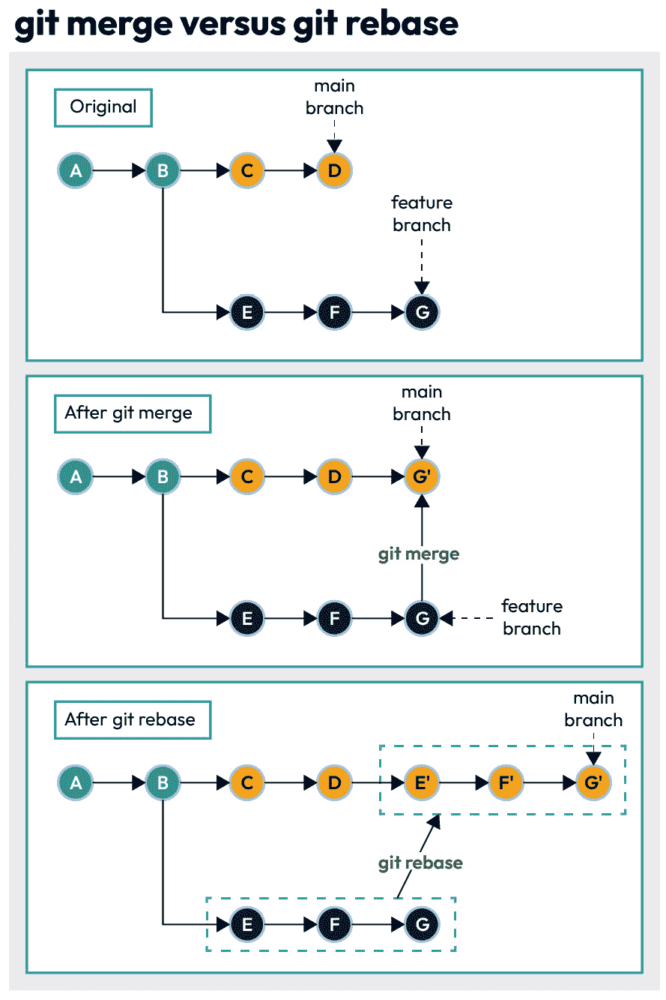
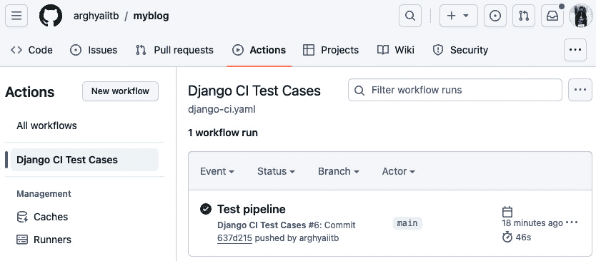
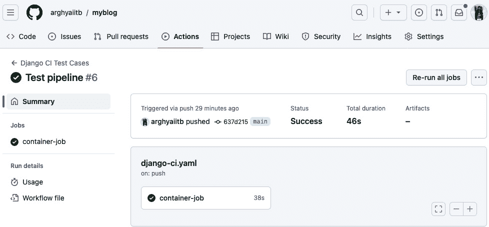
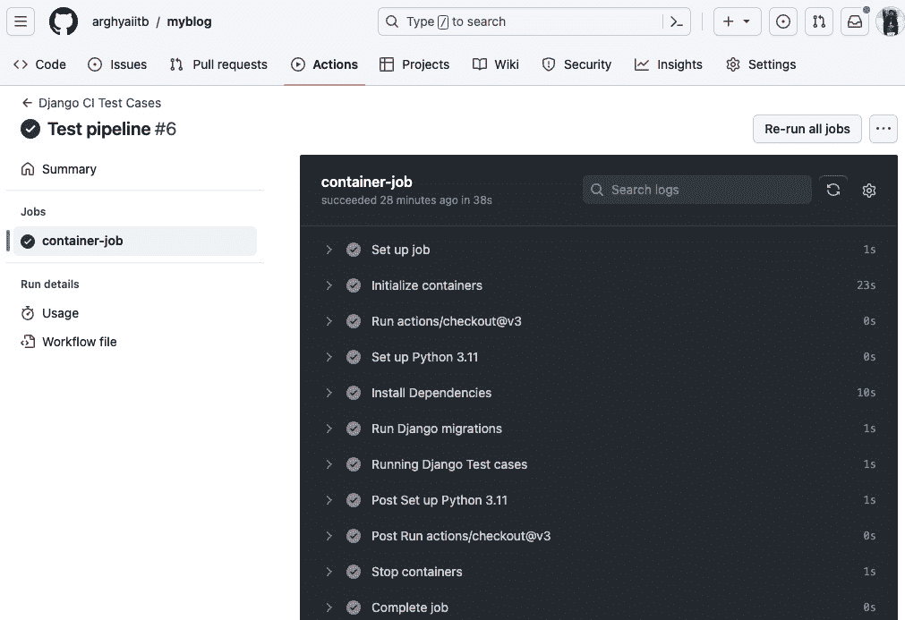

# 使用 Django 进行 Git 和 CI 流水线的工作

在 *第 11 章* 中，我们学习了如何将 Docker 集成到 Django 项目中。Docker 帮助我们在任何平台上无缝运行 Django 项目。在本章中，我们将探讨如何在 Django 项目中高效使用 Git。我们将学习使用 Git 的最佳实践，以及如何将 Git hooks 集成到开发周期中以提高开发者的生产力。

本章我们将学习以下主题：

* 高效使用 Git
* 使用 GitHub 并设置 GitHub Actions
* 设置 PR 评审和代码规范

# 技术要求

在本章中，我们将使用高级 Git 功能并将 GitHub Actions 集成到我们的项目中。我们期望读者对 Git 有良好的理解，并对使用 GitHub Actions 的 **持续集成**（**CI**）流水线有一定的了解。

如果你不熟悉 Git，我们强烈建议你学习 Git 的基础知识，然后再回来看本章。以下是一些你可以参考的书籍和免费课程资源：

* *Git for Programmers* by Jesse Liberty
* *Mastering Git* by Jakub Narębski, Jakub S Narebski
* *Version Control with Git* by Udacity ([`www.udacity.com/course/version-control-with-git--ud123`](https://www.udacity.com/course/version-control-with-git--ud123))
* *Pro Git* by Scott Chacon and Ben Straub ([`git-scm.com/book/en/v2`](https://git-scm.com/book/en/v2))
* *RY’s Git Tutorial* by Ryan Hodson ([`www.amazon.com/Rys-Git-Tutorial-Ryan-Hodson-ebook/dp/B00QFIA5OC`](https://www.amazon.com/Rys-Git-Tutorial-Ryan-Hodson-ebook/dp/B00QFIA5OC))

以下是本章所有代码和说明的 GitHub 仓库：[`github.com/PacktPublishing/Django-in-Production/tree/main/Chapter12`](https://github.com/PacktPublishing/Django-in-Production/tree/main/Chapter12)

# 高效使用 Git

版本控制是 **软件开发生命周期**（**SDLC**）中最重要的工具之一。我们在本章中不会介绍 Git 的基础知识，而是讨论在使用 Git 时应遵循的良好实践。让我们来看一下在使用 Git 时推荐的几个良好实践：

* 对于小的更改，始终为其创建新的分支。很多时候，开发者会想直接将更改提交到 `main`、`master`、`develop` 或用于默认分支的任何其他名称，这取决于他们使用的是什么。
* 在创建项目时尽快添加 `.gitignore` 文件。
* 切勿允许任何人直接推送代码到默认分支。每一块代码都应通过 `pull request`（`PR`）合并到默认分支。
* 始终确保 Git 在本地已配置，并且包含开发者的姓名、电子邮件和其他相关详细信息。
* 在合并两个分支时使用 `git merge` 命令策略，避免使用 rebase 和重写历史，除非你知道自己在做什么。我们将在下一节详细讨论这一点。
* 始终使用有意义且详细的提交信息。创建提交信息规范，并确保开发者遵循提交信息格式。
* 始终使用 `git revert` 来执行代码回滚。切勿更改代码库已发布的历史记录。
* 尽可能使用 Git hooks 来自动化你的工作流程。
* 使用 Git 标签来发布项目中的新代码。我们将在本章后面部分详细讨论如何利用 Git 标签。
* 决定一个 `Git workflow` 并确保开发者坚持执行。

请注意

前面提到的 Git 最佳实践是主观的，并且基于具体情况。读者始终可以选择适合/解决其问题陈述的不同工作流程。我在处理不同项目时也无法遵循所有前面提到的建议。因此，与所提及的内容相比，提出不同的工作流程总是可能的。

现在，让我们开始深入探讨一些可以帮助你和你的团队高效工作的主题。

## Git 分支策略

开发者在处理代码库时应始终创建新的分支。在使用分支时，开发者应遵循一些考虑或约定。在本节中，我们将讨论软件开发者应考虑的所有约定，以使用 Git 改进其开发流程：

* **分支名称**：决定分支命名约定很重要。分支名称应提供足够的信息，帮助任何人轻松识别分支中的更改。不同团队和公司遵循不同的约定，但最重要的是团队中的每个人都应遵循相同的约定。以下是行业中使用的一些示例；请随意讨论并选择适合你团队的分支约定：


1. `<branch type>/<ticket or issue number>/<branch name>`: 在这里，我们以分支所处理的任务类型开头，例如 `feature`、`bugfix` 和 `improvement`。然后我们添加 issue 编号或 JIRA 工单编号，后跟标准的分支名称。例如，如果我们正在做一个功能且我们的 JIRA 编号为 DJ-112，该功能将为博客添加评论功能，那么我们的分支名称应如下所示：`feature/DJ-112/integrating-comments`。

2. `<developer or team name/<branch type>/<branch name>`: 在这里，我们以正在处理该分支的团队或开发者名称开头，后跟任务类型，例如 `feature` 或 `bugfix`。例如，如果我正在添加评论功能，那么分支名称看起来像这样：`argo/feature/integrating-comments`。

开发者可以讨论并决定任何适合团队的命名约定，但重要的是选择一种特定的模式并在代码库中工作时只允许使用该模式。这可以通过本地 Git hooks 和服务器 hooks 来强制执行。

* **使用受保护分支**：项目中应有受保护分支，任何人都不能直接推送代码。代码进入这些分支的唯一方式应通过 PR。这些分支应用于生产部署或创建用于部署到生产环境的标签。

* **使用分支工作流**：不同公司开发了众多策略来解释分支策略。你可以阅读不同的著名分支策略并决定遵循哪种分支策略。以下是可以探索的几篇文章：
    1. 这是 Git 官方网站的一篇文章：[`git-scm.com/book/en/v2/Git-Branching-Branching-Workflows`](https://git-scm.com/book/en/v2/Git-Branching-Branching-Workflows)。
    2. 这是 *Vincent Driessen* 提出的最早的 Git 工作流之一，至今仍被各组织引用：[`nvie.com/posts/a-successful-git-branching-model/`](https://nvie.com/posts/a-successful-git-branching-model/)。
    3. 这是 GitHub 工作流：[`docs.github.com/en/get-started/quickstart/github-flow`](https://docs.github.com/en/get-started/quickstart/github-flow)。
    4. 这是 GitLab 工作流：[`docs.gitlab.com/ee/topics/gitlab_flow.html`](https://docs.gitlab.com/ee/topics/gitlab_flow.html)。

一旦我们确定了分支工作流，我们需要关注最重要的 Git 命令，`git commit`。

## 使用 git commit 时遵循良好实践

代码更改完成后，我们将使用 `git commit` 命令。每个 `git commit` 命令都可以被视为日志簿，可用于识别过去所做的代码更改。因此，我们必须为每次提交编写适当的提交信息，以便 Git 历史记录具有相关性，并且可以轻松识别代码更改。

提交信息是 SDLC 中最重要的元素之一。它们用于识别对代码所做的任何更改。开发者必须为每次提交编写适当的提交信息，以创建可维护的代码。让我们讨论一下在行业中广泛使用的几种标准提交信息格式。

### Conventional Commits

Conventional Commits 文档说明如下：

*The Conventional Commits specification is a lightweight convention on top of commit messages. It provides an easy set of rules for creating an explicit commit history; which makes it easier to write automated tools on top of.*

Conventional Commits 指南建议提交信息应按如下结构组织：

```
<type>[optional scope]: <description>
[optional body]
[optional footer(s)]
```

这有助于轻松识别代码更改反映了何种类型的工作，并且你还可以根据提交信息编写自动化工具和工作流。提交信息中提到的 `<type>` 有助于识别特定提交引入了何种类型的更改。`scope` 定义了更改的范围。最后，在 `description` 块中，我们添加对整体更改的简短描述。Conventional Commit 文档提供了适当的示例来解释不同类型的提交信息。有关更多详细信息，请访问 [`www.conventionalcommits.org/`](https://www.conventionalcommits.org/)。

### 在提交信息中使用 JIRA 和 GitHub Issues

项目管理工具用于跟踪开发工具的进度。例如，所有托管在 GitHub 上的开源项目都使用 GitHub Issues 来跟踪任何功能请求/错误。当我们在提交信息中添加 GitHub issue 编号时，GitHub 会自动链接代码提交和 issue。这有助于团队协调积极跟踪给定任务的任何进展。同样，重新审视代码提交历史有助于了解任何代码更改的 what、why 和 how。

如果你的团队使用 JIRA 或其他工具进行项目管理，那么在提交信息中添加 JIRA ID 有助于更快、更好地识别和标记问题。行业中使用了不同的格式，最好在团队内部讨论以确定最适合团队的提交信息格式。让我们看一下常用的格式之一：

```
<type> [<JIRA ID>]: <Short description>
```

Read more

有关更多详细信息，请访问 GitHub 官方文档，了解如何高效使用 GitHub Issues：[`docs.github.com/en/issues/tracking-your-work-with-issues/about-issues`](https://docs.github.com/en/issues/tracking-your-work-with-issues/about-issues)。要使用 GitHub 集成 JIRA 或其他项目管理工具，请访问 [`github.blog/2019-10-14-introducing-autolink-references/`](https://github.blog/2019-10-14-introducing-autolink-references/)。

随着团队的成长和项目的演进，添加可以强制执行提交信息格式的自动化工具非常重要。有一些工具可以帮助你强制执行良好的提交信息结构。建议读者阅读工具的官方文档并了解更适合自己的工具：

* `commitlint` ([`github.com/conventional-changelog/commitlint`](https://github.com/conventional-changelog/commitlint))
* `gitlint` ([`github.com/jorisroovers/gitlint`](https://github.com/jorisroovers/gitlint))
* `commitizen` ([`github.com/commitizen-tools/commitizen`](https://github.com/commitizen-tools/commitizen))
* `cz-cli` ([`github.com/commitizen/cz-cli`](https://github.com/commitizen/cz-cli))

现在，让我们学习一些可以帮助开发者更轻松地使用 Git 的工具。

## 与 Git 相关的工具

市场上有很多工具可以帮助我们更好地进行版本控制。让我们看看可以探索的顶级工具：

* `git-sim` ([`github.com/initialcommit-com/git-sim`](https://github.com/initialcommit-com/git-sim))：当你是一个初学者时，了解 Git 中不同命令的作用可能会令人望而生畏。git-sim 是一个命令行可视化工具，可以帮助初学者理解基本命令的作用。
* **GitHub Desktop**：GitHub Desktop 是 Git 的 GUI。它是平台无关的，可用于不同的代码托管平台，例如 GitLab 和 Bitbucket。
* **GitKraken**：GitKraken 是最古老的 Git GUI 之一，也是市场上最受欢迎的 GUI 工具之一。

我们学习了如何创建新分支，然后进行提交。我们看到了分支名称应如何命名以及什么是良好的提交信息的最佳实践，但如何确保开发者遵循这些指南呢？这就是 Git hooks 概念发挥作用的地方。

## 将 Git hooks 集成到 Django 项目中


Git 有一种方法可以在 Git 中发生某些重要操作时执行自定义脚本；这些自定义事件触发器被称为 Git hooks。Git 提供了两种类型的 hooks：客户端 hooks 在开发者机器上运行，并处理诸如 `commit`、`merge` 和 `push` 等事件，而服务器端 hooks 在远程服务器上运行，并处理诸如 `pre-receive` 和 `post-receive` 等事件。Git hooks 位于 `.git/hooks` 文件夹中。可以轻松创建 Git hooks 并将其集成，不同的框架可以帮助我们使用它们。我们不详细介绍如何手动添加自定义 hook，而是使用 `lefthook` 框架。虽然 `pre-commit` 是 Python 生态系统中最受欢迎的 Git hook 框架之一，但我们不会使用 `pre-commit`。相反，我们将学习如何使用 `lefthook`，因为它更快、更灵活。

## 使用 lefthook

`Lefthook` 是一个用 Go 编写的 Git hook 管理器。由于它是一个无需依赖的二进制文件，因此易于在任何环境中安装和运行。它可以并行运行命令，这使其比 `pre-commit` 快 3 倍，并且比大多数可用的 Git hook 管理器更快。Lefthook 文档正在不断完善，但社区非常活跃，并在解决任何阻塞问题方面提供支持。更多详情，请查看项目仓库 [`github.com/evilmartians/lefthook`](https://github.com/evilmartians/lefthook)。

现在，让我们看看如何将 `lefthook` 集成到我们的 Django 项目中。官方文档详细说明了如何安装它：[`github.com/evilmartians/lefthook/blob/HEAD/docs/install.md`](https://github.com/evilmartians/lefthook/blob/HEAD/docs/install.md)。

对于 Mac 系统，我们可以使用 `homebrew` 使用以下命令安装 lefthook：

```
brew install lefthook
```

Linux 用户可以通过 APT 包管理器安装 lefthook：

```
curl -1sLf 'https://dl.cloudsmith.io/public/evilmartians/lefthook/setup.deb.sh' | sudo -E bash
sudo apt install lefthook
```

对于 Windows 用户，可以使用 scoop（[`scoop.sh/`](https://scoop.sh/)）安装 lefthook：

```
scoop install lefthook
```

或者，Windows 用户也可以使用 winget 安装 lefthook（[`github.com/microsoft/winget-cli`](https://github.com/microsoft/winget-cli)）：

```
winget install evilmartians.lefthook
```

现在，让我们将 lefthook 集成到我们的项目中。为了学习 lefthook，我们将创建一个简单的项目：

1. 创建一个 `demo-project` 文件夹并添加一个新的 `demo-project/demo_script.py` 文件，内容如下：

```
def hello_world():
    print("hello world")
hello_world()
```

2. 使用以下命令向该文件夹添加 `git`：

```
git init
```

3. 现在，我们将使用以下命令将 `lefthook` 添加到项目中：

```
lefthook install
```

该命令将在项目文件夹中添加一个新的 `lefthook.yaml` 文件，其中包含大量被注释的示例命令。

4. 让我们添加一个示例 Git hook，该 hook 将检查生成的 `lefthook.yaml` 文件中的配置，其中包含示例检查：

```
pre-commit:
  commands:
    demo-echo:
      run: echo "Just Demo command"
    demo-echo2:
      run: echo "Just Demo command 2"
```

5. `pre-commit` 命令在开发者进行提交时运行。因此，当我们执行 `git commit` 命令时，我们会看到 Lefthook 运行以下自定义 hooks：

```
> git commit -am "Init commit"
 lefthook v1.5.5  hook: pre-commit
┃  demo-echo ❯
Just Demo command
┃  demo-echo2 ❯
Just Demo command 2
  ────────────────────────────────────
summary: (done in 0.03 seconds)
✔️  demo-echo
✔️  demo-echo2
[main 30019a4] Init commit
 2 files changed, 9 insertions(+)
create mode 100644 demo_script.py
```

所使用的 `echo` 命令可以轻松替换为我们想要执行的任何其他命令。

Lefthook 本质上是多功能的，可以用于在不同的编程语言中添加 Git hooks，例如 Python、Javascript 和 Shell Script。

阅读更多

更多详情，请访问 lefthook 的官方文档，其中解释了它提供的所有功能：[`github.com/evilmartians/lefthook/blob/master/docs/usage.md`](https://github.com/evilmartians/lefthook/blob/master/docs/usage.md)。

lefthook 的美妙之处在于它是语言无关的，因此我们可以使用 lefthook 为不同语言创建 Git hooks。以下是一些我通常配置的 lefthook 脚本：

* 使用 Black 和 Flake8 对所有暂存文件进行 Linting
* 强制分支名称符合约定
* 强制提交信息格式符合约定
* 阻止任何大文件被提交到仓库

Lefthook 有助于客户端 Git hooks。另一种类型的 Git hook 是服务器端 hook。不幸的是，GitHub 不支持服务器端 hooks。但这种自定义逻辑可以使用 GitHub Actions 实现，并且每当开发者不遵循指南时，我们将使 GitHub Actions 流水线失败。

现在我们已经学会了如何强制开发者遵守指南，让我们专注于如何合并我们的代码更改并发布代码。

## 使用 git merge 与 git rebase

`git merge` 和 `git rebase` 各有优缺点。在 *Figure 12.1* 中，我们可以看到使用 `git merge` 或 `git rebase` 命令时提交历史如何受到影响。因此，根据使用场景，开发者应选择使用 `git merge` 还是 `git rebase`。但将该选项留给开发者也可能很危险，特别是如果你的团队有很多初级开发者。因此，我通常更喜欢在团队中创建流程时选择 `git merge` 作为默认选项，因为它易于理解，因此每个人出错的可能性都很小。

使用 `git merge` 的优点如下：

* 它保留完整的仓库历史
* 它使在不同分支之间解决冲突变得容易
* 它使撤销任何代码更改变得容易



Figure 12.1: Image illustrating git merge versus git rebase

GitHub 和其他类似平台在合并时通过 UI 提供了另一个选择（即 `Create a merge commit` 或 `Squash and merge`）。两者各有优缺点，取决于情况。选择 `Squash and merge` 的最大优点是它能保持提交历史干净，但缺点是会丢失所有提交的历史记录。而 `Create a merge commit` 选项只会添加一个新的合并提交，并且过去的提交历史保持完整，我更喜欢在大多数使用场景中采用 `Create a merge commit` 选项。

一旦代码合并，我们就可以部署代码并向用户发布功能。

## 执行代码发布

将代码部署到生产环境是任何开发者最令人着迷的体验。看着自己的代码被数十、数千甚至数百万用户使用，绝对是一种极大的愉悦和喜悦。因此代码发布流程必须定义良好。每个团队都可以决定自己的代码发布流程；可以对每个服务器进行手动部署，也可以拥有复杂的 `continuous deployment`（`CD`）流程。

我通常更喜欢为服务构建自动化的“一键部署”流程。在 *Chapter 13* 中，我们将讨论如何使用 GitHub Actions 和 AWS Elastic Beanstalk 执行一键部署。


代码发布最重要的要点之一是使用 Git 标签。我们应该始终为每次代码发布使用 Git 标签，这样我们才能识别出在服务器上运行的确切代码。每个发布都可以用版本号进行标记，行业中存在不同的版本策略，例如语义化版本控制（`<major>.<minor>.<patch>`）、构建号和日历版本控制。最常见的版本类型是语义化版本控制，大多数开源项目都使用语义化版本控制来跟踪其发布。

代码发布的另一个重要方面是 **changelog** 或 **release note**。Changelog 或发布说明帮助我们识别所有将进入生产环境的更改。如果我们维护良好的提交信息并跟踪在上一个发布和新发布之间合并的所有 PR，那么我们就可以轻松地汇总一份变更日志。众多工具可以帮助创建自动化的发布说明。

没有开发者会故意将有 bug 的代码部署到生产环境，但不知怎么的，bug 还是会潜入生产环境。因此，监控系统中的任何 bug 很重要。我们将在 *Chapter 14* 中学习更多关于如何进行应用监控的内容。现在让我们学习如何修复我们的代码。

## 对代码进行热修复

修复生产环境中任何问题的第一个解决方案是 **revert**。开发者应始终先回滚自己的更改，然后再考虑修复 bug。它可能是一个单字符的更改就能修复代码，开发者可能想做小的代码更改来修复代码，但无法保证系统的稳定性。因此，始终建议先回滚对系统所做的任何代码更改，然后再尝试找到问题并解决它。开发者应始终优先考虑的是系统的稳定性以及避免影响产品的任何终端用户。

然而，并非总是可以回滚代码更改。在这些情况下，下一个最好的做法是从已发布的 Git 标签创建分支并在该分支上添加代码更改。不要部署任何除需要修复的代码之外的其他代码更改。

如果团队遵循上述步骤，那么任何代码发布都将始终顺利进行，因为团队将产品的稳定性和用户体验置于其他一切之上。

现在，让我们探索如何使用 GitHub 和 GitLab 等云平台。

# 使用 GitHub 和 GitHub Actions

GitHub、GitLab 和 Bitbucket 等多个平台可以提供代码仓库托管解决方案。GitLab 是一个开源项目，也可以用来托管我们自己的 GitLab 服务器。目前，GitHub 和 GitLab 是主要市场领导者。我们将在本书中讨论 GitHub，而不会涉及 GitLab；如果您使用 GitLab 或其他平台，可以跳过本节并进入本章的下一节。

以下是我们希望读者在与 GitHub 协作时注意的几个重要功能/设置/配置：

*   **对于非个人项目，始终使用 Organization**：GitHub 提供创建组织的界面，这有助于更好地组织所有仓库。
*   **为所有用户启用 2FA**：代码库是组织中最敏感的组件之一，因此安全措施应是首要任务。
*   **配置规则集**：分支规则集有助于强制执行如何使用给定分支/标签的规则。随着团队的增长，您可能不希望每个人都有权限将代码推送到特定分支。
*   **自动删除 head 分支**：这会在合并后自动删除分支。
*   **GitHub Copilot**：GitHub Copilot 是一种 AI 工具，可帮助开发者更快地编写代码。代码逻辑和其他关键编码概念应由开发者负责，但 Copilot 可以提高您的生产力。我一直在使用 Copilot 编写测试用例和其他低级代码，它帮助我更快地编写这些功能。
*   **使用 GitHub 代码所有者**：GitHub 代码所有者可以帮助更好地构建代码所有权。在仓库中，不同团队拥有代码的不同部分，因此使用代码所有者有助于定义所有权并改善代码审查流程。
*   **使用 GitHub Teams**：GitHub 提供团队功能；例如，前端开发者可以成为前端工程团队的一部分。
*   **使用 Dependabot**：Dependabot 是一个自动化的依赖更新机器人，会定期检查仓库中的安全修复。它可以被视为保护项目因所用软件包而引入的任何潜在漏洞的第一道防线。

GitHub 提供了多个其他功能，每个团队对其都有不同的需求和用例。建议读者使用所有相关功能和自动化步骤，以帮助他们提高生产力。现在让我们看看如何使用 GitHub Actions 创建自己的 CI 流水线。

## 使用 GitHub Actions 进行 CI 流水线

作为开发者，我们不断尝试自动化所有重复性任务、简化工作流程并确保代码的顺利部署。Jenkins、CircleCI、Travis CI 和 GitHub Actions 等工具帮助我们实现此类自动化工作流。GitHub Actions 可用于 CI/CD 流水线，可帮助我们自动化工作流，从而提高开发团队的生产力。在本节中，我们将学习如何利用 GitHub Actions 为 Django 项目自动化工作流。

Read more

GitHub Actions 的快速入门指南解释了如何开始使用 GitHub Actions。我们希望读者熟悉 GitHub Actions 的基础知识，或在进入下一节之前遵循该指南以快速上手：[`docs.github.com/en/actions/quickstart`](https://docs.github.com/en/actions/quickstart)。

现在，让我们学习如何为 Django 项目设置 CI 流水线。

## 使用 GitHub Actions 为 Django 设置 CI 流水线

CI 被认为是软件开发的最佳实践之一，它帮助开发者将代码合并到共享分支，例如 **main** 分支，然后自动化步骤开始运行自动化测试和构建。经常被误解的是 CI 流水线仅在我们想要自动化构建和部署时才有帮助，但实际上，CI 流水线有助于提高开发者生产力。例如，当开发者编写功能并将代码推送到其分支时，一个良好的 CI 流水线、自动化单元和集成测试可以针对其分支运行，以尽早发现任何潜在的 bug/问题。

现在，让我们学习如何创建运行 Django 项目单元测试的基本操作。

Important note

只有当项目父文件夹中存在 `.github` 文件夹时，GitHub Actions 才会工作。因此，本书官方 Git 仓库中的代码示例将无法工作。请按照代码部分中提到的说明创建您的操作：[`github.com/PacktPublishing/Django-in-Production/tree/main/Chapter12#setting-up-ci-pipeline-for-django-using-github-actions`](https://github.com/PacktPublishing/Django-in-Production/tree/main/Chapter12#setting-up-ci-pipeline-for-django-using-github-actions)。

### 使用示例设置 GitHub Actions

我们将在有人将代码推送到 GitHub 时运行 Django 单元测试。

在 `.github/workflows/django-ci.yaml` 中创建文件并添加以下代码。我们正在定义我们的操作并设置正确的环境变量：


```
name: Django CI Test Cases
on: push # Run this Action on every code push made.
env:
  DB_NAME: blog_testdb
  DB_USERNAME: root
  DB_PASSWORD: root
  DB_HOSTNAME: 127.0.0.1
  DB_PORT: 5432
  DB_ENGINE: django.db.backends.postgresql
  REDIS_HOST: 127.0.0.1
  REDIS_PORT: 6379
  REDIS_PASSWORD: redisPassWord
```

工作流的名称使用 `name` 属性定义；在此我们将工作流命名为 `CI Django Test Cases`：

```
name: CI Django Test Cases
```

`on` 属性定义工作流应何时执行。多个事件可以触发 GitHub Actions；请查阅官方文档了解更多详情：https://docs.github.com/en/actions/using-workflows/events-that-trigger-workflows：

```
on: push
```

`env` 部分与环境变量相同。它用于为代码仓库设置任何环境变量值。我们在此使用 `env` 属性设置 Postgres 凭据：

```
env:
  DB_NAME: blog_testdb
  ... # Other environment variables as needed
```

现在，让我们在 `.github/workflows/django-ci.yaml` 配置文件中添加 GitHub jobs。请注意，我们是将代码追加到前一节：

```
jobs:
  # Label of the container job
  container-job:
    runs-on: ubuntu-latest
    services:
      postgres:
        image: postgres:latest
        env:
          POSTGRES_USER: root
          POSTGRES_PASSWORD: root
          POSTGRES_DB: blog_testdb
        ports:
          - 5432:5432
        # Set health checks to wait until Postgres has started
        options: >-
          --health-cmd pg_isready
          --health-interval 10s
          --health-timeout 5s
          --health-retries 5
      redis:
        image: redis:latest
        ports:
          - 6379:6379
```

在 `job` 属性部分内，我们可以定义工作流的多个 jobs。例如，如果我们想在同一个工作流中运行 linting、单元测试和集成测试，那么我们可以创建不同的 jobs。在我们的例子中，我们创建了 `container-job`（注意 – 它可以取任何名称），它运行 Django 测试。

`runs-on` 属性定义 job 执行的基础层。除非有特定的需求或定制需求，否则建议从 `ubuntu-latest` 开始：

```
runs-on: ubuntu-latest
```

`services` 属性定义 job 所需的所有外部服务。例如，我们需要 Postgres 来运行单元测试，因为我们的 Django 应用连接了数据库。同样，我们也可以将 Redis 作为单独的服务连接到此 job。更多详情请查阅官方文档：https://docs.github.com/en/actions/using-containerized-services/about-service-containers。

现在让我们为我们的 actions 添加 `steps`：

```
jobs:
  container-job:
    services:
      . . . # Service config
    steps:
      - uses: actions/checkout@v3
      - name: Set up Python 3.11
        uses: actions/setup-python@v3
        with:
          python-version: 3.11
      - name: Install Dependencies
        run: |
          cd backend
          python -m pip install --upgrade pip
          pip install -r requirements/requirements-local.txt
      - name: Run Django migrations
        run: |
          cd backend
          python manage.py migrate
      - name: Running Django Test cases
        run: |
          cd backend
          python manage.py test --no-input
```

在设置好 services 后，我们现在将定义 `steps`。在 `steps` 中，我们将把 job 中需要执行的全部命令分组：

```
steps:
     - uses: actions/checkout@v3
     - name: Set up Python 3.11
       uses: actions/setup-python@v3
       with:
         python-version: 3.11
```

首先，我们使用 `uses: actions/checkout@v3` GitHub Actions job 从仓库检出代码并使其可用，然后为代码执行设置 Python 版本。

下一步是通过使用 `pip install -r requirements/ci-requirements.txt` 命令安装依赖：

```
     - name: Install Dependencies
       run: |
         cd backend
         python -m pip install --upgrade pip
         pip install -r requirements/requirements-local.txt
```

`name` 属性用于为 job 中的某个步骤命名；在 GitHub Actions UI 中，使用名称可以轻松识别步骤。

```
     - name: Run Django migrations
       run: |
        cd backend
        python manage.py migrate
     - name: Running Django Test cases
       run: |
        cd backend
        python manage.py test --no-input
```

在我们的自定义 actions 中，我们连接了 Postgres 数据库，然后每当有人进行代码提交并将代码推送到 GitHub 时运行 Django 测试用例。在我们的示例中，我们执行了一个简单的操作，即每次开发者进行代码推送时都运行 Django 测试用例。

### 测试 GitHub Actions

现在，我们准备运行与 Django 相关的命令。首先，我们在 Django 项目上运行迁移，然后执行 Django 测试用例。如果我们的测试用例通过，则我们将在 GitHub Actions 流水线中看到成功；否则，我们会看到失败的测试用例。

每当我们将代码更改推送到 GitHub 服务器时，我们的流水线将被自动触发。我们可以使用以下命令进行代码提交并推送代码：

```
git commit -am "Test pipeline"
git push
```

这将把本地更改推送到远程 GitHub 仓库并触发流水线。我们可以看到 *Figure 12.2* 显示工作流成功运行，其标题与我们的 `git commit` 消息相同：

 

图 12.2：显示代码推送时触发的 GitHub Actions 流水线

当我们进入工作流时，我们只能看到一个条目，因为我们只定义了一个 job。对于复杂项目，可能存在多个 jobs。*Figure 12.3* 显示我们在推送代码时 job 的运行情况：

 

图 12.3：显示一个 GitHub job

当我们再次进入 `container-job` 时，我们可以看到我们在 `django-ci.yaml` 文件中定义的所有步骤。*Figure 12.4* 显示正在运行的所有步骤：

 

图 12.4：显示我们在 django-ci.yaml 文件中配置的所有步骤

GitHub Actions 可以被视为一个远程服务器，可以执行开发者能够在服务器上执行的任何任务。同样，我们可以向我们的 CI 流水线添加更多 actions。以下是一些我推荐使用的 actions：

*   **代码覆盖率阈值**：为每次代码推送添加代码覆盖率阈值测试将确保开发者积极追求编写单元测试，以确保系统的稳定性

*   **代码 linter**：应启用 Linting，这样如果开发者未设置 Git hooks 和本地 linter，则可以在 GitHub 流水线中捕获

*   **运行 Git hooks**：始终建议使用 GitHub Actions 重新运行所有客户端 Git hooks，这样如果某些开发者未设置或绕过检查，则可以轻松捕获

*   **Slack/Teams/Email 通知器**：如果你的团队使用 Slack 或 Teams，你应该将 Slack 集成到所有重要操作中，以便通知并将所有重要通信直接发送为个人消息或群组消息

现在，让我们学习在使用 GitHub Actions 时的一些良好实践：


*   **始终使用缓存**：GitHub Actions 支持步骤缓存；使用缓存可以提高诸如 `pip install` 这样长时间运行的重复步骤的执行时间。更多详情，请访问 [`github.com/actions/cache`](https://github.com/actions/cache)。

*   **创建语义化版本**：我们已经学会了如何为项目使用语义化版本控制；建议使用 GitHub Actions 来发布版本。同样，我们可以为每次发布创建自动化的发布说明。

*   **在本地验证 GitHub Actions**：验证 GitHub Actions 变得很具挑战性，因为 YAML 配置中的每次更新都意味着我们必须再次运行流水线。因此，更好的验证更改方式是使用 [`github.com/nektos/act`](https://github.com/nektos/act) 项目。

*   **上传构建产物**：随着团队的成熟，会有使用相同构建步骤和构建产物的操作，因此与其重复相同的构建/创建过程，建议使用 `actions/upload-artifact` 在作业之间共享构建产物。更多详情，请访问 [`github.com/actions/upload-artifact`](https://github.com/actions/upload-artifact)。

## 推荐的 GitHub Actions 资源

自 2018 年推出 GitHub Actions 以来，使用 GitHub 中的 CI 流水线的体验不断改善。每周，开发者都会创建更多面向 GitHub Actions 的开源项目，并在全球范围内与不同开发者分享。因此，在从零开始构建任何 GitHub Actions 之前，我建议先去搜索现有的 Actions，看看它们是否能解决你的使用场景。我通常会先去 [`github.com/sdras/awesome-actions`](https://github.com/sdras/awesome-actions) 搜索相关 Actions，然后再考虑自定义构建。然而，也应检查该 Action 是否仍在维护中。我在使用任何第三方 Action 之前通常会问以下问题：

*   有多少用户使用过该 Actions？我们可以在 GitHub 项目仓库页面上找到此信息。

*   项目中的活跃问题有哪些？社区是否积极响应 GitHub Issues？活跃问题中是否有项目维护者未处理的 安全漏洞？

*   项目上次进行代码更新是什么时候？

*   该 Actions 有多少星标？

上述问题只能被视为一个大纲，可帮助开发者决定是否应使用第三方 GitHub Actions。

现在，让我们查看一些我经常使用的顶级 Actions，除了官方的 GitHub Actions 之外：

*   在代码仓库上执行某些操作时通过流水线发送 slack 消息，例如部署（[`github.com/marketplace/actions/slack-send`](https://github.com/marketplace/actions/slack-send)）

*   使用 GitHub Actions 执行代码规范检查（[`github.com/marketplace/actions/super-linter`](https://github.com/marketplace/actions/super-linter)）

*   检查代码仓库中是否意外提交了任何密钥（[`github.com/marketplace/actions/trufflehog-oss`](https://github.com/marketplace/actions/trufflehog-oss)）

一旦我们的功能经过测试并且所有流水线都已通过，我们接下来的任务就是执行代码审查。代码审查是任何对代码库所做代码更改的质量保证流程。它是开发周期中备受喜爱且同样令人讨厌的流程之一。如果代码审查流程得到正确实施，可以帮助为开发者创造出色的体验并加速产品开发周期。但如果代码审查流程实施不当，则可能成为公司速度的瓶颈，开发者可能会对进行代码审查感到敌意，有时甚至会造成更多问题。代码审查流程应由团队的早期成员实施，并应随着公司/产品/团队的成长而持续改进和调整。没有确定的指导方针，团队成员需要制定适合其情况的指导方针。然而，让我们来看一下业界遵循的几个代码审查指导方针。

# 设置代码审查指南

代码审查是对代码库中任何代码更改的质量保证流程。它是开发周期中备受喜爱且同样令人讨厌的流程之一。如果代码审查流程得到正确实施，可以帮助为开发者创造出色的体验并加速产品开发周期。但如果代码审查流程实施不当，则可能成为公司速度的瓶颈，开发者可能会对进行代码审查感到敌意，有时甚至会造成更多问题。代码审查流程应由团队的早期成员实施，并应随着公司/产品/团队的成长而持续改进和调整。没有确定的指导方针，团队成员需要制定适合其情况的指导方针。然而，让我们来看一下业界遵循的几个代码审查指导方针。

## 上下文和描述

每当代码更改被发送进行审查时，确保在 PR 中添加良好的上下文和描述有助于产生更好、更快的审查。我们可以添加以下内容：

*   **What?**：代码更改打算实现什么？解释我们试图通过代码更改实现的结果。你应在此处添加所有上下文并提及所有相关的非技术文档（如果适用）。

*   **How?**：解决方案在代码中是如何实现的？给出代码实现的高层次概述。在此部分附上任何架构文档或设计文档也很有帮助。

*   **Why?**：为什么我们要实施代码更改（如果适用）？

尽管本书主要关注后端更改，但代码审查指导方针可适用于不同的编码团队。我们应始终尝试在 PR 描述中附上与代码更改相关的所有截图或视频链接。

## 短小的代码更改以便审查

创建良好的代码审查流程最关键的要素之一是确保代码更改简短。设定 PR 中最多审查 300-500 行代码的指导方针有助于创建良好的流程。

但那么需要超过 1,000-2,000 行更改的功能该如何审查呢？对于此类功能，最好始终拥有一个主功能分支，并让开发者创建较小的功能分支并将其合并到主功能分支中。通过这种方法，代码审查者将始终拥有较小的代码更改需要审查，并且一旦代码更改合并到主功能分支，更容易浏览对庞大分支所做的所有更改并进行审查。

## 代码准备好时再审查

代码审查应在 PR 准备好审查时才进行。我们可以使用一些检查清单来帮助开发者了解他们的代码是否已准备好进行审查。以下是一些我通常遵循的检查清单项目：

*   删除所有调试语句或打印语句或任何注释语句（这些可以由代码规范检查工具本身处理）。

*   在开发环境中测试代码更改。

*   确保没有合并冲突。

*   单元测试和集成测试已添加到代码中，并且所有测试都已通过。另请确保代码测试覆盖率符合团队标准。

*   PR 描述是自解释的。

*   确保代码遵循编码规范标准。

每个团队都会创建一份详尽的检查清单供团队内部使用。

## 良好的代码审查者

一旦 PR 已勾选所有复选框，现在代码审查者的任务就开始了。代码审查者最重要的事情是确保你对请求审查的人保持同理心。以下是一些我通常在优秀代码审查者身上看到的良好品质/要点：

*   **尊重**：代码审查者最重要的品质是在进行代码审查时保持尊重。没有任何评论应涉及个人或贬低。

*   **详细**：能够详细说明评论背后的理由的代码审查者总是更受程序员青睐。


*   **专门的时间**：随着项目的增长，团队自然会加入更多开发者，代码评审请求也会增多。每天分配时间进行代码评审有助于保持流程顺畅，并在规划任何工作时确保已考虑代码评审所需的时间。

*   **面对面交流**：如果代码变更不清晰或请求的变更足够大，最好与对方交谈并讨论变更，而不是写评论并进行过多的来回沟通。

*   **关注核心问题**：代码评审者应主要关注核心问题、边界情况、错误、架构问题、代码可读性和可维护性。其他问题如糟糕的变量名和拼写错误对代码评审者指出也很重要，但这些不应是代码评审的主要议程。

*   **评审测试代码**：虽然很多评审者不评审测试代码，但确保代码评审者关注评审测试代码很重要，因为测试用例主要有助于及早发现错误，而拥有测试覆盖率始终能提高任何功能的开发速度。

*   **安全和漏洞**：代码评审者应始终询问并确认是否向代码中引入了任何安全和漏洞变更，以及它们是如何处理的。

*   **制定代码评审清单**：制定代码评审清单很重要，这样代码评审者在评审代码时就能涵盖所有重要要点。

代码评审需要时间，这是一种需要在团队内部建立的文化。随着项目和团队的成熟，代码评审流程会得到改进。重要的是要确保团队的早期成员树立正确的文化和代码评审流程，以便新成员加入团队时易于遵循。

# Summary

在本章中，我们学习了如何高效使用 Git。我们探索了不同的推荐良好实践，这些实践可以简化 SDLC 并有助于编写更好的可维护代码。Git hooks 可以帮助我们自动化大量 linting，我们也学习了如何在项目中使用 Git hooks。我们还看到了如何在 Django 项目中使用 GitHub 和 GitHub Actions，这可以帮助我们自动化多个工作流。代码评审是一个需要指导的过程，我们学习了如何为代码评审创建不同的指导方针。我们还看到了 PR 评审的不同方面，以及如何在团队中实施 PR 评审指导方针以改善良好的编码文化。

在下一章中，我们将探索如何使用 **Amazon Web Services** (**AWS**) 将我们的 Django 代码部署到云端。AWS 目前是市场上领先的云服务提供商。我们将在下一章中讨论更多关于 AWS 的内容，并学习如何使用 AWS 部署我们的 Django 应用。
