# Deploying Django in AWS

在 *Chapter 12* 中，我们学习了如何使用版本控制并使用 CI 流水线高效运行测试用例并验证我们的代码变更。在本章中，我们将朝着开发周期迈出下一步：学习如何在生产环境中部署我们的 Django 应用。虽然大多数书籍只涵盖应用代码开发，但我们将更进一步，确保学习如何在生产环境中部署我们的代码。我们将使用 **Amazon Web Services** (**AWS**) 作为平台来部署我们的 Django 代码。还有其他云提供商可供选择，例如 Azure、**Google Cloud Platform** (**GCP**) 和 Digital Ocean，但就所有主要云提供商而言，AWS 占据了三分之一的市场份额。这就是为什么我们将学习如何使用 AWS 来托管我们的 Django 应用。

## Important note

AWS 是一个庞大的主题，本身就是一本书。我们不会深入研究 AWS 的工作原理；相反，我们的主要重点是学习如何将我们的 Django 应用部署到 AWS。如果您或您的公司不使用 AWS，那么您可以跳过本章，因为本章与 AWS 紧密相关。

本章将涵盖以下主题：

*   学习 AWS 的基础知识
*   集成 AWS 以部署 Django
*   使用 GitHub Actions 和 Beanstalk 部署 Django 应用
*   使用 AWS 时遵循最佳实践

# Technical requirements

在本章中，我们将主要使用 AWS，特别是 Beanstalk、**Relational Database Service** (**RDS**) 和 ElastiCache，因此我们期望您对 AWS 有一定的背景知识。AWS 为期 1 年的免费额度足以完成本章中提到的所有步骤。您还应拥有信用卡访问权限，以便在 AWS 创建账户，因为您需要输入信用卡详细信息。

请注意，本章中使用的示例均在免费套餐范围内，因此如果您按照本书中提到的说明操作，将不会被收费。

如果您不熟悉 AWS，建议您在继续本章之前阅读由 *Prashant Lakhera* 所著的 *Packt Publishing* 出版的书籍 *AWS for System Administrators*，因为我们期望您对云服务有一定经验。

还有一本名为 *AWS Certified Developer – Associate Guide* 的书籍，由 *Vipul Tankariya and Bhavin Parman*、*Packt Publishing* 出版，涵盖了开发者如何入门 AWS 的更广泛主题。

本章的代码可以在本书的 GitHub 仓库中找到，地址为 `https://github.com/PacktPublishing/Django-in-Production/tree/main/Chapter13`。

由于本章涉及 AWS 集成，您可能会遇到一些挑战，因此请随时在 Discord 频道提问。加入 Discord 频道的链接可以在本书的 GitHub 仓库中找到。

## Important note

在本章中，我们将使用 AWS；所有示例和截图在我们出版本书时都是有效的。然而，AWS 不断改进并发布新功能，这可能会使说明/截图过时，因此我会尝试更新 GitHub 代码的 README 部分以提供最新说明。如果您有任何疑问，请遵循本书 GitHub 仓库中提到的说明或在 Discord 频道提问。

# Learning the basics of AWS

AWS 是一种云服务，让我们能够在云端运行 Web 应用。AWS 拥有众多服务，可用于在网络上运行我们的应用并随着流量的增长进行扩展。在本节中，我们将介绍部署 Django 应用到生产环境所需使用的所有 AWS 服务的基础知识。

## Creating an account in AWS

首先，我们必须在 AWS 创建一个新账户。以下是创建 AWS 账户的简单步骤：

1.  前往 `https://aws.amazon.com` 并进入 **Sign up** 页面。
2.  填写表单，如 *Figure 13.1* 所示：

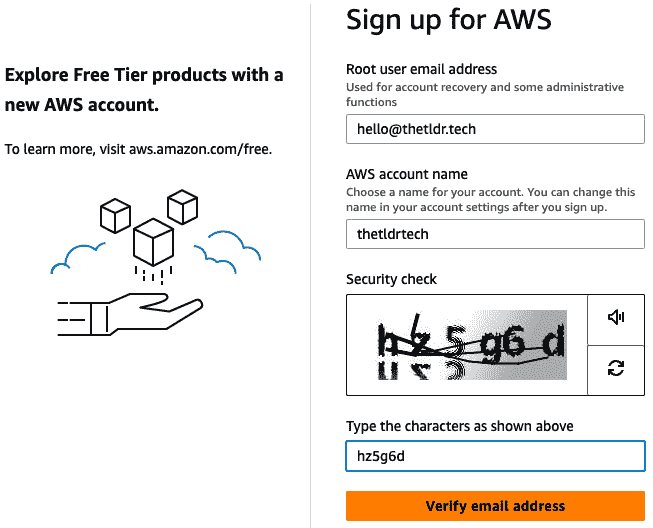

Figure 13.1: AWS sign up page


1. 前往你的邮箱获取 AWS 发送的六位 OTP，并在下一屏幕中输入。

2. 填写注册表单中有关联系信息和业务信息的全部字段，如图 13.2 所示：

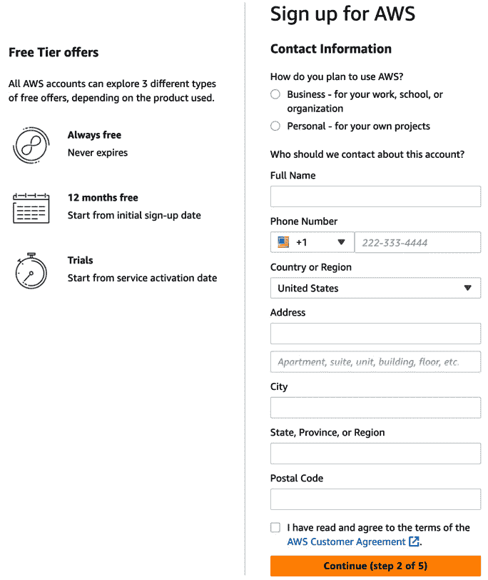 
图 13.2：AWS 注册联系信息

3. 接下来，我们进入 `Billing information` 页面，如图 13.3 所示：

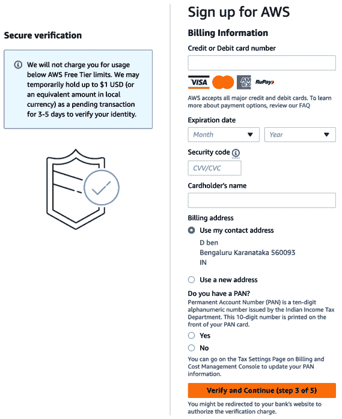 
图 13.3：AWS 注册的账单信息及信用卡详情

在这里，我们需要输入信用卡详情。AWS 不会在使用服务之外收取任何费用。由于我们仅使用免费套餐服务，按照本章所述的说明操作时不应产生任何账单。然而，如果你担心账单金额，可以通过诸如 [`privacy.com`](https://privacy.com) 之类的服务创建 `virtual credit card` 并输入其信用卡详情；否则，使用余额较小的借记卡。

4. 通过提供有效的电话号码确认你的身份；AWS 会向其发送验证码。图 13.4 显示了验证步骤：

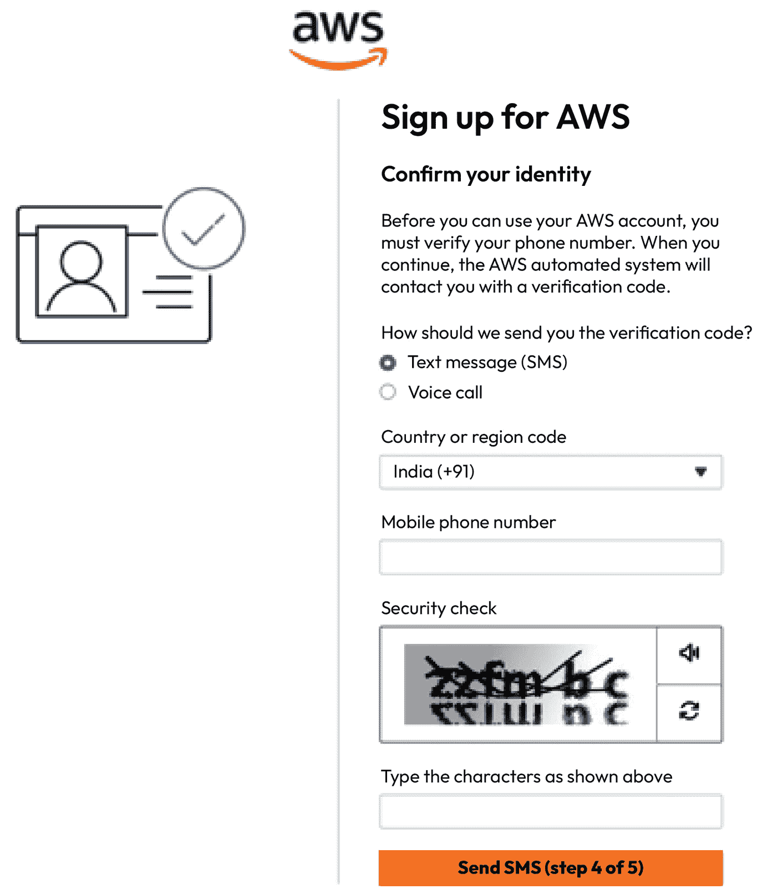 
图 13.4：输入电话号码以验证你的身份

5. 身份确认后，你必须选择一个支持计划。为学习目的，我们将选择 `Basic support – Free` 计划。支持计划在开发者使用 AWS 服务时需要帮助时很有用。对于在 AWS 上运行的任何生产应用程序，建议采用商业支持或企业支持，以更快地解决任何业务关键问题。在图 13.5 中，我们选择了 `Basic support – Free` 计划。该计划可在未来升级：

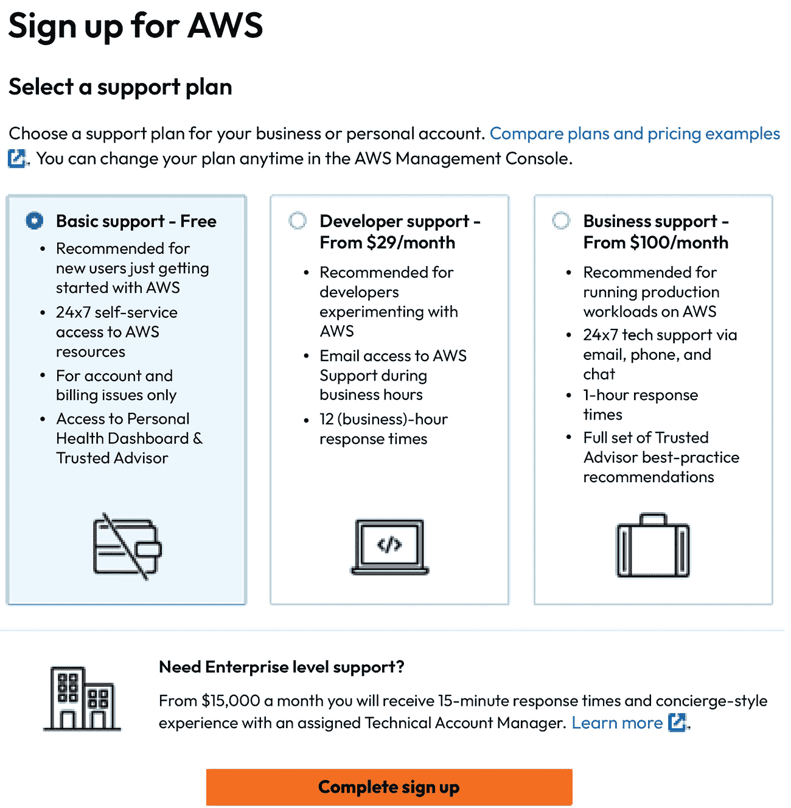 
图 13.5：选择 AWS 支持计划

至此，我们已完成注册并可访问 AWS 控制台。在下一节中，我们将对部署应用程序时将使用的所有 AWS 服务进行高层次概述。我们不会深入探讨任何服务，而是简要描述 AWS 服务的内容以及为何在我们的应用程序中使用它。我们将从学习 AWS 中的 `Identity and Access Management` (`IAM`) 开始。

## Identity and Access Management

AWS 提供 IAM 服务来管理使用 AWS 服务的所有身份验证和授权。每当我们想向任何工程师甚至任何其他应用程序授予对 AWS 服务的访问权限时，我们需要在 IAM 中创建新用户。让我们来看一下 IAM 中使用的术语：

* `User`: IAM 中的用户可以是获得 AWS 资源访问权限的人员或应用程序。我们应为每位人员在 IAM 中创建新用户，而不是共享凭据。创建 IAM 用户是免费的。

* `Group`: IAM 中的组是相似用户的集合。例如，假设我们希望客户支持的三个用户对 AWS S3 具有只读访问权限，而开发团队的 10 个用户对 AWS 服务具有读写访问权限。我们可以创建两个单独的组并将所有成员添加到各自的组中。现在，组中的每个成员都将对 AWS 服务具有统一的访问权限。

* `Role`: IAM 中的角色是多个 IAM 策略的组合。一个用户可以将其多个角色附加到其 IAM 用户。例如，`EC2AdminRole` 可以对 `Elastic Compute Cloud` (`EC2`) 服务具有读写访问权限，`RDSAdminRole` 可以对 RDS 具有读写访问权限，任何附加了这些角色的 IAM 用户都将对 EC2 和 RDS 具有读写访问权限。

* `Policy`: 策略是 AWS 中的 JSON 文档，让我们可以指定谁有权访问什么资源以及允许执行何种操作。AWS 中的策略是与角色、用户和用户组一起使用的细粒度访问控制，用于创建复杂的访问管理系统。

IAM 的另一个重要方面是为终端上的任何操作设置 AWS CLI 和 AWS SDK `boto3`。我们可以通过进入 `Security Credentials` 选项卡并点击 `Create access key` 按钮为给定用户创建新的 `Access key`。图 13.6 显示了为给定用户创建访问密钥的示例：

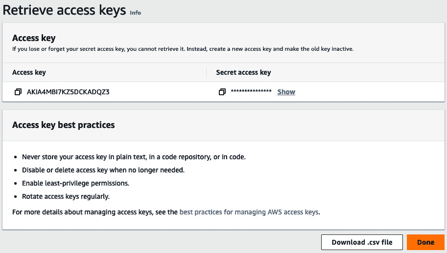 
图 13.6：使用 AWS 控制台从 IAM 获取访问密钥

始终将访问密钥保密。如果访问密钥 ever 泄露，请立即停用该密钥并尽快重新生成新的密钥。黑客拥有 AWS 访问密钥意味着他们可以控制你账户中的任何 AWS 服务。AWS 访问密钥绝不应提交到 Git 仓库。

接下来，让我们学习最常用的 AWS 服务：EC2。

## EC2

`Amazon EC2` 是一种提供云中安全、可调整大小的计算容量的 Web 服务。EC2 可被视为可用于任何计算目的的裸机服务器。这些是可根据需求配置的专用服务器。这很有帮助，因为公司无需担心硬件，如果其产品出现巨大增长，他们可以专注于代码应用程序逻辑，让 AWS 处理如何配置新服务器。AWS 对 EC2 实例采用标准且透明的按秒计费定价模型。这意味着你仅在 EC2 实例运行时才会被收费。如果它们被删除或停止，则不会产生额外费用。

EC2 实例可被视为任何 Web 应用程序最小的构建块。随着应用程序的增长，我们可以添加更多 EC2 实例来扩展应用程序。我们使用负载均衡器将所有此类 EC2 实例放入一个桶中。

## Elastic Load Balancer (ELB)

`ELB` 是 AWS 的负载均衡服务，可将传入流量分发到多个 EC2 实例。在应用程序中使用负载均衡器可以为应用程序提供高可用性、更好的容错性和更好的可扩展性。AWS ELB 主要有三种类型的负载均衡器：

* `Classic load balancer`: 将传入应用程序流量分发到多个 Amazon EC2 实例

* `Application load balancer`: 根据内容路由 HTTP/HTTPS 流量

* `Network load balancer`: 在传输层定向流量，适用于高性能场景

我们将使用 AWS Elastic Beanstalk 部署我们的 Django 应用程序，而 Elastic Beanstalk 建议使用应用程序负载均衡器。在下一节中，我们将了解 AWS Elastic Beanstalk 以及为何应使用它来部署我们的 Django 应用程序。

## Elastic Beanstalk

传统上，每当有人需要将 Web 应用程序部署到网络时，他们必须配置不同的服务器和服务。开发人员必须使用适当的基镜像配置 EC2 实例，配置 `auto-scaling groups`，配置 `security groups`，添加 `load balancer`，然后将应用程序部署到基础设施。当我们有多个服务器时，我们必须创建蓝绿部署或使用 AWS 的 Code Deploy 等服务，以确保代码正确部署到服务器。

根据 AWS 官方文档，Beanstalk 定义如下：

“Elastic Beanstalk 是一种用于部署和扩展 Web 应用程序和服务的服务。上传你的代码，Elastic Beanstalk 会自动处理部署——从容量配置、负载均衡和自动扩展到应用程序健康监控。”

在本章中，我们将使用 Elastic Beanstalk 将应用程序部署到生产环境。


其他服务，例如 AWS Lightsail，可用于较轻的规模。我们有 ECS 和 EKS，它们是比 Elastic Beanstalk 更复杂的系统，对配置有更多控制。Elastic Beanstalk 有一个甜蜜点，可以处理相当大的规模，而且配置也不会太多，以至于在初始设置期间让开发人员感到不知所措。我们将在《Integrating AWS Beanstalk to deploy Django》部分讨论如何设置和配置 Elastic Beanstalk 与 Django。

现在，让我们学习如何在 AWS 中使用 Postgres。

## RDS for Postgres

AWS RDS 是 AWS 提供的一种托管数据库服务，可以运行 Postgres、MySQL、MariaDB、Oracle 和 SQL 服务器，而无需涉及设置、操作和扩展数据库的额外设置。通过在 AWS 控制台上进行几次额外的点击，开发人员可以设置复制、进行备份、升级数据库版本以及扩展服务器大小。

RDS 免除了开发人员运行数据库服务器所需的所有基本维护和基础设施任务，使他们能够专注于应用程序构建。RDS 还开箱即用地提供安全功能，例如如何连接到数据库、加密和网络隔离。AWS RDS 还提供增强的监控指标，可帮助我们分析 RDS 服务器的性能。

AWS RDS 提供 12 个月的免费套餐，我们可以免费使用 RDS 服务——我们将在本章中利用免费套餐服务来跟随集成（在《Creating an AWS RDS Postgres instance and connecting to Django》部分）。

## ElastiCache for Redis

AWS ElastiCache 是 AWS 提供的一种托管服务，可通过 Redis 和 MemCache 提供缓存。与 RDS 类似，ElastiCache 提供可扩展的缓存服务，开发人员可以在几分钟内设置 Redis 服务器，而无需过多涉及服务器配置的麻烦。通过使用 ElastiCache，我们可以轻松升级服务器、创建复制实例，并使用 AWS 控制台执行维护。AWS ElastiCache 提供 12 个月的免费套餐。我们将在本章中使用免费套餐服务，以便将 AWS ElastiCache 和 Redis 集成到我们的 Django 项目中。

## Security groups and network components

安全组是 AWS 最重要的概念之一。AWS 中的每个服务都是隔离的。要连接到任何 AWS 服务，例如 RDS、ElastiCache、EC2 实例等，我们必须配置安全组。通俗地说，安全组是一个防火墙，可以控制流向和流出资源的流量。我们可以创建任意数量的安全组，并且是免费的。我们将在《Integrating AWS Elastic Beanstalk to deploy Django》部分中利用 Elastic Beanstalk 创建的默认安全组，将 Django 与 Elastic Beanstalk 集成。

## AWS Secrets Manager

AWS Secrets Manager 是一种机密管理服务，可帮助我们处理对应用程序、服务和资源的访问。这有助于我们轻松轮换、管理和检索数据库凭据、API 密钥以及其他容易受到攻击且不应共享的机密。Secrets Manager 是一种付费服务，每月每个密钥收费 $0.40。AWS 还提供 1 个月的免费试用。我们将在本章中利用 1 个月的免费试用，学习和探索如何将 AWS Secrets Manager 集成到我们的 Django 项目中。我们将使用 Secrets Manager 保存应用程序机密，然后在《Deploying a Django application using GitHub Actions in Elastic Beanstalk》部分中检索它们。

## Route 53

AWS Route 53 是一种域名系统 (DNS) Web 服务，可用于购买和维护域名。每个面向消费者的应用程序都需要有一个与其关联的域名，我们可以从 AWS Route 53 购买域名，或将域名转移到 Route 53，如果域名是通过其他平台购买的，例如 Godaddy、Namecheap 等。

AWS Route 53 具有许多附加优势。例如，它可用于流量负载均衡、DNS 故障转移以及其他有助于与其他 AWS 服务集成的功能。

## The AWS Billing console

AWS Billing 控制台允许我们轻松了解与所有 AWS 服务相关的成本。开发人员需要学习如何使用 AWS Billing 控制台来监控与 AWS 服务相关的成本。AWS 有 100 多项服务，很常见的是 AWS 账户中运行着未使用的 AWS 资源。AWS 仅对在 AWS 账户中运行的资源收费，因此我们可以使用 AWS Billing 控制台来识别所有正在运行的资源。

## CloudWatch

AWS CloudWatch 是一种监控服务，可用于监控在 AWS 上运行的 AWS 服务和应用程序。AWS CloudWatch 为我们提供了向 AWS 资源添加警报的能力。大多数 AWS 资源都有 Cloudwatch 指标，并且会自动集成。从 AWS 服务推送到 CloudWatch 的所有日志都可以使用 CloudWatch 日志洞察查询进行查询。

至此，我们已经了解了 AWS 提供的不同服务。协调不同的 AWS 服务并设置生产基础设施来运行 Django 需要付出大量的努力。另一方面，AWS Elastic Beanstalk 可以在几分钟内协调所需的 AWS 服务来创建生产环境。让我们学习如何使用 AWS Elastic Beanstalk 部署 Django 应用程序。

# Integrating AWS Elastic Beanstalk to deploy Django

在本节中，我们将学习如何使用 AWS Elastic Beanstalk 部署 Django 应用程序。让我们看一个基本的 Django 示例来帮助说明这一点。

## Integrating Beanstalk with a basic Django app

首先，按照第 1 章中提到的指南创建一个 Django 应用程序，然后按照第 11 章中提到的指南将 Django 应用程序容器化。另请按照 `https://github.com/PacktPublishing/Django-in-Production/tree/main/Chapter13#integrating-beanstalk-with-basic-django-app` 中提到的说明进行操作。

在开始 Elastic Beanstalk 集成之前，请确保通过运行 `docker compose up` 使 Django 项目正常工作。我们可以通过访问 `http://127.0.0.1/admin` 来访问 Django 管理页面：

```
docker compose up -–build
```

现在我们的本地设置正在使用 Docker 运行 Django 应用程序，让我们专注于创建一个新的 Beanstalk 环境：

1. 使用以下命令安装 Elastic Beanstalk `eb` CLI 工具：

```
pip install awsebcli
```

我们将使用 `eb` 命令与 Elastic Beanstalk 交互并设置我们的应用程序。

2. 安装 CLI 后，我们准备好通过运行 `eb init` 命令配置项目目录。我们需要选择应用程序将运行的 AWS 区域。选择对应于该区域的数字。在这里，我们将选择亚洲太平洋地区（孟买）– 6：

```
> eb init
Select a default region
1) us-east-1 : US East (N. Virginia)
2) us-west-1 : US West (N. California)
3) us-west-2 : US West (Oregon)
4) eu-west-1 : Europe (Ireland)
5) eu-central-1 : Europe (Frankfurt)
6) ap-south-1 : Asia Pacific (Mumbai)
7) ap-southeast-1 : Asia Pacific (Singapore)
...
(default is 3): 6
```

3. 接下来，提供访问密钥和密钥，以便 CLI 可以访问 AWS 账户并管理/创建资源。有关如何获取 AWS 安全凭证的更多详细信息，请访问 AWS 官方文档 `https://aws.amazon.com/blogs/security/wheres-my-secret-access-key/`：


```
You have not yet set up your credentials or your credentials are incorrect.
You must provide your credentials.
(aws-access-id): AKIAJOUAASEXAMPLE
(aws-secret-key): 5ZRIrtTM4ciIAvd4EXAMPLEDtm+PiPSzpoK
```

请记住不要与任何人分享 AWS 凭证。如果它们落入错误的人手中，他们可以接管你的整个 AWS 基础设施。

### 4. 接下来，我们需要为我们的应用程序命名：

```
Enter Application Name
(default is "eb"): django-demo-app
Application django-demo-app has been created.
```

### 5. Elastic Beanstalk 可以在多个平台上运行。我们的应用程序是一个在 Docker 中运行的 Django 应用程序，因此我们必须选择 Docker 平台：

```
Select a platform.
1) .NET Core on Linux
2) .NET on Windows Server
3) Docker
4) Go
5) Java
6) Node.js
7) PHP
8) Packer
9) Python
10) Ruby
11) Tomcat
(make a selection): 3
```

### 6. 选择你希望 Beanstalk 运行的 Docker 平台。我们将选择 `Docker running on 64-bit Amazon Linux 2023`：

```
Select a platform branch.
1) Docker running on 64bit Amazon Linux 2023
2) Docker running on 64bit Amazon Linux 2
3) ECS running on 64bit Amazon Linux 2
(default is 1): 1
```

### 7. 接下来，Beanstalk 会自动为我们的 AWS 实例设置 SSH 访问。我们需要选择 yes 来分配 SSH 密钥对。这将允许我们直接 SSH 到我们的 Beanstalk 应用程序：

```
Do you want to set up SSH for your instances?
(y/n): y
```

### 8. Beanstalk 创建一个新的 SSH 密钥对，它将用于为 EC2 实例提供访问权限：

```
Type a keypair name.
(Default is aws-eb):
Generating public/private rsa key pair.
Enter passphrase (empty for no passphrase):
Enter same passphrase again:
Your identification has been saved in /Users/argo/.ssh/aws-eb
Your public key has been saved in /Users/argo/.ssh/aws-eb.pub
```

至此，我们的 Beanstalk 应用程序已创建。现在，我们可以进入 AWS 控制台，找到我们的 Beanstalk 应用程序已准备就绪。*图 13.7* 显示了我们新创建的 Beanstalk 应用程序：

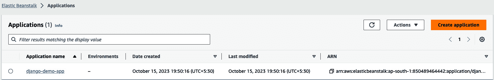

图 13.7：AWS 控制台显示新创建的 Beanstalk 应用程序，django-demo-app

当我们进入 AWS 控制台中的 `django-demo-app` 应用程序时，我们不会看到环境，如 *图 13.8* 所示。这是因为我们已创建了 Beanstalk 应用程序，但尚未创建任何将在 Beanstalk 上运行 Django 应用程序的环境：

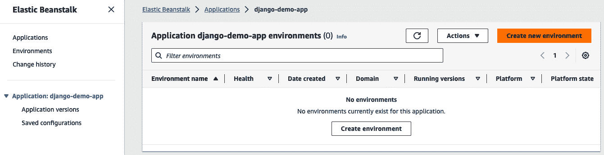

图 13.8：AWS 控制台显示空的 Beanstalk 应用程序

1. 要创建环境，请进入 Django 应用程序文件夹并运行 `eb create <environment-name>` 命令。例如，如果我们将环境命名为 `prod-env`，则应使用以下命令创建 Beanstalk 环境：

```
eb create prod-env
```

现在，我们可以进入 AWS Elastic Beanstalk 仪表板，查看我们的 Beanstalk 环境正在创建。此步骤通常需要 10 分钟，因为 Elastic Beanstalk 将创建所有必需的 AWS 组件，例如 EC2 实例、`Application Load Balancer` (`ALB`)、自动扩展组、CloudWatch 警报等：

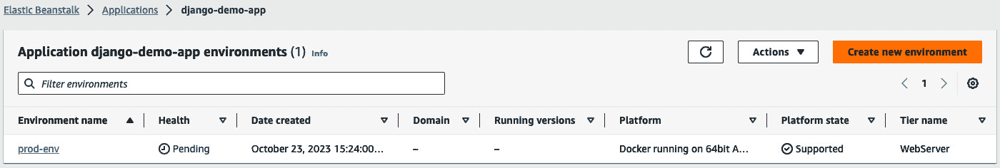

图 13.9：AWS Elastic Beanstalk 仪表板显示 prod-env 环境

一旦 Elastic Beanstalk 环境准备就绪，我们将看到 `Health` 状态从 `Pending` 变为 `Ok`。这表明应用程序已准备好提供流量。在 *图 13.10* 中，我们可以看到 `prod-env` 的状态，它表明它已准备好提供流量：

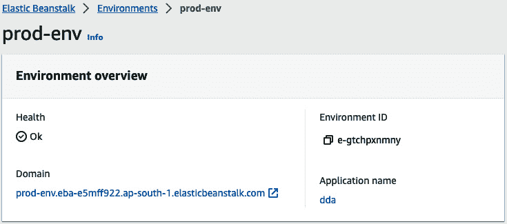

图 13.10：AWS Elastic Beanstalk prod-env 显示健康状态为 Ok

*图 13.10* 中显示的 `Domain` 值是可以用于从互联网访问我们的 Django 应用程序的公共域名。在我们的例子中，它是 `http://prod-env.eba-e5mff922.ap-south-1.elasticbeanstalk.com/admin`（示例 URL）；当我们在浏览器中打开它时，我们应该能够看到初始的 Django 网页。我们可以在 *图 13.11* 中看到浏览器的输出：

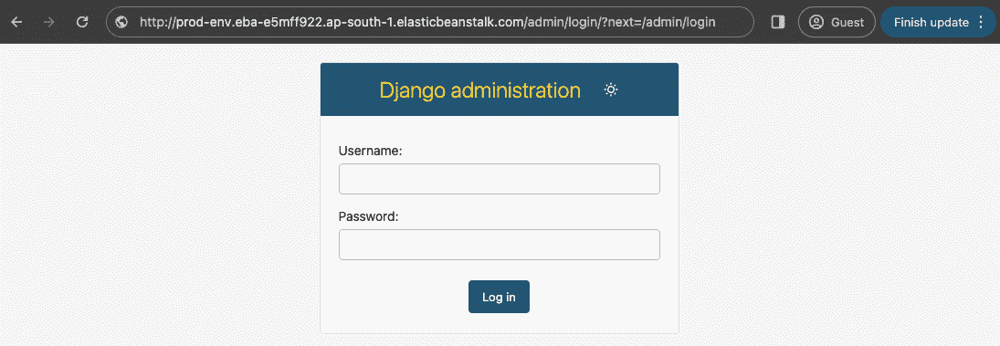

图 13.11：初始 Django 网页

`eb` CLI 仅适用于位于 Git 中并且至少有一个提交的项目。如果遇到如下所示的错误，请确保你的项目正在使用 Git 进行跟踪：

```
> eb create prod-env
WARNING: Git is in a detached head state. Using branch "default"
WARNING: Git is in a detached head state. Using branch "default"
WARNING: Git is in a detached head state. Using branch "default"
WARNING: Git is in a detached head state. Using branch "default"
ERROR: CommandError – git could not find the HEAD; most likely because there are no git commits present
```

使用我们的样板 Django 项目代码，我们已经了解了如何将应用程序部署到 Elastic Beanstalk。在我们的示例中，我们使用了基本的样板代码来部署 Django 应用程序，而不连接到数据库或运行 Web 服务所需的任何其他外部服务。现在，让我们学习如何将 Django 应用程序连接到 AWS RDS 和 ElastiCache。

## 创建 AWS RDS Postgres 实例并连接到 Django

Elastic Beanstalk 为我们提供了为给定的 Elastic Beanstalk 环境创建 RDS 的选项。然而，我们不会使用该选项，以确保我们的 RDS 实例与 Beanstalk 解耦。

现在，让我们学习如何创建一个可以连接到我们的 Beanstalk 环境的 RDS 实例并配置我们的 Django 代码。

### 创建新的 RDS 环境

以下是创建新 RDS 环境可以遵循的简单步骤：

1. 在 AWS 控制台中进入 RDS 仪表板：

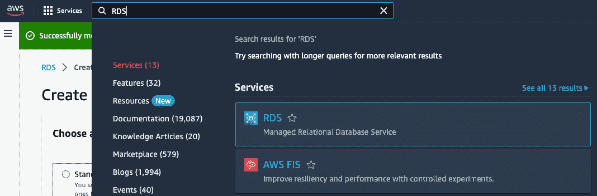

图 13.12：在 AWS 仪表板上导航到 RDS

2. 在左侧边栏进入 `Databases` 部分，然后单击 `Create Database` 以打开向导，如 *图 13.13* 所示：

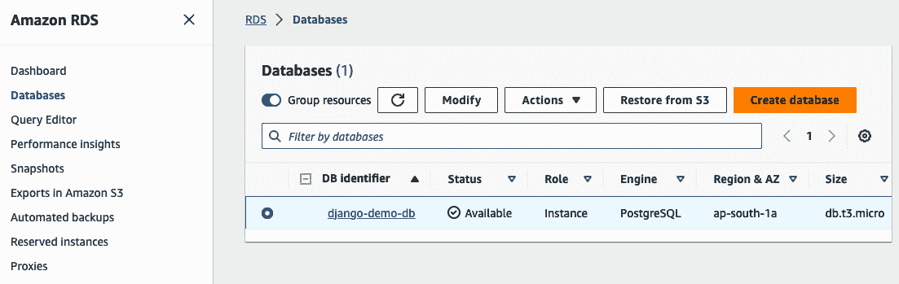

图 13.13：AWS 控制台中的 RDS 仪表板

3. 选择 `Easy Create` 选项，然后选择以下选项（或者，你可以通过使用 `Standard Create` 选项以更多选项配置数据库。我们将在本教程中遵循 `Easy Create` 选项）：

   1. 在向导中选择 `Option`。然后，在 `Engine Type` 下选择 `PostgreSQL`。
   2. 选择 `Free tier`。
   3. 为数据库命名。我们将其命名为 `django-demo`。
   4. 指定主用户名。我们将使用 `django_db_user`。
   5. 指定主密码。我们将使用 `abc^A12a*12`。
   6. 然后，单击 `Create` 按钮。

4. RDS 需要 4-5 分钟来创建数据库。创建后，我们会看到数据库的状态为 `Creating`：

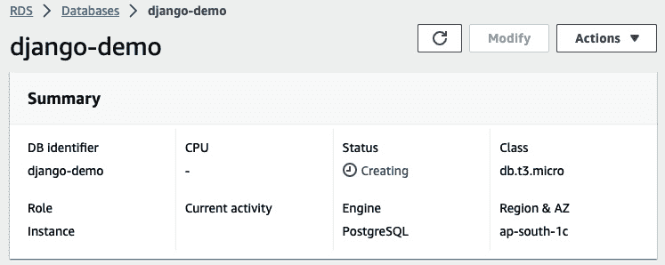

图 13.14：正在创建新的 RDS 实例

至此，我们已创建了数据库。接下来，我们需要将数据库连接到 Django 代码。默认情况下，RDS 不暴露给互联网，这意味着我们无法在 AWS VPC 网络之外连接到 RDS 实例。不将 RDS 服务器暴露给互联网是一个良好的实践。

然而，这并不意味着我们的 Elastic Beanstalk 服务器可以直接连接到 RDS 实例。要连接到 RDS 实例，我们必须配置我们的 VPC 安全组以启用连接。

### 将 RDS 连接到 Django 服务器


以下是将 RDS 连接到 Django 服务器的步骤：

1. 进入 `Elastic Beanstalk` 控制台并选择我们之前创建的 Django 应用。然后，选择 `prod-env` 选项并从左侧边栏选择 `Configuration` 选项。这将显示我们实例的所有配置：

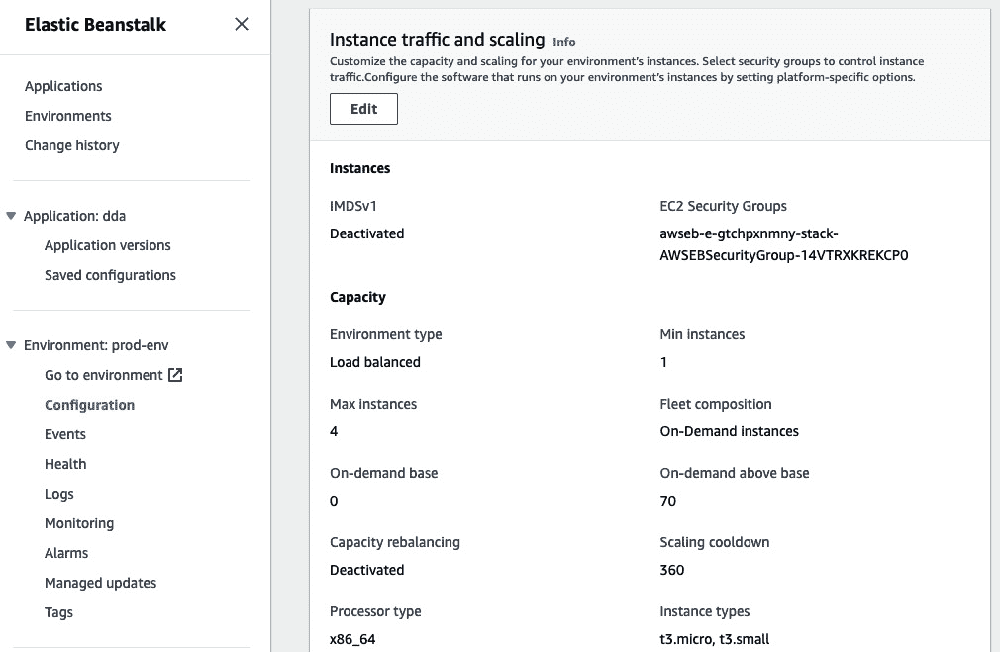 

Figure 13.15: Elastic beanstalk configuration for prod-env we created earlier

2. 复制显示的 EC2 安全组——在我们的例子中，它是 `awseb-e-gtchpxnmny-stack-AWSEBSecurityGroup-14VTRXKREKCP0`。

3. 现在，返回 RDS 控制台并选择创建的 RDS 实例。在 `Connectivity & security` 部分，点击 `VPC security groups` 值——在我们的例子中，它是 `default (sg-5acc5623)`：

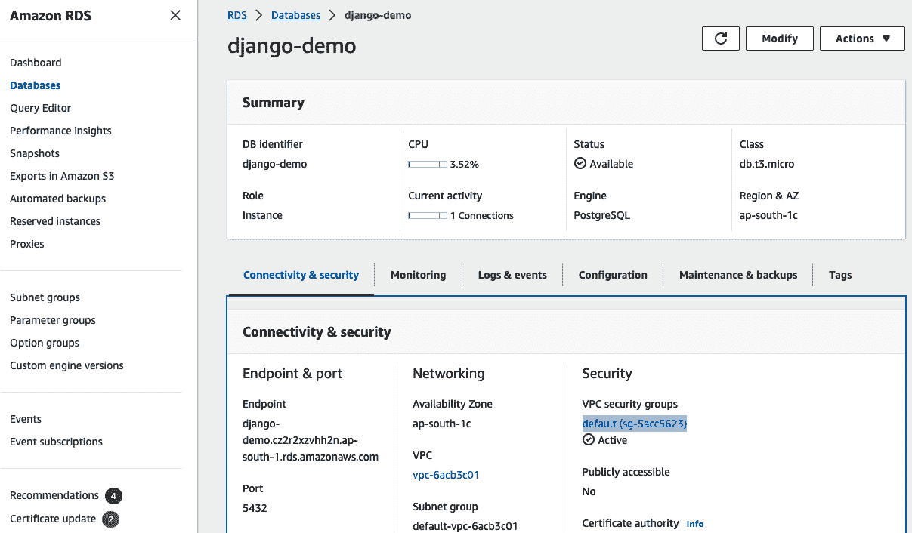 

Figure 13.16: RDS Connectivity & security settings

4. `default (sg-5acc5623)` 安全组控制哪些 AWS 资源将有权访问 RDS 实例。我们需要允许我们的 EC2 实例连接到 RDS 实例。我们必须向此安全组添加新的入站规则。默认情况下，我们不会有任何入站规则；要添加新的入站规则，我们应该点击右下角的 `Edit inbound rules` 按钮，如 *Figure 13**.17* 所示：

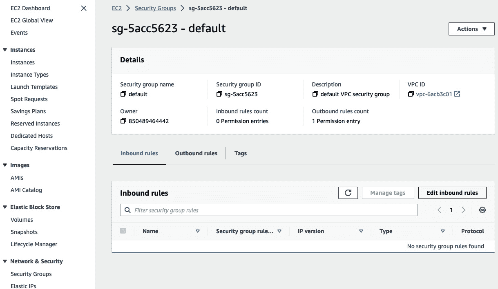 

Figure 13.17: RDS default security group

5. 将 `Type` 设置为 `PostgreSQL`，将 `Source` 设置为 `Custom`，然后搜索安全组，复制并粘贴我们在 *Step 2* 中选择的值，并选择该安全组：

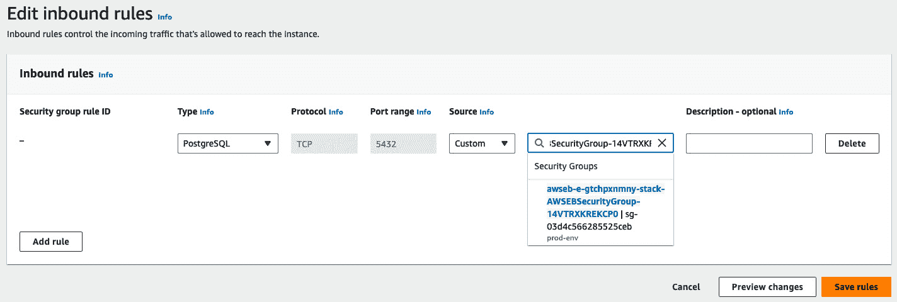 

Figure 13.18: Updating inbound rules to allow a connection from Elastic Beanstalk to RDS

这将使在 Elastic Beanstalk 内部运行的 EC2 实例能够连接到 RDS 实例。

### 配置我们的 Django 应用以使用 RDS

要获取 RDS 连接详细信息，请打开 RDS 控制台：

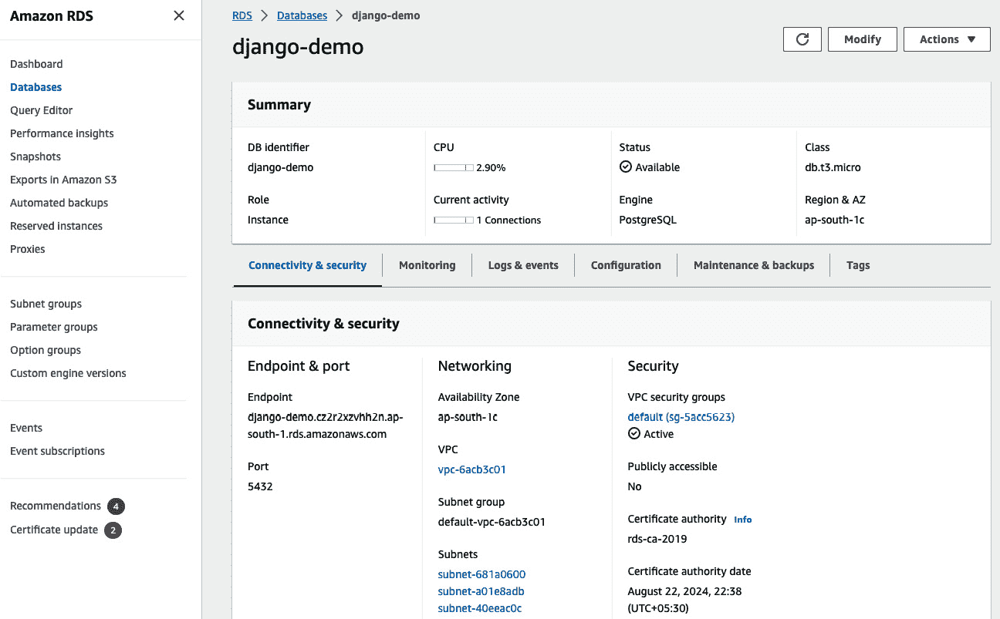 

Figure 13.19: RDS dashboard showing the connection configuration

从控制台找到 `Endpoint & port`，如 *Figure 13**.19* 所示。以下是我们需要将 RDS 与 Elastic Beanstalk 集成的配置：

* `Endpoint`: `django-demo.cz2r2xzvhh2n.ap-south-1.rds.amazonaws.com`
* `Port`: `5432`
* `Username`: `django_db_user`（来自 *Creating a new RDS **environment* 部分的 *Step 3D*）
* `Password`: `abc^A12a*12`（来自 *Creating a new RDS **environment* 部分的 *Step 3E*）

使用连接字符串更新 Django `.env` 文件：

```
DEBUG=True
DJANGO_ALLOWED_HOSTS=*
DB_ENGINE=django.db.backends.postgresql
DB_NAME=postgres
DB_USERNAME=django_db_user
DB_PASSWORD=abc^A12a*12
DB_HOSTNAME=django-demo.cz2r2xzvhh2n.ap-south-1.rds.amazonaws.com
DB_PORT=5432
REDIS_HOST=redis_db
REDIS_PORT=6379
REDIS_PASSWORD=redisPassWord
```

我们还在 `settings.py` 中配置了我们的 `Django-health-check` 包，以确保我们的健康检查端点可以测试和验证数据库连接。

#### Important note

我们已将 RDS 连接值硬编码到我们的 Django 设置文件中以供测试目的。RDS 连接值是敏感信息，不应共享或保存在应用程序代码中。我们将在 *Deploying a Django application using GitHub Actions in Elastic **Beanstalk* 部分学习如何传递此类敏感信息。

我们的代码已准备好部署和测试。现在，我们需要将 Django 设置文件移至 Git 暂存区。这至关重要，因为 `eb` CLI 只会部署 Git 跟踪的代码或在我们传递特殊标志 `--stage` 时处于暂存状态的代码：

```
> git add .env
> eb deploy --staged
Creating application version archive "app-8e23-231024_182626309787-stage-231024_182626309839".
Uploading dda/app-8e23-231024_182626309787-stage-231024_182626309839.zip to S3. This may take a while.
Upload Complete.
2023-10-24 12:56:27    INFO    Environment update is starting.
2023-10-24 12:56:31    INFO    Deploying new version to instance(s).
2023-10-24 12:56:46    INFO    Instance deployment completed successfully.
2023-10-24 12:56:52    INFO    New application version was deployed to running EC2 instances.
2023-10-24 12:56:52    INFO    Environment update completed successfully.
```

我们的 Django 代码可以连接到数据库。要验证这一点，请打开相同的 Elastic Beanstalk 环境 URL – [`prod-env.eba-e5mff922.ap-south-1.elasticbeanstalk.com/admin`](http://prod-env.eba-e5mff922.ap-south-1.elasticbeanstalk.com/admin)。您应该能够看到与 *Figure 13**.11* 中显示的相同页面。

如果页面显示 502，则表示 Django 无法连接到 RDS 实例——可能有多种原因。请检查本书 GitHub 仓库中的 `Troubleshooting` README 部分 [`github.com/PacktPublishing/Django-in-Production/tree/main/Chapter13#troubleshooting`](https://github.com/PacktPublishing/Django-in-Production/tree/main/Chapter13#troubleshooting)。

至此，我们已探索了如何创建新的 RDS 并将其连接到我们的 Django 服务以连接到我们的 RDS 实例的基础知识。现在，让我们学习如何将我们的 Django 服务连接到我们的 Redis 服务。

### 创建 ElastiCache Redis 实例并将其连接到 Django

ElastiCache 为我们提供了一个托管的 Redis 集群，我们可以用它进行缓存和管理 celery 服务的任务队列。在本节中，我们将创建我们的 Redis 集群。我们将使用基本配置来创建 Redis 服务器。我们将为演示目的创建一个基本集群。为此，请按照以下步骤操作：

1. 进入 ElastiCache 控制台并选择 `Create Redis Cluster`。
2. 在向导中，选择 `Design your own Cluster` 选项。
3. 选择 `Creating method – Cluster Cache` 并选择 `Cluster mode – Disabled` 配置。
4. 为集群选择一个名称；我们将其命名为 `django-demo-cache`。
5. 取消选中 `Multi-AZ and Auto-failover`。
6. 在集群设置中，进行以下更改：
   1. 将 `Engine version` 设置为 `7.0` 或更高
   2. 将 `Port` 设置为 `6378`
   3. 将 `Node type` 设置为 `cache.t4g.micro`
   4. 将 `Number of replicas` 设置为 `0`
7. 保持 `Connectivity` 和 `Availability Zone placements` 不变。
8. 在 `Security` 部分，取消选中 `Encryption in transit`。
9. 打开一个新标签页并进入 AWS 控制台的 `Security groups` 控制台。然后，创建一个新的安全组，该安全组将附加到 Redis 实例。
10. 就像 RDS 安全组一样，我们需要创建一个新的入站规则，该规则将公开端口 `6379`。将 Beanstalk 安全组附加为 `Source – Custom` 并从下拉列表中选择安全组，如 *Figure 13**.20* 所示：

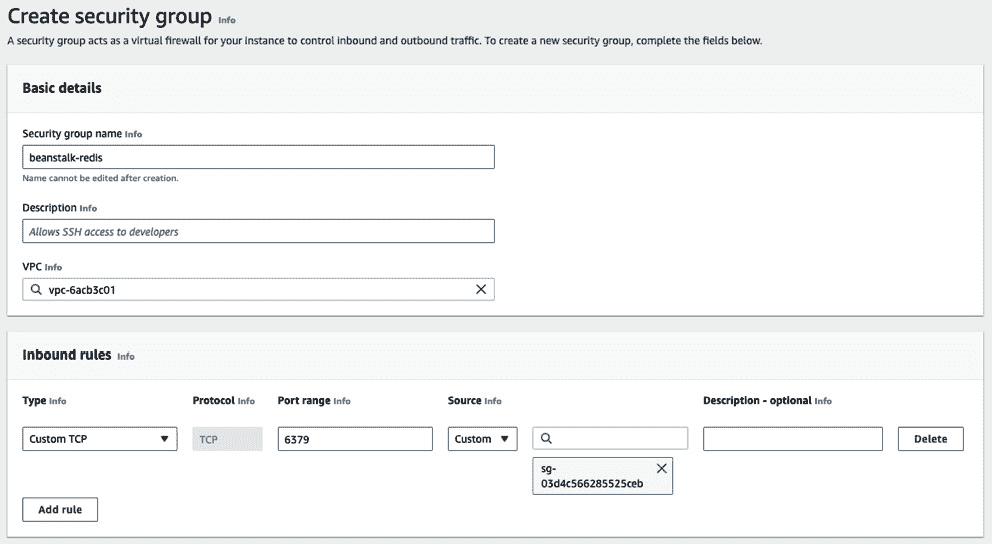 

Figure 13.20: Creating a new security group

11. 现在，返回 Redis 向导。然后，在 `Selected Security Groups` 部分，选择我们在 *Step 10* 中创建的新安全组。
12. 现在，选择 `Create` 选项。它需要 5-6 分钟来创建可连接的 Redis 实例。

一旦 Redis 集群变为 `Available`，选择 `Primary endpoint`，然后使用 Redis 缓存配置 Django `.env` 文件：


```
DEBUG=True
DJANGO_ALLOWED_HOSTS=*
DB_ENGINE=django.db.backends.postgresql
DB_NAME=postgres
DB_USERNAME=django_db_user
DB_PASSWORD=abc^A12a*12
DB_HOSTNAME=django-demo.cz2r2xzvhh2n.ap-south 1.rds.amazonaws.com
DB_PORT=5432
REDIS_HOST=django-demo-
cache.dysbo0.ng.0001.aps1.cache.amazonaws.com
REDIS_PORT=6379
```

我们的代码现在已准备好连接到 ElastiCache Redis 服务器并部署到 Elastic Beanstalk。我们需要将 Django 设置文件移至 Git 暂存区——这是必不可少的，因为 `eb` CLI 仅会部署 Git 跟踪的代码，或在我们传递 `--stage` 标志时处于暂存状态的代码：

```
> git add .env
> eb deploy --staged
Creating application version archive "app-8e23-231024_202626040031-stage-231024_202626040080".
Uploading dda/app-8e23-231024_202626040031-stage-231024_202626040080.zip to S3. This may take a while.
Upload Complete.
2023-10-24 14:56:27    INFO    Environment update is starting.
2023-10-24 14:56:30    INFO    Deploying new version to instance(s).
2023-10-24 14:56:47    INFO    Instance deployment completed successfully.
2023-10-24 14:56:52    INFO    New application version was deployed to running EC2 instances.
2023-10-24 14:56:52    INFO    Environment update completed successfully.
```

### 3. 在浏览器中打开 `/ht/` 端点以验证数据库和缓存连接。在 *图 13.21* 中，我们可以看到当我们的 RDS Postgres 和 ElastiCache Redis 实例正确配置并连接到 Django 服务器时的预期输出：

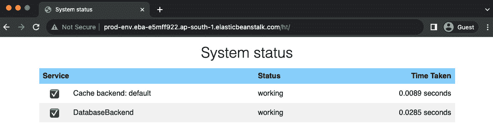 

图 13.21：健康检查端点 `/ht/` 显示成功

至此，我们已学习如何将 RDS Postgres 和 ElastiCache Redis 集群连接到 Django 服务。我们使用了一个非常简单的设置来创建数据库并连接到 Django 服务。我们将在 *Following the best practices for the AWS **infrastructure* 部分讨论在生产中使用 RDS 和 Elasticache 的所有最佳实践。

我们在 *第 8 章* 中学习了如何将 Celery 与 Django 集成，而在 *第 11 章* 中，我们看到了如何使用 Docker 在 Celery beat 旁边运行 Celery worker。我们使用 Docker 在 Elastic Beanstalk 环境中运行 Django 应用程序。对于小型应用程序，我们可以使用相同的设置并运行 Celery。

对于大型应用程序，我们应该将运行 Django 的 Web 应用程序与运行 Celery 任务的 worker 解耦。我们需要设置不同的 Beanstalk 环境来运行 Celery 和 Celery beat worker。为 worker 设置 Beanstalk 环境超出了本书的范围。

现在，让我们学习如何使用 GitHub Actions 部署我们的 Django 应用程序。

## 使用 GitHub Actions 在 Elastic Beanstalk 中部署 Django 应用程序

在 *第 12 章* 中，我们学习了如何使用 GitHub Actions 运行测试用例。现在，我们将学习如何使用 GitHub Actions 在 Elastic Beanstalk 中部署我们的 Django 应用程序。

首先，让我们学习如何将 GitHub Actions 连接到我们的 AWS 账户。

AWS 提供了官方的 GitHub Actions 属性（`https://github.com/aws-actions/configure-aws-credentials`），它们使用 AWS 访问密钥和 AWS 秘密访问密钥来处理身份验证，这两者我们都可以从 AWS IAM 控制台获取。我们需要提取密钥并将其添加到我们希望在相应 GitHub 仓库中运行操作的位置。

重要提示

在创建 AWS 访问密钥时，建议创建一个具有有限 AWS 资源访问权限的单独 IAM 用户，以便 GitHub Actions 使用。

一旦我们拥有 AWS 访问密钥，我们就可以遵循 GitHub Actions 文档。GitHub 提供了关于如何在 GitHub Actions 中使用密钥的非常好的指南。请查看 `https://docs.github.com/en/actions/security-guides/using-secrets-in-github-actions` 处的指南。

一旦我们在 GitHub 中配置了密钥，我们就可以使用以下示例测试我们的 GitHub-AWS 设置。在这里，我们使用 AWS CLI 来验证 GitHub Actions 是否可以访问我们的 AWS 账户：

```
name: Test Github-AWS actions integration
on: [workflow_dispatch]
jobs:
  build:
    runs-on: ubuntu-latest
    strategy:
      matrix:
        python-version: [3.8]
    steps:
      - uses: actions/checkout@v1
      - name: Configure AWS Credentials
        uses: aws-actions/configure-aws-credentials@v4
        with:
          aws-access-key-id: ${{ secrets.AWS_ACCESS_KEY_ID }}
          aws-secret-access-key: ${{ secrets.AWS_SECRET_KEY }}
          aws-region: ap-south-1
      - name: get caller identity
        run: aws sts get-caller-identity
```

至此，我们已验证 GitHub Actions 可以连接到 AWS 账户。在 *Connecting RDS to the Django server* 部分，在将 RDS 与 Django 集成时，我们在代码中硬编码了所有 RDS 密钥值。这是一种不好的做法，也是安全隐患，因为我们的密钥会在代码中公开。因此，我们应该使用环境变量传递此类敏感值，并使用 AWS Secrets Manager 填充环境变量。我们可以使用 AWS 提供的官方 GitHub Actions 来提取我们的密钥并将其保存到 `.env` 文件中。在以下示例中，我们正在下载所有以 `beta` 开头的密钥：

```
- name: Get Secret Names by Prefix
  uses: aws-actions/aws-secretsmanager-get-secrets@v1
  with:
    secret-ids: |
      django*    # Retrieves all secrets that start with 'django'
```

当我们运行前述代码块中的 GitHub Actions 时——假设我们有三个以 `django` 开头的密钥（`djangoSecretName`、`djangoTest` 和 `django/NewSecret`）——那么将创建三个环境变量，如下所示：

```
DJANGOSECRETNAME: secretValue1
DJANGOTEST: secretValue2
DJANGO_NEWSECRET: secretValue3
```

有关如何使用 AWS Secrets Manager GitHub Actions 的更多详细信息，请查看 `https://github.com/aws-actions/aws-secretsmanager-get-secrets` 处的官方文档。

要将环境变量保存到特定文件，请执行以下操作：

```
- name: Save secret manager variables to .env
  run: printenv | grep "^DJANGO" > .env
```

前述代码将把所有以 `DJANGO` 开头的环境变量保存到 `.env` 文件中。我们可以使用 Docker 环境访问此 `.env` 文件。

至此，我们已学习如何使用本地系统的 `eb` CLI 部署新应用程序代码。接下来，我们将学习如何将相同的操作移至 GitHub Actions。

以下是使用 GitHub Actions 将应用程序代码部署到 Elastic Beanstalk 所需的所有步骤的一个小示例：

```
- name: Install aws cli and beanstalk cli
  run: pip install awsebcli awscli
- name: Get Secret Names by Prefix
  uses: aws-actions/aws-secretsmanager-get-secrets@v1
  with:
    secret-ids: |
      django*    # Retrieves all secrets that start with 'beta'
- name: Save secret manager variables to .env
  run: printenv | grep "^DJANGO" > .env
- name: git add for .env
  run: git add .
- name: Run eb init
  run: eb init django-demo-app –region ap-south-1 –platform docker
- name: Run eb use
  run: eb use prod-env –region ap-south-1
- name: Run eb deploy
  run: eb deploy –staged
```

现在，我们可以从 GitHub Actions 触发 Django 代码的部署。我们不会深入介绍代码中提到的每个步骤，因为我们在 *Integrating AWS Elastic Beanstalk to deploy **Django* 部分中已经讨论过它们。


我们可以通过 Elastic Beanstalk AWS 控制台仪表板进一步配置 Beanstalk 环境。更多详情，请阅读官方文档 [`docs.aws.amazon.com/elasticbeanstalk/latest/dg/command-options.html`](https://docs.aws.amazon.com/elasticbeanstalk/latest/dg/command-options.html)。

Elastic Beanstalk 还允许开发者使用 `.ebextensions` 以编程方式配置环境。Elastic Beanstalk 是一个功能强大的平台，它让我们能够在很大程度上控制如何配置我们的应用程序。AWS 文档是收集有关如何配置 AWS Elastic Beanstalk 以及配置哪些内容的全部信息的最佳资源。

进一步阅读

我们目前以开发模式运行 Django 应用程序，以便您可以轻松跟随所有示例。随着我们希望将应用程序扩展到生产环境，我们需要添加 `nginx` 和 `gunicorn`，并根据需求设置应用程序。每个应用程序都有其规模和需求。要了解更多信息，请阅读 AWS 文档并根据您的需求和规模设置应用程序。

在下一节中，我们将讨论在使用 AWS 服务时应遵循的最佳实践。

# 遵循 AWS 基础设施的最佳实践

在本节中，我们将学习在使用 AWS 服务时应遵循的最佳实践。AWS 拥有一个良好的架构框架，AWS 建议组织遵循该框架。更多详情，请查看 [`aws.amazon.com/architecture/well-architected/`](https://aws.amazon.com/architecture/well-architected/)。

AWS Well-Architected Framework 非常全面，可能需要额外的工作才能达到其标准。我们不会深入探讨 AWS Well-Architected Framework，而是仅列出可以帮助开发者更好地配置 AWS 服务并确保系统中没有漏洞的最佳实践。我们将从 RDS 的最佳实践开始。

## RDS 的最佳实践

在本节中，我们将讨论所有应遵循的 RDS 最佳实践，以便在生产环境中运行 RDS：

*   **启用集群删除保护**：在生产环境中启用此标志是必须的，这样我们就不会意外删除 RDS 集群。
*   **启用 Multi-AZ**：数据库是应用程序中最重要的组件，因为它保存了对业务至关重要的一切持久信息。通过启用 RDS Multi-AZ，我们确保 RDS 服务器具有高可用性/故障转移。如果任何一个 AWS 可用区变得不可用，RDS 将自动切换到另一个可用区。
*   **性能洞察**：使用 Performance Insights，我们可以微调数据库的性能调优和监控功能。这有助于我们快速评估 RDS 服务器的负载，并帮助非专家检测性能问题。
*   **在低 I/O 时间启用 RDS 自动备份**：为 RDS 启用自动备份很重要。我们应在应用程序使用量较低时安排 RDS 备份——例如，对于面向消费者的应用程序，可安排在午夜后。
*   **不要使用默认端口**：不要使用 5432 的默认端口，这样攻击者和黑客就无法识别实际端口。
*   **RDS 不可公开访问**：确保 RDS 服务器不可公开访问。它只能在 AWS 网络内部访问，不能直接通过互联网访问。
*   **使用 CloudWatch 监控**：AWS RDS 有许多默认的 CloudWatch 指标会推送到 AWS CloudWatch。我们可以使用 CloudWatch 更好地监控 RDS，并在适当的阈值上设置警报。
*   **加密 RDS 静态数据**：始终确保 RDS 使用 AWS `Key Management Service` `KMS` 加密数据库。

## ElastiCache 的最佳实践

在本节中，我们将介绍在使用 ElastiCache 时可以遵循的最佳实践：

*   **启用 Multi-AZ 集群**：启用 ElastiCache Multi-AZ 集群将有助于我们获得更高的可用性。AWS 将保证更高的 `service-level agreement` `SLA`。每当我们的主节点宕机时，AWS 将自动执行故障转移。
*   **不要使用默认端口**：不要为 ElastiCache 使用 6379 的默认端口。
*   **使用 CloudWatch 监控**：为 Redis 集群设置 CloudWatch 监控将有助于我们为 ElastiCache 集群设置警报。默认情况下，ElastiCache 提供主机级指标（例如 CPU 使用率）和缓存引擎特定指标（例如缓存命中、未命中等）。

## Elastic Beanstalk 的最佳实践

现在，让我们来看 Elastic Beanstalk 的最佳实践：

*   **保护网络**：运行 Elastic Beanstalk 的 EC2 实例不应通过互联网在外部访问。添加 ALB 并确保所有流量都通过 ALB 路由将有助于将 ALB 保留在公共子网中，而 EC2 实例运行在私有子网中。
*   **IAM 最小权限访问**：Elastic Beanstalk 将使用服务账户角色执行不同操作。我们应为服务账户角色授予有限的权限。
*   **滚动部署并增加额外批次**：AWS 的 Beanstalk 部署策略可以帮助控制应用程序的部署方式。滚动部署并增加额外批次是最安全的选项，因为我们不会移除现有机器群，而是添加运行最新应用程序代码的新服务器。
*   **设置 CloudWatch 指标和监控**：为关键 Elastic Beanstalk 指标设置警报。

## IAM 和安全性的最佳实践

以下是 IAM 和安全性的最佳实践：

*   **永远不要使用 root 账户**：永远不要使用 root 账户进行任何操作。root 账户不应使用，除非有绝对必要的且其他 IAM 用户无法完成的需求。
*   **强制使用双因素认证（2FA）**：强制所有 AWS IAM 人类用户使用 2FA 将确保额外的安全性。
*   **应用最小权限原则**：在创建 IAM 策略时，始终明确指定要提供的权限，而不是授予 blanket 权限。
*   **定期审查并删除未使用的用户和角色**：进行持续监控并删除冗余用户和角色。

至此，我们已了解在使用 AWS 组件时应遵循的最佳实践。我们已尝试提供全面的视图并在一个地方列出所有最佳实践。然而，强烈建议您在将应用程序移至生产环境之前遵循官方 AWS 文档。

# 总结

在本章中，我们学习了部署 Django 应用程序到生产环境所需的各种 AWS 组件。我们使用 AWS Elastic Beanstalk 配置并部署了 Django 应用程序到生产环境。我们还在 Django 应用程序中使用了 AWS RDS 和 ElastiCache 用于数据库和缓存目的。AWS 确保我们可以轻松扩展应用程序基础设施。

AWS Elastic Beanstalk 是一种托管平台服务，可以通过帮助我们部署和扩展应用程序来编排应用程序。AWS 封装了部署和运行应用程序所需的所有重要配置以及 AWS 服务之间的链接，以便实现规模化。

运行稳定且性能良好的应用程序很重要。在下一章中，我们将学习如何使用 New Relic、Rollbar 等工具持续监控生产环境中运行的 Django 应用程序。

# 14
