# 监控 Django 应用程序

在 *Chapter 13* 中，我们学习了如何将 Django 应用程序部署到 AWS 并在生产环境中运行代码。现在是应用程序开发的最后也是最重要的一部分——监控和维护。


开发应用程序是产品开发的第一步。只有当用户对产品有足够的信任时，他们才会使用该产品。建立对产品的信任的第一步是使产品保持稳定。为了实现应用程序的稳定性，我们需要拥有良好的监控系统并减少错误和停机时间。我们将学习如何使用不同的工具来监控我们的 Django 应用程序。

在本章中，我们将涵盖以下主题：

* 将错误监控工具集成到 Django 应用程序中
* 将正常运行时间监控工具集成到 Django 应用程序中
* 将 APM 工具集成到 Django 应用程序中
* 将消息工具集成到开发流程中
* 更好地处理生产事故
* 使用无责 RCA 处理事故

# 技术要求

在本章中，我们将重点介绍将不同的第三方工具集成到我们的 Django 应用程序中。我们期望您已熟练掌握前几章中讨论的概念。您应具备基本的异常/错误监控和 `Application Performance Monitoring` `APM` 工具的知识，并了解它们如何用于提高应用程序的稳定性和性能。您还应了解正常运行时间监控的基本概念，并应使用诸如 `Slack`/`Teams` 之类的消息工具。

以下是本章所有代码和说明的 GitHub 仓库：[`github.com/PacktPublishing/Django-in-Production/tree/main/Chapter14`](https://github.com/PacktPublishing/Django-in-Production/tree/main/Chapter14)

# 集成错误监控工具

在开发应用程序时，开发人员会尝试处理所有边界情况并尽可能编写无错误的代码。但无论如何，仍会遗漏一些边界情况。一些错误总会溜过去，用户在使用服务时偶尔会看到错误。这些应用程序错误是偶发的，但要拥有稳定的应用程序，必须解决它们。在本地开发环境中，这些错误可以在终端中轻松检测到。但当我们迁移到生产环境时，检测这些错误变得困难。许多初学者仍然使用日志来检测引发的异常。错误监控工具是检测任何生产环境中引发异常的生命线。

诸如 `Sentry`、`Rollbar`、`BugSnag` 等工具是错误/异常监控工具，可帮助我们跟踪和修复生产环境中引发的异常。在本章中，我们将使用 `Rollbar`（[`rollbar.com/`](https://rollbar.com/)）并将其集成到我们的 Django 项目中。

## 将 Rollbar 集成到 Django 项目中

要将 `Rollbar` 集成到我们的 Django 项目中，我们将遵循以下步骤：

1. 在 `Rollbar`（[`rollbar.com/`](https://rollbar.com/)）中创建账户并使用向导创建新项目。在 *Figure 14**.1* 中，我们通过给出项目名称 `DjangoDemoApp` 来创建新项目：

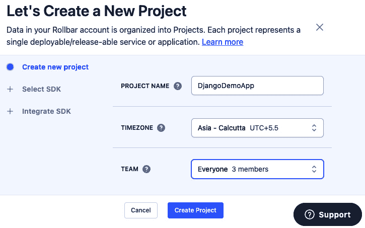

Figure 14.1: Wizard to create a new Django integration for Rollbar

1. 一旦我们点击 `Create Project` 按钮，我们将进入下一步，在此需要选择框架。在 *Figure 14**.2* 中，我们正在选择 `Django` 框架：

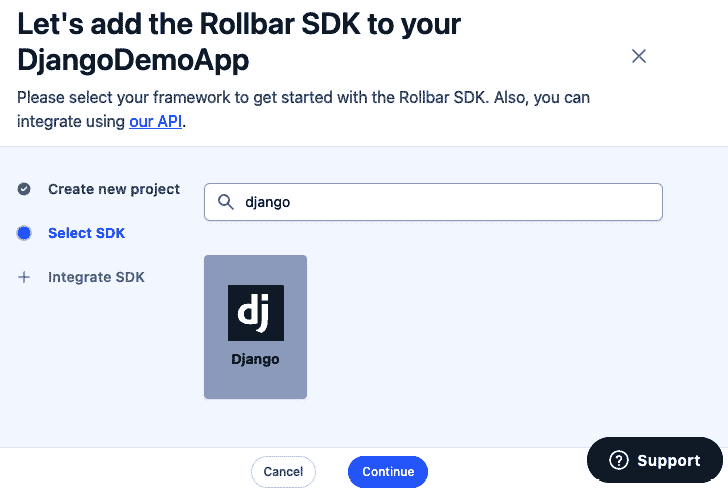

Figure 14.2: Select the Django framework in the wizard

1. 一旦我们点击 `Continue` 按钮，`Rollbar` 会为我们提供一组需要遵循的说明，如在接下来的步骤中所述。

2. 安装 `rollbar` SDK：

```
pip install rollbar
```

3. 为 Django 项目配置 `rollbar` SDK。转到 `settings.py` 文件并将 `Rollbar` 中间件添加到 `MIDDLEWARE`：

```
MIDDLEWARE = [
    # OTHER MIDDLEWARES 'rollbar.contrib.django.middleware.RollbarNotifierMiddleware',
]
```

4. 在 `settings.py` 文件中添加 `Rollbar` 访问令牌：

```
ROLLBAR = {
    'access_token': '<token>',
    'environment': 'dev' if DEBUG else 'prod',
    'root': BASE_DIR
}
```

我们已将 `Rollbar` 集成到 Django 应用程序中。为了测试 Django `Rollbar` 集成，我们需要在代码中故意创建一个异常错误。在 Django `urls.py` 文件中添加以下代码：

```
from django.http import HttpResponse
def rollbar_test_view(request):
    a = None
    a.hello() # This would raise an exception
    return HttpResponse("Hello World!")
urlpatterns = [
    # old url config
    path('rollbar-test/', rollbar_test_view),
]
```

现在，当我们在浏览器中打开 URL 时，`http://127.0.0.1:8000/rollbar-test/` 映射到我们引入错误的 `index` 视图。我们将在浏览器中看到异常，并在 `Rollbar` 仪表板上看到我们捕获的第一个异常。*Figure 14**.3* 显示了 `Rollbar` 仪表板中的错误捕获：

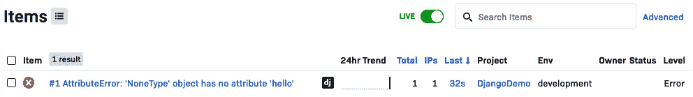

Figure 14.3: First error captured in Rollbar

接下来，我们将 `Rollbar` 与 `Slack` 集成。

## 将 Rollbar 与 Slack 集成

`Rollbar` 提供了官方文档，其中提到了将其集成到 `Slack` 所需的所有步骤。请遵循官方指南 [`docs.rollbar.com/docs/slack`](https://docs.rollbar.com/docs/slack)。

重要说明

我们没有在本章中添加集成步骤，因为第三方工具通常会频繁更新。

一旦 `Slack` 集成到 `Rollbar` 中，每当捕获到新错误时，我们将在配置的 `Slack` 频道上看到错误。*Figure 14**.4* 显示了 `Rollbar` 发布的一个示例错误消息：

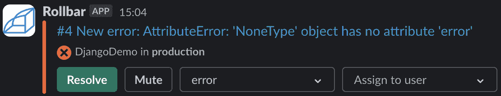

Figure 14.4: Slack notification for error captured in Rollbar

现在，我们已配置 `Rollbar` 以捕获生产环境中发生的所有错误，并在生产环境中引发新异常时在我们的 `Slack` 频道上收到通知。使用 `Rollbar` 和类似工具的优势在于它可以捕获导致异常发生的输入。这样，开发人员就能获得更多导致错误的数据，从而更快地修复问题，而不是猜测生产环境中异常的原因。

## 使用错误监控工具时的最佳实践

随着应用程序的增长，错误数量也可能会增加。团队必须遵循错误监控工具的最佳实践，以免不堪重负。让我们来看一下在使用错误监控工具时应遵循的几个良好实践：

* `Never silence errors forever`：团队可能因忙于新功能开发而使某个面向客户的异常被搁置。团队应始终在工作量减少时返回并修复错误，而不是将问题标记为静音，这将使错误永远保持沉默，除非有人查看它。

* `Dedicate time to triage the dashboard`：团队中应指定专人花费时间进行分类和分配 `Rollbar` 中的问题。此角色可以每月轮换。

* `Connect source code`：将源代码连接到错误监控系统可以帮助获得更好的堆栈跟踪和部署信息。

* `Use proper notification rules`：通知规则对任何监控工具都很重要。我们既不想错过重要警报，也不想制造太多噪音。每个团队/公司都应在内部讨论制定标准的通知节奏。

使用 `Sentry`


Sentry ([`sentry.io/`](https://sentry.io/)) 是一个开源的错误监控工具替代品，正引领行业。Sentry 具有许多提供自动化的功能，例如自动分配问题规则，这意味着当代码的特定部分发生错误时，开发者会被自动分配 Sentry 问题，无需任何人工干预。我们主要使用 Rollbar，主要是因为其慷慨的免费层级和免费的 Slack 集成，而这些在大多数其他平台上是付费的。

如果团队规模更大，并且你愿意为 Sentry 付费，我更倾向于使用 Sentry。集成 Sentry 是一个直接的步骤，与我们为 Rollbar 集成所做的工作相同。

我们已经学会如何监控生产环境中发生的错误。Rollbar 和 Sentry 等工具帮助我们跟踪由于意外输入或开发者可能遗漏的边界情况而导致的所有代码级错误。此类问题仅对特定数量的请求导致 5xx 错误。但也有系统整体宕机的场景。这可能是由于基础设施问题或其他超出应用程序代码的严重问题所致。对于此类场景，我们使用 `uptime monitoring`。在下一节中，我们将探讨如何使用 uptime monitoring 来确保我们的 Django 应用获得更好的 `Service-Level Agreements` (`SLAs`)。

# Integrating uptime monitoring

你会使用一个经常宕机的应用吗？不会。当你创建应用并且用户在使用它时，你需要确保你的服务具有最大可用性。Uptime SLA 对每个服务建立用户信任至关重要。在本节中，我们将学习如何通过向自动化监控系统添加健康检查端点来监控我们的 Django 应用的正常运行时间。

## Adding a health check endpoint

`django-health-check` ([`github.com/revsys/django-health-check`](https://github.com/revsys/django-health-check)) 是一个第三方包，可以轻松添加到任何 Django 项目中，以创建可用于监控正常运行时间的端点。让我们学习如何将 `django-health-check` 集成到 Django 项目中。为此，请按照以下步骤操作：

1. 使用以下代码在终端中安装 `django-health-check` 到我们的 Django 项目：

```
pip install django-health-check
```

2. 现在在 `settings.py` 文件中将 `health_check` 添加到 Django `INSTALLED_APPS`：

```
INSTALLED_APPS = [
    # …
    'health_check',
    'health_check.db',          # Checks database connection
    'health_check.cache',       # Checks cache backend
]
```

3. 在主 `urls.py` 文件中将 `django-health-check` 端点添加到项目中：

```
urlpatterns = [
    # ...
    path(r'^ht/', include('health_check.urls')),
]
```

4. 现在，当我们在浏览器中访问 `/ht/` 端点时，我们将看到系统的健康检查。在 *Figure 14*.5* 中，我们有一个集成 `django-health-check` 的多个系统的实时系统截图：

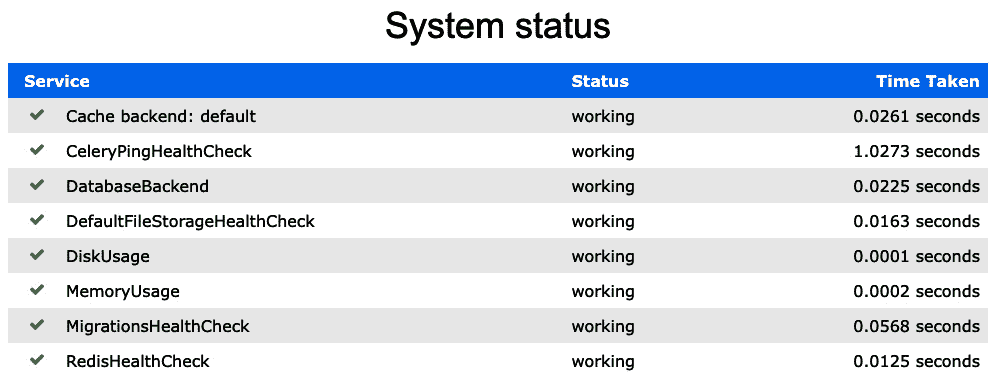

Figure 14.5: django-health-check output

现在我们有一个健康检查端点，可以在浏览器中打开以随时查看我们的服务是否正常运行。让我们添加自动化以定期监控我们的 Django 应用。有许多第三方工具，例如 Pingdom、BetterStack、FreshPing、New Relic 等，可以使用。我们将在本章中使用 `BetterStack` ([`betterstack.com/`](https://betterstack.com/))。

## Using BetterStack for uptime monitoring

在本节中，我们将学习如何使用 BetterStack 平台进行网站正常运行时间监控。BetterStack 具有慷慨的免费层级，我们将使用它通过以下步骤创建网站监控器：

1. 在 BetterStack ([`betterstack.com/`](https://betterstack.com/)) 创建新账户。

2. 一旦我们创建新账户并登录到仪表板，点击 `Create monitor` 按钮：


Figure 14.6: Create a new uptime monitor using BetterStack

3. 现在通过在 `URL to monitor` 字段中添加 `django-health-check` 端点来创建监控器。`django-health-check` 端点在健康检查成功时将发送 `200` 响应状态码，但在任何健康检查失败时将响应 `500` 状态码。

4. 我们将利用状态码并配置 BetterStack 监控器以检查响应码是否为 `200`。如果是，则为成功。否则，健康检查将被标记为失败。在 *Figure 14*.7* 中，我们使用 *mock postman* URL (`https://<mockid>.mock.pstmn.io/ht`) 作为示例，并配置了 `Alert us when` – `URL returns HTTP status other than` – `200`。

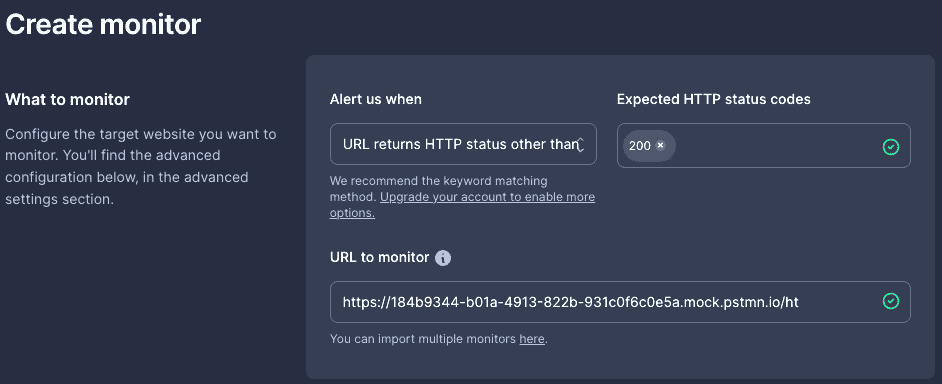

Figure 14.7: Configure the health check URL that we want to monitor

现在，每当我们的服务器出现健康检查问题时，端点将响应 `500`，这将导致正常运行时间监控失败。

5. BetterStack 官方文档提供了将 Slack 与 BetterStack 集成的最新步骤。请按照 [`betterstack.com/docs/uptime/slack/`](https://betterstack.com/docs/uptime/slack/) 的官方文档操作。

一旦我们使用 BetterStack 设置了 Slack 集成，BetterStack 将在我们的网站宕机时发送 Slack 通知。

6. BetterStack 提供了一些其他可以轻松集成的集成。一旦我们使用 BetterStack 配置了 Slack，我们现在可以在我们的 Slack 频道和其他通信媒介上看到任何事件通知。

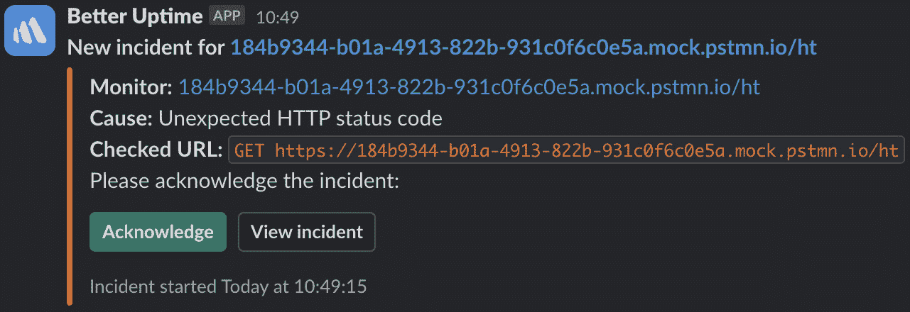

Figure 14.8: Slack message when the uptime monitor fails

我们已成功配置 Uptime 监控器以检查我们网站的任何停机时间。每当我们的网站出现停机时间时，工程师将首先被告知事件，然后他们可以开始调查问题。

### On-call process

每个团队都应该有一名值班工程师，他将随时待命以确认由正常运行时间监控工具或其他 APM 警报触发的任何事件。设置良好的值班时间表对于生产服务的更好 SLA 很重要。

在本书中，我们没有展示如何设置值班流程，因为这超出了范围，但你可以使用不同的工具来帮助管理值班时间表，例如 SquadCast、PagerDuty 等。

事件管理工具的官方文档很直接，我建议你探索这些工具以深入了解。以下是一些进一步阅读的资源：[`www.pagerduty.com/`](https://www.pagerduty.com/)、[`www.squadcast.com/`](https://www.squadcast.com/)，以及 [`www.atlassian.com/software/opsgenie`](https://www.atlassian.com/software/opsgenie)。

我们已经学习了如何监控代码级错误和任何服务停机。随着用户开始使用 Django 应用，我们将遇到不同的规模和性能瓶颈。`Application Performance Monitoring` (`APM`) 工具用于监控生产中发生的任何性能瓶颈。在下一节中，我们将学习如何将 APM 工具集成到我们的 Django 应用中。

# Integrating APM tools

假设我们在本地开发环境中开发、测试和优化我们的应用。现在，当我们将更改部署到生产环境时，一切正常，但突然在一周后，用户抱怨响应时间缓慢，恐慌模式开始。我们现在该怎么办？我们如何调试生产环境中性能下降的原因？为了解决这个问题，我们使用 APM 工具，如 New Relic。


APM 工具帮助我们识别所有性能瓶颈及其根本原因。性能下降可能是由于编写不当的数据库查询、编写不当的应用代码，或是用户请求数量增加所致。不论原因如何，APM 工具都能帮助我们识别问题，并以更少的主观猜测、更多的数据驱动结论引导我们找到正确的根本原因。

市面上有多种 APM 工具可供选择，例如 New Relic、DataDog、Chronosphere、Splunk 等等。本书将学习 New Relic，但你可以轻松查阅其他工具的官方文档来集成 APM 工具。

New Relic（[`newrelic.com/`](https://newrelic.com/)）提供慷慨的免费套餐，每月提供 100 GB 的免费数据摄取。New Relic 的免费套餐足以让任何新应用监控初始客户群。

## 了解更多关于 New Relic

New Relic 功能众多，对于初学者来说上手可能会让人不知所措。在一个章节中涵盖 New Relic 的所有细节也很困难。因此，我们将范围仅限于 New Relic 的基本功能，随着你对平台越熟悉，你可以自行探索更多。

New Relic 还有免费的课程和认证。欲了解更多详情，请访问 *New Relic University* 网站 [`learn.newrelic.com/`](https://learn.newrelic.com/)。

现在让我们开始将 New Relic 集成到 Django 项目中。

## 将 New Relic 集成到 Django 项目中

我们将在项目中使用 New Relic 作为 APM 工具，同时也作为日志监控工具。首先，让我们学习如何将 New Relic 集成到 Django 项目中以实现 APM。

让我们看一个过于简化的解释，说明 New Relic 的工作原理——New Relic 将被放置在用户和 Django 应用之间，如 *Figure 14**.9* 所示：

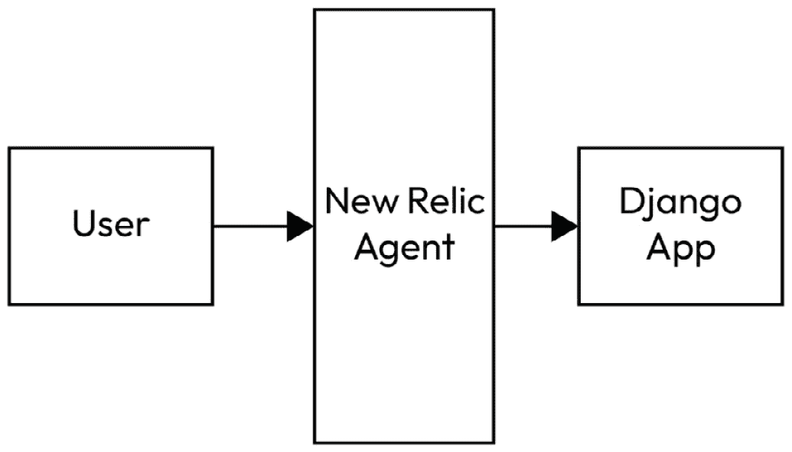 

Figure 14.9: The New Relic agent added to the Django application

让我们在 New Relic 中创建账户并开始 APM 集成：

1. 点击侧边导航栏中的 **Add Data** 并选择 **Application monitoring** | **Python**，如 *Figure 14**.10* 所示：

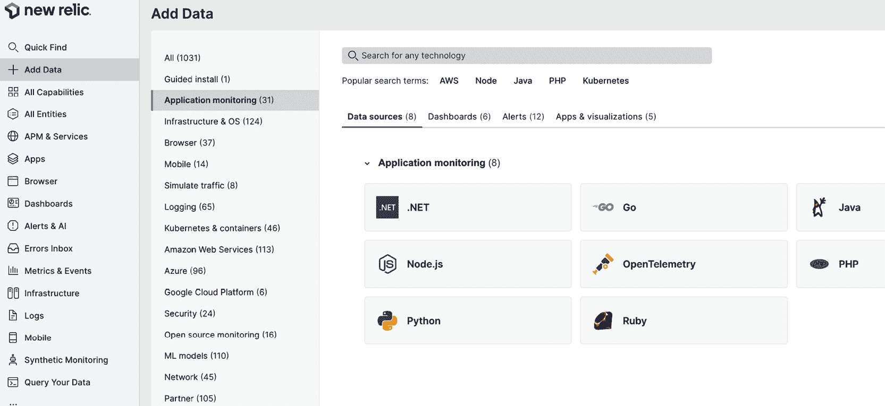 

Figure 14.10: Showing how to integrate New Relic into Django

一旦我们选择了 **Python** 代理，New Relic 会带我们进入一个引导式向导，通过以下步骤帮助我们直接将 New Relic 集成到 Django 应用中。

1. 如 *Figure 14**.11* 所示，我们需要为 Django 应用命名，我们使用了 **Django ****Demo App**。

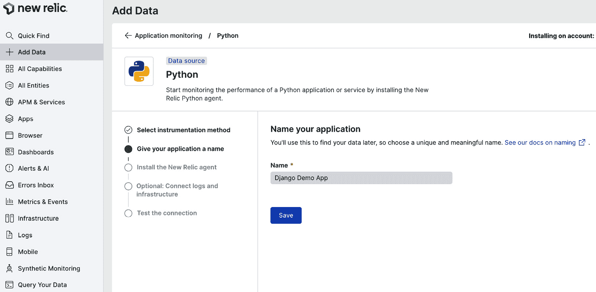 

Figure 14.11: New Relic wizard for Python integration

1. 接下来，按照向导中提到的步骤进行。安装 Python APM 代理：

```
pip install newrelic
```

将 `newrelic.ini` 文件保存到 `manage.py` 文件所在的根目录。 （`newrelic.ini` 文件的内容可以从向导中下载。我们没有展示文件内容，因为它将被复制粘贴，而且文件过大）。你可以在 [`github.com/PacktPublishing/Django-in-Production/blob/main/Chapter14/myblog/backend/newrelic.ini`](https://github.com/PacktPublishing/Django-in-Production/blob/main/Chapter14/myblog/backend/newrelic.ini) 查看 `newrelic.ini` 文件

2. 现在通过以下命令验证配置：

```
newrelic-admin validate-config newrelic.ini
```

3. 配置验证通过后，我们需要在 Django 应用的 New Relic 代理中运行插件，通过运行以下命令：

```
newrelic-admin run-program python manage.py runserver
```

上述命令用于在本地机器上测试设置。我们使用 `docker` 和 `gunicorn` 设置在生产环境中运行 Django 应用。我们需要更新 `docker-compose.yaml` 文件以将 New Relic 集成到 Django 应用中。如果你使用的是其他设置，例如 systemd 或其他设置，那么你需要在 `gunicorn` 命令之前添加 `newrelic-admin run-program` 命令，如我们在此所示：

```
services:
  backend:
    build:
      context: ./backend
      dockerfile: Dockerfile.prod
    command: newrelic-admin run-program gunicorn backend.prod_wsgi:application --workers 4 --bind 0.0.0.0:8000 --max-requests=512 --max-requests-jitter=64 --reload
```

现在当我们将更改部署到生产环境时，我们将在 New Relic 仪表板上开始接收 Web 事务的数据。

我们已成功将 Django 应用与 New Relic 集成以捕获性能指标。

### 重要说明

由于我们需要真实世界的数据和相当多的流量才能让 New Relic 展示其能力，我将使用我其中一个副项目作为参考。出于安全考虑，我将从截图中隐藏任何敏感数据。

## 探索 New Relic 仪表板

让我们现在看看当我们从 Django 服务器发送数据时，我们的 New Relic APM 仪表板是什么样子的。在 *Figure 14**.12* 中，我们可以看到三个不同的部分，突出了对性能监控重要的三个指标：

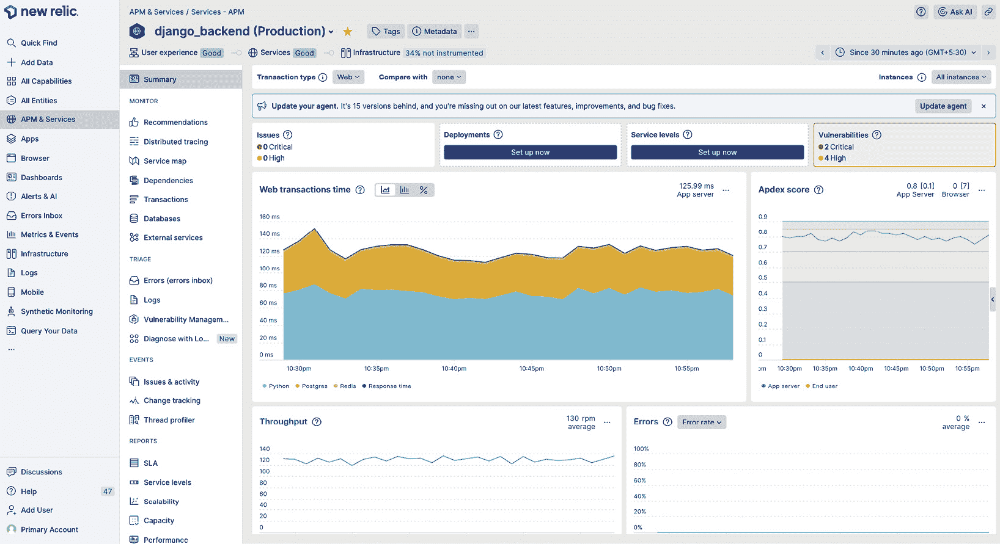 

Figure 14.12: New Relic dashboard showing performance metrics for Django app

让我们详细了解这三个指标：

* **Web transaction time**：这是我们 Django 应用中所有 API 的平均响应时间。Web 事务时间计算为 Django 应用的请求-响应时间，而非请求从用户到 Django 服务器的传输时间。尽管 Web 事务时间是应用所服务的请求平均时间，但较低的 Web 事务时间表明应用代码良好且架构设计周到。可以进一步深入分析并通过进入 **Transactions** 部分来分析单个请求-响应事务时间。

* **Throughput of Django app**：吞吐量显示 Django 应用所服务的总请求数。该数字以 **Requests per Minute** (**RPM**) 表示。随着用户群的增长，该数字会增加。密切关注 RPM 峰值对系统的稳定性很重要。

* **Apdex score**：**Application Performance Index** (**Apdex**) 是衡量用户对 Web 应用和服务响应时间满意度的行业标准。保持稳定的 Apdex 分数应该是工程团队的目标。它的计算比较复杂，我们不会深入介绍如何计算。你可以在 [`docs.newrelic.com/docs/apm/new-relic-apm/apdex/apdex-measure-user-satisfaction/`](https://docs.newrelic.com/docs/apm/new-relic-apm/apdex/apdex-measure-user-satisfaction/) 阅读更多内容。

**Summary** 页面为我们提供了系统的整体摘要。现在，我们想找出为什么系统响应时间突然从 *100 ms* 增加到 *300 ms*，因此我们需要进入 **Transactions** 选项卡。**Transactions** 选项卡显示 Django 应用中存在且被用户访问的所有 API 的列表。它按耗时从多到少列出 API 事务列表。在 *Figure 14**.13* 中，我们可以看到 Django 应用的 **Transactions** 选项卡（出于安全原因，页面的某些部分已被模糊）：

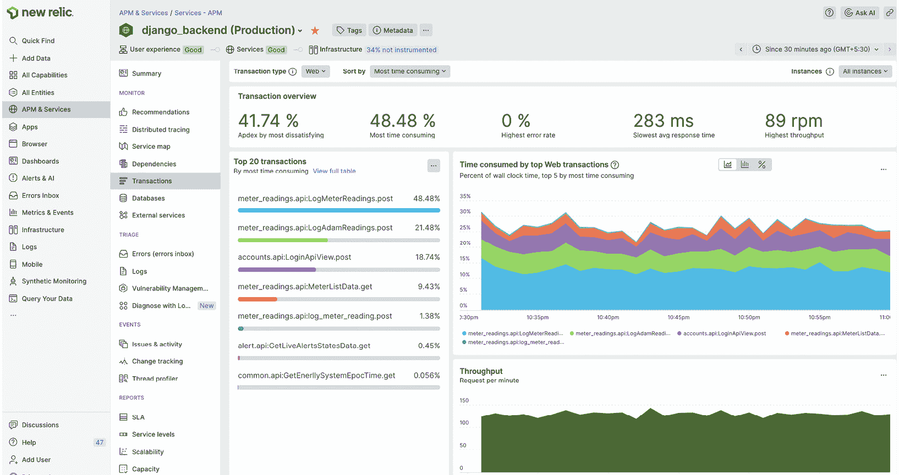 

Figure 14.13: Transactions tab for the Django application


使用 `Transactions` 选项卡，我们可以找到所有缓慢的端点或任何吞吐量更高的端点等等。假设我们发现某个 API 耗时 *85 ms*，根据 Django 应用的标准，这被认为很慢。通过选择一个 Web 事务，我们可以查看应用的更多详情。在 *Figure 14.14* 中，我们可以看到某个特定事务的详情，并分析应用的哪一部分耗时最多（出于安全原因，页面的某些部分已被模糊处理）：

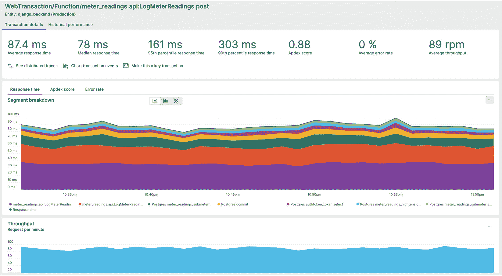

Figure 14.14: Details of a particular web transaction

*Figure 14.14* 详细显示 Postgres 查询是否耗时，或是否有其他应用代码耗时。这种详细的分析可以帮助我们以数据驱动的方式找到任何问题的根本原因。

## Creating New Relic alert conditions

在 New Relic 中拥有所有这些数据后，我们可以创建自动化的警报，以便在性能出现偏差时通知团队。New Relic 提供了创建自定义警报和策略的界面。

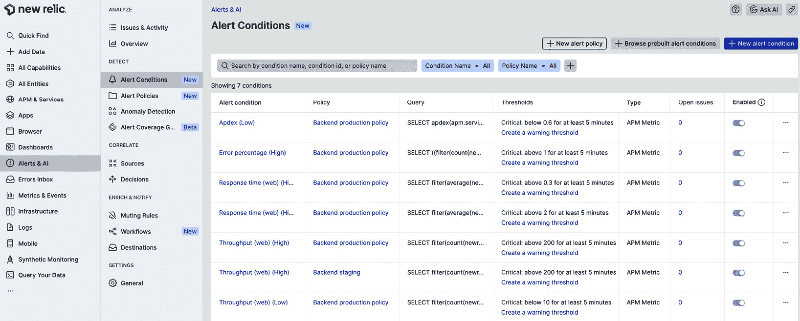

Figure 14.15: New Relic custom alert conditions and policies

New Relic 警报条件可以根据需要和 New Relic 捕获的数据进行扩展。可以为 Web 事务时间增加、吞吐量激增、Apdex 分数下降等设置标准警报条件。更多详情，请查阅官方文档：[`docs.newrelic.com/docs/alerts-applied-intelligence/new-relic-alerts/alert-conditions/create-alert-conditions/`](https://docs.newrelic.com/docs/alerts-applied-intelligence/new-relic-alerts/alert-conditions/create-alert-conditions/)。

配置好警报后，我们还应将 Slack 与 New Relic 集成。官方文档展示了 Slack 集成的详细步骤（[`docs.newrelic.com/docs/alerts-applied-intelligence/notifications/notification-integrations/#slack`](https://docs.newrelic.com/docs/alerts-applied-intelligence/notifications/notification-integrations/#slack)）。

现在，每当 New Relic 检测到我们已配置警报条件的异常时，就会触发警报。在 *Figure 14.16* 中，我们可以看到 New Relic 发送的 Slack 消息，因为系统吞吐量低于配置的范围：

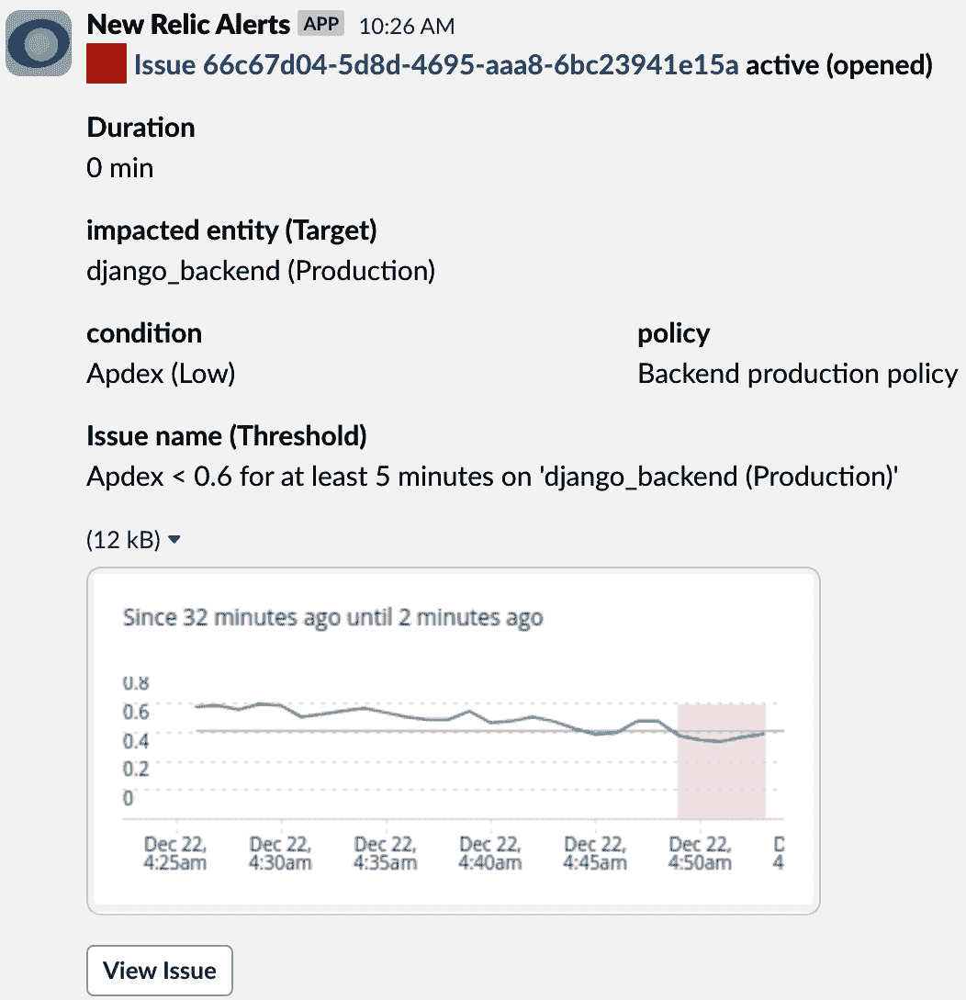

Figure 14.16: Slack alert sent by New Relic on breach of throughput threshold

为 Web 应用创建合适的 New Relic 警报可以确保更好的 SLA 监控、向生产环境部署合适数量的服务器，并识别任何隐藏的性能瓶颈。

## Monitoring AWS EC2 instances with New Relic

在 *Chapter 13* 中，我们学习了如何使用 AWS Beanstalk 部署 Django 应用。我们的 Django 应用使用 AWS Beanstalk 部署，因此我们需要在 AWS Beanstalk 上集成 New Relic 基础设施代理。New Relic 提供了在所有 Beanstalk 管理的 EC2 实例上安装 New Relic 基础设施代理的直接指南。集成步骤超出了本书的范围。请按照此处提到的指南操作：[`docs.newrelic.com/docs/infrastructure/install-infrastructure-agent/config-management-tools/configure-infrastructure-agent-aws-elastic-beanstalk/`](https://docs.newrelic.com/docs/infrastructure/install-infrastructure-agent/config-management-tools/configure-infrastructure-agent-aws-elastic-beanstalk/)。

借助 New Relic 基础设施代理，我们可以监控 EC2 主机的 RAM、CPU 使用率、磁盘空间以及其他数据。现在我们已为 EC2 实例配置了基础设施代理，让我们开始发送主机上存在的所有日志文件。

## Sending logs from Django to New Relic

在 *Chapter 6* 中，我们学习了如何在 Django 中设置日志。我们在 `settings.py` 中 `LOGGING` 配置的 `filename` 部分配置了日志文件的路径。

现在我们将告诉 New Relic 基础设施代理监视 `path/to/django_logs.log` 的文件内容并将日志发送到 New Relic：

```
LOGGING = {
    "version": 1,
    "disable_existing_loggers": False,
    "formatters": {"verbose": {"format": "%(asctime)s %(process)d %(thread)d %(message)s"}},
    "loggers": {
        "django_default": {
            "handlers": ["django_file"],
            "level": "INFO",
        },
    },
    "handlers": {
        "django_file": {
            "class": " logging.handlers.RotatingFileHandler",
            "filename": "path/to/django_logs.log",
            "maxBytes": 1024 * 1024 * 10,  # 10MB
            "backupCount": 10,
            "formatter": "verbose"
        },
    },
}
```

我们已在 *Chapter 6* 中讨论过 Django 中日志配置的工作原理。

Important note

必须在主机上安装 New Relic 基础设施代理，才能将主机系统的日志发送到 New Relic 系统。如果您未使用其他设置，请在执行下一步之前，按照 New Relic 提供的文档在主机上安装基础设施代理。

要在 Django 项目中设置日志并将日志转发到 New Relic，我们需要执行以下步骤：

1. 创建一个 `logging.yml` 配置文件，它将告诉 New Relic 基础设施代理从何处获取适当的日志文件并将数据发送到 New Relic 服务器。`logging.yml` 文件应包含以下内容：

```
logs:
  - name: "django_log"
    file: /<log file path>/*.log
  - name: "nginx_log"
    file: /<nginx log file path/*.log
  - name: "etc_log" # any other log we want to send
    file: /path/*.log
```

`name` 键值可以是我们决定的任何内容，而 `file` 应给出日志文件生成的绝对路径。

2. 创建 `logging.yml` 配置文件后，我们需要在主机上 `/etc/newrelic-infra/logging.d/logging.yml` 保存 `logging.yml` 文件——在我们的例子中，是运行 Django 应用的 Beanstalk 的 EC2 实例。将 `logging.yml` 文件保存在项目根目录的 `.ebextensions` 文件夹中。

3. 我们可以使用 `.ebextensions` 为 Django 应用设置日志。创建 `02_newrelic_logging.config` 文件并使用以下代码片段：

```
container_commands:
    01_copy_logging_config :
        command: 'cp .ebextensions/logging.yml /etc/newrelic-infra/logging.d/'
```

4. 现在，通过对 Django 应用进行全新部署，所有由 Django 应用生成的日志都可在 New Relic 中访问。

现在，如果我们在 New Relic 仪表板中打开 `Logs` 选项卡，我们可以看到 Django 应用收集并发送到 New Relic 的日志。*Figure 14.17* 显示了捕获并发送到 New Relic 的日志列表。New Relic 提供了 Lucene 搜索来扫描所有日志（出于安全原因，页面的某些部分已被模糊处理）。

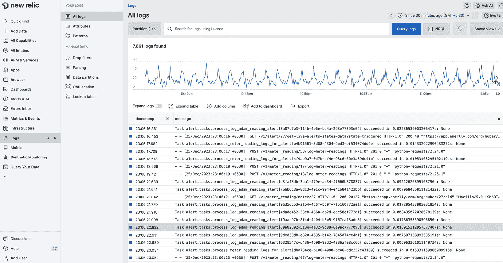

Figure 14.17: An overview of logs captured by Django and sent to New Relic

如果我们想查看特定日志数据的详情，可以打开所选日志并查看详情。在 *Figure 14.18* 中，我们可以看到一个日志的详细示例（出于安全原因，页面的某些部分已被模糊处理）：

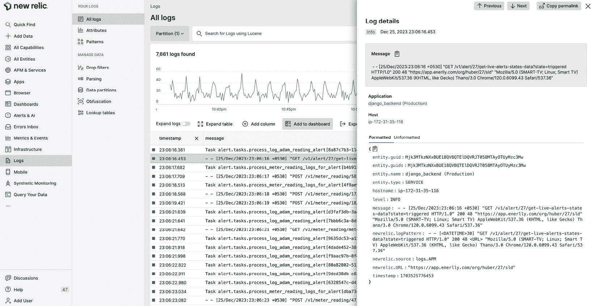

Figure 14.18: Detail log in New Relic dashboard


New Relic 还支持自定义解析器来解析不同的日志格式。有关如何最好地处理基础设施代理日志的更多详细信息，请查看官方文档：[`docs.newrelic.com/docs/logs/forward-logs/forward-your-logs-using-infrastructure-agent/`](https://docs.newrelic.com/docs/logs/forward-logs/forward-your-logs-using-infrastructure-agent/)。

New Relic 能够在其平台上存储多个数据源。要处理数百 GB 的数据，就需要查询数据。为此目的，New Relic 拥有一种类似于 SQL 的查询语言。

## 使用 NRQL 处理指标和事件

`New Relic Query Language` (`NRQL`) 是一种功能强大的工具，可用于查询和理解所有类型的数据。人们可以轻松学习并开始使用 `NRQL` 来分析平台上的数据，还可以创建图表和仪表板。一开始，学习一种新的查询语言来进行监控可能会让人不知所措，但根据我的个人经验，我强烈建议学习 `NRQL`。

官方文档易于遵循，学习 `NRQL` 的语法几乎只需要几个小时。请按照以下文档进行操作：[`docs.newrelic.com/docs/query-your-data/nrql-new-relic-query-language/get-started/introduction-nrql-new-relics-query-language/`](https://docs.newrelic.com/docs/query-your-data/nrql-new-relic-query-language/get-started/introduction-nrql-new-relics-query-language/)。

当我们进入 `Metrics & Events` 选项卡时，我们可以看到 New Relic 中捕获的所有事件。通过选择 `Event type`，我们可以开始探索数据。在 `Figure 14.19` 中，我们选择了 `Transaction` 事件，现在我们可以使用 `NRQL` 来探索数据。

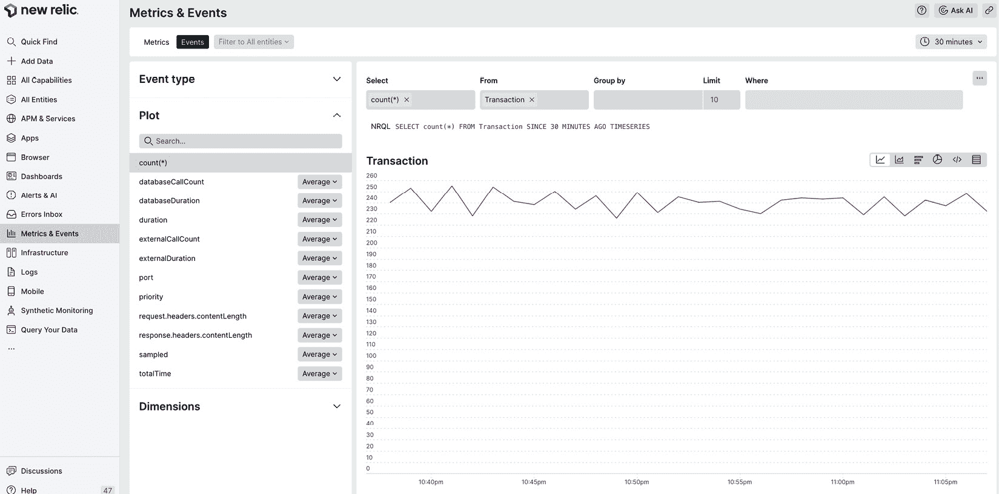 
Figure 14.19: Exploring Metrics & Events

现在我们已经学习了如何使用多种工具，例如 `APM`、错误监控工具、正常运行时间监控等，处理这么多工具可能会让人望而生畏。现代工程更注重优化和使用合适的工具来完成工作。在下一节中，我们将学习如何通过 Slack 消息工具来优化我们的工作流程。

# 使用 Slack 集成消息工具

在当今的软件开发世界中，`Slack`/`Teams` 等消息工具是开发周期不可或缺的一部分。在本节中，我们将以 `Slack` ([`slack.com/`](https://slack.com/)) 为例，展示软件开发人员如何利用此类通信工具来提高生产力和增强监控。

在 `Integrating Rollbar with Slack` 和 `Creating New Relic alert conditions` 部分中，我们展示了如何将 `Slack` 集成到错误监控工具、正常运行时间监控工具和 `APM` 工具中。这样，开发人员就不必分别进入所有应用程序来跟踪警报是否被触发。相反，只要有警报，工具就会自动在 `Slack` 上发送消息，开发人员可以直接从 `Slack` 访问详细信息。

`Slack` 提供了丰富的消息界面，因此用户不仅可以回复消息，还可以在不离开 `Slack` 的情况下采取行动。例如，当 `Rollbar` 通知我们错误时，我们可以直接标记相关人员并进行对话。我们也可以在不离开 `Slack` 的情况下将问题分配给开发人员，如下所示：

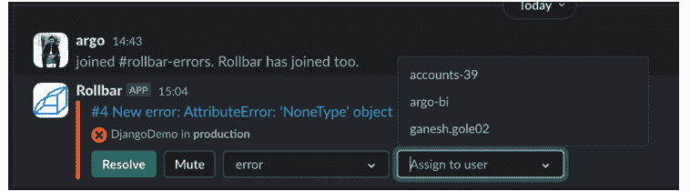 
Figure 14.20: Assigning Rollbar issues to users directly from Slack

我们还可以点击 `Resolve` 按钮直接从 `Slack` 将问题标记为已解决。

同样，每当 `BetterStack` 触发事件时，我们都可以从 `Slack` 确认该事件。这些 `Slack` 消息操作有助于开发人员将所有工具和重要操作集中在一个地方，同时确保任何关键事件都不会被工程领导者错过。

如今，几乎每个第三方工具都有 `Slack` 集成，因为它有助于将所有信息集中在一个地方，并确保不会错过 `Slack` 通知。无论是 `Jira`、`GitHub` 还是 `Google Calendar`，所有这些 `Slack` 应用都有助于确保开发人员不会错过重要通知。毫不夸张地说，我将工作日的 20% 花在 `Slack` 上，几乎 90% 的通知都是通过 `Slack` 管理的。

以下是 `Slack` 提供的一些官方资源，介绍 `Slack` 如何改善整体软件开发周期和开发人员生产力：

*   [`slack.com/intl/en-in/resources/using-slack/speed-up-software-development-with-slack`](https://slack.com/intl/en-in/resources/using-slack/speed-up-software-development-with-slack)
*   [`slack.com/intl/en-in/resources/why-use-slack/the-value-of-slack-for-software-developers`](https://slack.com/intl/en-in/resources/why-use-slack/the-value-of-slack-for-software-developers)
*   [`slack.com/intl/en-in/resources/why-use-slack/software-development-teams-and-slack`](https://slack.com/intl/en-in/resources/why-use-slack/software-development-teams-and-slack)
*   [`slack.com/intl/en-in/resources/why-use-slack/how-it-works-slack-for-software-development`](https://slack.com/intl/en-in/resources/why-use-slack/how-it-works-slack-for-software-development)
*   [`slack.com/intl/en-in/resources/why-use-slack/how-slacks-own-developers-use-slack`](https://slack.com/intl/en-in/resources/why-use-slack/how-slacks-own-developers-use-slack)

我们将 `APM` 工具和正常运行时间监控集成到我们的系统中，以便在系统性能下降时自动收到通知，而不是等客户投诉我们的服务。每当系统宕机或性能下降时，我们称之为事件。生产事件可能有不同的严重级别，具体取决于影响。在下一节中，我们将重点介绍当生产系统宕机时不同团队如何协作。

# 更好地处理生产事件

每个值班工程师的噩梦都是在半夜接到生产系统宕机的电话。生产事件在每个公司都很常见，无论是两名工程师的初创公司，还是像 `Google` 这样拥有 20,000 名工程师的大型科技组织。事件是指导致使用服务的终端用户出现中断或性能下降的事件。在 `Integration APM tools` 部分，我们学习了如何使用 `APM` 工具识别性能下降，以及如何使用正常运行时间监控工具识别任何停机并提醒利益相关者。现在让我们学习如何在事件期间工作以及如何更好地管理事情。

值班工程师的首要任务是确保不要惊慌。与普遍看法相反，我观察到那些不把事件当作“生死攸关”情况的工程师能够更好地处理事件。由于事件的原因每次都不同，因此很难对解决生产事件采取通用方法。但制定事件管理的 `Standard Operating Procedure` (`SOP`) 很重要。

让我列出我在不同行业公司工作时学到的一些 `SOP`：

*   `Communicate first`：在着手解决问题之前，首先沟通/确认任何事件非常重要。沟通应首先在内部消息渠道进行，如果需要，再与外部用户进行沟通。
*   `Identify the issue before taking any action`：事件期间最重要的一步是识别导致事件的问题。如果我们的 `API` 响应时间很高，我们需要进入 `APM` 工具来识别导致响应时间增加的原因。是由于吞吐量增加、糟糕的查询，还是由于某些下游依赖项响应时间变慢？根据根本原因，我们应采取行动。


进入`/path/to/xxx`目录，找到`xxx.json`。

在表达式`cvar = avar + bvar`中，加法运算符（`+`）将`avar`与`bvar`相加，得到它们的和`cvar`

在`List.of(arg0, arg1, arg2)`中，`List`接口的工厂方法`of()`接受一系列的元素，返回包含它们的只读列表。

之后我们这样调用`cmd`命令：`cmd arg0 arg1 arg2`。

```
if (condVar > someVal) {console.log("xxx")}
```

* **让利益相关者参与**：在事故发生期间，始终先尝试进行初步分析，但如果根本原因仍然不明确，则有必要让其他利益相关者参与。

* **设立战情室**：让所有利益相关者参加一次会议，与所有参与人员同步工作，并与每个成员和每个角色进行详细沟通。

* **先回滚再修复**：先回滚，后修复始终应该是做法。每当发现一个由最近代码变更引起的 issue 时，大多数值班工程师的第一反应是修复 bug，但那应该是第二步。对值班工程师来说，第一步应该是先回滚代码变更以稳定生产系统，然后再着手修复问题。

* **缓解和监控**：一旦问题得到缓解，我们应该密切关注系统健康状况的改善，并确保在接下来的几个小时内密切监控系统。

* **创建根本原因分析（RCA）和行动项**：一旦生产系统稳定下来，就必须确保团队进行无责备的 RCA 并创建行动项，以避免未来再次发生此类事故。事故只有在 RCA 得到批准并且事故的行动项得到实施后才能关闭。

我们已经了解了事故管理的 SOP，但每个团队和公司都可以有不同的处理事故的流程。一些工具可以帮助执行此类流程，例如 Squadcast（[`www.squadcast.com/`](https://www.squadcast.com/)）和 Opsgenie（[`www.atlassian.com/software/opsgenie`](https://www.atlassian.com/software/opsgenie)）可以用于简化事故管理。

在下一节中，我们将学习如何在团队中为事故创建**无责备 RCA 文化**。为事故评审创建健康的无责备文化非常重要，这样工程师才能感到安心，并对同事工程师表现出主人翁意识和同理心。

# 事故的无责备 RCA

RCA 可以定义为通过一系列“为什么？”问题系统地揭示事故根本原因的方法，直到无法再提取进一步的诊断信息。进行 RCA 最重要的一部分是保持*无责备*。在本节中，我们将学习如何为事故创建无责备的 RCA，这将有助于在 RCA 期间在团队中建立强大而健康的工程文化。

让我们学习一些可以帮助我们创建无责备 RCA 的重要要点：

* **关注事故中做得好的地方**：突出事故中做得好的积极点可以让团队更有信心。感谢响应事故并进行灭火的值班工程师。

* **关注未来**：不要关注本可以发生、应该发生或任何过去事件。相反，关注我们可以采取哪些行动来改进下一次或避免再次发生。

* **关注工作而不是人**：始终关注为什么某事失败，而不是谁在负责。

* **表现出同理心并避免自负**：没有人故意添加 bug 或创建有缺陷的设计，因此对其他工程师表示同理心很重要。

* **接受错误**：我们不应将反馈视为个人问题并试图为一切辩护。反馈始终是关于工作而不是关于人，所以接受错误并继续下一步如何改进。

每个公司都可以有自己的无责备 RCA 实施文化。以下是行业中不同公司遵循的几个无责备 RCA 示例：

* Gitlab: [`handbook.gitlab.com/handbook/customer-success/professional-services-engineering/workflows/internal/root-cause-analysis/`](https://handbook.gitlab.com/handbook/customer-success/professional-services-engineering/workflows/internal/root-cause-analysis/)

* Atlassian: [`www.atlassian.com/incident-management/postmortem/blameless`](https://www.atlassian.com/incident-management/postmortem/blameless)

* PagerDuty: [`postmortems.pagerduty.com/culture/blameless/`](https://postmortems.pagerduty.com/culture/blameless/)

一旦我们为无责备 RCA 建立了良好的文化，我们就可以创建团队可以遵循的 RCA 模板。我们不会详细介绍 RCA 模板，因为每个公司都希望有自己的实现。以下是行业中广泛流行的几个 RCA 模板示例：

* Gitlab 模板: [`gitlab.com/gitlab-org/gitlab/-/blob/master/.gitlab/issue_templates/rca.md`](https://gitlab.com/gitlab-org/gitlab/-/blob/master/.gitlab/issue_templates/rca.md)

* Atlassian 模板: [`www.atlassian.com/incident-management/postmortem/templates#incident-summary`](https://www.atlassian.com/incident-management/postmortem/templates#incident-summary)

* Google 模板: [`sre.google/sre-book/example-postmortem/`](https://sre.google/sre-book/example-postmortem/)

更多模板，请查看仓库 https://github.com/dastergon/postmortem-templates。随着团队成熟并处理事故，这些模板将不断演进并更符合公司需求。

在本节中，我试图强调无责备 RCA 的重要性，因为这奠定了正确的工程文化，而在早期初创公司如果工程师很少时，这往往会被忽视。优秀的工程领导者始终关注当前行动项以及如何改进系统未来，而不是过去本可以做得更好。无责备的 RCA 会鼓励工程师对事故承担责任并着手改进系统。

# 总结

在本章中，我们学习了如何使用不同的工具来监控和改进我们的应用程序。APM 工具如 New Relic 有助于应用程序性能监控，这对任何应用程序都至关重要。我们学习了如何将 New Relic 集成到我们的 Django 应用程序中。在生产环境中出现 5xx 错误是每个开发者的噩梦，而错误监控工具如 Rollbar 和 Sentry 有助于捕获和跟踪 bug，以便开发者可以轻松修复它们。本章中我们还学习了如何集成持续监控应用程序并在出现停机时立即通知我们的 uptime 监控工具。

重要的是要知道，在当今的应用程序开发过程中，编写代码只是第一部分，使用正确的维护和沟通工具至关重要。面对如此多的第三方工具，开发者和其他工程领导者很难跟踪每个工具，因此将所有通信和警报统一到一个地方，如 Slack/Teams 至关重要。我们学习了如何将 Slack/Teams 集成到我们的开发流程中。必须接受生产事故是现实。每支团队都会遇到生产事故，开发者必须做好充分准备，通过适当的流程处理此类事故。一旦发生生产事故，重要的是反思问题并创建无责备的 RCA，以避免未来再次发生。在本章中，我们学习了如何更好地管理事故并创建 RCA，以帮助我们进一步改进系统。

我们现在来到了本书的结尾——*Django in Production*。我们学习了如何使用 Django、Django REST Framework 和 Celery 创建 Web 应用程序。我们探索了 AWS 以及如何将应用程序部署到生产环境。我们试图涵盖软件开发人员在使用 Django 构建 Web 应用程序时应了解的所有重要主题。书中范围之外的一些高级概念我们已将您引导至官方文档学习。在本书中，我们讨论了很多最佳实践和我在软件行业工作时作为开发者学到的实际用例。


我希望你喜欢本书中提到的所有主题。祝你在所有 Django 冒险中好运！
