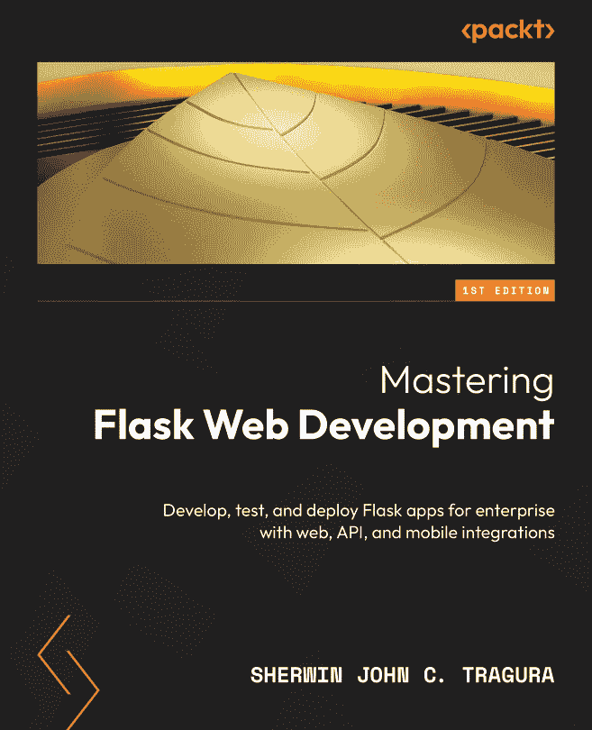

# 索引

由于本电子书版没有固定分页，下面的页码仅供参考，基于本书的印刷版进行超链接。

A

`abstract base classes` 44, 45

`Amazon EC2` 261

`Amazon Web Services (AWS)` 253, 254

account, creating 255-259

`AnonRateThrottle` 137

API authentication, testing 179-181

`factory_boy`, using 182, 183

mocks, using 185

`setUpTestData`, using 183-185

test cases, setting up 181, 182

test cases, tearing down 181, 182

API development tools 27, 28

API-first development approach

URL 6

APIs and use cases

reference link 178

API versioning

accept header versioning 18

host name versioning 19

query parameter versioning 19

URL path versioning 19

application authentication 110

Application Load Balancer (ALB) 261, 267

Application Performance Index (Apdex) score 297

Application Performance Monitoring (APM) tools

integrating 293

New Relic, integrating into Django project 294-296

New Relic Query Language (NRQL) 304

Arrange-Act-Assert testing pattern 178

asynchronous programming 160

Asynchronous Server Gateway Interface (ASGI) 208

reference link 208

automatic linting 194

AWS Billing console 263

AWS CloudWatch 263

AWS ElastiCache 262

AWS infrastructure

best practices 282

AWS Key Management Service (KMS) 283

AWS Lightsail 262

AWS RDS Postgres instance

creating 268

AWS Route 53 263

AWS Secrets Manager 263

AWS Well-Architected Framework 282

B

basic tests

writing, in DRF 177, 178

best practices, to write tests 189

authentication tests, using 192

brittle tests, avoiding 191

different types of tests, creating 193, 194

Postman, used for creating integration test suite 193

reverse function, using for URL path 191

tests, avoiding 194

test tags, using to group tests 192

time bomb test failures, avoiding 190

unit tests, using 189

BetterStack

for uptime monitoring 291-293

URL 291

`black`

reference link 194

blameless RCA

creating, for incidents 307, 308

`B-tree` 59

`bulk_create`

reference link 64

C

caching 130

best practices 135

custom caching 130

database caching 130

filesystem caching 130

local memory caching 130

memory database-based caching 130

`Celery` 159

integrating, with Django 161-164

interfaces 164, 165

reference link 160

tests, writing for 186

using, best practices 166, 167

using, with Django 160, 161

`celery beat` 167

using, with Django 167-169

changelog 238

CI pipelines 194

circular dependency 52

class-based views, DRF 25

`APIView` class 26

Generic Views 27

classic load balancer 261

code coverage threshold 246

code linter 246

code release

hot-fixing, performing on code 238

performing 238

code review 247

checklist 248

context and description 248

guidelines, setting up 247

short code changes 248

code reviewers

qualities 249

code structuring, for Django projects 198

circular dependencies, avoiding 200

common app, creating 200, 201

files, creating as per functionalities 198, 199

settings file for production, working with 201, 202

common app

creating 200

features 201

`CONN_MAX_AGE`

using 64

continuous deployment (CD) process 238

Conventional Commits 232

coverage threshold 193

Cross-Origin Resource Sharing (CORS)

设置 206

跨站请求伪造 (CSRF) 206

CursorPagination 150

自定义身份验证类

参考链接 123

自定义缓存 130

自定义字段级验证器

定义 83

自定义管理命令

创建 105\-107

自定义中间件

创建 156, 157

自定义对象级验证器

定义 84

自定义权限类

参考链接 123

自定义权限

创建 117, 118

自定义信号

创建 152, 153

D

数据库

设置，用于测试 176

数据库缓存 130

数据库连接配置 64

`connect_timeout`，使用 65

`CONN_MAX_AGE`，使用 64

数据库迁移

自定义迁移，避免 50

假迁移，使用 49, 50

新增字段 51

执行 48

反向迁移，执行 48

系统检查，在重复迁移时创建 50

数据验证

使用序列化器 82

默认验证器

移除，自 DRF 序列化器类 85, 86

Dependabot 239

disconnect 函数

参考链接 187

Django 4

与 Celery 集成 161\-164

配置，用于生产环境 205, 206

访问环境变量 226

功能 5

MVT 框架 6

集成到社交登录 125

创建超级用户 94

Django 管理

重命名管理 URL 100

使用自定义操作 104

使用自定义 Admin 分页器 101

添加自定义字段 97

自定义 97

添加 django-json-widget 102, 103

探索 94

使用 `filter_horizontal` 97, 98

禁用 ForeignKey 下拉选项 101

为性能覆盖 `get_queryset` 102

使用 `get_queryset` 98, 99

界面 94\-96

使用 `list_select_related` 102

日志 99, 100

为生产环境优化 100

使用权限和组 115\-117

使用权限 104

使用主题 99

使用第三方包 99

为管理员用户使用双因素认证 (2FA) 100

django-admin-honeypot 包

参考链接 100

Django 应用

使用 RDS 配置 274, 275

创建 11, 12

使用 Docker 启动 227

将视图与 `urls.py` 链接 13, 14

Django 异步 ORM

探索 66

Django 身份验证

基础 110

django-cacheops

使用 132\-135

django-environ

参考链接 227

Django Girls 教程

URL 7

Django 组

使用 114

用于 API 的使用 118, 119

Django hello_world 项目

创建 8\-11

django-json-widget 包

参考链接 102

Django 中间件 155

创建自定义中间件 156, 157

使用 155

Django 迁移 46

执行数据库迁移 48

揭秘迁移管理命令 46

Django 模型 35

添加 35, 36

Django 模型和 ORM 最佳实践

使用基础模型 51

避免循环依赖 52, 53

使用自定义模型方法 54

默认主键 55

探索 51

使用有限状态机 (FSM) 56

避免通用外键 56

将模型拆分为包 57

为所有模型定义 `__str__` 53

为任何 DateTime 相关数据使用 `timezone.now()` 52

使用事务 55, 56

Django ORM 36

`auto_now` 与 `auto_now_add` 37

避免 `bulk_create` 64

避免 `bulk_update` 64

使用数据库函数 38

exists 与 count 60

使用 `get_or_create` 64

规范化 40, 41

null 与 blank 37

使用 `prefetch_related` 63

使用查询表达式 38

使用 QuerySets 60

`raw queries`, 获取 39, 40

`raw SQL queries`, 使用 37

`reverse foreign key lookup`, 使用 38, 39

`select_related`, 使用 61-63

`update_or_create`, 使用 64

使用 60

`django-otp`

参考链接 101

`Django permissions` 114

限制 119

使用，用于 API 118, 119

`Django Rest Framework (DRF)` 109

基础测试，编写 177, 178

集成 14-16

分页，使用 149, 150

社交登录，集成到 125

基于令牌的身份验证，集成到 120

`djangorestframework-simplejwt` 包 125

`django-rest-knox` 包 124

参考链接 124

`Django runners`

使用 188, 189

`Django server`

RDS，连接至 271-273

`Django signals`

自定义信号，创建 152-154

数据库包装器 152

揭秘 151

管理信号 151

模型信号 151

请求/响应信号 152

使用 154

`Docker` 215

基础 212

高层架构 214, 215

安装 215

测试，在本地系统上 216, 217

`Docker CLI` 217

`Docker Compose` 215

`docker-compose.yaml` 文件

创建 223

`Docker container` 214

`Docker daemon` 215

`Docker Engine` 214

`Dockerfile` 214

创建，用于 Django 项目 220-222

`Docker Hub` 215

`Docker images` 214

`Docker registry` 215

域名系统 (DNS) 263

不要重复自己 (DRY) 原则 25, 201

`DRF Serializers`

基础 70, 71

context 参数，使用以传递信息 87, 88

自定义 QuerySet，传递给 PrimaryKeyField 88, 89

`DynamicFieldsSerializer`，构建 89

字段，自定义 88

精通 86

N+1 查询问题，避免 89

`SerializerMethodField` 81, 86

source 选项，探索 80, 81

source 选项，使用 86

`to_internal_value` 方法，使用 86

`to_representation` 方法，使用 87

验证器，使用 86

`DRF token-based authentication`

添加，到 Django 项目 121-123

限制 123, 124

使用 120

`DRF views`

`Serializers`，使用与 89

## E

`EC2AdminRole` 260

`ElastiCache`

最佳实践 283

`ElastiCache Redis instance`

连接，到 Django 277, 278

创建 276, 277

`Elastic Beanstalk` 261, 262

最佳实践 283

Django 应用，使用 GitHub Actions 部署 279-281

集成，用于部署 Django 264

集成，与基础 Django 应用 264-268

`Elastic Load Balancer (ELB)` 261

`Elasticsearch-Logstash-Kibana (ELK)` 145

端到端 (E2E) 测试 173

错误监控工具

最佳实践 289

集成 286

Rollbar，集成到 Django 项目 286-288

Rollbar，与 Slack 集成 288, 289

错误

使用 202-204

异常

使用 202-204

## F

`factory_boy`

参考链接 182, 187

使用 182, 183

功能标志

使用 204, 205

字段级验证

自定义 82

文件

创建，根据功能 198, 199

文件系统缓存 130

先进先出 (FIFO) 166

`Flagsmith`

URL 205

`flake8`

参考链接 194

`ForeignKey` 字段 41, 42

`Freezegun`

参考链接 190

## G

`Generic Views` 26, 27

`Git`

分支策略 231, 232

良好实践 230

使用 230

`git commit`

GitHub，使用 233

良好实践 232

JIRA，使用 233

Git hooks

集成到 Django 项目中 234

GitHub

使用 239，240

GitHub Actions

最佳实践 246

资源 246，247

设置，带示例 240\-243

测试 244\-246

用于设置 Django CI 管道 240

使用 239，240

使用，用于 CI 管道 240

GitHub code owners 239

GitHub Copilot 239

GitHub Teams 239

`git merge`

与 `git rebase` 对比 236\-238

Git tools

GitHub Desktop 234

GitKraken 234

`git-sim` 233

Git workflow 230

Google Cloud Platform (GCP) 253

group 260

使用，在 Django Admin 中 115\-117

### H

Hello World web app

创建，使用 Django 和 DRF 7，8

hoppscotch

URL 27

hypervisor 213

### I

Identity and Access Management (IAM) 259，260

最佳实践 284

group 260

role 260

user 259

Insomnia

参考链接 193

integration testing 173

### J

`JSONParser` 70

`JSONRenderer` 70

JSON Web Token (JWT) 125

参考链接 125

### K

kill switches 205

### L

LaunchDarkly

URL 205

lefthook 234

集成到项目中 235，236

使用 234

`LimitOffsetPagination` 150

linting tests 194

Linux packages 221

load balancers

application load balancer 261

classic load balancer 261

network load balancer 261

local memory caching 130

logging 139

最佳实践 145

设置 140\-144

login 110

### M

management commands

参考链接 105

`ManyToManyField` 43

自定义 43

memory database-based caching 130

messaging tools

集成，Slack 使用 305，306

migration 46

migration file tests 194

migration management commands

去神秘化 46

`makemigrations` command 47

`migrate` command 47

mock 185

mocking 185

model inheritance

abstract base classes 45

multi-table inheritance 45

Proxy model 45，46

使用 44

Model Serializers

data，检索自 Model 对象实例 74

现有 model Objects，更新 73，74

Meta class，探索 75\-77

new model object，创建 72，73

使用 71，72

multi-table inheritance 44

MVT framework 6

### N

N+1 query problem 82

Neon

URL 177

nested Serializers

使用 79，80

network components 263

network load balancer 261

New Relic 294

alert conditions，创建 299，300

AWS EC2 instances，使用进行监控 301

dashboard，探索 296\-298

集成到 Django 项目中 294\-296

logs，从 Django 发送 301\-304

URL 293

New Relic Query Language (NRQL) 304

normalization，与 Django ORM 40，41

ForeignKey field 41，42

`ManyToManyField` 43

OneToOneField 41

### O

OAuth 2.0 110

object-level validation

执行 83，84

on_delete options

探索 44

OneToOneField relationship

使用，与 User model 114

### P

package file tests 193

`PageNumberPagination` 150

pagination 148

添加 149

CursorPagination 150

`LimitOffsetPagination` 150

`PageNumberPagination` 150

使用，在 DRF 中 149

performance optimization 58

database connection configuration 64

Django ORM，使用 60

index，使用 59

performance, demystifying 58

permissions

using, in Django Admin 115\-117

Playwright

URL 173

policy 260

PostgreSQL

Django, configuring with 33, 34

server, creating 31\-33

setting up, with Django project 31

Postman 193

URL 27

Postman CLI, to run test cases from CI/CD pipeline

reference link 193

production

Django, configuring 205, 206

production incidents

handling 306, 307

pull request (PR) 230

Puppeteer

URL 173

pytest-django

reference link 174

Python environment variables 221

Python packages 221

python-social-auth package

reference link 125

## Q

queryset argument 79

## R

RCA 307

blameless RCA, creating 307, 308

`RDSAdminRole` 260

RDS environment

creating 269, 270

receivers

tests, writing for 186, 187

Redis

caching, adding 131, 132

URL 130

using 130

regression testing 173

relational database management systems (RDBMSs) 29

Relational Database Service (RDS) 254, 262

best practices 282, 283

connecting, to Django server 271\-273

Django application, configuring with 274, 275

release note 238

Requests per Minute (RPM) 297

`requirements.txt` file

structure 218

working with 218, 219

responses

pagination 148

REST API, with DRF

API versioning, using 18\-21

best practices 18

custom version class, using with DRF 21\-24

Router, avoiding 24

RESTful API

best practices 17, 18

endpoints, creating with DRF 16

role 260

role-based access control (RBAC) 110, 114

Rollbar 145

integrating, into Django project 286\-288

integrating, with Slack 288

URL 203, 286

## S

scaling groups 261

`ScopedRateThrottle` 137

security groups 263

security testing 173

Sentry 145, 289

URL 203

`SerializerMethodField` 86

exploring 81

Serializer relations

implementing 78, 79

Serializers

using, for data validation 82

Serializers, with DRF views

generic views 90

OrderingFilter 91

SearchFilter 91

using 89

Service-Level Agreements (SLAs) 290

services, composing with `docker-compose.yaml` file 224, 225

`.env` file, creating 225, 226

session-based authentication 110

reference link 110

settings file, for production

working with 201, 202

setUpTestData

using 183\-185

signals 186

tests, writing for 186, 187

Slack

reference link 288

Rollbar integration 288, 289

URL 305

used, for integrating messaging tools 305, 306

social login

integrating, into Django and DRF 125

software development lifecycle (SDLC) 230

SQLite3 31

Standard Operating Procedure (SOP) 306, 307

superuser 115

creating, in Django 94

## T

tag concept, for test cases

reference link 192

test case classes, DRF

reference link 174

test cases

naming 174\-176

structuring 174\-176

Test-Driven Development (TDD) 195

testing 171

testing, with Celery

reference link 186

testmace

URL 27

test runner

reference link 189

tests

database, setting up for 176

writing, for advanced use cases 179

writing, for Celery 186

writing, for receivers 186, 187

writing, for signals 186, 187

test scripts, Postman

reference link 193

tests, software development 172

end-to-end (E2E) tests 173

integration tests 173

unit tests 173

third-party token-based authentication packages 124

`djangorestframework-simplejwt` 125

`django-rest-knox` 124

throttling 136

best practices 139

implementing 137, 138

throughput, of Django app 297

token-based authentication

integrating, into DRF 120

U

unit testing 173

`unittest` package 174

reference link 174

uptime monitoring 290

`BetterStack`, using 291-293

health check endpoint, adding 290, 291

integrating 290

user 259

user acceptance testing 173

`User` model 110

customizing 111-113

fields 110, 111

`OneToOneField` relationship, using with 114

`UserRateThrottle` 137

V

validation, DRF Serializers

custom field-level validator, defining 83

custom object-level validators, defining 84

default validators, removing from DRF Serializer class 85, 86

field-level validation, customizing 82

object-level validation, performing 83, 84

validators

order of evaluation 84, 85

Viewsets

reference link 27

views, with DRF

class-based views 25

functional views 25

working with 24

virtualization 212, 213

virtual machine 213

virtual tables 45

W

web application firewall (WAF) 136

Web Server Gateway Interface (WSGI)

exploring 207, 208

web transaction time 297

[packtpub.com](http://packtpub.com)

订阅我们的在线数字图书馆，即可完整访问超过 7,000 本图书和视频，以及帮助您规划个人发展并提升职业生涯的行业领先工具。有关更多信息，请访问我们的网站。

# 为什么订阅？

*   使用来自 4,000 多名行业专业人士的实用电子书和视频，花更少时间学习，花更多时间编码
*   使用专为你打造的技能计划提升学习效果
*   每月免费获得一本电子书或视频
*   完全可搜索，便于快速访问重要信息
*   复制、粘贴、打印和书签收藏内容

您知道 Packt 为每本出版的图书都提供电子书版本吗？提供 PDF 和 ePub 文件。您可以在 [packtpub.com](http://packtpub.com) 升级到电子书版本，作为印刷图书客户，您有权享受电子书的折扣。请通过 [customercare@packtpub.com](http://customercare@packtpub.com) 与我们联系了解更多详情。

在 [www.packtpub.com](http://www.packtpub.com)，您还可以阅读大量免费技术文章，订阅多种免费新闻通讯，并在 Packt 图书和电子书上获得独家折扣和优惠。

# 您可能感兴趣的其他图书

如果您喜欢这本书，您可能对 Packt 的这些其他图书感兴趣：

 

**Django 5 By Example**

Antonio Melé

ISBN: 978-1-80512-545-7

*   实现 Django 框架的不同模块以解决特定问题
*   将第三方 Django 应用程序集成到您的项目中
*   使用 Django 构建异步 (ASGI) 应用程序
*   为您的项目设置生产环境
*   轻松创建复杂的 Web 应用程序以解决实际用例
*   实现高级功能，例如全文搜索引擎、用户活动流、支付网关和推荐引擎
*   使用 Django Channels 和 WebSockets 为您的应用添加实时功能

 

**Mastering Flask Web Development**

Sherwin John C. Tragura

ISBN: 978-1-83763-322-7

*   为 API 和 Web 应用程序准备、设置和配置开发环境
*   使用 Flask 的请求和响应管理请求和响应数据
*   将 Flask 应用程序与 NoSQL 数据库如 HBase/Hadoop、Cassandra、Mongo 和 Neo4J 集成以解决大数据问题
*   应用各种 ORM 和 ODM 来构建应用程序的模型和存储库层
*   与 OpenAPI、Circuit Breaker、ZooKeeper、OpenTracing 等集成以构建可扩展的 API 应用程序
*   利用 Flask 中间件为基于 Flutter 的移动应用程序提供 CRUD 事务

# Packt 正在寻找像您这样的作者

如果您有兴趣成为 Packt 的作者，请访问 [authors.packtpub.com](http://authors.packtpub.com) 并立即申请。我们已与数千名开发人员和技术专业人士合作，帮助他们与全球技术社区分享见解。您可以提交通用申请、申请我们正在招聘作者的特定热门主题，或提交您自己的想法。

# 分享您的想法

现在您已经读完了 *Django in Production*，我们很想听听您的想法！如果您从 Amazon 购买了本书，请访问 [`packt.link/r/1804610488`](https://packt.link/r/1804610488) 并分享您的反馈或在您购买的网站上留下评论。

您的评论对我们和技术社区非常重要，将帮助我们确保提供优质内容。

# 下载本书的免费 PDF 副本

感谢您购买本书！

您喜欢随时阅读但无法随身携带印刷书籍吗？

您的电子书购买不兼容您选择的设备吗？

不用担心，现在每本 Packt 图书都免费附带一本无 DRM 的 PDF 版本。

随时随地在任何设备上阅读。直接从您喜爱的图书中搜索、复制和粘贴代码到您的应用程序中。

福利不止于此，您还可以获得每日发送到您电子邮件的独家折扣、新闻通讯和优质免费内容。

按照以下简单步骤获取福利：

1.  扫描二维码或访问以下链接

[`packt.link/free-ebook/9781804610480`](https://packt.link/free-ebook/9781804610480)

1.  提交您的购买证明
2.  就这样！我们会直接将您的免费 PDF 和其他福利发送到您的电子邮件

