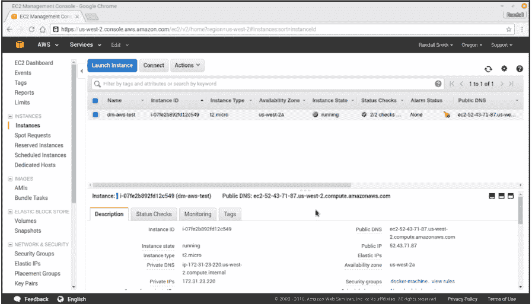
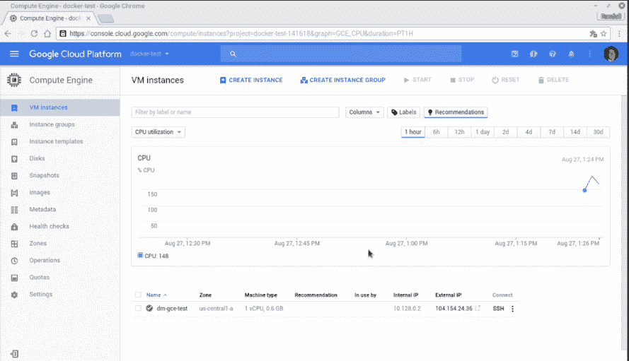
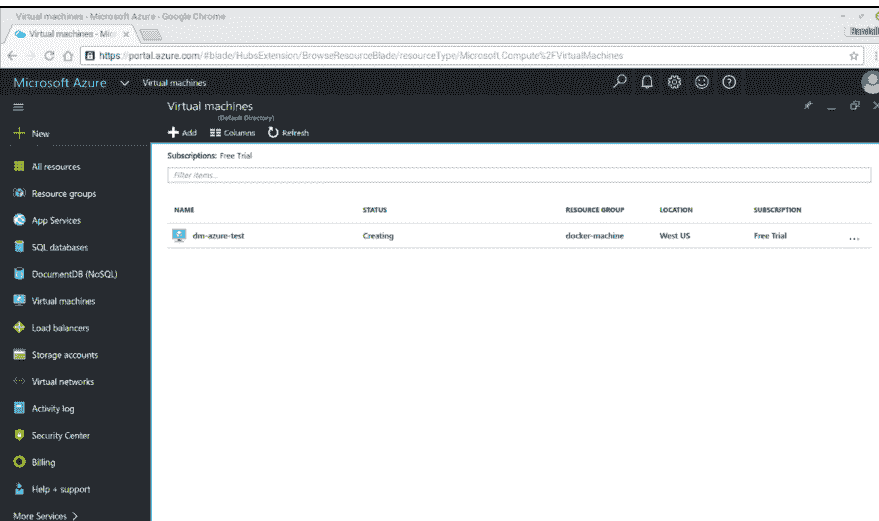
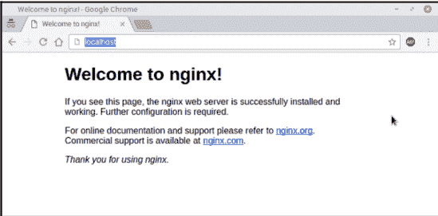

# Docker 编排入门

最初，互联网服务运行在硬件上，生活还算可以。为了扩展服务以处理峰值容量，需要购买足够的硬件来处理负载。当不再需要负载时，硬件会闲置或未充分利用，但随时准备服务。未使用的硬件是资源的浪费。此外，由于每次新安装时我们所做的细微变化，配置漂移的威胁始终存在。

接着是虚拟机（VM），生活变得美好。VM 可以根据需要进行扩展，且不会过度。多个 VM 可以在同一硬件上运行。如果需求增加，可以在任何有空间的物理服务器上启动新的 VM。可以在更少的硬件上完成更多工作。更棒的是，需要时可以在几分钟内启动新的 VM，负载减轻时销毁它们。甚至可以将硬件外包给 Amazon、Google 和 Microsoft 等公司。因此，弹性计算诞生了。

VM 也有自身的问题。每个 VM 都需要分配额外的内存和存储空间来支持操作系统。此外，每个虚拟化平台都有自己的做事方式。与一个系统配合工作的自动化必须完全重新调整才能与另一个系统配合工作。供应商锁定成为一个问题。

然后 Docker 出现了。VM 对硬件所做的，Docker 对 VM 也同样如此。服务可以跨多个服务器甚至多个提供商启动。部署后，容器可以在几秒钟内启动，而无需承载完整 VM 的资源开销。更棒的是，在 Docker 中开发的应用程序可以以构建时完全相同的方式部署，最大限度地减少配置漂移和包维护的问题。

问题是：如何实现？这个过程称为 **编排**，就像管弦乐队一样，构建一个工作集群需要多个组件。在接下来的章节中，我将展示几种将这些组件组合在一起的方法，以构建可扩展、可靠的服务，并实现更快速、更一致的部署。

让我们快速回顾一下基础知识，以便大家步调一致。以下主题将被介绍：

- 了解如何在 **Amazon Web Services (AWS)**、**Google Compute Engine (GCE)**、Microsoft Azure 和使用 `docker-machine` 的通用 Linux 主机上安装 Docker Engine
- Docker 特定发行版（包括 CoreOS、RancherOS 和 Project Atomic）简介
- 使用 Docker 启动、停止和检查容器
- 管理 Docker 镜像

## 安装 Docker Engine

Docker Engine 是实际在每个 Docker 主机上运行和控制容器的进程。它是让集群工作的引擎。它提供运行和管理容器的守护进程、各种工具用于与 Docker 交互的 API，以及命令行界面。

Docker Engine 很容易使用 Docker 提供的脚本进行安装。Docker 项目建议通过 `sh` 管道下载：

```
$ wget -qO - https://get.docker.com/ | sh
```

我无法过分强调这种做法有多危险。如果 `https://www.docker.com/` 被攻破，您下载的脚本可能会攻破您的系统。相反，请将文件下载到本地并对其进行审查，以确保您对脚本的操作感到满意。审查后，您可以将其加载到本地 Web 服务器以便轻松访问，或使用 Puppet、Chef 或 Ansible 等配置管理工具将其推送出去：

```
$ wget -qO install-docker.sh https://get.docker.com/
```


查看脚本后，运行它：

```
$ sh install-docker.sh
```

运行安装脚本的用户需要是 root 用户，或具有使用 su 或 sudo 的能力。

如果你运行的是受支持的 Linux 发行版，脚本将准备你的系统并安装 Docker。安装完成后，Docker 将由本地包管理系统更新，例如 Debian 和 Ubuntu 上的 `apt` 或 CentOS 和 **红帽企业 Linux (RHEL)** 上的 `yum`。`install` 命令会启动 Docker 并将其配置为随系统启动。

受支持的操作系统、发行版和云提供商列表位于 https://docs.docker.com/engine/installation/。

默认情况下，任何在本地使用 Docker 的人都需要 root 权限。你可以通过将其添加到由安装包创建的 `docker` 组来更改这一点。他们将能够在下次登录后无需 root 即可使用 Docker。

## 使用 Docker Machine 进行安装

Docker 提供了一个非常实用的工具，用于便利地在各种云服务和 Linux 主机上部署和管理 Docker 主机，该工具名为 **Docker Machine**。Docker Machine 作为 Docker Toolbox 的一部分安装，但也可以单独安装。完整说明可在 https://github.com/docker/machine/releases/ 中找到。

Docker Machine 支持许多不同的云服务，包括 AWS、Microsoft Azure 和 GCE。它还可以配置为连接到任何现有的受支持 Linux 服务器。`docker-machine` 使用的驱动程序由 `--driver` 标志定义。每个驱动程序都有自己特定的标志，用于控制 `docker-machine` 与服务的交互方式。

### 在 AWS 上启动主机

AWS 是运行 Docker 主机的绝佳方式，而 `docker-machine` 使启动和管理它们变得容易。你可以使用 **弹性负载均衡 (ELB)** 将流量发送到特定主机上运行的容器，或在多个主机之间进行负载均衡。

首先，你需要从 AWS 获取访问凭据。有几种使用方式。首先，你可以在运行 docker-machine 时将其包含在命令行中：

```
$ docker-machine create --driver amazonec2 --amazonec2-access-key AK*** --amazonec2-secret-key DM*** ...
```

其次，你可以将其添加到 ~/.aws/credentials。将凭据放在凭据文件中意味着你每次使用 docker-machine 处理 AWS 时都不需要在命令行中包含它们。它还可以使你的凭据不出现在命令行和进程列表中。以下示例将假设你已创建凭据文件，以避免命令行混乱：

```
[default]
aws_access_key_id = AK***
aws_secret_access_key = DM***
```

使用 create 子命令创建新的 Docker 主机。你可以使用 --amazonec2-region 标志指定区域。默认情况下，主机将在 us-east-1 区域启动。命令行上的最后一项是实例名称，本例中为 dm-aws-test：

```
$ docker-machine create --driver amazonec2 --amazonec2-region us-west-2 dm-aws-test
Creating CA: /home/user/.docker/machine/certs/ca.pem
Creating client certificate:
/home/user/.docker/machine/certs/cert.pem
Running pre-create checks...
Creating machine...
(dm-aws-test) Launching instance...
Waiting for machine to be running, this may take a few minutes...
Detecting operating system of created instance...
Waiting for SSH to be available...
Detecting the provisioner...
Provisioning with ubuntu(systemd)...
Installing Docker...
Copying certs to the local machine directory...
Copying certs to the remote machine...
Setting Docker configuration on the remote daemon...
Checking connection to Docker...
Docker is up and running!
To see how to connect your Docker Client to the Docker Engine running on
this virtual machine, run: docker-machine env dm-aws-test
```



该命令运行需要几分钟，但完成后，你将拥有一个功能齐全的 Docker 主机，准备好运行容器。`ls` 子命令将显示 `docker-machine` 知道的所有主机：

```
$ docker-machine ls
NAME                ACTIVE   DRIVER       STATE     URL                         SWARM
DOCKER              ERRORS
dm-aws-test         -        amazonec2    Running   tcp://52.43.71.87:2376
                        v1.12.1
```

主机的 IP 地址列在 `docker-machine ls` 的输出中，但你也可以通过运行 `docker-machine ip` 获取它。要开始使用新主机，请通过运行 `eval $(docker-machine env dm-aws-test)` 设置环境。现在当你运行 Docker 时，它将与运行在 AWS 上的实例通信。甚至可以使用 `docker-machine` 通过 `ssh` 登录到服务器：

```
$ docker-machine ssh dm-aws-test
Welcome to Ubuntu 15.10 (GNU/Linux 4.2.0-18-generic x86_64)

 * Documentation:  https://help.ubuntu.com/
 Get cloud support with Ubuntu Advantage Cloud Guest:
 http://www.ubuntu.com/business/services/cloud

New release '16.04.1 LTS' available.
Run 'do-release-upgrade' to upgrade to it.
```

```
*** System restart required ***
ubuntu@dm-aws-test:~$
```

使用完实例后，可以使用 docker-machine stop 停止它，并使用 docker-machine rm 删除它：

```
$ docker-machine stop dm-aws-test
Stopping "dm-aws-test" ...
Machine "dm-aws-test" was stopped.
```

```
$ docker-machine rm dm-aws-test
About to remove dm-aws-test
Are you sure? (y/n): y
Successfully removed dm-aws-test
```

> 可以向 docker-machine create 传递多个选项，包括用于使用自定义 AMI、实例类型或卷大小的选项。完整文档可在 https://docs.docker.com/machine/drivers/aws/ 中找到。

### 在 GCE 上启动主机

GCE 是云计算领域的另一大参与者。其 API 使在 Google 高性能基础架构上启动新主机变得非常容易。如果你已经在使用其他 Google Cloud 服务，Google 托管 Docker 主机是一个绝佳选择。

你需要在 GCE 为容器创建一个项目。身份验证通过 Google 应用程序默认凭据 (ADC) 进行。这意味着如果你在 GCE 主机上运行 docker-machine，身份验证将自动进行。如果你从自己的计算机运行 docker-machine，则需要使用 gcloud 工具进行身份验证。gcloud 工具需要 Python 2.7，可从以下网站下载：https://cloud.google.com/sdk/。

```
$ gcloud auth login
```

gcloud 工具将打开一个网页浏览器以使用 OAuth 2 进行身份验证。选择你的帐户，然后在下一页点击 Allow。你将被重定向到显示已通过身份验证的页面。现在，进入有趣的部分：

```
$ docker-machine create --driver google \
--google-project docker-test-141618 \
--google-machine-type f1-micro \
dm-gce-test
```



完成所需时间取决于你选择的映像大小，可能需要几分钟。完成后，你将拥有一个在 GCE 上运行的 Docker 主机。现在，你可以像之前在 AWS 上一样使用 ls、ssh 和 ip 子命令。完成后，运行 docker-machine stop 和 docker-machine rm 来停止和删除映像。

> 可以向 docker-machine 传递多个选项，包括用于设置区域、映像和机器时间的选项。完整文档可在 https://docs.docker.com/machine/drivers/gce/ 中找到。

### 在 Microsoft Azure 上启动主机

Microsoft 是云服务领域相对较新的参与者，但他们构建了一项令人印象深刻的服务。Azure 支撑着多个大型系统，包括 Xbox Live。

Azure 使用订阅 ID 进行身份验证。你将获得一个访问代码，并被引导到 https://aka.ms/device/login 输入它。选择 Continue，选择你的帐户，然后点击 Accept。完成后，可以关闭浏览器窗口：

```
$ docker-machine create --driver azure --azure-subscription-id 30*** dm-azure-test
```



同样，完成需要一些时间。完成后，你将能够在新主机上运行容器。一如既往，你可以使用 docker-machine 管理新主机。在 Azure 上删除主机时，输出中有一条重要通知。值得确保一切都已清理干净：

```
$ docker-machine rm dm-azure-test
About to remove dm-azure-test
Are you sure? (y/n): y
(dm-azure-test) NOTICE: Please check Azure portal/CLI to make sure you have no
leftover resources to avoid unexpected charges.
(dm-azure-test) Removing Virtual Machine resource. name="dm-azure-test"
(dm-azure-test) Removing Network Interface resource. name="dm-azure-test-nic"
(dm-azure-test) Removing Public IP resource. name="dm-azure-test-ip"
(dm-azure-test) Removing Network Security Group resource.
```


```
name="dm-azure-test-firewall"
(dm-azure-test) Attempting to clean up Availability Set resource...
name="docker-machine"
(dm-azure-test) Removing Availability Set resource... name="docker-machine"
(dm-azure-test) Attempting to clean up Subnet resource... name="docker-machine"
(dm-azure-test) Removing Subnet resource... name="docker-machine"
(dm-azure-test) Attempting to clean up Virtual Network resource...
name="docker-machine-vnet"
(dm-azure-test) Removing Virtual Network resource... name="docker-machine-vnet"
Successfully removed dm-azure-test
```

> Azure 驱动程序有许多选项，包括用于选择镜像、VM 大小、位置，甚至主机上需要开放哪些端口的选项。有关完整文档，请参阅 https://docs.docker.com/machine/drivers/azure/。

## 在运行 Linux 的主机上安装

你也可以使用 docker-machine 的通用驱动程序在运行受支持 Linux 发行版的现有主机上安装和管理 Docker。需要牢记几点。首先，主机必须已经在运行。Docker 可以预先安装。如果你正在将 Docker 安装作为主机构建过程的一部分，这很有用。其次，如果 Docker 正在运行，它将被重新启动。这意味着任何正在运行的容器都会被停止。第三，你需要已有 SSH 密钥对。

以下命令将使用 SSH 通过 --generic-ssh-key 标识的密钥和使用 --generic-ssh-user 设置的用户，连接到由 --generic-ip-address 标志指定的服务器。对于 SSH 用户，有两点需要牢记。首先，用户必须能够在不提示密码的情况下使用 sudo。其次，公钥必须位于用户 $HOME/.ssh/ 目录中的 authorized_keys 文件中：

```
$ docker-machine create --driver generic --generic-ip-address 52.40.113.7 --generic-ssh-key ~/.ssh/id_rsa --generic-ssh-user ubuntu dm-ubuntu-test
```

此过程需要几分钟时间。它将比云服务上的创建更快，因为那些服务也需要预配置 VM。完成后，你可以使用 docker-machine 管理主机并开始运行容器。

通用驱动程序与其他云驱动程序之间的唯一区别是 `stop` 子命令不起作用。这意味着停止通用 Docker 主机必须在主机上完成。

完整文档可在此处找到：
https://docs.docker.com/machine/drivers/generic/.

## 介绍 Docker 特定的发行版

使用 Docker 运行服务的一大好处是服务器发行版不再重要。如果你的应用程序需要 CentOS 工具，它可以在基于 CentOS 的容器中运行。Ubuntu 也是如此。事实上，基于不同发行版的容器中的服务可以并排运行而不会出现问题。这促使人们推动非常精简的、Docker 特定的发行版。

这些发行版只有一个目的：运行 Docker 容器。因此，它们非常小巧，且开箱即用的功能非常有限。这对云端管理人员来说是巨大的好处。工具越少，更新越少，正常运行时间越长。这也意味着主机 OS 的攻击面要小得多，从而为你提供更大的安全性。

他们对 Docker 的关注是一大优势，但也可能成为弱点。如果你需要主机上不可用的特定内容，可能会发现自己遇到了困难。积极的一面是，许多默认安装中可能不可用的工具可以从容器中运行。

### CoreOS

CoreOS (https://coreos.com) 是最早的 Docker 特定发行版之一。此后，他们启动了名为 **rkt** 的自有容器项目，但仍然包含 Docker。它在所有主要云提供商上都受支持，包括 Amazon EC2、Microsoft Azure 和 GCE，并可以在裸机或本地云环境中本地安装。

CoreOS 使用 Google 在其 Chromebook 上用于管理更新的同一系统。如果更新导致问题，可以轻松回滚到之前的版本。这可以帮助你维护稳定可靠的服务。

CoreOS 旨在自动更新系统，这一点非常独特。其理念是自动更新操作系统是维护基础设施安全性的最佳方式。默认情况下，此过程可以配置为确保 CoreOS 集群中同一时间只有一个主机在重新启动。它还可以配置为仅在维护窗口期间更新或完全关闭。在决定手动关闭之前，请记住，配置得当的编排系统即使在运行服务的主机正在重新启动时，也会保持服务运行。

CoreOS 包含 Docker 但未启用它。CoreOS 文档中的以下示例展示了如何在引导时启用 Docker。这是通过 cloud-init 创建新的 systemd 单元文件来完成的。在 AWS 上，此内容放置在用户数据实例配置中：

```
#cloud-config

coreos:
  units:
    - name: docker-tcp.socket
      command: start
      enable: true
      content: |
        [Unit]
        Description=Docker Socket for the API

        [Socket]
        ListenStream=2375
        BindIPv6Only=both
        Service=docker.service

        [Install]
        WantedBy=sockets.target
```

CoreOS 使用默认 core 用户。可以通过 cloud-config 文件添加用户：

```
#cloud-config
users:
  - name: "demo"
    passwd: "$6$HpqJOCs8XahT$mSgRYAn..."
    groups:
    - "sudo"
    - "docker"
```

还可以使用 `users` 块中的 `ssh-authorized-keys` 选项添加 SSH 密钥。可以为每个用户添加任意数量的密钥：

```
#cloud-config
users:
- default
- name: "demo"
  ssh-authorized-keys:
- "ssh-rsa AAAAB3Nz..."
```

CoreOS 还支持 `sssd` 用于针对 LDAP 和 **活动目录 (AD)** 进行身份验证。与 Docker 类似，它通过 `cloud-config` 启用：

```
#cloud-config
coreos:
units:
- name: "sssd.service"
command: "start"
enable: true
```

`sssd` 的配置位于 `/etc/sssd/sssd.conf`。与 CoreOS 的其他部分一样，配置可以添加到 `cloud-config`：

```
#cloud-config
write_files:
- path: "/etc/sssd/sssd.conf"
permissions: "0644"
owner: "root"
content: |
config_file_version = 2
...
```

> `sssd` 的完整配置超出了本书的范围。完整文档位于以下网站：
> https://jhrozek.fedorapeople.org/sssd/1.13.1/man/sssd.conf.5.html

### RancherOS

Rancher (http://rancher.com) 是从头开始设计用于运行 Docker 容器的。它支持多种编排工具，包括 Kubernetes、Mesos 和 Docker Swarm。有可用于安装到硬件的 ISO 以及适用于 Amazon EC2、GCE 或 OpenStack 的镜像。你甚至可以在 Raspberry Pi 上安装 RancherOS！

RancherOS 非常独特；即使是系统工具也在 Docker 中运行。因此，管理员可以选择适合其习惯的控制台。支持的控制台包括 CentOS、Debian、Fedora、Ubuntu 或默认的基于 BusyBox 的控制台。

Rancher 提供了一个非常友好的 Web 界面来管理容器和集群。它还使运行多个环境（包括多种编排工具套件）变得容易。Rancher 将在第 7 章“使用更简单的编排工具 – Fleet 和 Cattle”中详细介绍。

`cloud-init` 软件包用于配置 RancherOS。你可以将其配置为在引导时启动容器、格式化持久磁盘或执行各种其他酷炫操作。它无法做的一件事是添加其他用户。其理念是，一旦 Docker 安装并配置完成，很少有理由登录到主机。但是，你可以向默认 rancher 用户添加 SSH 密钥，以允许不同用户进行唯一登录：

```
#cloud-config
ssh_authorized_keys:
- ssh-rsa AAAAB3Nz...
```

如果需要向 Docker 添加选项，请使用 `cloud-init` 设置：

```
#cloud-config
rancher:
docker:
args: [daemon, ...]
```

### Project Atomic / RHEL Atomic

Project Atomic (http://projectatomic.io) 起源于 Fedora 项目，但现在支持 CentOS、Fedora 和 RHEL。适用于 Linux KVM 和基于 Xen 的虚拟化平台以及 Amazon EC2 和裸机安装的镜像均可用。

它使用 OSTree 和 `rpm-OSTree` 来提供原子更新。换句话说，每个包都会在同一时间、以一个整体进行更新。你不必担心某个包的更新失败会导致系统保留较旧的包。它还提供了在更新导致问题时轻松回滚的功能。

Project Atomic 预装了 Docker 和 Kubernetes。（Kubernetes 在第 5 章“使用 Kubernetes 部署和管理服务”中有详细介绍。）这使其成为基于 Kubernetes 的集群的理想基础。添加 SELinux 增加了额外的安全级别，以防正在运行的容器被攻破。


使用 cloud-init，几乎可以在任何本地云系统或 EC2 上更轻松地进行部署。cloud-init 软件包可让你在引导时自动配置 Atomic 主机，从而即时扩展你的 Kubernetes 集群。

你可以使用 cloud-init 为默认用户设置密码并启用 SSH 登录：

```
#cloud-config
password: c001-pa$$word
ssh_pwauth: True
```

你还可以将 SSH 密钥添加到默认用户的 authorized_keys 文件中：

```
#cloud-config
ssh_authorized_keys:
  - ssh-rsa AAAAB3Nz...
  - ssh-rsa AAAAB3Nz...
```

> 默认用户的名称取决于你使用的 Atomic 版本。对于 Fedora，用户名是 fedora，对于 CentOS 它是 centos，而对于 RHEL 它是 cloud-user。

## 运行单容器应用程序

在深入了解 Docker 编排的细节之前，让我们先快速了解在 Docker 中运行单个应用程序的基础知识。鉴于这是一本技术书籍，第一个示例总是 Hello World 的某个变体，本例也不例外。

> 默认情况下，docker 必须以 root 用户身份运行或使用 sudo。或者，你可以将用户添加到 docker 组，从而在无需 root 权限的情况下运行容器。

```
$ docker run --rm ubuntu echo "Hello World"
```

这个示例非常简单。它会下载 ubuntu Docker 镜像，并使用该镜像来运行 echo "Hello World" 命令。简单，对吧？在深入编排之前，你实际上需要了解这里发生了很多事情。

首先，请注意该命令中 `ubuntu` 这个词。它告诉 Docker 你想要使用 `ubuntu` 镜像。默认情况下，Docker 将从 Docker Hub 下载镜像。有大量的镜像，大部分由社区上传，但也有多个项目的官方镜像，其中 `ubuntu` 就是其中之一。这些镜像几乎可以作为任何应用程序的基础。

其次，请特别注意 `--rm` 标志。当 `docker` 运行时，它会为容器创建一个包含对基础镜像的任何更改的镜像。只要容器存在，这些更改就会保留，即使容器已停止。`--rm` 标志告诉 `docker` 在容器停止运行后立即删除容器及其镜像。当你开始使用编排工具自动化容器时，通常会希望在容器停止时将其删除。我将在下一部分中详细说明。

最后，来看看 `echo` 命令。没错，它确实是一个 `echo` 命令，并且会输出 `Hello World`，这正如你所预期的。这里有两个重要点。首先，该命令可以是镜像中的任何内容，其次，它必须存在于镜像中。例如，如果你尝试在该命令中运行 `nginx`，Docker 会抛出类似于以下内容的错误：

```
$ sudo docker run --rm ubuntu nginx
exec: "nginx": executable file not found in $PATH
Error response from daemon: Cannot start container
821fcd4e8ae76668d8c508190b338e166247dc46cb6bc2582731566e7f2c705a: [8]
System error: exec: "nginx": executable file not found in $PATH
```

“Hello World” 示例固然不错，但如果你想做一些真正有用的事情怎么办？引用旧 iPhone 广告的话；_“有相应的应用”_。Docker Hub 上有许多官方应用程序可用。让我们继续使用 `nginx` 并启动一个运行 `nginx` 的容器来提供一个简单的网站：

```
$ docker run --rm -p 80:80 --name nginx nginx
```

此命令基于 `nginx` 镜像启动一个新容器，在需要时下载该镜像，并指示 `docker` 将 TCP 端口 80 转发到镜像中的端口 80。现在你可以访问 `http://localhost` 并看到一个非常欢迎的网站：



欢迎人们使用 Nginx 固然不错，但显然，你会想做更多事情。这将在 *第 2 章：使用 Docker Compose 构建多容器应用程序* 中更详细地介绍。目前，默认设置就足够了。

如果你运行前面的示例，会发现控制台似乎挂起了。这是因为 `docker` 在前台启动进程。你看到的 `nginx` 正在等待请求。如果你访问 `http://localhost`，则应该看到 `nginx` 访问日志中的消息打印到控制台。另一个选择是向 `run` 命令添加 `-d`。这将使进程从控制台分离：

```
$ docker run -d -p 80:80 --name nginx nginx
```

> `-d` 和 `--rm` 选项是互斥的。

停止容器有多种方法。第一种方法是结束容器中运行的进程。对于短期运行的进程，这会自动发生。在启动前面示例中类似 `nginx` 的容器时，在会话中按下 `Ctrl + C` 将停止 `nginx` 和容器。另一种方法是使用 `docker stop`。它需要容器的镜像 ID 或名称。例如，要停止先前启动的容器，你可以运行 `docker stop nginx`。

让我们花点时间来看看 Docker 如何处理远程镜像。请记住，当你第一次使用 `ubuntu` 或 `nginx` 镜像运行 `docker run` 时，`docker` 必须先从 Docker Hub 下载镜像。当你再次运行它们时，Docker 将使用已下载的镜像。你可以使用 `docker images` 命令查看 Docker 知道的镜像：

| 仓库 | 标签 | 镜像 ID | 创建时间 | 虚拟大小 |
|---|---|---|---|---|
| ubuntu | latest | ae81bbda2b6c | 5 小时前 | 126.6 MB |
| nginx | latest | bfdd4ced794e | 3 天前 | 183.4 MB |

可以使用 `docker rmi` 命令删除不需要的镜像：

```
$ docker rmi ubuntu
```

哎呀！如果你删除了一个镜像但仍然需要它，该怎么办？你有两个选择。首先，你可以运行一个使用该镜像的容器。这可行，但如果运行容器会更改数据或与正在运行的某个内容冲突，则可能会比较麻烦。幸运的是，有 `docker pull` 命令：

```
$ docker pull ubuntu
```

此命令将从 Docker Hub 上的仓库拉取 `ubuntu` 镜像的默认版本。可以通过在命令中指定特定版本来拉取特定版本：

```
$ docker pull ubuntu:trusty
```

`docker pull` 也用于更新之前下载的镜像。例如，`ubuntu` 镜像会定期更新安全修复和其他补丁。如果你不拉取更新，主机上的 `docker` 将继续使用旧镜像。只需再次运行 `docker pull` 命令，任何镜像更新都将被下载。

让我们快速跑个偏，并考虑当你开始编排 Docker 时，这对你的主机意味着什么。除非你或你的工具更新主机上的镜像，否则你会发现一些主机在运行旧镜像，而另一些主机在运行崭新的镜像。这可能会使你的系统面临间歇性故障或安全漏洞。大多数现代工具会为你处理此问题，或者至少提供强制在部署前拉取的选项。其他工具可能不会，在查看编排工具和策略时请牢记这一点。

### 正在运行什么？

到了某个时刻，你会想查看特定主机上正在运行哪些容器。你的编排工具会对此提供帮助，但有时你需要直接从源头入手来排查问题。为此，有 `docker ps` 命令。为了演示，启动几个容器：

```
$ for i in {1..4}; do docker run -d --name nginx$i nginx ; done
```

现在运行 `docker ps`：

```
$ sudo docker ps
CONTAINER ID        IMAGE               COMMAND                  CREATED             STATUS                         PORTS               NAMES
e5b302217aeb        nginx             "nginx -g 'daemon off"   About a minute ago   Up About a minute              80/tcp, 443/tcp     nginx4
dc9d9e1e1228        nginx             "nginx -g 'daemon off"   About a minute ago   Up About a minute              80/tcp, 443/tcp     nginx3
6009967479fc        nginx             "nginx -g 'daemon off"   About a minute ago   Up About a minute              80/tcp, 443/tcp     nginx2
67ac8125983c        nginx             "nginx -g 'daemon off"   About a minute ago   Up About a minute              80/tcp, 443/tcp     nginx1
```

你应该能看到刚刚启动的容器以及任何其他正在运行的容器。如果你停止容器，它们将从 `docker ps` 中消失：

```
$ for i in {1..4}; do docker stop nginx$i ; done
nginx1
nginx2
nginx3
nginx4
```

如你所见，如果你运行 `docker ps`，容器就不见了：

```
$ docker ps
CONTAINER ID        IMAGE               COMMAND             CREATED             STATUS              PORTS               NAMES
```

但是，由于未使用 `--rm` 标志，`docker` 仍然知道它们并且可以重新启动它们：

```
$ docker ps -a
CONTAINER ID        IMAGE               COMMAND                  CREATED             STATUS                     PORTS               NAMES
e5b302217aeb        nginx             "nginx -g 'daemon off"   3 minutes ago       Exited (0) About a minute ago                        nginx4
dc9d9e1e1228        nginx             "nginx -g 'daemon off"   3 minutes ago                          nginx3
```


minutes ago       Exited (0) About a minute ago
nginx3
6009967479fc      nginx   "nginx -g 'daemon off'"   3
minutes ago       Exited (0) About a minute ago
nginx2
67ac8125983c      nginx   "nginx -g 'daemon off'"   3
minutes ago       Exited (0) About a minute ago
nginx1

这些都是已停止的 nginx 容器。`docker rm` 命令将删除这些容器：

```
$ for i in {1..4}; do docker rm nginx$i ; done
nginx1
nginx2
nginx3
nginx4
```

Until a container is removed, all the data is still available. You can restart the container and it will chug along quite happily with whatever data existed when the container was stopped. Once the container is removed, all the data within that container is removed right along with it. In many cases, you might not care but, in others, that data might be important. How you deal with that data will be an important part of planning out your orchestration system. In Chapter 3, Cluster Building Blocks – Registry, Overlay Networks, and Shared Storage, I will show you how you can move your data into shared storage to keep it safe.

移除容器之前，所有数据仍然可用。你可以重新启动容器，它会非常愉快地继续运行，使用容器停止时存在的任何数据。一旦容器被移除，容器内的所有数据也会随之删除。在许多情况下，你可能不在乎，但在其他情况下，这些数据可能很重要。你如何处理这些数据将是规划编排系统的重要部分。在第 3 章“集群构建模块 – 注册表、覆盖网络和共享存储”中，我将向你展示如何将数据移入共享存储以保持其安全。

## 检查你的容器

There comes a time in the life of anyone working with containers when you will need to jump into a running container and see what is going on. Fortunately, Docker has just the tool for you in the form of docker exec. The exec subcommand takes two arguments, the name of the container, and the command to run:

在使用容器的任何人的职业生涯中，总会有一天你需要进入正在运行的容器查看发生了什么。幸运的是，Docker 正好有你需要的工具，即 `docker exec`。exec 子命令接受两个参数：容器名称和要运行的命令：

```
$ docker exec -it nginx bash
```

I slipped an option in there that is important if you are starting an interactive process. The --it option tells Docker that you have an interactive process and that you want a new TTY. This is essential if you want to start a shell:

我在那里加入了一个选项，如果你要启动交互式进程，这个选项很重要。`--it` 选项告诉 Docker 你有一个交互式进程，并且你想要一个新的 TTY。如果你想启动一个 shell，这是必不可少的：

```
$ sudo docker exec -it nginx bash
root@fd8533fa2eda:/# ps ax
PID TTY          STAT TIME COMMAND
1 ?        Ss     0:00 nginx: master process nginx -g daemon off;
6 ? S 0:00 nginx: worker process
13 ? Ss 0:00 bash
18 ? R+ 0:00 ps ax
root@fd8533fa2eda:/# exit
```

In the preceding example, I connected to the container and ran `ps ax` to see every process that the container knew about. Getting a shell in the container can be invaluable when debugging. You can verify that files were added correctly or that internal scripts are properly handling environment variables passed in through `docker`.

在前面的示例中，我连接到容器并运行了 `ps ax` 以查看容器所知的每个进程。在容器中获得 shell 在调试时非常有价值。你可以验证文件是否正确添加，或者内部脚本是否正在正确处理通过 `docker` 传递的环境变量。

It's also possible to run non-interactive programs. Let's use the same `ps` example as earlier:

也可以运行非交互式程序。让我们使用与之前相同的 `ps` 示例：

```
$ sudo docker exec nginx ps ax
PID TTY STAT TIME COMMAND
1 ? Ss 0:00 nginx: master process nginx -g daemon off;
6 ? S 0:00 nginx: worker process
19 ? Rs 0:00 ps ax
```

As you might expect, there's not much to see here, but it should give you an idea of what is possible. I often use them when debugging and I do not need a full shell.

如你所料，这里没什么可看的，但它应该能让你了解可能的情况。我在调试时经常使用它们，而不需要一个完整的 shell。

## Summary

In this chapter you have learned the basics of using Docker. You saw how to quickly install Docker on AWS, GCE, Azure, and a generic Linux host. You were introduced to a few Docker-specific distributions and saw a little bit of how to configure them. Finally, we reviewed the basics of using the `docker` command. In the next chapter, I will walk you through using Docker Compose to build new single and multi-container applications.

## 总结

在本章中，你学习了使用 Docker 的基础知识。你了解了如何在 AWS、GCE、Azure 和通用 Linux 主机上快速安装 Docker。你被介绍了几个 Docker 特定的发行版，并了解了一点如何配置它们。最后，我们回顾了使用 `docker` 命令的基础知识。在下一章中，我将指导你使用 Docker Compose 构建新的单容器和多容器应用程序。

# Building Multi-Container Applications with Docker Compose

Modern applications have a lot of moving parts. A web application almost always uses a database such as MySQL or MongoDB to store data. There may be a load balancer or SSL proxy. Often there are tasks scheduled to run regularly that perform routine maintenance or backups. On a traditional server, these tasks might all be installed on a single server or spread across numerous hosts. The challenge faced by system administrators is how are all these parts deployed consistently and reliably?
