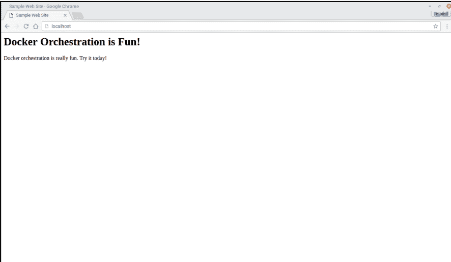

# 使用 Docker Compose 构建多容器应用程序

现代应用程序有很多活动部件。Web 应用程序几乎总是使用 MySQL 或 MongoDB 等数据库来存储数据。可能有负载均衡器或 SSL 代理。通常会有定期运行的任务来执行例行维护或备份。在传统服务器上，这些任务可能全部安装在一台服务器上，或分布在许多主机上。系统管理员面临的挑战是如何以一致且可靠的方式部署所有这些部件？

Rather than having a single container that does everything, you can split your application into smaller chunks. Each container has a specific task and does only that task. For example, you might have one image that is a Perl-based web application; a second that runs MySQL; a third that runs HAProxy to load balance and provide SSL termination for the Perl application. Each separate container can be run, upgraded, and tested independent of each other. Your developers can work on the web code all they want, and you do not have to worry about what they might do to your database install.

与其有一个什么都做的单个容器，不如将你的应用程序拆分成更小的块。每个容器都有一个特定任务并且只执行该任务。例如，你可能有一个是基于 Perl 的 Web 应用程序的镜像；第二个运行 MySQL；第三个运行 HAProxy 来为 Perl 应用程序提供负载均衡和 SSL 终止。每个独立容器可以相互独立地运行、升级和测试。你的开发人员可以随心所欲地处理 Web 代码，而你不必担心他们可能对你的数据库安装做什么。

This chapter will show you how that is done. The process starts with a single image, defined by a `Dockerfile`. It then proceeds to build a small multi-container application using both custom images and images from the Docker Hub. Along the way, you will see how to use Docker Compose to define your application; how networks can be used to isolate your data; and how volumes can keep your data safe.

本章将向你展示如何做到这一点。该过程从一个由 `Dockerfile` 定义的单个镜像开始。然后继续使用自定义镜像和来自 Docker Hub 的镜像构建一个小型多容器应用程序。在此过程中，你将了解如何使用 Docker Compose 定义你的应用程序；如何使用网络隔离你的数据；以及如何使用卷保持数据安全。

The following topics will be covered in this chapter:

本章将涵盖以下主题：

- Building an image from a `Dockerfile` with Docker Engine
- Installing Docker Compose
- Using Docker Compose to build single and multi-container applications
- Using environment files to change how your application runs
- Extending Docker Compose files
- Controlling the container start order
- Using named networks for data isolation
- Using volumes for data persistence

- 使用 Docker Engine 从 `Dockerfile` 构建镜像
- 安装 Docker Compose
- 使用 Docker Compose 构建单容器和多容器应用程序
- 使用环境文件更改应用程序的运行方式
- 扩展 Docker Compose 文件
- 控制容器启动顺序
- 使用命名网络进行数据隔离
- 使用卷实现数据持久化

## Building an image with Docker Engine

They say the longest journey begins with a single step. In this case, an application begins with a single image. More often than not, existing images will not be perfect fits. This will certainly be the case if you are deploying your own services.

## 使用 Docker Engine 构建镜像

话说最长的旅程始于第一步。在此情况下，应用程序始于一个单一镜像。更多时候，现有镜像并不完全合适。如果你在部署自己的服务，情况肯定就是这样。

It all starts with a `Dockerfile`. This file provides detailed instructions to Docker for building an image. There are a lot of things that can be done in a `Dockerfile`. Specific operating system packages or language libraries can be installed; configuration files can be put into place; and a default command can be set. It is best to base a new image for an application off an official image, when possible. For example, an application written in Ruby should be based off of the official `ruby` image. A full reference of the `Dockerfile` directives can be found at https://docs.docker.com/engine/reference/builder/.

一切都始于 `Dockerfile`。此文件为构建镜像向 Docker 提供详细指令。在 `Dockerfile` 中可以完成很多事情：可以安装特定的操作系统软件包或语言库；可以放置配置文件；还可以设置默认命令。尽可能在可能时，基于官方镜像为应用程序构建新镜像是最佳选择。例如，用 Ruby 编写的应用程序应基于官方 `ruby` 镜像。`Dockerfile` 指令的完整参考可在 https://docs.docker.com/engine/reference/builder/ 找到。

## Building from a Dockerfile

Back in Chapter 1, Getting Started with Docker Orchestration, we started with a container that ran Nginx and displayed the default welcome page. This time, let us add a custom website to the container. Start by creating an empty directory somewhere. In that directory, download the examples from the GitLab repository for this book:

## 从 Dockerfile 构建

回到第 1 章“开始使用 Docker 编排”，我们使用了一个运行 Nginx 并显示默认欢迎页面的容器。这次，让我们向容器添加一个自定义网站。首先在某处创建一个空目录。在该目录中，下载本书的 GitLab 仓库中的示例：

```
$ git clone https://gitlab.com/perlstalker/docker-orchestration-examples
$ cd docker-orchestration-examples/ch02
```

Then, create a file named `Dockerfile` with the following content:

然后，创建一个名为 `Dockerfile` 的文件，内容如下：

```
FROM nginx:1.10
COPY sample-website /usr/share/nginx/html
```

This is a simple file but there are two important pieces here. First is the FROM command, which tells Docker that your container extends the nginx image that was used before. Basing your custom images on the existing images can save a lot of time and hassle. They may not be perfect out of the box but often it only takes a few changes to get what you need.

这是一个简单的文件，但这里有两个重要部分。第一个是 FROM 命令，它告诉 Docker 你的容器扩展了之前使用的 nginx 镜像。将自定义镜像基于现有镜像可以节省大量时间和麻烦。它们开箱即用可能并不完美，但通常只需做一些更改就能得到你需要的东西。

Second, there is the ADD command. The nginx container uses /usr/share/nginx/html within the container as the document root. The ADD command places the content of the website directory in /usr/share/nginx/html when the container is built.

第二个是 ADD 命令。nginx 容器在容器内使用 /usr/share/nginx/html 作为文档根目录。ADD 命令在构建容器时将网站目录的内容放入 /usr/share/nginx/html。

The ADD command can add single files, directories, or tarballs. The TAR files will be unpacked in the directory that you specify. The TAR file can be compressed with gzip, bzip2, or xz. The ADD command can also take a URL. The file pointed to by ADD will be downloaded and placed in the given directory in your image. A tarball added via URL will not be unpacked.

ADD 命令可以添加单个文件、目录或 tarball。TAR 文件将在你指定的目录中解包。TAR 文件可以用 gzip、bzip2 或 xz 压缩。ADD 命令还可以接受 URL。ADD 指向的文件将被下载并放置在镜像中的给定目录。通过 URL 添加的 tarball 不会被解包。

In addition to the ADD command, there is a command called COPY. It simply adds the given files or directories with any of the automated unpacking that ADD does. The COPY command is preferred when adding simple files or directories to an image.

除了 ADD 命令，还有一个名为 COPY 的命令。它只是添加给定的文件或目录，而不执行 ADD 所做的任何自动解包。当将简单文件或目录添加到镜像时，COPY 命令更受推荐。

Now, it is time to build the container. Change to the directory with your Dockerfile and website directory and run docker build. When the build completes, you will have an image named website ready to use with docker run:

现在是构建容器的时候了。切换到包含 Dockerfile 和网站目录的目录，然后运行 docker build。构建完成后，你将拥有一个名为 website 的镜像，可以与 docker run 一起使用：

```
$ docker build -t website .
```

## Tagging the image

## 为镜像打标签

The -t flag allows you to give your image a name. The name may include a : followed by a tag. The most common way of using this is as a version number. It might also be a date, Git tag, or something else that makes sense in your environment. For example, the official ubuntu image has tags for releases such as ubuntu:trusty or ubuntu:xenial, which refer to the appropriate Ubuntu release:

-t 标志允许你为镜像命名。名称可以包含一个跟随标签的 :。最常见的用法是作为版本号。它也可能是日期、Git 标签或你环境中有意义的其他东西。例如，官方 ubuntu 镜像有针对发行版（如 ubuntu:trusty 或 ubuntu:xenial）的标签，它们引用适当的 Ubuntu 发行版：

```
$ docker build -t website:0.1 .
```

Image versioning will be important going forward. At some point, you will be deploying an updated version of your service. It is possible to reuse a name and version, which may be fine while you develop the application, but different versions will make it easy to roll back to a previous, known good image in the event of a failure. It also allows you or your QA team to test an image without overwriting the image your production services are started from.

镜像版本控制在今后将非常重要。在某个时候，你将部署服务的更新版本。可以重复使用名称和版本，在开发应用程序时这可能没问题，但不同版本将使在发生故障时轻松回滚到之前已知良好的镜像。它还允许你或你的 QA 团队测试镜像，而不会覆盖生产服务启动所用的镜像。


构建镜像后，还可以为其添加其他标签。你可以把这看作是一个别名。镜像标签是识别特定状态镜像的好方法。例如，在构建网站后，你可以为其打上标签以显示它已准备好进行测试，使用 `docker tag website:testing website:0.1`。测试后，镜像可以被标记为 `website:latest` 或 `website:production`，以表明该镜像已准备好投入生产。随着每个新镜像通过开发流程，重复此过程。保持一致的镜像名称将使开发人员更容易知道下载哪个镜像。使用版本号将使更容易看到正在使用哪个版本的镜像。它还允许在新版本出现问题时轻松回滚应用程序。

### 跳过构建缓存

另一个有用的标志是 `--no-cache`。通常，Docker 会尽可能重复使用现有镜像。这会加快构建过程，但可能会导致构建出现问题。当向镜像添加软件包时，这是一个常见的示例。以这个小型 `Dockerfile` 为例。它基于最新的 Ubuntu 镜像。它只是更新 `apt` 并安装 `nginx`：

```
FROM ubuntu:16.04
RUN apt-get update
RUN apt-get -y install nginx && apt-get clean
```

由于 Docker 会缓存每个步骤，后续构建不会再运行 `apt-get update`。然后 APT 会尝试基于缓存中的内容安装 `nginx`。镜像想要安装的版本可能不再存在于镜像站中，导致安装失败。当你更改要安装的软件包列表时，这种情况最常发生。`apt-get install` 命令会被重新运行，但 `apt-get update` 不会。在这种情况下，添加 `--no-cache` 将强制 Docker 重新运行每个步骤，而不是使用缓存。

我还要指出的另一个标志是 `--pull` 标志。它告诉 Docker 下载所使用的任何镜像的较新版本。如果你想确保拥有应用了所有安全补丁的最新版本，这一点很重要。然而，这可能意味着更新的库，这可能会给你的应用程序带来问题。好消息是，通过版本化构建，你不会破坏生产环境中运行的任何内容：

```
$ docker build --no-cache --pull -t website:0.1 .
```

## 运行镜像

构建镜像后，你可以使用以下命令运行镜像来启动容器：

```
$ docker run --rm -p 80:80 website:0.1
```

这应该非常熟悉。这一次，Docker 不是运行 nginx 镜像，而是运行你新构建的镜像，其中包含示例网站。启动后，你可以在网页浏览器中打开该网站。如果容器在你的桌面上运行，请访问 http://localhost/ 查看新网站：



## 安装 Docker Compose

构建镜像后，你需要告诉 Docker 如何运行它们。Docker Engine 在定义容器如何协同工作方面存在局限性。Docker 项目提供了一个名为 Docker Compose 的解决方案。Docker Compose 是一个出色的工具，可用于测试部署、定义容器如何交互或需要什么外部存储，甚至可作为轻量级编排工具。

安装 Docker Compose 很容易。对于 Windows 和 OS X 用户，docker-compose 作为 Docker Toolbox 和 Docker for Mac and Windows 的一部分进行安装。对于 Linux 用户，docker-compose 可以从 GitHub 上的 Docker 仓库下载。Docker Compose 文档中的以下命令向你展示了如何操作：

```
### curl -L
https://github.com/docker/compose/releases/download/1.8.0  /docker-compose-
`uname -s`-`uname -m`  > /usr/local/bin/docker-compose
chmod +x /usr/local/bin/docker-compose
```

- 如所示，curl 命令必须以 root 权限运行，才有权将文件写入 /usr/local/bin。
- 编写本文档以来，版本号几乎肯定已经更改。请相应更新命令。最新版本可在 https://github.com/docker/compose/releases/ 找到。

## 编写 Docker Compose 文件

Docker Compose 文件定义了应用程序的所有内容。服务、卷、网络和依赖项都可以在同一个位置定义。该配置可以在本地用于启动开发环境，插入到现有的持续集成或持续部署系统中，甚至可以在服务器上用于启动生产服务。后续章节将展示更好的方法来管理运行中的服务。

Docker Compose 在当前目录中查找名为 `docker-compose.yml` 的文件。可以使用 `-f` 选项指定备用文件。该文件采用 YAML 格式，因此可以在任何文本编辑器中编辑。

让我们从一个非常简单的 compose 文件开始，该文件启动一个监听 80 端口的单个 nginx 容器。这相当于使用 `docker run -p 80:80 nginx` 启动的容器。`image` 的值可以是服务器或注册表上的任何镜像，就像 `docker run` 命令中一样：

```
version: '2'
services:
  web:
    image: nginx
    ports:
      - "80:80"
```

在 Docker Compose 文件中定义的应用程序使用 `docker-compose up` 命令启动。与 `docker run` 类似，你可以使用 `docker-compose` 的 `-d` 选项在后台启动应用程序：

```
$ docker-compose up -d
Starting singleservice_web_1
```

应用程序已启动并在后台运行。如果在网页浏览器中打开 http://localhost，你将看到 Nginx 欢迎页面。你可以使用 `docker ps` 查看正在运行的容器，但 `docker-compose ps` 提供了更友好的视图：

| 名称 | 命令 | 状态 | 端口 |
|---|---|---|---|
| singleservice_web_1 | nginx -g daemon off; Up 443/tcp, | 0.0.0.0:80->80/tcp | |

`singleservice` 前缀是应用程序的命名空间。默认情况下，它基于包含 `docker-compose.yml` 文件的目录名称。在你的系统上可能不同。可以通过向 `docker-compose` 传递 `-p` 标志来指定命名空间：

```
$ docker-compose -p mynamespace up
```

完成后，可以通过运行 `docker-compose stop` 停止应用程序。要停止并删除 `docker-compose` 为当前上下文创建的所有资源，请使用 `docker-compose down`。在 `docker-compose.yml` 中创建的任何卷都不会被删除：

```
$ docker-compose down
Stopping singleservice_web_1 ... done
Removing singleservice_web_1 ... done
Removing network singleservice_default
```

查看应用程序中容器的输出通常很有用。可以使用 `docker-compose logs` 命令完成此操作。添加 `-f` 标志将导致 `docker-compose` `follow` 日志并在消息出现时打印它们。

## 多容器应用程序

前一部分的示例很有趣，但与直接使用 docker 命令相比并没有真正给我们带来什么好处。大多数 Internet 应用程序都由多个部分组成。最常见的示例是从数据库加载数据的 Web 应用程序。

在 docker-orchestration-examples 仓库的 ch02/web-db 中，有一个非常简单的应用程序，它从 MySQL 加载作者和书籍列表，并在网页上显示它们。以下是定义该应用程序的 docker-compose.yml：

```
version: '2'

services:
    web:
        image: web-db:0.1
        build: .
        ports:
            - 80:5000
        env_file:
            - db.env
        entrypoint: ./start.pl --init --command shotgun
    db:
        image: mysql:5.7
        env_file:
            - db.env
```

首先要注意的是，这里定义了两个服务。第一个是 web，即 Web 应用程序。第二个是 db，即 MySQL 容器。让我们逐一查看它们。

`build` 键告诉 docker-compose，该服务将从与 `docker-compose.yml` 相同的目录中的 Dockerfile 构建。这里可以定义子目录，例如 `build: ./myapp`。如果你需要构建多个自定义镜像来支持应用程序，这很常见。

要构建的镜像名称由 `image` 键设置。这与你传递给 `docker build` 的 `-t` 标志是同一回事。镜像构建完成后，你会在 `docker images` 中看到该名称。你可以使用 `docker run` 单独运行容器，或将其推送到注册表。

> docker-compose.yml 规范的旧版本不允许在同一服务中同时使用 `build` 和 `image`。


`ports` 键与 `docker run` 的 `-p` 标志相同。在此示例中，docker-compose 会将主机端口 80 转发到容器中的端口 5000。`ports` 键接受一个列表，因此如果需要，您可以指定多个端口进行转发。以下示例将主机上的端口 80 和 443 分别转发到容器中的端口 5000 和 5001：

```
ports:
  - 80:5000
  - 443:5001
```

让我们先跳过 `env_file` 键，转而介绍 `entrypoint` 键。`entrypoint` 键允许您覆盖镜像 Dockerfile 中定义的 entrypoint。这与在 `docker run` 中使用 `--entrypoint` 相同。我将在本章后面解释您可能希望设置它的原因。

`db` 服务启动 MySQL。与 `web` 服务类似，`image` 选项定义要使用的镜像。不过在此示例中，docker-compose 不会从 Dockerfile 构建镜像，而是会从 Docker Hub 下载官方 `mysql` 镜像。

敏锐的读者可能会注意到 `db` 服务的另一点。没有设置端口。同一 docker-compose 命名空间中的服务可以连接到其他容器在其 Dockerfile 中使用 EXPOSE 命令定义的端口。无需将端口提供给其他人或容器。更好的是，docker-compose 为集群中的每个容器提供名称解析，以便它们可以相互查找。在此示例中，Web 应用程序可以使用服务名称 `db` 连接到 MySQL。网络将在本章稍后详细讨论。

## 使用环境文件

现在让我们来看看那个神秘的 `env_file` 选项。`env_file` 选项允许您提供一个或多个环境文件。这些文件设置环境变量，并在服务启动时将其传递给服务。这与使用 `docker run` 的 `-e` 标志设置环境变量相同。同一文件可以传递给 `docker run` 的 `--env-file` 选项。`mysql` 镜像使用环境变量来配置要创建的数据库名称（如果不存在）、root 密码、应用程序用户名和密码以及许多其他内容。这个特定的 `env_file` 包含 MySQL 用户信息：

```
MYSQL_DATABASE=db
MYSQL_USER=myapp
MYSQL_PASSWORD=password
MYSQL_ROOT_PASSWORD=root-password
```

将这些信息放在 `env_file` 中，可以让您将相同的变量传递给 Web 应用程序。Web 服务 entrypoint 中定义的 `./start.pl` 脚本读取这些环境变量，并为应用程序写入配置文件。

将这些信息放在环境变量中，而不是放在 Web 镜像本身中，可以在密码更改时更轻松地更新正在运行的服务。您只需更新环境文件并重新启动使用它的任何容器即可。与更新镜像配置、重新构建，然后将镜像重新部署到集群中的所有 Docker 主机相比，这将节省大量时间。

环境文件的另一个主要用例是为开发和生产环境提供不同的设置。例如，在像前面那样的应用程序中，您可以有一个定义开发数据库帐户凭据的文件，还有一个用于生产环境的文件。

还有一点需要注意的是，`env_file` 接受一个列表。您可以指定所需的任意数量的不同文件。例如，您可能有一组常见的环境变量，以及另一组特定于此应用程序的变量。在此情况下，您的 `env_file` 可能类似于以下示例。后续文件中的变量会覆盖早期文件中设置的变量：

```
env_file:
  - common.env
  - myapp.env
```

## 扩展 Compose 文件

我们已经讨论过使用环境文件来更改应用程序的行为。另一种方法是使用多个 Docker Compose 文件。每个文件都基于前一个文件，扩展它并可能覆盖选项。这可以在开发应用程序或将其调整以适应不同环境时为您提供极大的灵活性。这可以通过以下两种方式之一完成：

- 第一种方法是将覆盖项放在名为 docker-compose.override.yml 的文件中。此文件由 docker-compose 自动读取。`docker-compose.yml` 中的选项首先应用，然后应用 `docker-compose.override.yml` 中的选项。

- 第二种方法是使用 `docker-compose` 的 `-f` 标志。您可以包含任意数量的 Compose 文件。它们将按从左到右的顺序应用。例如，在命令 `docker-compose -f docker-compose.yml -f docker-compose-prod.yml` 中，首先读取 `docker-compose.yml`，然后读取 `docker-compose-prod.yml`。

让我们回到示例 Web 应用程序。默认的 `docker-compose.yml` 为 `web` 服务定义了一个 `entrypoint`，它使用 Plack 的 Shotgun 加载器。这是一个调试的绝佳工具，但速度很慢，因为它在每次页面加载时都会重新编译应用程序。要将其投入生产，需要性能更好的东西。因此，让我们使用预fork加载器 Starman。

以下是 `docker-compose.yml` 文件的相关部分：

```
services:
  web:
    image: web-db
    build: .
    ports:
      - 80:5000
    env_file:
      - db.env
    entrypoint: ./start.pl --init --command shotgun
```

现在创建一个名为 `docker-compose-prod.yml` 的文件来覆盖 `entrypoint`：

```
version: '2'

services:
  web:
    entrypoint: ./start.pl --init --command starman
```

使用 `docker-compose` 启动应用程序：

```
$ docker-compose -f docker-compose.yml -f docker-compose-prod.yml up
```

启动时，您应该在日志中看到此消息：

```
web_1 | Command: starman
web_1 | Waiting 60 seconds for mysql
web_1 | Initializing database
web_1 | Starting the app
web_1 | 2016/09/08-13:11:35 Starman::Server (type Net::Server::PreFork)
starting! pid(1)
web_1 | Resolved [*]:5000 to [0.0.0.0]:5000, IPv4
web_1 | Binding to TCP port 5000 on host 0.0.0.0 with IPv4
web_1 | Setting gid to "0 0"
```

如果停止应用程序并在不使用 `docker-compose-prod.yml` 文件的情况下再次运行它，您应该看到它重新使用 Shotgun：

```
web_1 | Command: shotgun
web_1 | Waiting 60 seconds for mysql
web_1 | Initializing database
web_1 | Starting the app
web_1 | HTTP::Server::PSGI: Accepting connections at http://0.0.0.0:5000/
```

使用多个 Compose 文件非常有用，但也可能有点令人困惑。您可能会发现自己处于这样的境地：正在调试应用程序配置，并自问，“docker-compose 为什么使用那个选项？”在这种情况下，运行 `docker-compose config` 可能会有所帮助，以查看合并后的配置：

```
$ docker-compose -f docker-compose.yml -f docker-compose-prod.yml config
networks: {}
services:
  db:
    environment:
      MYSQL_DATABASE: db
      MYSQL_PASSWORD: password
      MYSQL_ROOT_PASSWORD: root-password
      MYSQL_USER: myapp
    image: mysql
  web:
    build:
      context: /home/user/examples/ch02/web-db
      entrypoint: ./start.pl --init --command starman
      environment:
        MYSQL_DATABASE: db
        MYSQL_PASSWORD: password
        MYSQL_ROOT_PASSWORD: root-password
        MYSQL_USER: myapp
    image: web-db
    ports:
      - 80:5000
version: '2.0'
volumes: {}
```

由此，您可以看到 docker-compose 确实采用了我们对 entrypoint 的覆盖。您还可以看到通过 env_files 选项添加的所有环境变量。如果您看到一个看起来不正确的选项，可以开始在 Compose 文件中查找该特定选项。最可能是顺序问题。

## 控制启动顺序

与几乎所有使用数据库的应用程序一样，如果前面的示例应用程序无法连接到数据库，它将无法工作。要实现这一点，数据库需要先启动。Docker Compose 提供了一个名为 `depends_on` 的选项来帮助实现这一点：

```
version: '2'
services:
  web:
    image: web-db
    build: .
    depends_on:
      - db
  db:
    image: mysql
    ...
```

在前面的示例中，`docker-compose` 会先启动 `db` 服务，然后启动 `web` 服务。如果您尝试使用 `docker-compose up web` 单独启动 `web` 服务，它也会启动 `db` 服务。您可以定义服务所需的任意数量的其他依赖项。

这里有一点需要注意。Docker Compose 会先启动所需的服务，但在启动依赖于它的服务之前，不会等待它准备好接受连接。在此示例中，`docker-compose` 会启动 `db`，然后立即启动 `web`。不幸的是，MySQL 需要一点时间才能启动。如果 Web 应用程序立即尝试连接，MySQL 可能尚未准备好，您的应用程序可能无法启动。

处理此问题的方法有几种。第一种，也是通常最好的选择是让您的应用程序不断尝试连接。最终，数据库将准备就绪，您的应用程序就可以正常运作了。我喜欢这种选择的原因是，故障经常发生。在大型 Docker 环境中，故障通常是一种特性。容器设计为快速启动，并且在部署新版本服务时通常会被快速替换。自愈服务意味着管理集群的团队会更少头疼。

另一种选择是在应用程序的启动命令周围使用一个包装器。包装器可以反复轮询数据库，当它发现数据库准备就绪时，启动您的应用程序。示例应用程序中的 `start.pl` 脚本采用了更简单的方法，它只是休眠 60 秒，给数据库留出启动时间。

> Docker 文档指向两个名为 `wait-for-it` 和 `dockerize` 的工具。任一工具都可以用于在另一服务准备就绪之前延迟应用程序的启动。它们分别可在 https://github.com/vishnubob/wait-for-it 和 https://github.com/jwilder/dockerize 上找到。


## 使用 Docker 网络

Docker 支持虚拟网络的概念。Docker Compose 使用它们来提供应用程序之间的网络隔离。默认情况下，使用 Docker Compose 启动的每个应用程序都有自己的虚拟网络，其名称以应用程序的命名空间命名。这意味着，如果您使用 docker-compose 启动两个不同的应用程序，它们将无法相互访问。

在应用程序的命名空间内，docker-compose 创建的网络提供 DNS 服务发现。在示例多容器应用程序中，为 web 和 db 服务分别创建了名为 web 和 db 的 DNS 条目。在 web 应用程序的配置中（MyApp/config.yml.in），数据库连接配置为连接到名为 db 的主机。Docker 通过确保 db 主机名指向 db 服务来完成其余工作。


当服务重新启动时，它将获得新的 IP 地址，但保留相同的主机名。请确保您的应用程序可以处理这种情况。

最初，Docker 中的网络功能非常有限。最新版本创建了一个可插拔的网络堆栈，可以根据需要简单或复杂。Docker Compose 允许您使用 networks 选项进行配置：

```
version: '2'

services:
  web:
    image: web-db
    build: .
    ports:
      - 80:5000
    env_file:
      - db.env
    entrypoint: ./start.pl --init --command shotgun
    networks:
      - frontend
      - backend
  db:
    image: mysql
    env_file:
      - db.env
    networks:
      - backend
networks:
  frontend:
    driver: bridge
  backend:
    driver: bridge
```

此示例基于前面部分中的简单多容器应用程序。这次，定义了两个网络，名为 frontend 和 backend，它们使用标准的 Docker 网桥网络。使用 docker-compose up 启动应用程序：

```
$ docker-compose -f docker-compose-networks.yml up
```

```
$ docker-compose exec web /bin/bash
root@2bae616b5cf1:/var/www# ip addr
1: lo: <LOOPBACK,UP,LOWER_UP> mtu 65536 qdisc noqueue state UNKNOWN group default qlen 1
 link/loopback 00:00:00:00:00:00 brd 00:00:00:00:00:00
 inet 127.0.0.1/8 scope host lo
 valid_lft forever preferred_lft forever
 inet6 ::1/128 scope host
 valid_lft forever preferred_lft forever
 505: eth0@if506: <BROADCAST,MULTICAST,UP,LOWER_UP> mtu 1500 qdisc noqueue state UP group default
 link/ether 02:42:ac:13:00:03 brd ff:ff:ff:ff:ff:ff link-netnsid 0
 inet 172.19.0.3/16 scope global eth0
 valid_lft forever preferred_lft forever
 inet6 fe80::42:acff:fe13:3/64 scope link
 valid_lft forever preferred_lft forever
 507: eth1@if508: <BROADCAST,MULTICAST,UP,LOWER_UP> mtu 1500 qdisc noqueue state UP group default
 link/ether 02:42:ac:12:00:02 brd ff:ff:ff:ff:ff:ff link-netnsid 0
 inet 172.18.0.2/16 scope global eth1
 valid_lft forever preferred_lft forever
 inet6 fe80::42:acff:fe12:2/64 scope link
 valid_lft forever preferred_lft forever
```

数据库容器仍然只有一个 NIC。请注意，web 容器中分配给 eth1 的地址与两个容器中分配给 eth0 的地址处于不同的子网：

```
$ docker-compose exec db bash
root@cc883ceac1f3:/# ip addr
1: lo: <LOOPBACK,UP,LOWER_UP> mtu 65536 qdisc noqueue state UNKNOWN group default qlen 1
 link/loopback 00:00:00:00:00:00 brd 00:00:00:00:00:00
 inet 127.0.0.1/8 scope host lo
 valid_lft forever preferred_lft forever
 inet6 ::1/128 scope host
 valid_lft forever preferred_lft forever
 503: eth0@if504: <BROADCAST,MULTICAST,UP,LOWER_UP> mtu 1500 qdisc noqueue state UP group default
 link/ether 02:42:ac:13:00:02 brd ff:ff:ff:ff:ff:ff
 inet 172.19.0.2/16 scope global eth0
 valid_lft forever preferred_lft forever
 inet6 fe80::42:acff:fe13:2/64 scope link
 valid_lft forever preferred_lft forever
```

`networks` 选项使您可以轻松隔离应用程序中的服务。例如，您可能在 `frontend` 网络中有一个服务，例如 SSL 终止代理，它可以响应来自 Internet 的请求，但您不希望该服务能够连接到数据库。它还可用于连接以前使用 `docker network create` 创建的网络。当您开始使用多主机集群时，这尤其有用。这将在 `Chapter 3, Cluster Building Blocks – Registry, Overlay Networks, and Shared Storage` 中更详细地介绍。

## 在卷中保持数据安全

将数据直接添加到容器镜像对于在应用程序运行时不希望更改的应用程序非常有效。您的应用程序代码通常属于此类。对于需要定期更新数据的任务，最好将数据放在卷上。卷还提供了一定程度的数据持久性，因为它们在容器删除后仍然存在。

卷是编排的关键之一。将容器数据放在外部卷中有助于促进容器更新并在多个主机上运行容器。使用网络共享存储将在 `Chapter 3, Cluster Building Blocks – Registry, Overlay Networks, and Shared Storage` 中介绍。

让我们回到 Web 数据库示例。正如本章开头配置的那样，数据库在应用程序启动时创建，在应用程序停止时销毁。这对于示例有效，但在实际生活中并不十分实用。相反，让我们重新配置应用程序以将数据库放在卷上：

```
version: '2'
services:
  web:
    image: web-db
    build: .
    ports:
      - 80:5000
    env_file:
      - db.env
    entrypoint: ./start.pl --init --command shotgun
    depends_on:
      - db
  db:
    image: mysql
    env_file:
      - db.env
    volumes:
      - ./mysql:/var/lib/mysql
```

此示例将把 MySQL 数据放在与 docker-compose.yml 同一目录下名为 mysql 的目录中。应用程序启动后，您应该看到 MySQL 数据文件：

```
$ ls mysql
db  mysql  performance_schema  sys  auto.cnf  ib_buffer_pool  ibdata1
ib_logfile0  ib_logfile1
```


如果您运行了前面的示例，可能需要使用 docker-compose rm 删除容器，然后才能使用卷目录。

现在，当您使用 docker-compose rm 删除应用程序时，您可以看到数据仍在 mysql 目录中。如果重新启动应用程序，MySQL 容器将看到卷中的数据并从中断处继续。您可以在示例中以两种方式看到这一点。首先，将显示一条警告，指出表 'author' 已存在。其次，将出现重复条目。这是因为 start.pl 是使用 --init 标志运行的，它在启动时会盲目尝试创建数据库并插入示例作者和书籍条目。

可以配置 Docker 支持的任何卷驱动程序。为此，docker-compose.yml 中需要一个单独的 volumes 条目。此块将允许您配置驱动程序所需的任何选项：

```
version: '2'

services:
  web:
    ...
  db:
    image: mysql
    env_file:
      - db.env
    volumes:
      - dbvol:/var/lib/mysql

volumes:
  dbvol:
    driver: "driver-name"
    driver_opts:
      - opt1: "foo"
      - opt2: "bar"
```

在此示例中，定义了一个名为 `dbvol` 的卷。`driver` 键告诉 Docker 使用哪个驱动程序。驱动程序所需的任何选项均通过 `driver_opts` 键设置。

要在服务中使用卷，请像以前一样使用 `volumes` 选项。这次，第一部分是卷名而不是本地路径，在此示例中为 `dbvol`。第二部分仍然是容器内挂载卷的路径。

> Docker 的可插拔架构支持大量插件，可支持多种存储系统。现有的插件包括 Azure File Storage、Ceph、Gluster 和 VMware vSphere。您喜欢的搜索引擎可以帮助您找到更多。Docker 维护了一个不完整的列表，网址为 https://docs.docker.com/engine/extend/legacy_plugins/。

## 摘要

在本章中，您学习了如何构建新的 Docker 镜像以及如何使用 Docker Compose 定义和控制应用程序。您还学习了如何使用网络隔离容器之间的流量以及如何使用卷保护数据安全。在下一章中，将为多主机 Docker 集群打下基础，包括使用注册表、覆盖网络和网络存储。


